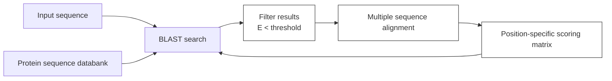
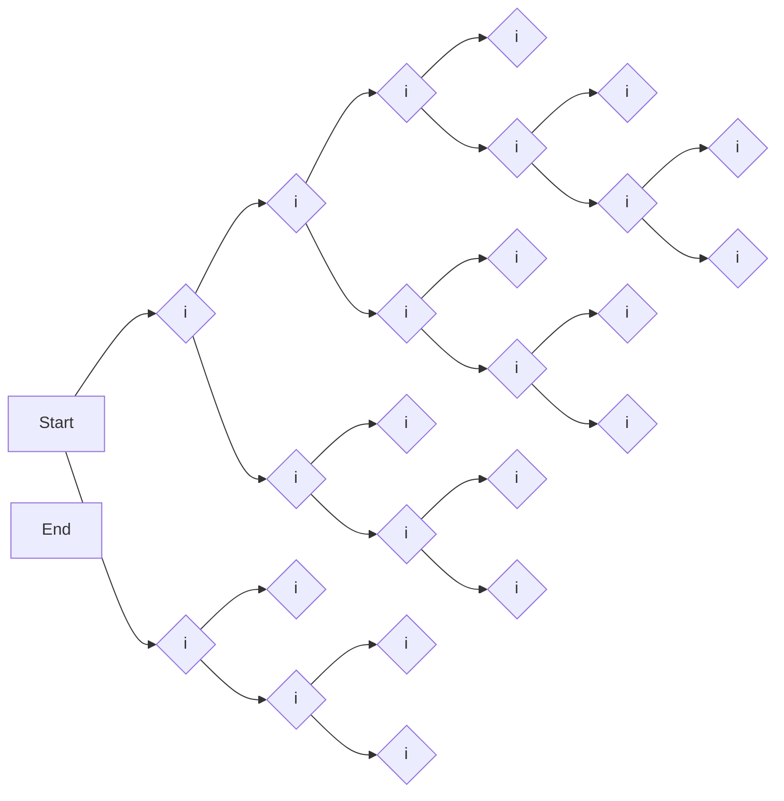
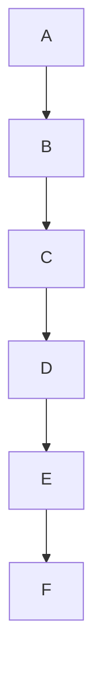
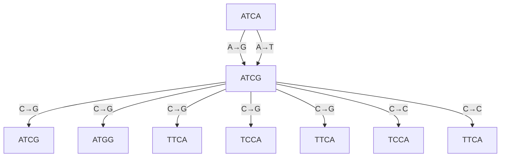

Thioredoxins are members of a superfamily including many more distantly related homologues. These include glutaredoxin (hydrogen donor for ribonucleotide reduction in DNA synthesis), protein disulphide isomerase (which catalyses exchange of mismatched disulphide bridges in protein folding), phosducin (a regulator of Gprotein signalling pathways), and glutathione-S-transferases (chemical defence proteins). Implicit in the multiple sequence alignment table of the thioredoxins themselves are patterns that should be applicable to identifying these more distant relatives.


E. coli Thioredoxin


E. coli Thioredoxin

Figure 5.6 The structure of E. coli thioredoxin [2TRX] (see also Plate VI). Residue numbers correspond to those in the multiple sequence alignment table. The N- and C-termini are also marked. Spheres indicate the positions of the Cα atoms of every tenth residue. The reactive disulphide bridge between $^ { 3 2 } \mathrm { C y s }$ and $^ { 3 5 } \mathrm { C y s }$ appears between the numbers 30 and 60.


**See Weblem 5.5**

## Applications of multiple sequence alignments and database searching

Searching in databases for homologues of known proteins is a central theme of bioinformatics. Indeed, it brooked no delay; we introduced it in Chapter 1 with the application of PSI-BLAST. We reconsider database searching here, with the goal of trying to understand how we can best use available information to build effective procedures. The goals are high sensitivity—picking up even very distant relationships—and high selectivity—minimizing the number of sequences reported that are not true homologues. Here we discuss how to apply multiple sequence alignments to this problem. In Chapter 6 we shall discuss how to apply structural information in addition.

Great progress has been made during the last decade in devising methods for applying multiple sequence alignments of known proteins to identify related sequences in database searches. The results are central to contemporary applications of bioinformatics, including the interpretation of genomes. Three important methods are profiles, PSI-BLAST, and hidden Markov models (HMMs).

## Profiles

Profiles express the patterns inherent in a multiple sequence alignment of a set of homologous sequences. They have several applications.

• They permit greater accuracy in alignments of distantly related sequences.
• Sets of residues that are highly conserved are likely to be part of the active site, and give clues to function.
The conservation patterns facilitate identification of other homologous sequences.
• Patterns in the sequences are useful in classifying subfamilies within a set of homologues.
Sets of residues that show little conservation, and are subject to insertion and deletion, are likely to be in surface loops. This information has been applied to vaccine design, because such regions are likely to elicit antibodies that will cross-react well with the native structure.

Most structure-prediction methods are more reliable if based on a multiple sequence alignment than on a single sequence. Homology modelling, for instance, depends crucially on correct sequence alignments, and can make effective use of the conformational variation seen in multiple parent structures.

To use profile patterns to identify homologues, the basic idea is to match the query sequences from the database against the sequences in the alignment table, giving higher weight to positions that are conserved than to those that are variable. If a region is absolutely conserved, such as the WGCPC motif in thioredoxins, the procedure should all but insist on finding it. But the risk of being too compulsive is to miss interesting distant relatives; some leeway should be allowed.

What is needed is a quantitative measure of conservation. Take an inventory of the distribution of amino acids for each position in the table of aligned sequences. For instance, for positions 25–30 of the thioredoxin alignment see Table 5.2.

Table 5.2 Position-dependent inventory of amino acids in residues 25–30 of 16 aligned thioredoxin sequences

<table><tr><td rowspan="2">Residue number</td><td colspan="20">Number of occurrences</td></tr><tr><td>A</td><td>C</td><td>D</td><td>E</td><td>F</td><td>G</td><td>H</td><td>I</td><td>K</td><td>L</td><td>M</td><td>N</td><td>P</td><td>Q</td><td>R</td><td>S</td><td>T</td><td>V</td><td>W</td><td>Y</td></tr><tr><td>25</td><td>1</td><td></td><td></td><td></td><td></td><td></td><td></td><td></td><td></td><td>2</td><td></td><td></td><td></td><td></td><td></td><td></td><td></td><td>13</td><td></td><td></td></tr><tr><td>26</td><td></td><td></td><td>16</td><td></td><td></td><td></td><td></td><td></td><td></td><td></td><td></td><td></td><td></td><td></td><td></td><td></td><td></td><td></td><td></td><td></td></tr><tr><td>27</td><td></td><td></td><td></td><td></td><td>16</td><td></td><td></td><td></td><td></td><td></td><td></td><td></td><td></td><td></td><td></td><td></td><td></td><td></td><td></td><td></td></tr><tr><td>28</td><td></td><td></td><td></td><td></td><td></td><td></td><td></td><td></td><td></td><td></td><td></td><td></td><td></td><td></td><td></td><td>7</td><td>1</td><td></td><td>5</td><td>3</td></tr><tr><td>29</td><td>16</td><td></td><td></td><td></td><td></td><td></td><td></td><td></td><td></td><td></td><td></td><td></td><td></td><td></td><td></td><td></td><td></td><td></td><td></td><td></td></tr><tr><td>30</td><td></td><td></td><td>1</td><td>4</td><td></td><td></td><td></td><td></td><td></td><td></td><td></td><td></td><td>2</td><td></td><td></td><td>1</td><td>7</td><td>1</td><td></td><td></td></tr></table>

Given a query sequence representing a potential thioredoxin homologue, we want to evaluate its similarity to the query sequence in such a way that agreement with the known sequences at the absolutely conserved positions—for instance 26, 27, and 29—contributes a very high score, and disagreement at these positions contributes a very low score. For moderately conserved positions, such as 28, we want a modest positive contribution to the score if the query sequence has an S or a W at this position, and a smaller contribution if it has T or Y. The general idea is to score each residue from the query sequence based on the amino acid distribution at that position in the multiple sequence alignment table.

It is tempting to use the inventories as scores directly. For example, if the residues in a query sequence that correspond to positions 25–30 in thioredoxin contain the sequence VDFSAE, this fragment would score $13+16+16+6+16+4=71$ . This is almost the greatest value possible. The alternative query sequence ACGVAP would score $1+0+0+5+16+2=24$ , a much lower value. Of course, for each query sequence we have to test all possible alignments with the multiple alignment table and take the largest total score. The highest scoring sequences best fit the patterns implicit in the table.

This simple approach would work if our table contained a large and unbiased sample of thioredoxin sequences. But only in that case would the simple inventory give a correct picture of the potential distributions of residues at each position. If our sample were small the pattern derived would be unlikely to reflect the complete repertoire. Or, if the sample contained a large subset of similar sequences, these would be over-represented in the inventories. For instance, we can see in Plate VI that vertebrate thioredoxins form a very closely related set. If we included 20 more vertebrate thioredoxins in the alignment the profile would recognize only vertebrate thioredoxins effectively.

Substitution matrices suggest how to make the inventory ‘fuzzy’ and thereby more general.

The observed amino acid distribution at any residue position is a 20-membered array $( a _ { 1 } ,   a _ { 2 } ,   a _ { 3 }$ $\cdots a _ { 2 0 } )$ where $a _ { i }$ is the number of amino acids of type i observed at that position. (For position 25 of the thioredoxins, $a _ { 1 } = 1$ because one alanine is observed, and $a _ { 1 8 } = 1 3$ , representing the valines.) Then in the simple ‘inventory scoring’ scheme, the score of an alanine at position 25 is just 1; the score of a valine is 13; in general, the score of an amino acid of type i is $a _ { i } .$ In this scheme the rows of the inventory itself provide the arrays a needed for scoring each position.

A better scoring scheme would evaluate any amino acid according to its chance of being substituted for one of the observed amino acids. If $D ( i , j )$ is an amino acid substitution matrix— BLOSUM62, for example—then amino acid i could score $a _ { 1 } D ( i ,   1 ) + a _ { 2 } D ( i ,   2 )   \cdots   a _ { 2 0 } D ( i ,   2 0 )$ . This scheme distributes the score among observed amino acids, weighted according to the substitution probability. An amino acid in the query sequence could score high either if it appears frequently in the inventory at this position, or if it has a high probability of arising by mutation from residue types that are common at this position. This approach is more effective in detection of distant relatives from a limited set of known sequences. In this case, the scoring vector for amino acids at any position is a row in the product of the substitution matrix and the rows of the inventory array. An even better approach is to use as the amino acid distribution a combination of the observed inventory and a general background level of amino acid composition.

The result is a set of probability scores for each amino acid (or gap) at each position of the alignment, called a position-specific scoring matrix. An alternative method of deriving a positionspecific scoring matrix, based on three-dimensional structures, is described in Chapter 6.

Given a query sequence, and the position-specific scoring matrices derived from a profile, the calculations required to find the optimal score over all alignments of the query sequence with the profile are extensions of the dynamic-programming methods for aligning two sequences.

A weakness of simple profiles is that the multiple sequence alignment must be provided in advance, and is taken as fixed. PSI-BLAST and hidden Markov models gain power by integrating the alignment step with the collection of statistics.

## PSI-BLAST

PSI-BLAST is a program that searches a data bank for sequences similar to a query sequence. It is a development of the earlier program BLAST. The BLAST program and its variants check each entry in the data bank independently against a query sequence. PSI-BLAST begins with such a one-at-atime search. It then derives pattern information from a multiple sequence alignment of the initial hits, and reprobes the database using the pattern. Then it repeats the process, fine-tuning the pattern in successive cycles (see Fig. 5.7).


<details>
<summary>flowchart</summary>


</details>

Figure 5.7 Schematic flowchart of a PSI-BLAST calculation to detect protein sequences in a database similar to a

probe sequence. The user submits an input sequence and chooses a protein sequence data bank to probe. First, using the input sequence and a standard substitution matrix such as BLOSUM62, a BLAST calculation identifies similar sequences in the database and assigns a statistical measure of significance, E, to each ‘hit’. For each sequence retrieved from the database, E is the number of sequences of equal or higher similarity to the probe sequence that would be expected to be found in the database, just by chance. The program will select those sequences for which E is no greater than a specified threshold, often chosen as 0.005, and perform a multiple sequence alignment of them. By counting the relative frequencies of different amino acids in each column of the multiple sequence alignment the program will derive a position-specific scoring matrix. The box at the lower left shows a part of a position-specific scoring matrix. The columns are labelled by the 20 natural amino acids. The rows are labelled by the sequence to be scored by the matrix. In this case the N-terminal sequence of the sequence to be scored is $\mathrm { R D A . . . }$ . The entries in the column are the log-odd scores of finding any amino acid at any position in the multiple alignment. For instance, the entry under A in row 3 is −1; therefore, the probability of finding an A at the third position is proportional to $1 0 ^ { - 1 }$ . To find the score of the sequence, add up the value in the R column of the first row, the D column of the second row, the A column of the third row, etc., to give: $1 0 ^ { - 3 } \pm 1 0 ^ { - 7 } \pm 1 0 ^ { - 1 }$ . In this example the probabilities are expressed unscaled and as logs to the base 10. Note that the sequence being scored may contain gaps. This matrix can be used as an alternative to the input sequence and substitution matrix in a BLAST search. Each subsequent BLAST search, based on the matrix derived in the previous step, will return a different set of ‘hits’. With a sensible choice of input parameters the procedure will usually converge, to produce a more reliable set of similar sequences than would be returned by the simple BLAST search of the input sequence performed in the first step.

The problem that BLAST was originally designed to solve is that full-blown dynamicprogramming methods are rather slow for complete searches in a large data bank. Often the data bank contains close matches to the query sequence. Less-sensitive but faster programs, such as BLAST, are quite capable of identifying the close matches. If that is what you want, fine. For example, if you want to search for homologues of a mouse protein in the human genome, the similarity is likely to be high and an approximate method likely to find it. But if you want to search for homologues of a human protein in C. elegans or yeast, the relationship may be more tenuous. More sophisticated, slower methods may be required. (It may come as a surprise, but computer time requirements are still a consideration. For although computing is becoming less expensive, the sizes of the data banks and the number of searches desired, on a worldwide basis, are growing. The net effect is that the pressure on computing resources is increasing.)

The method used by BLAST goes back, in a sense, to the dotplot approach, checking for wellmatching local regions. For each entry in the database it checks for short contiguous regions that match a short contiguous region in the query sequence, using a substitution scoring matrix but allowing no gaps. An approach in which candidate regions of fixed length are identified initially can be made very fast by the use of lookup tables.

Once BLAST identifies a well-fitting region, it tries to extend it. In some versions gaps are allowed. The output of BLAST is the set of local segment matches. In an example from Chapter 1:


<details>
<summary>text_image</summary>

My.care.is.loss.of.care,.by.old.care.done,
Your.care.is.gain.of.care,.by.new.care.won
</details>

even a very simple algorithm could pick up all matching regions of five contiguous residues and then combine and extend them.

## A flowchart for PSI-BLAST

**1.** Probe each sequence in the chosen database independently for local regions of similarity to the query sequence, using a BLAST-type search but allowing gaps.
**2.** Collect significant hits. Construct a multiple sequence alignment table between the query sequence and the

significant local matches.

**3.** Form a profile from the multiple sequence alignment.
**4.** Reprobe the database with the profile, still looking only for local matches.
**5.** Decide which hits are statistically significant and retain these only.
**6.** Go back to step 2 until a cycle produces little or no change. This accounts for the ‘Iterated’ in the title of the PSI-BLAST program.

PSI-BLAST, using iterated pattern searching (see the box and Fig. 5.7), is much more powerful than simple pairwise BLAST in picking up distant relationships. PSI-BLAST correctly identifies three times as many homologues as BLAST in the region below 30% sequence identity. It is therefore a very useful method for analysing whole genomes. PSI-BLAST was able to match protein domains of known structure to 39% of the genes in M. genitalium, 24% of the genes in yeast, and 21% of the genes in C. elegans.

The only methods based entirely on sequence analysis that do better than PSI-BLAST are HMMs. These are described in the next section. To achieve significantly better performance it is necessary to make explicit use of structural information. This is discussed in Chapter 6.


## See Weblems 5.6 and 5.7

## Hidden Markov models

A hidden Markov model (HMM) is a computational structure for describing the subtle patterns that define families of homologous sequences. HMMs are powerful tools for detecting distant relatives and for prediction of protein folding patterns. They are the only method based entirely on sequences that is, without explicitly using structural information—competitive with PSI-BLAST for identifying distant homologues. They also perform well at identifying the folding pattern of a protein from the amino acid sequence, as assessed in CASP programmes.

Within an HMM is a multiple sequence alignment. However, HMMs are usually presented as procedures for generating sequences. A conventional multiple sequence alignment table could also be used to generate sequences by selecting amino acids at successive positions, each amino acid being chosen from a position-specific probability distribution derived from the profile. But HMMs are more general than profiles:

1. they include the possibility of introducing gaps into the generated sequence, with positiondependent gap penalties;
2. application of profiles requires that the multiple sequence alignment be specified up front; the pattern statistics are then derived from the alignment. HMMs carry out the alignment and the assignment of probabilities together.

The internal structure of an HMM shows the mechanism for generating sequences (Fig. 5.8). Begin at Start, and follow some chain of arrows until arriving at End. Each arrow takes you to a state of the system. At each state (1) you take some action—emit a residue, perhaps—and (2) choose an arrow to take you to the next state. The action and the choice of successor state are governed by sets of probabilities. Associated with each state that emits a residue are one probability distribution for the 20 amino acids and a second probability distribution for the choice of successor state. Both of these probability distributions are calibrated to encode information about a particular sequence family. In this way the same general computational framework can be specialized to many different sequence families.


<details>
<summary>flowchart</summary>


</details>

Figure 5.8 The structure of an HMM. Corresponding to each residue position in a multiple sequence alignment, the HMM contains a match state (m) and a delete state (d). Insert states (i) appear between residue positions, and at the beginning and end.

• Match states emit a residue. Here the term match means only that there is some amino acid both in the model underlying the HMM and in the sequence emitted, not that these are necessarily the same amino acid. The probability of emitting each of the 20 amino acids in each of the match states is a property of the model. As with profiles, the probabilities are position-dependent.
• Delete states skip a column in the multiple sequence alignment. Arriving at a delete state from a match or insert state corresponds to gap opening, and the probabilities of these transitions reflect a position-specific gap-opening penalty. Arriving at a delete state from a previous delete state corresponds to gap extension.
• Insert states appear between two successive positions in the alignment. If the system enters an insert state, a new residue that does not correspond to a position in the alignment table appears in the emitted sequence. An insert state can be followed by itself, to insert more than one residue. The succession of residues emitted from match and insert states generates the output sequence.

After taking the action appropriate to the type of state (m, d, or i), another probability distribution governs the choice of the next state. In every possible succession of states every column of the embedded alignment must be visited and either matched or deleted: there is no way to traverse the network without passing through either an m state or a d state at each position.

The dynamics of the system is such that only the current state influences the choice of its successor: the system has no ‘memory’ of its history. This is characteristic of processes studied by the 19th century Russian mathematician A.A. Markov. Distinguish the succession of states from the succession of amino acids emitted to form the output sequence. Several paths through the system can generate the same sequence. Only the succession of characters emitted is visible; the state sequence that generated the characters remains internal to the system; that is, hidden. By the probability distributions associated with the individual states the system captures—or models—the patterns inherent in a family of sequences. Hence the name, hidden Markov model.

Software for applying HMMs to biological sequence analysis can achieve the following.

1. Training: given a set of unaligned homologous sequences it can align them and adjust the transition and residue output probabilities to define an HMM capturing the patterns inherent in the sequences submitted.

## Web resource: Hidden Markov models

Two research groups specializing in biological applications of HMMs run web servers and distribute their programs:

R. Hughey, K. Karplus, and D. Haussler (University of California at Santa Cruz, CA, USA)

[http://cse.ucsc.edu/research/compbio/sam.html](http://cse.ucsc.edu/research/compbio/sam.html)

[http://cse.ucsc.edu/research/compbio/HMM-apps/HMM-applications.html](http://cse.ucsc.edu/research/compbio/HMM-apps/HMM-applications.html)

S. Eddy (Washington University, St Louis, MO, USA; now at HHMI Janelia Farm Research Campus)

[http://hmmer.janelia.org/](http://hmmer.janelia.org/)

Results of analysis of known sequences and structures are also available on the web:

Pfam is a database of multiple sequence alignments and HMMs for many protein domains, developed by A. Bateman, E. Birney, R. Durbin, S.R. Eddy, K.L. Howe, and E.L. Sonnhammer [http://www.sanger.ac.uk/Software/Pfam](http://www.sanger.ac.uk/Software/Pfam)

2. Detection of distant homologues: given an HMM and a test sequence, calculate the probability that the HMM would generate the test sequence. If an HMM trained on a known family of sequences would generate the test sequence with relatively high probability, the test sequence is likely to belong to the family.
3. Alignment of additional sequences: the probability of any sequence of states can be computed from the individual state-to-state transition probabilities. Finding the most likely succession of states that the HMM would use to generate one or more test sequences reveals their optimal alignment to the family.

## Phylogeny

We have now seen several examples of evolution, in proteins and in genomes. These represent the extension to the molecular level of concerns that have occupied biologists since Darwin and even before. The basic principle is that the origin of similarity is common ancestry. Although there are exceptions, arising from convergent evolution or horizontal gene transfer, the importance of this principle both for rationalizing contemporary observations and giving a window into the history of life cannot be underestimated.

The field of phylogeny has the goals of working out the relationships among species, populations, individuals, or genes. (The general term is ‘taxa.’) The observable taxa—for instance the extant species for which we wish to work out the pattern of ancestry—are called the ‘operational taxonomic units’, abbreviated to OTUs. Relationship is taken in the literal sense of kinship or genealogy; that is, assignment of a scheme of descendants of a common ancestor (see Box 5.5). Evolutionary relationships give us a glimpse at the historical development of life (see Box 5.6). Although molecules themselves cannot be dated, the evolutionary events as observed on the molecular level can be calibrated with the fossil record.

## Box 5.5 Concepts related to biological classification and phylogeny

Homology means, specifically, descent from a common ancestor.

Similarity is the measurement of resemblance or difference, independent of the source of the resemblance. Similarity is observable in data collectable now, and involves no historical hypotheses. In contrast, assertions of homology require inferences about historical events which are usually unobservable.

Clustering is bringing together similar items, distinguishing classes of objects that are more similar to one another than they are to other objects outside the classes. Most people would agree about degrees of similarity, but clustering is more subjective. When classifying objects, some people prefer larger classes, tolerating wider variation; others prefer smaller, tighter, classes. They are called groupers or splitters.

Hierarchical clustering is the formation of clusters of clusters of … .

Phylogeny is the description of biological relationships, usually expressed as a tree. A statement of phylogeny among objects assumes homology and depends on classification. Phylogeny states a topology of the relationships based on classification according to similarity of one or more sets of characters, or on a model of evolutionary processes. In many cases, phylogenetic relationships based on different characters are consistent, and support one another. If different characters induce inconsistent phylogenetic relationships, they are all dubious. Note that the same similarity data may be consistent with different possible topologies or trees.

See also the section on Biological classification and nomenclature in Chapter 1.

## Box 5.6 Time scale of Earth history

Geological eras (e.g. Cenozoic), periods (e.g. Jurassic), and cataclysmic events (e.g. asteroid impact: mass extinction) are shown in black. First appearance of, or prevalence of, different life forms are in green (mya, millions of years ago).


The results of phylogenetic analyses are usually presented in the form of an evolutionary tree. The taxonomy of the ratites—large flightless birds—is a typical example (Fig. 5.9a). The ancestor of the ratites is believed to be a bird that could fly, probably related to the extant tinamous.


Figure 5.9 (a) Phylogenetic tree of ratites (large flightless birds) based on mitochondrial DNA sequences. The common ancestor is at the root of this tree. A surprising implication of these DNA sequences is that the moa and kiwi are not the closest relatives, and therefore that New Zealand must have been colonized twice by ratites or their ancestors. (b) Unrooted tree of relationships among finches from the Galapagos and Cocos Islands. Darwin studied the Galapagos finches in 1835, noting the differences in the shapes of their beaks and the correlation of beak shape with diet. Finches that eat fruits have beaks like those of parrots, and finches that eat insects have narrow, prying beaks. These observations were seminal to the development of Darwin’s ideas. As early as 1839 he wrote, in The Voyage of the Beagle, ‘Seeing this gradation and diversity of structure in one small, intimately related group of birds, one might really fancy that from an original paucity of birds in this archipelago, one species had been taken and modified for different ends’.

Such a tree, showing all descendants of a single original ancestral species, is said to be rooted. (The root of the tree typically appears at the top or the side; botanists will have to get used to this.) Alternatively, we may be able to specify relationships but not order them according to a history. The relationships among the finches of the Galapagos Islands, studied by Darwin, plus a related species from the nearby Cocos Island, are shown in an unrooted tree (Fig. 5.9b). Addition of data from species on the South American mainland ancestral to the island finches might allow us to root the tree.

Statement of a tree of relationships may reveal only the connectivity or topology of the tree, in which case the lengths of the branches contain no information. A more ambitious goal is to show the distances between taxa quantitatively, for instance to label the branches with the time since divergence from a common ancestor.

## Determination of taxonomic relationships from molecular properties

Given a set of data that characterize different groups of organisms—for example, DNA or protein sequences, or protein structures, or shapes of teeth from different species of animals—how can we derive information about the relationships among the organisms in which they were observed? It is rare for species relationships and ancestry to be directly observable. Evolutionary trees determined from genetic data are often based on inferences from the patterns of similarity. We generally assume that the more similar the characters the more closely related the species, although this is a dangerous assumption. Nevertheless, from the relationships among the characters we wish to infer patterns of ancestry: the topology of the phylogenetic relationships (informally, the ‘family tree’).

To what extent do the topologies of the relationships depend on the choice of character? In particular, are there systematic discrepancies between the implications of molecular and palaeontological analysis?

Molecular approaches to phylogeny developed against a background of traditional taxonomy, based on a variety of morphological characters, embryology, and, for fossils, information about the geological context (stratigraphy). The classical methods have some advantages. Traditional taxonomists have much less restricted access to extinct organisms, via the fossil record. They can date appearances and extinctions of species by geological methods.

A crucial event in the acceptance of molecular methods occurred in 1967 when V.M. Sarich and A.C. Wilson dated the time of divergence of humans from chimpanzees at 5 mya, based on immunological data. At that time palaeontologists had dated this split at 15 mya, and were reluctant to accept the molecular approach. Reinterpretation of the fossil record led to acceptance of a more recent split, and broke the barrier to general acceptance of molecular methods. It is now generally accepted that human and chimpanzee lineages diverged between ≈6 and 8 mya.

Indeed, many molecular properties have been used for phylogenetic studies, some surprisingly long ago. Serological cross-reactivity was used from the beginning of the last century until superseded by direct use of sequences. In one of the most premature scientific studies I know of, E.T. Reichert and A.P. Brown published, almost a century ago, a phylogenetic analysis of fishes based on haemoglobin crystals. Their work was based on Stenö’s law (1669), which states that although different crystals of the same substance have different dimensions—some are big, some small—they have the same interfacial angles, reflecting the similarity in microscopic arrangement and packing of the atomic or molecular units within the crystals. Reichert and Brown demonstrated that the interfacial angles of crystals of haemoglobins isolated from different species showed patterns of similarity and divergence parallel to the species’ taxonomic relationships.

Reichert and Brown’s results are replete with significant implications. They show that proteins have definite, fixed shapes, an idea by no means recognized at the time. They imply that as species progressively diverge the structures of their haemoglobins also progressively diverge. In 1909 no one had a clue about nucleic acid or protein sequences. In principle, therefore, the recognition of evolution of protein structures preceded, by several decades, the idea of evolution of sequences.

Today, DNA sequences provide the best measures of similarities among species for phylogenetic analysis. The data are digital. It is even possible to distinguish selective from nonselective genetic change, using the third position in codons, or untranslated regions such as pseudogenes, or the ratio of synonymous to nonsynonymous codon substitutions. Many genes are available for comparison. This is fortunate because, given a set of species to be studied, it is necessary to find genes that vary at an appropriate rate. Genes that remain almost constant among the species of interest provide no discrimination of degrees of similarity. Genes that vary too much cannot be aligned. There is an analogous situation in radioactive dating requiring choice of an isotope with a half-life of the same general magnitude as the time interval to be determined.

Fortunately genes vary widely in their rates of change. The mammalian mitochondrial genome, a circular double-stranded DNA molecule approximately 16 000 bp long, provides a useful fastchanging set of sequences for study of evolution among closely related species. In contrast, rRNA sequences were used by C. Woese to identify the three major kingdoms: Archaea, Bacteria, and Eukarya (see Fig. 1.2).

Conversely, different rates of change of sequences of different genes can lead to different and even contradictory results in phylogenetic studies. This is especially true if what we want is not just the topology of the relationships but the branch lengths. In addition, horizontal gene transfer and convergent evolution are competing phenomena—that is, competing with descent—that interfere with the deduction of phylogenetic relationships.

One limitation of sequence methods is the paucity of access to extinct species. Some subfossil remains of species which became extinct as recently as the last century or two have legible DNA, including specimens of the quagga (a relative of the zebra) and the thylacine (Tasmanian ‘wolf’, a marsupial), and some New Zealand birds (including moas). We have seen an example of a sequence from the mammoth. Extensive DNA sequences from Neanderthals have been recovered from individuals who died approximately 30 000 years ago.

It has been possible to sequence DNA amplified from ancient samples, given adequate preservation in continuously frozen environments. Most of the samples that provide useful sequences come from locations near the poles. A few are from mountaintop glaciers even in the tropics.

Holders of the current age record for extraction and analysis of ancient DNA are E. Willerslev and coworkers <sup>2</sup> who have sequenced DNA fragments from ice cores extracted from Greenland. The longest of these cores extended to depths of 2 and 3 km, reaching back 500 000 years or more.

Geologists have reconstructed ancient environments and ecologies from fossil material. Actual sequence data have the potential to offer a much sharper focus. One of the ice core samples, from the Dye 3 site in south-central Greenland $( 6 5 ^ { \circ } ~ 1 1 ^ { \prime } ~ \mathrm { N } , ~ 4 5 ^ { \circ } ~ 5 0 ^ { \prime } ~ \mathrm { W } )$ , contained sequences from several species of trees, including alder, spruce, pine, and yew. DNA from animals included butterflies and moths (definitely) and beetles, flies, spiders, and brushfoots (probably). These flora and fauna do not characterize the current ecology of southern Greenland. They suggest that at the time the samples were laid down the temperature did not fall below −17°C in the winter and rose higher than +10°C in the summer. This corresponds to current conditions in Helsinki, Finland, or Murmansk, Russia, warmer than current conditions in southern Greenland (see [http://worldclimate.com](http://worldclimate.com)).

## Phylogenetic trees

We describe phylogenetic relationships as trees. In computer science, a tree is a particular kind of graph. A graph is a structure containing nodes (abstract points) connected by edges (represented as lines between the points) (see box entitled Glossary of terms related to graphs). In a directed graph each edge has a direction, like a one-way street. A path from one node to another is a consecutive set of edges beginning at one point and ending at the other, like our trip from Malmö to Tromsø. A connected graph is a graph containing at least one path between any two nodes. From these we can define a tree: a connected graph in which there is exactly one path between every two points. A particular node may be selected as a root, but this is not necessary: abstract trees may be rooted or unrooted (see Fig. 5.9). Unrooted trees show the topology of relationship but not the pattern of descent. A rooted tree in which every node has two descendants is called a binary tree (see Box 5.7). A completely connected graph has an edge between every pair of nodes.

## Glossary of terms related to graphs

Graph An abstract structure containing nodes (points) and edges (lines connecting points).

Path A consecutive set of edges.

Connected graph A graph in which there is at least one path between every two nodes.

Tree A connected graph with exactly one path between every two points.

Edge length A number assigned to each edge signifying in some sense the distance between the nodes connected by the edge.

Path length The sum of the lengths of the edges that comprise the path.

The input (A((BC)D)(EF)) produces the following output, as a PostScript file, which can be printed on most printers and displayed on most terminals.


<details>
<summary>flowchart</summary>


</details>

This representation of a tree is about as simple as possible. Many programs are available on the web to make fancier drawings, including those with curved lines, or three-dimensional representations for clarity in depiction of very complex trees.

```perl
#!/usr/bin/perl
#drawtree.pl -- draws binary trees (root at top)
#usage: echo '(A((BC)D)(EF))' | drawtree.pl > output.ps

print <<EOF;
%!PS-Adobe-
%%BoundingBox: atend
/n /newpath load def /m /moveto load def /l /lineto load def
/rm /rmoveto load def /rl /rlineto load def /s /stroke load def
1.0 setlinewidth 50 100 translate 2 2 scale
/Helvetica findfont 10 scalefont setfont
EOF

\$tree = <>; chop(\$tree); \$_ = reverse(\$tree); s/[]//g;

\$x = 0; \$y = 0;
while (\$nd = chop()) {
    print "\$x \$y m (\$nd) stringwidth pop -0.5 mul 0 rm (\$nd) show\n";
    \$xx{\$nd} = \$x; \$x+=20; \$yy{\$nd} = 10;
}
while (\$tree =~ s/\?(?([A-Z])([A-Z])?)?/\$1/) {
    print "n \$xx{\$1} \$yy{\$1} m\n";
    (\$yy{\$1} > \$yy{\$2}) || {\$yy{\$1} = \$yy{\$2}}; \$yy{\$1} += 20;
    print "\$xx{\$1} \$yy{\$1} l \$xx{\$2} \$yy{\$1} l \$xx{\$2} \$yy{\$2} l s\n";
    \$xx{\$1} = 0.5*(\$xx{\$1} + \$xx{\$2});
}
print "n \$xx{\$tree} \$yy{\$tree} m 0 20 rl s showpage\n";
\$rx = 2*\$x + 30; \$yt = 2*\$yy{\$tree} + 146;
print "%%BoundingBox: 40 95 \$rx \$yt\n";
```

Another special kind of graph is a directed graph in which each edge is a one-way street. Examples include the Gene Ontology subnetworks (See Chapter 8), the HMM diagram shown in Figure 5.8, and the neural networks illustrated in Chapter 6. Rooted phylogenetic trees are, implicitly, directed graphs, the ancestor–descendant relationship implying the direction of each edge.

It may be possible to assign numbers to the edges of a graph to signify, in some sense, a ‘distance’ between the nodes connected by the edges. The graph may then be drawn to scale, with the sizes of the edges proportional to the assigned lengths. The length of a path through the graph is the sum of the edge lengths.

In phylogenetic trees, edge lengths signify either some measure of the dissimilarity between two species or the length of time since their separation. The assumption that differences between properties of living species reflect their divergence times will be true only if the rates of divergence are the same in all branches of the tree. Many exceptions are known; for instance, among mammals, rodents show, for many proteins, relatively fast evolutionary rates.


## See Weblem 5.8.

Broadly, there are two approaches to deriving phylogenetic trees. One approach makes no reference to any historical model of the relationships. Proceed by measuring a set of distances between species, and generate the tree by a hierarchical clustering procedure. This is called the phenetic approach. The alternative, the cladistic approach, is to consider possible pathways of evolution, infer the features of the ancestor at each node, and choose an optimal tree according to some model of evolutionary change. Phenetics is based on similarity; cladistics is based on genealogy. (see Box 5.7.)

## Clustering methods

Phenetic, or clustering, approaches to determination of phylogenetic relationships are explicitly nonhistorical. Indeed, hierarchical clustering methods are perfectly capable of producing a tree even in the absence of evolutionary relationships. A department store has goods clustered into sections according to the type of product—for instance, clothing or furniture—and subclustered into more closely related subdepartments, such as men’s and women’s shoes. Men’s and women’s shoes have a common ancestor, but there is no implication that shoes and furniture do.

A simple clustering procedure works as follows: given a set of species, determine for all pairs a measure of the similarity or difference between them. This could depend on a physical body trait such as the difference between the average adult height of members of two species. Or one could use the number of different bases in alignments of mitochondrial DNA. To create a tree from the set of dissimilarities, first choose the two most closely related species and insert a node to represent their common ancestor. Then replace the two selected species by a set containing both, and replace the distances from the pair to the others by the average of the distances of the two selected species to the others. Now we have a set of pairwise dissimilarities, not between individual species, but between sets of species. (Regard each remaining individual

## Example 5.6 Generation of phylogenetic tree by progressive clustering

Consider four species characterized by homologous sequences ATCC, ATGC, TTCG, and TCGG. Taking the number of differences as the measure of dissimilarity between each pair of species, use a simple clustering procedure to derive a phylogenetic tree.

The distance matrix is:

|  | ATCC | ATGC | TTCG | TCGG |
| --- | --- | --- | --- | --- |
| ATCC | 0 | 1 | 2 | 4 |
| ATGC |  | 0 | 3 | 3 |
| TTCG |  |  | 0 | 2 |
| TCGG |  |  |  | 0 |

Because the matrix is symmetrical, we need fill in only the upper half. The smallest distance is 1 (in green), between ATCC and ATGC. Therefore, our first cluster is {ATCC, ATGC}. The tree will contain the fragment:


The reduced distance matrix is:

|  | {ATCC, ATGC} | TTCG | TCGG |
| --- | --- | --- | --- |
| {ATCC, ATGC} | 0 | $\frac{1}{2}(2+3)=2.5$ | $\frac{1}{2}(4+3)=3.5$ |
| TTCG |  | 0 | 2 |
| TCGG |  |  | 0 |

The next cluster is {TTCG, TCGG}, distance 2. Finally, linking the clusters {ATCC, ATGC} and {TTCG, TCGG} gives the tree:


<details>
<summary>dendrogram</summary>

| Category | Value |
| --- | --- |
| ATCC | 0.5 |
| ATGC | 0.5 |
| TTCG | 1 |
| TCGG | 1 |
</details>

Branch lengths have been assigned according to the rule:

$$
\text { branch   length   of   edge   between   nodes } X \text { and } Y = \frac {1}{2} \text { distance   between } X \text { and } Y
$$

Whether the branch lengths are truly proportional to the divergence times of the taxa represented by the nodes must be determined from external evidence.

species as a set containing only one element.) Then repeat the process, as in Example 5.6.

This process of tree building is called the UPGMA method, for unweighted pair group method with arithmetic mean. A modification of the UPGMA method by N. Saitou and M. Nei, called neighbour-joining, is designed to correct for unequal rates of evolution in different branches of the tree.

## Cladistic methods

Cladistic methods deal explicitly with the patterns of ancestry implied by the possible trees relating a set of taxa. Their aim is to select the correct tree by utilizing an explicit model of the evolutionary process. The most popular cladistic methods in molecular phylogeny are the maximum parsimony and maximum likelihood approaches. They are specialized to sequence data, starting from a multiple sequence alignment. Neither maximum parsimony nor maximum likelihood could be applied to anatomic characters such as average adult height.

The maximum parsimony method of W. Fitch defines an optimal tree as the one that postulates the fewest mutations. For instance, given species characterized by homologous sequences ATCG, ATGG, TCCA, and TTCA, the tree:


<details>
<summary>flowchart</summary>


</details>

postulates four mutations. An alternative tree:


<details>
<summary>flowchart</summary>

This diagram illustrates the genetic relationships and mutation types between ATCG, ATCA, TTCG, and their respective transgenic lines (A→G, A→T, T→C, C→G).
</details>

postulates seven mutations. Note that the second tree implies that the G→A mutation in the fourth position occurred twice independently. The former tree is optimal according to the maximum parsimony method, because no other tree involves fewer mutations. In many cases, several trees may postulate the same number of mutations, fewer than any other tree. For such cases the maximum parsimony approach does not give a unique answer.

The maximum likelihood method assigns quantitative probabilities to mutational events, rather than merely counting them. Like maximum parsimony, maximum likelihood reconstructs ancestors at all nodes of each tree considered, but it also assigns branch lengths based on the probabilities of the mutational events postulated. For each possible tree topology the assumed substitution rates are varied to find the parameters that give the highest likelihood of producing the observed sequences. The optimal tree is the one with the maximum likelihood of generating the observed data.

Both maximum parsimony and maximum likelihood methods are superior to clustering techniques. This has been demonstrated with cases where independent evidence—for instance, from classical palaeontology—provides a correct answer, and also with simulated data: computed generation of evolving sequences.

## Reconstruction of ancestral sequences

Maximum likelihood methods of phylogenetic tree construction determine, as part of their procedures, the sequences expected in the ancestors of extant species. L. Pauling and E. Zuckerkandl suggested in a 1963 paper that if we could determine the sequences of proteins from extinct organisms then the proteins could be recreated by synthesis.<sup>3</sup> In some cases, such a synthesized sequence shows the expected biological activity. Although this does not prove that it is the correct ancestral sequence, the result is of course gratifying.

Steroid receptors are vertebrate proteins that detect hormones, including androgen, oestrogen, progesterone, glucocorticoid, and mineralocorticoid receptors (see Table 5.3). Upon activation they translocate from the cytoplasm to the nucleus and control gene expression. They belong to a larger superfamily of receptors with affinity for a wider variety of ligands, including thyroid hormones, prostaglandins, and 1,25-dihydroxyvitamin D. It is likely that the entire superfamily diverged from a single ancestral protein.


Table 5.3 Properties of two closely related receptors in higher vertebrates

| Receptor | Ligand | Physiological role includes |
| --- | --- | --- |
| Mineralocorticoid receptor | 11-Deoxycorticosterone (teleost fish)Aldosterone (tetrapods) | Electrolyte homeostasis |
| Glucocorticoid receptor | Cortisol | Regulation of metabolism, inflammation and immunity |

J.W. Thornton and colleagues have studied the species distribution and the evolution of these receptors.<sup>4</sup> The most primitive species in which natural steroid receptors appear are lamprey and hagfish. The receptors in these species show high affinity for 11-deoxycorticosterone, cortisol, and aldosterone. It is likely that 11-deoxycorticosterone is the natural ligand of the ancestral homologue. A gene duplication before the emergence of tetrapods gave rise to receptors with differential specificity for cortisol and aldosterone (see Fig. 5.10).


<details>
<summary>text_image</summary>

Agnathans
Elasmobranchs
Teleosts
Tetrapods
6 subst
CA
4 subst
CA
* Aldosterone synthesis begins
C(A)
S106P
L111Q
C(A)
-420 mya
36 substitutions
1 aa deleted
-440 mya
proto-QR
C(A)
proto-MR
25 substitutions
-470 mya
Ancestral state
</details>

**Figure 5.10** Evolutionary pathway of steroid receptors, inferred from ancestral sequence reconstruction, and synthesis and assay of predicted sequences. The ancestor of the vertebrate steroid receptor probably had affinity for aldosterone (A) as well as other steroids (C), notably 11-deoxycorticosterone and cortisol. This affinity is indicated by C(A), with the (A) in parentheses because aldosterone was not a natural ligand at that time. After gene duplication to form protoglucocorticord (proto-GR) and proto-mineralocorticoid (proto-MR) receptors, the protein diverged to attain differential specificity. In tetrapods, subsequent to the origin of aldosterone synthesis, two families of receptor show selectivity for aldosterone (MR) or cortisol. aa, amino acid; mya, million years ago; subst, substitutions.

These specificity profiles must be interpreted in light of the fact that aldosterone is not present in