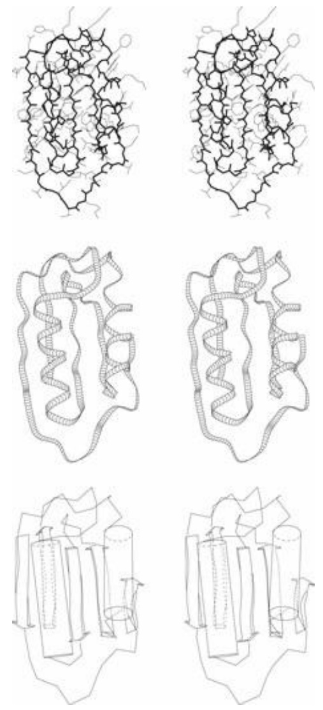
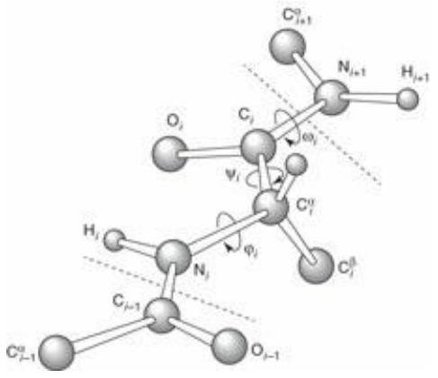
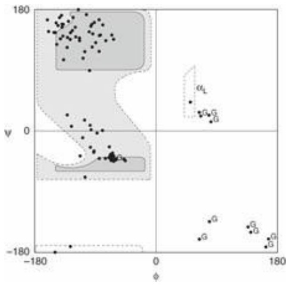

primitive vertebrates. The affinity preceded the ligand. (How could a lock evolve millions of years before the appearance of the key?) Aldosterone was first synthesized along the line leading to tetrapods, when a mutation in the cytochrome P450 11β-hydroxylase gene produced a protein that would hydroxylate 11-deoxycorticosterone. The tetrapod glucocorticoid receptor must have lost aldosterone affinity (see Fig. 5.10).

Thornton and colleagues computed the maximum likelihood evolutionary tree of cortisol-specific and aldosterone-specific receptors. They inferred the ancestral sequence, and ‘resurrected’ it, following Pauling and Zuckerkandl: synthesizing the protein, determining its specificity, and solving its crystal structure. The computed and synthesized ancestral protein is activated by 11- deoxycorticosterone, aldosterone, and, with lower affinity, cortisol.

Thornton and colleagues computed the evolutionary pathway from the computed ancestral protein. By synthesizing and assaying proteins with different substitutions they identified two mutations as primarily reponsible for the loss of aldosterone affinity in tetrapod glucocorticosteroid receptors: S106P and L111Q. The L111Q substitution, by itself, has almost no effect on the affinity for any of the three ligands: aldosterone, deoxycorticosterone, and cortisol. The S106P substitution, by itself, largely destroys affinity for all three. That L111Q is functional and S106P is not suggests the scenario that L111Q appeared first, followed by S106P. In this way, the evolutionary pathway passed through functional intermediates only. Other substitutions, with less dramatic effects, acted to ‘tune the affinities to their current value.

Molecular modelling allowed inference of the structural consequences in the computed-ancestral protein structure of these two mutations, separately and together. In the hypothetical glucocorticoid receptor of the common ancestor of all jawed vertebrates, positions 106 and 111 appear in a loop adjacent to a helix. The mutation S106P on its own is predicted to reconform the loop, and the adjacent helix partially unwinds. However, a concomitant of these changes is to bring position 111 closer to the ligand, to the point where the L111Q mutation can form a hydrogen bond to the C17 hydroxyl of cortisol, stabilizing its binding. This hydroxyl is not present in aldosterone (or 11- deoxycorticosterone) so the hydrogen bond can form only to cortisol. Without the repositioning of position 111 by the S106P mutation it is unlikely that the L111Q mutation, on its own, could form the hydrogen bond to enhance cortisol binding (see Plate VII).

Plate VII Effect of mutations S106P and L111Q in evolution of differential specificity to aldosterone and cortisol in vertebrate steroid receptors. Magenta: experimental structure corresponding to predicted sequence ancestral to all jawed vertebrates. Cyan: experimental structure corresponding to predicted sequence ancestral to all bony vertebrates. A region from the binding site is shown. The mutation S106P reconforms the loop between helices 6 and 7 (H6 and H7). The mutation L111Q creates a hydrogen bond to the C17 hydroxyl which is present in cortisol but not in aldosterone nor 11-deoxycorticosterone (See Chapter 5, Reconstruction of ancestral sequences).

Although some aspects of this investigation are hypothetical, there is reason to be fairly confident that they are correct. In revealing a detailed evolutionary pathway, one can see the mechanism whereby gene duplication followed by divergence produces differential ligand specificity.

## The problem of varying rates of evolution

Suppose that the four species—A, B, C, and D—have the phylogenetic tree:

This tree is consistent with the dissimilarity matrix:

|  | A | B | C | D |
| --- | --- | --- | --- | --- |
| A | 0 | 3 | 3 | 3 |
| B |  | 0 | 2 | 2 |
| C |  |  | 0 | 1 |
| D |  |  |  | 0 |

Suppose, however, that species D has changed very fast, although the phylogeny is unaltered. The dissimilarity matrix might then be observed to be:

|  | A | B | C | D |
| --- | --- | --- | --- | --- |
| A | 0 | 3 | 3 | 20 |
| B |  | 0 | 2 | 20 |
| C |  |  | 0 | 20 |
| D |  |  |  | 0 |

From this we would derive the incorrect phylogenetic tree:

All the methods discussed here are subject to errors of this kind if the rates of evolutionary change vary along different branches of the tree. To test for varying rates, compare the species under consideration with an outgroup, a species more distantly related to all the species in question than any pair of them is to each other. For instance, if we are studying species of primates, a nonprimate mammal such as the cow would be a suitable outgroup. If the rates of evolution among the primate species were constant, we should expect to observe approximately equal dissimilarity measures between all primate species and the cow. If this is not observed, the suggestion is that evolutionary rates have varied among the primates, and the character being used may well not provide the correct phylogenetic tree.

## Are trees the correct way to present phylogenetic relationships?

In the classic model of evolution by descent and divergence, the biological process assures us that the relationship between species is a hierarchy. A tree structure is its natural and proper representation. The question of whether we can accurately and confidently determine the correct tree is a separate issue. However, in some cases a tree structure does not adequately account for the data. This is observed particularly often in viral evolution, or in situations in which there has been a large amount of horizontal gene transfer.

H.-J. Bandelt and A.W.M. Dress developed a more general graphical clustering method, called split decomposition, that can better account for a set of distances than a tree structure (see Example 5.7).

## Example 5.7 Alternative representations of similarity data

Bandelt and Dress\* consider the following distance matrix:

|  | A | B | C | D | E | F | G |
| --- | --- | --- | --- | --- | --- | --- | --- |
| A | 0 | 4 | 5 | 7 | 13 | 8 | 6 |
| B | 4 | 0 | 1 | 3 | 9 | 12 | 10 |
| C | 5 | 1 | 0 | 2 | 8 | 13 | 11 |
| D | 7 | 3 | 2 | 0 | 6 | 11 | 13 |
| E | 13 | 9 | 8 | 6 | 0 | 5 | 7 |
| F | 8 | 12 | 13 | 11 | 5 | 0 | 2 |
| G | 6 | 10 | 11 | 13 | 7 | 2 | 0 |

Application of the UPGMA method gives the following tree representation:

dendrogram

| Node | Value |
| --- | --- |
| A | 2.66 |
| B | 1.25 |
| C | 0.5 |
| D | 1.25 |
| E | 3 |
| F | 1 |
| G | 1 |

Note that the sum of the path labels between B and C is $0.5 + 0.5 = 1,$ which is equal to the B–C distance in the matrix. However, the sum of the path labels between A and D is $2.66 + 2.66 + 1.25 = 6.57$ which is only approximately equal to 7. The tree does not account precisely for all the distance data.

Bandelt and Dress represent the distance matrix by a more complex network based on the split decomposition method:

text_image

A
4
6
G
2
F
4
6
E
1
B
C
1
2
D
1
6

This is not a phylogenetic tree such as we are used to. But the sum of the indices of the edges linking any two nodes, along the shortest path, does reproduce the distance data. In this graph the distance between A and D, along a shortest path—which might pass through B and $C--is 4+1+2=7$ equal to the distance in the original data matrix. Observe that the graph contains some intermediary nodes that do not correspond to original data points.

From which representation do the clusters appear more naturally? Do you think that if the UPGMA graph were drawn so that the edge lengths were proportional to the distances indicated as the labels that the clustering would be more clear? (Try it!)

## Computational considerations

Cladistic methods—maximum parsimony and maximum likelihood—are more accurate than simpler clustering methods such as UPGMA, but require large amounts of computer time if the number of species is appreciable. The total number of possible trees, which cladistic methods are committed to considering if they could, increases very rapidly with the number of species. As a result, in many cases of interest these methods can give only approximate answers, even with respect to their intrinsic assumptions.

Because calculated phylogenies are often approximations, it is important to try to test them. Methods include the following.

1. Comparison of phylogenies obtained from different characters describing the same set of taxa: are they consistent? If trees produced from different characters share a subtree, perhaps that portion of the phylogeny has been determined reliably and other portions have not.
2. Analysis of subsets of taxa should give the same answer—with respect to the subset—as appears within the full tree.
3. Formal statistical tests, involving rerunning the calculation on subsets of the original data, are known as jackknifing and bootstrapping.

**Jackknifing** is calculation with data sets sampled randomly from the original data. For phylogeny calculations from multiple sequence alignments, select different subsets of the positions in the alignment and rerun the calculation. Finding that each subset gives the same phylogenetic tree lends it credibility. If each subset gives a different tree, none of them is trustworthy.

**Bootstrapping** is similar to jackknifing except that the positions chosen at random may include multiple copies of the same position, to form data sets of the same size as the original, to preserve statistical properties of the sampling.

4. If there are very long edges, consider seriously the possibility of unequal variation in evolutionary rate that may have perturbed the calculation. Introduce outgroup taxa to check.

## Putting it all together

A fairly standard sequence of operations in bioinformatics involves:

1. selecting a sequence of interest, and using PSI-BLAST or some equivalent tool to extract a set of similar sequences;
2. performing a multiple alignment of the sequences retrieved;
3. from the multiple sequence alignment, deriving and studying the conservation patterns, and from the set of overall similarities and differences among the sequences computing and drawing a phylogenetic tree. (Some multiple sequence alignment packages, such as CLUSTAL-W, provide facilities to launch a phylogenetic tree calculation from the alignments they produce.)

Numerous tools are available to facilitate the individual steps of the process, and to smooth the transition from each to the next. We have already mentioned the feature of the PSI-BLAST that feeds retrieved sequences into a multiple sequence alignment program such as CLUSTAL-W. CLUSTAL-W computes a tree based on the similarities of the input sequences, which can serve as input to one of a number of tree-drawing programs. The most popular current program for many aspects of phylogeny analysis is Molecular Evolutionary Genetics Analysis (MEGA) by K. Tamura, D. Peterson, N. Peterson, G. Stecher, M. Nei, and S. Kumar ([http://www.megasoftware.net](http://www.megasoftware.net)). See also [http://en.wikipedia.org/wiki/List\_of\_phylogenetics\_software](http://en.wikipedia.org/wiki/List_of_phylogenetics_software).

## See Weblems 5.9–5.15

## RECOMMENDED READING

- Altschul, S.F. and Koonin, E.V. (1998). Iterated profile searches with PSI-BLAST—a tool for discovery in protein databases. Trends Biochem. Sci., 23, 445–447. Description of one of the most important tools when database searching for sequence similarity.
- Altschul, S.F., Boguski, M.S., Gish, W., and Wootton, J.C. (1994). Issues in searching molecular sequence databases. Nat. Genet., 6, 119–129. General background to challenges in designing information-retrieval methods and interpreting the results.
- Doyon, J., Ranwez, V., Daubin, V., and Berry, V. (2011). Models, algorithms and programs for phylogeny reconstruction. Brief. Bioinform., 12, 392–400.
- Eddy, S. (1996). Hidden Markov models. Curr. Opin. Struct. Biol., 6, 361–365. Readable introduction to an important mathematical technique providing powerful tools for detection of distantly related sequences, and protein-fold recognition.
- Efron, B. and Gong, G. (1983). A leisurely look at the bootstrap, the jackknife, and cross-validation. Am. Stat., 37, 36–48. Classic paper on statistical methods for calibrating pattern-recognition procedures.
- Lesk, A.M. (2004). Introduction to Protein Science. Architecture, Function and Genomics. Oxford University Press, Oxford.
- Nei, M. and Kumar, S. (2000). Molecular Evolution and Phylogenetics. Oxford University Press, Oxford.
- Page, R.D. (2012). Space, time, form: viewing the Tree of Life. Trends Ecol. Evol., 27, 113–120.
- Penny, D., Hendy, M.D., Zimmer, E.A., and Hamby, R.K. (1990). Trees from sequences: panacea or Pandora’s box? Aust. Syst. Bot., 3, 21–38. Cautionary notes about determination of phylogenetic trees.
- Smith, T.F. (1999). The art of matchmaking: sequence alignment methods and their structural implications. Structure, 7, R7–R12. Explanation of different sequence alignment methods and what can confidently be concluded from them about similarity of structure. Gives due emphasis to structure-based alignment as a ‘gold standard’.
- Tamura, K., Peterson, D., Peterson, N., Stecher, G., Nei, M., and Kumar, S. (2011). MEGA5: molecular evolutionary genetics analysis using maximum likelihood, evolutionary distance, and maximum parsimony methods. Mol. Biol. Evol., 28, 2731–2739.

## EXERCISES AND PROBLEMS

**Exercise 5.1** What is the Hamming distance between the words DECLENSION and RECREATION?

**Exercise 5.2** What is the Levenshtein distance between the words BIOINFORMATICS and CONFORMATION?

**Exercise 5.3** The Levenshtein distance between the strings agtcc and cgctca is 3, consistent with the following alignment:

ag-tcc cgctca

Provide a sequence of three edit operations that convert agtcc to cgctca.

**Exercise 5.4** ‘I wasted time and now doth time waste me.’ (a) First sketch the expected appearance of a dotplot of this character string against itself. (b) Then calculate the dotplot exactly, recording only character identities as dots in the matrix, and compare with (a).

**Exercise 5.5** What values of window and threshold (see program, Box 5.1) could you use to eliminate the singletons in the DOROTHYHODGKIN dotplot, but retain the other matches shown?

**Exercise 5.6** For each of the matrices (a) PAM250 and (b) BLOSUM62, which substitution is more probable, W↔F or H↔R?

**Exercise 5.7** To what alignment does the path through the following dotplot correspond?

**Exercise 5.8** In planning your trip from Malmö to Tromsø (see section on The dynamic-programming algorithm for optimal pairwise sequence alignment), suppose that for personal reasons you wanted to include a visit to Uppsala. How could you adjust the costs of the segments to ensure that the minimal-cost route passed through Uppsala?

**Exercise 5.9** How would you use a dotplot to pick up palindromic DNA sequences of the type that appear partly on each strand, as in the specificity sites of restriction endonucleases?

**Exercise 5.10** Modify the PERL program in Box 5.1 that draws dotplots to accept sequences in FASTA format.

**Exercise 5.11** To what value of P would a Z score of 1 correspond in a normal distribution?

**Exercise 5.12** For each of the alignments in Figure 5.2, state whether it is in the twilight zone, more similar than the twilight zone or less similar than the twilight zone.

**Exercise 5.13** Figure 5.2a shows the sequence alignment of papaya papain and kiwi fruit actinidin, and the corresponding dotplot. The sequence alignment shows two places at which one or more residues are deleted from the papain sequence, and one place at which a residue is deleted from the actinidin sequence. On a photocopy of Figure 5.2a indicate in the dotplot the approximate positions of these insertions and deletions.

**Exercise 5.14** Suppose it were argued that randomizing a sequence is not an appropriate way to generate a control population for analysis of the statistical significance of pairwise sequence alignments, because natural sequences have nonrandom dipeptide or tripeptide frequencies. What improved way to generate a control population would you suggest?

**Exercise 5.15** Comparisons of DNA sequences of homologous chromosomes in different people show that, on average, one of every 700 bp of noncoding DNA is different. Ninety-five per cent of the human genome is noncoding. Estimate the number of polymorphisms in the human genome to give some idea of the number of potential DNA markers.

**Exercise 5.16** Show the calculations that led to the entry with value 65 in Example 5.6. What is the significance of the observation that there are two arrows coming from it?

**Exercise 5.17** The α helix formed by residues 32–49 in E. coli thioredoxin is interrupted. On a photocopy of Figure 5.6 indicate where this interruption appears. At what residue is this distortion likely to occur?

**Exercise 5.18** (a) Using simple ‘inventory’ scoring, what hexapeptide gives the greatest possible value for a match to positions 25–30 in the thioredoxin scoring table (see Table 5.2). (b) Using a scoring scheme distributed among all 20 amino acids according to the BLOSUM62 matrix, compare the score of this hexapeptide with the score of the hexapeptide VDFSAE.

**Exercise 5.19** (a) Make an inventory of the region from residues 90 to 95, similar to Table 5.2. What contribution would the following sequences aligned to these residues make to a simple profile score using inventories as weights? (b) ISSAVK. (c) FVGAKE.

**Exercise 5.20** (a) Is the following pair of trees identical in topology?

(b) Is the following pair of trees identical in topology?

**Exercise 5.21** Draw all possible rooted trees relating three taxa. How many are there?

**Exercise 5.22** For the final graph in Example 5.6, how was the branch length 1.5 of the nodes joining the clusters {ATCC, ATGC} and {TTCG, TCGG} arrived at?

**Exercise 5.23** Using the original matrix of distances, and the final tree, in Example 5.6, for each pair of species compare the original distance between them with the sum of the lengths of the paths joining them in the tree.

**Exercise 5.24** Draw an example of a connected graph containing five nodes that is not a tree.

**Exercise 5.25** If a completely connected graph (a graph with an edge between every two nodes) is not a tree, what is the maximum number of nodes it can contain?

**Exercise 5.26** Mitochondrial DNA sequences of European, African, and Asian cattle suggest that European and African breeds are more closely related to each other than to Indian breeds. To exclude the appearance of this result as the spurious result of differential rates of evolution in the two lineages, suggest a reasonable choice of a species as an outgroup.

**Exercise 5.27** Draw the final tree in Example 5.6 to scale, with sizes of the edges proportional to the assigned branch lengths.

**Exercise 5.28** For the dynamic-programming method for alignment of two sequences of length n we noted that the execution time requirements scale as $n ^ { 2 } .$ In a naive implementation of the algorithm how would the storage space requirements scale with n: (a) if we want to determine an optimal alignment, so that traceback information must be stored? and (b) if we want only the score and not an alignment, so that traceback need not be stored? (Note: subtle ways of implementing the algorithm substantially reduce the space requirements over the naive implementation.)

**Problem 5.1** Draw a dotplot of the following sequence from the wheat dwarf virus genome —ttttcgtgagtgcgcggaggctttt—against itself. In what respects is it not a perfect palindrome?

**Problem 5.2** (a) How would you change the algorithm of the section entitled The dynamic-programming algorithm for optimal pairwise sequence alignment to find the optimal matches of a relatively short pattern $A   =   a _ { 1 } a _ { 2 } . . . a _ { n }$ in a long sequence $B   =   b _ { 1 } b _ { 2 } . . . b _ { m }$ with $n { < } { < } m$ . (No gap penalty in the regions of B that precede and follow the region matched by A.) This corresponds to motif matching as described in Chapter 1. (b) Redo the calculations of Example 5.5 for aligning the strings ggaatgg and $B = a t g$ as a motif-matching problem, using the same scoring scheme: match 0, mismatch 20, internal gap initiation 25, gap extension 22. (c) How do the results that you get differ from those derived in the example?

**Problem 5.3** At which residues in E. coli thioredoxin are there turns in the chain conformation that do not correspond to regions at or near which there are deletions in the multiple sequence alignment?

**Problem 5.4** How could you modify the profile method to retain its ability to pick up nonmammalian thioredoxins if a large number of additional mammalian, closely related, sequences were added to the table. Consider (a) methods that attempt to remove redundancy by ignoring certain sequences and (b) methods that retain all the sequences but include a weighting scheme to balance the representation of the closely related ones.

**Problem 5.5** Write a PERL program to make profile inventories from a multiple sequence alignment, and to score the matching of query sequences using BLOSUM62. Assume that the query sequence has already been aligned before it is presented to the program.

**Problem 5.6** (a) Write a PERL program to read in two character strings and report all matches of contiguous fourcharacter regions. Test this on the strings:

My.care.is.loss.of.care,.by.old.care.done

and

Your.care.is.gain.of.care,.by.new.care.won

(b) Develop this program to extend and combine the matches found, to the longest regions that contain perfectly matching 4-mers, without gaps, with no more than 25% mismatches overall.

**Problem 5.7** Extend the previous problem by writing a PERL program to illustrate, in a form based on dotplots, the progress of a BLAST-type algorithm at the stages when it (a) detects all matching substrings of length 5, (b) extends them to maximal contiguous matches, and (c) combines them to form a match with no more than k mismatches. You may make use of the PERL program for dotplots in the text.

**Problem 5.8** Write a program to animate the progress of a BLAST-type algorithm as described in the previous problem. As background, look on the web for examples of animation of string search algorithms. (This problem requires a relatively high level of experience with computing.)

**Problem 5.9** Single-stranded RNAs, such as tRNA or rRNAs, adopt conformations containing stem–loop regions, in which a region of the chain loops back on itself to form a double-stranded helix from complementary base pairs, with antiparallel strands. How would a program that would detect palindromes be useful in analysing RNA sequences to detect regions capable of forming perfect (i.e. no mismatched bases) stem–loop structures?

**Problem 5.10** Suppose that you have a pair of dice, one red and one green. Define a state of the pair of dice as the pair of numbers: the number appearing on the upper face of the red one followed by the number appearing on the upper face of the green one. Instead of rolling the dice, pass from state to state by tipping each of the dice by 90° in any direction with equal probability. Then a state in which 6 is up on one of die can by followed, with equal probability, by 2, 3, 4, or 5 up. (Dice are constructed so that the sum of the numbers on each of the three sets of opposite faces is 7. Therefore, the probability that 1 follows 6 is 0, because this would require a 180° rotation.) The probability of the sequence 6, 2, 6, 4 is (1/4)4 = 1/256. The probability of generating the sequence 6, 2, 5, 4 is 0, because the transition 2→5 is not allowed, and the probability of the sequence 6, 6, 2, 3, 4 is 0 because the system must change its state, so 6 cannot be followed by 6. This procedure defines a first-order Markov process.

Write a program to answer the following questions (suppose the initial state has a 4 at the top of the red die and a 3 at the top of the green die). (a) What is the probability of another state in which the numbers add up to 7 appearing within five moves? (b) If the initial state is an 8, what is the probability that another 8 appears before a 7?

**Problem 5.11** Show that any (undirected) graph that has either of the following properties must also have the other: (a) there is a unique path between any two nodes and (b) The graph contains no cycles.

**Problem 5.12** How many paths are there altogether from Start to Finish in Figure 5.11? Count them in each of the following ways.

(a) Brute force: write down all the possibilities. This is actually less of a mindless exercise than it appears. It demonstrates that it is really not so difficult to do as it first seems. Secondly, it shows how you will get to sense patterns as you do it.
(b) In Figure 5.11, count the number of paths from Start to A and from A to Finish. Multiply these numbers together to get the total number of paths from Start to Finish that pass through A. Then count the number of paths from Start to B and from B to Finish. What is the relationship between these numbers? Multiply them together to get the total number of paths from Start to Finish that pass through B. Compute the total number of paths from Start to Finish as the sum of the number of paths from Start to Finish that pass through A, B, C, and D.
(c) Recognize that to go from Start to Finish requires six steps, including exactly three left turns and three right turns (else you won’t end up at the right place). Different choices of the order of right and left turns correspond to different paths. To count the number of paths, recognize that you need to decide only how many ways there are to choose the three steps at which you turn left (for then you must turn right at the other three steps). To assign three left turns to six steps, first we can choose one of six steps for one left turn, then one of the five remaining steps for the next left turn, and then one of the four remaining steps for the final left turn. However, the product of these numbers overcounts the number of possibilities, because it includes the same sets of steps assigned in different order. Each triple can arise in six different ways, and it is necessary to correct for this. The result is equal to the binomial coefficient $\binom { 6 } { 3 } = 6 ! / ( 3 ! 3 ! )$

text_image

Start
A
B
C
D
Finish

Figure 5.11 Counting paths on a finite lattice.

**Problem 5.13** For the final tree in Example 5.6, derive possible ancestors at internal nodes chosen from a maximum parsimony criterion. Are there any ambiguities?

**Problem 5.14** A convenient notation for trees uses nested parentheses to indicate the clusters. (a) Expand the following into a rooted tree: ((A(BC))D). (b) Write the parenthesis notation for the trees shown in Exercise 5.20.

**Problem 5.15** Add a generous amount of comments to the PERL program for drawing dotplots and trees.

**Problem 5.16** Write a PERL program for the UPGMA method of deriving a phylogenetic tree from a matrix of distances. You may use the program for tree drawing to produce graphical output.

**Problem 5.17** For each pair of points in Example 5.7: (a) calculate the sum of indices of the edges along the path joining the two points in the tree representation of the data; (b) calculate the sum of indices of the edges along the shortest path joining the two points in the split-decomposition representation of the data; and (c) what is the average value of the absolute value of the difference between the numbers computed in (a) and the distances in the data matrix? (d) Confirm that the values computed in part (b) precisely reproduce all values in the data matrix.

**Problem 5.18** If you didn’t draw the UPGMA graph with edge lengths scaled according to the values of the indices, do it now. Compare with the split-decomposition representation. Now, from which representation do the clusters appear more naturally?

1 This is an optional section. Readers in doubt may consider the remarks in Lesk, A.M. (1988). TATA for now… . Trends Biochem. Sci., 13, 410.
2 Willerslev, E. et al. (2007). Ancient biomolecules from deep ice cores reveal a forested Southern Greenland. Science, 317, 111–113.
3 Pauling, L. and Zuckerkandl, E. (1963). Chemical paleogenetics: molecular restoration studies of extinct forms of life. Acta Chem. Scand., 17 (suppl.), 1, 9–16.
4 Bridgham, J.T., Carroll, S.M., and Thornton, J.W. (2006). Evolution of hormone-receptor complexity by molecular exploitation. Science, 322, 97–101; Ortlund, E.A., Bridgham, J.T., Redinbo, M.R., and Thornton, J.W. (2007). Crystal structure of an ancient protein: evolution by conformational epistasis. Science, 317, 1544–1548.

# Structural bioinformatics and drug discovery

## LEARNING GOALS

Understanding the concept of protein folding: the process by which the one-dimensional amino acid sequence encoded by a gene takes up a definite and biologically active three-dimensional conformation.
• Recognizing that steric considerations severely limit the conformations of the polypeptide chain, with the Sasisekharan–Ramakrishnan–Ramachandran plot showing the allowed states of the mainchain.
• Getting to know the 20 sidechains: the actors that play all the roles in all the proteins.
• Understanding the hydrophobic effect and its implications for the structures and energetics of folded proteins.
• Generalizing the ideas of sequence alignment to alignment of protein sequences by structural superposition.
• Knowing the relationship between divergence of sequence and divergence of structure in protein evolution.
Becoming familiar with classification of protein folding patterns, as presented for example by the Structural Classification of Proteins (SCOP) database and website.
• Knowing some basic approaches to the prediction of protein structure from amino acid sequence, and the Critical Assessment of Structure Prediction (CASP) programs.
• Understanding neural networks and hidden Markov models, among the most powerful bases for ‘machine-learning algorithms.
• Knowing the basic requirements of a successful drug and understanding some approaches to drug discovery and design.

## Introduction

To equip them to play their biological roles, proteins have three profound and fundamental properties:

1. for implementation of the metabolism, growth, architecture, and regulation of cell and organism, proteins show a great variety of structures and functions;
2. for their synthesis, proteins show a unity that permits all proteins to be synthesized by one apparatus, the ribosome. The implications for molecular biology are analogous to the impact of movable type on printing;
3. proteins fold spontaneously to active native three-dimensional states. It is therefore sufficient to encode the amino acid sequence in terms of a one-dimensional sequence of nucleotides in a genome. Evolution takes advantage of the hereditary transmission of the information, and of the mutations that generate variants on which natural selection can act.

The great variety of three-dimensional structures and functions of proteins arise in molecules that share underlying common chemical features. Proteins are like strings of Christmas tree lights: almost all proteins consist of a linear (that is, unbranched) polymer mainchain with different amino acid sidechains attached at regular intervals (Fig. 1.6). The wire linking the string of lights corresponds to the repetitive mainchain or backbone, and the variable sequence of colours of the lights corresponds to the individuality of the sequence of sidechains.

The amino acid sequence of a protein is specified by the nucleotide sequence of a gene. The threedimensional structures of protein molecules are determined, without further participation of nucleic acids, by the one-dimensional sequences of their amino acids. Proteins fold spontaneously to their native conformations.

How does the amino acid sequence encode the three-dimensional structure? Any possible folding of the mainchain places different residues into contact. The interactions of the sidechains and mainchain, with one another and with the solvent, and the restrictions placed on sidechain mobility, determine the relative stabilities of different conformations. This is a consequence of the second law of thermodynamics, which states that systems at constant temperature and pressure find an equilibrium state that is a compromise between comfort (low enthalpy, H) and freedom (high entropy, S), to give a minimum Gibbs free energy $G   =   H   -   T S _ { z }$ in which T is the absolute temperature. (In human relationships, marriage is just such a compromise.)

Proteins have evolved so that one folding pattern of the mainchain is thermodynamically significantly better than other conformations. This is the native state. If we could calculate sufficiently accurately the energies and entropies of different conformations, and if we could computationally examine a large enough set of possible conformations to be sure of including the correct one, it would be possible consistently to predict protein structures from amino acid sequences on the basis of a priori physicochemical principles. There has been progress towards this goal but it has not yet been achieved.

The mainchain of each protein in its native state describes a curve in space. We now know 100 000 protein structures. They show a great variety of folding patterns. The first problem in analysing these structures is one of presentation. Figure 6.1 illustrates the difficulty in interpreting a fully detailed, literal representation, and the kind of simplified pictures that computer programs produce to give us visual access to the material. An active cottage industry has produced many different simplified representations. A skilled molecular illustrator will combine them to show different parts of a structure in finely tuned degrees of detail.

## See Weblems 6.1 and 6.2

The central panel of Figure 6.1 shows the course through space of the mainchain. Two regions at the front of the picture have the form of helices—like classic barber poles—with their axes almost vertical in the orientation shown. The structure also contains four strands of sheet, in which the chain is extended, almost linearly. These too are approximately vertical in orientation.

The four strands interact laterally to stabilize their assembly into a β sheet. In the bottom frame, helices and strands are represented by ‘icons’: helices as cylinders and strands of sheet as large arrows. The top panel of Figure 6.1, showing the most detailed representation of the structure, including mainchain and sidechains, demonstrates the importance of simplification in producing an intelligible picture of even a small protein.

natural_image

Six-panel scientific illustration showing protein secondary structure and helical binding, no text or labels present

Figure 6.1 Proteins are sufficiently complex structures that it has been necessary to develop specialized tools to present them. This figure shows a relatively small protein, at three different degrees of simplification. (Which protein? This is the subject of a series of web-based projects.) Top: complete skeletal model; mainchain bolder than sidechains. Centre: the course of the chain is represented by a smooth interpolated curve, the chevrons indicating the direction of the chain. Bottom: schematic diagram, in which cylinders represent helices and arrows represent strands of sheet. The solid objects in the picture are represented as ‘translucent’ by altering lines that pass behind them to broken lines. It is possible to superpose different representations visually by rotating the page $9 0 ^ { \circ }$ and viewing in stereo (but not for too long!)

## Protein stability and folding

To form the native structure, a protein must optimize the interactions within and between residues, subject to constraints on the space curve traced out by the mainchain. Preferred conformations of the mainchain bias the folding pattern towards recurrent structural patterns: (1) helices, (2) extended regions that interact to form sheets, and (3) several standard types of turns.

## The Sasisekharan–Ramakrishnan–Ramachandran plot describes allowed mainchain conformations

To a good approximation, the mainchain conformation of each nonglycine residue in a protein is restricted to two discrete conformational states.

A fragment of the polypeptide chain common to all protein structures is shown in Figure 6.2. Rotation is permitted around the N–Cα and Cα–C single bonds of all residues (with one exception: proline). The angles ϕ and ψ around these bonds, and the angle of rotation, ω, around the peptide bond, define the conformation of a residue. The peptide bond itself tends to be planar, with two allowed states: trans, $\omega \approx 1 8 0 ^ { \circ }$ and $c i s ,   \omega \approx 0 ^ { \circ }$ . Most peptide bonds in proteins are in the trans state.

cis peptides are rare, and most cases involve a proline residue. The sequence of ψ, $\phi ,$ and ω angles of all residues in a protein defines the backbone conformation.

chemical

Molecular structure diagram showing atom labels and bond angles in a coordination compound

Figure 6.2 Definition of conformational angles of the polypeptide backbone.

The principle that two atoms cannot occupy the same space limits the values of conformational angles. The allowed ranges of $\phi$ and $\Psi ,$ for $\omega = 1 8 0 ^ { \circ }$ , fall into defined regions in a graph called a Sasisekharan–Ramakrishnan–Ramachandran plot, usually shortened to ‘Ramachandran plot’ (see Fig. 6.3). Solid lines in the figure delimit energetically preferred regions of $\phi$ and $\Psi ;$ regions outside the broken lines are sterically disallowed. The conformations of most amino acids fall into either the $\mathbf { a } _ { \mathrm { R } }$ or $\beta$ regions. Glycine has access to additional conformations. In particular it can form a lefthanded helix, $\mathbf { a } _ { \mathrm { L } }$ . Figure 6.3 shows the typical distribution of residue conformations in a welldetermined protein structure. Most residues fall in or near the allowed regions, although a few are forced by the folding into energetically less favourable states.

scatter

| Series | \(\phi (\)range) | \(\nu (\)range) |
| --- | --- | --- |
| Data Points | -180~180 | -180~180 |

Figure 6.3 A Sasisekharan–Ramakrishnan–Ramachandran plot of acyl phosphatase (PDB code 2ACY). Note the clustering of residues in the α and $\beta$ regions, and that most of the exceptions occur in glycine residues (labelled G).

The allowed regions generate standard conformations. A stretch of consecutive residues in the α conformation (typically between $6$ and 20 in native states of globular proteins) generates an α helix. Repeating the $\beta$ conformation generates an extended $\beta$ strand. Two or more $\beta$ strands can interact laterally to form $\beta$ sheets, as in (Fig. 6.1).

## See Weblems 6.3–6.4

Helices and sheets are ‘standard’ or ‘prefabricated’ structural pieces that form components of the conformations of most proteins. They are stabilized by relatively weak interactions, hydrogen bonds, between mainchain atoms. In some fibrous proteins virtually all of the residues belong to one of these types of structure: wool contains α helices and silk $\beta$ sheets. Amyloid fibrils, formed in disease states by many proteins, also contain extensive β sheets.

Typical globular proteins contain several helix and/or sheet regions, connected by turns. Usually the ends of helix or strand regions appear on the surface of a domain of a protein structure. They are connected by turns, or loops: regions in which the chain alters direction to point back into the structure. Many but not all turns are short, surface-exposed regions that contain charged or polar residues.

How does the mainchain choose among the possible allowed conformations? What is unique about each protein is the sequence of its sidechains. Therefore, interactions involving sidechains must determine the mainchain conformation.

## The sidechains

Sidechains offer the physicochemical versatility required to generate all the different folding patterns. The sidechains of the 20 amino acids vary in the following ways.

• Size The smallest, glycine, consists of only a hydrogen atom; one of the largest, phenylalanine, contains a benzene ring.
Electric charge Some sidechains bear a net positive or negative charge at normal pH. Asp and Glu are negatively charged. Lys, Arg, and often His are positively charged. Charged residues of opposite sign can form attractive pairwise interactions called salt bridges.
Polarity Some sidechains are polar; they can form hydrogen bonds to other polar sidechains, or to the mainchain, or to water. Other sidechains are electrically neutral. Some of these contain chemical groups related to ordinary hydrocarbons such as methane or benzene. Because of the thermodynamically unfavourable interaction of hydrocarbons with water, these are called ‘hydrophobic’ residues. Congregation of hydrophobic residues in protein interiors, predicted by W.J. Kauzmann before the first protein structures were determined, is an important contribution to protein stability. This effect is analogous to the formation of droplets of oil in salad dressing. (See Box 6.1.)
• Shape and rigidity The overall shape of a sidechain depends on its chemical structure and on its degrees of internal conformational freedom.

Many pairs of amino acids have similar properties. For instance, Glu and Asp both contain distal

## Box 6.1 The hydrophobic effect

The difference among the different amino acid sidechains in their preferences for aqueous or oil-like environments is one of the governing principles of protein structure.

What is the hydrophobic effect? Phase separation in oil/water mixtures—for instance, salad dressing—is one common example; another is that gases (unlike most solids) are less soluble in water as the temperature increases. Readers with whistling tea kettles will have heard low levels of sound prior to proper boiling; this occurs when dissolved air comes out of solution as the water is heated.

What is the origin of the hydrophobic effect? Cold water is a highly structured liquid. It contains many hydrogen bonds, which account for its high heat of vaporization and low density. But water is even more highly ordered around solutes than in the pure liquid. Methane dissolved in water—it is only slightly soluble, but soluble enough to study—is surrounded by a cage of water molecules called a clathrate complex. As a result, dissolving methane in water makes the solvent even more ordered, lowering the entropy. The natural tendency towards states of higher entropy inhibits the dissolving of methane in water. This is why methane and other hydrocarbons are only very slightly water-soluble. The solubilities of nonpolar gases decrease upon heating— from an already small value in cold water—because as the temperature increases entropy plays an even more important role in determining the equilibrium state.

The hydrophobic effect in aqueous solutions of simple nonpolar solutes was well known to physical chemists when W.J. Kauzmann, in 1959, recognized its importance for protein structure.

The nonpolar sidechains of proteins are similar to oil-like solutes. Their interaction with water is unfavourable. Kauzmann predicted that they would be sequestered in protein interiors, away from the solvent. This oil-drop model of protein interiors was confirmed by the X-ray crystal structures of globular proteins. We now recognize also the importance of high packing densities in protein interiors, and that it is better to regard the interior of a folded protein as more like a crystal than like an organic liquid. But the hydrophobic effect has lost none of its significance.

As a consequence of the hydrophobic effect, charged residues are largely excluded from protein interiors; in rare cases they form internal salt bridges, or gain or lose protons to form neutral states. Obviously, the backbone must traverse the interiors of the protein, and carries with it the polar N and O atoms, which interact with other polar mainchain atoms and with polar sidechains such as threonine or asparagine. Thus the interior is not completely oil-like. Conversely, the surface of a protein is not exclusively charged or polar. About half the residues on the surface of a protein are nonpolar.

carboxyl groups. Leu and Ile are both hydrophobic and have the same sidechain volume. Mutations changing Glu ↔ Asp or Leu ↔ Ile are conservative changes, and might be expected to cause only minor changes in the protein's structure and function. A mutation from a Leu to a Glu, especially in a residue in a protein interior, would be expected to do severe damage. One of the motivations for collecting SNPs by wide-scale genetic screening is to look for mutants that, by damaging proteins, cause disease. (However, many SNPs associated with diseases appear in nonprotein-coding regions!)

## See Weblem 6.5

## Protein stability and denaturation

What are the chemical forces that stabilize native protein structures? What is the process by which a protein folds from an ensemble of denatured conformations to a unique native state?

To address these questions, biochemists have studied the denaturation of proteins in response to heat, or to increasing concentrations of urea or guanidinium hydrochloride (commonly used denaturants). Some measurements are static, such as determination of the amount of native and denatured states at equilibrium under different conditions, or the heat released at points along the transition. Others are kinetic, such as measurement of rates of folding or unfolding, or identification of structures that appear transiently during the process.

One important message from these studies is that proteins are only marginally stable. The native state of globular proteins is typically only 20 − 60 kJ⋅mol−1 (5 − 15 kcal⋅mol−1 ) more stable than the denatured state. This is the equivalent of about one or two water–water hydrogen bonds.

Precisely why proteins have marginal stability is unclear. Some people believe that it facilitates protein turnover. Others suggest that proteins are as stable as they need to be so ‘why bother’ (less informally: there is no selective advantage in) further optimizing the stabilizing interactions. We do know that the interactions that stabilize native proteins are capable of producing protein structures with much higher stabilities.

Suppose you are a globular protein in aqueous solution, and you want to achieve a stable native state. Your major problem is the great loss of conformational freedom, relative to the large ensemble of denatured states, that is exacted from you in adopting a unique conformation. This entails a large reduction in entropy, which is thermodynamically unfavourable. One way in which you can compensate is to form a compact globular state, burying many residues in the interior away from contact with water. The release of water from interaction with the nonpolar atoms of the protein produces a compensating favourable increase in entropy arising from the hydrophobic ef ect (See Box 6.1).

That's fine, but now you discover that to form the compact state you have buried many polar atoms, including but not limited to mainchain nitrogen and carbonyl oxygens. In the denatured state, these atoms make hydrogen bonds to water. When buried in the interior, their hydrogen-bonding potential must somehow be satisfied. (Don't forget: one or two uncompensated hydrogen bonds and you've blown it; your native state would be unstable.) A fairly general-purpose solution that satisfies mainchain hydrogen-bonding potential is to form helices or sheets.

There is a bonus: formation of secondary structure also ensures that the mainchain is in a stereochemically acceptable conformation, as limited by the Sasisekharan–Ramakrishnan– Ramachandran plot. Residues in α helices are all in the α conformation; residues in strands of β sheet are all in the β conformation.

How do you decide which regions should form helices or strands? Enthalpically, helix and sheet are reasonably similar for most residues. However, entropically, some sidechains are more hindered in helices than in strands (Ile, Val, Thr); these prefer strands. Such effects bias the formation of secondary structures. Specific sequences providing sidechain–mainchain hydrogen bonds form helix caps, governing where α helices begin and end.

How compact is the globular state required to be? You could achieve exclusion of water from your interior by fairly loose packing—as long as no channel is larger than 1.4 Å in radius—the size of a water molecule (see Box 6.2). But the closer together you can squeeze your atoms, the better advantage you can take of Van der Waals forces: general forces of attraction between atoms that give matter its general cohesion. Protein interiors are densely packed: the fitting together of the sidechains is like a solved jigsaw puzzle. However, the puzzle pieces (the residues) are deformable, so the folding process is more complicated than the rigid matching of pieces in ordinary jigsaw puzzles.1

## Box 6.2 Accessible and buried surface area

In a pioneering development of computational analysis of protein structures, B.D. Lee and F.M. Richards defined and measured the solvent-accessible surface areas of proteins.

The accessible surface area of a protein or protein complex is the area swept out by a water molecule (modelled as a sphere 1.4 Å in radius) rolling around the outside of the protein. The accessible surface includes nooks and crannies in the protein surface that are larger than 2.8 Å wide, but smoothes over finer wrinkles. Calculations of accessible surface area rationalize the hydrophobic contribution to the thermodynamics of protein folding and interactions. Observed regularities include the following.

**1.** C. Chothia established a basic calibration: each $\mathrm { A } ^ { 2 }$ of buried surface area contributes 6 J (25 cal) of free energy of stabilization.
**2.** The accessible surface area (ASA) of monomeric proteins of up to about 300 residues varies as the ⅔ power of the molecular weight M: $\mathrm { A S A } = 1 1 . 1 M ^ { 2 / 3 }$
**3.** The formation of oligomeric proteins from monomers buries an additional 1000–5000 $\mathrm { A } ^ { 2 }$ of surface. Lower values characterize proteins for which the monomer structure is stable in isolation; higher values characterize proteins in which association must stabilize the structure of the monomers as well as the complex.
**4.** The nature of the accessible and buried area in native protein structures: the average solvent-accessible surface of monomeric proteins—the protein exterior—is ≈58% nonpolar (hydrophobic), ≈29% polar, and ≈13% charged. The average buried surface of monomeric proteins—the protein interior—is ≈60% nonpolar (hydrophobic), ≈33% polar, and ≈7% charged. Many people expect the large buried hydrophobic surface but are surprised at how large the exterior hydrophobic area is. In fact, the main ‘take-home message’ about the difference between the surface and the interior is that proteins rarely bury charged groups.