In summary, you have to find a conformation of the chain that simultaneously solves all the following problems.

1. All residues must have stereochemically allowed conformations. This applies to both the mainchain and the sidechains. Steric collisions would raise the energy of the conformation and render it unstable.
2. Buried polar atoms must be hydrogen-bonded to other buried polar atoms. If you miss out a few hydrogen bonds, the protein will prefer to form the denatured state to allow these unsatisfied polar atoms to hydrogen bond to solvent.
3. Enough hydrophobic surface must be buried, and the interior must be sufficiently densely packed, to provide thermodynamic stability.

For most proteins there is a unique solution of all these problems, defining the native state. Other proteins change conformation when they bind ligands, or pass through metastable states, as part of their mechanisms of function. Many proteins contain disordered regions.

The fact that one conformation of a protein—the native state—has substantially greater stability than others is complex but not mysterious. It is a question of optimizing the available interactions, and selecting sequences for which this optimum is unique and substantially lower than others. For most regions the local structure is determined by local interactions. Therefore if the native state were not unique there would have to be more than one way to fit a given set of pieces together. This is possible for small independent subunits. Many small inorganic and organic molecules crystallize in different forms. But the constraints imposed by the connectivity of the polypeptide chain make this much more difficult for a protein. As a result it is easy for evolution to avoid multiple stable conformations, unless this is required by the mechanism of biological activity.

## Protein folding

Suppose again that you are a protein, and that you are denatured. Now that you understand how your native state is stabilized, how would you go about finding it? Clearly you can't try all conformations: many years ago C. Levinthal calculated that a simple conformational search, using reasonable assumptions about speeds of internal rotations, could not achieve the desired result in times shorter, by many orders of magnitude, than observed folding times.

Two circumstances conspire to make the process by which proteins fold to their native states a mysterious one.

First is the fact that proteins are only marginally stable. This implies that any quasi-stable intermediate in protein folding must be even less stable, else the folding process would get trapped in the intermediates. Indeed, for many proteins, measurements of fractions of molecules in native and denatured states, as a function of temperature or denaturant concentration, imply simple two-state native ↔ denatured equilibria in which undetectably few molecules are anything but native or denatured. This confirms that there are no intermediates with more than marginal stability. But this makes it difficult to follow the folding transition structurally.

The second circumstance that makes protein folding mysterious is that the denatured state is so heterogeneous that in the absence of stable intermediates there is no convenient way to visualize the complete pathway.

Contrast protein folding with two other types of structure formation.

1. In assembling do-it-yourself furniture, one passes through a succession of well-defined intermediate states. First one screws A to B in the native-like conformation. The structure of the A–B fragment is determined and stabilized purely by the interactions between A and B. Were it not for gravity, a stable A–B intermediate would be formed. But proteins don't have the luxury of forming stable intermediates.
2. In assembling an arch from its voussoirs, the structure as a whole has no stability until the keystone is inserted. Only the completed arch has independent stability, there are no stable intermediates, and the only way to assemble the structure is by using scaffolding which is subsequently removed. But proteins don't have the luxury of using external scaffolding.

What proteins have to do is to work with unstable intermediates—like do-it-yourself furniture in the presence of gravity—and to get the job finished before the intermediates fall apart, or else keep reforming them and trying again.

Identification of transient structure during protein folding can be achieved experimentally by isotope-exchange measurements. Prepare a sample of denatured protein in which all hydrogen atoms are replaced by deuterium. (It is possible to separate signals from H and D in NMR experiments.) At various times during refolding, in separate experiments, expose the sample to a pulse of protons. After the native state is formed, detect where in the structure D ↔ H exchange occurred and when. Such studies justify the model that many proteins fold by initial formation of a ‘molten globule containing some native secondary structure, but without the tertiary structural interactions that lock the molecule into its final conformation. This is followed by a hierarchical condensation to form supersecondary structure, etc., leading eventually to accretion of the native state. For most proteins there is no evidence for nonnative structures as intermediates along productive folding pathways, although nonnative structures—such as incorrect proline isomers—can divert and thereby slow down the folding process.

The conclusion is that structures of local regions are determined primarily by local interactions, and, although these interactions may be inadequate to stabilize local regions to the point where they can be isolated, they are good enough to provide a low-energy pathway for structure assembly.

Most of what we understand about the process of protein folding comes from measurements on purified proteins in dilute solution. Within cells, protein folding is made more difficult by the intermolecular crowding. What is worse, misfolded proteins have an enhanced tendency to aggregate. Protein aggregates are implicated in many diseases, including spongiform encepalopathies, and Alzheimer’s disease. Cells contain chaperones to catalyse proper folding and reduce aggregation.

The idea is that the function of a chaperone is to prevent unwanted interactions. The ‘substrates’ of chaperones are misfolded proteins. The chaperone recognizes them by the exposure of hydrophobic surface. The chaperonin system GroEL and GroES engulfs such misfolded proteins in a cage, forming a macroclathrate complex. The misfolded proteins are unfolded, and released to have another try at folding properly. Observe that the chaperonin does not contain any information about the native state of any specific protein on which it acts. Therefore, chaperones are not an exception to the statement that all information about the native protein fold is contained in the amino acid sequence.

Using a hydrophobicity scale that assigns a value to each amino acid we can plot the variation of hydrophobicity along the sequence of a protein. This is called a hydrophobicity profile. Hydrophobicity profiles have been used to predict the positions of turns between elements of secondary structure, exposed and buried residues, membrane-spanning segments, and antigenic sites (see Examples 6.1 and 6.2, and Box 6.3).

## Coiled-coiled proteins

Helical wheel diagrams also illuminate coiled-coil structures, in which two α helical regions wind around each other. Proteins containing coiled coils are known among structural proteins, such as α- keratin, and also in a variety of globular proteins associated with a number of functions prominently including transcription regulation. The pitch—the rise, along the axis, of one complete turn—is 14.7 nm. The chains go in opposite directions. The JUN–DNA complex is a typical example (see Fig. 6.5).

Such coiled-coil domains contain a signature pattern in their amino acid sequences. They show heptad repeats—seven-residue patterns—containing positions denoted $a , b , c , d , e , f ,$ and g, of which

## Example 6.1 Use of hydrophobicity profiles to predict the positions turns between helices and strands of sheet

Figure 6.4a shows the hydrophobicity profile of hen egg white lysozyme. It has pronounced minima at the following residues: 17, 44, 70, 93, and 117. Figure 6.4b shows the structure of hen egg white lysozyme, from which it is possible to check the correlation between turns in the structure and the positions of the minima in the hydrophobicity profile.

Four of the major minima in the hydrophobicity profile appear at or near the positions of turns. Another minimum occurs in a surface-exposed region, but in the structure this one corresponds to a strand of a β sheet rather than to a turn. One of the minima is within a helix. Conversely, many of the turns do not correspond to pronounced minima in the hydrophobicity plot. Hydrophobicity profiles provide useful information, but do not unambiguously predict all turns in a protein structure.

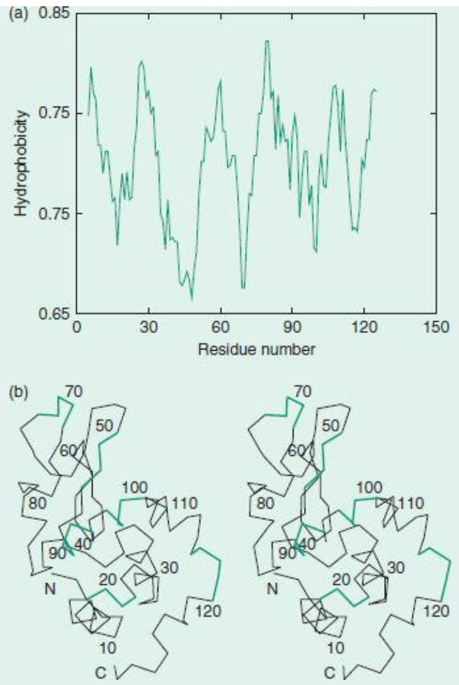

Figure 6.4 (a) Hydrophobicity profile of hen egg white lysozyme. (Produced using the Primary Structure Analysis tools available through [http://www.expasy.org](http://www.expasy.org).) (b) Structure of hen egg white lysozyme. Regions corresponding to minima in the hydrophobicity plot are shown with bold green lines.

## Example 6.2 The helical wheel

O.B. Ptitsyn observed that α helices in globular proteins often have a ‘hydrophobic face’ turns inwards towards the protein interior, and a ‘hydrophilic face’ turned outwards towards the solvent. Each residue in an α helix appears at a position 100° around the circumference of the helix from its predecessor. Therefore, to achieve Ptitsyn's effect, the sequence of residues should alternate between hydrophobic and hydrophilic with a periodicity of approximately four.

To check this relationship, the residues can be projected onto a plane perpendicular to a helix axis, a diagram called a helical wheel. This example shows the sequence of an α helix of sperm whale myoglobin. Charged and polar residues appear in green; others in black.

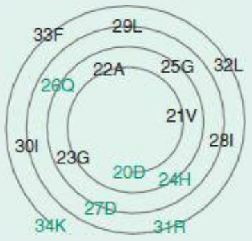

<details>
<summary>donut</summary>

| Ring | Label |
| --- | --- |
| Outer | 33F |
| Outer | 29L |
| Outer | 32L |
| Inner | 25G |
| Inner | 28I |
| Inner | 21V |
| Inner | 24H |
| Inner | 20D |
| Inner | 27D |
| Inner | 23G |
| Inner | 26Q |
| Inner | 30I |
| Inner | 34K |
| Outer | 31R |
</details>

The helix has a hydrophobic face—which points to the inside of the structure, and a hydrophilic face—which points outside. In this picture the hydrophilic face is at the bottom of the diagram. From such a pattern of hydrophobicity we can predict whether a region of an amino acid sequence is likely to form an α helix in the native protein structure.

Box 6.3 A PERL program to draw helical wheels

```perl
#!/usr/bin/perl
#helwheel.pl---draw helical wheel
#usage: echo DVAGHGQDILIRLFKSH | helwheel.prl > output.ps
# or    echo 20DVAGHGQDILIRLFKSH | helwheel.prl > output.ps
#       the numerical prefix sets the first residue number

# The output of this program is in PostScript (TM),
#      a general-purpose graphical language

# The next section prints a header for the PostScript file
print <<EOF;
%!PS-Adobe-
%%BoundingBox: (atend)
%1 0 0 setrgbcolor
%newpath
%37.5 161 moveto 557.5 161 lineto 557.5 681 lineto 37.5 681 lineto
%closepath stroke
297.5 421. translate 2 setlinewidth 1 setlinecap
/Helvetica findfont 20 scalefont setfont 0 0 moveto
EOF

# Define fonts to associate with each amino acid

$font{"G"} = "Helvetica";          $font{"A"} = "Helvetica";          $font{"S"} =
"Helvetica";
$font{"T"} = "Helvetica";          $font{"C"} = "Helvetica";          $font{"V"} =
"Helvetica";
$font{"I"} = "Helvetica";          $font{"L"} = "Helvetica";          $font{"F"} =
"Helvetica";
$font{"Y"} = "Helvetica";          $font{"P"} = "Helvetica";          $font{"M"} =
"Helvetica";
$font{"W"} = "Helvetica";          $font{"H"} = "Helvetica-Bold"; $font{"N"} =
"Helvetica-Bold";
$font{"Q"} = "Helvetica-Bold"; $font{"D"} = "Helvetica-Bold"; $font{"E"} =
"Helvetica-Bold";
$font{"K"} = "Helvetica-Bold"; $font{"R"} = "Helvetica-Bold";
$_= <>;                                # read line of input
chop();$_=~ s/\s//g;                          # remove terminal carriage
return and blanks
if ($_ =~ s/^(\d+)//)                  # if input begins with integer
{$resno = $1;}                            # extract it as initial
residue number
else {$resno = 1}                             # if not, set initial residue
number = 1
$radius = 50;                               # initialize values for
radius,
$x = 0; $y = -50; $theta = -90;         # x, y and angle theta
# print light gray spiral arc as succession of line segments, 10 per
residue
$npoints = 10*(length($_) - 1);
```

```perl
print "0.8 0.8 0.8 setrgbcolor\n";          # set colour to light gray
print "newpath\n";                          # draw spiral arc
printf("%8.3f %8.3f moveto\n",$x,$y);
foreach $d (1 .. $npoints) {              # 10 points per residue
    $theta += 10; $radius += 0.6;         # increase radius and theta
    $x = $radius*cos($theta*0.01747737);     # calculate new value of x
    $y = $radius*sin($theta*0.01747737);     #     and y
    printf("%8.3f %8.3f lineto\n",$x,$y);
}
print "stroke\n";

# print residues and residue numbers

$radius = 50;                          # reinitialize values for
radius,
$x = 0; $y = -50; $theta = -90;           # x, y and angle theta
print "0 setgray\n";                           # set colour to black

foreach (split ("",$_)) {                # loop over characters from
input line
    print "/$font{$_} findfont ";           # set font appropriate
    print "20 scalefont setfont\n";        # for this amino acid
    printf("%8.3f %8.3f moveto\n",$x,$y);   # move to current point
    print " ($resno$_) stringwidth";       # adjust position to centre
residue
    print " pop -0.5 mul -7 rmoveto\n";      # identification on point
on spiral
    print " ($resno$_) show\n";               # print residue number and id
    print "% $theta $resno$_\n";
    $theta += 100; $radius += 6;            # set new values of angle,
radius
    $x = $radius*cos($theta*0.01747737);     # compute new values of x
    $y = $radius*sin($theta*0.01747737);     #     and y
    $resno++;                            # increase residue number
}
print "showpage\n";                   # postscript signals to
print "%%BoundingBox:";                    # print
$xl = 297.5 - 1.05*$radius;          # x
$xr = 297.5 + 1.05*$radius;          #     and
$yb = 421.  - 1.05*$radius;          #     y
$yt = 421.  + 1.05*$radius;          #     limits
printf("%8.3f %8.3f %8.3f %8.3f\n",$xl,$xr,$yb,$yt);

print "%%EOF\n";                             # and wind up
```

the first and fourth positions—a and g—are usually hydrophobic. The sequences of coiled-coiled regions frequently contain a motif called the ‘leucine zipper’ because of the leucine repeats every seven residues. Here is the sequence of the coiled-coil region of GCN4, with the heptads demarcated and the hydrophobic positions indicated by asterisks:

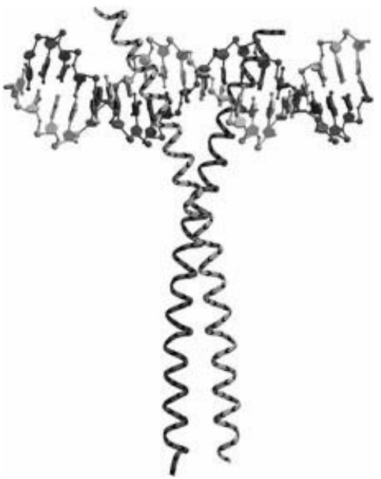

<details>
<summary>chemical</summary>

Molecular structure diagram showing a long chain of atoms with a central helical backbone and terminal groups
</details>

Figure 6.5 Coiled-coil BZIP domain from proto-oncogene c-jun bound to cAMP response element (CRE) DNA target.

abcdefg abcdefg abcdefg abcdefg

\* \* \* \* \* \* \* \*

R|MKQLEDK|VEELLSK|NYHLENE|VARLKKL|VG

The distribution of leucine residues (green) is clear on a helical wheel:

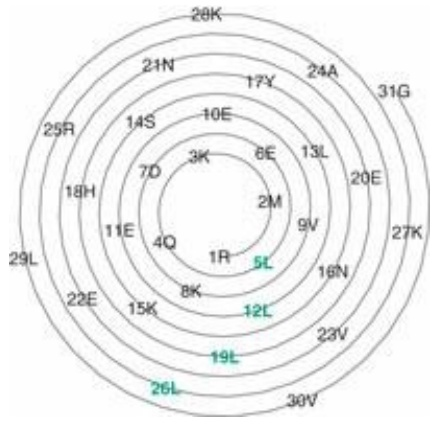

<details>
<summary>radar</summary>

| Ring | Label |
| --- | --- |
| Top | 28K |
| Top | 24A |
| Top | 31G |
| Upper-Mid | 21N |
| Upper-Mid | 17Y |
| Upper-Mid | 10E |
| Upper-Mid | 6E |
| Upper-Mid | 13L |
| Upper-Mid | 20E |
| Upper-Mid | 27K |
| Lower-Mid | 14S |
| Lower-Mid | 7D |
| Lower-Mid | 18H |
| Lower-Mid | 11E |
| Lower-Mid | 4Q |
| Lower-Mid | 1R |
| Lower-Mid | 8K |
| Lower-Mid | 15K |
| Lower-Mid | 19L |
| Lower-Mid | 22E |
| Lower-Mid | 26L |
| Bottom | 29L |
| Bottom | 30V |
| Bottom | 19L |
| Bottom | 12L |
| Bottom | 9V |
| Bottom | 6E |
| Bottom | 3K |
</details>

## Prediction of transmembrane proteins and signal peptides

Many proteins are designed to sit within membranes. Membrane proteins mediate the exchange of matter, energy, and information between cell interiors, organelles, and surroundings. Examples of membrane protein functions include energy transduction, via the generation or release of concentration gradients across cell or organelle membranes; and signal reception and transmission.


## See Weblem 6.6

It is estimated that in the human genome approximately 30% of genes encode membrane proteins. Approximately 70% of known targets of drugs are membrane proteins, mostly receptors. Given that membrane proteins are so common, it is important to have reliable tools for their identification. Relatively few membrane protein structures have been experimentally determined. Their identification and characterization places a greater burden on computational tools for sequence analysis.

Among their adaptations, transmembrane proteins contain regions of mostly nonpolar residues, which interact with the organic layer. Thereby they differ from water-soluble proteins that show biases towards a hydrophobic interior and a hydrophilic exterior. Most also contain additional domains in the aqueous regions inside and/or outside the membrane. Many transmembrane proteins contain a set of seven consecutive α helices that traverse the membrane, oriented approximately perpendicular to the plane of the membrane. These helices are connected by loops that protrude into the aqueous surroundings. A second class of membrane-associated protein structures contains a β- barrel. Transmembrane helices are typically 15–30 residues long. Although enriched in hydrophobic residues they contain some polar sidechains, usually in interfaces between helices packed together in the structure.

A useful clue to the orientation of the helices across the membrane is the ‘positive-inside rule’. The loops between helices lie either entirely inside or entirely outside the cell or organelle. Those inside contain a preponderance of positively charged residues. (see Example 6.3.)

These applications of hydrophobicity are typical of early approaches to sequence–structure correlation. Using some specific physical idea about proteins, they describe, or infer, structural properties of one protein at a time, from one sequence at a time.

## Example 6.3 Detection of transmembrane helical segments

Bacteriorhodopsin was the first solved structure to show the configuration of seven helices traversing a membrane, connected by loops (see Fig. 6.6).

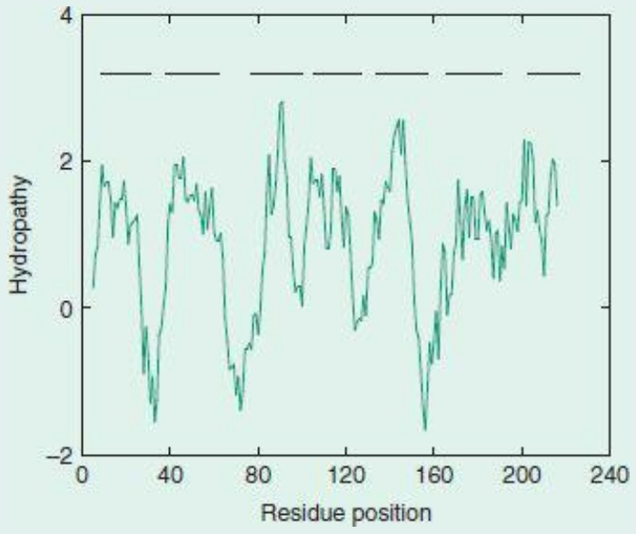

<details>
<summary>line</summary>

| Residue position | Hydropathy |
| --- | --- |
| 0 | ~0.3 |
| 10 | ~1.9 |
| 20 | ~1.5 |
| 30 | ~-1.5 |
| 40 | ~1.8 |
| 50 | ~1.6 |
| 60 | ~1.0 |
| 70 | ~-1.3 |
| 80 | ~-0.5 |
| 90 | ~2.8 |
| 100 | ~0.2 |
| 110 | ~1.8 |
| 120 | ~1.8 |
| 130 | ~-0.2 |
| 140 | ~1.5 |
| 150 | ~2.5 |
| 160 | ~-1.6 |
| 170 | ~0.8 |
| 180 | ~1.5 |
| 190 | ~1.2 |
| 200 | ~2.2 |
| 210 | ~1.5 |
</details>

Figure 6.6 Bacteriorhodopsin from the bacterium Halobacterium salinarum (formerly H. halobium) [2BRD] viewed in the plane of the membrane. The ligand shown in ball-and-stick representation is the chromophore, retinal.

Residues within the membrane-spanning segments are almost exclusively hydrophobic because the entire helix is embedded in a nonaqueous medium. They are separated by regions containing polar amino acids.

An unfiltered hydrophobicity plot of the amino acid sequence of Halobacterium salinarum bacteriorhodopsin shows seven regions of maxima, corresponding to the seven transmembrane helices (positions indicated by horizontal bars).


**See Weblem 6.7**

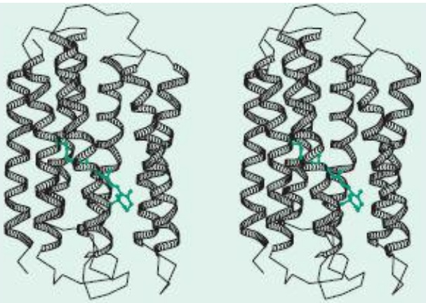

<details>
<summary>natural_image</summary>

Two identical 3D protein structure models shown with helical helices and green cross markers (no text or labels)
</details>

2BRD

Modern developments have demonstrated the predictive power of multiple sequence alignments. Indeed, a program to predict coiled-coil regions, by C.D.D. Barry in 1982, was the first application of position-specific scoring matrices (See Chapter 5). The best current methods for predicting coiled coils and transmembrane domains make use of hidden Markov models (HMMs; See Chapter 5).

## Superposition of structures, and structural alignments

Some aspects of sequence analysis carry over fairly directly into structural analysis, some must be generalized, and others have no analogues at all.

As in the case of sequences, a fundamental question in analysing structures is to devise and compute a measure of similarity. If two molecules have very similar structures, we can imagine superposing them so that corresponding points are as close together as possible. Then the average distance between corresponding points is a measure of the structural similarity. In practice it is conventional to report the root-mean-square (r.m.s.) deviation of the corresponding atoms:

$$
\text { r.m.s.   deviation } = \sqrt {\{\Sigma d _ {i} ^ {2} / n \}}
$$

where $d _ { i }$ is the distance between the ith pair of atoms after optimal fitting, and n is the number of points. This assumes that we have prespecified the correspondence between the points.

If the correspondence is not known, we must first determine it and only then calculate the r.m.s. deviation of the alignable substructures. If each point corresponds to an atom representing the successive residues of a protein or nucleic acid structure (the Cα atoms of proteins or the phosphorus atoms of nucleic acids), the problem is literally a question of alignment (= assignment of residue– residue correspondences) (see Example 6.4 and Box 6.4). Indeed, determination of residue–residue correspondences

## Example 6.4 Structural alignment of bovine γ-chymotrypsin and S. aureus epidermolytic toxin A

Bovine chymotrypsin and S. aureus epidermolytic toxin A are both members of the chymotrypsin family of proteinases. Figure 6.7 shows a structural superposition of PDB entries 8GCH (γ-chymotrypsin) (black) and 1AGJ (S. aureus epidermolytic toxin A) (green). The molecules share the common chymotrypsin-family serine proteinase folding pattern, and the Ser-His-Asp catalytic triad (ball-and-stick).

A sequence alignment derived from the superposition follows:

8gch CGVPAIQPVLIVNG- EEAVP--GS----WPWQVSLQ-DKTG

<div class="docvortex-algorithm" style="white-space: pre-wrap; font-family:monospace;">
1agj ----------EVSAEEIKKHEEKWNKYYGVNAFNLPKELFSKVDEKDR-QKYPYNTIGNVFVK-G-
8gch FH--FCGGSLINE-NWVVTAAHC-GV-T---T-SDVVVAGEFDQG---SSSEKI--QKLKIAKVFK-NS-
1agj --QTSATGVLIG-KNTVLTNRHIAK-FANGDPSKVSFRPSI-NTDDNGNT-E-TPYGEYEVKEILQEP-F
8gch KYNSLTINNDITLLKLST----AAS--FSQTVSAVCLPSASD--DFAAGTTCVTTGWG-LTRYNTPD-R
1agj GAG------VDLALIRLKPDQNGVSL-GDK---ISPAKIGT---SNDLKDGTKLELIGYPFDH----KVNQ
9gch LQQASLPLL-SNTNCKKYWGTKIKDAM--ICAGASGV-SSCMGDSGGPLVCKKNGAWTLVGIVSWGSSTC
1agj MHRSEIELTTLS----------RGLRYY----GFTVPGNSGSGIFNSN---GELVGIHSSK-----
8gch STST-------PGVYARVTA-LVNWVQQTLAAN-
1agj ----VSHLDREHQINYGVGIGNYVKRIINEKN---E
</div>

The resemblance between these two sequences is well within the ‘twilight zone’. It could not be derived correctly from standard pairwise alignment of the two sequences alone.


## See Weblem 6.8

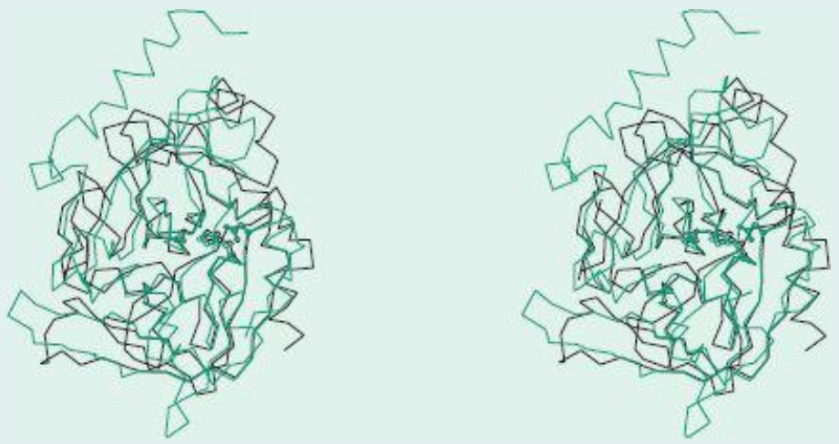

Figure 6.7 Structural superposition of γ-chymotrypsin [8GCH] (black) and S. aureus epidermolytic toxin A [1AGJ] (green). The sidechains of the catalytic triads are shown. Observe that the region around the active site is the best-conserved part of the protein.

## Box 6.4 Determination of similarity and alignment in computational chemistry

Three related problems have applications in molecular biology.

**1.** Similarity of two sets of atoms with known correspondences:

$$
p _ {i} \leftrightarrow q _ {i}, i = 1, \dots N
$$

The analogue, for sequences, is the Hamming distance: mismatches only.

**2.** Similarity of two sets of atoms with unknown correspondences, but for which the molecular structure— specifically, the linear order of the residues—restricts the possibilities. In the case of proteins or nucleic acids we are limited to correspondences in which we retain the order along the chain:

$$
p _ {i (k)} \leftrightarrow q _ {j (k)}, k = 1, \dots K \leq N, M
$$

with the constraint that if $k _ { 1 } \geq k _ { 2 }$ then it is necessary that $i ( k _ { 1 } )   \geq   i ( k _ { 2 } )$ and $j ( k _ { 1 } )   >   j ( k _ { 2 } )$ This can be thought of as corresponding to the Levenshtein distance, or to sequence alignment with gaps. The result of such a calculation is a structural alignment of parts of all of the sequences.

**3.** Similarities between two sets of atoms with unknown correspondence, with no restrictions on the correspondence:

$$
p _ {i (k)} \leftrightarrow q _ {j (k)}
$$

This problem arises in the following important case: suppose two (or more) molecules have similar biological effects, such as a common pharmacological activity. It is often the case that the structures share a common constellation of a relatively small subset of their atoms that are responsible for the biological activity. These atoms are called a pharmacophore. The problem is to identify them: to do so it is useful to be able to find the maximal subsets of atoms from the two molecules that have a similar structure.

via structural superposition of two or more proteins is a powerful method of sequence alignment. Because structure tends to diverge more conservatively than sequence during evolution, structure alignment is a more powerful method than pairwise sequence alignment for detecting homology and aligning the sequences of distantly related proteins.

There are many available programs for pairwise and multiple structure alignment (see [http://www.cgl.ucsf.edu/home/meng/grpmt/structalign.html](http://www.cgl.ucsf.edu/home/meng/grpmt/structalign.html)).


**See Weblems 6.9–6.10**

## DALI and MUSTANG

As proteins evolve, their structures change. Among the subtle details that evolution has strongly tended to conserve are the patterns of contacts between residues. That is, if two residues are in contact in one protein, the residues aligned with these two in a related protein are also likely to be in contact. This is true even in very distant homologues, and even if the residues involved change in size. Mutations that change the sizes of packed buried residues produce adjustments in packing of the helices and sheets against one another.

L. Holm and C. Sander applied these observations to the problem of structural alignment of proteins. If the interresidue contact pattern is preserved in distantly related proteins then it should be possible to identify distantly related proteins by detecting conserved contact patterns.

Computationally, one makes matrices of contact patterns in two proteins (this is very easy) and then seeks the maximal matching submatrices (this is hard). Using carefully chosen approximations, Holm and Sander wrote an efficient program called DALI (for Distance-matrix ALIgnment) that is now in common use for identifying proteins with folding patterns similar to that of a query structure. The program runs fast enough to carry out routine screens of the entire Protein Data Bank for structures similar to a newly determined structure, and even to perform a classification of protein domain structures from an all-against-all comparison. Holm and Sander have found several unexpected similarities not detectable at the level of pairwise sequence alignment.

An example of DALI's ‘reach’ into recognition of very distant structural similarities is its identification of the relationship between mouse adenosine deaminase, Klebsiella aerogenes urease, and Pseudomonas diminuta phosphotriesterase (see Fig. 6.8).

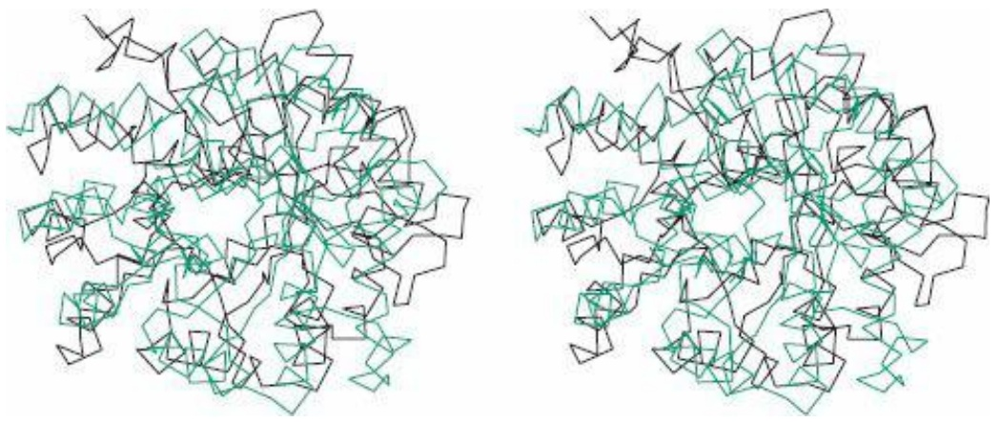

Figure 6.8 The regions of common fold, as determined by the program DALI by L. Holm and C. Sander, in the TIM-barrel proteins mouse adenosine deaminase [1FKX] (black) and Pseudomonas diminuta phosphotriesterase [1PTA] (green). In the alignment shown in this figure the sequences have only 13% identical residues: closer to midnight than to the twilight zone.

DALI is available over the web. You can submit coordinates to the site [http://ekhidna.biocenter.helsinki.fi/dali\_lite/start](http://ekhidna.biocenter.helsinki.fi/dali_lite/start) and receive the set of similar structures and their alignments with the query.


## See Weblem 6.11

MUSTANG, written by A.S. Konagurthu, is a development of DALI's distance-matrix approach to multiple structural alignment ([http://www.csse.monash.edu.au/\~karun/Site/mustang.html](http://www.csse.monash.edu.au/~karun/Site/mustang.html)).

## Evolution of protein structures

Included in the 100 000 protein structures now known are several families in which the molecules maintain the same basic folding pattern over ranges of sequence similarity from near-identity down to well below 20% conservation. The serine proteinases (γ-chymotrypsin and S. aureus epidermolytic toxin A; Fig. 6.7) and the adenosine deaminase/phosphotriesterase family (Fig. 6.8) are examples.

The general response to mutation is structural change. It is characteristic of biological systems that the objects we observe to have a certain form arose by evolution from related objects with similar but not identical form. They must, therefore, be robust, having the freedom to tolerate some variation. We can take advantage of this robustness in our analysis: by identifying and comparing related objects we can distinguish variable and conserved features, and thereby determine what is crucial to structure and function.

Natural variations in families of homologous proteins that retain a common function reveal how structures accommodate changes in amino acid sequence. Surface residues not involved in function are usually free to mutate. Loops on the surface can often accommodate changes by local refolding. Mutations that change the volumes of buried residues generally do not change the conformations of individual helices or sheets, but produce distortions of their spatial assembly. The nature of the forces that stabilize protein structures sets general limitations on these conformational changes. Particular constraints derived from function vary from case to case.

Families of related proteins tend to retain common folding patterns. However, although the general folding pattern is preserved, there are distortions which increase as the amino acid sequences progressively diverge. These distortions are not uniformly distributed throughout the structure. Usually, a large central core of the structure retains the same qualitative fold, and other parts of the structure change conformation more radically. As a simple analogy, consider the letters B and R. As structures, they have a common core which corresponds to the letter P. Outside the common core they differ: at the bottom right B has a loop and R has a diagonal stroke.

Figure 6.9 compares spinach plastocyanin and cucumber stellacyanin. For other illustrations of structural comparisons of homologous proteins, and discussion of classification schemes, see Chapter 4 of Introduction to Protein Architecture: The Structural Biology of Proteins (Lesk, 2001; see Recommended reading). That book contains a large number of pictures of protein structures, suitable for browsing, for any reader interested in exploring the stunning variety of protein folding patterns.

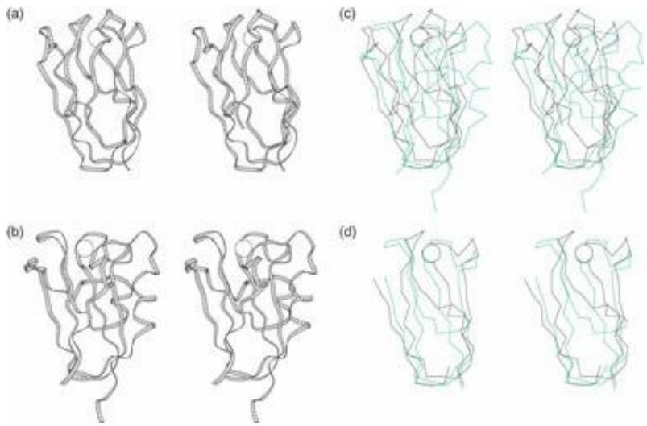

Figure 6.9 Two related proteins that share the same general folding pattern but which differ in detail. Circles represent copper ions. (a) Spinach plastocyanin [1AG6], (b) cucumber stellacyanin [1JER], (c,d) superpositions, showing (c) the entire structures and (d) only the well-fitting core. The main secondary structural elements of these proteins are two β sheets packed face-to-face. It is seen in the superposition that several strands of β sheet are conserved but displaced, and that the helix at the right of cucumber stellacyanin has no counterpart in the spinach plastocyanin structure. Even the relatively well-fitting core shows the conservation of folding topology but nevertheless reveals considerable distortion.

Systematic studies of the structural differences between pairs of related proteins have defined a quantitative relationship between the divergence of the amino acid sequences of the core of a family of structures and the divergence of structure. As the sequence diverges, there are progressively increasing distortions in the mainchain conformation, and the fraction of the residues in the core usually decreases. Until the fraction of identical residues in the sequence drops below about 40–50% these effects are relatively modest. Almost all the structure remains in the core, and the deformation of the mainchain atoms is on average no more than 1.0 Å. With increasing sequence divergence, in most cases some regions refold entirely, reducing the size of the core, and the distortions of the residues remaining within the core increase in magnitude.

A correlation between the divergence of sequence and structure applies to all families of proteins. Figure 6.10a shows the changes in structure of the core, expressed as the r.m.s. deviation of the mainchain atoms after optimal superposition; plotted against the sequence divergence, expressed as the percentage conserved amino acids of the core after optimal alignment. The points correspond to pairs of homologous proteins from many related families. (Those at 100% residue identity are proteins for which the structure was determined in two or more crystal environments, and the deviations show that crystal packing forces—and, to a lesser extent, solvent and temperature—can modify slightly the conformation of the proteins.) Figure 6.10b shows the changes in the fraction of residues in the core as a function of sequence divergence. The fraction of residues in the cores of distantly related proteins can vary widely: in some cases the fraction of residues in the core remains high, in others it can drop to below 50% of the structure.

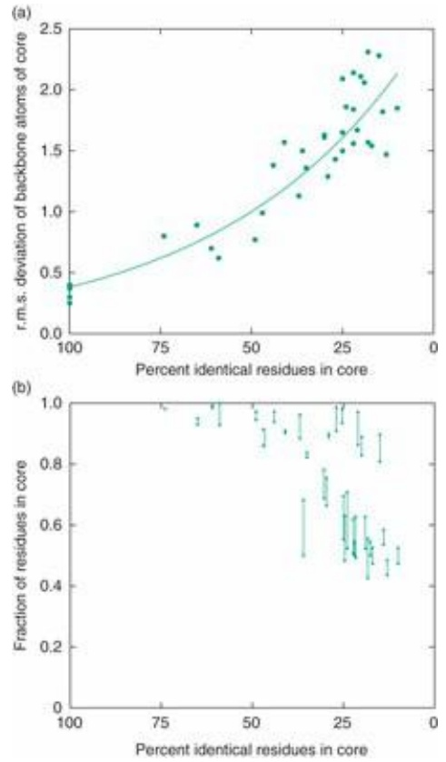

Figure 6.10 Relationships between divergence of amino acid sequence and three-dimensional structure of the core, in evolving proteins. (a) Variation of r.m.s. deviation of the core with the percent identical residues in the core. (b) Variation of size of the core with the percent identical residues in the core. This figure shows results calculated for 32 pairs of homologous proteins of a variety of structural types.

Adapted from Chothia, C. and Lesk, A.M. (1986). Relationship between the divergence of sequence and structure in proteins. EMBO J., 5, 823–826.

## Classifications of protein structures

Organization of protein structures according to folding pattern imposes a very useful logical structure on the entries in the PDB. It affords a basis for structure-oriented information retrieval. Several databases derived from the PDB are built around classifications of protein structures. They offer useful features for exploring the protein structure world, including search for keyword or sequence, navigation among similar structures at various levels of the classification hierarchy, presentation of structure pictures, probing the data bank for structures similar to a new structure, and links to other sites. These databases include SCOP (Structural Classification of Proteins), CATH (Class, Architecture, Topology, Homologous superfamily), and FSSP/DDD (Fold classification based on Structure-Structure alignment of Proteins/Dali Domain Dictionary).

## SCOP

SCOP, by A.G. Murzin, L. Lo Conte, B.G. Ailey, S.E. Brenner, T.J.P. Hubbard, and C. Chothia, organizes protein structures in a hierarchy according to evolutionary origin and structural similarity. At the lowest level of the SCOP hierarchy are individual domains, extracted from the PDB entries. Sets of domains are grouped into families of homologues, for which the similarities in structure, sequence, and sometimes function imply a common evolutionary origin. Groups of families containing proteins of similar structure and function, but for which the evidence for evolutionary relationship is suggestive but not compelling, form superfamilies. Superfamilies that share a common folding topology, for at least a large central portion of the structure, are grouped as folds. Finally, each fold group falls into one of the general classes. The major classes in SCOP are $\alpha , \beta , \alpha + \beta , \alpha / \beta$ and miscellaneous ‘small proteins’, which often

Box 6.5 SCOP classification of flavodoxin from C. beijerinckii

| 1. Root | SCOP |
| --- | --- |
| 2. Class | α and β proteins (α/β)Mainly parallel β sheets (β-α-β units) |
| 3. Fold | Flavodoxin-likeThree layers, α/β/α; parallel β sheet of five strands, order 21345 |
| 4. Superfamily | Flavoproteins |
| 5. Family | Flavodoxin-related, binds FMN (flavin mononucleotide) |
| 6. Protein | Flavodoxin |
| 7. Species | Clostridium beijerinckii |

have little secondary structure and are held together by disulphide bridges or ligands.


## See Weblem 6.12

Box 6.5 shows the SCOP classification of flavodoxin from Clostridium beijerinckii (Plate VIII.) For illustrations of the degree of similarities of proteins grouped together at different levels of the hierarchy, and discussion of other classification schemes, see Introduction to Protein Architecture, chapter 4 (Lesk, 2001).

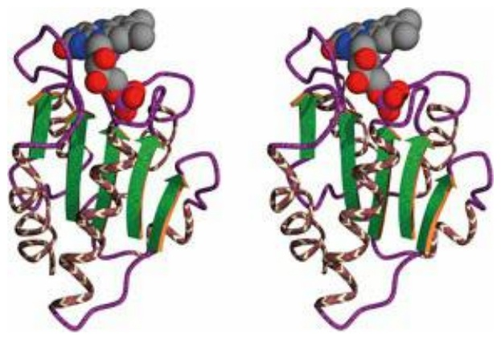

Plate VIII Flavodoxin from Clostridium beijerinckii, binding cofactor FMN [5NLL]. Large arrows represent strands of sheet. Placement of this structure in a hierarchical classification of protein structures according to the SCOP database is described in Box 6.5.

The SCOP release of February 2009 contained 38 221 PDB entries, split into 110 800 domains. The distribution of entries at different levels of the hierarchy is shown in Table 6.1.

Table 6.1 Contents of current SCOP release

| Class | Number of families | Number of superfamilies | Number of folds |
| --- | --- | --- | --- |
| All-α proteins | 871 | 507 | 284 |
| All-β proteins | 742 | 354 | 174 |
| α/β Proteins | 803 | 244 | 147 |
| α+β Proteins | 1055 | 552 | 376 |
| Multidomain proteins | 89 | 66 | 66 |
| Membrane and cell-surface proteins | 123 | 110 | 58 |
| Small proteins | 219 | 129 | 90 |
| Total | 3902 | 1962 | 1195 |

## Protein structure prediction and modelling

The observation that each protein folds spontaneously into a unique three-dimensional native conformation implies that nature has an algorithm for predicting protein structure from amino acid sequence.


## See Weblem 6.13

Some attempts to understand this algorithm are based solely on general physical principles; others are empirical, based on observations of the known amino acid sequences and protein structures. A proof of our understanding would be the ability to reproduce the algorithm in a computer program that could predict protein structure from amino acid sequence (see Box 6.6).

## A priori and empirical methods

Many attempts to predict protein structure from basic physical principles alone try to reproduce the interatomic interactions in proteins, to define a computable energy associated with any conformation. Computationally, the problem of protein structure prediction then becomes a task of finding the global

## Box 6.6 Overview of modelling methods

Nature has an algorithm that computes protein native structure from amino acid sequence. All the information needed to do this computation is contained in the sequence itself: proteins don't need to look things up in databases. We do. Many of the most effective methods for protein structure prediction make use of known structures of homologous proteins. Indeed, the degree of sequence similarity between a protein of unknown structure and its nearest homologue of known structure controls what we can achieve in prediction of the unknown structure, and dictates what methods to use.

Generally speaking:

**1.** If a protein of unknown structure has homologues of known structure with 40% or more identical residues in an optimal alignment, homology modelling methods are likely to produce a nearly complete structural model. The quality of the model is likely to be good enough to interpret the protein's function. (The higher the sequence similarity, the more accurate the model.) Mature software for homology modelling is available.
**2.** If no homologue of known structure has sequence similarity to the unknown with 40% or more residue identity, it may still be possible to assign a general folding pattern to the protein of unknown structure. It should be possible to predict its secondary structure with ≈70–80% accuracy on a residue-by-residue basis. Many servers will apply a variety of methods to a submitted sequence.
**3.** If no homologue of known structure is recognizable from the sequences, the last recourse is to use a prediction method general enough to handle novel folds. Such methods include both a priori and knowledgebased approaches. At present, the program ROBETTA, by D. Baker and colleagues, is the most effective tool for protein structure prediction whenever homology modelling is not applicable. It has proved quite successful at recent Critical Assessment of Structure Prediction (CASP) programmes.

minimum of this conformational energy function. So far this approach has not succeeded, partly because of the inadequacy of the energy function, partly because the minimization algorithms tend to get trapped in local minima, and partly because the calculations require more computer resources than are available.

Other a priori approaches to structure prediction are based on attempts to simplify the problem, to