capture the essentials somehow.

There is a spectrum of approaches, distributed between two extremes.

Establish the most detailed and accurate model of the interatomic interactions within a protein and between protein and solvent. Apply molecular dynamics to simulate the motion of the system starting with a denatured conformation—perhaps the extended chain—and ending with something in the vicinity of the native state. The idea is that the physics of the problem is fairly well understood, down to the detailed microscopic level. The challenges are computational: how to simulate the system for long enough to attain the native state.
2. Establish the least detailed and least accurate model that can give the correct answer. If one could identify the essentials, great computational power might not be needed. The idea is that the physics of the problem is not well understood, except in microscopic detail. Of course, everyone accepts the principles of mechanics and thermodynamics, but much of the detail is irrelevant and unilluminating, and this is a crucial part of the picture. Proteins just aren't that fussy: at the melting temperature half the molecules are in the native state, despite the very great alteration in the relative strengths of various terms in the free energy relative to normal physiological conditions. This argues for a great robustness in the determinants of structure, which is difficult to capture in detailed calculations, or to explain even if they were captured. It argues for a distinction between determinants of structure and determinants of stability, also difficult to explain from detailed calculations. In addition, many proteins with substantial sequence differences fold to very similar native states. However, in some cases there are large perturbations of the folding pathway.

The field contains many people widely scattered between these endpoints, linked by a certain creative tension.

It is partly a question of choosing goals. To go beyond a prediction of the native state, to account for trajectories, transition states, intermediates if any, and melting temperatures, a detailed simulation may well be necessary. If one wants a perspicuous and satisfying explanation of how amino acid sequence determines protein structure, then even a successful fully detailed calculation may not provide it.

A proponent of molecular dynamics might argue that (1) from a successful fully detailed calculation one could generate a series of simplified models by making approximations that keep the broad picture intact and (2) a simplified model that works is—by virtue of its success—interesting, but may be unrealistic, or, even if realistic, incomplete. After all, there may be many simplified models, all of which work, but which do not agree on what is essential. The reason for suspecting that this may be true is the observation that folded proteins solve many problems at once: stereochemistry, packing, hydrogen bonding, entropy compensation. It might be possible to base a successful prediction on optimizing one of these features, while ignoring the others; any spoke may lead to the hub.

The alternative to a priori methods are approaches based on assembling clues to the structure of a target sequence by finding similarities to known structures. These empirical or ‘knowledge-based’ methods have become very powerful.

We are coming closer and closer to saturating the set of possible folds with known structures. This is the stated goal of structural genomics projects (see Box 6.7). Once we have a complete set of folds and sequences, and powerful methods for relating them, empirical methods will provide pragmatic solutions of many problems. What will be the effect of this on attempts to predict protein structure a priori? The intellectual appeal of the problem will still be there: nature folds proteins without searching databases. Moreover, some methods may not merely identify the native conformation, but illuminate folding pathways. But it is unlikely that the problem will continue to command interest of the same intensity, and support of the same largesse, once a pragmatic solution has been found.

Methods for prediction of protein structure from amino acid sequence include the following.

• Attempts to predict secondary structure without attempting to assemble these regions in three dimensions. The results are lists of regions of the sequence predicted to form α helices and regions predicted to form strands of β sheet.
Homology modelling: prediction of the three-dimensional structure of a protein from the known structures of one or more related proteins. The results are a complete coordinate set for mainchain and sidechains, intended to be a high-quality model of the structure, comparable to at least a lowresolution experimental structure.
Fold recognition: given a library of known structures, determine which of them shares a folding pattern with a query protein of known sequence but unknown structure. If the folding pattern of the target protein does not occur in the library, such a method should recognize this. The results are a nomination of a known structure that has the same fold as the query protein, or a statement that no protein in the library has the same fold as the query protein.
Prediction of novel folds, by either a priori or knowledge-based methods. The results are a complete coordinate set for at least the mainchain and sometimes the sidechains also. The model is intended to have the correct folding pattern, but would not be expected to be comparable in quality to an experimental structure. D. Jones has likened the distinction between a priori modelling and fold recognition to the difference between an essay and a multiple-choice question in an exam.

## Critical Assessment of Structure Prediction

Critical Assessment of Structure Prediction (CASP) organizes blind tests of protein structure predictions, in which participating crystallographers and NMR spectroscopists make public the amino acid

## Box 6.7 Structural genomics

In analogy with full-genome sequencing projects, structural genomics has the commitment to deliver the structures of the complete protein repertoire. X-ray crystallographic and NMR experiments will solve a ‘dense set’ of proteins, such that all proteins are within homology-modelling range of one or more known experimental structures. More so than genomic sequencing projects, structural genomics projects combine results from different organisms. The human proteome is of course of special interest, as are proteins unique to infectious microorganisms.

The goals of structural genomics have become feasible partly by advances in experimental techniques, which make high-throughput structure determination possible; and partly by advances in our understanding of protein structures, which define reasonable general goals for the experimental work, and suggest specific targets.

The theory and practice of homology modelling suggests that at least 30% sequence identity between target and some experimental structure is necessary. This means that experimental structure determinations will be required for an exemplar of every sequence family, including many that share the same basic folding pattern. Experiment will have to deliver the structures of on the order of 10 000 domains. In the year 2006, 6547 structures were deposited in the PDB, so the throughput rate is adequate.

Methods of bioinformatics can help select targets for experimental structure determination that offer the highest payoff in terms of useful information. Goals of target selection include:

• elimination of redundant targets: proteins too similar to known structures;

• identification of sequences with undetectable similarity to proteins of known structure;
• identification of sequences with similarity only to proteins of unknown function; or
proteins of unknown structure with ‘interesting’ functions; for example, human proteins implicated in disease, or bacterial proteins implicated in antibiotic resistance;
proteins with properties favourable for structure determination—likely to be soluble—or contain methionine (which facilitates solving the phase problem of X-ray crystallography).

The machinery for carrying out the modelling is already up and running. MODBASE

([http://modbase.compbio.ucsf.edu/](http://modbase.compbio.ucsf.edu/)) and the SWISS-MODEL repository

([http://swissmodel.expasy.org/repository/](http://swissmodel.expasy.org/repository/)) collect homology models of proteins of known sequence.

sequences of the proteins they are investigating, and agree to keep the experimental structure secret until predictors have had a chance to submit their models. CASP runs on a 2-year cycle. Every 2 years the sequences are published in the spring, and predictions are due in the autumn. At the end of the year a gala meeting brings the predictors together to discuss the current results and to gauge progress. (The CASP programmes were introduced briefly in Chapter 1.)

Protein structure predictions in CASP have traditionally fallen into three main categories: (1) comparative modelling (in effect homology modelling), (2) fold recognition, and (3) modelling of novel folds (Table 6.2).

Table 6.2 Traditional categories of protein structure prediction challenges in CASP

| CASP category | Nature of target |
| --- | --- |
| Comparative modelling | Close homologues of known structure are available; homology modelling methods are applicable. |
| Fold recognition | Structures with similar folds are available, but no sufficiently close relative for homology modelling; the challenge is to identify structures with similar topology. |
| New fold | No structure with same folding pattern known; requires either a genuine a priori method or a knowledge-based method that can combine features of several structures. |

Three groups of assessors, one for each category, compared the predicted and experimental structures, and judged the predictions. Speakers at the end-of-year meeting include the organizers, the assessors, and selected predictors, including those who have been particularly successful, or who have an interesting novel method to present.

As the field has progressed, the prediction challenges have varied. Secondary structure prediction was dropped a decade ago, when specialized methods ceased to make robust progress. Fold recognition has been dropped, as a priori methods did as well as specialized ones. The classical problems still provide essential background to understanding the state of the art, and we will continue to discuss them.

Currently the categories for CASP predictions are:

template-based modelling: a sequence such that a homologue of known structure can be identified so that homology modelling methods, for instance, are applicable;
• refinement: given a—perhaps rough—homology model, can it be improved?
template-free modelling: no suitable homologue identified, a priori method necessary;
• contact-assisted structure modelling: given, as a hint, a small number of pairs of residues that are neighbours, can this information improve prediction quality?
• chemical-shift guided modelling: given the chemical shifts measured by NMR, can this information improve prediction quality?

• molecular-replacement structure modelling: given crystallographic diffraction data (phases not measured), can an a priori model be of adequate quality to place the model in the unit cell and solve the structure?
• prediction of residue–residue contact patterns;
• identification of disordered regions;
prediction of binding sites;
• quality assessment of models, in ignorance of the correct structure.

The latest CASP programme took place in 2012. There were over 100 targets. In all categories, 213 groups of predictors, and 69 servers, submitted a total of 66 297 models. This was almost equal to the number of entries in the PDB!

Many predictions are prepared by groups of researchers who study the results generated by their computer programs, and select and edit them before submission. In addition, the target sequences are sent to web servers that return predictions without human intervention. The CAFASP, or Critical Assessment of Fully Automated Structure Prediction, programme monitors the quality of these predictions. It is thereby possible to determine to what extent successful procedures could be made fully automatic. There are three challenges:

| Human against protein | CASP |
| --- | --- |
| Computer against protein | CAFASP |
| Human against computer | CASP versus CAFASP |

A separate programme of blind tests of prediction evaluates methods for predicting protein– protein interactions, or ‘docking’. This is CAPRI, or Critical Assessment of PRedicted Interactions. Both CASP and CAPRI held assessment meetings in 2012–2013.

Structure predictions at recent CASP programmes have showed continued improvements. Indeed, improvements in knowledge-based methods originally developed for prediction of novel folds threaten to supersede traditional methods for fold recognition, such as threading, that make explicit reference to libraries of complete structures.

For the most part progress has been incremental rather than spectacular, with one notable exception: David Baker's group predicted and refined the structure of a small (70-residue) protein from Thermus thermophilus, producing a model that deviated by 1.59 Å from the X-ray structure!

Results at CAPRI show that complexes between partners that do not undergo major conformational changes can now be predicted from the structures of the components. Large conformational changes upon complex formation still present difficulties. However, progress could be seen in at least one case, the trimeric TBE envelope protein.

For both CASP and CAPRI the best results are very impressive. An observer of this scene once commented some years ago that protein structure prediction had advanced to the point that ‘failure can no longer be guaranteed’. Things are now much better than that. However, consistency in quality of prediction is still the challenge.

## Secondary structure prediction

It seems obvious that (1) it should be easier to predict secondary structure than tertiary structure and (2) to predict tertiary structure a sensible way to proceed would be first to predict the helices and strands of sheet and then to assemble them. Whether or not these propositions are correct, many people have believed in, and acted upon, them. Given the amino acid sequence of a protein of unknown structure, they produce secondary structure predictions, the assignment of regions in the sequence as helices or strands of sheet.

To assess the quality of a secondary structure prediction, classify the residues in the experimental three-dimensional structure into three categories (helix = H, strand = E (extended), and other = -). The percentage of residues predicted correctly is denoted Q3. At the 2000 CASP programme, the PROF server by B. Rost achieved a good prediction of a domain from the Thermus aquaticus mismatch-repair protein MutS. The value of Q3 for Rost's prediction is 81%:

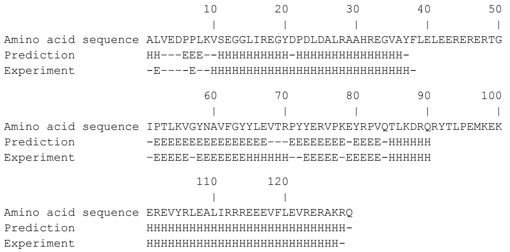

<details>
<summary>text_image</summary>

Amino acid sequence ALVEDPPLKVSEGGLIREGYDPDLDALRAAHREGVAYFLEERERERTG
Prediction HH---EEE--HHHHHHHHHH-HHHHHHHHHHHHHH-
Experiment -E-----E--HHHHHHHHHHHHHHHHHHHHHHHHH-60 70 80 90 100
Amino acid sequence IPTLKVGYNAVFGYYLEVTRPYYERVPKEYRPVQTLKDRQRYTLPEMKEK
Prediction -EEEEEEEEEEEEEEEE---EEEEEEEE-EEEE-HHHHHH
Experiment -EEEE-EEEEEEEEHHHHH--EEEE-EEEE-HHHHH
Amino acid sequence EREVYRLEALIRRREEEVFLEVRERAKRQ
Prediction HHHHHHHHHHHHHHHHHHHHHHHH-
Experiment HHHHHHHHHHHHHHHHHHHHHH-
</details>

Figure 6.11 shows the experimental structure, with the predicted secondary structures distinguished. Except for a short $3 _ { 1 0 }$ helix, the secondary structural elements are predicted correctly except for some minor discrepancies in the positions at which they start and end. (Other scoring schemes that check for segment overlap are less sensitive to end effects.) The quality of this result is very high but not exceptionally rare. This target was classified as being of medium difficulty by the assessors at CASP4 (the fourth CASP meeting, held in 2000). At present, PROF is running at an average accuracy of Q3 ≈77%.

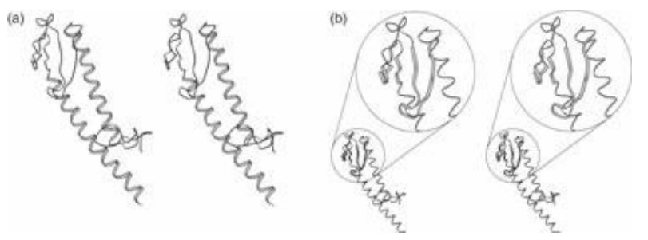

<details>
<summary>natural_image</summary>

Diagram showing two molecular structures labeled (a) and (b), with no visible text or symbols.
</details>

Figure 6.11 The structure from the T. aquaticus mismatch-repair protein MutS [1EWQ]. (a) The regions predicted by the PROF server of Rost to be helical are shown as wider ribbons. The prediction missed only a short $3 _ { 1 0 }$ helix, at the top left of the picture. (b) The regions predicted to be in strands are shown as wider ribbons.

The most powerful methods of secondary structure prediction are based on artificial neural networks.

## Artificial neural networks

Artificial neural networks are a class of general computational structures based loosely on the anatomy and physiology of biological nervous systems. They have been applied successfully to a wide variety of pattern recognition, classification, and decision problems.

A single neuron, in the computational scheme, is a node in a directed graph, with one or more entering connections designated as input, and a single leaving connection called the output:

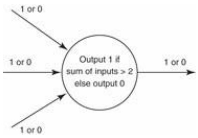

<details>
<summary>flowchart</summary>

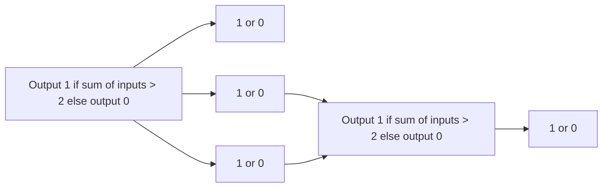
</details>

In the physiological metaphor, one says that the neuron ‘fired’ if the output is 1, and that the neuron ‘didn't fire’ if the output is 0. Simulated neurons can differ in the number of input and output connections, and in the formula for deciding whether to fire (see Box 6.8).

To form a network, assemble several neurons and connect the outputs of some to the inputs of others. Some nodes contain connections that provide input to the entire network; some deliver output information from the network to the outside world; and others, that do not interact directly with the outside, are called hidden layers.

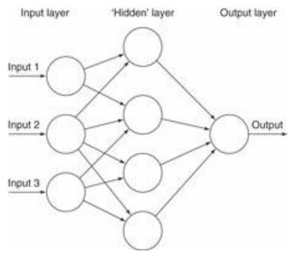

<details>
<summary>flowchart</summary>

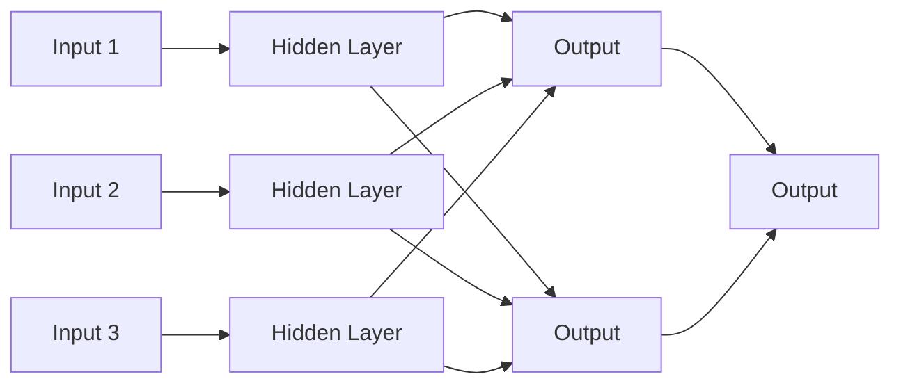
</details>

An unlimited degree of complexity is available by assembling and connecting neurons, and by varying

## Box 6.8 Logic of neural networks

For a single neuron, a discrete decision process governing the output has a geometric interpretation in terms of lines and planes. The neuron in the following figure has two inputs. If we interpret the inputs as the coordinates of a point (x, y) in the plane, the neuron ‘decides’ on which side of a line the input point lies. The output will be 1 if and only if x+ y ≤ 2; that is, if the point is below and to the left of the line x + y = 2.

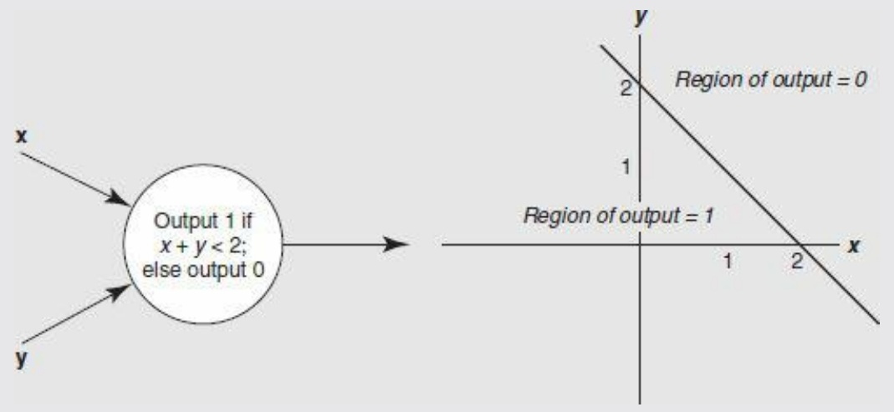

<details>
<summary>text_image</summary>

x
y
Output 1 if
x + y < 2;
else output 0
Region of output = 0
2
1
Region of output = 1
1
2
x
y
</details>

A neural network is specified by the topology of its connections, and the weights and decision formulas of its nodes. A network can make more complex decisions than a single neuron. Thus, if one neuron with two inputs can decide on which side of a line a point lies, three neurons can select points that lie within a triangle:

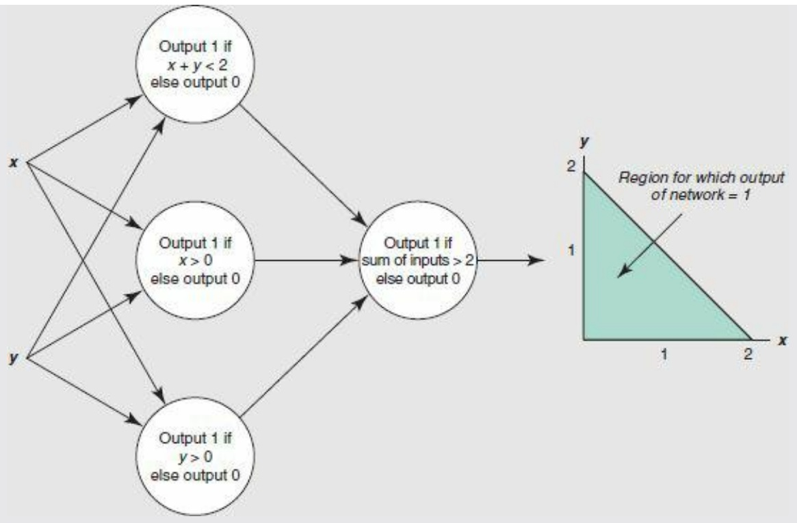

<details>
<summary>flowchart</summary>

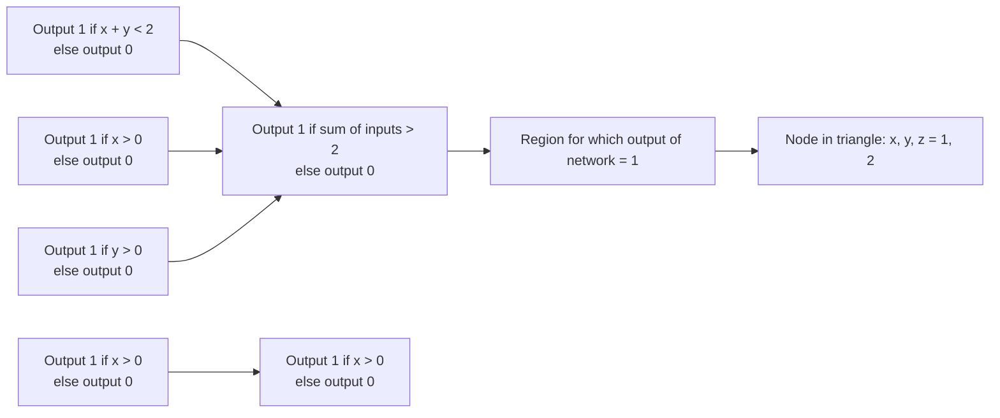
</details>

Neural networks are more powerful and robust if the output is a smoothly varying function of the inputs. Such networks can perform more general kinds of computations and are better at pattern recognition. Also, for training the network it is useful if the output is a differentiable function of the parameters. To this end a sharp threshold function for the output of a neuron is replaced by a smoothed-out step, or sigmoidal, function:

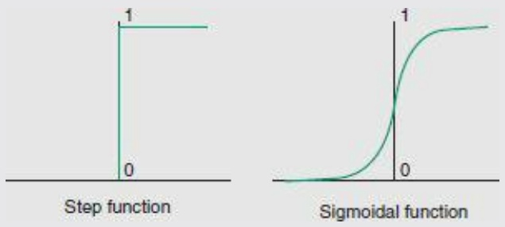

the strengths of the connections. That is, instead of taking a simple sum of inputs, $i _ { 1 } + i _ { 2 } + i _ { 3 } ,$ , take a weighted sum—for instance, $1 0 i _ { 1 } + 5 i _ { 2 } + i _ { 3 } ]$ —which would make the neuron most sensitive to input 1 and least sensitive to input 3. Biologically, this may correspond to changing the strengths of synapses.

A property of a neural network that gives it great power is that the weights may be regarded as variables, and a calculation or learning process may determine the weights appropriate for a particular decision or pattern identifier. To train a network, feed the system sets of sample input for which the desired output is known, and compare the output with the correct answer. If the observed output differs from the desired one, adjust the parameters. The topology of the network remains invariant during the training process, although of course setting a weight to 0 has the effect of detaching an input.

The type of neural network that has been applied to secondary structure prediction is shown in Figure 6.12.

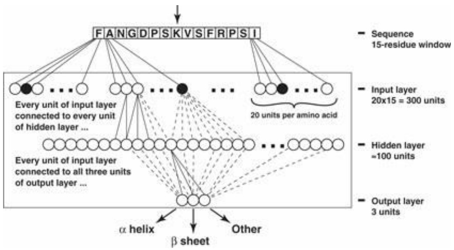

<details>
<summary>flowchart</summary>

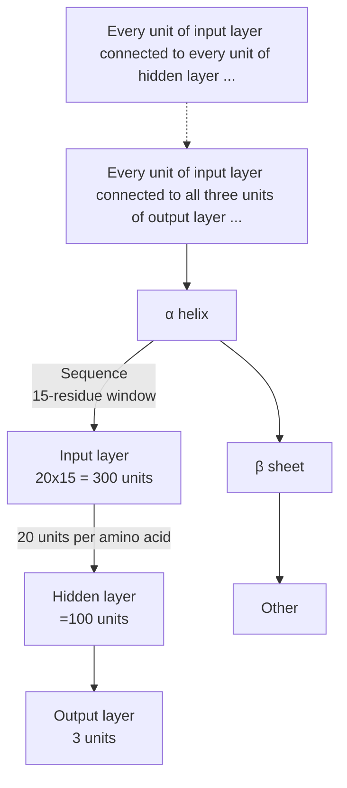
</details>

Figure 6.12 A neural network applicable to secondary structure prediction contains three layers:

1. The input layer sees a sliding 15-residue window in the sequence. That is, it treats a 15-residue region, predicts the secondary structure of the central residue (marked by an arrow, at the top), and then moves the window one residue along the amino acid sequence and repeats the process. To each of the 15 residues in the current window there correspond 20 nodes in the input layer of the network, one of which will be triggered according to the amino acid in that position.
2. A hidden layer of ≈100 units connects the input with the output. Each node of the hidden layer is connected to all input and output units; not all the connections are shown.
3. The output layer consists of only three nodes, that signify prediction that the central residue in the window be in a helix, strand, or other conformation.

A major advance in secondary structure prediction occurred with the application of evolutionary information, the recognition that multiple sequence alignment tables contain much more information than individual sequences. The conservation of secondary structure among related proteins means that the sequence–structure correlations are much more robust when a family as a whole is taken into account. Most neural network-based methods for secondary structure prediction now feed the input layer not simply with the identities of the amino acid at successive positions, but with a profile derived from a multiple sequence alignment.

It has also proved useful to run two neural networks in tandem, to make use of observed correlations among conformations of residues at neighbouring positions. Predictions of the states of several successive residues by one network similar to the one shown in Figure 6.12 are combined by a second network into a final prediction.

A test of the maturity of a prediction method is whether it can be made fully automatic. (See the section on CASP.) Some computational methods require human intervention and editing of results. Others, including PROF, the system that predicted the secondary structure of MutS, are fully automatic.

## Homology modelling

Model building by homology is a useful technique for predicting the structure of a target protein of known sequence, when the target protein is related to at least one other protein of known sequence and structure. If the proteins are closely related, the known protein structures—called the parents— can serve as the basis for a model of the target. Although the quality of the model will depend on the degree of similarity of the sequences, it is possible to estimate this quality before experimental testing (see Fig. 6.10). In consequence, knowing how good a model is necessary for the intended application permits intelligent prediction of the probable success of the exercise.

Steps in homology modelling are outlined here.

1. Align the amino acid sequences of the target and the protein or proteins of known structure. It will generally be observed that insertions and deletions lie in the loop regions between helices and sheets.
2. Determine mainchain segments to represent the regions containing insertions or deletions. Stitching these regions into the mainchain of the known protein creates a model for the complete mainchain of the target protein.
3. Replace the sidechains of residues that have been mutated. For residues that have not mutated, retain the sidechain conformation. Residues that have mutated tend to keep the same sidechain conformational angles, and could be modelled on this basis. However, computational methods are now available to search over possible combinations of sidechain conformations.
4. Examine the model—both by eye and by programs—to detect any serious collisions between atoms. Relieve these collisions, as far as possible, by manual manipulations.
5. Refine the model by limited energy minimization. The role of this step is to fix up the exact geometrical relationships at places where regions of mainchain have been joined together, and to allow the sidechains to wriggle around a bit to place themselves in comfortable positions. The effect is really only cosmetic: energy refinement will not fix serious errors in such a model.

To a great extent, this procedure produces ‘what you get for free’ in that it defines the model of the protein of unknown structure by making minimal changes to its known relatives. In some cases it is possible to make substantial improvements. A rule of thumb (referring again to Fig. 6.10) is that if two or more sequences have at least 40–50% identical amino acids in an optimal alignment of their sequences, the procedure described will produce a model of sufficient accuracy to be useful for many applications. If the sequences are very distantly related, neither the procedure described nor any other currently available method will produce a model, correct in detail to atomic resolution, of the target protein from the structure of its relative.


## See Weblem 6.14

In most families of proteins the structures contain relatively constant regions and more variable ones. A single parent structure will permit reasonable modelling of the conserved portion of the target protein, but may fail to produce a satisfactory model of the variable portion. From only one target and one parent sequence, it will not be easy to even predict which are the variable and constant regions. A more favourable situation occurs when several related proteins of known structure provide a basis for modelling a target protein. These reveal the regions of constant and variable structure in the family. The observed distribution of structural variability among the parents dictates an appropriate distribution of constraints to be applied to the model.

SWISS-MODEL hosts a website that will accept the amino acid sequence of a target protein, determine whether a suitable parent or parents for homology modelling exist, and, if so, deliver a set of coordinates for the target. SWISS-MODEL was developed by T. Schwede, M.C. Peitsch, and N. Guex, now at the Geneva Biomedical Research Institute.

An example of the automatic prediction by SWISS-MODEL is the prediction of the structure a neurotoxin from red scorpion (Buthus tamulus) from the known structure of the neurotoxin from the related scorpion North African yellow scorpion (Androctonus australis hector). These two proteins have 52% identical residues in their sequence alignment. With such a close degree of similarity it is not surprising that the model fits the experimental result very closely, even with respect to the sidechain conformation (Fig. 6.13).

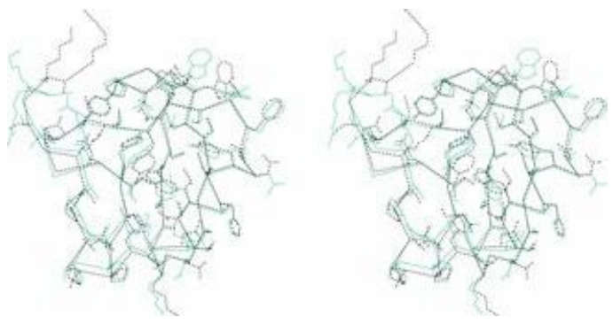

<details>
<summary>chemical</summary>

Molecular structure diagram showing two complex organic frameworks with labeled atoms and bonds
</details>

Figure 6.13 SWISS-MODEL predicts the structure of red scorpion neurotoxin [1DQ7] (green) from a closely related protein [1PTX] (black). The prediction was done automatically. Observe that most of the buried sidechains have not mutated, and have very similar conformations. Some sidechains on the surface have different conformations, and the mainchain of the C-terminus is in a different position (upper left). Not shown is a network of disulphide bridges, which constrain the structure. However, a model of this high quality would be expected, for two such closely related proteins, even without the extra constraints.


## See Weblem 6.15

## Fold recognition

Searching a sequence database for a probe sequence and searching a structure database with a probe structure are problems with known solutions. The mixed problems—probing a sequence database with a structure, or a structure database with a sequence—are less straightforward. They require a method for evaluating the compatibility of a given sequence with a given folding pattern.

The goal is to abstract the essence of a set of sequences or structures. Other proteins that share the pattern are expected to adopt similar structures.

## Three-dimensional profiles

We have discussed patterns and profiles derived from multiple sequence alignments and their application to detection of distant homologues. One way to take advantage of available structural information to improve the power of these methods is a type of profile derived from the available sequences and structures of a family of proteins.

J.U. Bowie, R. Lüthy, and D. Eisenberg analysed the environments of each position in known protein structures and related them to a set of preferences of the 20 amino acids for these structural contexts.

Given a protein structure, classify the environment of each amino acid in three separate categories:

1. its mainchain hydrogen-bonding interactions; that is, its secondary structure;
2. the extent to which it is buried within or on the surface of the protein structure;
3. the polar/nonpolar nature of its environment.

The secondary structure may be one of three possibilities: helix, sheet, and other. A sidechain is considered buried if the accessible surface area is less than 40 $\mathrm { A } ^ { 2 } ;$ partially buried if the accessible surface area is between $4 0$ and 114 $\mathrm { A } ^ { 2 }$ , and exposed if the accessible surface area is greater than 114 $\mathrm { A ^ { 2 } } ,$ The fraction of sidechain area covered by polar atoms is measured. The authors define six classes on the basis of accessibility and polarity of the surroundings. Sidechains in each of these six classes may have any of three types of secondary structure assignment: helix, sheet, or neither. This gives a total of 18 classes.

Assigning each sidechain to one of 18 categories makes it possible to write a coded description of a protein structure as a message in an alphabet of 18 letters, called a 3D structure profile. Algorithms developed for sequence searches can thereby be applied to ‘sequences’ of encoded structures. For example, one could try to align two distantly related sequences by aligning their 3D structure profiles rather than their amino acid sequences. The 3D profile method translates protein structures into onedimensional probe (or probe-able) objects that do not explicitly retain either the sequence or structure of the molecules from which they were derived.

Next, how can one relate the 3D structure profile to the set of known protein folding patterns? It is clear that some amino acids will be unhappy in certain kinds of sites; for example, a charged sidechain would prefer not to be buried in an entirely nonpolar environment. Other preferences are not so clear-cut, and it is necessary to derive a preference table from a statistical survey of a library of well-refined protein structures.

Suppose now that we are given a sequence and want to evaluate the likelihood that it takes up, say, the globin fold. From the 3D structure profile of the known sperm whale myoglobin structure we know the environment class of each position of the sequence. We must consider all possible alignments of the sequence of the protein of unknown structure with the 3D structure profile of myoglobin. Consider a particular alignment, and suppose that the residue in the unknown sequence that corresponds to the first residue of myoglobin is phenylalanine. The environment class in the 3D structure profile of the first residue of sperm whale myoglobin is: exposed, no secondary structure. One can score the probability of finding phenylalanine in this structural environment class from the table of preferences of particular amino acids for this 3D structure profile class. (The fact that the first residue of the sperm whale myoglobin sequence is actually valine is not used, and in fact that information is not directly accessible to the algorithm. Sperm whale myoglobin is represented only by the sequence of environment classes of its residues, and the preference table is averaged over proteins with many different folding patterns.) Extension of this calculation to all positions and to all possible alignments (not allowing gaps within regions of secondary structure) gives a set of scores that measures how well the given unknown sequence, in each possible alignment, fits the sperm whale myoglobin sequence–structure profile. The best score, over all tested alignments, can be calibrated to decide whether the sequence and folding pattern are likely to correspond.

A particular advantage of this method is that it can be automated, with a new sequence being scored against every 3D profile in the library of known folds, in essentially the same way as a new sequence is routinely screened against a library of known sequences.

## Use of three-dimensional profiles to assess the quality of structures

The 3D profile derived from a structure depends only very indirectly on the amino acid sequence. It is therefore meaningful to ask not only whether it is possible to identify other amino acid sequences compatible with the given fold, but whether the score of a 3D profile for its own parent sequence is a measure of the compatibility of the sequence with the structure. Naturally, if real sequences did not generally appear to be compatible with their own structures, credibility in the method as capturing a valid connection between sequence and structure would be severely impaired. Two interesting results are observed. (1) protein structures determined correctly do fit their own profiles well, although other, related, proteins, may give higher scores. The profile is abstracting properties of the family, not of individual sequences. (2) When a sequence does not match a profile computed from an experimental structure of that protein there is likely to have been an error in the structure determination. The positions in the profile that do not match can identify the regions of error.

## Threading

Threading is a method for fold recognition. Given a library of known structures, and a sequence of a query protein of unknown structure, does the query protein share a folding pattern with any of the known structures? The fold library could include some or all of the PDB, or even hypothetical folds.

The basic idea of threading is to build many rough models of the query protein, based on each of the known structures and using different possible alignments of the sequences of the known and unknown proteins. This systematic exploration of the many possible alignments gives threading its name: imagine trying out all alignments by pulling the query sequence gently through the threedimensional framework of any known structure. Gaps must be allowed in the alignments, but if the thread is thought of as being sufficiently elastic the metaphor of threading survives.

Both threading and homology modelling deal with the three-dimensional structure induced by an alignment of the query sequence with known structures of homologues. Homology modelling focuses on one set of alignments and the goal is a very detailed model. Threading explores many alignments and deals with only rough models usually not even constructed explicitly.

| Homology modelling | Threading |
| --- | --- |
| First, identify homologues | Try all possible folds |
| Then, determine optimal alignment | Try many possible alignments |
| Optimize one model | Evaluate many rough models |

Successful fold recognition by threading requires:

1. a method to score the models, so that we can select the best one;
2. a method for calibrating the scores, so that we can decide whether the best-scoring model is likely to be correct.

Several approaches to scoring have been tried. One of the most effective is based on empirical patterns of residue neighbours, as derived from known structures. First, we observe the distribution of interresidue distances in known protein structures, for all 20 × 20 pairs of residue types. For each pair, derive a probability distribution, as a function of the separation in space, and in the amino acid sequence. For instance, for the pair Leu–Ile, consider every Leu and Ile residue in known structures, and, for each Leu–Ile pair, record the distance between their Cβ atoms, and the difference in their positions in the sequence. Collecting these statistics permits estimation of how well the distributions observed in a model agree with the distributions in known structures.

The Boltzmann equation relates probabilities and energies. Usual applications of the Boltzmann equation start from an energy function and predict a probability distribution. (A standard example is the prediction of the density of the atmosphere as a function of altitude from the gravitational potential energy function of the air molecules.) For threading, one turns this on its head, and derives an energy function from the probability distribution. This energy function is then used to score threading models.

For each structure in the fold library, the procedure finds the assignment of residues that produces the lowest energy score. The most effective algorithms for finding optimal sequence alignments are based on a mathematical technique called dynamic programming (See Chapter 5).

Although threading is an alignment problem, it can't be solved by dynamic programming, because of the nonlocal interactions.

The best methods for fold recognition are consistently effective. These include, but are not limited to, methods based on threading.

Figures 6.14 and 6.15 show a prediction by A.G. Murzin, and another prediction by Bonneau, Tsai, Ruczinski, and Baker, of targets from the 2000 CASP programme. Both proteins were of unknown function and came from H. influenzae.

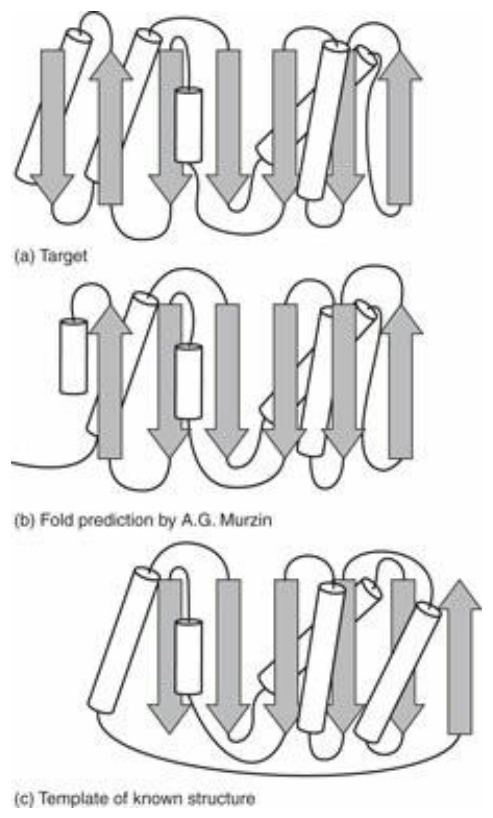

Figure 6.14 Prediction of structure of H. influenzae, hypothetical protein. (a) The folding pattern of the target. (b) Prediction by A.G. Murzin. (c) Folding pattern of the closest homologue of known structure: an N-ethylmaleimidesensitive fusion protein involved in vesicular transport (PDB entry 1NSF). The topology of Murzin's prediction is closer to the target than that of the closest single parent.

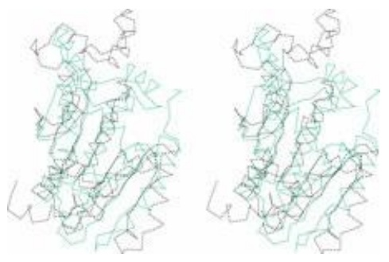

<details>
<summary>natural_image</summary>

Two abstract line drawings of a protein structure, possibly a ligand or protein backbone, with no visible text or symbols.
</details>

Figure 6.15 Prediction by Bonneau, Tsai, Ruczinski, and Baker of another hypothetical protein from H. influenzae, based on glycine N-methyltransferase [1XVA]. Black, experimental structure; green, prediction. Note that much of the prediction superposes well on the experimental structure, and that the parts that do not superpose well have similar local structures but improper orientation and packing against the main body of the protein.

## Prediction of coiled coils by hidden Markov models

Approaches to prediction of coiled-coiled regions in proteins include:

profile methods using running windows (PCOILS);
profile methods, running windows, with residue correlations (PairCoil2);
• HMMs (MARCOIL).

MARCOIL gave the best overall performance in controlled tests.

MARCOIL uses a HMM trained on a database containing nine classes of proteins:

• Tropomyosins

• Myosins

• Intermediate filaments

• Dyneins

• Kinesins

• Laminins

• SNARE proteins

• Transcription factors

• Others

Submitting to MARCOIL the chicken proto-oncogene protein c-fos, and selecting default parameters:

```txt
>P11939 - FOS_CHICK Proto-oncogene protein c-fos - Gallus gallus (Chicken).
MMYQGFAGEYEAPSSRCSSASPAGDSLTYYPSPADSFSSMGSPVNSQDFCTDLAVSSANF
VPTVTAISTSPDLQWLVQPTLISSVAPSQNRGHPYGVPAPAPPAAYSRPAVLKAPGGRGQ
SIGRRGKVEQLSPEEEEKRRIRRERNKMAAAKCRNRRRELTDTLQAETDQLEEEKSALQA
EIANLLKEKEKLEFILAAHRPACKMPEELRFSEELAAATALDLGAPSPAAAEEAFALPLM
TEAPPAVPPKEPSGSGLELKAEPFDELLFSAGPREASRSVPDMDLPGASSFYASDWEPLG
AGSGGELEPLCTPVVTCTPCPSTYTSTFVFTYPEADAFPSCAAAHRKGSSSNEPSSDSLS
SPTLLAL
```

The program returned the prediction shown in Figure 6.16. The program is quite confident that the protein contains a coiled-coil domain, between residues ≈125– ≈ 200.

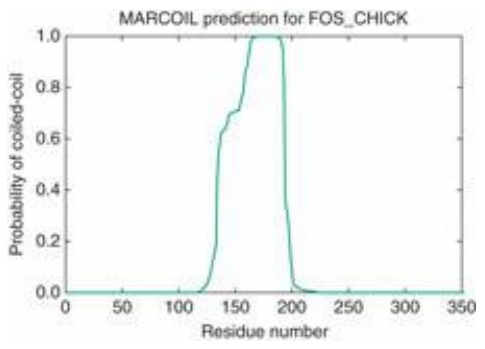

<details>
<summary>line</summary>

| Residue number | Probability of coiled-coil |
| --- | --- |
| ~120 | 0.0 |
| ~130 | ~0.2 |
| ~140 | ~0.6 |
| ~150 | ~0.7 |
| ~160 | ~0.9 |
| ~170 | 1.0 |
| ~180 | 1.0 |
| ~190 | ~0.3 |
| ~200 | 0.0 |
</details>

Figure 6.16 Prediction by MARCOIL of a coiled-coil domain in chicken c-fos.

## Prediction of transmembrane helices and signal sequences by hidden Markov models

Some fold-recognition procedures strive for sufficient generality to identify all known domain structures. Others are specialized to particular types of folds. The best algorithms for prediction of transmembrane helices and coiled coils make use of HMMs, as will be discussed.

A simple approach to prediction of membrane proteins involves looking for amino acid segments 15–30 residues in length that are rich in hydrophobic residues. However, signal peptides also contain hydrophobic helices: the signal sequence typically comprises a positively charged n-region, followed by a helical hydrophobic h-region, followed by a polar c-region. Methods for recognizing transmembrane helices in amino acid sequences tend to pick up the h-regions of signal peptides as false positives. Methods for recognizing signal peptides in amino acid sequences tend to pick up transmembrane helices as false positives.

Käll, Krogh, and Sonnhammer trained HMMs to test simultaneously for transmembrane helices and signal peptides. The goals are to find both at the same time, to discriminate between them in the results, and to predict not only the positions of the transmembrane helices but the locations— cytoplasmic or interior—of the loops. They called their method PHOBIUS.

PHOBIUS is the most successful algorithm currently available for recognizing signal peptides and helical transmembrane proteins, and for predicting the orientation of the transmembrane segments. PHOBIUS is capable of distinguishing h-domains of signal peptides from transmembrane helices: the number of false classifications of signal peptides was 3.9%, and the number of false classifications of transmembrane helices was 7.7%. These results represent a substantial improvement over previous methods. It is interesting that addressing the two problems at once proved to be more successful than treating them separately.

Web resources: Membrane proteins

| PHOBIUS (L. Käll, A. Krogh, and E. Sonnhammer) | http://phobius.cgb.ki.se/ |
| --- | --- |
| PHDhtm (B. Rost) | http://www.predictprotein.org |
| Membrane Protein Explorer (S. White) | http://blanco.biomol.uci.edu/mpex/ |
| Membrane proteins of known structure | http://blanco.biomol.uci.edu/mpstruc/listAll/list |
| The Membrane Protein Data Bank (P. Raman, V. Cherezov, and M. Caffrey) | http://www.mpdb.tcd.ie/ |
| Protein Data Bank of Transmembrane Proteins (G.E. Tusnády, Z. Dosztányi, and I. Simon) | http://pdbtm.enzim.hu/ |

## Conformational energy calculations and molecular dynamics

A protein is a collection of atoms. The interactions between the atoms create a unique state of maximum stability. Find it, that's all!

The computational difficulties in this approach arise because (1) the model of the interatomic interactions is not complete or exact and (2) even if the model were exact we face an optimization problem in a large number of variables, involving nonlinearities in the objective function and the constraints, creating a very rough energy surface with many local minima. Like a golf course with many bunkers, such problems are very difficult.

The interactions between atoms in a molecule can be divided into:

1. primary chemical bonds: strong interactions between atoms that must be close together in space; these are regarded as a fixed set of interactions that are not broken or formed when the conformation of a protein changes, but are equally consistent with a large number of conformations;
2. weaker interactions that depend on the conformation of the chain. These can be significant in some conformations and not in others: they affect sets of atoms that are brought into proximity by different folds of the chain.

The conformation of a protein can be specified by giving the list of atoms in the structure, their coordinates, and the set of primary chemical bonds between them (this can be read off, with only slight ambiguity, from the amino acid sequence). Terms used in the evaluation of the energy of a conformation typically include:

Bond stretching: $\scriptstyle \sum _ { \mathrm { b o n d s } } K _ { r } ( r - r _ { 0 } ) ^ { 2 }$ . Here $r _ { 0 }$ is the equilibrium interatomic separation and $K _ { r }$ is the force constant for stretching the bond. $r _ { 0 }$ and $K _ { r }$ depend on the type of chemical bond.

• Bond angle bend: $\scriptstyle \sum _ { \mathrm { a n g l e s } } K _ { \theta } ( \theta \mathrm { ~ - ~ } \theta _ { 0 } ) ^ { 2 }$ . For any atom i that is chemically bonded to two (or more) other atoms j and k, the angle $i - j - k$ has an equilibrium value $\theta _ { 0 }$ and a force constant for bending $K _ { \theta } .$

• Other terms to enforce proper stereochemistry penalize deviations from planarity of certain groups, or enforce correct chirality (handedness) at certain centres.

Torsion angle: $\textstyle \sum _ { \mathrm { d i h e d r a l s } }$ $\% V_{n}[1+\cos\phi]$ For any four connected atoms—i bonded to j bonded to k bonded to l—the energy barrier to rotation of atom l with respect to atom i around the $j { - } k$ bond is given by a periodic potential. $V _ { n }$ is the height of the barrier to internal rotation; n barriers are encountered during a full $3 6 0 ^ { \circ }$ rotation. (For instance, for ethane $n \; = \; 3 . )$ The mainchain conformational angles ϕ, ψ, and ω are examples of torsional rotations (see Fig. 6.2).
Van der Waals interactions: $A_{ij}R_{ij}^{-12}-B_{ij}R_{ij}^{-6}$ . For each pair of nonbonded atoms i and j the first term accounts for a short-range repulsion and the second term for a long-range attraction between them. The parameters A and B depend on atom type.
Hydrogen bonds: $C_{ij}R_{ij}^{-12}-D_{ij}R_{ij}^{-10}$ The hydrogen bond is an weak chemical/electrostatic interaction between two polar atoms. Its strength depends on distance and also on the bond angle. This approximate hydrogen-bond potential does not explicitly reflect the angular dependence of hydrogen-bond strength; other potentials attempt to account for hydrogen-bond geometry more accurately.
Electrostatics: $\mathcal { Q } _ { i } \mathcal { Q } _ { j } / ( \varepsilon R _ { i j } )$ For each pair of charged atoms i and $j ,   Q _ { i }$ and $Q _ { j }$ are the effective charges on the atoms, $R _ { i j }$ is the distance between them, and ε is the dielectric ‘constant’. This formula applies only approximately to media that are not infinite and isotropic, including proteins.
Solvent: interactions with the solvent, water, and cosolutes such as salts and sugars, are crucial for the thermodynamics of protein structures. Attempts to model the solvent as a continuous medium, characterized primarily by a dielectric constant, are approximations. With the increase in available computer power it is now possible to include solvent explicitly, simulating the motion of a protein in a box of water molecules.

There are numerous sets of conformational energy potentials of this or closely related forms, and a great deal of effort has gone into the tuning of parameter sets. The energy of a conformation is computed by summing these terms over all bonded and nonbonded atoms.

The potential functions satisfy necessary but not sufficient conditions for successful structure prediction. One test is to take the right answer—an experimentally determined protein structure—as a starting conformation, and minimize the energy starting from there. Most high-quality energy functions produce a minimized conformation that is about 1 Å (r.m.s. deviation) away from the starting model. This can be thought of as a measure of the resolution of the force field. Another test has been to take deliberately misfolded proteins and minimize their conformational energies, to see whether the energy value of the local minimum in the vicinity of the correct fold is significantly lower than that of the local minimum in the vicinity of an incorrect fold. Such tests reveal that multiple local minima cannot be reliably distinguished from the correct one on the basis of calculated conformational energies.

Indeed, attempts to predict the conformation of a protein by minimization of the conformational energy have so far not provided a general method for predicting protein structure from amino acid sequence. Molecular dynamics offers a way to overcome the problems of getting trapped in local minima, and of the absence of a good static model for protein–solvent interactions. In molecular dynamics calculations, the protein plus explicit solvent molecules are treated—via the force field— by classical Newtonian mechanics. It is true that this permits exploration of a much larger sector of phase space. However, as an a priori method of structure prediction it has still not succeeded consistently. However, these are calculations that are extremely computationally intensive and here, perhaps more than anywhere else in this field, advances deriving from the increased power of processors will have an effect.