Is lack of computational power the only reason for lack of success in prediction of protein structure by simulation of the folding pathway? There have been several attempts to apply ‘brute force’, including the IBM Blue Gene supercomputer project and the distributed computing approach of Folding, which makes use of contributions of computer power from over a million participating CPUs. (A similar approach has been applied to drug design.) In 2003, an IBM group folded a 20- residue peptide from a fully extended conformation to a state within ≈1.5 Å r.m.s. deviation of the native state. (See Box 6.9.)

In the meantime, molecular dynamics, if supplemented by experimental data, regularly makes extremely important contributions to structure determinations by both X-ray crystallography (usually) and NMR (always). How is molecular dynamics integrated into the process of structure determination? For any conformation, one can measure the consistency of the model with the experimental data. In the case of crystallography, the experimental data are the absolute values of the Fourier transform of the electron density of the molecule. In the case of NMR, the experimental data provide constraints on the distances

## Box 6.9 Scaling of resource requirements for molecular dynamics calculations

Fully detailed molecular dynamics calculations perform a series of individual time steps of duration $1 0 ^ { - 1 5 }   \mathrm { s }   ( = 1$ fs). The computer time required for an individual time step scales approximately as N lnN, where N is the length of the protein. The time required for a protein to fold depends on a number of features, but, for purposes of a ‘back-of-the-envelope’ calculation, it varies with the length N of the protein $\mathrm { a s   \approx   } N ^ { 2 / 3 }$

Therefore the total computer resources required to fold a protein may be expected to vary approximately as $N ^ { 5 / 3 }$ lnN. This means that if it takes 3 months (of uninterrupted time on a supercomputer running flat out) to fold a protein of length N, it would be expected to require over 1.5 years, on the same system, to fold up a protein of length 3N residues.

between certain pairs of residues. But in both X-ray crystallography (usually) and NMR the experimental data underdetermine the protein structure. To solve a structure one must seek a set of coordinates that minimizes a combination of the deviation from the experimental data and the conformational energy. Molecular dynamics is successful at determining such coordinate sets: the dynamics provides adequate coverage of conformation space, and the bias derived from the experimental data channels the calculation quite effectively towards the correct structure.

Molecular dynamics revolutionized protein crystallography. It has transformed what used to be a lengthy, labour-intensive process of manual building and rebuilding of models into electron densities, into a ‘batch’ job turned over to a computer, and requiring much less overall time.

## ROSETTA

ROSETTA is a program by D. Baker and colleagues that predicts protein structure from amino acid sequence by assimilating information from known structures. At recent CASP programmes, ROSETTA has showed consistent success on targets in both the Fold Recognition and Novel Fold categories. At present, it leads the field by several lengths. It represents a major breakthrough.

ROSETTA predicts a protein structure by first generating structures of fragments using known structures, and then combining them. First, for each contiguous region of three and nine residues, instances of that sequence and related sequences are identified in proteins of known structure. For fragments this small there is no assumption of homology to the target protein. The distribution of conformations of the fragments serves as a model for the distribution of possible conformations of the corresponding fragments of the target structure.

ROSETTA explores the possible combinations of fragments using Monte Carlo calculations (see Box 6.10). The energy function has terms reflecting compactness, paired β sheets, and burial of hydrophobic residues. The procedure carries out 1000 independent simulations, with starting structures chosen from the fragment conformation distribution pattern generated previously. The structures that result from these simulations are clustered, and the centres of the largest clusters presented as predictions of the target

## Box 6.10 Monte Carlo algorithms

Monte Carlo algorithms are used very widely in protein structure calculations to explore conformations efficiently, and in many other optimization problems to search for the minimum of a complicated function. Simple minimization methods based on moving ‘downhill’ in energy fail because the calculation gets trapped in a local minimum far from the native state.

In general, Monte Carlo methods make use of random numbers to solve problems for which it is difficult to calculate the answer exactly. The name was invented by J. von Neumann, referring to the applications of random-number generators in the famous casino in Monaco.

To apply Monte Carlo techniques to find the minimum of a function of many variables—for instance, the minimum energy of a protein as a function of the variables that define its conformation—suppose that the configuration of the system is specified by the variables x, and that for any values of these variables we can calculate the energy of the conformation, E(x). (x stands for a whole set of variables: perhaps the set of atomic coordinates of a protein, or the mainchain and sidechain torsion angles.)

Then the Metropolis procedure (invented in 1953, allegedly at a dinner party in Los Alamos) prescribes:

**1.** generate a random set of values of x, to provide starting conformation. Calculate the energy of this conformation, $E   =   E ( \mathbf { x } )$
**2.** perturb the variables, $\mathbf { x } \longrightarrow \mathbf { x } ^ { \prime } ,$ to generate a neighbouring conformation;
**3.** calculate the energy of the new conformation, $E ( \mathbf { x } ^ { \prime } )$ ;
**4.** decide whether to accept the step, to move $\mathbf { x } \longrightarrow \mathbf { x } ^ { \prime } ,$ or to stay at x and try a different perturbation:

**a.** if the energy has decreased, so $E = E ( \mathbf { x } ) > E ( \mathbf { x } ^ { \prime } )$ that is, the step went downhill—always accept it. The perturbed conformation becomes the new current conformation: set $\mathbf { x } ^ { \prime } = \mathbf { x }$ and $E   =   E ( \mathbf { x } ^ { \prime } )$
**b.** if the energy has increased or stayed the same; that is $E ( \mathbf { x } ) \leq E ( \mathbf { x } ^ { \prime } )$ in other words the step goes uphill —sometimes accept the new conformation. If $\Delta   =   E ( { \bf x } ^ { \prime } )   -   E ( { \bf x } )$ accept the step with a probability exp[ $[ - \Delta / ( k T ) ]$ , where k is Boltzmann's constant and T is an effective temperature;

## 5. return to step 2.

It is step 4b that is the ingenious one. It has the potential to get over barriers; out of traps in local minima. The effective temperature, $T ,$ controls the chance that an uphill move will be accepted. T is not the physical temperature at which we wish to predict the protein conformation, but simply a numerical parameter that controls the calculation.

For any temperature, the higher the uphill energy difference, the less likely that the step will be accepted. For any value of $E ,$ if $T$ is low, then $E ( \mathbf { x } ) / ( k T )$ will be high, and $\exp [ - E ( \mathbf { x } ) / ( k T ) ]$ will be relatively low. If $T$ is high then $E ( \mathbf { x } ) / ( k T )$ will be low, and $\exp [ - E ( \mathbf { x } ) / ( k T ) ]$ will be relatively high. The higher the temperature, the more probable the acceptance of an uphill move. This relatively simple idea has proved extremely effective, with successful applications including but by no means limited to protein structure calculations.

Simulated annealing is a development of Monte Carlo calculations in which T varies; first it is set high to allow efficient exploration of conformations and then it is reduced to drop the system into a low-energy state.

structure. The idea is that a structure that emerges many times from independent simulations is likely

to have favourable features.

Figure 6.17 shows successful predictions by ROSETTA of two targets from the 2000 CASP programme.

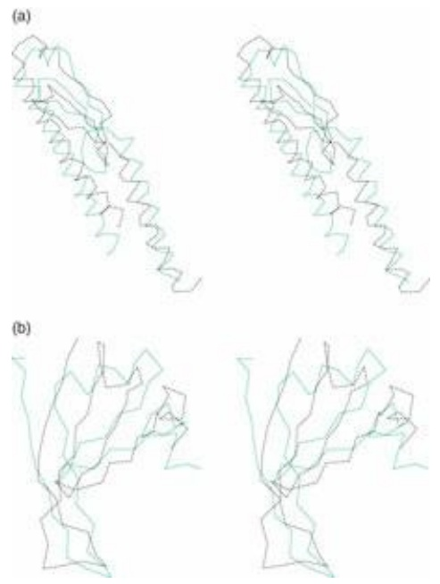

Figure 6.17 Predictions by ROSETTA of (a) H. influenzae, hypothetical protein and (b) the N-terminal half of domain 1 of human DNA repair protein Xrcc4. Panel b shows a selected substructure containing the N-terminal 55 out of 116 residues. Solid lines, experimental structures; broken lines, predicted structures.

ROBETTA ([http://robetta.bakerlab.org](http://robetta.bakerlab.org)) is a web server designed to integrate and implement the best of the protein structure prediction tools. The central pipeline of the software involves first the parsing of a submitted amino acid sequence of a protein of unknown structure into putative domains. Then homology modelling techniques are applied to those domains for which suitable parents of known structure exist, and the de novo methods developed by Baker and coworkers to other domains. In addition, the user will receive the results of other prediction methods based on software developed outside the ROBETTA group. These include, for example, predictions of secondary structure, coiled coils, and transmembrane helices.

## LINUS

LINUS, or Local Independently Nucleated Units of Structure, is a program for prediction of protein structure from amino acid sequence by G.D. Rose and R. Srinivasan. It is a completely a priori procedure, making no explicit reference to any known structures or sequence–structure relationships. LINUS folds the polypeptide chain in a hierarchical fashion, first producing structures of short segments and then assembling them into progressively larger fragments.

An insight underlying LINUS is that the structures of local regions of a protein—short segments of residues consecutive in the sequence—are controlled by local interactions within these segments. During natural protein folding, each segment will preferentially sample its most favourable conformations. However, these preferred conformations of local regions, even the one that will ultimately be adopted in the native state, are below the threshold of stability. Local structure will form transiently and break up many times before a suitable interacting partner stabilizes it. But in the computer one is free to anticipate the results. In a LINUS simulation, favourable structures of local fragments, as determined by their frequent recurrence during the simulation, transmit their preferred conformations as biases that influence subsequent steps. The procedure applies the principle of a rachet to direct the calculation along productive lines.

LINUS begins by building the polypeptide from the sequence as an extended chain. The simulation proceeds by perturbing the conformations of a succession of randomly chosen threeresidue segments and evaluating the energies of the results. Structures with steric clashes are rejected out of hand; other energetic contributions are evaluated only in terms of local interactions. A Monte Carlo procedure (see Box 6.10) is used to decide whether to accept a perturbed structure or revert to its predecessor. LINUS performs a large number of such steps. It periodically samples the conformations of the residues to accumulate statistics of structural preferences.

Subsequent stages in the simulation assemble local regions into larger fragments, using the conformational biases of the smaller regions to guide the process. The window within the sequence controlling the range of interactions is progressively opened, from short local regions to larger ones, and ultimately to the entire protein.

The LINUS representation of the protein folding process is realistic in essential respects, although approximate. All nonhydrogen atoms of a protein are modelled, but the energy function is approximate and the dynamics simplified. The energy function captures the ideas of (1) steric repulsion preventing overlap of atoms, (2) clustering of buried hydrophobic residues, (3) hydrogen bonding, and (4) salt bridges.

LINUS is generally successful in getting correct structures of small fragments (sized between a supersecondary structure and a domain), and in some cases can assemble them into the right global structure. Figure 6.18 shows the LINUS prediction of the C-terminal domain of rat endoplasmic reticulum protein ERp29, one of the targets of the 2000 CASP programme.

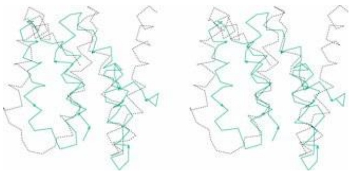

natural_image

Two abstract line drawings with interlocking shapes, no text or symbols present

Figure 6.18 A LINUS prediction of the C-terminal domain of rat endoplasmic reticulum protein ERp29. Black, experimental structure; green, prediction.

## Assignment of protein structures to genomes

A genome sequence is the complete statement of a potential life. Assignment of structures to gene products is a first step in understanding how organisms implement their genomic information.

We want to understand the structures of the molecules encoded in a genome, their individual activities and interactions, and the organization of these activities and interactions in space and time during the lifetime of the organism. We want to understand the relationships among the molecules encoded in the genome of one individual, and their relationships to those of other individuals and other species.

For individual proteins, knowing their structure is essential for understanding the mechanism of their function and interactions. For entire organisms, knowing the structures tells us how the repertoire of possible protein folds is called upon, and how it is distributed among different functional categories in different species. For interspecies comparisons, protein structures can reveal relationships invisible in highly diverged sequences.

Several methods have been applied to structure assignment.

Experimental structure determination: the best way of all!

Detection of homology in sequences: sophisticated sequence comparison methods such as PSI-BLAST or HMMs can identify relationships between proteins, both within an organism and between species. If the structure of any homologue is known experimentally, at least the general fold of the family can be inferred.
• Fold-recognition methods can assign folds to some proteins even in the absence of evidence for homology.
• Specialized techniques detect membrane proteins and coiled coils.

The results of structure assignments provide partial inventories of proteins in the different genomes, and, for the subset of proteins with sufficiently close relatives of known structure, detailed threedimensional models. The degree of coverage of assignments is changing very fast, primarily because of the rapid growth of sequence and structural data. The table contains a current scorecard:

| Species | Number of sequences | Structures assigned | Percentage |
| --- | --- | --- | --- |
| E. coli | 4289 | 916 | 21 |
| M. jannaschii | 1773 | 262 | 14 |
| S. cerevisiae | 6289 | 1109 | 17 |
| D. melanogaster | 13 687 | 2990 | 21 |

From GeneQuiz, [http://jura.ebi.ac.uk:8765/ext-genequiz/](http://jura.ebi.ac.uk:8765/ext-genequiz/).

What do these results tell us about the usage of the potential protein repertoire? A comparison of folding patterns of proteins deduced from the genomes of an archaeon, M. jannaschii, a bacterium, H. influenzae, and a eukaryote, S. cerevisiae, revealed that, out of a total of 148 folds, 45 were common to all three species, and, by implication, probably common to most forms of life. The archaeon M. jannaschii had the fewest unshared folds (see Fig. 6.19).

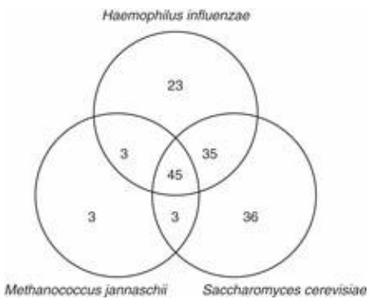

funnel

| Region | Value |
| --- | --- |
| Haemophilus influenzae | 23 |
| Methanococcus jannaschii | 3 |
| Saccharomyces cerevisiae | 36 |
| Haemophilus influenzae & Methanococcus jannaschii | 3 |
| Haemophilus influenzae & Saccharomyces cerevisiae | 35 |
| Methanococcus jannaschii & Saccharomyces cerevisiae | 3 |
| Haemophilus influenzae & Methanococcus jannaschii & Saccharomyces cerevisiae | 45 |

Figure 6.19 Shared protein folds in an archaeon, M. jannaschii, a bacterium, H. influenzae, and a eukaryote, S. cerevisiae.

After Gerstein, M. (1997). A structural census of genomes: comparing bacterial, eukaryotic, and archaeal genomes in terms of protein structure. J. Mol. Biol., **274**, 562–576.

An inventory of the structures common to all three species showed that the five most common folding patterns of domains are (1) the P-loop-containing NTP hydrolase fold, (2) the NAD-binding domain, (3) the TIM-barrel fold, (4) the flavodoxin fold, and (5) the thiamin-binding fold. Plate IX shows the structure and a simplified schematic diagram of the topology of the first of these (see also Weblem 6.2). All are of the α/β type.

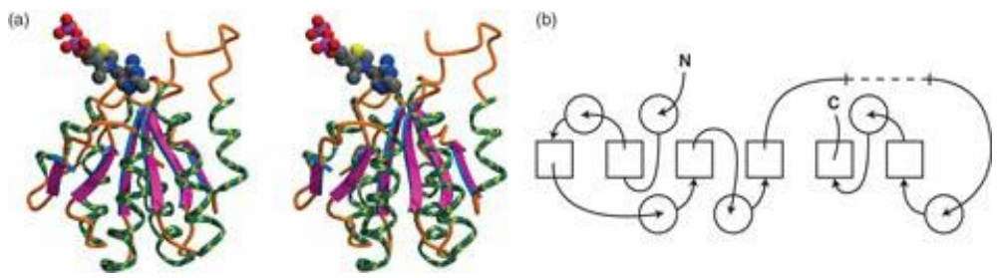

chemical

Molecular structure diagrams showing protein-ligand interactions and a corresponding molecular diagram with labeled atoms N, C, and C'.

Plate IX The thiamin-binding domain from yeast pyruvate decarboxylase. Thiamin-binding domains, identified by M. Gerstein as one of the five most common folding patterns, have been found in archaea, bacteria, and eukarya. (a) Three-dimensional structure. (b) Schematic topology diagram (See Chapter 6).

## Prediction of protein function

The cascade of inference should ideally flow as sequence → structure → function. However, although we can be confident that similar amino acid sequences will produce similar protein structures, the relationship between structure and function is more complex. Proteins of similar structure and even of similar sequence can be recruited for very different functions. Very widely diverged proteins may retain similar functions. Moreover, just as many different sequences are compatible with the same structure, proteins with different folds can carry out the same function (see Fig. 6.20).

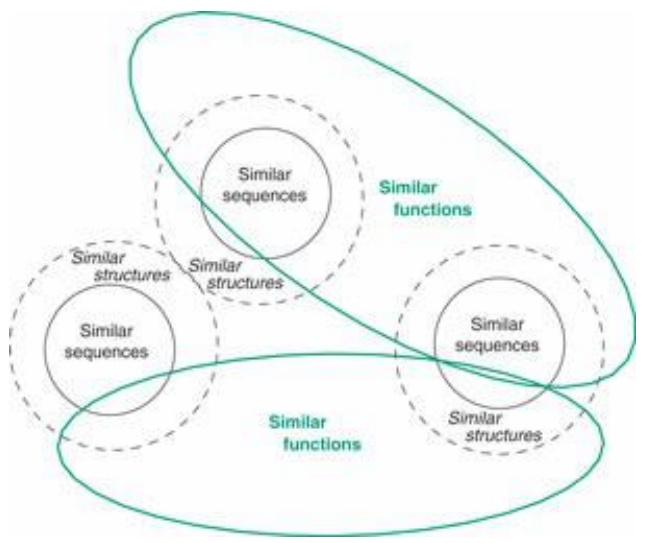

flowchart

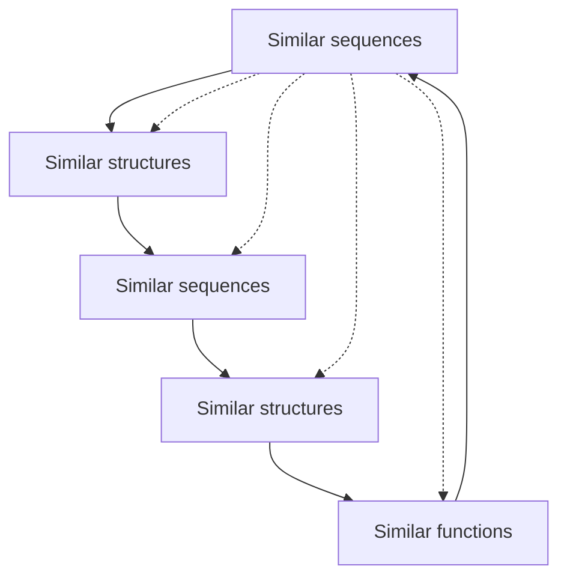

Figure 6.20 Relationships among sequence, structure, and function:

• similar sequences can be relied on to produce similar protein structures, with divergence in structure increasing progressively with the divergence in sequence;
conversely, similar structures are often found with very dif erent sequences. In many cases the relationships in a family of proteins can be detected only in the structures, the sequences having diverged beyond the point of our being able to detect the underlying common features;
• similar sequences and structures often produce proteins with similar functions, but exceptions abound;
• conversely, similar functions are often carried out by nonhomologous proteins with dissimilar structures; examples include the different families of proteinases, sugar kinases, and lysyl-tRNA synthetases.

As proteins evolve they may:

• retain function and specificity;
• retain function but alter specificity;
• change to a related function, or a similar function in a different metabolic context; or
• change to a completely unrelated function.

## Divergence of function: orthologues and paralogues

The family of chymotrypsin-like serine proteinases includes closely related enzymes in which function is conserved, and widely diverged homologues that have developed novel functions (see Box 6.11).

Trypsin, a digestive enzyme in mammals, catalyses the hydrolysis of peptide bonds adjacent to a positively charged residues, Arg or Lys. (A specificity pocket, a surface cleft in the active site, is complementary in shape and charge distribution to the sidechain of the residue adjacent to the scissile bond.) Enzymes with similar sequence, structure, function, and specificity exist in many species, including human, cow, Atlantic salmon, and even Streptomyces griseus (Fig. 6.21). The similarity of the S. griseus enzyme to vertebrate trypsins suggests a lateral gene transfer. For the three vertebrate enzymes, each pair of sequences has 64% or more identical residues in the alignment, and the bacterial homologue has 30% or more identical residues with the others; all have very similar structures. These enzymes are orthologues, or homologous proteins in different species. (Other bacterial homologues are very different in sequence.)

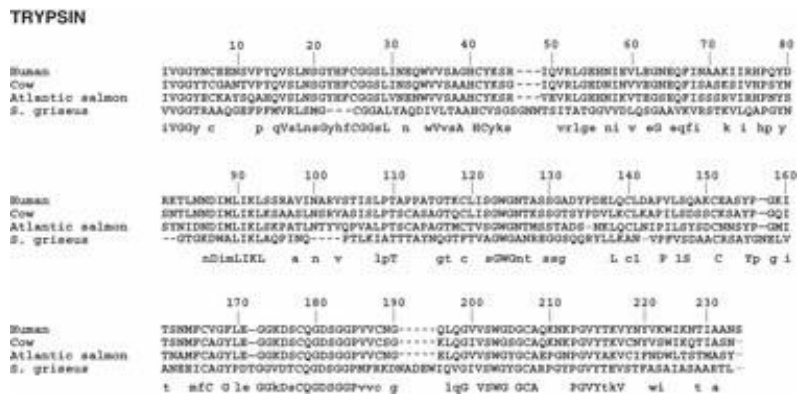

text_image

TRYPSIN
Human
Cow
Atlantic salmon
S. griseus
10 20 30 40 50 60 70 80
IVGGYTCKENSVPTQVSLNGTGEFCGGLSIQQWYSAAGHCYESK----IQVLEGKENHIVLEGNEQPINKAAIKIRHPQTD
IVGGYTCCAMTVPTQVSLNGTGEFCGGLSIQQWYSAAGHCYESK----IQVRLGKENHIVLEGNEQPISASESVNPHSYN
IVGGYECKATSGAEQVSLNGTGEFCGLVENBWVSAAHCYESK----TEVLGKEKNIKVTDEGKEQIFIGSRVIRHPFYSI
VVGGTRAAQGEFFPVMRLMG---CGGALTAQDIVLTAANCVSGDGNMTSITATGGYVDLGQSGAAYKVFRSTKVLQAPGTN
iVGOy c p qValnsqYhfC0GsL n wVysA Hcyks vrlge ni v e9 sqfi k i hp y
90 100 110 120 130 140 150 160
Human
Cow
Atlantic salmon
S. griseus
RETLAMDMLIKLSSRAVINASYSTISLPTAPPATGTFLCLGGWNTASSGADYPDELQLCLDAFVPILSQAKCEASYFP-GKI
SWTLAMDMLIKLSSRAASLMSKYASISLTSPSCARQTCLIDGGWNTESGGTSYPVILCKLAPILSEDSGCKSAYFP-GQI
STWDMDMLIKLSKPATLNTYGPVALPTSPACAPRTMCTVEGGWNTMESTADS-NEKLCLNIPILSYSDCNNSYP-GMI
--GTGEDWALIKLAQPIMQ----FTLEIATTAYMGTPTVAGWSANKEGGSSQRYLLLEAN-VPPVSDAACRSATGYNELV
nDimLIKL a n v lpT gt c sgWont ssg L cl P 1S C Tp g i
170 180 190 200 210 220 230
Human
Cow
Atlantic salmon
S. griseus
TSNMFCYGFLE-OGKDSCQDGSGPVYCMG----QLGVYVSWGDGCAQKNKPGVYTEVYNTVKWIKMNTIAANS
TSNMFCAYYLE-OGKDSCQDGSGPVYCMG----KLGVYVSWGDGCAQKNKPGVYTEVYNTVKWIKMNTIAANS
TNAMPCAGYLE-OGKDSCQDGSGPVYCMG----KLGVYVSWGTGCAEPGNPGVYAKVCIPNDWLTLSTMAST-
ANERICAGYPTQGVUTCQDGSGPMPRKWDADEWIQGVYGWTGCABPGTPGVTYEVSTFASAIASAAETL-
t mfC G le OGKDSCQDGSGPVvvo g lgG VSWG GCA PGVYTKV wi t a

Figure 6.21 Alignment of sequences of trypsins from human, cow, Atlantic salmon, and S. griseus. In the lines under the blocks, uppercase letters indicate absolutely conserved residues and lowercase letters indicate residues conserved in three of the four sequences (in most but not all cases S. griseus is the exception).

Evolution has also created related enzymes in the same species with different specificities. Chymotrypsin and pancreatic elastase are other digestive enzymes that, like trypsin, cleave peptide bonds, but next to different residues: chymotrypsin cleaves adjacent to

## Box 6.11 Evolutionary relationships among proteins: homologues, orthologues, and paralogues

• Proteins are homologous if and only if they are descended from a common ancestor.
• Homologues in different species, descended from a single ancestral protein, are orthologues.
Homologues in the same species, arising from gene duplication, are paralogues. Their descendants are also paralogues. After gene duplication, one of the resulting pairs of proteins can continue to provide its customary function, releasing the other to diverge, to develop new functions. Therefore, inferences of function from homology are more secure for orthologues than for paralogues.

large flat hydrophobic residues (Phe, Trp) and elastase cleaves adjacent to small residues (Ala). The change in specificity is effected by mutations of residues in the specificity pocket. Another homologue, leukocyte elastase (the object of database searching in Chapter 4) is essential for phagocytosis and defence against infection. Under certain conditions it is responsible for lung damage leading to emphysema.

Homologous proteins in the same species are called paralogues. Trypsin, chymotrypsin and pancreatic elastase function in digestion of food. Another set of paralogues mediates the blood coagulation cascade. Although all are proteinases, the requirements for activation and control are very different for digestion and blood coagulation, and the families have diverged and become specialized for these respective roles.

Many proteolytic enzymes are synthesized in inactive forms, and mature by peptide cleavage to expose the active site. (It would just not do to have rogue proteases running around in cells.) However, in trypsin, activation involves cleavage of a 15-residue N-terminal peptide. In the activation of thrombin the protein is doubly cleaved, not near the initial N-terminus, and ends up as about half the size of its precursor. Also, trypsin and thrombin interact with different sets of inhibitors and thrombin, but not trypsin, is subject to allosteric control.

Some homologues of trypsin have developed entirely new functions, as described here.

Haptoglobin is a chymotrypsin homologue that has lost its proteolytic activity. It acts as a chaperone, preventing unwanted aggregation of proteins. Haptoglobin forms a tight complex with haemoglobin fragments released from erythrocytes, with several useful effects including preventing the loss of iron.
The serine proteinase of rhinovirus has developed a separate, independent function, of forming the initiation complex in RNA synthesis, using residues on the opposite side of the molecule from the active site for proteolysis. This is not a modification of an active site: it is the creation of a new one.
• Subunits homologous to serine proteinases appear in plasminogen-related growth factors. The role of these subunits in growth factor activity is not yet known, but it cannot be a proteolytic function because essential catalytic residues have been lost.
• An antifreeze glycoprotein in antarctic fish is homologous to chymotrypsin.
• The insect ‘immune’ protein scolexin is a distant homologue of serine proteinases that induces coagulation of haemolymph in response to infection.

In the chymotrypsin family we see a retention of structure with similar functions in closely related proteins, and progressive divergence of function in some but not all distantly related ones.

The message is that the overall folding pattern of a protein is an unreliable guide to predicting function, especially for very distant homologues. For correct prediction of function in distantly related proteins it is necessary to focus on the active site. For example:

• J.F. Bazan and R. Fletterick, and, independently, P. Argos, G. Kamer, M.J. Nicklin, and E. Wimmer, recognized that viral 3C proteinases are chymotrypsin homologues, despite the fact that the serine of the catalytic triad is changed to cysteine;
• W.R. Taylor and L. Pearl recognized the distant homology between retroviral and aspartic proteinases from conserved Asp, Thr, and Gly residues.

Like motif libraries such as PROSITE, such approaches go directly from signature patterns of activesite residues in the sequence to conserved function, even in the absence of an experimental structure.

In focusing on the active site there is opportunity to use methods similar to those used in drug design to predict ligands that might bind to the proteins. These would be putative substrates. It will be important to make use of other experimental information available, such as tissue-distribution patterns of expression, and catalogues of proteins that interact. Attempts to measure function directly, for instance by means of gene knockouts, will sometimes provide an answer, but are unproductive if the knocked-out phenotype is lethal or if there are multiple proteins that share a function.

It seems likely that the contribution of bioinformatics to prediction of protein function from sequence and structure will not be a simple algorithm that provides an unambiguous answer. (In contrast there is reasonable hope that there will someday be a program that will predict structure from sequence.) More reasonable aims are to suggest productive experiments and to contribute to the interpretation of the results. These are not unworthy goals.

## Drug discovery and development

It is a sobering experience to ask a classroom full of students how many would be alive today without at least one course of drug therapy during a serious illness. (This ignores diseases escaped entirely, through vaccination.) Or to ask the students how many of their surviving grandparents would be leading lives of greatly reduced quality without regular treatment with drugs. The answers are eloquent. They engender fear of the new antibiotic-resistant strains of infectious microorganisms. It is necessary to develop new drugs, which, in combination with genomic information that can improve their specificity and reduce side effects, will extend and improve our lives.

However, it is not easy to be a drug. For a chemical compound to qualify as a drug, it must be:

1. safe,
2. effective,
3. stable: both chemically and metabolically,
4. deliverable: the drug must be absorbed and make its way to its site of action,
5. available: by isolation from natural sources or by synthesis,
6. novel; that is, patentable.

Medicinal chemists apply an equivalent of the duck test: only if it walks like a drug, swims like drug, and quacks like a drug, then maybe it will be a drug. Steps in the development of new drug are summarized in Box 6.12. The process involves

## Box 6.12 Steps in the development of a new drug

**1.** Understanding the biological nature and symptoms of a disease. Is it caused by

o an infectious agent: bacterium, virus, other?
a poison of nonbiological origin?
a mutant protein in the patient?

**2.** Developing an assay. Given a candidate drug, can you test it by:

0 its effect on the growth of a microorganism?
its effect on cells grown in tissue culture?
its effect on animals that suffer the disease or an analogue?
0 its binding to a known protein target?

**3.** Is an effective agent from a natural source known from folklore? If so, go to 6.

**4.** Identify a specific molecular target, usually a protein. Determine its structure experimentally or by model building.

**5.** Get a general idea of what kind of molecule would fit the site on the target. Is there a known substrate or inhibitor?
**6.** Identification of a lead compound: any chemical that shows the desired biological activity to any measurable extent. A lead compound is a bridgehead; finding lead compounds and subsequently modifying them are quite different kinds of activities.
**7.** Development of the lead compound: extensive study of variants of the compound, with the goal of building in all the desired properties and enhancing the biological activity.
**8.** Preclinical testing, in vitro and with animals, to prove effectiveness and safety. At this point the drug may be patented. (In principle, one wants to delay patenting as long as possible because of finite lifetime of the patent. Many lengthy steps still remain before the drug can be sold.)
**9.** In the USA: submission of an Investigational New Drug Application to the Federal Drug Administration (FDA). This is followed by three phases of clinical trials.
**10.** Phase I clinical trials. Test the compound for safety on healthy volunteers. Determine how the body deals with the drug: how it is absorbed, distributed, metabolized, and excreted. The results suggest a safe dosage range.
**11.** Phase II clinical trials. Test the compound for efficacy against a disease on approximately 200 volunteer patients. Does it cure the disease or alleviate symptoms? Calibrate the dosage.
**12.** Phase III clinical trials. Test approximately 2000 patients to demonstrate conclusively that the compound is better than the best known treatment. These are randomized double-blind tests, either against a placebo or against a currently used drug. These trials are very expensive; it is not uncommon to kill a project before embarking on this step, if the phase II trials expose side effects or unsatisfactory efficacy.
**13.** File a New Drug Application with the FDA, containing supporting data proving safety and efficacy. FDA approval allows selling the drug. Only now can the drug bring in income.
**14.** Phase IV studies, subsequent to FDA approval and marketing, involve continued monitoring the effects of the drug, reflecting the wider experience in its use. New side effects may turn up in some classes of patients, leading to restrictions on the use of the drug, or even possibly its recall.

scientific research, clinical testing to prove safety and efficacy, and very important economic and legal aspects involving patent protection and estimation of returns on the very high investment that is required.

To develop a drug, first you must choose a target disease. You will want to study what is known about its possible causes, its symptoms, its genetics, its epidemiology, its relationship to other diseases—human and animal—and all known treatments. Assuming that the potential utility of a drug justifies the major time, expense, and effort required to develop one, you are now ready to begin.

You must develop a suitable assay with which to detect success in the initial phase. If a known protein is the target, binding can be measured directly. A potential antibacterial drug can be tested by its effect on growth of the pathogen. Some compounds might be tested for effects on eukaryotic cells grown in tissue culture. If a laboratory animal is susceptible to the disease, compounds can be tested on animal subjects. However, compounds may have different effects on animals and humans. For example, tamoxifen, now a drug used widely against breast cancer, was originally developed as a birth-control pill. In fact it is a fine contraceptive for rats but promotes ovulation in women.

## The lead compound

A goal in the early stages of drug development is identification of one or more lead compounds. A lead compound is any substance that shows the biological activity you seek. It demonstrates that a compound exists that possesses at least some of the desired properties.

There are a number of ways to find lead compounds.

1. Serendipity: penicillin is the classic example.
2. Survey of natural sources. ‘Grind and find’ is the medicinal chemist's motto. Sometimes traditional remedies point to a source of active compounds. For example, digitalis was isolated from leaves of the foxglove, which had been used for congestive heart failure. (Why not just continue to use the traditional remedy? Isolation of the active principle makes it possible to regulate dosage, and to explore variants.)
3. Study of what is known about substrates, inhibitors, and the mechanism of action of a protein implicated in a disease, and select potentially active compounds from these properties.
4. Drugs effective against similar diseases.
5. Large-scale screening. Techniques of combinatorial chemistry permit parallel testing of large sets of related compounds. A special technique applicable to polypeptides is phage display.
6. Occasionally, from side effects of existing drugs. Minoxidil (2,4-diamino-6-piperidinopyrimidine-3-oxide), originally designed as an antihypertensive, was found to induce hair growth. Viagra, originally developed as a heart medicine, is another example.
7. Screening. The US National Cancer Institute has screened tens of thousands of compounds. (Screening of variants is also very important after a lead compound has been found.)
8. Computer screening and ab initio computer design.

Discovery of a lead compound triggers other kinds of research activities. Many variants of the lead compound must be tested to improve its effectiveness, and to build in other essential properties. For instance, a compound that binds to its target is no good as a drug unless it can get there. Deliverability of a drug to a target within the body requires the capacity to be absorbed and transmitted. It requires metabolic stability. It requires the proper solubility profile: a drug must be sufficiently water-soluble to be absorbed, but not so soluble that it is excreted immediately; it must (in most cases) be sufficiently lipid-soluble to get across membranes, but not so lipid-soluble that it is merely taken up by fat stores.

## Improving on the lead compound: quantitative structure-activity relationships

For any compound with pharmacological activity, similar compounds typically exhibit related activity but vary in potency and specificity. Starting with a lead compound, chemists must survey large numbers of related molecules to optimize desired pharmacological properties. To search systematically, it would be very useful to understand how the variation in structural and physicochemical features in the family of molecules is correlated with pharmacological properties. The problem is that there are very many possible descriptors for characterizing molecules. These include structural features such as the nature and distribution of substituents; experimental features such as solubility in aqueous and organic solvents, or dipole moments; and computed features such as charges on individual atoms.

Quantitative structure-activity relationships (QSARs) provide methods for predicting the pharmacological activity of a set of compounds from the relationship between molecular features and pharmacological activity, based on test cases. The method was developed by C. Hansch and colleagues in the 1960s and has been of very widespread use.

C. Hansch, J. McClarin, T. Klein, and R. Langridge applied QSAR methods to study inhibitors of carbonic anhydrase. Carbonic anhydrase is an enzyme that catalyses the reaction $\mathrm{CO}_{2}+\mathrm{H}_{2}\mathrm{O}\rightleftharpoons\mathrm{H}^{+}$ + $HCO _{3}^{-}$ . Clinical applications of carbonic anhydrase inhibitors include diuretics, treatment of high interocular pressure in glaucoma by supressing secretion of aqueous humour (the fluid within the eye), and antiepileptic agents. High-altitude climbers take carbonic anhydrase inhibitors for relief of symptoms of acute mountain sickness.

Measurements of carbonic anhydrase binding of 29 phenylsulphonamides:

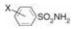

where X stands for a set of substituents on the ring that are variable in both structure and position, showed that the binding constant was related to Hammett electronic substituent constant σ, a measure of the electron-withdrawing or -donating strength of the substituent; the octanol–water partition coefficient P of the unionized form of the ligand; and the location (ortho or meta) of the substitution:

$$
\log K \approx 1. 5 5 \sigma + 0. 6 5 \log P - 2. 0 7 I _ {1} + 3. 2 8 I _ {2} + 6. 9 4
$$

in which K = binding constant, $\mathrm { I } _ { 1 } = 1 \mathrm { i f }   \mathrm { X }$ is meta and 0 otherwise and $\mathrm { I } _ { 2 } = 1$ if X is ortho and 0 otherwise. The substituents X were of the form -alkyl, -COO-alkyl, or -CONH-alkyl.

This type of correlation has two implications.

1. A large number of compounds can be screened in the computer and those predicted to be the best can then be tested experimentally.
2. It is possible to visualize the binding site from analysis of the parameters:

• the positive coefficient of $\mathfrak { S } _ { \mathfrak { z } }$ implying that electron-withdrawing substituents are favoured, suggests that the ionized form of the $- \mathrm { S O } _ { 2 } \mathrm { N H } _ { 2 }$ moiety binds to the $\mathrm { Z n ^ { 2 + } }$ ion in the carbonic anhydrase active site;
• the positive coefficient of logP suggests a hydrophobic interaction between the protein and ligand;
• the negative coefficients of $I _ { 1 }$ and $I _ { 2 }$ suggest steric clashes with substituents in the meta or ortho positions.

Structures of ligated carbonic anhydrase confirm these conclusions.

## Bioinformatics in drug discovery and development

Computing and information retrieval contribute to several steps in drug discovery and development projects. These include target identification, design, analysis, and enhancement of ligands, and selection and in silicio screening of libraries. Information systems are also important in the organization of the theoretical predictions, the experimental designs, and analysis of the data. D. Searls has called the intimate interplay between theory and experiment ‘wet–dry cycles’.

## Target selection

To develop a drug against a disease it is necessary to select a protein linked to the disease in a way that suggests that it would be therapeutically useful to affect its function or expression. New highthroughput data sources, particularly of genome sequences and protein expression patterns, provide a rich source of material for identifying potential drug targets. Dif erential genomics and proteomics, the comparisons of healthy and diseased humans or animals, can pinpoint which particular protein is missing, dysfunctional, improperly regulated, or expressed only in affected cells. Comparisons between antibiotic-resistant and -susceptible strains of bacteria can elucidate the mechanism of resistance. Information about protein–protein complexes make it possible to target not just a single protein, but a specific protein–protein interaction.

Knowledge of prokaryotic and viral genomes supports identification of targets for drugs against infectious disease. Of particular interest are metabolic pathways specific to microorganisms, and the proteins that participate in them. A drug affecting such a target is less likely to interact with a human homologue with consequent side effects. Proteins with sequences similar across bacterial clades offer the possibility of broad-spectrum antibiotics. Conversely, gene duplications warn of potential redundant functions, with concomitant insensitivity to inactivation of the target. Knowledge of the relative speed of evolution of different proteins, including horizontal gene transfer rates, indicates the expected stability of a therapy against development of resistant strains.

Commitment to a target by a large pharmaceutical company involves a very heavy investment of resources. The profit expected to flow from a successful drug exerts a very important influence on the choice of targets actively pursued. Analysis of the history of drugs that currently yield high profits suggests that prediction of economic returns is not a very precise science. Now, even generously supported bioinformatics efforts are much less expensive than laboratory work. The possibility that calculations will improve predictions and enhance profit is behind the espousal of bioinformatics by the pharmaceutical industry, in addition to the purely scientific contributions of bioinformatics to drug discovery. This contribution to economic forecasting is especially important when a company considers high-risk projects, such as those aimed at developing a drug against a new class of targets. Such projects must compete with lower-risk activities such as trying to improve on a competitor's success.

## Prediction of a lead compound

Methods for predicting ligands suitable as lead compounds for drug discovery can be divided into inductive and deductive approaches.

Inductive methods depend on correlations between known affinities of some test set of compounds, and molecular features characterizing entire libraries of potential ligands. These features include structural properties such as size, geometry, charge distributions, and specific functional groups including hydrogen-bond donors and acceptors. They include general ‘drug-like’ qualities such as solubility in aqueous and organic solvents, easy route of administration, appropriate distribution in body tissues, and metabolic turnover rate. The relevant characteristics of compounds are compiled into a feature vector used to compare the overall match between compounds of known affinity and a complete library. The requirements for organization, encoding, storage, and searching of information about small molecules has created a new field, chemoinformatics, which complements bioinformatics in applications to drug discovery.

Deductive methods are applicable if the binding site on the target protein is known or can be inferred. However, because binding affinity and specificity are only two requirements for a lead compound—admittedly essential ones—it is necessary to combine deductive methods with the correlation to desirable properties as in the purely inductive approach. Binding assays on purified systems give little idea of the behaviour of a compound as a drug in its biological context. Bioinformatics has a contribution to make in integrating the information available from molecular and cell biology, and physiology and pharmacology, to help bridge the gap between in vitro

experiments and in vivo therapeutic activities.

## Molecular modelling in drug discovery

A central problem in drug discovery is the identification of a compound that will bind tightly and specifically to a target protein. Tight binding is necessary for efficacy at low concentrations. Specificity is necessary to minimize side effects.

If the structure of the target is known from experiment, it is possible to apply molecular modelling directly to ligand design. If the structure of the target is unknown, a picture of the binding site must be created from indirect evidence and ligand design is correspondingly more difficult. Ligand design without the target structure is like trying to catch a bank robber from eyewitness descriptions; ligand design to a target of known structure is like trying to catch the bank robber from a clear image on a CCTV recording.

Goals of molecular modelling applied to drug design include:

• ideally: suggestion of a lead compound that already shows reasonable affinity and specificity. This is a rare achievement;
analysis of compounds known to bind to the target. Understanding the important interactions serves as a guide to design and testing of potential ligands, and for selecting structural features to build into combinatorial synthesis of libraries. In the case of antibacterial or antiviral projects, a model of the protein–ligand complex can give some idea of how easy it would be for the pathogen to develop resistance by mutations that lower the affinity;
pharmacophore identification is the identification of common substructures of many compounds that share a pharmacological activity, or at least that bind to the same site on a protein. The hypothesis is that there is some common constellation of atoms within the structures that is responsible. The computational problem of extracting the pharmacophore from a set of compounds is similar to that of structural alignment of a set of homologous proteins. Although typical ligands are much smaller than proteins, the combinatorial problems are more severe because one has lost the linear ordering of the residues in proteins (see Box 6.4). Inferred pharmacophore properties are integrated with QSAR methods to filter libraries of compounds for candidate ligands;
in silicio screening: predicting of affinities, even qualitatively, suggests candidate ligands from a library of chemical structures. (See Box 6.13.) The results can be either used for setting priorities in experimental tests or integrated into broader approaches to computer screening of libraries on the basis of features correlated with favourable chemical and pharmacological properties. Many readers will be aware of the harnessing of screensavers worldwide to search for potential drugs.2 Over 3.5 million computers joined the project. They contributed a cumulative total of over 320 000 years of CPU power;
lead compound improvement: once a compound is identified that binds to a target protein, albeit with low affinity and specificity, interactive modelling can suggest modifications that are expected to enhance the fit. Synthesis and testing of compounds predicted to show enhanced affinity, and even solution of crystal structures of their complexes, can guide the search for improved compounds. The modelling is usually coupled with combinatorial chemistry and experimental library screening.

Docking is prediction of ligand binding. It includes prediction both of binding of small molecules to proteins and of protein–protein binding. The goals of docking are (1) to identify the binding site on the protein, and determine the position and orientation of the ligand, and (2) to estimate the affinity.

**1.** Identification of mode of binding. Docking of small molecules to proteins requires matching of the ligand to a site on a protein of known structure. The binding site may be known in advance, or it may be necessary to try many different modes of apposition of the ligand and protein to predict the optimal binding site.

The basis for docking is the identification of complementarity in size, shape, and distribution of charge, polarity, and potential for hydrophobic and hydrogen-bonding interactions. A complication is the possibility of flexibility in both partners. Small organic molecules containing many single bonds have high degree of conformational flexibility. (Drug designers love structures with rings and bridges.) Many proteins show conformational changes upon binding ligands. Therefore the experimental structure of an unligated protein cannot be assumed to serve as a rigid target for docking. However, allowing for flexibility complicates docking calculations substantially.

Water molecules at interfaces present another difficulty. They can contribute to the surface complementarity, and provide bridging hydrogen bonds.

**2.** Estimation of affinity. It is difficult to estimate absolute affinities. However, comparative docking can provide useful information about relative affinities. A suitable scoring function that can predict the ranking of different ligands in approximate order of affinity allows selectivity, and setting of priorities, in experimental testing. Such scoring schemes can be ab initio—based on the kinds of force fields described in the section entitled Conformational energy calculations and molecular dynamics—or empirical. Conversely, comparative docking of one ligand to many proteins can predict the specificity of the interaction.

| Docking calculation | Information provided |
| --- | --- |
| 1 ligand–1 protein | Mode of binding, estimate of affinity |
| Many ligands–1 protein | Ranking of affinities of a series of potential ligands |
| 1 ligand–many proteins | Prediction of specificity |

Docking and scoring are important steps in the filter between a total potential library and testing at the bench. A typical narrowing of the funnel might run as follows:

| Overall library size | 1012 compounds |
| --- | --- |
| After general filters | 105 |
| Docking | 104 |
| Scoring | 103 |
| Visual | 10–100 for experimental testing |

Case Studies 6.1 and 6.2 illustrate the range of chemical and molecular biological techniques involved in drug development, and show some interesting similarities and contrasts. They concern well-known families of analgesic drugs—colloquially, painkillers—typified by morphine and aspirin. The two groups of compounds have different mechanisms of actions, different potencies, and different spectra of side effects.

## CASE STUDY 6.1 Development of analgesic drugs based on morphine\*

Morphine and codeine are natural alkaloids contained in the latex of the opium poppy (Papaver somniferum) (Fig. 6.22). The pharmacological effects have been known since antiquity. Modern chemistry has explored and developed many variants. Heroin was synthesized in 1874 (Fig. 6.22). More hydrophobic than the natural compounds, heroin traverses the blood–brain barrier more readily, giving it a more rapid onset of action.

Both codeine and heroin are metabolized to produce morphine, the active form. Codeine is therefore a natural example of a prodrug, an inactive agent that is converted to an active one. The conversion depends on a cytochrome, CYP2D6, which is absent in 5–10% of white people and 1–3% of African-Americans and Asians.

Morphine and codeine have been applied in medicine and surgery as analgesics, or drugs to relieve severe pain. Side effects include passivity and euphoria, and physical dependence and addiction. Drug developers have therefore long sought a compound that would relieve pain without the harmful side effects. Of course there was no guarantee that this would be possible.

Synthetic variants of morphine allow correlation of biological effects with chemical structure.

One approach is to try to simplify the structure. The goals are (1) to infer the minimal pharmacophore required for activity and (2) if possible, to dissect the parts of the structure that relieve pain away from those causing addiction. Morphine, codeine, and heroin are rigid compounds containing five fused rings. Levorphanol differs from morphine by loss of the bridging oxygen (i.e. removal of the tetrahydrofuran ring) and one of the hydroxyl groups (Fig. 6.23). It is a more potent analgesic than morphine but still addictive. Benzomorphan, cyclazocine, and pentazocine break the cyclohexene ring (Fig. 6.24). The addictive effects of these compounds are less than those of morphine and levorphanol. Demerol, which opens the cyclohexene ring, and methadone, which has no fused rings, retain analgesic activity, sharing even smaller common substructures with morphine. From these structures one can infer the pharmacophore shown in Figure 6.25.

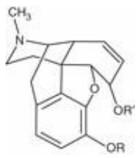

Figure 6.22 Morphine, codeine, and heroin have structures differing only in substituents at two positions:

| Compound | R | R' |
| --- | --- | --- |
| Morphine | -H | -H |
| Codeine | -CH3 | -H |
| Heroin | -COCH3 | -COCH3 |

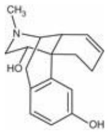

Figure 6.23 The structure of levorphanol.

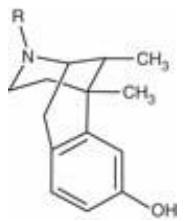

Figure 6.24 The structures of benzomorphan $( \mathrm { R }   =   \mathrm { C H } _ { 3 } )$ , cyclazocine $\mathrm{(R = CH_{2} - cp)}$ , where $\mathrm { c p } = \mathrm { c y c l o p r o p a n e } )$ and pentazocine $\mathrm{(R = CH_2CH = C(CH_3)_2)}$ .

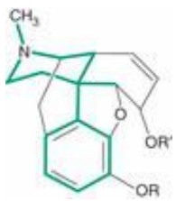