Figure 6.25 Pharmacophore (green) derived from structural comparisons among morphine derivatives. After A.D. MacKerell, Jr.

In contrast to simplifying the molecule to identify a pharmacophore, attempts to enhance specificity have retained the pharmacophore but made the molecule more complex. Some success has been achieved. Etorphine and buprenorphine, discovered in the 1960s, are far more powerful analgesics than morphine (etorphine is used for sedation of large animals) and have lower addictive potential (see Fig. 6.26). Indeed, the most important clinical use of buprenorphine is in treatment of drug addiction rather than in analgesia.

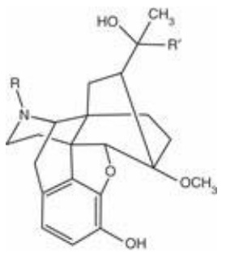

chemical

Complex organic molecule structure with multiple functional groups including amide, hydroxyl, and ester linkages

Figure 6.26 The structures of etorphine $\left( \mathrm{R} = \mathrm{CH}_{3}, \mathrm{R}' = \mathrm{C}_{3} \mathrm{H}_{7} \right)$ and buprenorphine $\mathrm{(R = CH_{2}-cp)}$ , where cp = cyclopropane; $\mathrm { R } ^ { \prime } = t \mathrm { - b u t y l ) }$

This exploration of variants went on before the natural receptors were identified. We now know that the natural targets of action of morphine and related molecules are receptors for endogenous peptides called endorphins. These include:

| β-Endorphin | YGGFMTSEKSQTPLVTLFKNAIIKNAYKKGE |
| --- | --- |
| Dynorphin | YGGFLRRIRPKLKWDNQ |

And their cleavage products:

| Leu-enkephalin | YGGFL |
| --- | --- |
| Met-enkephalin | YGGFM |

Morphine is therefore a natural peptidomimetic, a nonpeptide that shares a structure and activity with a peptide.

Several classes of receptors are known, including μ, κ, and δ types, and a recently discovered fourth type, called ORL-1 (where ORL means opiate-receptor like). They are G-protein-coupled receptors, similar in structure to bacteriorhodopsin (see Fig. 6.6). Their sequences are about 50–70% identical at the residue level. Different ligands—natural and synthetic—have differential affinity to different receptors, and different kinetics of binding and dissociation. The natural targets of morphine are μ receptors. It is thought that μ receptors tend to be more involved in physical dependence and addiction than κ receptors, although this statement of the situation is extremely oversimplified. Nevertheless the suggestion is that an approach to producing a drug that provides analgesia with reduced side effects is to look at the distribution of affinities of compounds with the different types of receptor.

\*Coop, A. and MacKerell, Jr., A.D. (2002). The future of opioid analgesics. Am. J. Pharm. Edu., **66**, 153–156.

## CASE STUDY 6.2 Computer-aided drug design: specific inhibitors of prostaglandin cyclooxygenase 2

Prostaglandins are a family of natural compounds that mediate a wide variety of physiological processes. Pharmacological applications include the use of prostaglandins themselves, and, conversely, drugs that block prostaglandin synthesis. Prostaglandin $\mathrm { E } _ { 2 }$ (dinoprostone) is used in obstetrics to induce labour. Aspirin, ibuprofen, acetaminophen (paracetamol), and other non-steroidal anti-inflammatory drugs (NSAIDs) are effective against arthritis and related diseases (see Box 6.14). They achieve this effect by inhibiting enzymes in the pathway of prostaglandin synthesis; specifically, prostaglandin cyclooxygenases. A well-known side effect of aspirin is bleeding from the walls of the stomach. This occurs because prostaglandins (the production of which aspirin inhibits) suppress acid secretions by the stomach and promote formation of a mucus coating protecting the stomach lining.

Aspirin and other NSAIDs inhibit two closely related prostaglandin cyclooxygenases, called COX-1 and COX-2. (Unfortunately the same abbreviations are used for cytochrome oxidases 1 and 2.) COX-1 is expressed constitutively in the stomach lining. COX-2 is inducible, and upregulated in response to inflammation. This suggests that a drug that would inhibit COX-2 but not COX-1 would retain the desired activity of NSAIDs but reduce unwanted side effects.

The amino acid sequences and crystal structures of COX-1 and COX-2 are known. (These proteins have 65% sequence identity.) Figure 6.27 shows part of the structure of COX-1, acetylated by the aspirin analogue 2- bromoacetoxybenzoic acid (aspirin brominated on the methyl group of the acetyl moiety). The salicylate moiety binds nearby. The effect is to block the entrance to the active site. Most NSAIDs bind but do not covalently modify the enzyme.

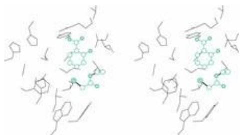

chemical

Two molecular structures showing organic frameworks with substituents and functional groups

Figure 6.27 The binding site in COX-1 for an aspirin analogue, 2-bromoacetoxybenzoic acid. The ligand has reacted with the protein, transferring the bromoacetyl group to the sidechain of530Ser. The protein is shown in skeletal representation, in black. The aspirin analogue is shown in ball-and-stick representation, in green.

Figure 6.28 shows the same figure with the corresponding region of COX-2 superposed. Can you see regions of structural difference, that could be clues to the design of selective drugs? Figure 6.29 shows the region of COX-2 with the selective inhibitor SC-558 (1-phenylsulphonamide-3-trifluoromethyl-5- parabromophenylpyrazole; made by Searle). From Figure 6.30 we can see why SC-558 cannot inhibit COX-1. There would be steric clashes with the isoleucine sidechain, which corresponds to a valine in COX-2.

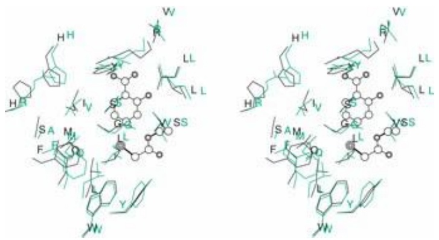

chemical

Two molecular structures showing complex organic frameworks with labeled atoms (W, V, L, S, F) and substituents (H, Y, L, SS)

Figure 6.28 The binding site in COX-1 for an aspirin analogue, 2-bromoacetoxybenzoic acid, in black, and the homologous residues of COX-2, in green. Can you see what unoccupied space exists in the site that could accomodate a larger ligand? Can you see any sequence differences that might be exploited to design an inhibitor that would bind to COX-2 (green) but not to COX-1 (black)?.

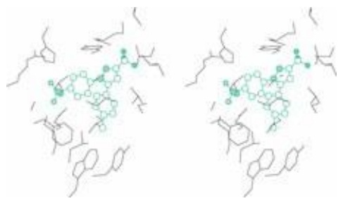

chemical

Molecular structure diagrams showing two identical organic molecules with green atoms and functional groups

Figure 6.29 The binding site in COX-2 (black) for a selective inhibitor of COX-2, SC-558 (1- phenylsulphonamide-3-trifluoromethyl-5-parabromophenylpyrazole) (green).

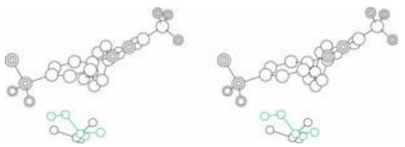

chemical

Two molecular structures showing atom connectivity and bonding interactions

Figure 6.30 SC-558 and the residue in COX-1 (black, isoleucine) and COX-2 (green, valine) that appears to produce the selectivity. SC-558 cannot bind to COX-1 because there would be steric contacts between it and the isoleucine.

## Box 6.14 Aspirin

Aspirin is one of the oldest of folk remedies and newest of scientific ones. Hippocrates noted the effectiveness of preparations of willow leaves or bark to assuage pain and reduce fever. The active ingredient, salicin, was purified in 1828, and synthesized in 1859 by Kolbe. The mechanism of its action was unknown, and indeed remained unknown until, in the 1970s, J. Vane and colleagues discovered that aspirin acts by blocking prostaglandin synthesis. Not knowing the mechanism of action was never an impediment to its use.

A century ago, sodium salicylate was used in the treatment of arthritis. Because stomach irritation was a serious side effect, F. Hoffman sought to reduce the compound's acidity by forming acetylsalicylic acid, or aspirin. Aspirin was the first synthetic drug, which launched the modern pharmaceutical industry. (The name salicin comes from the Latin name for willow, Salix, and the name aspirin comes from ‘a’ for acetyl and ‘spir’ from the Spirea plant, another natural source of salicin.)

Aspirin has the effect of reducing fever, and giving relief from aches and pains. In high doses it is effective against arthritis. Aspirin is also used for prevention and treatment of heart attacks and strokes. The applications to cardiovascular disease depend on inhibition of blood clotting by suppressing prostaglandin control over platelet clumping. The many applications of aspirin reflect the many physiological processes that involve prostaglandins.

Aspirin's many uses:

| Small doses | Medium doses | Large doses |
| --- | --- | --- |
| Interferes with blood clotting | Fever/pain | Reduces pain and inflammation of arthritis and related diseases |

## RECOMMENDED READING

## Protein folding

- Baldwin, R.L. and Rose, G.D. (1999). Is protein folding hierarchic? I. Local structure and peptide folding. II. Folding intermediates and transition states. Trends Biochem. Sci., 24, 26–32, 77–83.
- Han, J.-H., Batey, S., Nickson, A.A., Teichman, S.A., and Clarke, J. (2007). The folding and evolution of multidomain proteins. Nat. Rev. Mol. Cell Biol., 8, 319–330.
- Lesk, A.M. (2001). Introduction to Protein Architecture: The Structural Biology of Proteins. Oxford University Press, Oxford.
- Liberles, D.A. et al. (2012). The interface of protein structure, protein biophysics, and molecular evolution. Prot. Sci., 21, 769–785.
- Morris, E.R. and Searle, M.S. (2012). Overview of protein folding mechanisms: experimental and theoretical approaches to probing energy landscapes. Curr. Protocols Prot. Sci., Chapter 28, Unit 28.2, 1–22.

## Structural bioinformatics

- Donald, B.R. (2011). Algorithms in Structural Molecular Biology. MIT Press, Cambridge, MA.
- Peitsch, M. and Schwede, T. (eds) (2008). Computational Structural Biology. World Scientific Publishing, Singapore.
- Sussman, J.L. and Silman, I. (eds) (2008). Structural Proteomics and its Impact on the Life Sciences. World Scientific Publishing, Singapore.

## Structure alignment and sequence–structure relationships

- Hasegawa, H. and Holm, L. (2009). Advances and pitfalls of protein structural alignment. Curr. Opin. Struct. Biol., 19, 341–348.
- Holm, L. and Sander. C. (1995). Dali: a network tool for protein structure comparison. Trends Biochem. Sci., 20, 478–480. Describes DALI and its applications to structural alignment.
- Sadowski, M.I. and Taylor, W.R. (2012). Evolutionary inaccuracy of pairwise structural alignments. Bioinformatics, 28, 1209–1215.
- Slater, A.W., Castellanos, J.I., Sippl, M.J., and Melo, F. (2013). Towards the development of standardized methods for comparison, ranking and evaluation of structure alignments. Bioinformatics, 29, 47–53.

## Connections among sequences, structures, and functions

- Das, R., Junker, J., Greenbaum, D., and Gerstein, M.B. (2001). Global perspectives on proteins: comparing genomes in terms of folds, pathways and beyond. Pharmacogenom. J., 1, 115–125.
- Galperin, M.Y. and Koonin, E.V. (2003). Sequence – Evolution – Function / Computational Approaches in Comparative Genomics. Kluwer, Boston, MA.
- Pethica, R.B., Levitt, M., and Gough, J. (2012). Evolutionarily consistent families in SCOP: sequence, structure and function. BMC Struct. Biol., 12, 27.

## State of the art in homology modelling and its application in structural genomics

- Guex, N., Diemand, A., and Peitsch, M.C. (1999). Protein modelling for all. Trends. Biochem. Sci., 24, 364–367. A description of SWISS-MODEL.
- Martí-Renom, M.A., Stuart, A.C., Fiser, A., Sánchez, R., Melo, F., and Sali, A. (2000). Comparative protein structure modeling of genes and genomes. Annu. Rev. Biophys. Biomol. Struct., 29, 291–325.
- Nurisso, A., Daina, A., and Walker, R.C. (2012). A practical introduction to molecular dynamics simulations: applications to homology modeling. Methods Mol. Biol., 857, 137–173.
- Peitsch, M.C., Schwede, T., and Guex, N. (2000). Automated protein modelling – the proteome in 3D. Pharmacogenomics, 1, 257–266. What it will take to complete the structural genomics problem.
- Pieper, U., Eswar, N., Braberg, H., Madhusudhan, M.S., Davis, F.P. et al. (2004). MODBASE, a database of annotated comparative protein structure models, and associated resources. Nucl. Acids Res., 32, D217–D222.
- Schwede, T., Kopp, J., Guex, N., and Peitsch, M.C. (2003). SWISS-MODEL: an automated protein homologymodeling server. Nucl. Acids Res., 31, 3381–3385. A description of SWISS-MODEL.
- Tramontano, A. (2004). Integral and differential form of the protein folding problem. Phys. Life Rev., 1, 103–127.
- Tramontano, A. (2006). Protein Structure Prediction: Concepts and Applications. Wiley-VCH, Weinheim, Baden-Württemberg.

## Other protein structure prediction methods

- Bonneau, R. and Baker, D. (2001). Ab initio protein structure prediction: progress and prospects. Annu. Rev. Biophys. Biomol. Struct., 30, 173–189.
- Kaufmann, K.W., Lemmon, G.H., Deluca, S.L., Sheehan, J.H., and Meiler, J. (2010). Practically useful: what the Rosetta protein modeling suite can do for you. Biochemistry (ACS), 49, 2987–2498.
- Kuroda, D., Shirai, H., Jacobson, M.P., and Nakamura, H. (2012). Computer-aided antibody design. Prot. Eng. Des. Sel., 25, 507–522.
- Marks, D.S., Colwell, L.J., Sheridan, R., Hopf, T.A., Pagnani, A., Zecchina, R., and Sander C. (2011). Protein 3D structure computed from evolutionary sequence variation. PLoS One., 6, e28766.
- Pavlopoulou, A. and Michalopoulos, I. (2011). State-of-the-art bioinformatics protein structure prediction tools. Int. J. Mol. Med., 28, 2959–3010.
- Raman, S. et al. (2009). Structure prediction for CASP8 with all-atom refinement using Rosetta. Proteins, 77 (suppl. 9), 89–99.

## Structural and computational drug design

- Abraham, D.J. (2007). Structure-based drug design – a historical perspective and the future. In: Comprehensive Medicinal Chemistry II, Mason, J.S. (volume editor), vol. 4, pp. 1–22. Elsevier, Amsterdam.
- Frey, J.G. and Bird, C.L. (2011). Web-based services for drug design and discovery. Expert Opin. Drug Discov., 6, 885–895.
- Kortagere, S., Lill, M., and Kerrigan, J. (2012). Role of computational methods in pharmaceutical sciences. Methods Mol. Biol., 929, 21–48.

## Introduction to molecular visualization

Lesk, A.M. and Bernstein, H.J. (2008). Molecular graphics in stuctural biology. In: Computational Structural Biology, Peitsch, M. and Schwede, T. (eds), pp. 729–770. World Scientific Publishing, Singapore.

## Classics still well worth reading

Chothia, C. (1984). Principles that determine the structure of proteins. Annu. Rev. Biochem., 53, 537–572.

Kauzmann, W. (1959). Some factors in the interpretation of protein denaturation. Adv. Protein Chem., 14, 1–63.

Richards, F.M. (1977). Areas, volumes, packing and protein structure. Annu. Rev. Biophys. Bioeng., 6, 151–176.

Richards, F.M. (1991). The protein folding problem. Sci. Am., 264(1), 54–57, 60–63.

## EXERCISES AND PROBLEMS

Exercise 6.1 The heat of sublimation of ice $= 5 1 \mathrm { k J } \cdot \mathrm { m o l } ^ { - 1 }$ at the freezing point. In the solid state, each molecule of H2O makes two hydrogen bonds. What is the energy of a single water–water hydrogen bond?

Exercise 6.2 Which pairs are orthologues, which are paralogues and which are neither?

- (a) Human haemoglobin α and human haemoglobin β
- (b) Human haemoglobin α and horse haemoglobin α
- (c) Human haemoglobin α and horse haemoglobin β
- (d) Human haemoglobin α and human haemoglobin γ
- (e) The proteinases human chymotrypsin and human thrombin
- (f) The proteinases human chymotrypsin and kiwi fruit actinidin

Exercise 6.3 On a photocopy of Plate IX, indicate the locations in the structure that correspond to X, Y, and Z in the following diagram.

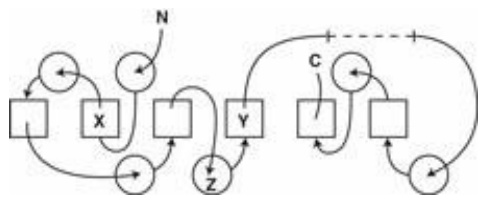

flowchart

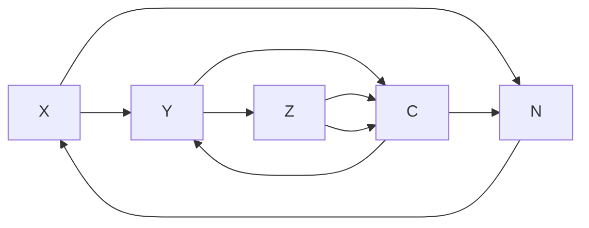

Exercise 6.4 On a photocopy of Figure 6.11a, highlight the region of $^ { 1 3 } 1 0$ helix that was not predicted to be helical.

Exercise 6.5 Which of the following shows the correct topology—correct strand order in the sequence and orientation —of the β sheet in Figure 6.11b?

(a) ↑↑↑↑ 1234 (b) ↑↓↓ 3421 (c)↑↑↓↑ 1324

**Exercise 6.6** On a photocopy of Figure 6.9a, indicate with highlighters of two different colours the strands that form the two β sheets.

**Exercise 6.7** In the structure prediction of the H. influenzae hypothetical protein (Fig. 6.14): (a) What are the differences in folding pattern between the target protein and the experimental parent? (b) What are the differences in folding pattern between the prediction by A.G. Murzin and the target? (c) What are the differences in folding pattern between the prediction by A.G. Murzin and the experimental parent? In what respects is Murzin's prediction a better representation of the folding pattern than the experimental parent?

**Exercise 6.8** Draw the chemical structures of aspirin and 2-bromoacetoxybenzoic acid.

**Exercise 6.9** Many proteins from pathogens have human homologues. Suppose you had a method for comparing the determinants of specificity in the binding sites of two homologous proteins. How could you use this method to select propitious targets for drug design?

**Exercise 6.10** In the neural network illustrated in Box 6.8, how many parameters—variable weights and thresholds— are available to adjust, assuming a linear decision procedure?

**Exercise 6.11** What is the geometrical interpretation of a neuron that accepts two inputs x and y and ‘fires’ if and only if x + 2y ≥ 2?

**Exercise 6.12** Sketch a neuron with two inputs x and y, each of which may have any numerical value, that will emit 1 if and only if the value of the first input is greater than or equal to that of the second. What is the geometric interpretation of this neuron?

**Exercise 6.13** Which of the following compounds would you expect to have the higher affinity for carbonic anhydrase?

(a) HOCH2 (b)

**Problem 6.1** In the table of aligned sequences of ETS domains (see Problem 1.1): (a) which are the most similar and most distant members of the family? (b) Suppose that an experimental structure is known only for the first sequence. For which others would you expect to be able to build a model with an overall deviation of ≤ 1.0 Å for 90% or more of the residues?

**Problem 6.2** Sketch a network that accepts eight inputs, each of which has value 0 or 1, with the interpretation that the eight inputs correspond to the residues in a sequence of eight amino acids, and that the value of the ith input is 0 if the ith residue is hydrophilic and 1 if the ith residue is hydrophobic. The network should output 1 if the pattern appears helical—for simplicity demand that it be PPHHPPHH where H = hydrophobic (uncharged) and P = polar or charged— and 0 otherwise.

**Problem 6.3** Write a more reasonable set of patterns to identify helices from the hydrophobic/hydrophilic character of the residues in a 10-residue sequence. Your patterns might include ‘wild cards’: positions that could be either hydrophobic or hydrophilic, or correlations between different positions. Generalize the previous problem by sketching neural networks to detect these more complex patterns.

**Problem 6.4** We, and computers, can do logic with arithmetic. Define: 1 = TRUE and 0 = FALSE. Sketch simulated neurons with two inputs, each of which can have only the values 0 or 1, and a linear decision process for firing, for which (a) the output is the logical AND of the inputs and (b) the output is the logical OR of the two inputs. (c) What is the simplest neural network, with each neuron having a linear decision process for firing, that produces as its output the EXCLUSIVE OR of the two inputs (the exclusive or is true if either one of the inputs is true, and false if neither or both inputs are true.) Can this be done with a single neuron? If not, what is the minimum number of layers in the network required?

**Problem 6.5** Modify the PERL program for drawing helical wheels (Box 6.3) so that different amino acids appear in different colours, as follows: GAST, cyan; CVILFYPMW, green; HNQ, magenta, DE, red; KR, blue.

**Problem 6.6** Hydrophobic cluster analysis. Suppose a region of a protein forms an α helix. To represent its surface, imagine winding the sequence into an α helix (even if in fact it forms a strand of sheet or loop in the native structure). Then ‘ink’ the surface of the helix, and roll it onto a sheet of paper, to print the names of the residues. By rolling the helix over twice, all surfaces are visible. From such a diagram, hydrophobic patches on surfaces of helices can be identified. In this way it is possible to try to predict which regions of the sequence actually form helices in the native structure. Comparisons of hydrophobic clusters can also be used to detect distant relationships. Write a PERL program to produce such diagrams.

**Problem 6.7** In the 2000 CASP4, one of the targets in the category for which no similar fold was known was the Nterminal domain of the human DNA end-joining protein Xrcc4, residues 1–116. The secondary structure prediction by B. Rost, using the method PROF (profile-based neural network prediction), is as follows (an H under a residue means that residue is predicted to be in a Helix, an E means that that residue is predicted to be in an Extended conformation, or strand, and–means Other):

<table><tr><td rowspan="2"></td><td>1</td><td>2</td><td>3</td><td>4</td><td>5</td><td>6</td></tr><tr><td>0</td><td>0</td><td>0</td><td>0</td><td>0</td><td>0</td></tr><tr><td rowspan="5">Sequence Prediction</td><td colspan="6">MERKISRIHLVSEPSITHFLQVSWEKTLESGFVITLTDGHSAWTGTVSESEISQEADDMA</td></tr><tr><td colspan="6">---EEEEEEE----HHHHHH-HHHHHHH--EEEEEE----EE---HHHHHHHHHHHH</td></tr><tr><td></td><td></td><td></td><td>1</td><td>1</td><td></td></tr><tr><td>7</td><td>8</td><td>9</td><td>0</td><td>1</td><td></td></tr><tr><td>0</td><td>0</td><td>0</td><td>0</td><td>0</td><td></td></tr></table>

Sequence MEKGKYVGELRKALLSGAGPADVYTFNFSKESCYFFFEKNLKDVSFRLGSFNLEKV Prediction HHH-HHHHHHHHHHHH-----EEEEEE-----EEEEE------EEEE-----HHHH

The experimental structure of this domain, released after the predictions were submitted (PDB entry 1FU1) is shown here:

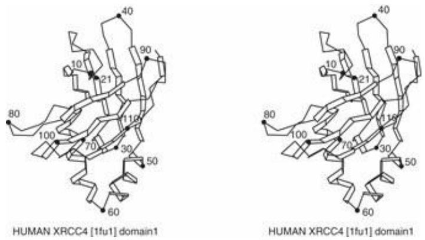

The secondary structure assignments from the wwPDB entry are:

| Secondary structure | Residue ranges |
| --- | --- |
| Helix | 27–29, 49–59, 62–75 |
| Sheet 1 | 2–8, 18–24, 31–37, 42–48, 114–115 |
| Sheet 2 | 84–88, 95–101, 104–111 |

(a) Calculate the value of Q3, the percentage of residues correctly assigned to helix (H), strand (E), and other (–).
(b) On a photocopy of the picture of Xrcc4, highlight, in separate colours, the regions predicted to be in helices and strands.
(c) From the result of (b), how many predicted helices overlap with helices in the experimental structure? How many strands overlap with strands in the experimental structure?

**Problem 6.8** In CASP4 the group of Bonneau, Tsai, Ruczinski, and Baker made a prediction of the full threedimensional structure of protein Xrcc4, residues 1–116. The secondary structure prediction derived from their model is as follows (H = helix, E = strand (extended), − = other):

1 2 3 4 5 6
0 0 0 0 0 0
Sequence MERKISRIHLVSEPSITHFLQVSWEKTLESGFVITLTDGHSAWTGTVSESEISQEADDMA
Prediction ----E--EEEE---EEEE--EHHHHHHH----EEEE--EEEE-----HHHHHHHHHHH
7 8 9 0 1
0 0 0 0 0
Sequence MEKGKYVGELRKALLSGAGPADVYTFNFSKESCYYFFFEKNLKDVSFRLGSFNLEKV
Prediction HHH---HHHHHHHHHHH----EEEEEEE--EEEEEEE-----HHHH----HHHH

(a) What is the value of Q3 for this prediction? (b) In this case, which method gives the better results, as measured by Q3, for the prediction of secondary structure: the neural network that produces only a secondary structure prediction, or a prediction of the full three-dimensional structure.

**Problem 6.9** A much more ambitious challenge: write a PERL program that implements the neural network shown in the second diagram in Box 6.8.

**Problem 6.10** Suppose that you are trying to evaluate, using a threading approach, whether a sequence of length M is likely to have the folding pattern of a protein of known structure of length N > M. (a) How many different alignments of the sequences are possible? (b) Suppose that half the residues of the known protein form α helices, and no gaps within helical regions are permitted. How many different alignments of the sequences are now possible? (c) How many alignments are there, under each of these assumptions, if N = 200 and M = 150?

**Problem 6.11** Write a PERL program to calculate approximate values of π by a Monte Carlo method, as follows: the square in the plane with corners at (0, 0), (1, 0), (0, 1), and (1, 1) has area 1. Compute a series of pairs of random numbers (x, y) in the range [0, 1] to generate points distributed at random in this square. Count the number of points that lie within a circle of radius 0.5 inscribed in the square. The ratio of the number of points that fall within the circle to the total number of points = the ratio of the area of the circle to the area of the square = π/4.

Determine the average relationship between the number of points chosen and the number of correct digits in the calculated value of π. Estimate the number of points required to determine π correctly to 50 decimal places.

**Problem 6.12** To convert the output of a neuron from a step function to a smooth function (see the third diagram in Box 6.8) one can replace a statement of the form ‘Let X be some weighted sum of the inputs; then output 1 if X > 0, else output 0’ to ‘Let X be some weighted sum of the inputs; then output $1 / ( 1 + e ^ { - X _ { \mathrm { { } } } } ) ^ { \star }$ . (a) Verify that as $X   \rightarrow   - \infty ,   1 / ( 1 +$ $e ^ { - X } ) \to 0 , \mathrm { a s } X \to + \infty , 1 / ( 1 + e ^ { - X } ) \to 1$ , and that if $X = 0 , 1 / ( 1 + e ^ { - X } ) = 0 . 5 . ( b )$ Suppose the network for determining whether a point lies within a triangle (as in the second diagram in Box 6.8) is so altered that the output of each neuron is described by the smooth function $1 / ( 1 \pm e ^ { - X _ { \mathrm { { } } } } )$ rather than a step function, and that a point is considered inside the accepted area if the output of the network is > 0.5. Write a PERL program to determine what area is then defined.

**Problem 6.13** The pollen antigen from western ragweed Ambrosia psilostachya (SWISS-PROT ID MPA5A\_AMBPS) is a 77-residue protein with the sequence:

MNNEKNVSFEFIGSTDEVDEIKLLPCAWAGNVCGEKRAYC

CSDPGRYCPWQVVCYESSEICSQKCGKMRMNVTKNTI

A BLAST search in the nonredundant protein sequence data bank produced the following hits:

Score E

Sequences producing significant alignments: (Bits) Value

sp - P43174 - MP5A_AMBPS Pollen allergen Amb p 5a precursor (Amb ... 142 8e-33
gb - AAA20067.1 - Amb p V allergen 140 2e-32
sp - P43175 - MPA5B_AMBPS Pollen allergen Amb p 5b precursor (Amb... 116 3e-25
gb - AAA20066.1 - Amb p V allergen 115 5e-25
gb - AAA20068.1 - Amb p V allergen 115 1e-24
sp - P02878 - MPA5_AMBEL Pollen allergen Amb a 5 (Amb a V) (Allergen 81.3 2e-14

sp – P10414 – MPAT5\_AMBTR Pollen allergen Amb t 5 precursor (Amb 42.4 0.008

The first six ‘hits’ have E values substantially less than 1.0. These proteins can be confidently taken to be homologous to the probe sequence. The last ‘hit’, with an E value of 0.008, is a likely homologue, a pollen antigen from a closely related plant: ragweed pollen allergen from giant ragweed Ambrosia trifida (SWISS-PROT ID MPAT5\_AMBTR). Although the similarity of the sequences is above Doolittle's ‘twilight zone’, the E value suggests that there is almost a 1% chance of finding a sequence, with this degree of similarity to the probe sequence, at random.

What can we do to try to confirm a true relationship? The structure of the mature form of the A. trifida protein, corresponding to the C-terminal 40 residues of that sequence, is known (PDB entry 1BBG). In the full alignment of the sequences, uppercase letters indicate the portion of the sequence that corresponds to the mature protein, and which appears in the structure; and the letter B underneath the blocks indicates the residues buried within the structure (computed from coordinate set 1BBG):

P43174|MPA5A_AMBPS mnne--------knvsfefigstdevdeikllP--
CAWAGNVCGEKRAYCCSDPGRYCP 49
P10414|MPAT5_AMBTR mknifmltlfiliitstikaigstnevdeikqeDDGLCYEGTNCGKVGKYCCSPIGKYC-
59
*:*
. ::: ****
:********* . : *. **: **** *:**
B BB
P43174|MPA5A_AMBPS WQVVCYESSEICSQKCGkmrmnvtknti 77
P10414|MPAT5_AMBTR ---VCYDSKAICNKNCT---------- 73
***:. **.::**
B

These two sequences share the same residue at 28 positions. From the structure, the following pairs of cysteines form disulphide bridges: 5–35, 11–26, 18–28, 19–39.

Figure 6.31 shows the structure of the mature fragment of the giant ragweed (A. trifida) antigen, including the putative disulphide bridges. Sidechains corresponding to positions of mutations are shown in green. The site of the insertion in the A. psilostachya sequence is marked by a ‘\*’.

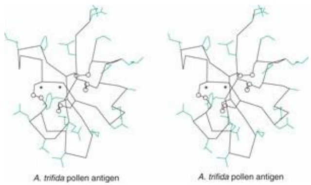

Figure 6.31 Ambrosia trifida pollen antigen. Sidechains shown are those that differ from pollen antigen of A. psilostachya.

(a) Does the overall extent of sequence similarity suggest that the proteins are homologous? (b) On a photocopy of Figure 6.31 mark the N- and C-termini. (c) On a photocopy of Figure 6.31 write next to the sidechain of each mutated residue the one-letter code of the amino acid that appears in the parent sequence. (d) Is the site of insertion in a loop between two elements of secondary structure? (e) Consider each of the mutations. Which are easy to reconcile with a conservation of structure and which are difficult to reconcile with a conservation of structure? (f) Was MODBASE able to construct a model of the parent sequence? (This will require checking a website.)

For a more in-depth discussion of protein folding see Chapter 5 in Lesk, A.M. (2004). Introduction to Protein Science. Architecture, Function and Genomics. Oxford University Press, Oxford.
2 See [http://www.chem.ox.ac.uk/curecancer.html](http://www.chem.ox.ac.uk/curecancer.html)

# Introduction to systems biology

## LEARNING GOALS

• Appreciating a trend towards a new point of view: the theme of systems biology is integration.
• Understanding the general features of graphs, including the distinction between undirected, directed, and labelled graphs. Understanding the representation of networks by graphs.
• Knowing which kinds of biological interaction patterns can profitably be thought of as networks.
• Recognizing the distinction between static and dynamic properties of networks.
Appreciating the different possible kinds of dynamic states of networks.

## Introduction

Like all good first acts, this short interlude is anticipatory. It provides the background for the final two chapters. This is a tribute to the recent growth in systems biology: in the previous edition the subject could be contained in a single chapter.

The increased interest in systems biology is both the effect and, if not the cause, certainly a contributor to the motivation for development, of novel high-throughput data streams. Like most of contemporary biology, systems biology is data-driven. But where are the data driving us? They are driving us to the exploration of new directions and attitudes. Specifically, there is focus on integration of the components of biological activity, at the cellular, organismic, and ecological levels. It is justifiable to repeat that, for generations, biochemists have been taking things apart. Systems biology has the goal of putting them back together.

This change in focus demands new ideas, and new mathematical techniques with which to express them.

Many patterns of interaction have the form of networks. Many networks are already familiar: the web is a pervasive example. A road map of the city in which you live portrays a network of locations connected by streets. In biology, metabolic pathways and phylogenetic trees are networks.

As phylogenetic trees show, the mathematical representation of a network is a graph. A strictly hierarchical graph, or a ‘tree’ structure, is a simple type of graph. The Bandelt–Dress representation of phylogenetic relationships (see Example 5.7) is a more complex form of graph.

We are interested in both the static and dynamic aspects of networks. A graph showing the underground rail system in a city, such as London, indicates the stations and the links between them. The familiar map reports the static structure of the network. But although stations and tracks do not move, trains and their passengers do. The traffic patterns in a network at a particular time are an aspect of its dynamic structure. So too are the variations in traffic patterns. Although the static structure of the London underground—the stations and tracks—is the same at noon and midnight, the dynamic structure—the traffic pattern—is very different.

Similarly, in an E. coli cell, the potential metabolic pathways are fixed. These depend on the catalytic activities of the enzymes that the genome encodes, plus spontaneous reactions not requiring enzymes. But, depending on the physiological state of the cell, the traffic through the network of metabolic pathways may be very different. Indeed, the metabolic network is itself governed by a supervising control network that responds to internal and external changes. A famous example is control of the Lac operon in response to the composition of the medium.

We have suggested that an initial goal of systems biology is to identify the active networks in cells, organisms, and ecosystems, and to understand the properties of their components and the interactions among them. Perhaps an ultimate challenge would be this: suppose we know the complete structure of the cellular networks, and know exact details specifying, quantitatively, the inputs and outputs of each network element. That is, suppose for simplicity that we consider a cell in some fixed physiological state. Assume that we know the complete inventory of cellular enzymes, and we know exactly which reactions they catalyse and the relevant kinetic parameters. Would the behaviour of the cell be predictable? Given a set of conditions—initial metabolite concentrations— would we be able to model, computationally, the metabolic traffic patterns?

Some systems biologists have already achieved some interesting results in modelling the dynamics of some fragments of metabolic networks, under simplifying assumptions.

How can we try to set reasonable goals? We learn from physics that some dynamical systems are stable, and robust to perturbations. For instance, a golf ball sitting at the bottom of a hill will, after a small displacement up the hill, return and come to rest at its initial position. Other systems are not stable. A golf ball balanced precariously on the peak of a hill will, after a small displacement, roll down the hill.

Living things are more complicated, because the environment is changeable. There is consensus that instead of asking whether a cell is or is not stable, we must ask whether or not it is robust. Before trying to answer such a question, we shall have to devote some attention to a careful characterization of robustness, a matter of considerable delicacy.

We also learn from physics that for a system consisting of a small number of particles we can in classical mechanics predict their trajectories precisely in many cases, knowing the forces between them and given the initial conditions. But for large numbers of particles, for example the air in a bicycle tyre, even in classical mechanics we can hope for no more than to derive some statistical regularities.

There is an analogue of that in biology, in modelling epidemics of a disease. Suppose we know the state of a population, the typical severity and time course of the disease in individuals, and the probability of transmission. It is then possible to predict the spread of the disease in the population. We cannot predict whether any particular individual will become ill, but we can do a reasonable job of modelling the number of affected individuals as a function of time. In particular we can try to decide whether the parameters suggest that there will be an epidemic—uncontrolled spread of disease throughout the population—or only self-contained pockets.

Such ideas set out the program for our discussion of systems biology, as follows.

What are the data?
• How can we represent and analyse them?
• What concepts do we need to understand if we are to be able to make sense of the data?
• What kinds of predictions can we make?

• Specific?
• Statistical?

• Qualitative?
• Quantitative?

## Networks and graphs

In the abstract, networks have the form of graphs. (See Box 7.1.)

The routes between cities on the map of Sweden in Figure 5.4 is a network represented by a graph, similar to those appearing in systems biology. Each city is a node. The thick lines joining them indicate routes. Other examples familiar to many readers are the map of the London Underground, and maps of the subway systems of other cities (see Box 7.2). Each station is a node of the graph, and edges correspond to tracks connecting the stations. The modern London Underground map shows the topology of the network; it does not quantitatively represent the geography of the area. An early map, from 1925, did maintain geographic accuracy.2 This was possible when the system was simpler than it is now. Some of the maps now posted in the Paris Métro are fairly accurate geographically. Considered as networks, a geographically accurate map and a simplified map with the same topology correspond to the same graph.

The London Underground network is fully connected, in that there is (on most days) a route between any two stations. Many questions familiar to commuters are shared in the analysis of biological networks; for example: what are the routes connecting

## Box 7.1 The idea of a graph

• Mathematically, a graph consists of a set of vertices V and a set of edges E.
• Each edge is specified by a pair of vertices.
• In a directed graph the edges are ordered pairs of vertices.
In a labelled graph there is a value associated with each edge. (A directed graph is a special case of a labelled graph: consider the arrowheads as labels.)

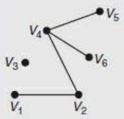

flowchart

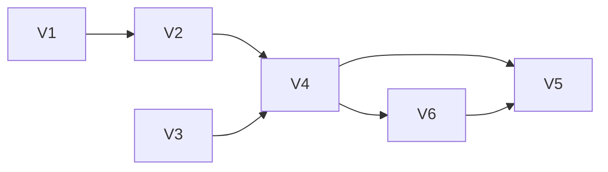

Graph

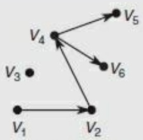

flowchart

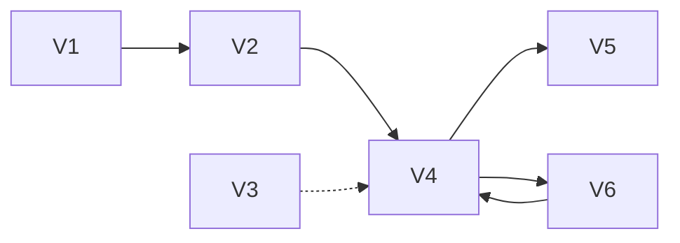

Directed graph

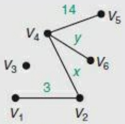

flowchart

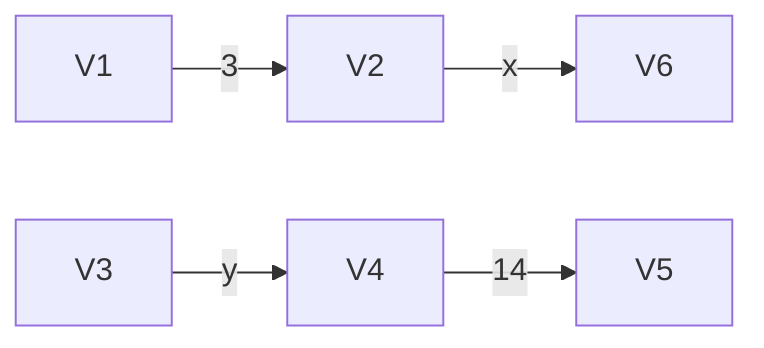

Labelled graph

An undirected unlabelled graph specifies the connectivity of a network but not the distances between vertices (the topology but not the geometry, as in the modern London Underground map). Labels on the edges can indicate distances. For example, some phylogenetic trees indicate only the topology of the ancestry. Others indicate quantitatively the amount of divergence between species. Phylogenetic trees are often drawn with the lengths of the branches indicating the time since the last common ancestor. This is a pictorial device for labelling the edges.

Some graphs do not correspond to physical structures, and in any event edge labels need not indicate only internode distances; they can be far more general. For example, the links in a network of metabolic pathways might be labelled to reflect flow capacities.

## Box 7.2 Examples of graphs

• Sets of people who have met each other; generalizable to people linked in online social networks
• Road maps, railroad maps, airline routing maps (but not purely topographic maps)
• Electricity distribution systems
• Phylogenetic trees
• Metabolic pathways
• Chemical bonding patterns in molecules
• Citation patterns in scientific literature
• The worldwide web

Station A and Station B? Regarding different lines as subnetworks, how easy is it to transfer from one to another; that is, what is the nature of the patterns of connectivity? In case of failure of one or more links, does the network remain fully connected? If so, this would be an example of robustness.

## Connectivity in networks

If $V _ { A }$ and $V _ { Z }$ are vertices in a graph, a path from $V _ { A }$ to $V _ { Z }$ is a series of vertices: $V _ { A } ,   V _ { B } ,   V _ { C } ,   \dots   V _ { Z } ,$ such that an edge in the graph connects each successive pair of vertices. For instance, in the graph in Box 7.1, $V _ { 1 } ,   V _ { 2 } ,   V _ { 4 } ,   V _ { 5 }$ is a path from $V _ { 1 }$ to $V _ { 5 } .$ . The number of vertices in the chain, including the initial and final vertices, is called the length of the path. A cycle is a path of length $> 2$ in a nondirected graph for which the initial and final endpoints are the same, but in which no intermediate link is repeated.

A graph that contains a path between any two vertices is called connected. Alternatively, a graph may split into several connected components.

The graph in the Box 7.1 contains two connected components, one containing five vertices and one containing only one vertex. (In the extreme, a graph could contain many vertices but no edges at all.) It is often useful to determine the shortest path between any two nodes, and to characterize a network by the distribution of shortest path lengths. The phrase ‘six degrees of separation’—also the title of a play by John Guare, made into a film—refers to the assertion (attributed originally to Marconi) that if the people in the world are vertices of a graph and the graph contains an edge whenever two people know each other, then the graph is connected, and there is a path between any two vertices with length $\leq 6$

A tree is a special form of graph. A tree is a connected graph containing only one path between each pair of vertices. A hierarchy is a tree: examples include chains of command and Linnaean taxonomy. Note that some family trees are not trees in the mathematical sense; examples are plentiful in the royal families of Europe. A tree cannot contain a cycle: if it did, there would be two paths from the initial point (= the final point) to each intermediate point. In the graph in Box 7.1 the subgraph consisting of vertices $V _ { 1 , }   V _ { 2 , }   V _ { 4 , }   V _ { 5 , }$ and $V _ { 6 }$ is a tree. Adding an edge from $V _ { 1 }$ to $V _ { 5 }$ would create an alternative path from $V _ { 1 }$ to $V _ { 5 , }$ and the cycle $V _ { 1 } \to V _ { 2 } \to V _ { 4 } \to V _ { 5 } \to V _ { 1 }$ ; the modified subgraph is not a tree.

## See Weblem 7.1

The density of connections, or the mean number of edges per vertex, characterizes the structure of a graph. A fully connected graph of N vertices has N − 1 connections per vertex; a graph with no edges has 0. Nervous systems of higher animals achieve their power not only by containing large number of neurons but also by having high connectivities.

In some systems there are limits on numbers of connections: for many human societies, in the graph in which individuals are the vertices and edges link people married to each other, each node has connectivity 0 or 1. For any hydrocarbon, the graph in which carbon and hydrogen atoms are the vertices and edges link atoms bonded to each other, each node has four or fewer connections. In other networks, connectivities follow observable regularities (see Box 7.3). For instance, the worldwide web can be considered as a directed graph. Individual documents are the nodes, and hyperlinks are the edges. It is observed that the distribution of incoming and outgoing links follow power laws: P(k) = probability of k edges is proportional to $k ^ { - q }$ , where $q = 2 . 1$ for incoming links and $q = 2 . 4 5$ for outgoing links.

The density of connections is very important in defining the properties of a network. For instance, the interactions that spread disease among humans and/or animals form a network. Whether a disease will cause an epidemic depends not only on the ease

## Box 7.3 ’Small-world’ networks

Many observed networks, including biological networks, the worldwide web, and electric power distribution grids, have the characteristics of high clustering and short path lengths. They include relatively few nodes with very large numbers of connections, called ’hubs’, and many that contain few connections. These combine to produce short path lengths between all nodes. From this feature they are called ’small-world’ networks. Such networks tend to be fairly robust, staying connected after failure of random nodes. Failure of a hub would be disastrous but is unlikely, because there are so few hubs. The 1987 fire in the King’s Cross underground station in London had a devastating effect on the underground network because King’s Cross is a hub.

Many networks, notably the worldwide web, are continuously adding nodes. The connectivity distribution tends to remain fairly constant as the network grows. These are called ’scale-free’ networks.

## See Weblem 7.2

of transmission in any particular interaction, but on the density of connections. As the density of connections—the rate of interactions—increases, the system can exhibit a qualitative change in behaviour, analogous to a phase change in physical chemistry, from a situation in which the disease remains under control to an epidemic spreading through an entire population. The classic approach of ‘quarantine’—isolating people for 40 days—works by cutting down the degree of connectivity of the disease-transmission network. Note that a carrier who shows no symptoms—‘Typhoid Mary’ 3 was a classic case—serves as a hub of the disease-transmission network.

Two historical epidemics associated with wars demonstrate the distinction between topology and geometry in network connectivity. In the early years of the Peloponnesian War, Athens suffered a severe epidemic. (From Thucydides' detailed description of the symptoms, the disease was probably bubonic plague.) A factor contributing to its transmission was the crowding of people into the city from the more militarily vulnerable surrounding countryside. After World War I, an epidemic of influenza killed an estimated 20 million people, more than died in the war itself. Long-distance travel by soldiers returning from the war helped spread the disease. Any epidemic needs an infectious agent and a high density of routes of transmission. These examples show that the controlling factor is the density of the connections and not necessarily the density of the people.

A change in behaviour analogous to the transition to an epidemic appears in nuclear fission. In a sample of uranium-235, decaying nuclei produce neutrons that can trigger fission of other atoms. If the sample is small, so many secondary neutrons are lost through the surface that the sample remains stable. Above a critical mass, enough neutrons are captured within the sample to create a chain reaction. If the atoms are vertices of a graph, and the edges are the trajectories of neutrons from one atom to another, the change in behaviour can be seen as the effect of increasing the connectivity density of a network. (The background to Michael Frayn's popular play, Copenhagen, involves the attempts, before and during the Second World War, to estimate the size of the critical mass, in order to determine whether nuclear explosions would be feasible.)

## Dynamics, stability, and robustness

An unlabelled, undirected graph gives a static structure of the topology of a network. For our molecular interaction networks this may be an adequate description of many of the physical interactions.

For some networks, such as metabolic pathways or patterns of traffic in cities, the dynamics of the system depend on the transmission capacities of the individual links. These capacities can be indicated as labels of the edges of the graph. This allows modelling of patterns of flow through the network. Examples include route planning, in travel or deliveries. Note that the shortest path may well not give optimal throughput. In many cities, taxi drivers are exquisitely sensitive—and insensitively garrulous—about optimal traffic paths.

In molecular biology, metabolic pathways and signal transduction cascades are networks that lend themselves to pathway and flow analysis. Optimal sequence alignment by dynamic programming (see Chapter 5) involves determining the optimal path through an edit graph.

Although much is known about the mechanisms of individual elements of control in signalling pathways, understanding their integration is a subject of current research. For instance, the idea that healthy cells and organisms are in stable states is certainly no more than an approximation (and in most cases a gross idealization). The description of the actual dynamic state of the metabolic and regulatory networks is a very delicate problem. Understanding how cells achieve even an apparent approximation to stability is also quite tricky. It is likely that great redundancy of control processes lies at its basis. Regulation is based on the resultant of many individual control mechanisms: here a short feedback loop, there a multistep cascade. Somehow the independent actions of all the individual signals combine to achieve an overall, integrated result. It is like the operation of the ‘invisible hand’ that, according to Adam Smith, coordinates individual behaviour into the regulation of national economies.

## Stability and robustness

Stability is the property of being able to continue to carry out approximately the same set of activities when challenged by small fluctuations in conditions: ’Take it in your stride’. A stable system is not necessarily a static system.

Robustness is the property of being able to continue to carry out the same or if necessary a more substantially modified set of activities, that achieve similar goals, after challenge by larger perturbations. Sometimes but not always this involves the attainment of a different stable state. An example would be a switch from anaerobic to aerobic metabolism in yeast, which involves major physiological changes. ’Oops!’

Several types of dynamic states of a network are possible (see Box 7.4):

• equilibrium;

• steady-state;
• states that vary periodically;
• unfolding of developmental programmes;
• chaotic states;
• runaway or divergence;
shutdown.

## Box 7.4 States of a network of processes

At equilibrium one or more forward and reverse processes occur at compensating rates, to leave the amounts of different substances unchanging:

$$
A \rightleftharpoons B
$$

Chemical equilibria are generally self-adjusting upon changes in conditions, or in concentrations of reactants or products.

A steady state will exist if the total rate of processes that produce a substance is the same as the total rate of processes that consume it. For instance, the two-step conversion:

$$
\mathrm{A} \rightarrow \mathrm{B} \rightarrow \mathrm{C}
$$

could maintain the amount of B constant, provided that the rate of production of B (the process A → B) is the same as the rate of its consumption (the process B → C). The net effect would be to convert A to C.

A cyclic process could maintain a steady state in all its components:

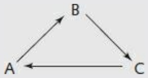

A steady state in such a cyclic process with all reactions proceeding in one direction is very different from an equilibrium state. Nevertheless, in some cases it is still true that altering external conditions produces a shift to another, neighbouring, steady state.

States that vary periodically appear in the regulation of the cell cycle, circadian rhythms, and seasonal changes such as annual patterns of breeding in animals and flowering in plants. Circadian and seasonal cycles have their origins in the regular progressions of the day and year, but have evolved a certain degree of internalization.
Many equilibrium and some steady-state conditions are stable, in the sense that concentrations of most metabolites are changing slowly if at all, and the system is robust to small changes in external conditions. The alternative is a chaotic state, in which small changes in conditions can cause very large responses. Weather is a chaotic system: the meteorologist Lorenz asked, ’Does the flap of a butterfly’s wings in Brazil set off a tornado in Texas?’ In a carefully regulated system, chaos is usually well worth avoiding, and it is likely that life has evolved to damp down the responses to the kinds of fluctuations that might give rise to it. Chaotic dynamics does sometimes produce the approximations to stable states: these are called strange attractors. Understanding stability in dynamical systems subject to changing environmental stimuli is an important topic, but beyond the scope of this book.
Unfolding of developmental programmes occurs over the course of the lifetime of the cell or organism. Many developmental events are relatively independent of external conditions, and are controlled primarily by regulation of gene expression patterns.
Runaway or divergence. Breakdown in control over cellular proliferation leads to unconstrained growth, in cancer.
• Shutdown is part of the picture. Apoptosis is the programmed death of a cell, as part of normal developmental