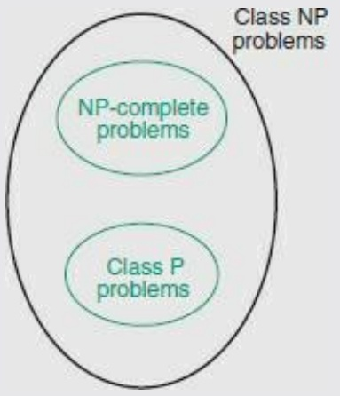
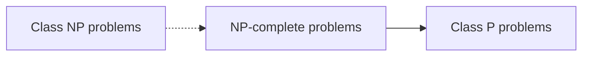
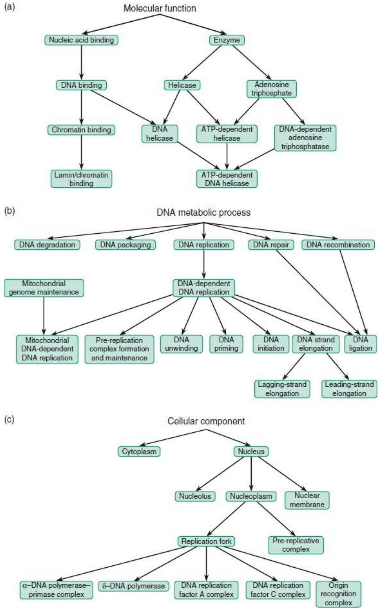
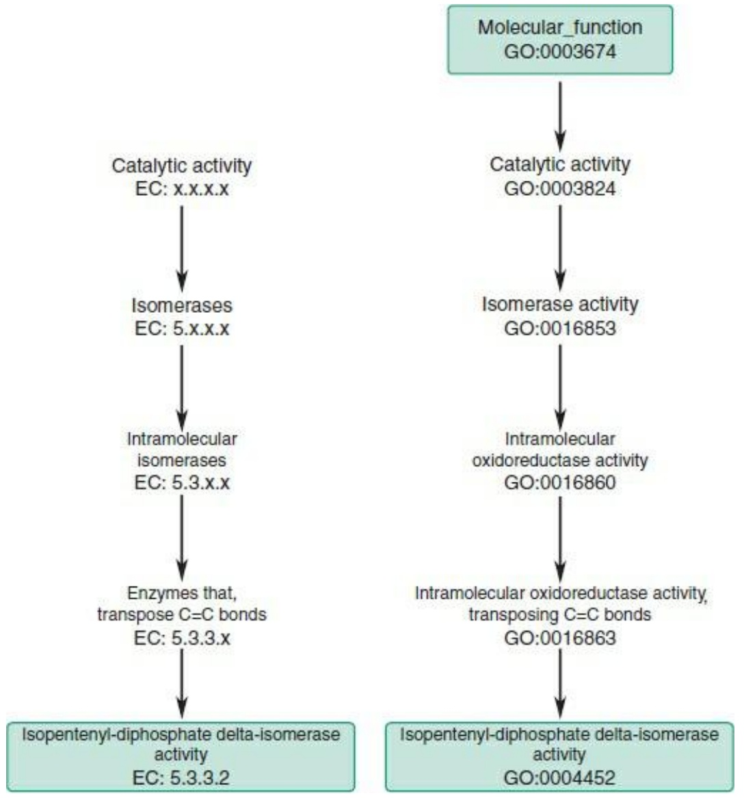
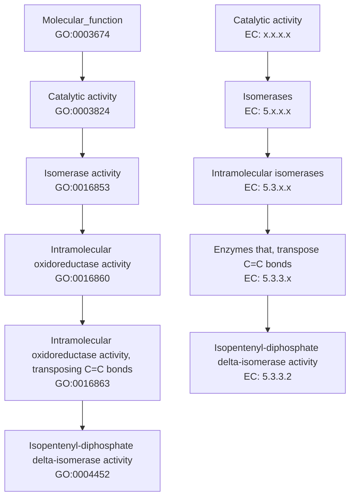
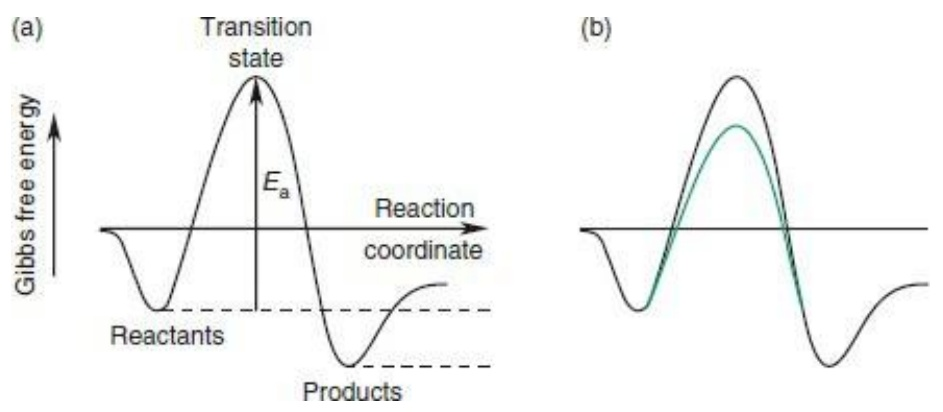
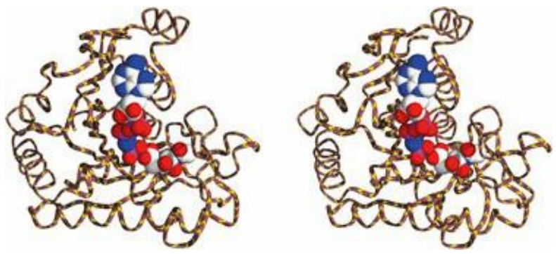

## Some sources of ideas for systems biology

Several related ideas are important in coping with the static and dynamic aspects of the networks studied in systems biology. These include complexity, entropy, randomness, redundancy, robustness, predictability, and chaos. We deal with these in our daily lives, but without the need to define them precisely and quantitatively. How well do we really understand these concepts? What are the relationships among them? And how can they be used to illuminate biology in general and systems biology in particular?

## Complexity of sequences

The simplest complex object in biology is a sequence. We have all heard of random sequences, and probably agree that the more random the sequence the more complex it is. For example, genomic sequences contain ‘low-complexity’ regions. In the human genome, such regions include simple repeats, or microsatellites, or regions of highly skewed nucleotide composition such as AT-rich or GC-rich regions, or polypurine and polypyrimidine stretches. Are these regions more, or less, random than a region containing a gene that encodes a specific protein? How can such properties of sequences be measured?

Take a sequence of characters:

AGTCTCTA . . ., or AATAAAAATAAA . . ., or ABZXUVJFLT....

What determines the amount of information needed to specify the next character in each sequence? Less information is required if the set of possible characters—A, T, G, C—is very small, or if the distribution is very skewed—AATAAAAATAAA—than if the set is very large and the ratios of different characters is more even.

How can we make this quantitative? Genomic sequences are limited to the characters A, T, G, and C. To identify each symbol it is enough to ask two ‘yes-or-no’ questions. For instance:

Question 1: is it a purine (or a pyrimidine)? (Purine implies it is A or G.)

Question 2: Is it 6-amino (or 6-keto)? (6-Amino implies it is A or C.)

Knowing the answer to these two questions is enough for us to identify one of the four bases uniquely.

Representing yes with 1 and no with 0, each ‘yes-or-no’ question provides 1 binary digit, or 1 bit of information. We could encode each nucleotide of a genome sequence as a two-bit binary string.

To identify a character of the ordinary alphabet—abcd … z—requires more than two yes/no questions. It is therefore reasonable to think that a character string of full text is more complex than a genomic sequence of the same length containing only the characters A, T, G, and C.

Questions of how much information is needed to specify an amino acid appear in the genetic code itself. How many nucleotides are required to encode 20 amino acids? If each position in a gene can contain one of four nucleotides, then there are only 16 possible dinucleotides: not enough. So, if the same number of nucleotides is to be required for each amino acid, there must be at least three nucleotides per codon, as observed. Because there are only 20 amino acids, the triplet code contains redundancy.

Why not make do with fewer amino acids? If 15 amino acids (plus a STOP signal)—not unreasonable—would suffice, then from the information point of view a doublet code would be possible. However, a two-base codon/two-base anticodon interaction would probably not have adequate stability.

It has been possible to embed these ideas in a more formal framework.

## Shannon's definition of entropy

In 1948 C.E. Shannon introduced the concept of entropy into information theory, as part of his analysis of signal transmission. Suppose a text contains symbols with relative probability $p _ { i } .$ Shannon's measure of entropy is:

$$
H = - \sum_ {i} p _ {i} \log_ {2} p _ {i}
$$

The entropy H can be interpreted as the minimum average number of bits per symbol required to transmit the sequence.

For example, for a genomic sequence with equimolar base composition, $p_{\mathrm{G}}=p_{\mathrm{C}}=p_{\mathrm{G}}=p_{\mathrm{C}}=0.25$

$$
\begin{array}{l} H = - \sum_ {i} p _ {i} \log_ {2} p _ {i} \\ = - [ 0. 2 5 \log_ {2} 0. 2 5 + 0. 2 5 \log_ {2} 0. 2 5 + 0. 2 5 \log_ {2} 0. 2 5 \\ + 0. 2 5 \log_ {2} 0. 2 5 ] = 2 \\ \end{array}
$$

(Note that $\log_{2}0.25 = \log_{2}\% = - 2.$

The result H = 2 for the gene sequence with equimolar base composition recovers our informal result that 2 bits, or two ‘yes-or-no’ questions, are required. For a sequence limited to two equiprobable characters A and T: $p_{\mathrm{A}} = p_{\mathrm{T}} = 0.5, H = - \left[ 0.5 \log_{2} 0.5 + 0.5 \log_{2} 0.5 \right] = 1$ . This also makes sense because, knowing that the only choices are A and T, we can decide which it is with one ‘yes-or-no’ question, or 1 bit.

Suppose that a sequence is known to have the skewed nucleotide composition: $p _ { \mathrm { A } }   =   p _ { \mathrm { T } }   =   0 . 4 2$ , and $p _ { \mathrm { G } }   =   p _ { \mathrm { C } }   =   0 . 0 8$ . Then:

$$
\begin{array}{l} H = - [ 0. 4 2 \log_ {2} 0. 4 2 + 0. 4 2 \log_ {2} 0. 4 2 + 0. 0 8 \log_ {2} 0. 0 8 \\ + 0. 0 8 \log_ {2} 0. 0 8 ] = 1. 6 3 \\ \end{array}
$$

What is the significance of the fact that the value H = 1.63 is less than 2? It suggests that we might be able to encode the sequence with fewer than 2 bits/character, on average.

The Morse code for telegraphy took such advantage of unequal letter distribution frequencies to encode common letters with short sequences and uncommon letters with longer ones. For instance E = dot (length one) and J = dot-dash-dash-dash (length four). Note that to take advantage of entropy values lower than those corresponding to equal distributions of characters requires variable-length encoding. Huffman devised an algorithm for assigning length-optimal codes to symbols knowing their relative probabilities.

It would be difficult to devise a Morse code for single nucleotides because the fact that we can easily encode them with no more than 2 bits doesn’t give us much room to play with; after all, we can’t subdivide a single bit. However, consider encoding a genome sequence at the trinucleotide level. Assume that there is no bias in trinucleotide frequencies other than that expected from the mononucleotide frequencies. (That is, $p _ { \mathrm { A T C } } = p _ { \mathrm { A } } \times p _ { \mathrm { T } } \times p _ { \mathrm { C } }$ , etc.) There are 64 trinucleotides to encode. Six bits per triplet obviously suffice, but for the skewed distribution $p _ { \mathrm { A } }   =   p _ { \mathrm { T } }   =   0 . 4 2$ and $p _ { \mathrm { G } } =$ $p_{\mathrm{C}} = 0.08, H = 4.9$ . We could encode the sequence using 5 bits per trinucleotide instead of 6.

The entropy is lower than for an equimolar sequence because the uncertainty in each transmitted symbol is not complete: it is more likely to be A or T than G or C. In principle we can use this knowledge to improve the coding efficiency.

Conversely, looking at distributions of oligonucleotides (dinucleotides, triplets, etc.) is a useful way to detect biologically significant patterns. Codon usage patterns in protein-coding regions are examples. Some algorithms for gene identification make use of biases, in coding regions, of frequencies of hexanucleotides.

Although the actual genetic code does not achieve the theoretical efficiency that entropy calculations suggest, and indeed there does not even seem to be selection for reduction in the size of nonviral genomes, it is clear that the redundancy in the genetic code has biological significance. Many single-base mutations are silent. Conservative mutations allow proteins to evolve with small nonlethal changes that, cumulatively, can achieve large changes in structure and function. And of course the redundancy in having two copies of the genetic information in two strands of DNA is used to detect and correct errors in replication and translation, and to repair DNA damage.

## Randomness of sequences

The Shannon entropy of sequences is related to the idea of randomness, another concept that we know from everyday life without worrying too much about exactly what it means.4 A.N. Kolmogorov defined, as a quantitative measure of the randomness of a sequence of numbers, the length of the shortest computer program that can reproduce the sequence. Thus the sequence 0, 0, 0, 0, 0, 0, 0, … is far from random, as it is the output of the very short program:

Step 1: print 0

Step 2: go back to step 1

Periodic sequences, such as:

Monday, Tuesday, Wednesday, Thursday, Friday, Saturday, Sunday, Monday,

are also of low complexity. In contrast, a truly random sequence has no description shorter than the sequence itself.

## The relationship between complexity, randomness, and compressibility

One way to shorten the specification of a nonrandom sequence is to compress it. We all use compression algorithms on our computer files to save disk space. If a sequence is truly random, in the sense of Kolmogorov, it cannot be compressed. By definition, nonrandom sequences can be compressed.

One basic principle of compression is that: if you can predict what is coming next, you can compress ef ectively.

The reason that sequences such as 0, 0, 0, 0, … and Monday, Tuesday, Wednesday, Thursday, Friday, Saturday, Sunday, Monday, … are so effectively compressible, and—concomitantly—far from random, is that it is simple to decide what the successor of any element is. Even sequences for which it is not possible to decide unambiguously what the next element is can be compressed if some indications are available. It is not even necessary that the rules be supplied ‘up front’ as they can be for sequences such as 0, 0, 0, 0, … and Monday, Tuesday, Wednesday, Thursday, Friday, Saturday, Sunday, Monday, … The rules and statistics of prediction of a successor can be generated on the fly from the incoming data. The rule, ‘the weather tomorrow is likely to be the same as the weather today’ would—in most places—be good enough for effective compression of a series of daily weather reports.

Putting together these considerations suggests a general idea that the harder it is to predict the contents of a data set from a subset of the data, the more complex the data set is.

The relationships among complexity, predictability, compressibility, and randomness, which we have so far described for character strings, apply to the static structures of other types of objects, including images, three-dimensional structures, and—especially—networks. Indeed, most types of biological data can be regarded as networks. For instance, a nucleotide sequence is equivalent to a network in which the individual bases are the nodes, and each base is connected by a directed edge pointing to the next base. That's a perfectly proper graph! Conversely, recognizing that sequences are networks can usefully lead us to ask: can we define analogues of sequence alignment for more general networks? (Yes, we can.)

## Complexity of other types of biological data

Many types of biological data are not sequences. These include static data, such as protein structures,5 gene expression patterns measured with microarrays, and regulatory networks; and dynamic data, describing processes.

For static data, generalizations of Kolmogorov's approach are suitable for defining complexity. The description of the complexity of a process is more difficult.

## Computational complexity

Perhaps the best-developed area of analysis of complexity of processes comes from studies of the complexities of computational problems.

An algorithm in computer science defines a process for solving a computational problem. For some problems, the execution time required to solve it is directly proportional to the size of the problem. These are said to be of order O(N) (read ‘Oh-N’). For instance, searching for a number in an unsorted table requires an execution time proportional to the length N of the table, O(N). For some problems, the execution time increases only as N logN. Sorting a list is an O(N logN) problem. For some problems, the execution time increases as a power $N ^ { 2 }$ or $N ^ { 3 }$ or …. The alignment by dynamic programming (see Chapter 5) of two sequences, both of length N, by dynamic programming is an O(N 2 ) problem. These are called polynomial-time problems. Still other problems have even greater time demands. Enumerating all subsets of a set containing N members is $O ( 2 ^ { N } )$

Computer scientists define the complexity of a problem in terms of the dependence of execution time on problem size (see Box 7.5).

In principle, constraints of computational complexity apply to biological systems much as to any other kind of computer. Computational complexity describes the complexity of the problem, not the complexity of the device that solves it. However, classical computational complexity theory applies to computers that execute programs sequentially. Biological computers do lots of parallel processing. This allows them to solve problems of substantial complexity. For instance, the regulatory activities that biological systems carry out are complicated nonlinear optimization calculations. Prediction of protein structure from amino acid sequence is an example. Another, described by Sydney Brenner, is the growth of bacteria in heavy water. Changing from $\mathrm { H } _ { 2 } \mathrm { O }$ to $\mathrm { D } _ { 2 } \mathrm { O }$ has the effect of changing the kinetic constants of many enzymatic reactions. After a relatively short period, cells readjust and resume activity and growth. (Would you call this stability or robustness?)

## Static and dynamic complexity

One dimension of complexity is time. Is it possible to distinguish static from dynamic complexity? If we could define and measure the static complexity of a system, this would provide an approach to dynamic complexity: we could ask how the static complexity of a system changes with time.

For example, a program that sorts a list of numbers into order may proceed through a series of steps

## Box 7.5 Classes P and NP

A problem that can be solved in polynomial time is said to be in class P. O(N logN) algorithms are faster than $O ( N ^ { 2 } )$ , and are therefore in class P.

Suppose on the other hand that the optimal algorithm to solve a problem has order worse than polynomial— for instance, it might have exponential order $O ( 2 ^ { N } )$ but that if you propose a solution it can be checked in polynomial time. Such a problem is said to be of class NP. (NP does not stand for nonpolynomial, but for nondeterministic polynomial, referring to a different model for the computation. Don’t worry about this technical distinction.)

Consider the problem of sorting a list of numbers into order. That is, given a series of N numbers—2, 1, 7, 5, 8, 4, 3, … —an algorithm must produce as output the numbers rearranged into order: 1, 2, 3, 4, 5, 7, 8, Whatever the order of the optimal algorithm that solves the problem, an algorithm to verify that 1, 2, 3, 4, 5, 7, 8, is a solution (or that 1, 8, 7, 2, 4, 5, 3, …, is not a solution) can run in time linear in the length of the list. It is necessary only to check that each number is greater than or equal to its predecessor, which can be done by looking at each element of the list once. Therefore, sorting a list of numbers into order is a problem in class NP. (Sorting happens also to be in class P; sorting algorithms are known with order O(N logN).)

For many problems, we don’t know whether any polynomial time algorithm exists.

## NP-complete problems. Does P = NP?

Many NP problems have equivalent complexities, in the sense that if a polynomial algorithm were discovered for one, it could be applied to solve others. The set of NP-complete problems is the set of NP problems, such that if we could solve any one of them in polynomial time we would be able to solve all of them in polynomial time. In other words, the discovery of a polynomial-time algorithm for any problem known to be NP complete would cause the classes P and NP-complete to coalesce. But are there any NP problems that are not in class P? This is the famous unsolved conjecture of computer science: does P = NP? (See Figure 7.1).

flowchart

Figure 7.1 Computational problems can be:

• class P = problems for which algorithms of polynomial asymptotic order are known;
• class NP = problems, for which optimal algorithms are probably nonpolynomial;
NP-complete = a set of problems for which no algorithms of asymptotic polynomial-time order are known but which are reducible to one another in the sense that the discovery of an algorithm of asymptotic polynomialtime order for one of them (proving it to be of class P) would show that all NP-complete problems are of class P, or:

If P = NP, class P would expand to fill the entire class NP set.

in which the numbers appear ordered to progressively greater extents. The randomness, of the list may steadily decrease. This provides an important connection between complexity of static data and complexity of process. We can collect the historical records of a process, and treat them as a succession of cases of static data. We can apply ideas of predictability and complexity of structures to these historical records, to give insight into the changes in complexity of the system during the process.

For real physical processes, changes in complexity over time appear to be governed by some general rules. If you stop people on the street, some of them might well say that in closed systems the laws of thermodynamics require that structural complexity always increases in natural processes. Others might say that the solar system is structurally complex but, ignoring tidal effects, dynamically simple. Will these statements hold up to rigorous analysis?

Within classical Newtonian mechanics, we could base an analysis of dynamic complexity on the definition and description of the trajectories of a system of particles. The initial positions and velocities of the particles, knowledge of the forces between them, and Newton’s laws of motion, together provide a concise description of the dynamics of such a system.

However, even within the framework of classical dynamics, this concise description can break down in the case of chaotic states. In chaotic states, very small changes in the initial conditions can lead to very large changes in the ensuing trajectories. Prediction of the dynamics requires very precise statement of the initial conditions, and very precise knowledge of the forces. Specification of the information required to describe the dynamics cannot in these cases be concise. Chaos is an extreme form of dynamic complexity.6

Another way to look at this is directly relevant to systems biology: the dynamics of nonchaotic systems are robust to small changes in initial conditions. The dynamics of chaotic systems are not robust to small changes in initial conditions.

## Chaos and predictability

The discovery of the laws of mechanics in the 17th century—Newton’s Principia was published in 1687—gave rise to the hope that the dynamics of the solar system in particular (and much if not all of the universe in general) was predictable. Laplace expressed the view that:

‘If we can imagine a consciousness great enough to know the exact locations and velocities of all the objects in the universe at the present instant, as well as all forces, then there could be no secrets from this consciousness. It could calculate anything about the past or future from the laws of cause and effect.’

Leaving aside philosophical questions of the implications about free will and responsibility, there are also issues of computability. How much information do we really need, and how accurately do we need it, to predict the dynamics of the solar system? The weather? The universe? In chaotic systems, accurate prediction of the dynamic development requires unachievably accurate knowledge of the initial conditions. (At the atomic level Heisenberg’s uncertainty principle killed off Laplace’s hope of perfect determinism.)

It is true that, in classical mechanics, even chaotic systems are subject to Poincaré’s recurrence principle: any system of particles held at fixed total energy will eventually return arbitrarily closely to any set of initial positions and velocities. (What rescues the second law of thermodynamics is that the closer the reapproach demanded, the longer the time required; that is, the rarer the fluctuations that achieve the recurrence.) However, knowing that the configuration will recur does not simplify the calculation of the trajectories of the particles.

Through unpredictability, chaotic dynamics is associated with complexity. However, chaotic dynamics is not entirely incompatible with order and even the ‘spontaneous’ generation of order. In governing the time course of evolution of a system, chaotic dynamics does sometimes produce stable states or approximations to stable states: these are called attractors. Sometimes these are unique points, in other cases they are periodic and/or localized states. There have been examples of apparent generation of order in model systems evolving ‘at the edge of chaos’.

There are even examples of static or structural order in chaotic systems. Many sequences associated with chaotic behaviour have a fractal structure. This means that if an object is dissected into parts, the parts have a structure similar to that of the whole (as well as to one another). B. Mandelbrot has produced many familiar beautiful images. This self-similarity at different scales implies that if we know part of such a structure we can predict a larger segment of it. This should recall the idea that predictability should permit compressibility, and effectively reduce complexity. Indeed, such internal structural relationships have been applied to compression. Fractal image compression is an effective tool for reducing the sizes of images, to a form from which the recovered image is not exactly the same as the starting image but perceptually equivalent.

Fractal structures in biology include branching patterns of plants, and of the circulatory systems of vertebrates. At the molecular level, the storage polysaccharide glycogen has features of a fractal structure.

## RECOMMENDED READING

- Albert, R. and Barabási, A.-L. (2002). Statistical mechanics of complex networks. Rev. Mod. Phys., 74, 47–97.
- Barabási, A.-L. (2003). Linked: How Everything Is Connected to Everything Else and What It Means. Plume Books, New York.
- Bechhoefer, J. (2005). Feedback for physicists: a tutorial essay on control. Rev. Mod. Phys., 77, 783–836.
- Emmert-Streib, F. and Dehmer, M. (2011). Networks for systems biology: conceptual connection of data and function. IET Syst. Biol., 5, 185–207.
- Ideker, T. (2004). A systems approach to discovering signaling and regulatory pathways – or, how to digest large interaction networks into relevant pieces. Adv. Exp. Med. Biol., 547, 21–30.
- Ma’ayan, A. (2011). Introduction to network analysis in systems biology. Sci Signal., 4(190), tr5.
- Pavlopoulos, G.A., Secrier, M., Charalampos, N., Moschopoulos, C.N., Soldatos, T.G. et al. (2011). Using graph theory to analyze biological networks. BioData Mining, 4, 10.
- Wagner, A. (2009). Robustness and Evolvability in Living Systems. Princeton University Press, Princeton, NJ.
- Wagner, A. (2009) Networks in molecular evolution. In: Meyers, R.A. (ed.), Encyclopedia of Complexity and System Science|, pp. 5655–5667. Springer, Heidelberg.

## EXERCISES AND PROBLEMS

**Exercise 7.1** In the undirected, unlabelled graph in Box 7.1:

(a) Name two vertices such that if you add an edge between them at least one vertex has exactly four neighbours. (Note that two edges may cross without making a new vertex at their point of intersection.)
(b) Name two vertices such that if you add an edge between them to the original graph, the graph becomes a tree.
(c) Starting with the answer to (b), name two vertices (neither of them $V _ { 1 } )$ such that if you add an edge between them to the original graph, the graph does not remain a tree.
(d) Name two vertices such that if you add an edge between them to the original graph, there are alternative paths, of lengths 3 and 4, between $V _ { 1 }$ and $V _ { 5 } ,$ with no vertices repeated. (In determining the length of a path, you have to count the initial and final vertices. A path of length 3 between $V _ { 1 }$ and $V _ { 5 }$ contains one intermediate vertex.)
(e) Name two vertices such that if you add an edge between them to the original graph there is exactly one path between $V _ { 1 }$ and $V _ { 3 } ,$ with no vertices repeated, and it has length 4.

**Exercise 7.2** Of the examples of graphs in Box 7.1, (a) which are directed graphs? (b) Which are labelled graphs? (c) In each example, what is the set of nodes? (d) In each example, what is the set of edges?

**Exercise 7.3** In the London Underground: (a) what is the shortest path between Moorgate and Embankment stations? Note that, considered as a graph, the shortest path between two nodes is the path with the fewest intervening nodes, not the path that would take the minimal time or fewest interchanges. (b) What is the shortest cycle containing King’s Cross, Holborn, and Oxford Circus stations? (c) The clustering coefficient of a node in a graph is defined as follows: suppose the node has k neighbours. Then the total possible connections between the neighbours is $k ( k - 1 ) / 2$ The clustering coefficient is the observed number of neighbours divided by this maximum potential number of neighbours. If the neighbours of a station are the other stations that can be reached without passing through any intervening stations, what is the clustering coefficient of the Oxford Circus station? (If necessary, see [http://www.bbc.co.uk/london/travel/downloads/tube\_map.html](http://www.bbc.co.uk/london/travel/downloads/tube_map.html)).

**Exercise 7.4** In the London Underground: (a) what is the maximum path length between any two stations? That is, for which two stations does the shortest trip between them involve the maximum number of intervening stops? (b) If the District Line were not active, what stations if any would be inaccessible by underground? (c) If the Jubilee line were not active, what stations if any would be inaccessible by underground?

**Problem 7.1** On the map of the London Underground, what is the distribution of numbers of neighbours of vertices? (You could just count them by hand. Or you could download the map and write a program to solve this problem. Generating the connectivity list is not an entirely trivial exercise.)

**Problem 7.2** Analyse the map of the London Underground by counting the number of connections made from each station in Zone 1 (the central portion). Count connections to stations inside and outside Zone 1 as long as they originate within Zone 1. Count only one connection if two stations are connected by more than one line; in other words, for each station, the question is: how many other stations can be reached without passing through any intermediate stops? (a) What is the maximum number of connections of any station? (b) For each integer k from 1 to this maximum number, how many stations have k connections? (c) Plot these data on a log-log plot. Does the relationship appear reasonably linear? (d) If so, fit a straight line to the log-log plot and determine the exponent. Results of network analysis of this sort are more significant if the data cover several orders of magnitude, but this is not possible for this example.

**Problem 7.3** What is the minimum number of ’yes-or-no’ questions required to identify a specific letter of the English uppercase alphabet: ABC … Z? Assume a random text with equal distribution of all letters.

**Problem 7.4** Suppose you want a program to identify whether a certain passage of text, no fewer than 200 words in length, is in English, French, or German. You are given sample texts of comparable length known to be in each of those languages. Of course you could scan the unknown text for its alphabet: the presence of é would imply French, the presence of ü would imply German, and the absence of both would imply English. Or you could look for words:’and’ implies English, ’le’ implies French, and ’der’ or ’das’ (but not ’die’ or ’den’, or even, in Brooklyn, ’dem’) implies German. However, these might fail in the case of text primarily in one language, but quoting a short passage in one of the others.

Think of a method based on compression of the concatenation of the unknown text with each of the knowns. Your method should require no knowledge whatsoever of the alphabet or vocabulary of each of the languages. Indeed, it should work even if the languages of the known texts were unidentified and unrecognized. For instance, there is no reason why it should not work with transliterations of material in oriental languages, provided samples were provided. (Based on a remark by A. Aho.)

**Problem 7.5** Write a program that accepts as input two London Underground stations, and advises a traveller what line to take, and where if necessary to change trains. Choose the route to minimize the number of changes.

**Problem 7.6** Write a web server to provide the information generated in Problem 7.5 to tourists. (Note that Transport for London has already done this. If you were lazy or in a hurry, could your program simply access their site, rather than redoing the calculation yourself? Why might you want to revisit a solved problem? One reason might be to provide versions in languages that the TFL site does not. Another might be to link to sites with local attractions around the destination.)

## See Weblems 7.3, 7.4 and 7.5

1 See [http://www.bbc.co.uk/london/travel/downloads/tube\_map.html](http://www.bbc.co.uk/london/travel/downloads/tube_map.html). Exercises 7.3 and 7.4, Problems 7.1, 7.2, and 7.5, and Weblem 7.4 also make use of this map.
[2 See http://www.ltmcollection.org/museum/object/related.html?](http://www.ltmcollection.org/museum/object/related.html?IXrelsr=sdi5UHeCftW&IXrelinv=&IXinv=1983/4/1924&IXcollection=tickets%20or%20maps%20or%20timetables&IXsummary=collection/collection&IXfirst=7)
[IXrelsr=sdi5UHeCftW&IXrelinv=&IXinv=1983/4/1924&IXcollection=tickets%20or%20maps%20or%20timetables&](http://www.ltmcollection.org/museum/object/related.html?IXrelsr=sdi5UHeCftW&IXrelinv=&IXinv=1983/4/1924&IXcollection=tickets%20or%20maps%20or%20timetables&IXsummary=collection/collection&IXfirst=7)
3 Mary Mallon (1869–1938) presented the following unfortunate combination of features: (1) she was infected with typhoid, (2) she did not show symptoms, and (3) she worked for many families as a cook.
4 Shannon entropy is linked with thermodynamic entropy through the general notion of disorder or randomness. The relationship has been explored by physicists, including J.C. Maxwell and L. Szilard, in their discussions of’Maxwell’s demon’, and by E.T. Jaynes.
5 A paradox when applying Kolmogorov’s ideas to protein structures is that the shortest representation of a protein structure is an amino acid or DNA sequence!
6 The original meaning of the word chaos (from the Greek word for vast empty void) suggests a structural significance, but modern physics, since Maxwell, has given it a dynamical one.

## LEARNING GOALS

• To recognize that metabolic networks of any organism correspond to graphs, in which metabolites are the nodes and reactions connecting them are the edges. Enzymes label the edges that correspond to the reactions they catalyse.
• To understand that comparisons of metabolic pathways in different species shows regions of core overlap. Some pathways are special to certain groups of organisms. For instance, the Calvin–Benson cycle for fixation of carbon dioxide does not appear in (almost any) animals.1
• To know the defining principles of the Enzyme Commission and the Gene Ontology Consortium classifications of the functions of biological molecules. In what ways are they similar? In what ways do they differ?
• To appreciate the importance of accurate annotation of enzyme function in databases. To recognize that transfer of annotation among homologous proteins is by far the easiest way to proceed, but in the absence of experimental confirmation it is not trustworthy.
• To appreciate the physicochemical basis of enzymatic catalysis, and the quantities needed to characterize their kinetics. Such information is necessary if we are to consider modelling flows through metabolic networks.
• To understand how enzymes develop modified or novel functions. General categories are recruitment, divergence, and mixing and matching of domains.
• To see how the algorithms for comparison of nucleic acid and amino acid sequences can be generalized to compare metabolic pathways.
• To become familiar with databases of metabolic networks.

A metabolite is a molecule that undergoes transformation in a biological system, either under the action of enzymatic catalysis or by spontaneous reaction. It is conventional to think of metabolites as small molecules such as simple sugars or amino acids, rather than proteins and nucleic acids, but the distinction is arbitrary.

Metabolic pathways are the road maps defining the possible transformations of metabolites. They form a network, representable as a graph. Usually the metabolites are the nodes, and reactions connecting them are the edges. Irreversible reactions correspond to directed edges. The enzyme that catalyses each reaction labels the edge.

## See Weblem 8.1

To compile a metabolic network we need to know the possible reactions that can occur, and we need to know the catalytic activities of all the enzymes. These sets of data are really two sides of the same coin.

Generations of biochemists have charted metabolic pathways. These are fairly comprehensive for the best-studied organisms, which include E. coli, yeast, rat, and human. A sizable fraction of the pathways are common, and in many cases the enzymes that catalyse corresponding reactions are homologous over a broad range of species. Indeed, this often provides the most direct route to establishing the metabolic pathway network of a less-well-studied organism. Working out the individual reactions using classical methods such as following radioactive tracers remains very labour-intensive. It is much easier to sequence the genome, infer the amino acid sequences of the enzymes, look for sequences similar to enzymes of known function, and assemble the metabolic networks from the assignable enzymatic functions. When this works, it is golden. The problem is that it often fails.

Clearly the basic infrastructure of this enterprise involves knowing the functions of enzymes. To impose some order on this information there have been several attempts to classify enzyme function.

## Classification and assignment of protein function

## The Enzyme Commission

The first detailed classification of protein functions was that of the Enzyme Commission (EC). In 1955, the General Assembly of the International Union of Biochemistry (IUB), in consultation with the International Union of Pure and Applied Chemistry (IUPAC), established an International Commission on Enzymes to systematize nomenclature. The EC published its classification scheme, first on paper and now on the web ([http://www.chem.qmul.ac.uk/iubmb/enzyme/](http://www.chem.qmul.ac.uk/iubmb/enzyme/)).

EC numbers (looking suspiciously like a computer's IP number) contain four fields, corresponding to a four-level hierarchy. For example, EC 1.1.1.1 corresponds to alcohol dehydrogenase, catalysing the general reaction:

An alcohol+NAD$^{+}$=
the corresponding aldehyde or ketone+NADH+H$^{+}$

Several reactions, involving different alcohols, would share this number; but the same dehydrogenation of one of these alcohols by an enzyme using the alternative cofactor NADP + would be assigned EC 1.1.1.2.

The first field in an EC number indicates one of the six main divisions (classes) to which the enzyme belongs:

| Class 1 | Oxidoreductases |
| --- | --- |
| Class 2 | Transferases |
| Class 3 | Hydrolases |
| Class 4 | Lyases |
| Class 5 | Isomerases |
| Class 6 | Ligases |

The significance of the second and third numbers depends on the class. For oxidoreductases the second number describes the substrate and the third number the acceptor. For transferases, the second number describes the class of item transferred and the third number describes either more specifically what they transfer or in some cases the acceptor. For hydrolases, the second number signifies the kind of bond cleaved (e.g. an ester bond) and the third number the molecular context (e.g. a carboxylic ester or a thiolester). (Proteinases are treated slightly differently, with the third number indicating the mechanism: serine proteinases, thiol proteinases, and acid proteinases are classified separately.) For lyases the second number signifies the kind of bond formed (e.g. C─C or C─O) and the third number the specific molecular context. For isomerases, the second number indicates the type of reaction and the third number the specific class of reaction. For ligases, the second number indicates the type of bond formed—for example, EC 6.1 for C─O bonds (enzymes acylating tRNA) and EC 6.2 for C─S bonds (acyl-CoA derivatives), etc—and the third number the type of molecule in which it appears. The fourth number gives the specific enzymatic activity.

Specialized classifications are available for some families of enzymes; for instance, the MEROPS database by N.D. Rawlings and A.J. Barrett provides a structure-based classification of peptidases and proteinases ([http://merops.sanger.ac.uk/](http://merops.sanger.ac.uk/)).

The EC produced a catalogue of reactions, not an assignment of function to proteins. The EC has emphasized that: ‘It is perhaps worth noting, as it has been a matter of long-standing confusion, that enzyme nomenclature is primarily a matter of naming reactions catalysed, not the structures of the proteins that catalyse them’ ([http://www.chem.qmul.ac.uk/iubmb/nomenclature/](http://www.chem.qmul.ac.uk/iubmb/nomenclature/)). Assigning EC numbers to proteins is a separate task. Such assignments appear in protein databases such as UniProtKB.

## The Gene Ontology Consortium protein function classification

In 1999, Michael Ashburner and many coworkers faced the problem of annotating the soon-to-becompleted D. melanogaster genome sequence. As a classification of function, the EC classification was unsatisfactory, if only because it was limited to enzymes. Ashburner organized the Gene Ontology Consortium to produce a standardized scheme for describing function.2 (Recall that an ontology is a formal set of well-defined terms with well-defined interrelationships; that is, a dictionary and rules of syntax.)

The Gene Ontology Consortium ([http://www.geneontology.org](http://www.geneontology.org)) has produced a systematic classification of gene function, in the form of a dictionary of terms, and their relationships. As with the EC classification, GO provides a catalogue of functions, not an assignment of function to particular genes or proteins. Many databases contain attributions of EC and GO categories to individual proteins.

Organizing concepts of the GO project include three categories.

1. Molecular function: a function associated with what an individual protein or RNA molecule does in itself; either a general description such as enzyme, or a specific one such as alcohol dehydrogenase. This is function from the biochemists’ point of view.
2. Biological process: a component of the activities of a living system, mediated by a protein or RNA, possibly in concert with other proteins or RNA molecules; either a general term such as signal transduction, or a particular one such as cAMP synthesis. This is function from the cell's point of view.

Because many processes are dependent on location. GO also tracks:

3. Cellular component: the assignment of site of activity or partners; this can be a general term such as nucleus or a specific one such as ribosome.

An example of the GO classification is shown in Figure 8.1. The GO schemes are not strict hierarchies, but have a more general structure. They form ‘directed acyclic graphs’: Graphs, because they consist of nodes connected by edges. Directed because for any pair of nodes connected by an edge, one of the nodes represents a more general class than the other, so that (more inclusive) → (less inclusive) defines a direction, pointing away from the root. Acyclic means that any path that follows the directions specified by each edge cannot re-encounter any previous node in the path, for this would contradict the idea that the directions of the edges are always from the more general to the

more specific.

Figure 8.1 Selected portions of the three categories of GO, showing classifications of functions of proteins that interact with DNA. (a) Molecular function: including general DNA binding by proteins, and enzymatic manipulations of DNA. (b) Biological process: DNA metabolism. (c) Cellular component: Different places within the cell. These pictures illustrate the general structure of the GO classification. Each term describing a function is a node in a graph. Each node has one or more parents and one or more descendants: arrows indicate direct ancestor–descendant relationships. A path in the graph is a succession of nodes, each node the parent of the next. Nodes can have ‘grandparents’, and more remote ancestors.

Unlike the EC hierarchy, the GO graphs are not trees in the technical sense, because there can be more than one path from an ancestor to a decendant. For example, there are two paths in (a) from enzyme to ATP-dependent helicase.

Along one path helicase is the intermediate node. Along the other path adenosine triphosphatase is the intermediate node.

Although the nodes are shown on discrete levels to clarify the structure of the graph, all the nodes on any given level do not necessarily have a common degree of significance, unlike family, genus, and species levels in the Linnaean taxonomic tree, or the ranks in military, industrial, or academic organizations. GO terms could not have such a common degree of significance given that there can be multiple paths, of different lengths, between different nodes.

## See Weblem 8.2, 8.3 and 8.4

## Comparison of Enzyme Commission and Gene Ontology classifications

EC identifiers form a strict four-level hierarchy, or tree. For example, isopentenyl-diphosphate Δ- isomerase is assigned EC number 5.3.3.2. The initial 5 specifies the most general category, 5 = isomerases, 5.3 comprises intramolecular isomerases, 5.3.3 is those enzymes that transpose C═C bonds, and the full identifier 5.3.3.2 specifies the particular reaction. In the molecular function ontology, GO assigns the identifier 0004452 to isopentenyl-diphosphate Δ-isomerase. (The numbers themselves have no specific significance.)

Figure 8.2 compares the EC and GO classifications of isopentenyl-diphosphate Δ-isomerase. The figure shows a path from GO:0004452 to the root node of the molecular function directed acyclic graph (DAG), GO:0003674. In this case there are four intervening nodes, with progressively more general categories as we move up the figure. Note that the GO description of this enzyme as an oxidoreductase is inconsistent with the EC classification, in which a committed choice between oxidoreductase and isomerase must be made at the highest level of the EC hierarchy.

flowchart

Figure 8.2 Comparison of Enzyme Commission and Gene Ontology Consortium classifications of isopentenyldiphosphate Δ-isomerase.

Proteomics has become an important field in bioinformatics, given the importance of accurate assignments of enzyme functions. Genomics and proteomics contribute to the development of the relevant databases, and also to the development of algorithms for comparing and analysing the patterns they contain.

## Catalysis by enzymes

Enzymes are examples of protein–ligand complexes. They bind substrates and cofactors selectively and in specific geometric orientations. In this way, they ensure that substrates are properly juxtaposed with catalytic residues of the protein. For multisubstrate reactions, enzymes force the two substrates to approach each other in the correct orientation for favourable reaction. If the same molecules, free in solution, were to collide in random orientation, the probability that any collision would result in a reaction would be very low.

Some enzyme-catalysed reactions follow the same pathway as the uncatalysed reactions, but with lower activation barriers. Other enzymes substitute different reaction mechanisms, with intermediates very different from those of the uncatalysed reaction. To understand rate enhancement by activation-barrier lowering, compare the affinities of the initial enzyme–substrate complex and the enzyme–transition state complex (see Fig. 8.3).

Figure 8.3 (a) A graph of energy (vertical) against ‘reaction coordinate’ (horizontal). The reaction coordinate is a measure of the progress of the reaction. Both reactants and products are stable. Therefore they appear at local minima in the energy. To convert from reactants to products requires traversing a barrier. The configuration at the top of the barrier is called the transition state. The height of the barrier above the energy level of the reactants—the activation energy $E _ { a }$ —controls the rate of reaction. The higher the barrier, the slower the reaction. (b) Comparison of the uncatalysed reaction (black) with the catalysed reaction (green). In the presence of a catalyst that does not change the energies of reactants and products, but which stabilizes the transition state, the barrier is lower and the reaction rate higher.

The Gibbs free energy G is a thermodynamic quantity such that the change in Gibbs free energy measures the ‘driving force’ for a reaction or other process that takes place at constant temperature and pressure. A process with a negative Gibbs free energy will be spontaneous. The height of a barrier in Gibbs free energy in a reaction diagram measures the difficulty in surmounting the barrier, and thereby governs the rate of reaction.

A superscript ‡ indicates a property of the transition state: the state at the top of a barrier $\mathrm{(S = substrate, S^{\dagger} =}$ transition state, E = enzyme, ES = enzyme–substrate complex, $\mathrm { E S } ^ { \ddagger } = \mathrm { e n z y m e - t r a n s i t i o n }$ state complex).

Free energy of activation in the presence of enzyme $= \mathrm { G } ( \mathrm { E S ^ { \ddagger } } ) - \mathrm { G } ( \mathrm { E S } )$ . Free energy of activation in the absence of enzyme $= \mathrm { G } ( \mathrm { S } ^ { \ddag } ) - \mathrm { G } ( \mathrm { S } )$

Subtracting:

$$
\begin{array}{l} \Delta \Delta G ^ {\ddagger} = [ G (E S ^ {\ddagger}) - G (E S) ] - [ G (S ^ {\ddagger}) - G (S) ] \\ = [ \mathrm{G} (\mathrm{ES} ^ {\ddagger}) - \mathrm{G} (\mathrm{S} ^ {\ddagger}) - \mathrm{G} (\mathrm{E}) ] - [ \mathrm{G} (\mathrm{ES}) ] - \\ \mathrm{G(S)-G(E)} \\ = \text {binding affinity of transition state} S ^ {\ddagger} \\ - \text {binding affinity of substrate S} \\ \end{array}
$$

The rate enhancement is directly related to the lowering of the activation energy, $\Delta \Delta \mathrm { G } ^ { \ddagger }$ . The effect of the enzyme on $\Delta \mathbf { G } ^ { \ddagger }$ is the dif erence between the affinity of the enzyme for the transition state $\mathbb { S } ^ { \frac { 1 } { \frac { 1 } { 2 } } }$ and for the substrate S. (Here $\Delta \mathrm { G }   =   \mathrm { G } ( \mathrm { E S } )   -   \mathrm { G } ( \mathrm { S } )   -   \mathrm { G } ( \mathrm { E } )$ is the Gibbs free energy change of the association reaction $\mathrm { E } + \mathrm { S } = \mathrm { E S }$ ; not shown in Fig. 8.3)

An efficient enzyme will bind its substrate adequately to get the process started, but bind the transition state more tightly. Some enzymes are rigid, and have better complementarity to the transition state than to the substrate. Others undergo conformational changes upon binding substrate, from a form adapted to bind the substrate to one adapted to bind the transition state, or, often, to exclude water from the reaction site. This is known as ‘induced fit’.

## Active sites

Many enzymes bind substrates in crevices, often but not always between domains. The picture of E. coli N-acetyl-L-glutamate kinase in Plate X shows a single-domain protein with substrate and cofactor swaddled in a cleft. These active sites both bind substrates and juxtapose specific catalytic residues with them.

Plate X An enzyme–substrate complex: E. coli N-acetyl-L-glutamate kinase binding the substrate N-acetylglutamate and the inhibitory cofactor analogue AMPPNP (instead of the natural cofactor ATP) [1GS5]. The substrate and inhibitor nestle snugly into the enzyme, which holds them in proper proximity and orientation for phosphate transfer.

In most cases the active site is a small portion of the protein, perhaps ≈10%. Why then is the rest of the protein necessary? Reasons include the following.

The rest of the protein is required to bring the active site residues into their correct spatial relationship. The active site residues are generally distant in the sequence, and it is the folding of the chain that brings them into proximity.
• In many enzyme mechanisms, proteins must undergo conformational changes. The entire structure is needed to provide the levers and fulcra for the mechanical activity.
In some proteins active sites are in strained conformations. The rest of the structure must provide the energy to stabilize this. Coupling of relief of this strain to interaction with a substrate can enhance binding affinity and catalytic power. Typically the enzyme becomes more rigid, thermostable, and protease-resistant with substrate bound.