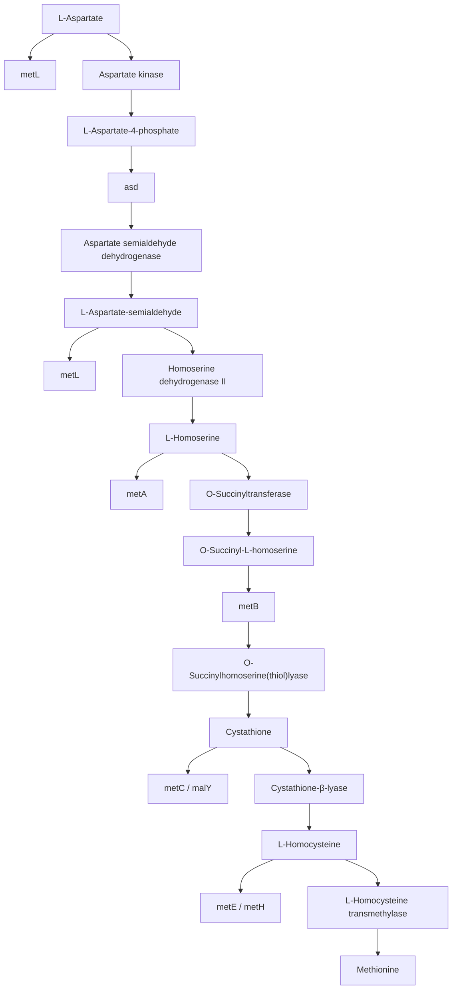
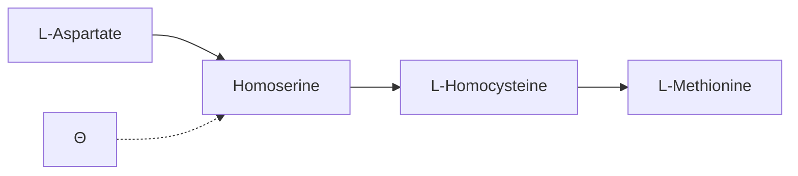
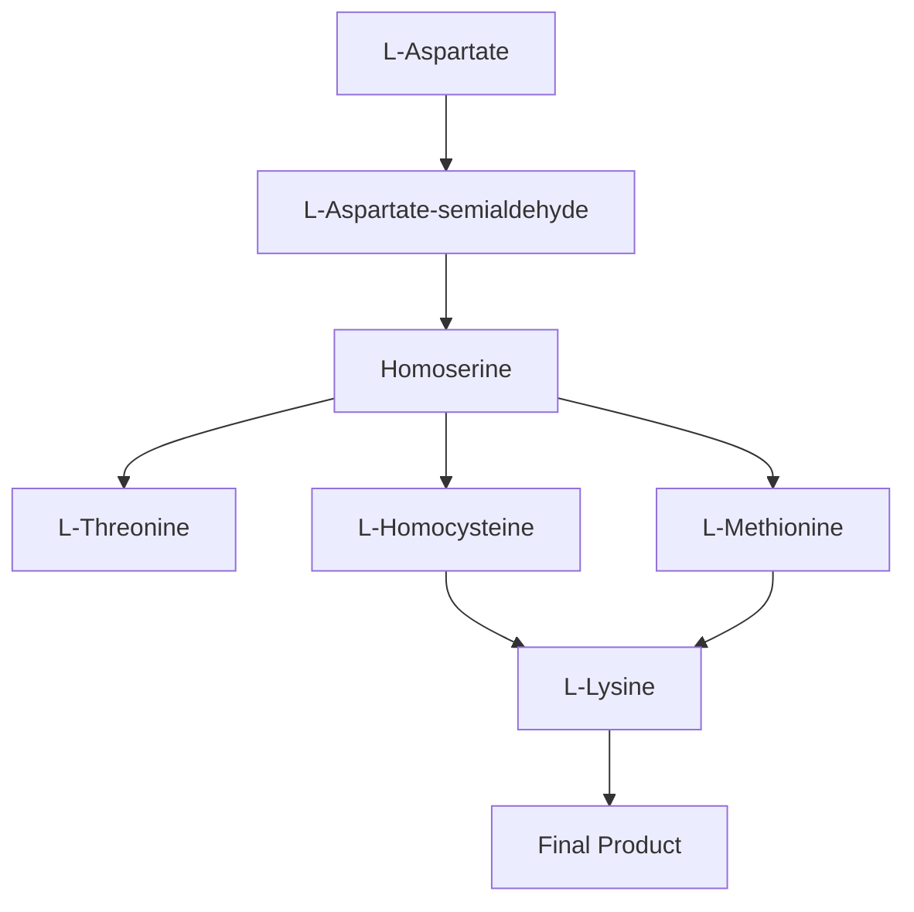
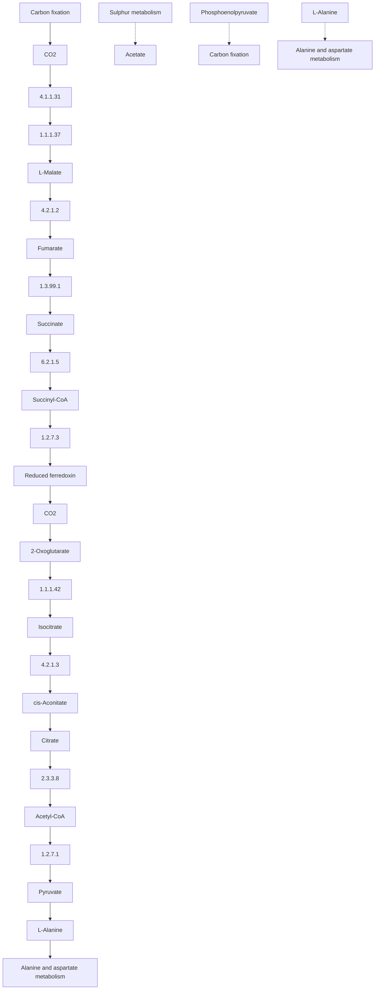
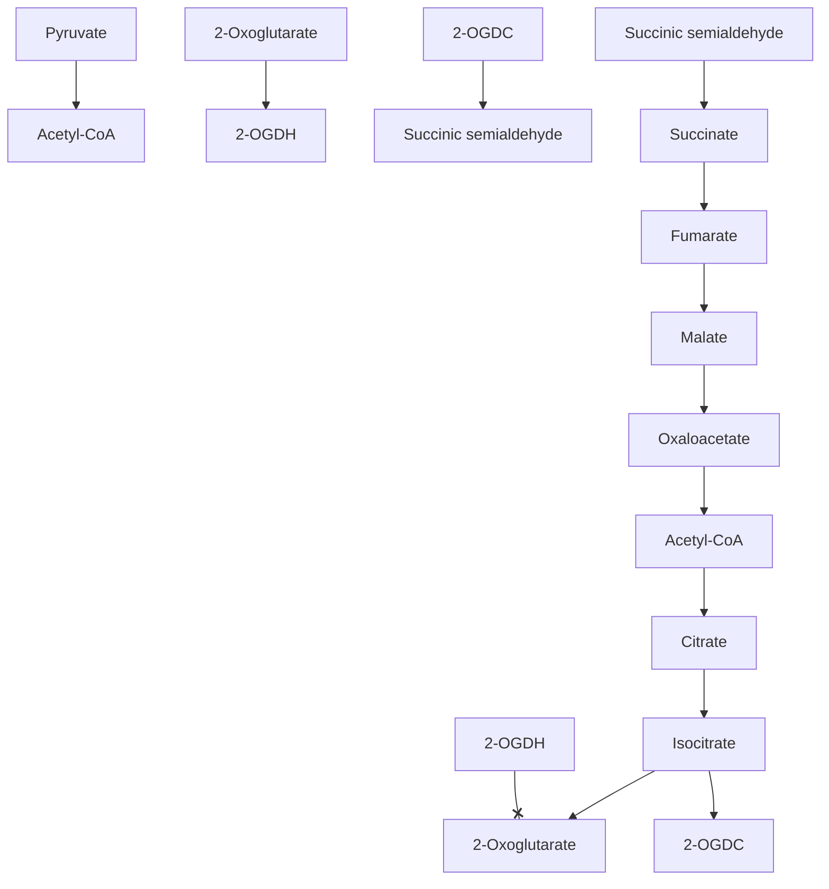

## Cofactors

The natural amino acids have a range of chemical properties, but not enough for all biochemical reactions. Many metal ions and small organic molecules attach to enzymes or enzyme-substrate complexes and participate in catalysis. For example, $\mathrm { N A D ^ { + } }$ and $\mathrm { N A D P ^ { + } }$ accept electrons during dehydrogenation reactions. Several metal ions undergo reversible oxidation and reduction, for instance in the electron transport chains of respiration and photosynthesis.

Classes of cofactors tend to specialize in different types of reactions (see Table 8.1).

Table 8.1 Typical biochemical roles of different types of cofactor

| Type of cofactor | Example | Biological role |
| --- | --- | --- |
| Redox | NAD+, NADP+ | Electron or hydrogen transfer |
|  | Flavin adenine dinucleotide (FAD) |  |
|  | Coenzyme Q |  |
| Group transfer | Thiamine pyrophosphate | Aldehyde transfer |
|  | Coenzyme A | Acyl transfer |
|  | Pyridoxal phosphate | Amino group transfer |
|  | S-Adenosyl methionine | Methyl group transfer |
|  | Biotin | Carboxyl group transfer |
|  | Tetrahydrofolate | Methyl group transfer |
|  | UDP-glucose | Glucosyl group transfer |

Many cofactors are vitamins or related to vitamins. To say that a compound is a vitamin means that it is essential, but that the species never developed (or had, but subsequently lost) a biosynthetic pathway leading to the compound.

## Protein–ligand binding equilibria

Reversible binding of ligands to proteins involves equilibria of the form:

$$
\begin{array}{c} \text {Protein + Ligand = Protein\cdot Ligand} \\ \text {P + L = P\cdot L} \end{array}
$$

for a one-to-one complex, or:

$$
\text {Protein} + n \text {Ligand} = \text {Protein} \cdot \text {Ligand} _ {n}
$$

for the binding of n identical ligands to a single protein. These do not exhaust the possibilities. Many proteins bind two or more different ligands at the same time: enzymes binding a substrate and a cofactor provide many examples. A common index of the affinity of a complex is the dissociation constant, $K _ { \mathrm { D } } ,$ , the equilibrium constant for the reverse of the binding reaction:

$$
\text {Protein} \cdot \text {Ligand} = \text {Protein} + \text {Ligand} K _ {\mathrm{D}} = [ \mathrm{P} ] [ \mathrm{L} ] / [ \mathrm{PL} ]
$$

[P], [L], and [PL] denote the numerical values of the concentrations of protein, ligand, and protein– ligand complex, respectively, expressed in $\mathrm { m o l }   \cdot   \mathrm { l } ^ { - 1 }$ . The lower the $K _ { \mathrm { D } } ,$ the tighter the binding. $K _ { \mathrm { D } }$ corresponds to the concentration of free ligand at which half the proteins bind ligand and half are free: $[ \mathrm { P } ] = [ \mathrm { P L } ]$ . It is common parlance, although incorrect, to write equilibrium constants in terms of concentration, with the result that $K _ { \mathrm { D } }$ may appear to have units mol $\cdot \mathrm { I } ^ { - 1 }$ . One often reads, ‘The ligand binds with nanomolar affinity,’ to mean:<sup>3</sup>

$$
K _ {\mathrm{D}} = \frac {[ \mathrm{P} ] [ \mathrm{L} ]}{[ \mathrm{PL} ]} = 1 0 ^ {- 9} \mathrm{mol} \cdot \mathrm{l} ^ {- 1}
$$

The Michaelis constant of an enzyme is the dissociation constant of the enzyme–substrate complex, assumed in the Michaelis–Menten model to be at equilibrium with respect to enzyme + substrate (see next section, on Enzyme kinetics).

The $K _ { \mathrm { D } }$ is related to the Gibbs free energy change of dissociation by the relationship:

$$
\mathrm{PL} = \mathrm{P} + \mathrm{L} \quad \Delta G ^ {\ominus} = \Delta H ^ {\ominus} - T \Delta S ^ {\ominus} = - R T \ln K _ {\mathrm{D}}
$$

in which the ‘underground’ symbol ( ) designates a property of an agreed-upon standard state.

Assuming no structural change on ligation, the entropy term will favour dissociation, because two objects will have greater conformational freedom if they are kinetically independent than if they are tethered. Therefore, to achieve a stable complex the enthalpy term must provide attractive forces adequate to overcome the intrinsic entropic penalty. Raising the temperature, which gives more importance to the entropy term, will promote dissociation.

To get a feel for the numbers, at 300 K the purely kinetic entropy gain upon dissociation, $T \Delta S ^ { \circledast }$ ΔS , is about 20 kJ $\cdot \mathrm { m o l } ^ { - 1 }$ . This is equivalent, in terms of attractive interactions, to about a hydrogen bond, or burial of about 200 $\mathbb { A } ^ { 2 }$ of hydrophobic surface. A value of $\Delta G ^ { \circledast }$ of 50 kJ⋅mol<sup>−1</sup> for a dissociation reaction corresponds to a dissociation constant of $K _ { \mathrm { D } }   \approx   2 \times 1 0 ^ { - 9 }$ at 300 K.

Dissociation constants of protein–ligand complexes span a very wide range (see Table 8.2).

Table 8.2 Protein–ligand complexes show a very wide range of affinities

| Biological context | Ligand | Typical $K_{D}$ | $\Delta G^{\ominus}$ at 298 K (kJ·mol-1) |
| --- | --- | --- | --- |
| Allosteric activator | Monovalent ion | $10^{-4}$-$10^{-2}$ | 11–23 |
| Coenzyme binding | NAD+, for instance | $10^{-7}$-$10^{-4}$ | 23–40 |
| Antigen–antibody complexes | Various | $10^{-4}$-$10^{-16}$ | 23–91 |
| Thrombin inhibitor | Hirudin | $5 \times 10^{-14}$ | 76 |
| Trypsin inhibitor | Bovine pancreatic trypsin inhibitor | $10^{-14}$ | 80 |
| Streptavidin | Biotin | $10^{-15}$ | 85.6 |

Several databases collect data on the structures and thermodynamics of interaction of proteins with small ligands. A few examples, of many, are:

Relibase [http://www.ccdc.cam.ac.uk/free\_services/relibase\_free/](http://www.ccdc.cam.ac.uk/free_services/relibase_free/)

PDBcal http://www.pdbcal.org

Protein Ligand Database [http://www-mitchell.ch.cam.ac.uk/pld/](http://www-mitchell.ch.cam.ac.uk/pld/)

Protein–protein interaction databases are a separate speciality.

## Enzyme kinetics

Kinetics is the measurement of reaction rates and their dependence on conditions, including concentrations of reactants, products, and catalysts. Classically, the measurement of reaction velocity as a function of substrate concentration [S] involved mixing enzyme and substrate, and following the reaction by measuring disappearance of substrate or appearance of product. For instance, the fact that NADH but not $\mathrm { N A D ^ { + } }$ has an absorption maximum at 340 nm made it convenient to follow

dehydrogenation reactions of the form:

$$
\text {malate} + \mathrm{NAD} ^ {+} \rightleftharpoons \text {oxaloacetate} + \mathrm{NADH} + \mathrm{H} ^ {+}
$$

by running the reaction in a spectrophotometer and recording absorbance at 340 nm.

A simple model of an enzyme-catalysed reaction, by V. Henri, and by L. Michaelis and M. Menten, involves enzyme and substrate interacting to form an enzyme–substrate complex. The complex breaks down to release product and restore the original free enzyme:

$$
\mathrm{E+S} \xrightarrow [ k _ {- 1} ]{k _ {1}} \mathrm{ES} \xrightarrow {k _ {2}} \mathrm{P}
$$

where E is enzyme, S is substrate, ES is the enzyme–substrate complex, P is the product, and $k _ { 1 } , k _ { - 1 }$ and $k _ { 2 }$ are rate constants for the individual reaction steps. [S] means the concentration of substrate, [E] is the concentration of enzyme, and [ES] is the concentration of enzyme–substrate complex. More precisely, [E] is the concentration of active sites, for some enzyme molecules may contain more than one active site.

An important contribution of Michaelis and Menten was to emphasize the determination of the initial rate, $\nu _ { 0 } ,$ of the reaction, in the absence of product. In practice this requires following the time course of the reaction and extrapolating back to the moment of mixing enzyme and substrate. (There is also a transient stage as the enzyme and substrate mix and interact, before establishment of equilibrium. This stage lasts only milliseconds. It is observable only with special techniques, and does not affect extrapolated inferences of initial rates.) Under these circumstances there is no backreaction of product, if only because there is no product there to back-react. This assumption also avoids certain potentially complicating factors, such as product inhibition or enzyme degradation, which probably were not recognized in 1913.

Michaelis and Menten further assumed that the forward and reverse rates of the first step are faster than the formation of product; that is: $k _ { 1 } \gg k _ { 2 } ,$ and $k _ { - 1 } \gg k _ { 2 }$ . The picture is that ES is at equilibrium with $\mathbf { E } + \mathbf { S }$ , with product P ‘bleeding off’ slowly.

Michaelis and Menten derived the rate equation relating the initial velocity $\nu _ { 0 }$ as a function of substrate concentration [S]

$$
\nu_ {0} = \frac {V _ {\mathrm{max}} [ S ]}{K _ {\mathrm{M}} + [ S ]}
$$

The Michaelis constant $K _ { \mathrm { M } }$ has dual significance: (1) it is the substrate concentration at which the initial velocity is $V _ { 2 } V _ { \mathrm { m a x } }$ and (2) it is the dissociation constant of the enzyme–substrate complex ES:

$$
\mathrm{ES} \rightleftharpoons \mathrm{E+S} \quad K _ {\mathrm{M}} = \frac {[ \mathrm{E} ] [ \mathrm{S} ]}{[ \mathrm{ES} ]}
$$

Figure 8.4 shows the general features of the relationship between substrate concentration and initial velocity. Curves of this shape are quite common, arising from many phenomena that exhibit saturation, or, in general, follow a ‘law of diminishing returns’. I. Langmuir derived a version to describe the absorption of molecules on a surface. Such a graph could also describe the grade you will receive in your bioinformatics course, as a function of the number of hours you study.


<details>
<summary>line</summary>

| Substrate concentration [S] | Reaction velocity |
| --- | --- |
| 0 | 0 |
| KM | Vmax/2 |
</details>

Figure 8.4 Typical dependence of reaction velocity of an enzyme-catalysed reaction on substrate concentration in the presence of a fixed amount of enzyme. The graph is linear at low substrate concentrations and approaches a maximum value at high substrate concentrations. These curves depend on two parameters: the maximum velocity, $V _ { \mathrm { m a x } }$ , and the substrate concentration corresponding to half the maximum velocity. In the Michaelis–Menten model the substrate concentration corresponding to the rate $V _ { 2 } V _ { \mathrm { m a x } }$ is the Michaelis constant, $K _ { \mathbf { M } }$ , interpreted as the dissociation constant of the enzyme–substrate complex.

For low values of [S], $\nu _ { 0 }$ and [S] are proportional. In this region, the enzyme is accommodating all substrate molecules equally well. The rate-limiting step is the encounter of substrate and free enzyme. As [S] increases, $\nu _ { 0 }$ as a function of [S] rises less and less steeply. With further increase in [S], $\nu _ { 0 }$ approaches a limiting value $V _ { \mathrm { m a x } }$ . This is attributable to saturation of the enzyme. Virtually all the enzyme is in the form of enzyme–substrate complex, ES (apply Le Chatelier's principle to the E $+ \mathbf { S } \rightleftharpoons \mathbf { E } \mathbf { S }$ equilibrium). The enzyme is running flat out to produce substrate. The rate of appearance of product is $V _ { \mathrm { m a x } }$ , independent of substrate concentration. The observed rate at the plateau corresponds to the rate of some step of the reaction that occurs after binding of the substrate.

Given a set of data recording $\nu _ { 0 }$ as a function of [S] for some enzyme–substrate combination, it is possible to use curve-fitting software to derive $K _ { \mathrm { M } }$ and $V _ { \mathrm { m a x } }$ . The values of $V _ { \mathrm { m a x } }$ and $K _ { \mathrm { M } }$ characterize the enzyme, the substrate, and the conditions of reaction, such as temperature, pH, and ionic strength.

## Measures of effectiveness of enzymes

At high substrate concentrations the velocities $\nu _ { 0 }$ and $V _ { \mathrm { m a x } }$ are proportional to the amount of enzyme present. How can we characterize an enzyme and a set of reaction conditions, independent of the amount of enzyme?

The turnover number of an enzyme, $k _ { \mathrm { c a t s } }$ is the ratio $( V _ { \mathrm { m a x } } ) / ( [ \mathrm { E } ] _ { \mathrm { t o t a l } } )$ , where $[ \mathrm { E } ] _ { \mathrm { t o t a l } }$ <sup>is</sup> the total concentration of enzyme. The turnover number is a measure of ‘throughput’ on a molecular basis: it represents the number of substrate molecules converted to product, per enzyme molecule, under conditions of saturation; that is, at high substrate concentrations.

More usually, enzymes operate at low substrate concentrations. $\mathrm{If} \left[ \mathrm{S} \right] \ll K_{\mathrm{M}}, \nu_0 = \left( k_{\mathrm{cat}} / K_{\mathrm{M}} \right) \left[ \mathrm{E} \right] \left[ \mathrm{S} \right]$ The ratio $k _ { \mathrm { c a t } } / K _ { \mathrm { M } }$ gives a measure of the catalytic efficiency of enzymes at low substrate concentrations. Two factors may contribute to increasing the value of $k _ { \mathrm { c a t } } / K _ { \mathrm { M } } ; ( 1 )$ a low $K _ { \mathrm { M } }$ implies a high affinity of substrate and enzyme and (2) a high $k _ { \mathrm { c a t } }$ implies that the enzyme–substrate complexes formed will turn over rapidly to product.

Different enzymes show a large range of $k _ { \mathrm { c a t } } / K _ { \mathrm { M } }$ values. However, no matter how efficient the catalytic mechanism itself, the rate of a reaction is limited by the rate of encounters of enzyme and substrate, which depends on the diffusion rate. If every encounter results in reaction—that is, the catalysis is $d i f f u s i o n \text { - } l i m i t e d \text {— } k _ { \mathrm { c a t } } / K _ { \mathrm { M } }$ would be ${ \approx } 1 0 ^ { 8 } \mathrm { ~ - ~ } 1 0 ^ { 9 } \mathrm { ~ ( m o l / l ) ^ { - 1 } ~ s ^ { - 1 } }$ under typical conditions. Some enzymes achieve this. No evolution of enhanced catalytic efficiency in the enzyme itself could improve turnover rate (see Table 8.3).

Table 8.3 Some enzymes that approach diffusion-limited rates

| Enzyme | Substrate | $k_{cat}, s^{-1}$ | $K_M, mol·l^{-1}$ | $k_{cat}/K_M, (mol/l)^{-1}s^{-1}$ |
| --- | --- | --- | --- | --- |
| Acetylcholinesterase | Acetylcholine | $1.4×10^4$ | $9×10^{-5}$ | $1.6×10^8$ |
| Catalase | $H_2O_2$ | $4×10^7$ | 1 | $4×10^7$ |
| Fumarase | Fumarate | $8×10^2$ | $5×10^{-6}$ | $1.6×10^8$ |

As the amino-acid sequences of enzymes diverge, their function can also diverge. In many cases, homologous enzymes in different species retain similar catalytic activities. This does not mean that they retain exactly the same specificities, or the same kinetic constants. The catalogues of function in the EC and GO are discrete and do not depend on details of kinetic parameters. Under moderate sequence divergence enzymes may typically retain the same EC and GO classifications.

## BRENDA: a database about enzymes

Biochemists have learned a lot about different enzymes in different species. The database BRENDA ([www.brenda-enzymes.info/](http://www.brenda-enzymes.info/)) collects information about enzymes, including description of the reaction catalysed, ‘classical’ biochemical kinetic information such as Michaelis constants and $V _ { \mathrm { m a x } } ,$ and links to other databases such as UniProtKB and the wwPDB.


**See Weblem 8.5**

## How do proteins evolve new functions?

Recall that enzymes have two types of specificity. They have substrate specificity, for which Fischer's lock-and-key analogy remains a useful description. They also have specificity with respect to the reaction catalysed.

Sequence divergence can modify both types of specificity, while conserving the basic reaction. For instance, humans have two homologous succinyl-CoA synthases, one linked to formation of GTP and the other to formation of ATP. Although most biochemists would regard this as only a change in substrate specificity, according to both EC and GO they catalyse different reactions.


## See Weblem 8.6

In other cases, homologous proteins have diverged to catalyse reactions with different substrates and products. In some cases they retain components of the mechanism. An example is a set of proteins from the enolase family (see Box 8.1).

As enzymes evolve, they may:

• change kinetic parameters;
• change substrate specificity;
• change reaction catalysed;
• change control mechanism;
• yet retain general mechanism of catalysis.

It is of the greatest importance, in comparing metabolic pathways between different species, to understand the general principles of the evolution of protein function.

## Box 8.1 Enolase, mandelate racemase, and muconate lactonizing enzyme catalyse different reactions but have related mechanisms

Enolase, mandelate racemase, and muconate lactonizing enzyme I are homologous enzymes. They have a common structure, closely related to the TIM-barrel fold. However, they catalyse different reactions.


## See Weblem 8.7

Looking only at sequence and structure runs the risk of overlooking a more subtle similarity. These enzymes share a common feature of their mechanism: each acts by abstracting a proton adjacent to a carboxylic acid to form an enolate intermediate (Figure 8.5). The stabilization of a negatively charged transition state is conserved. In contrast, the subsequent reaction pathway, and the nature of the product, vary from enzyme to enzyme. These enzymes have not only a similar overall fold, but each requires a divalent metal ion, bound by structurally equivalent ligands. However, other residues in the active site differ, to produce enzymes that catalyse different reactions.


<details>
<summary>chemical</summary>

Three-step organic reaction mechanism showing phenol-catalyzed transformation and subsequent oxidation to form a ketone or ester product.
</details>

Figure 8.5 Common mechanism in the enolase family of enzymes: (a) mandelate racemase, (b) muconate lactonizing enzyme, and (c) enolase.

## Control over enzyme activity

For smooth operation of metabolic pathways it is essential to regulate the panoply of enzymatic activities. Discussions of ‘classical’ enzymology, treating kinetics as we have just done, would go on to discuss regulation of the velocities of enzymatic reactions by inhibitors and allosteric effectors. However, inhibition—the control of enzyme activity by modification of a mature enzyme by interaction with a ligand—is only one of the possible mechanisms of regulation. As shown in Figure 8.6 there are many different potential targets for control. Inhibition and allostery are only two of

them. This topic is the subject of Chapter 9.


<details>
<summary>flowchart</summary>

```mermaid
graph TD
  A["DNA"] --> B["RNA"]
  B --> C["Expressed protein"]
  C --> D["Modified protein"]
  
  subgraph Transcription ["Transcription"]
    direction TB
    E["Gene copy number\nPromotor activity\nRepression / attenuation\nInduction\nDNA methylation / chromatin remodelling"]
  end
  
  subgraph Translation ["Translation"]
    direction TB
    F["mRNA lifetime\nCodon usage, tRNA levels\nRibosome binding\nAlternative splicing\nRNA interference"]
  end
  
  subgraph Post_translational_modification_Post_translational_modification["Post-translational modification [\"Post-translational modification\"]"]
    direction TB
    G["Protein turnover\nChemical modification (phosphorylation, ...)\nInhibition\nAllosteric change"]
  end
  
  A -.-> E
  A -.-> F
  A -.-> G
```
</details>

Figure 8.6 There are many mechanisms and types of target for regulation of enzyme activity. These include control over expression patterns, and control over the structures and activities of proteins in the cell. For instance, allosteric changes are ligand-induced conformational changes in proteins that modify activity, often leading to cooperative binding curves, as in haemoglobin.

## Structural mechanisms of evolution of altered or novel protein functions

Mechanisms of protein evolution that produce altered or novel functions include divergence, recruitment, and ‘mixing and matching’ of domains.

## Divergence

In families of closely related proteins, mutations usually conserve function but modulate specificity. We have seen several examples: the trypsin family of serine proteinases contains a specificity pocket, a surface cleft complementary in shape and charge distribution to the sidechain adjacent to the scissile bond. Mutations tend to leave the backbone conformation of the pocket unchanged but to affect the shape and charge of its lining, altering the specificity.

Malate and lactate dehydrogenases are related enzymes that catalyse similar reactions. They arose by gene duplication at an early stage of the history of life, and their sequences have diverged. (In an optimal alignment, human malate and lactate dehydrogenases have ≈20% identical residues.) Nevertheless, site-directed mutagenesis showed that a single residue change (Gln → Arg) could change the specificity of Bacillus stearothermophilus lactate dehydrogenase to malate. (Reports of that work may have been read by a trichomonad, which developed a malate dehydrogenase that, in an evolutionary tree of these enzymes, is much more similar to lactate dehydrogenases than to other malate dehydrogenases.) Indeed, it is arguable that the relationship between malate and lactate dehydrogenases is really more a change in specificity than a change in the reaction. But they do have different EC classifications.

Such families of enzymes illustrate the kinds of structural features that change, and those that stay the same. In some cases, the catalytic atoms occupy the same positions in molecular space, although the residues that present them are located at different points in the fold. In other cases the positions in space of the catalytic residues are conserved even though the identities and functions of the catalytic residues vary. In these cases, there appears to be a set of conserved functional positions within the space of the molecule.

As evolution ventures farther afield, several enzyme families show an even greater degree of divergence. The apurinic/apyrimidinic endonuclease superfamily, a large diverse group of phosphoesterases, includes members that cleave DNA and RNA, and lipid phosphatases. Even catalytic residues vary between different subfamilies of this group. For example, a His essential for function of DNA repair enzyme DNaseI is not conserved in exonuclease III.

Conversely, many functions are provided by unrelated proteins. Chymotrypsin and subtilisin have produced the same catalytic mechanism for proteolysis by convergent evolution (Figure 8.7).


<details>
<summary>chemical</summary>

Molecular structure diagrams showing protein domains with labeled residues (197H, 308A, 285T, 277Y) and side chains (180S)
</details>

Figure 8.7 (a) Chymotrypsin and (b) subtilisin, two proteinases that even share a common Ser-His-Asp catalytic triad (green), are not homologous, and show entirely different folding patterns. The Ser-His-Asp triad appears also in other proteins, including lipases and a natural catalytic antibody.

## Recruitment

Many people ask how much a protein must change its sequence before its function changes. The answer is: not at all! There are numerous examples of proteins with multiple functions.

1. Eye lens proteins in the duck are identical in sequence to active lactate dehydrogenase and enolase in other tissues, although they do not encounter the substrates in the eye. They have been recruited to provide a structural and optical function. Several other avian eye lens proteins are identical or similar to enzymes. In some cases residues essential for catalysis have mutated, proving that the function of these proteins in the eye is not enzymatic. In those species, the coexistence of mutated, inactive, enzymes in the eye and active enzymes in other tissues implies that the gene must have been duplicated.
2. Some proteins interact with different partners to produce oligomers with different functions. In E. coli, a protein that functions on its own as lipoate dehydrogenase is also an essential subunit of pyruvate dehydrogenase, 2-oxoglutarate dehydrogenase, and the glycine cleavage complex.
3. Proteinase Do functions as a chaperone at low temperatures and as a proteinase at high temperatures. The logic, apparently, is that under conditions of moderate stress it attempts to salvage misfolded proteins; under conditions of higher stress it gives up and recycles them.

4. The activity of phosphoglucose isomerase (= neuroleukin = autocrine motility factor = differentiation and maturation mediator) depends on location. This protein functions as a glycolytic enzyme in the cytoplasm, but as a nerve growth factor and cytokine outside the cell.

Divergence and recruitment are at the ends of a broad spectrum of changes in sequence and function. Aside from cases of ‘pure’ recruitment such as the duck eye lens proteins or phosphoglucose isomerase, in which a protein adopts a new function with no sequence change at all, there are examples on the one hand of relatively small sequence changes correlated with very small function changes (which most people would think of as relatively pure divergence), relatively small sequence changes with quite large changes in function (which most people would think of as recruitment), but also many cases in which there are large changes in both sequence and function.

## ‘Mixing and matching’ of domains

There are many dehydrogenases, which catalyse a large number of reactions. Many of these are coupled to reduction of NAD+ or NADP + . Many are multidomain proteins (some multimeric as well) that contain a common NAD-binding domain, with a range of partner catalytic domains from at least a dozen different families, that vary with the reaction catalysed.

Many other examples are known, in which a change in partners, or even a change in order along the polypeptide chain, can create, ablate, or modify catalytic activity. It appears much easier for protein evolution to adapt existing structures to new functions than to create a new folding pattern. Domain recombination offers great opportunities for evolution of novel functions.

Domain recombination can modify catalytic function. In addition, the evolution of many enzymes involves accreting domains, or forming multimers, for regulation of activity. Most allosteric enzymes, and also haemoglobin, are multidomain proteins or multimers that achieve control through coupled changes in tertiary and quaternary structure. It is quite common for an enzyme to appear in fairly simple form in prokaryotes, and in more complex form in eukaryotes, with the addition of domains involved in regulation of activity.

## Protein evolution at the level of domain assembly

Comparisons of protein sequences and structures confirm that the domain is an important unit of protein evolution. Domains appear in different proteins in different combinations. Thereby, from a relatively small roster of domain families, evolution can assemble a large number of complete proteins.

Many large proteins contain tandem assemblies of domains which appear in different contexts and orders in different proteins (see Fig. 8.8).


<details>
<summary>chemical</summary>

Molecular structures and functional groups of protein domains including Fn2, EGF, Kr, SerPr, Gla, Factor XII, Factor IX, Prothrombin, and Tissue plasminogen activator
</details>

Figure 8.8 Several proteins involved in the blood coagulation cascade show structures that share modules or domains. The composition and order of the modules is not preserved. Each module is a relatively small compact unit it its own right. The serine proteinases (SerPr) contain two halves with structural similarities, which arose by gene duplication and divergence, but which are never seen separately.

Censuses of genomes suggest that many proteins are multimodular. Of 4401 genes in E. coli, 287 correspond to proteins containing two, three, or four modules. The structural patterns of 510 E. coli enzymes involved in metabolism of small molecules can be accounted for in total or in part by 213 families of domains. Of the 399 that can be entirely divided into known domains, 68% are singledomain proteins, 24% contain two domains, and 7% three domains. Only four of the 399 have four, five, or six domains. There are marked preferences for pairing of different families of domains.

Multidomain proteins present particular problems for assignment of function in genome annotation, because the domains may possess independent functions, modulate one another's function, or act in concert to provide a single function that may depend on the domain composition and even order. On the other hand, in some cases the presence of a particular domain or combination of domains is associated with a specific function. For example, NAD-binding domains appear almost exclusively in dehydrogenases.

Based on known protein structures it has been possible to define ≈1000 domain superfamilies. Of the ≈21 000 human genes, almost two-thirds contain known domains. The ≈1000 domain superfamilies account for ≈30 000 matches in the human genes.

The population of domains encoded by known genes is unevenly distributed. Nine domain superfamilies account for 20% of the matched domains in human genes. These include those in Table 8.4.

Table 8.4 Most common domains assignable to human proteins

| Domain | Number of matches in human genome |
| --- | --- |
| CH2 and C2HC zinc fingers | 3693 |
| Immunoglobulin | 1778 |
| P-loop nucleoside triphosphate hydrolase | 1024 |
| G-protein-coupled receptors: family A | 824 |
| Fibronectin type III | 802 |
| EGF/laminin | 697 |
| Cadherins | 686 |
| Protein kinases | 539 |
| PH domains | 491 |

From Chothia, C. and Gough, J. (2009). Genomic and structural aspects of protein evolution. Biochem. J., 419, 15–28.


## See Weblem 8.8

Similar results apply to other eukaryotic genomes—fugu fish, D. melanogaster, and C. elegans— although the rank order is not the same.

The distribution of domains depends on the functional class of the protein. The number of proteins in a given functional class scales exponentially with the size of the genome:

<div class="docvortex-algorithm" style="white-space: pre-wrap; font-family:monospace;">
Number of proteins involved in transcription regulation=constant×genome size $^{1.9}$ 
Number of proteins involved in protein biosynthesis=constant×genome size $^{0.13}$
</div>

Our discussion so far has primarily treated the functions of individual proteins. Let us now turn to assembly of these functions into networks.

## Databases of metabolic pathways

The full panoply of metabolic reactions forms a complex network. The structure of the network corresponds to a graph in which metabolites are the nodes, and the substrate and product of each reaction form an edge. The dynamics of the network depend on the flow capacities of the individual links, analogous to traffic patterns on the streets of a city.

Some patterns within the metabolic network are linear pathways. Others form closed loops, such as the Krebs (tricarboxylic acid) cycle. Many pathways are highly branched and interlock densely. However, metabolic networks also contain recognizable clusters or blocks; for instance, catabolic and anabolic reactions form clustered subnetworks. There is a relatively high density of internal connections within clusters and relatively few connections between them.

Several databases contain information on metabolic pathways in different organisms. They organize this information, collecting it within a coherent and logical structure, with links to other databases that provide different data selections and different modes of organization. EcoCyc treats E. coli. It is the model for—and linked with—numerous parallel databases, with uniform web interfaces, treating other organisms. BioCyc is the ‘umbrella’ collection. KEGG, the Kyoto Encyclopedia of Genes and Genomes, contains information from multiple organisms.

| Database | Home page |
| --- | --- |
| EcoCyc | http://ecocyc.org |
| BioCyc | http://www.biocyc.org |
| KEGG | http://www.genome.jp/kegg/ |
| Plant metabolic pathway database | http://www.plantcyc.org |

## EcoCyc

EcoCyc is a database representing what we know about the biology of E. coli strain K-12 MG1655. It contains:

• the genome: the complete sequence, and for each gene its position, and function if known;
transcription regulation: operons, promoters, and transcription factors and their binding sites;
• metabolism: the pathways, including details of the enzymology of individual steps; for each enzyme it gives the reaction, activators, inhibitors, and subunit structure;
• membrane transporters: transport proteins and their cargo;
• links to other databases: of protein and nucleic acid sequence data, literature references, and comparisons of different E. coli strains.

A tiny subset of the E. coli metabolic network is the pathway for synthesis of methionine from aspartate (see Box 8.2).

## The Kyoto Encyclopedia of Genes and Genomes

The Kyoto Encyclopedia of Genes and Genomes (KEGG) collects individual genomes and gene products and their functions, but its special strengths lie in its integration of biochemical and genetic

Box 8.2 Methionine synthesis in E.coli


<details>
<summary>flowchart</summary>


</details>

The diagram shows the seven-step synthesis of methionine from L-aspartate. Methionine inhibits homoserine Osuccinyltransferase, a classic example of feedback control. Both the reaction sequence, and the associated control mechanisms, are embedded in much larger networks.

The first step, phosphorylation of L- aspartate, is common to the biosynthesis of methionine, lysine, and threonine. E. coli contains three aspartate kinases, encoded by three separate genes, each specific for one of the end-product amino acids. They catalyse the same reaction, but are subject to separate regulation.
The third step, conversion of L-aspartate-semialdehyde to L-homoserine, is common to the methionine and threonine synthesis pathways. Two homoserine dehydrogenases are separately encoded. Regulation of expression of the aspartate kinases and homoserine dehydrogenases suffices to control all three pathways.
After synthesis, methionine is converted to S-adenosyl-methionine, a common participant in methyl group transfers. S-Adenosyl-methionine activates the met repressor. In classic feedback inhibition, a product interacts directly with an enzyme that produces one of its precursors. This is a more complicated form of feedback: the product interacts with a repressor, which reduces the expression—not the activity—of enzymes that produce its precursors.

In the EcoCyc web page that contains the information corresponding to this diagram, the items are active. Links to other internal pages expand information about metabolites, cofactors, enzymes, genes, and regulators. It is possible to ‘zoom’ in or out by controlling the level of detail. For instance, asking for less detail than the contents of the preceding diagram would first eliminate the information about the genes and enzymes, then reduce the pathway to an outline showing only critical intermediates:


<details>
<summary>flowchart</summary>


</details>

It is also possible to explore in other dimensions. The methionine synthesis pathway is embedded in larger networks. One of these involves synthesis of amino acids lysine and threonine in addition to methionine, all starting with aspartate (see Figure 8.9).


<details>
<summary>flowchart</summary>


</details>

Figure 8.9 The pathway of amino acid biosynthesis from asparate branches after asparate semialdehyde. In this figure, the black sequence corresponds to the previous example, and the green pathways are the immediate context. The aspartate → methionine sequence is a subnetwork of the network shown here. Each amino acid plays a regulatory role, exerting feedback inhibition over its own synthesis, without affecting the others. It looks as if threonine and lysine both individually inhibit the first step of the synthesis of all three products, but this step is catalysed by three separate aspartate kinases, allowing specialized regulation.


## See Weblems 8.9, 8.10, and 8.11

Readers are urged to explore the EcoCyc website on their own, deliberately or serendipitiously, or guided by weblems in this chapter.

information. KEGG focuses on interactions: molecular assemblies, and metabolic and regulatory networks. It has been developed under the direction of M. Kanehisa. Figure 8.10 shows a pathway from KEGG, the reductive carboxylate cycle in photosynthetic bacteria. (This pathway is basically the Krebs cycle, running backwards.)


<details>
<summary>flowchart</summary>


</details>

Figure 8.10 Metabolic pathway map from the Kyoto Encyclopedia of Genes and Genomes (KEGG). This figure shows the reductive carboxylate cycle, and its links to other metabolic processes. The numbers in square boxes are EC numbers identifying the reactions at each step.


## See Weblem 8.14

KEGG organizes five types of data into a comprehensive system:

1. catalogues of chemical compounds in living cells;
2. gene catalogues;
3. genome maps;
4. pathway maps;
5. orthologue tables.

The catalogues of chemical compounds and genes—items 1 and 2—contain information about particular molecules or sequences. Item 3, genome maps, integrates the genes themselves according to their appearance on chromosomes. In some cases knowing that a gene appears in an operon can provide clues to its function.

Item 4, the pathway maps, describe potential networks of molecular activities, both metabolic and regulatory. A metabolic pathway in KEGG is an idealization corresponding to a large number of possible metabolic cascades. It can generate a real metabolic pathway of a particular organism by matching the proteins of that organism to enzymes within the reference pathways.

One enzyme in one organism would be referred to in KEGG in its orthologue tables, item 5, which link the enzyme to related ones in other organisms. This permits analysis of relationships between the metabolic pathways of different organisms.

KEGG derives its power from the very dense network of links among these categories of information, and additional links to many other databases to which the system maintains access. Two examples of the kinds of question that can be treated by KEGG are given here.

1. It has been suggested that simple metabolic pathways evolve into more complex ones by gene duplication and subsequent divergence. Searching the pathway catalogue for sets of enzymes that share a folding pattern will reveal clusters of linked paralogues.
2. KEGG can take the set of enzymes from some organism and check whether they can be integrated into known metabolic pathways. A gap in a pathway suggests a missing enzyme or an unexpected alternative pathway. The archaeal shikimate kinase, not homologous to its bacterial counterparts, is an example. (See next section.)

## Evolution and phylogeny of metabolic pathways

Most organisms share many common metabolic pathways. But there are many individual variations.

## Pathway comparison

Of particular interest for comparative genomics are facilities to compare pathways among different organisms. Alignment and comparison of pathways can expose how pathways have diverged between species. Even if the pathways are the same, in some cases the enzymes are nonhomologous.

Pathway comparison can be useful for annotation of genomes. It is often possible to assign function to proteins on the basis of similarity to sequences of proteins of known function in other organisms. However, sometimes there are several weak similarities to other proteins and it is unclear which is the true homologue. Conversely, sometimes an organism has a metabolic pathway but no annotated enzyme for an essential step. Confronting the unannotated proteins with the unassigned functions can sometimes identify the protein that fills the gap in the pathway.

If an enzyme needed for a pathway cannot be identified even by weak sequence similarity, it may be that the organism has evolved a nonhomologous enzyme for the task. For example, the archaeon M. jannaschii has a pathway for biosynthesis of chorismate from 4-dehydroquinate. Enzymes for most of the steps have homologues in bacteria and/or eukaryotes. However, shikimate kinase was not identifiable from sequence similarity. Because the metabolic pathway is not interrupted, M. jannaschii must have some protein with this function. How can it be found?

Although in bacteria, genes consecutive in pathways are often consecutive in operons in the genome, this is not true of M. jannaschii. However, the genes for successive steps of the chorismate biosynthesis pathway are clustered and consecutive in another archaeon, Aeropyrum pernix. It was possible to propose a gene for a shikimate kinase in A. pernix, and to identify a homologue of that gene in M. jannaschii.

Experiment confirmed the prediction that the M. jannaschii gene so identified (MJ1440) encodes a shikimate kinase. It has no sequence similarity to bacterial or eukaryotic shikimate kinases. A protein from a different family has been recruited for the archaeal pathway. (For more details, see Introduction to Genomics, pp. 378–379; Lesk, 2011.)


## See Weblem 8.15

In some cases, a particular species or strain may show a variant metabolic pathway. For instance, the normal Krebs cycle, memorized by generations of biochemistry students, includes the conversion of 2-oxoglutarate (aka α-ketoglutarate) to succinyl-CoA. Cyanobacteria, however, lack the enzyme 2-oxoglutarate dehydrogenase. Instead, they convert 2-oxoglutarate to succinate via succinic semialdehyde (Fig. 8.11).


<details>
<summary>flowchart</summary>


</details>

Figure 8.11 Cyanobacterial succinic semialdehyde shunt. 2-OGDH, 2-Oxoglutarate dehydrogenase; 2-OGDC, 2- oxoglutarate decarboxylase; SSADH, succinic semialdehyde dehydrogenase.

From Zhang, S. and Bryant, D.A. (2011). The tricarboxylic acid cycle in cyanobacteria. Science, 334, 1551–1553.

The cyanobacterial Krebs cycle is, after all, a relatively minor variation on a very common theme. In more extreme cases, organisms have metabolic competence that is completely absent from others. We expect plants but not humans to have enzymes for reactions involved in photosynthesis and cellwall formation.

Some organisms achieve the same overall metabolic transformation but use alternative pathways; that is, different sets of intermediates. For instance, classical glycolysis (the Embden–Meyerhof pathway) and the Entner–Doudoroff pathway are alternative routes from glucose to pyruvate (Fig. 8.12). Often, organisms will share many steps in a metabolic transformation but some will extend or truncate the pathway. Many parasites have dispensed with substantial biosynthetic competence.