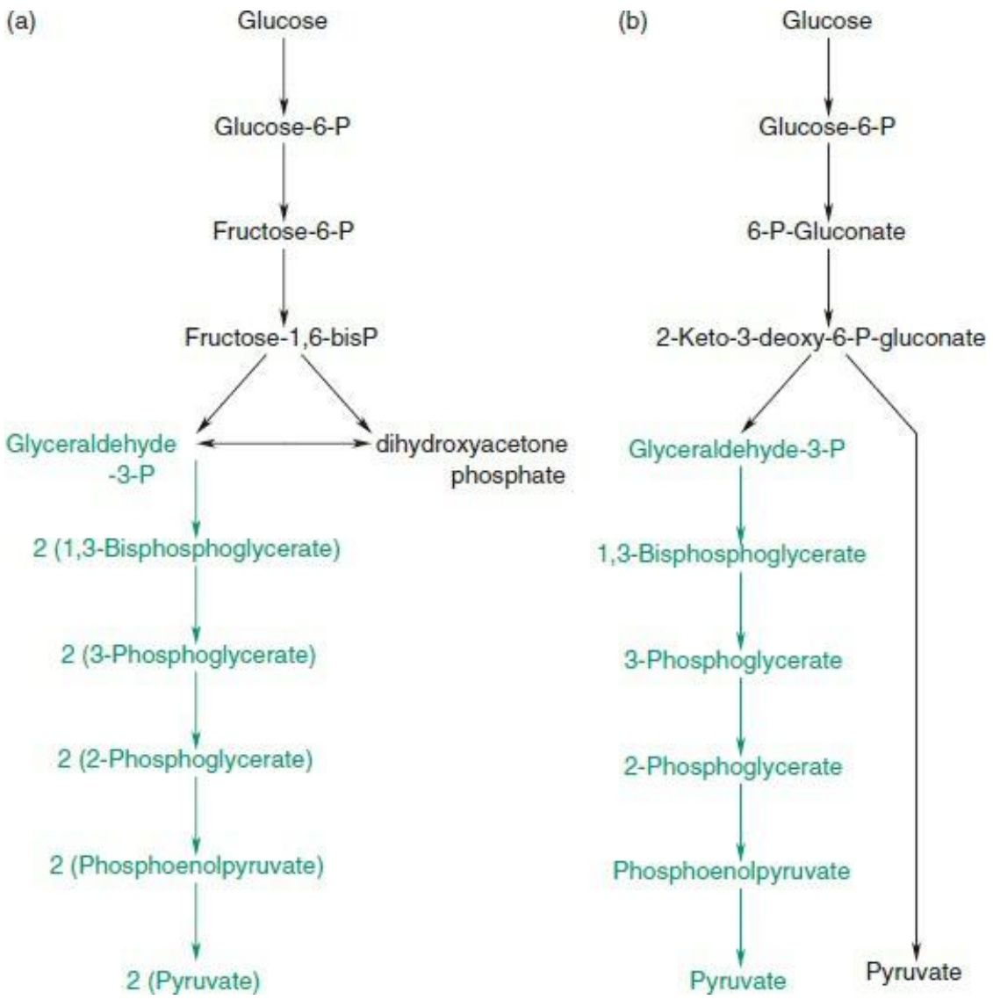

Figure 8.12 (a) Embden–Meyerhof glycolytic pathway. (b) Entner–Doudoroff pathway. Note that the enzymatic conversion of glyceraldehyde-3-phosphate to pyruvate is the same in both pathways (green branch).

Using the representations of metabolic networks of different species as graphs, we can compare the graphs to get a quantitative measure of the divergence (see Box 8.3). Intuitively, we expect that the divergence in metabolic network should correspond to the divergence between species as measured from comparing genome sequences.

## See Weblem 8.16

## Box 8.3 Carbohydrate metabolism in archaea

The common pathway from glucose to pyruvate in bacteria and eukaryotes is the Embden–Meyerhof glycolytic route (see Fig. 8.12). B. Siebers and P. Schönheit have studied the metabolic pathways of carbohydrate metabolism in archaea. In the initial conversion of glucose to pyruvate they observed a number of differences in the pathway, from either the standard Embden–Meyerhof glycolytic pathway or the Entner–Doudoroff alternative.

Sulfolobus solfataricus and Haloarcula marismortui use a modified Entner–Doudoroff pathway (Fig. 8.13). Pyrococcus furiosus, Thermococcus celer, Archaeoglobus fulgidus strain 7324, Desulfurococcus amylolyticus, and Pyrobaculum aerophilum use a modified Embden–Meyerhof pathway (Fig. 8.14). Thermoproteus tenax uses both.

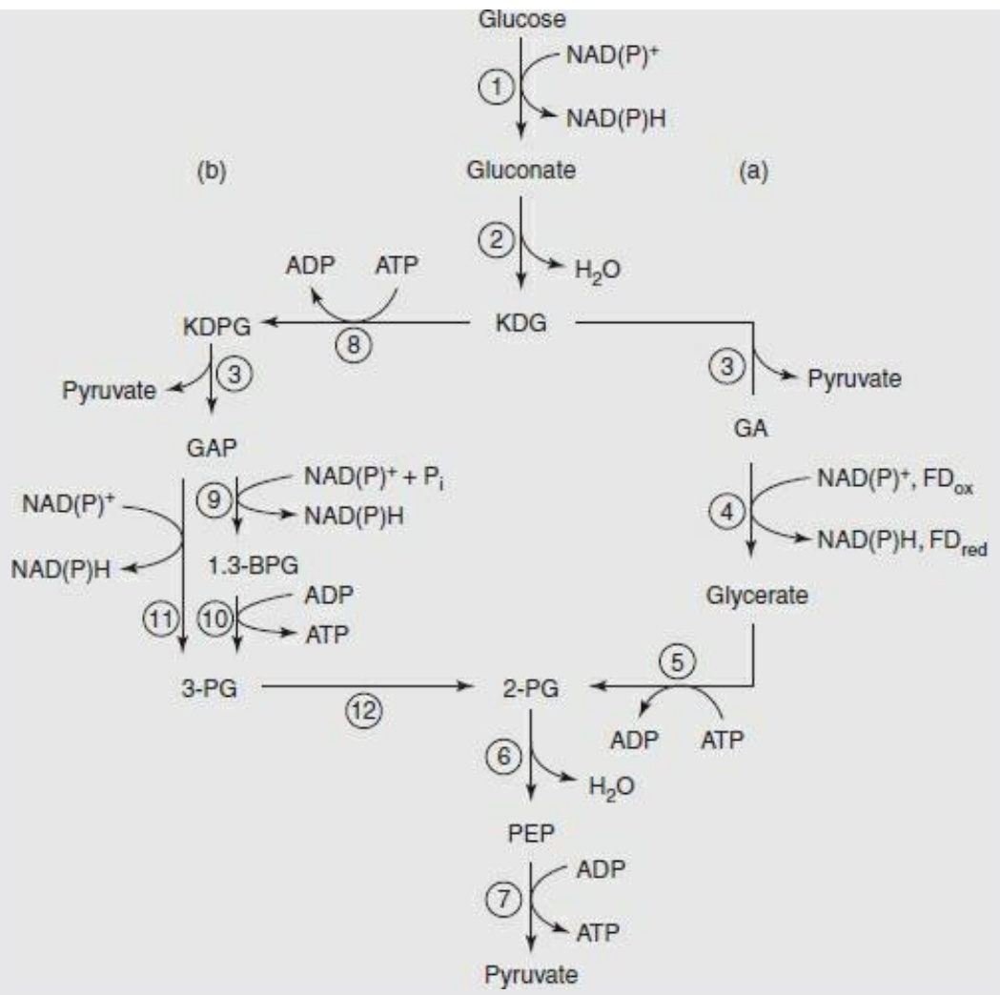

flowchart

This image displays a complex metabolic pathway diagram representing the conversion of glucose into various metabolites (ADP, ATP, H2O, Pyruvate, GA, Glycerate) and their subsequent metabolites.

Figure 8.13 Modifications of the Entner–Doudoroff (ED) pathway in archaea. (a) The nonphosphorylative ED pathway in Thermoplasma acidophilum. (b) The semiphosphorylative ED pathway in halophilic archaea. A branched ED, combining (a) and (b), appears in S. solfataricus and T. tenax. 1.3-BPG, 1,3-bisphosphoglycerate; $\mathrm { F d } _ { \mathrm { o x } }$ and $\mathrm { F d } _ { \mathrm { r e d } } ,$ , oxidized and reduced ferredoxin; GA, glyceraldehyde; GAP, glyceraldehyde-3 phosphate; KDG, 2-keto-3-deoxy-gluconate; KDPG, 2-keto-3-deoxy-6-phosphogluconate; PEP, phosphoenolpyruvate; 2-PG, 2- phosphoglycerate; 3-PG, 3-phosphoglycerate. Enzymes are numbered as follows: 1, glucose dehydrogenase; 2, gluconate dehydratase; 3, KD(P)G aldolase; 4, glyceraldehyde dehydrogenase (proposed for T. acidophilum), glyceraldehyde:ferredoxin oxidoreductase (proposed for T. tenax), or glyceraldehyde oxidoreductase (proposed for Sulfolobus acidocaldarius); 5, glycerate kinase; 6, enolase; 7, pyruvate kinase; 8, KDG kinase; 9, GAPDH; 10, phosphoglycerate kinase; 11, GAPN; 12, phosphoglycerate mutase.

From Siebers, B. and Schönheit, P. (2005). Unusual pathways and enzymes of central carbohydrate metabolism in Archaea. Curr. Opin. Microbiol., 8, 695–705.

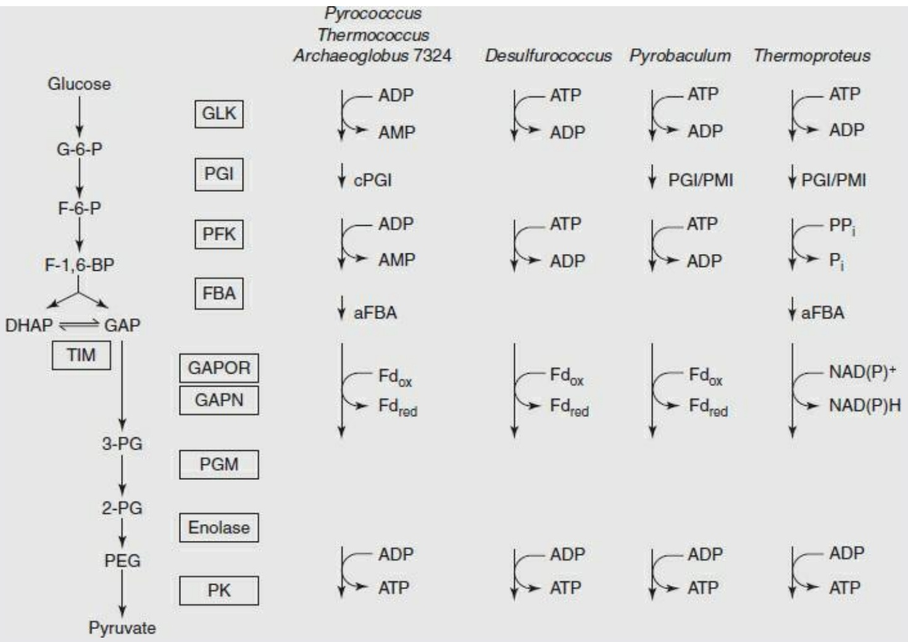

flowchart

This flowchart illustrates the metabolic pathway of glucose in various gut microbiota species (Pyrococcus, Desulfurococcus, Pyrobaculum, and Thermoproteus), showing enzymatic reactions between enzymes like GLK, PGI, PFK, FBA, TIM, GAPOR, GAPN, PGM, Enolase, PK, and their interactions with metabolites such as G-6-P, F-6-P, F-1,6-BP, DHAP, 3-PG, 2-PG, PEG, and Pyruvate.

Figure 8.14 Modifications of the Embden–Meyerhof pathway in archaea. In this case most of the reactions are the same as in the unmodified pathway. The enzymes are not homologous to those that catalyse the corresponding reactions in bacteria and eukarya. Note the differences in cofactors. aFBA, archaeal class I FBA; cPGI, cupin PGI; DHAP, dihydroxyacetone phosphate; FBA, fructose-1,6-bisphosphatae aldolase; F-1,6-BP, fructose-1,6-bisphosphate; $\mathrm { F d } _ { \mathrm { o x } }$ and $\mathrm { F d } _ { \mathrm { r e d } ; }$ oxidized and reduced ferredoxin; F-6-P, fructose-6-phosphate; GAP, glyceraldehyde-3-phosphate; GAPN, nonphosphorylative glyceraldehyde-3-phosphate dehydrogenase; GAPOR, glyceraldehyde-3-phosphate-ferredoxin oxidoreductase; GLK, glucokinase (ADP- or ATP-dependent); G-6-P, glucose-6-phosphate; PEP, phosphoenolpyruvate; PFK, 6-phosphofructokinase; 2-PG, 2-phosphoglycerate; 3- PG, 3-phosphoglycerate; PGI/PMI, bifunctional phosphoglucose/phosphomannose isomerase); PGI, phosphoglucose isomerase; PGM, phosphoglycerate mutase; PK, pyruvate kinase; TIM, triosephosphate isomerase.

From Siebers, B. and Schönheit, P. (2005). Unusual pathways and enzymes of central carbohydrate metabolism in Archaea. Curr. Opin. Microbiol., 8, 695–705.

In addition to the differences in the sequence of metabolites—that is, in the pathway—the enzymes that catalyse even the same reactions are almost always not homologues of bacterial or eukaryotic ones. (The M. jannaschii shikimate kinase is an example of this.) Many of them use different cofactors. Bacterial and eukaryotic phosphofructokinases (that convert fructose-6-phosphate to fructose-1,6-bisphosphate) use ATP as the phosphoryl donor. The archaeal enzymes that catalyse this reaction can use ATP, ADP, or even inorganic pyrophosphate. In addition, some of the familiar enzymes are under allosteric control. The control relationships are also not retained in the corresponding archaeal enzymes.

## Alignment of metabolic pathways

Metabolic pathways provide interesting examples of the generalization of ideas of alignment from sequences to more general networks.

Alignment of two or more character strings is the assignment of correspondences between positions in the strings, usually preserving the relative order. The constraint that relative order must be conserved means that:

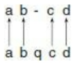

is an allowable alignment, but

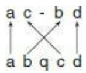

is not. The concept of alignment, including the relative-order constraint, carries over fairly directly to protein structures, because of the linear chemistry of the polypeptide chain: a structural alignment is still a correspondence between the amino acid sequences, despite an appeal to three-dimensional data to determine it. (An exception would be the case of two multidomain proteins composed of homologous domains in different order.)

However, many objects of interest in bioinformatics have a fundamentally nonlinear structure. These include the most general networks, such as sets of regulatory interactions among transcription factors. How does the concept of alignment generalize?

Metabolic pathways are an interesting example. Some present themselves as linear sequences, others are higher-dimensional.

The alignments discussed deal with a static and nonquantitative picture of metabolic networks. Either a transformation is possible, or it is not. It is entirely possible that enzymes that catalyse corresponding steps in the networks have very different kinetic constants in two species, or are subject to different kinds of regulation. In this case the dynamic patterns of traffic through the networks might be quite different, even if the topologies of the networks are the same. (That is, the graphs are isomorphic.) Think of the difference in traffic flow through a city during rush hour and at midnight. The roads haven't changed, but the kinetics has.

## Comparing linear metabolic pathways

Many linear metabolic pathways are extractable from general metabolic networks. In principle, alignment of linear metabolic pathways is directly analogous to alignment of any other sequences. The extension to alignment of nonlinear metabolic pathways takes us out of our comfort zone.

How we characterize steps in metabolic pathways depends on the kinds of questions we want to explore. In its simplest form, a metabolic pathway is a sequence of metabolites. Associated with each step, in each organism, is an enzyme. Associated with each enzyme is a gene. In some cases, for example the tryptophan synthesis pathway in E. coli, the genes for successive steps of the pathway are collinear in the genome with the steps of the pathway (see Fig. 2.1). Alignment methods can detect this.

In studies of evolution of metabolic pathways it also is useful to associate cofactors with reactions. Well known to biochemistry students is the succinyl-CoA synthetase reaction, converting succinyl-CoA to succinate in the Krebs cycle. The reaction is coupled to phosphorylation of GDP in mammals and ADP in bacteria and plants.

Some differences in pathways between organisms are common knowledge. A vitamin is by definition not the product of a metabolic pathway. Humans and other primates require a diet containing vitamin C because we cannot synthesize it. Most animals can synthesize vitamin C. All those animals that cannot do so lack the enzyme L-gulano-γ-lactone oxidase, which catalyses the last step in the pathway, the conversion of L-gluonate to vitamin C. From the point of view of alignment of metabolic sequences, the pathway in humans is truncated, relative to that of animals such as the mouse that are competent to synthesize vitamin C. In primates there is a deletion of a large component of the gene for L-gulano-γ-lactone oxidase.

## See Weblem 8.17

Similar considerations apply to catabolic pathways. The end product of purine metabolism—the form in which nitrogen is excreted—differs among animals in different phyla (Fig. 8.15). Organisms with more water available in their immediate surroundings use more of the reactions. Most mammals degrade purines to allantoin, produced from uric acid by urate oxidase. Primates (and dalmatian dogs) lack functional urate oxidase, and consequently excrete its subtrate, uric acid.

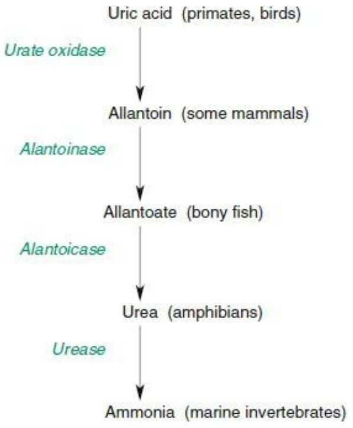

flowchart

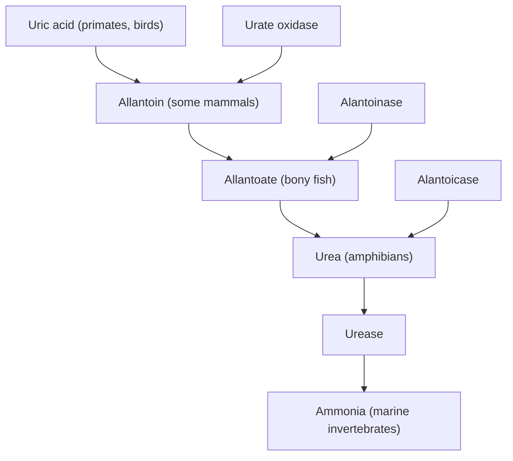

Figure 8.15 Succession of reactions to produce excreted forms of end products of nitrogen metabolism.

The much lower solubility of uric acid relative to allantoin creates clinical problems in humans including kidney stones and gout. The drug allopurinol inhibits xanthine oxidase, the enzyme that converts hypoxanthine → xanthine → uric acid. The precursors, hypoxanthine and xanthine, are more soluble than uric acid, and are cleared much faster by the kidneys. Moreover, in a mixture of hypoxanthine, xanthine, and uric acid each solute has independent solubility. Therefore formation of a precipitate is less likely from a mixed solution of hypoxanthine, xanthine, and uric acid, than from a solution of the same total concentration of uric acid alone.

The enzyme hypoxanthine-guanine phosphoribosyltransferase (HGPRT) recovers degraded purines for nucleic acid synthesis. It converts hypoxanthine and guanine to AMP and GMP. Absence of HGPRT activity causes a build up of uric acid, associated with Lesch–Nyhan syndrome, an inherited metabolic disease. Gout and kidney stones are common symptoms, together with mental retardation and behavioural syndromes including uncontrollable lip and finger biting. (Lesch–Nyhan syndrome was the first unambiguous correlation of a biochemical defect with a psychological abnormality.)

Comparing nonlinear metabolic pathways: the pentose phosphate pathway and the Calvin–Benson cycle

The pentose phosphate pathway, and the Calvin–Benson cycle in photosynthesis, are two metabolic pathways involving transformations of sugars.

Metabolism of glucose can proceed through glycolysis and the Krebs cycle, to couple glucose oxidation to production of ATP. The pentose phosphate pathway is an alternative, which produces NADPH and ribose-5-phosphate. A cell that needs reducing power or ribose-5-phosphate for nucleic acid synthesis will divert some of its glucose metabolism through the pentose phosphate pathway. Several intermediates in the pentose phosphate pathway can be shuttled back into glycolysis.

The Calvin–Benson cycle is the route of carbon dioxide fixation in photosynthesis. The enzyme ribulose-1,5-bisphosphate carboxylase (RUBISCO) couples carbon dioxide to ribulose-1,5- bisphosphate to form an intermediate that breaks down spontaneously to two molecules of glyceraldehyde-3-phosphate. Of every six molecules of glyceralde-3-phosphate produced, five are used to reconstitute three molecules of ribulose-1,5-bisphosphate and the sixth is harvested for energy. (Five 3-carbon molecules → three 5-carbon molecules.)

The pentose phosphate pathway and the Calvin–Benson cycle share many intermediates. Several intermediates link each pathway with ‘mainstream’ glycolysis.

A. Sillero, V.A. Selivanov, and M. Cascante presented three-dimensional diagrams of these two metabolic subnetworks, which brings out the similarities more clearly than standard two-dimensional textbook presentations do (see Fig. 8.16).

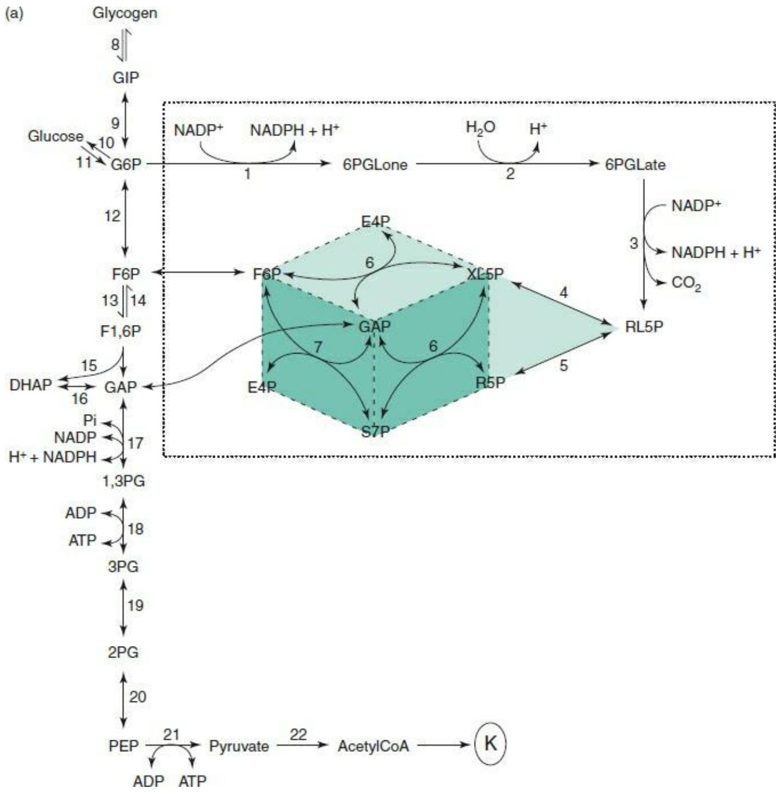

flowchart

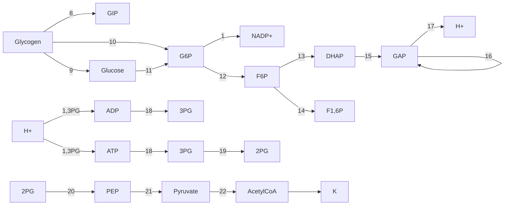

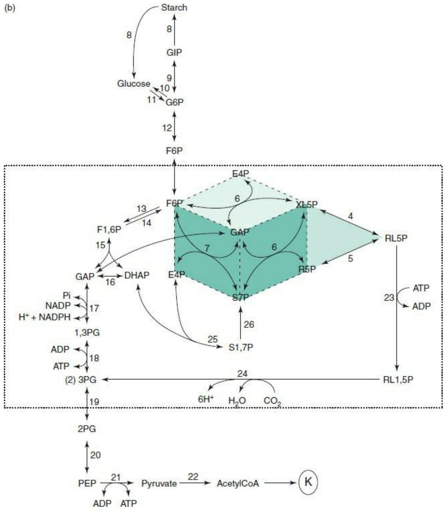

flowchart

This diagram illustrates the metabolic pathway of glucose in a starch system, showing how glucose is converted into various metabolites (F6P, E4P, XL5P, RL5P) and their interactions with various metabolites like GAP, DHAP, and 3PG.

Figure 8.16 (a) The pentose phosphate cycle. (b) The Calvin–Benson cycle. In both panels, numbers in the figure correspond to the following enzymes: 1, glucose-6-P dehydrogenase; 2, gluconolactonase; 3, 6-P-gluconate dehydrogenase; 4, ribulose-5-P 3-epimerase; 5, ribulose-5-P-isomerase; 6, transketolase; 7, transaldolase; 8, enzymes acting in the interconversion between glucose-1-P and glycogen; 9, phosphoglucomutase; 10, glucose-6-phosphatase; 11, hexokinase; 12, phosphoglucose isomerase; 13, 6-phosphofructokinase; 14, fructose-1,6-bisphosphatase; 15, aldolase; 16, triosephosphate isomerase; 17, glyceraldehyde-3-P dehydrogenase; 18, phosphoglycerate kinase; 19, phosphoglycerate mutase; 20, enolase; 21, pyruvate kinase; 22, pyruvate dehydrogenase. K represents the Krebs cycle. In (b), 23, phosphoribulose kinase; 24, RUBISCO; 25, transaldolase; 26, sedoheptulose-1,7-bisphosphatase.

From Sillero, A., Selivanov, V.A., and Cascante, M. (2006). Pentose phosphate and Calvin cycles: similarities and three-dimensional views. Biochem. Mol. Biol. Educ., 34, 275–277.

## Dynamics of metabolic networks

We have discussed metabolic networks as static objects. They differ between species, but for any organism in any particular physiological state at any particular instant, they are fixed. What about the dynamics? What can we say about the traffic patterns in the network? What about the response of the network to changing conditions? Is it robust? If it is, how is this accomplished?

## Robustness of metabolic networks

In principle, networks can achieve robustness through an extension of the mechanism by which redundancy confers stability. The most direct approach is simple substitutional redundancy: if two proteins are each capable of doing a job, knock out one and the other takes over. In the London Underground, this would correspond to a second line running over the same route. For instance, when the Circle line is not running, passengers travelling between Paddington and King's Cross stations can use the Hammersmith and City line that runs on the same tracks. In yeast, for example, single-gene knockouts of over 80% of the 6200 open reading frames are survivable injuries.

Some duplicated genes contribute to substitutional redundancy. For example, in studying animal models for diabetes it appears that mice and rats (but not humans) have two similar but nonallelic insulin genes. Substitutional redundancy requires equivalence not only of function but of expression levels. In the mouse, knocking out either insulin gene leads to compensatory increased expression of the other, producing a normal phenotype.

Coordinated expression patterns are more probable among duplicated genes than among unrelated ones. For example, E. coli contains two fructose-1,6-bisphosphate aldolases. One, expressed only in the presence of special nutrients, is nonessential under normal growth conditions. However, the other is essential. In this case, functional redundancy does not provide robustness. These two enzymes are probably homologous, but if so they are very distant relatives, not the product of a recent gene duplication. One is a member of a family of fructose-1,6-bisphosphate aldolases typical of bacteria and eukaryotes, whereas the other is a member of another family that occurs in archaea. E. coli is unusual in containing both.

An alternative mechanism of network robustness is distributed redundancy: equivalent effects achieved through different routes. In normal E. coli, approximately two-thirds of the NADPH produced in metabolism arises via the pentose phosphate shunt, which requires the enzyme glucose-6-phosphate dehydrogenase. Knocking out the gene for this enzyme leads to metabolic shifts, after which increased levels of NADH produced by the Krebs cycle are converted to NADPH by a transhydrogenase reaction. The growth rate of the knockout strain is comparable to that of the parent.

## Dynamic modelling of metabolism

Can we model the dynamics of a metabolic network? What would it mean to do so?

A challenge that might—naively—appear relatively simple would be to predict the effect of knocking out an enzyme. An easy guess would be to expect a build up of the substrate of the missing enzyme. However, if the metabolic pathways branch in the vicinity of that metabolite, the consequences of a knockout are more complex. For example, the disease phenylketonuria results most commonly from a specific dysfunctional (i.e. knocked-out) enzyme, phenylalanine hydroxylase. The normal function of phenylalanine hydroxylase is to convert phenylalanine to tyrosine. In phenylketonuria, phenylalanine does indeed build up. However, the excess phenylalanine is converted by phenylalanine transaminase to phenylpyruvic acid:

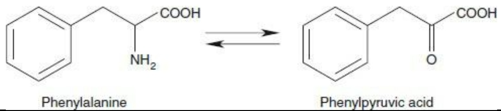

chemical

Chemical reaction diagram showing the conversion of Phenylalanine to Phenylpyruvic acid via a hydrolysis step

Both compounds accumulate. As phenylpyruvic acid is less readily absorbed by the kidneys than phenylalanine, it is excreted into the urine, giving the disease its name. (Phenylalanine is not a ketone.) The Guthrie test for phenylketonuria measures the concentration of phenylpyruvic acid in the blood of newborns.

A challenge greater than predicting the effect of a single knockout would be to simulate the entire metabolic network—given an initial set of metabolite concentrations—to predict the concentrations as a function of time. The idea would be to combine predictions of the rates of individual reactions, assuming a simple model such as Michaelis–Menten kinetics, or more complex models of allosteric enzymes. This requires knowing accurately the kinetic constants of all of the enzymes, including the consequences of inhibitors and effectors. It requires being able to give a sensible treatment of the idea of ‘substrate concentration’ within a cell divided into compartments and to deal with questions of rates of diffusion in a crowded intercellular environment. Longer-term simulation would require knowing the kinetics of transcription regulation, for which no simple model analogous to the Michaelis–Menten equation is available. There are also serious computational issues involving how precisely the kinetic parameters must be known, and the extent to which simplifying assumptions— for instance, the steady-state approximation—are justified.

Accurate simulation of metabolic patterns of entire cells is a clear target for research in the field. However, it is quite a daunting challenge, and a very long-term goal. The hope is to find pieces of the general problem that are both interesting and tractable. Efforts have included the following.

Attempts at detailed numerical analysis of simple networks. For instance, a simulation of the asparate → threonine pathway (see Fig. 8.9) in E. coli represented the enzymatic transformations and feedback inhibition as a set of coupled equations.4 Changes in expression pattern were not included. Steady-state solutions were compared with experimental measurements on cell extracts. It was possible to:

• simulate the time course of threonine synthesis and the effects of changes in initial metabolite concentrations;

• predict the steady-state concentrations of intermediates;

predict the effects of changes in concentrations of individual enzymes on overall throughput, expressed as flux control coef icients; such data can help to guide development of microbial factories for increased yield of particular products; (the flux control coefficient is the percentage change in flux divided by the percentage change in amount of enzyme. It is not a property of the enzyme, but a property of a reaction within a metabolic network. A flux control coefficient equal to 1 would correspond to a rate-limiting step);

• for different steps, distinguish whether the substrates and products are approximately at equilibrium.

Focusing not on individual enzymes but on potential sets of flow rates. The metabolic network is represent by a graph. Metabolites are the nodes. Edges correspond to reactions: an edge connects two compounds if there is a reaction, or possibly several reactions, that interconvert them. The goal is to predict the flow rate through each edge. Recently the models have been generalized to include regulation of expression. There are general constraints on the set of flow rates:

• under steady-state conditions the fluxes through each node must add up to 0; i.e. for each compound, the amount that is synthesized or supplied externally must equal the amount used up or secreted;
• flux control coefficients of all of the reactions contributing to a single flux must add up to 1;
• the flux through any edge is limited by the values of the Michaelis–Menten parameter $V _ { \mathrm { m a x } }$ for

all enzymes contributing to the edge; and

the thermodynamic properties of each reaction determine whether or not the reaction is reversible: this is a property of the substrate and product of the reaction, not of the enzyme; the flux of an irreversible reaction must be greater than or equal to 0.

It will be interesting to see whether the space of possible metabolic states is connected or broken up into separated regimens.

In general, many possible flow patterns, or metabolic states, are consistent with the constraints. To determine a single metabolic state to compare with experiments it is possible to select from the feasible states the one that is optimal for ATP production or for growth rate. A variety of observable quantities are predictable.

• The effects of changes of medium or gene knockouts: which enzymes are essential for growth on different carbon sources?
• What are limiting factors in growth?
• What are maximal theoretical yields of ATP, or assimilation of carbon, etc?
• What are the fluxes through individual pathways? This is difficult but not impossible to measure.
What are the flux control coefficients of different enzymes?
• For optimal growth, how much oxygen and carbon source are taken up?

Such models have been constructed for several organisms, including prokaryotes and eukaryotes. Predictions have generally achieved good agreement with experiments.

## RECOMMENDED READING

- Bashton, M. and Chothia, C. (2007). The generation of new protein functions by the combination of domains. Structure, 15, 85–99.
- Csermely, P., Korcsmáros, T., Kiss, H.J., London, G., and Nussinov, R. (2013). Structure and dynamics of molecular networks: a novel paradigm of drug discovery: a comprehensive review. Pharmacol. Ther., 138, 333–408.
- Kruse K., Chalancon, G., and Babu, M.M. (2012). Metabolic networks and their applications. In: W. Dubitzky, O. Wolkenhauer, K. Cho, and H. Yokota | (eds), Encyclopedia of Systems Biology. Springer Science + Business Media, New York.
- Lacroix, V., Cottret, L., Thébault, P., and Sagot, M.-F. (2008). An introduction to metabolic networks and their structural analysis. IEEE/ACM Trans. Comput. Biol. Bioinform., 5, 594–617.
- Lesk, A.M. (2011). Introduction to Genomics, 2nd edn. Oxford University Press, Oxford.
- Terzer, M., Maynard, N.D, Covert, M.W., and Stelling, J. (2009). Genome-scale metabolic networks. Wiley Interdiscip. Rev. Syst. Biol. Med., 1, 285–297.

## EXERCISES AND PROBLEMS

**Exercise 8.1** On a photocopy of Figure 8.3, mark the following distances: (1) on part (a) of the figure, the free energy difference between reactant and product. (All these distances are purely vertical distances.); (2) on part (b) of the figure, the difference in activation energy of the forward reaction between uncatalysed and enzyme-catalysed reactions.

**Exercise 8.2** The Michaelis–Menten model implies the following relationship between substrate concentration [S] and initial velocity v0:

$$
v _ {0} = \frac {V _ {\text {max}} [ S ]}{K _ {M} + [ S ]}
$$

**Problem 8.1** The network of metabolic pathways must obey constraints of thermodynamics and physical-organic chemistry. E. Meléndez-Hevia and colleagues suggested the principle that metabolic pathways are optimized, subject to the constraints, for the minimum number of steps.

The nonoxidative phase of the pentose phosphate pathway converts six 5-carbon sugars to five 6- carbon sugars:

$$
6 \text { Ribulose - 5 - phosphate } \rightarrow 5 \text { glucose - 6 - phosphate }
$$

A simplified model of a pathway for this conversion is a series of steps, each of which is either:

1. transfer of a 2-carbon unit from one sugar to another (a transketolase reaction), or
2. transfer of a 3-carbon unit from one sugar to another (a transaldolase or aldolase reaction).

Represent each sugar only by a number of carbon atoms. Starting with five 5-carbon sugars, one possible initial step would be a transketolase step converting two 5-carbon sugars to a 3-carbon sugar and a 7-carbon sugar. Assume that all intermediates must have at least three carbon atoms.

Create a tableau with the following initial and final states (an initial transketolase (TK) step is also shown):

<table><tr><td>Step</td><td colspan="6">Number of carbons in sugar molecules</td></tr><tr><td>0</td><td>5</td><td>5</td><td>5</td><td>5</td><td>5</td><td>5</td></tr><tr><td>1</td><td>3</td><td>7</td><td>5</td><td>5</td><td>5</td><td>5</td></tr><tr><td>N</td><td>6</td><td>6</td><td>6</td><td>6</td><td>6</td><td>0</td></tr></table>

Copy and fill in the tableau to find the shortest route from top (step 0, six 5-carbon sugars) to bottom (five 6-carbon sugars). Identify the intermediates created. Compare with the observed metabolic pathway.

**Problem 8.2** (a) Suppose an enzyme with known values of $K _ { \mathrm { M } }$ and $V _ { \mathrm { m a x } }$ irreversibly converts A to B. Write a program that, given initial concentrations of substrate [A] and enzyme and assuming that the initial concentration of $\mathrm { ~ B ~ } = \mathrm { ~ } 0$ , computes and draws a graph of the value of the substrate concentration at subsequent times. (b) Suppose that a second enzyme, also with known values of $K _ { \mathrm { M } }$ and $V _ { \mathrm { m a x } }$ (which need not be the same as those of the first enzyme) irreversibly converts B to C. Write a program that, given initial concentrations of substrate [A] and both enzymes and assuming that the initial concentrations of B and C are 0, computes and draws a graph of the concentrations of A, B, and C as a function of time.

1 Have a look at the sea slug Elysia chlorotica, and even, possibly, the salamander Ambystoma maculatum.
2 Ashburner, M. (2006). Won for All: How the Drosophila Genome Was Sequenced. Cold Spring Harbor aboratory Press, Cold Spring Harbor, NY.

3 This is indeed colloquial phraseology, but, strictly speaking, one should write: $K _ { D } = \frac { [ P ] [ L ] } { [ P L ] C ^ { \ominus } } = 1 0 - 9$ with $c ^ { \phi } = 1 m o H ^ { - 1 }$ Equilibrium constants must be dimensionless! (If not, how could you take their logs?)
4 Chassagnole, C., Raïs, B., Quentin, E., Fell, D.A., and Mazat, J.P. (2001). An integrated study of threoninepathway enzyme kinetics in Escherichia coli. Biochem. J., 356, 415–423.

# Gene expression and regulation

## LEARNING GOALS

• Understanding the goals of proteomics: the measurement of amounts and distributions of proteins within a cell or organism.
• Becoming familiar with the data derivable from microarrays and their application to inferring and interpreting similarities and differences in gene expression patterns. Grasping the relationship between typical ‘raw’ microarray data (see for instance Plate XI) and the gene expression table.

bubble

| Row | Column 1 | Column 2 | Column 3 | Column 4 | Column 5 | Column 6 | Column 7 | Column 8 | Column 9 | Column 10 | Column 11 | Column 12 |
| --- | --- | --- | --- | --- | --- | --- | --- | --- | --- | --- | --- | --- |
| 1 | Yellow | Green | Red | Green | Green | Green | Green | Red | Green | Yellow | Green | Green |
| 2 | Green | Green | Green | Green | Green | Green | Green | Green | Green | Yellow | Green | Green |
| 3 | Green | Green | Green | Green | Green | Green | Green | Green | Green | Yellow | Green | Green |
| 4 | Green | Red | Red | Red | Red | Red | Red | Red | Red | Red | Red | Red |
| 5 | Green | Green | Green | Green | Green | Green | Green | Green | Green | Yellow | Green | Green |
| 6 | Green | Yellow | Red | Red | Red | Red | Red | Red | Red | Red | Red | Red |
| 7 | Green | Green | Green | Green | Green | Green | Green | Green | Green | Yellow | Green | Green |
| 8 | Green | Yellow | Red | Red | Red | Red | Red | Red | Red | Red | Red | Red |
| 9 | Green | Green | Green | Green | Green | Green | Green | Green | Green | Yellow | Green | Green |

Plate XI Comparison of gene expression patterns in liver (red) and brain (green). The liver RNA is tagged with a red fluorophore, the brain RNA with a green one, then both are exposed to the array. Red spots correspond to genes active in the liver but not in the brain. Green spots correspond to genes active in the brain but not in the liver. Yellow spots correspond to genes active in both brain and liver (See Chapter 9).

Courtesy Dr P.A. Lyons.

Understanding the applications of mass spectrometry to analysis of mixtures of proteins, to partial protein sequencing, and to high-throughput nucleic acid sequencing and searching for variant genetic sequences.
• Understanding the structure and some of the building blocks of regulatory networks.
• Knowing the essential structural features of protein–protein and protein–nucleic acid complexes.
• Recognizing the regulatory networks are ‘reprogrammable’ under changes of physiological state.
• Integrating the logical and physical interactions in the real but relatively simple case of phage λ.

For a cell to be in a healthy state it must control which of its genes are being expressed, and at what levels. The effect of this control is to achieve the proper inventory of proteins and RNA molecules appropriate to the developmental and physiological state of the cell. In our bodies, largely irreversible differentiation events create different tissues. These play different metabolic roles. Differentiation gives cells tissue-specific structures, and also tissue-specific gene expression patterns. Moreover, when environmental conditions change, most cells can change physiological state in response. The diauxic shift in yeast, in switching between aerobic and anaerobic environments, is one example. The change requires an altered pattern of gene expression. (This takes a little time, accounting for the lag phase observed by Monod in his original observations of diauxy.) Two relatively simple systems that have been examined in very great detail are the Lac operon in E. coli, and the lytic–lysogenic switch in phage λ. In those two cases we know not only the abstract logic of the system, but the details of how this logic is implemented at the level of atomic-resolution molecular structures.

Nucleotide sequences of genomes give a static picture of an organism's potential. The results of gene expression are the proteins and RNA molecules that underlie cellular activity. Study of patterns of proteins in a cell, as a function of state and conditions, is a mature enterprise, and has produced copious amounts of useful data. These data are interesting in themselves as revealing the state of cellular activity, and also for what they can tell us, albeit indirectly, about how gene expression is being controlled. Of course, the field is moving towards the goal of direct observations of mechanisms of expression control.

Proteomics is the study of the distribution and interactions of proteins in time and space in a cell or organism. High-throughput experimental methods of data analysis, including microarray analysis and mass spectrometry, are giving us a large-scale picture of the protein economy in living things. Some of the interactions are active in control of transcription and translation. These include binding of transcription regulatory proteins to DNA, and interaction of specific RNAs with mRNA, inhibiting translation.

The goal of systems biology is the synthesis of genomic, transcriptomic, proteomic, and other data into an integrated picture of the structure, dynamics, logistics, and ultimately the logic of living things. A systems biologist will combine study of proteins and RNAs, the genes that encode them, the molecules that control their expression or activity once expressed, and the set of other proteins and nucleic acids with which they interact. A systems biologist will assemble into a metabolic network the chemical reactions catalysed by the enzymes of a cell (see Chapter 8), and assemble into control networks the mechanisms that regulate their activities and expression.

Measurement of distributions of proteins in cells is a mature technology, but one that is also in flux. Competing with the classical microarray technique is RNAseq, the high-throughput sequencing of RNAs in a sample.

## DNA microarrays

DNA microarrays analyse the mRNAs in a cell to reveal the expression patterns of proteins; or genomic DNAs, to reveal absent or mutated genes.

1. For an integrated characterization of cellular activity, we want to determine what proteins are present, where, and in what amounts. To determine the expression pattern of a cell's genes, we measure the relative amounts of many different mRNAs. Hybridization is an accurate and sensitive way to detect whether any particular nucleic acid sequence is present. The key to highthroughput analysis is to run many hybridization experiments in parallel.
2. Measuring expression patterns can help to identify genes associated with propensities to diseases. Some diseases, such as cystic fibrosis, arise from mutations in single genes. For these, isolating a region by classical genetic mapping can lead to pinpointing the lesion. Other diseases, such as asthma, depend on interactions among many genes, with environmental factors as complications. To understand the aetiology of multifactorial diseases requires the ability to determine and analyse expression patterns of multiple genes, which may be distributed around

different chromosomes.

DNA microarrays, or DNA chips, are devices for checking a sample simultaneously for the presence of many sequences.

The basic idea is this: to detect whether one oligonucleotide has a particular known sequence, test whether it can bind to an oligo with the complementary sequence (a ‘one-to-one’ test). To detect the presence or absence of a query oligo in a mixture, spread the mixture out and test each component of the mixture for binding to the oligo complementary to the query (a ‘many-to-one’ test). This is a northern or Southern blot. To detect the presence or absence of many oligonucleotides in a mixture, synthesize a set of oligos, one complementary to each sequence of the query list, and test each component of the mixture for binding to each member of the set of complementary oligos (a ‘manyto-many’ test). Microarrays provide an efficient, high-throughput way of carrying out these tests in parallel.

To achieve parallel hybridization analysis, a large number of DNA oligomers are affixed to known locations on a rigid support, in a regular two-dimensional array. The mixture to be analysed is prepared with fluorescent tags to permit detection of the hybrids. After exposing the array to the mixture, each element of the array to which some component of the mixture has become attached bears the tag. Because we know the sequence of the oligomeric probe in each spot in the array, measurement of the positions of the probes identifies their sequences. This analyses the components present in the sample.

DNA microarrays are distributed on a small wafer of glass or nylon, typically 2 cm square. Oligonucleotides are attached in an array at densities between 10 000 and 250 000 positions per square centimetre. The spot size may be as small as ≈150 µm in diameter. The grid is typically a few centimetres across. A yeast chip contains over 6000 oligonucleotides, covering all known genes of S. cerevisiae. A DNA array, or DNA chip, may contain 400 000 probe oligomers. Note that this is larger than the total number of genes even in higher organisms (excluding immunoglobulin genes).

To analyse a mixture, expose it to the microarray under conditions that promote hybridization, then wash away any loose probe. To compare two sets of oligos, tag the samples with differently coloured fluorophores (Plate XI). Scanning the array collects the data in computer-readable form.

Different types of chip designed for different investigations differ in the types of DNA immobilized. (The immobilized material on the chip is the probe. The sample tested is the target.)

1. In an expression chip, the immobilized oligos are cDNA samples, typically 20–80 bp long, derived from mRNAs of known genes. The target sample might be a mixture of mRNAs from normal or diseased tissue.
2. In genomic hybridization, one looks for gains or losses of genes or changes in copy number. The target sequences, fixed on the chip, are large pieces of genomic DNA, from known chromosomal locations, typically 500–5000 bp long. The probe mixtures contain genomic DNA from normal or disease states. For instance, some types of cancer arise from chromosome deletions, which can be identified by microarrays.
3. In mutation microarray analysis one looks for patterns of SNPs.

## Microarray data are quantitative but imprecise

Microarrays are capable of comparing concentrations of probe oligos. This allows investigation of responses to changed conditions. However, the

Microarrays provide another high-throughput stream of data production in bioinformatics. A standard called MIAME (which stands for Minimum Information About a Microarray Experiment) describes the contents and format of the information to be recorded in the experiment and deposited. Major publicly available microarray databases include the following.

The European Bioinformatics Institute hosts a database, ArrayExpress: [http://www.ebi.ac.uk/arrayexpress/](http://www.ebi.ac.uk/arrayexpress/)

The US NCBI hosts the Gene Expression Omnibus database: [http://www.ncbi.nlm.nih.gov/geo/](http://www.ncbi.nlm.nih.gov/geo/)

The Stanford Microarray Database: [http://genome-www5.stanford.edu/MicroArray/SMD/](http://genome-www5.stanford.edu/MicroArray/SMD/)

A listing of microarray databases for plants appears in: [http://www.plexdb.org](http://www.plexdb.org)

precision is low. Moreover, mRNA levels, detected by the array, do not always quantitatively reflect protein levels. Indeed, usually mRNAs are reverse transcribed into more stable cDNAs for microarray analysis; the yields in this step may also be nonuniform. Microarray data are therefore semiquantitative, in that distinction between presence and absence is possible, determination of relative levels of expression in a controlled experiment is more difficult, and measurement of absolute expression levels is beyond the capacity of current microarray techniques. (See Box 9.1.)

## Analysis of microarray data

The raw data of a microarray experiment are displayed as an image, in which the colour and intensity of the fluorescence reflect the extent of hybridization to alternative probes. The two sets of probes are tagged with red and green fluorophores. If only one probe hybridizes, the spot appears red; if only the other probe hybridizes, the spot appears green. If both hybridize, the colour of the corresponding spot appears red + green = yellow (see Plate XI).

The initial goal of data processing is a gene expression table. This is a matrix in which the rows correspond to different genes, and the columns to different samples. Different spots in a microarray pattern such as that shown in Plate XI correspond to different genes. For each gene, results from different sets of samples appear in the red or green channel (or neither, or both). There is extensive redundancy in the oligos in a microarray: each gene may be represented by several spots, corresponding to different regions of the gene sequence; inclusion of controls with a deliberate mismatch allows data verification. Typically one gene may correspond to ≈30–40 spots.

The samples may vary according to experimental conditions and/or physiological states, or they may be extracted from different individuals, or different tissues or developmental stages.

The process of data reduction to produce the gene expression matrix involves many technical details of image processing, checking internal controls, dealing with missing data, selecting reliable measurements, and putting the results of different arrays on consistent scales. The derived gene expression table indicates relative expression levels. A change in expression levels of a gene between two samples by a factor of 1.5–2 or more is generally considered significant.

Extraction of reliable biological information from a gene expression table is not straightforward. Despite extensive internal controls, there is considerable noise in the experimental technique. In many cases, variability is inherent within the samples themselves. Microorganisms can be cloned; animals can be inbred to a comparable degree of homogeneity. However, experiments using RNA from human sources—for example, a set of patients suffering from a disease and a corresponding set of healthy controls—are at the mercy of the large individual variations that humans present. Indeed,