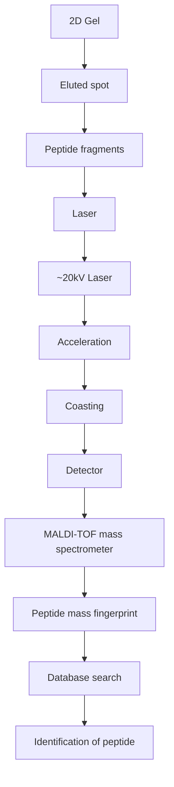

inbred animals, and even apparently identical eukaryotic tissue-culture samples, show extensive variability.

Another intrinsic disadvantage—and a severe one—in interpreting gene expression data, is the fact that the number of genes is much larger than the number of samples. Computationally we are trying to understand the relationship of a space of very many variables (the genes) to a space of observations (the phenotype), from only a few measured points (the samples). The sparsity of the observations does not give us anywhere near adequate coverage. Statistical methods bear a heavy burden in the analysis to give us confidence in the significance of our conclusions.

Two general approaches to the analysis of a gene expression matrix involve (1) comparisons focused on the genes—that is, comparing distributions of expression patterns of different genes by comparing rows in the expression matrix—and (2) comparisons focused on samples; that is, comparing expression profiles of different samples by comparing columns of the expression matrix.

1. Comparisons focused on genes. How do gene expression patterns vary among the dif erent samples? Suppose a gene is known to be involved in a disease, or to a change in physiological state in response to changed conditions. Other genes coexpressed with the known gene may participate in related processes contributing to the disease or the change in state. More generally, if two rows (two genes) of the gene expression matrix show similar expression patterns across the samples, this suggests a common pattern of regulation, and possibly some relationship between their functions, including but not limited to a possible physical interaction.
2. Comparisons focused on samples. How do samples dif er in their gene expression patterns? A consistent set of differences among the samples may characterize the classes which the samples represent. If the samples are from different controlled groups (for instance, diseased and healthy animals), do samples from different groups show consistently different expression patterns? If so, given a novel sample, we can assign it to its proper class on the basis of its observed gene expression pattern.

How then do we measure the similarity of different rows or columns? Each row or column of the expression matrix can be considered as a vector, in a space of many dimensions. The row-vectors (a row corresponds to a gene), each entry of which refers to the same gene in different samples, has as many elements as there are samples. The column-vectors (a column corresponds to a sample), each entry of which refers to a different gene in a single sample, has as many elements as there are genes reported. It is possible to calculate the ‘angle’ between different row-vectors, or between different column-vectors, to provide a measure of their similarities. It is then natural to ask whether subsets of the points form natural clusters—points with high mutual similarity—characterizing either sets of genes or sets of samples.

Depending on the origin of the samples, what is already known about them, and what we want to learn, data analysis can proceed in different ways.

1. The simplest case is a carefully controlled study, using two different sets of samples of known characteristics. For instance, the samples might be taken from bacteria grown in the presence or absence of a drug, from juvenile or adult fruit flies, or from healthy humans and patients with a disease. We can focus on the question, what differences in gene expression pattern characterize the two states? Can we design a classification rule such that, given another sample, we can assign it to its proper class? This would be applicable in diagnosis of disease. For instance, determination of the subtype of a leukaemia permits more accurate treatment and prognosis. Subject to the availability of adequate data, such an approach can be extended to systems of more than two classes.

Computationally, training such a classification algorithm is called ‘supervised learning’. The expression pattern of each sample is given by a vector corresponding to a single column of the matrix. This corresponds to a point in a many-dimensional space; as many dimensions as there are genes. In favourable cases, the points may fall in separated regions of space. Then a scientist, or a computer program, will be able to draw a boundary between them. In other cases, separation of classes may be more difficult. Consider the distribution of football players during a match. At the start of play, a line drawn across the midfield separates the teams; that is, the midfield line divides the field into two regions, each region containing exclusively the players of one of the teams. During play, the teams become commingled, and it is impossible to draw a single line that divides the field into regions that separate the teams.

2. In a different experimental situation, we might not be able to preassign different samples to different categories. Instead, we hope to extract the classification of samples from the analysis. The goal is to cluster the data to identify classes of samples and the differences between the genes that characterize them.

Many clustering algorithms have been applied to microarray data, including those that try to work out simultaneously both the number of clusters and the boundaries between them. All algorithms must face the difficulty arising from the sparsity of sampling of the very highdimensional space of the measurement. Sometimes it is possible to simplify the problem by identifying a small number of combinations of genes that account for a large portion of the variability. This is called reduction of dimensionality (see Box 9.2, and compare with discussion of odour classification by neural networks, Chapter 3).

## Box 9.2 Reduction of dimensionality

The distribution of gene expression data in a space of a large number of dimensions means that (1) coverage of the space with a limited number of samples is sparse and (2) it is difficult to visualize the distribution of sample points. In some cases, the distribution may depend primarily on fewer equivalent variables, and it is very advantageous to find them and transform the data accordingly.

A simple example illustrates the basic idea. Consider a distribution of groups of people picnicking on a beach. Represent the position of each person by the x, y, and z coordinates of the tip of his or her nose. Make the x axis parallel to the shoreline, the y axis perpendicular to the shoreline, and the z axis vertical. Obviously height is irrelevant: this is really a two-dimensional, not a three-dimensional, distribution. To cluster the people into groups (perhaps families, or surfing clubs) the x and y coordinates carry all the significant data, and the z coordinate carries only irrelevant information, such as the heights of the people and whether or not they are standing up or sitting on the sand. In this case, to reduce the dimensionality from 3 to 2 we need only ignore the z coordinate. (Indeed, if the tide comes in and the beach area becomes narrower, the dimension along the shoreline carries the bulk of the information and the dimensionality could be further reduced from 2 to 1.)

Alternatively, suppose that groups of people are climbing a vertical rock face rising parallel to the shoreline. This also is really a two-dimensional, not a three-dimensional, distribution, but in this case it is the x and z coordinates that carry the information.

In more complex cases, reduction in dimension requires more than simply picking coordinates to ignore. Suppose the people are distributed on a ski slope. To reduce the distribution from three to two dimensions, we could not simply ignore a coordinate, but would have to project the data onto the oblique plane parallel to the slope. This idea of projection of the data onto a lower-dimensional space that contains the important components of the variation is the key to the methods.

Practical problems of data analysis are harder than these simple illustrations. For one thing, the starting dimensions are much higher than three and the reduction in dimensionality is potentially much greater. For another, it is not obvious how to achieve the dimensionality reduction because we don't have the easily visualizable picture of the physical space and the distribution of people on a beach, rock face, or ski slope.

Nevertheless, the questions to be answered remain: along what directions should we project the data to retain the largest discrimination using the fewest dimensions? Mathematical methods known as principal-component analysis (PCA) using the singular value decomposition (SVD) can solve this problem. These methods automatically select a new coordinate system that best represents the variability of the data along the fewest axes, and, for each new coordinate axis, the calculation gives a measure of the contribution of that coordinate to accounting for the overall variability of the data.

Although two dimensions may well not contain all important components of the variation, we can always pick the best two-dimensional projection and plot the result on a graph; this has the immense advantage of allowing scientists to stare at the data and think about them. (Three-dimensional distributions can also be represented visually, with somewhat greater difficulty.)

## CASE STUDY 9.1 Interpretation of microarray data: regulation of genes by BRCA1 and implications for the role of BRCA1 dysfunction or silencing in tumour development

The BRCA1 gene encodes a tumour suppressor. It is mutated in approximately 90% of patients with familial predisposition to breast and ovarian cancer. A single defective BRCA1 allele is sufficient to increase risk, for in any cell the normal copy of the gene may be lost, or, in a small fraction of cases, rendered inactive by promotor methylation.

BRCA1 is an 1863-residue protein. It has an N-terminal ring finger domain, followed by a predicted helical coiled-coil region, followed by two tandem BRCT domains, that bind other proteins and also regulate transcription. (BRCT abbreviates BRCA C-terminal domain.)

BRCA1 interacts with many other proteins to form functional complexes and is thereby involved in several different activities, including:

• sensing and signalling of lesions in DNA: BRCA1 responds to several types of DNA damage—for instance, double-strand breaks—and activates repair mechanisms appropriate to each;
• preserving chromosome structure: chromosome integrity may suffer as a consequence of inaccurate repair of DNA damage. These functions are related;
• mediating checkpoint tests at points in the cell cycle, in part at least by regulating transcription of genes encoding proteins involved in checkpoint enforcement.

A unifying idea about BRCA1 is that the protein encoded mediates responses to DNA damage by eliciting repair mechanisms and, in case repair is unsuccessful, checkpoint mechanisms that stop cells with unrepaired damage from propagating. Loss of BRCA1 function leads to the accumulation of damaged DNA in cells, enhancing the chances of transition to a cancerous state.

The variety and complexity of the processes involving BRCA1 make it difficult to sort out the detailed mechanism of its relation to cancer.

1. Is tumour formation a direct consequence of loss of one or more functions of BRCA1 and its interacting partners? If so, which one(s)?
2. What is the importance of transcriptional regulation, of BRCA1 by products of other genes, of other genes by BRCA1, or both? To what extent do changing expression patterns involving BRCA1 lead indirectly to tumourigenesis? We shall see that the distinction between direct and indirect effects is not really a hard and fast one: BRCA1 binds directly to some of the proteins the expression of which it regulates.
3. DNA repair mechanisms are common to many types of cells. Why does BRCA1 dysfunction or silencing specifically lead to increased risk of cancers of the breast and ovary (and other epithelial tissues, including pancreas and prostate)?

One function of BRCA1 is control over transcription. In order to investigate the regulatory context of the relationship of BRCA1 to cancer risk, Welcsh et al. used microarray analysis to compare the expression patterns of genes in cells producing high and low levels of BRCA1, with a cell line in which BRCA1 expression was selectively inducible. (See Plate XII.) The chip used for detection of the response contained oligonucleotides representing ≈6800 human genes. (Note that this is a relatively small fraction of the total human proteome.)

heatmap

| Sample | BRCA1-experiments::5 | BRCA1-experiments::2 | BRCA1-experiments::6 | BRCA1-experiments::4 | BRCA1-experiments::3 | BRCA1-experiments::1 | BRCA1-experiments::1 | BRCA1-experiments::5 | BRCA1-experiments::3 | BRCA1-experiments::2 | BRCA1-experiments::6 | BRCA1-experiments::4 |
| --- | --- | --- | --- | --- | --- | --- | --- | --- | --- | --- | --- | --- |
| 1 | Green | Green | Green | Green | Green | Green | Green | Green | Green | Green | Green | Green |
| 2 | Red | Red | Red | Red | Red | Red | Red | Red | Red | Red | Red | Red |
| 3 | Green | Green | Green | Green | Green | Green | Green | Green | Green | Green | Green | Green |
| 4 | Green | Green | Green | Green | Green | Green | Green | Green | Green | Green | Green | Green |
| 5 | Green | Green | Green | Green | Green | Green | Green | Green | Green | Green | Green | Green |
| 6 | Green | Green | Green | Green | Green | Green | Green | Green | Green | Green | Green | Green |
| 7 | Green | Green | Green | Green | Green | Green | Green | Green | Green | Green | Green | Green |
| 8 | Green | Green | Green | Green | Green | Green | Green | Green | Green | Green | Green | Green |
| 9 | Green | Green | Green | Green | Green | Green | Green | Green | Green | Green | Green | Green |
| 10 | Green | Green | Green | Green | Green | Green | Green | Green | Green | Green | Green | Green |

**Plate XII** Clustering of gene expression data in cells expressing high and low levels of BRCA. BRCA1¯ experiments, with low expression levels of BRCA1, appear in the left-hand six columns. BRCA1+ experiments, with high expression levels of BRCA1, appear in the right-hand six columns. The intensity of the colour reflects the ratio of the expression to that of a control. Red reflects genes with higher expression levels in response to BRCA1. Green reflects genes with lower expression levels in response to BRCA1. (See Chapter 9.)

From Welcsh, P.L., Lee, M.K., Gonzales-Hernandez, R.M., Black, D.J., Mahadevappa, M. et al. (2002). BRCA1 transcriptionally regulates genes involved in breast tumourigenesis. Proc. Natl. Acad. Sci. USA, **99**, 7560–7566. Reproduced by permission.

The results implicated 373 genes, differentially expressed by significant and reproducible amounts in response to higher levels of BRCA1 expression. Standing out among these were 57 upregulated genes and 15 downregulated genes, for which expression levels changed by factors of 2 or more. These candidates for involvement in functions of BRCA1 relevant to tumourigenesis were checked for differential expression in cancer tissues from patients and normal controls.

Clustering the gene expression matrix shows the clear distinction between up- and downregulated genes, and gives an impression of the variability among replicates. (See Plate XII.) Many of the proteins encoded by upregulated genes are hormone receptors and structural proteins. Many of the proteins encoded by downregulated genes are involved in DNA replication and translation.

Notable among the genes identified in the study are the following.

Consistent with the tissue-specific appearance of tumours as a result of BRCA1 dysfunction, some of the genes with altered expression patterns are involved in oestrogen-mediated control pathways, suggesting a possible link to the tissue-specificity enigma. The set of proteins implicated includes cyclin D1 and Myc, which are upregulated by lower levels of BRCA1. (For comparison with the clinical setting, low levels of BRCA1 expression correspond to patients with reduced or absent BRCA1 function, that is, the high-risk group; and high levels are analogous to normal controls. However, the experiments of Welcsh et al. did not try to reproduce actual endogenous BRCA1 expression levels observed in patients and normal counterparts.) Cyclin D1 and Myc are observed to be overexpressed in 20% of breast cancers, consistent with their repression by functional BRCA1.
2. Conversely, JAK and STAT proteins are downregulated by decreased levels of BRCA1. These proteins are implicated as growth inhibitors in control pathways that govern proliferation, differentiation, apoptosis, and transformation. Loss of BRCA1 activity would be expected to reduce JAK1 and STAT1 levels, promoting cellular proliferation and reducing apoptosis. This is consistent with the observation that Stat1-null mice develop tumours more readily than normals.

The relationships detected by Welcsh et al. are part of the cell's control network. However, some of the products of genes regulated by BRCA1 are also known to be involved in formation of functional complexes with BRCA1. For instance, Myc—the product of a potent oncogene—binds to BRCA1, suggesting a direct inhibition of Myc by BRCA1. Thus reduced BRCA1 levels would have the dual effect of reducing the inhibition of Myc through binding, and increasing the expression of Myc through loss of transcriptional repression.

Thus, Myc is linked to BRCA1 through both physical and regulatory interactions. We have seen in an earlier chapter that the idea of two parallel interaction networks in cells—physical interactions and regulatory interactions—is a useful distinction. However, it is one that is difficult to maintain in a system such as BRCA1 function in which the two are so closely intertwined.

## Mass spectrometry

Mass spectrometry is a physical technique that characterizes molecules by measurements of the masses of their ions. Investigations of large-scale expression patterns of proteins require methods that give high throughput rates as well as fine accuracy and precision. Mass spectrometry achieves this, which has stimulated its development into a mature technology in widespread use. Applications to molecular biology include:

rapid identification of the components of a complex mixture of proteins;
• sequencing of proteins and nucleic acids, including high-throughput genomic sequencing and surveying populations for genetic variability;
• analysis of post-translational modifications, or substitutions relative to an expected sequence.

## Identification of components of a complex mixture

First the components are separated by electrophoresis. Then the isolated proteins are digested by trypsin to produce peptide fragments with 800–4000 amino acids. (Fig. 9.1). Trypsin cleaves proteins after lysine and arginine residues. Given a typical amino acid composition, a protein of 500 residues yields about 50 tryptic fragments. The mass spectrometer measures the masses of the fragments with very high accuracy (Fig. 9.2). The list of fragment masses, called the peptide mass fingerprint, characterizes the protein (Fig. 9.3). Searching a database of fragment masses identifies the unknown sample.

flowchart

Figure 9.1 Identification of components of a mixture of proteins by elution of individual spots, digestion and fingerprinting of the peptide fragments by matrix-assisted laser desorption ionization-time of flight (MALDI-TOF) mass spectrometry, followed by looking up the set of fragment masses in a database.

text_image

Detector
Detect time-of-flight
Field-free flight
(coasting)
Lighter ions move faster
Heavier ions move slower
Accelerating voltage
Laser
λ = 337 nm
Vaporization and ionization

Figure 9.2 Schematic diagram of mass spectrometry experiment.

spectrogram

| M/z | Relative Abundance (%) |
| --- | --- |
| 981.5262 | ~35 |
| 957.5369 | ~20 |
| 1108.6494 | ~15 |
| 1157.6235 | ~85 |
| 1123.6340 | ~10 |
| 1273.7909 | ~5 |
| 1282.7338 | ~5 |
| 1407.7719 | ~25 |
| 1479.8687 | ~15 |
| 1501.7567 | ~10 |
| 1578.856 | ~5 |
| 1622.8511 | ~90 |
| 1617.8866 | ~15 |
| 1654.8632 | ~10 |
| 1826.0116 | ~30 |
| 1919.0556 | 100 |
| 1932.8910 | ~20 |
| 1964.8928 | ~5 |
| 2163.0570 | ~5 |
| 2254.2646 | ~20 |
| 2425.44 | ~5 |

Figure 9.3 Mass spectrum of a tryptic digest. Of the 21 highest peaks (shown in black), 15 match expected tryptic peptides of the 39 kDa subunit of cow mitochondrial complex I. This easily suffices for a positive identification. Figure courtesy of Dr I. Fearnley.

Construction of a database of fragment masses is a simple calculation from the amino acid sequences of known proteins, translations of open reading frames in genomes, or (at a pinch) of segments from EST libraries. The fragments correspond to segments cut by trypsin at lysine and arginine residues, and the masses of the amino acids are known. (Note that trypsin doesn't cleave

Lys–Pro peptide bonds, and may also fail to cleave Arg–Pro peptide bonds.)

Mass spectrometry is sensitive and fast. Peptide mass fingerprinting can identify proteins in subpicomole quantities. Measurement of fragment masses to better than 0.1 mass units is quite good enough to resolve isotopic mixtures. It is a high-throughput method, capable of processing 100 spots/day (though sample preparation time is longer). However, there are limitations. Only proteins of known sequence can be identified from peptide mass fingerprints, because only their predicted fragment masses are included in the databases. (As with other fingerprinting methods, it would be possible to show that two proteins from different samples are likely to be the same, even if no identification is possible.) Also, posttranslational modifications interfere with the method because they alter the masses of the fragments.

The results shown in Figure 9.3 are from an experiment in which the molecular masses of the ions were determined from their time of flight over a known distance, as illustrated in Figures 9.1 and 9.2. The operation of the spectrometer involves these steps.

1. Production of the sample in an ionized form in the vapour phase.
2. Acceleration of the ions in an electric field. Each ion emerges with a velocity proportional to its charge/mass ratio.
3. Passage of the ions into a field-free region, where they ‘coast’.
4. Detection of the times of arrival of the ions. The ‘time of flight’ (or TOF) indicates the mass-to-charge ratio of the ions.
5. The result of the measurements is a trace showing the flux as a function of the mass-to-charge ratio of the ions detected.

Proteins being fairly delicate objects, it has been challenging to vaporize and ionize them without damage. Two ‘soft-ionization’ methods that solve this problem are described here.

1. The matrix-assisted laser desorption ionization (MALDI), in which the sample is introduced into the spectrometer in dry form, mixed with a substrate or matrix that moderates the delivery of energy. A laser pulse, absorbed initially by the matrix, vaporizes and ionizes the protein. The MALDI-TOF combination that produced the results shown in Figure 9.3 is a common experimental configuration.
2. The electrospray ionization (ESI) method starts with the sample in liquid form. Spraying it through a small capillary with an electric field at the tip creates an aerosol of highly charged droplets. As the solvent evaporates, the droplets contract, bringing the charges closer together and increasing the repulsive forces between them. Eventually the droplets explode into smaller droplets, each with less total charge. This process repeats, creating ions, which may be multiply charged, devoid of solvent. These ions are transferred into the high vacuum region of the mass spectrometer. Because the sample is initially in liquid form, ESI lends itself to automation in which a mixture of tryptic peptides passes through a high-performance liquid chromatograph (HPLC) into the mass spectrometer directly.

## Protein sequencing by mass spectrometry

Fragmentation of a peptide produces a mixture of ions. Conditions under which cleavage occurs primarily at peptide bonds yield series of ions differing by the masses of single amino acids (Fig. 9.4). The amino acid sequence of the peptide is therefore deducible from analysis of the mass spectrum (Fig. 9.5), subject to ambiguities: Leu and Ile have the same mass and cannot be distinguished, and Lys and Gln have almost the same mass and usually cannot be distinguished. Discrepancies from the masses of standard amino acids signal posttranslational modifications. In practice, the sequence of about 5–10 amino acids can be determined from a peptide of less than 20–30 residues.

chemical

Chemical structure diagram showing b and y ion coordination with labeled atoms and substituents R1–R5

Figure 9.4 Fragments produced by peptide bond cleavage of a short peptide: b ions contain the N-terminus; y ions contain the C-terminus. The difference in mass between successive b ions or successive y ions is the mass of a single residue, from which the peptide sequence can be determined. Two ambiguities remain: Leu and Ile have the same mass and cannot be distinguished, and Lys and Gln have almost the same mass and usually cannot be distinguished. In CID (defined in the text), bond breakage can be largely limited to peptide linkages by keeping to low-energy impacts. Higher-energy collisions can fragment sidechains, occasionally useful to distinguish Leu/Ile and Lys/Gln.

spectrogram

| M/z | % |
| --- | --- |
| 104.03 | ~25 |
| 175.09 | ~20 |
| 246.06 | ~50 |
| 373.24 | ~20 |
| 501.29 | ~80 |
| 614.37 | 100 |
| 727.45 | ~60 |
| 841.49 | ~30 |

Figure 9.5 Peptide sequencing by mass spectrometry. CID (defined in the text) produces a mixture of ions. (a) The mixture contains a series of ions, differing by the masses of successive amino acids in the sequence. In CID the ions are not produced in sequence as suggested by this list, but the mass-spectral measurement automatically sorts them in order of their mass/charge ratio. (b) Mass spectrum of fragments suitable for C-terminal sequence determination. The greater stability of y ions over b ions in fragments produced from tryptic digests simplifies the interpretation of the spectrum. The mass differences between successive y ion peaks are equal to the individual residue masses of successive amino acids in the sequence. Because y ions contain the C-terminus, the y ion peak of smallest mass contains the C-terminal residue, etc., and therefore the sequence comes out ‘in reverse’. The two leucine residues in this sequence could not be distinguished from isoleucine in this experiment.

From Carroll, J., Fearnley, I.M., Shannon, R.J., Hirst, J., and Walker, J.E. (2003). Analysis of the subunit composition of complex I from bovine heart mitochondria. Mol. Cell. Proteomics, 2, 119–126 (Supplementary figure S138).

In current practice, the fragments are produced in situ: first the peptide is vaporized, then it is fragmented by collision-induced dissociation (CID) with argon gas. This approach requires two mass analysers, operating in tandem in the same instrument (called MS/MS). The vaporized sample first passes through one mass analyser, to separate an ion of interest. The selected ion passes into the collision cell where impact with Argon atoms excite and fragment it. By keeping the energy of impact low, the fragmentation can be limited largely to peptide bond breakage (Fig. 9.5). The second mass analyser determines the masses of the fragments. (see Table 9.1.)

Table 9.1 Masses of amino acid residues, standard isotopes

| Gly | 57.02146 | Ala | 71.03711 | Ser | 87.03203 |
| --- | --- | --- | --- | --- | --- |
| Pro | 97.05276 | Val | 99.06841 | Thr | 101.04768 |
| Cys | 103.00919 | Leu | 113.08406 | Ile | 113.08406 |
| Asn | 114.04293 | Asp | 115.02694 | Gln | 128.05858 |
| Lys | 128.09496 | Glu | 129.04259 | Met | 131.04049 |
| His | 137.05891 | Phe | 147.06841 | Arg | 156.10111 |
| Tyr | 163.06333 | Trp | 186.07931 |  |  |

## See Weblem 9.1

## Measuring deuterium exchange in proteins

If a protein is exposed to $\mathrm { D } _ { 2 } \mathrm { O } _ { : }$ , mobile hydrogen atoms will exchange with deuterium at rates dependent on the protein conformation. By exposing proteins to $\mathrm { D } _ { 2 } \mathrm { O }$ for variable amounts of time, mass spectrometry can give a conformational map of the protein. Applied to native proteins, the results give information about the structure. Using pulses of exposure the method can give information about intermediates in folding.

## Genome sequence analysis by mass spectrometry

Mass spectrometry of nucleic acids provides a very precise and high-throughput technique for quantitative analysis of DNA and RNA sequences in individuals and in populations. Its advantages include:

• high precision: the standard deviation of typical mass-spectral concentration measurement replicates is $\approx   3 \% ,$ , compared with ≈200% for microarray measurements;
• more data per sample: a mass spectrum contains many peaks rather than a single value. This allows analysis of mixtures; and permits ‘multiplexing’, or simultaneous analysis of features of a set of mixed samples;
high specificity and sensitivity: very small sample sizes are required. PCR amplification can be pushed to very high gain, as there is little risk of mistaking a contaminant for a true sample amplicon. In fact, it is possible to determine sequences from individual cells or even single DNA strands.

To prepare for the measurement, samples undergo gene-specific PCR amplification by allele-specific primer extension, to produce single-stranded oligonucleotides. Products are purified and embedded in a matrix suitable for MALDI vaporization and mass analysis. No hybridization step is required for detection. Assembly of many subjects on an array allows for automation of data collection. (Throughput rates can reach $1 0 ^ { 5 }$ spectra per instrument per day.)

The typical relative molecular mass of an oligonucleotide measured is ≈6000, corresponding to about 20 bases. Under conditions where the amplified products of different alleles contain different numbers of bases the mass difference is 300 or more, a very large difference relative to the accuracy of mass spectrometry. In fact, it is feasible to pick up a single-base substitution in oligos of the same length, or even the methylation of a gPc site. For nucleotide substitutions, the mass differences between bases range from ±9 for t ↔ a to ±40 for c ↔ g.

Applications include the following.

Measurement of allele frequencies in populations, or detection of alleles in individuals, by identification of SNPs. For population studies, samples from several individuals in the selected groups can be pooled, and genotype frequencies measured to about 3% accuracy. Several SNPs can be determined from a single spectrum. Such studies have impact on a wide variety of fields, including anthropology, agriculture, and forensics, but medical applications are the major driving force. For example, controlled comparisons between healthy populations and those predisposed to a disease can identify genetic factors of clinical importance.
2. Characterization of individual genotypes. A selection of 100 000 SNPs offers about three polymorphisms per gene, enough for fairly thorough characterization of the protein-coding portion of an individual person's genome. Determination of one individual's SNP profile is achievable using one instrument for one day. Clinical applications include: (a) diagnosis, based on systematic differences, between healthy individuals and those with a disease, previously established from controlled population studies, and (b) pharmacogenomics, to distinguish patients who will benefit from treatment with a drug from those who will not benefit or even risk severe side effects.
3. Measurement of individual haplotypes. Haplotypes are local combinations of genetic polymorphisms that tend to be co-inherited (see Chapter 2). Haplotypes simplify the search for phenotype–genotype correlations because they reduce the number of variables with which to characterize the genotype. Mass-spectrometric methods based on amplifying regions around SNPs in a sample containing a single DNA molecule provide an accurate and high-throughput method of individual haplotype determination.
4. Measurement of gene expression levels on an absolute scale, with a precision of ≈3%. This is achieved by spiking the RNA extracted from a sample with a known amount of a related oligoribonucleotide, and measuring the relative amounts of signal from the calibrating oligo and the natural ones.
5. Noninvasive prenatal diagnosis based on the small amount of foetal DNA that leaks into maternal blood. Because of the 95–99% maternal DNA background, only paternal contributions to the foetus can be identified. However, the technique is sensitive enough to detect the SRY gene, demonstrating that the foetus is male, or other paternal alleles that may be useful in diagnosing genetic abnormalities. It should be emphasized that the use of only a maternal blood sample avoids the significant risks of an invasive procedure to sample amniotic fluid.
6. Genomic sequencing. Mass spectrometry has the potential to compete in accuracy and throughput with gel-based methods for large-scale DNA sequence determination (see Case Study 9.2), but perhaps not with next-generation methods.

## CASE STUDY 9.2 Application of combined genomic, proteomic, and structural methods to antibiotic resistance in tuberculosis

Tuberculosis is an infectious disease caused by Mycobacterium tuberculosis. Despite development of vaccines and drugs, it remains a potent killer. Tuberculosis is the most common cause of death from infectious disease, claiming about 2 million victims per year. Of the 9 million new cases per year (estimated by the World Health Organization) 80% occur in developing countries in Asia and sub-Saharan Africa. HIV infection, also more prevalent in developing countries, exacerbates the mortality of tuberculosis infection by lowering resistance.

Our bodies' front-line defences against most bacterial infections include macrophages, which are cells of the immune system that engulf bacteria and attack them with a variety of chemical and biochemical agents. M. tuberculosis, exceptionally, is adapted to survive within the macrophage. Part of its adaptation is structural: cells of M. tuberculosis and close relatives surround themselves with a waxy coat. The low permeability of the coat shields them from the inhospitable environment within the macrophage, including low pH and oxidative stress. The bacteria also make substantial changes to gene expression patterns to adapt their physiological state to these surroundings.

After several decades of decline following the development of effective drugs, the incidence of tuberculosis began to increase in the mid-1980s. One reason is emergence of resistant strains. A primary drug used in prevention and therapy of tuberculosis is isoniazid (isonicotinic acid hydrazide). Isoniazid attacks M. tuberculosis by interfering with synthesis of its cell wall, without which the bacterium cannot survive. Targets of isoniazid include an NADH-dependent enoyl-acyl carrier protein (ACP) reductase (InhA) and a β-keto-acyl ACP synthase (KasA). These enzymes participate in synthesis of mycolic acids, major components of the cell wall.

Isoniazid must be converted to an active form after absorption by the bacterial cell. The enzyme that effects the conversion, KatG, is a natural suspect for involvement in resistance. Its natural function is to detoxify peroxides.

Several methods have been applied to elucidate the adaptations responsible for isoniazid resistance:

1. changes in gene expression patterns were detected using microarrays;
2. genes that change expression were sequenced in susceptible and resistant strains, and mutations observed;
3. the crystal structure of isoniazid bound to InhA has been determined.

## Changes in gene expression patterns

Wilson and colleagues 1 examined susceptible and resistant strains of M. tuberculosis at times up to 8 h of exposure to isoniazid (Plate XIII). The array included almost all open reading frames identified in the M. tuberculosis genome. (The genome of M. tuberculosis is about 4.4 Mb long and contains about 4000 genes.) Although biochemical studies had already implicated some proteins in resistance, a general screen was carried out in order to identify as many drug targets as possible.

heatmap

| Category | 1 | 2 | 3 | 4 | 5 | 6 | 7 | 8 | 9 | 10 | 11 | 12 | 13 | 14 | 15 | 16 |
| --- | --- | --- | --- | --- | --- | --- | --- | --- | --- | --- | --- | --- | --- | --- | --- | --- |
| A | Yellow | Yellow | Green | Yellow | Yellow | Yellow | Yellow | Green | — | — | — | — | — | — | — | — |
| B | Green | Green | — | — | — | — | — | — | — | — | — | Red | Red | Red | Red | Red |
| C | — | — | — | — | — | — | — | Green | Red | Green | Green | — | — | Red | Red | Green |
| D | — | Green | — | — | — | — | — | — | — | — | — | — | — | — | — | — |
| E | — | — | — | — | Red | Red | — | — | — | — | — | Green | Red | Red | Green | — |

Plate XIII The effect of 4 h treatment by isoniazid on the mRNA expression profiles of 203 open reading frames from M. tuberculosis. Red, expressed in cells treated with isoniazid; green, expressed in untreated cells; yellow, expressed in both treated and untreated cells. The row of red spots at the upper right corresponds to genes of the FAS-II gene cluster. (See Case Study 9.2.)

From Wilson, M., DeRisi, J., Kristensen, H.H., Imboden, P., Rane, S. et al. (1999) Exploring drug-induced alterations in gene expression in Mycobacterium tuberculosis by microarray hybridization. Proc. Natl. Acad. Sci. USA, **96**, 12833–12838.

Exposure to isoniazid greatly enhanced the transcription of two classes of genes. One set is involved in cellwall synthesis, including an operon-like cluster encoding components of a fatty-acid synthase complex (FAS-II). Additional genes, including a subunit of alkyl hydroxyperoxide reductase (AhpC), that handle oxidative stress, were also upregulated. The logic of the experiment is that the treated cells are recognizing the effects of the drug, and feedback mechanisms are acting to try to compensate for reduced activities by enhanced expression.

## Mutations conferring resistance to isoniazid

On the basis of the changed expression profiles, Ramaswamy et al. (2003) sequenced a total of 2.6 Mb from 124 M. tuberculosis isolates.2 These include mutations in KatG that impede activation of isoniazid, and mutations in InhA to escape inhibition by the activated form.

Note that because oxidative stress is part of the host's natural defence to infection, simple knockout of KatG could be a dangerous strategy for the bacterium. Ideally the bacterium would reduce the activity of the enzyme in isoniazid activation but retain activity against small peroxides. In this way it would reduce susceptibility to the drug while maintaining its general fitness in the environment within the macrophage. Precisely this balance is achieved by the most common KatG mutation in resistant strains, $^ { 3 1 5 } \mathrm { S e r } \rightarrow$ Thr.

The most common mutation in InhA is $^ { 9 4 } \mathrm { S e r } \rightarrow$ Ala. The inhibitory effectiveness of activated isoniazid is reduced in this modified protein.

## Crystallography

Rozwarski et al. (1998) solved the structure of the complex between the activated form of isoniazid and InhA (Fig. 9.6). The drug is covalently attached to the nicotinamide ring of NAD, bound to the active site of InhA. The sidechain of94Ser is also shown. In the inhibitory complex the protein binds the NAD-activated isoniazid adduct. The coupling of these molecules can occur only on the enzyme (in solution activated isoniazid and NADH do not react).

How does the 94Ser → Ala mutant achieve resistance? In the absence of inhibitor, the enzyme can either bind substrate first and then cofactor, or cofactor first and then substrate. Because the substrate occupies the same site on the enzyme as the inhibitor, only if cofactor is bound first can an inhibitory complex form. Two pathways are possible, the first leading exclusively to product, the other producing an inhibitory complex (E = enzyme, S = substrate, C = cofactor and I = inhibitor):

If substrate binds first:

If cofactor binds first:

If substrate binds first (1a and 1b), the inhibitory complex cannot form. If cofactor binds first (2a and 2b), a stable inhibitory complex may form, taking the enzyme out of the game permanently.

The $^ { 9 4 } \mathrm { S e r } \rightarrow$ Ala mutation reduces the affinity of the enzyme for NADH. This enhances the substrate-boundfirst pathway (1a and 1b), lowering the amount of inhibitory complex produced (2b), and also enhancing the dissociation rate of the inhibitory complex.

It is also possible that $^ { 9 4 } \mathrm { S e r } \rightarrow \mathrm { A }$ la and other mutations reduce the affinity of the adduct. Research and development of anti-tuberculosis drugs is a continuing challenge. This example shows the effectiveness of

coordinated application of many different techniques.

## See Weblem 9.2

chemical

Molecular structure diagram showing two identical protein domains with labeled hydrogen atoms and side chains

Figure 9.6 Structure of long fatty acid chain enoyl-ACP reductase (InhA) in complex with inhibitor [1ZID]. The ligand is an adduct of activated isoniazid and NADH. Shown in green are the isoniazid moiety of the inhibitor (centre of blown-up circle), and the sidechain of 94Ser (left in blown-up circle). The mutation 94Ser → Ala contributes to isoniazid resistance.

See Rozwarski, D.A., Grant, G.A., Barton, D.H., Jacobs, Jr, W.R., and Sacchettini, J.C. (1998). Modification of the NADH of the isoniazid target (InhA) from Mycobacterium tuberculosis. Science, 279, 98–102.

## Protein complexes and aggregates

The basis of our understanding of how life within a cell is organized and regulated is the set of protein–protein and protein–nucleic acid interactions. The development of high-throughput methods for detecting interactions has been a focus of recent interest.

Interacting proteins and nucleic acids span a range of structures and functions:

• simple dimers or oligomers in which the monomers appear to function independently;
• oligomers with functional ‘cross-talk’, including ligand-induced dimerization of receptors, and allosteric proteins such as haemoglobin, phosphofructokinase, and asparate carbamoyltransferase;
• large fibrous proteins such as actin or keratin;
• nonfibrous structural aggregates such as viral capsids;
• large aggregates with dynamic properties such as F1-ATPase, pyruvate kinase, the GroEL–GroES chaperonin, and the proteasome;
protein–nucleic acid complexes, including ribosomes, nucleosomes, transcription regulation complexes, splicing and repair particles, and viruses. In many cases initial binding is followed by recruitment of additional proteins to form large complexes;
many proteins, whether monomeric or oligomeric, function by interacting with other proteins. These include all enzymes with protein substrates, and many antibodies, inhibitors, and regulatory proteins;
protein interactions are frequently associated with disease, as misfolded or mutant proteins are prone to aggregation (see Table 9.2).

Table 9.2 Diseases associated with protein aggregates.

| Disease | Aggregating protein | Comment |
| --- | --- | --- |
| Sickle-cell anaemia | Deoxyhaemoglobin-S | Mutation creates hydrophobic patch on surface |
| Classical amyloidoses | Immunoglobulin light chains, transthyretin, and many others | Extracellular fibrillar deposits |
| Emphysema associated with Z-antitrypsin | Mutant α1-antitrypsin | Destabilization of structure facilitates aggregation |
| Huntington's | Altered huntingtin | One of several polyglutamine repeat diseases |
| Parkinson's | α-Synuclein | Found in Lewy bodies |
| Alzheimer's | Aβ, τ | Aβ = 40–42-residue fragment |
| Spongiform encephalopathies | Prion proteins | Infectious, despite containing no nucleic acid |

## Properties of protein–protein complexes

Enzyme catalysis involves protein–ligand complexes. We discussed some fundamental ideas in Chapter 8. From the point of view of the thermodynamics, protein–protein binding is just another example of protein–ligand association. However, the biological significance of the complexes tends to be quite dissimilar. Also, the structure and energetics of protein–protein complexes exhibits numerous features unlike those of proteins binding small metabolites. We shall therefore now focus on the special properties of protein–protein association.

## Stoichiometry: what is the composition of the complex?

Stable oligomeric proteins may contain many copies of one protein, or combine different ones. Among aggregates of a single protein, complexes containing odd numbers of molecules are less common than those containing even numbers. Oligomers (complexes containing a few copies of the same protein: dimers, trimers, …) usually show symmetry. For instance, insulin forms a hexamer with three-fold and two-fold axes.

Some prokaryotic proteins containing identical subunits are homologous to eukaryotic proteins containing related but nonidentical subunits, arising by gene duplication and divergence. The proteasome is an example. Some viruses achieve diversity without duplication, by combining proteins with the same sequence but different conformations.

Protein complexes vary widely in the numbers and variety of molecules they contain. Some complexes contain only a few proteins, but others are very large: for example, pyruvate dehydrogenase contains hundreds of subunits, and some viral capsids contain thousands.

Many very large aggregrates have clinical importance, including bovine spongiform encephalopathy (BSE, or so-called mad cow disease), Alzheimer’s and Huntington’s disease (see Table 9.2). Amyloidoses are diseases characterized by extracellular fibrillar deposits, usually with a common crossed-β-sheet structure. They arise from a variety of causes, including destabilizing mutations, overproduction of a protein, and inadequate clearance in renal failure. Misfolded proteins are more prone to aggregate, and mutated proteins are more prone to misfold. Large local concentrations, such as can occur in myelomas that overproduce immunoglobulin light chains, also aggravate the threat of aggregation.

## Af inity: how stable is the complex?

A common index of the affinity of a complex is the dissociation constant, $K _ { \mathrm { D } } ,$ , the equilibrium constant for the reverse of the binding reaction:

$$
\text {Protein} \cdot \text {Ligand} = \text {Protein} + \text {Ligand} K _ {\mathrm{D}} = \frac {[ \mathrm{P} ] [ \mathrm{L} ]}{[ \mathrm{PL} ]}
$$

[P], [L], and [PL] denote the numerical values of the concentrations of protein, ligand, and protein– ligand complex, respectively, expressed in $\mathrm { m o l }   \cdot   \mathrm { l } ^ { - 1 }$ . The lower the $K _ { \mathrm { D } }$ , the tighter the binding. $K _ { \mathrm { D } }$ corresponds to the concentration of free ligand at which half the proteins bind ligand and half are free: $[ \mathrm { P } ] = [ \mathrm { P L } ]$ . (Recall that the Michaelis constant of an enzyme is the dissociation constant of the enzyme–substrate complex.)

The $K _ { \mathrm { D } }$ is related to the Gibbs free energy change of dissociation by the relationship:

$$
\begin{array}{l} \mathrm{PL} = \mathrm{P} + \mathrm{L} \quad \Delta G ^ {\ominus} = \Delta H ^ {\ominus} - T \Delta S ^ {\ominus} \\ = - R T \ln K _ {\mathrm{D}} \\ \end{array}
$$

Dissociation constants of protein–ligand complexes span a very wide range (see Table 8.2).

Structural studies have elucidated several important features of the interactions between soluble proteins, contributing to affinity.

• What holds the proteins together? Burial of hydrophobic surface, hydrogen bonds and salt bridges.
Do proteins change conformation upon formation of complexes? In some cases they do. In these cases the interaction energy has to ‘pay for’ the conformational change, and the interface tends to be larger. The site [http://molmovdb.mbb.yale.edu/molmovdb](http://molmovdb.mbb.yale.edu/molmovdb) contains numerous movies illustrating protein conformational changes.
What determines specificity? Complementarity of the occluding surfaces, in shape, hydrogenbonding potential, and charge distribution. Prediction of protein complexes from the structures of the partners is the docking problem. Reliable solution of this problem, together with progress in structural genomics, would permit in silicio screening of proteomes for interacting partners.

## Kinetics of formation and breakup, average lifetime

The dissociation constant of a complex indicates the fraction of time that the components spend in the bound state and the fraction of time in which they are unbound. But the average lifetime of the bound state can vary without affecting $K _ { \mathrm { D } }$ . Defining individual rate constants for association and dissociation, $k _ { \mathrm { o n } }$ and $k _ { \mathrm { o f f } } ,$ the dissociation constant is equal to their ratio:

$$
\mathrm{P} + \mathrm{L} \xrightarrow [ k _ {\mathrm{off}} ]{k _ {\mathrm{on}}} [ \mathrm{PL} ] \quad K _ {\mathrm{D}} = k _ {\mathrm{off}} / k _ {\mathrm{on}}
$$

A short average lifetime, corresponding to large values of both $k _ { \mathrm { o f f } }$ and $k _ { \mathrm { o n } } ,$ or a long average lifetime, corresponding to small values of both $k _ { \mathrm { o f f } }$ and $k _ { \mathrm { o n } } ,$ can produce the same $K _ { \mathrm { D } }$ . Lifetimes are important: if you want to purify a complex it is important that its average lifetime is longer than the duration of the isolation procedure! Conversely, if a protein–protein complex is to mediate transmission of a signal, a short lifetime provides a natural ‘reset mechanism’ to preclude the signal's being locked ‘on’ for too long.

The ‘on rate’ is limited by diffusion rates. Under ordinary conditions $k _ { \mathrm { o n } } \leq 1 0 ^ { - 9 } \mathrm { M } ^ { - 1 } \cdot \mathrm { s } ^ { - 1 } . k _ { \mathrm { o n } }$ may be considerably smaller if, for example, a conformational change is required for binding. Typical $k _ { \mathrm { o n } }$ values are $1 0 ^ { - 6 }     -     1 0 ^ { - 7 }   \mathrm { M } ^ { - 1 }   \cdot   \mathrm { s } ^ { - 1 }$ , and typical lifetimes ≈1 s.

## How are complexes organized in three dimensions $1 \begin{array} { l } { 2 } \\ { \notag } \\ { \notag } \end{array}$

When two proteins form a complex, each leaves a ‘footprint’ on the surface of the other, defining the portion of the surface involved in the interaction. If two proteins interact using the same surface on both, the complex is closed. If two proteins interact through dif erent surfaces, the complex is open. The significance is that a closed complex does not allow additional proteins to bind with the same interaction. An open complex, in which the surface of potential interaction is not occluded, can grow by accretion of additional subunits. Thus, open but not closed complexes are compatible with formation of repetitive aggregates.

## Do proteins change conformation upon complex formation?

Some protein complexes form by the coming together of rigid subunits. The subunits in these complexes have the same structure in the complex that they have separately. Other protein complexes involve structural changes upon complex formation. These include complexes of subunits that are not stable separately. (See Box 9.3.)

## Box 9.3 Features of protein–protein interfaces

Burial of protein surface: the surface buried by formation of a complex is the difference between the accessible surface area (ASA) of the complex and the sum of the ASAs of the components separately.

A typical protein–protein interface might involve 22 residues, 90 atoms of which 20% would be mainchain atoms, with the occasional water molecule. A histogram of surface area buried in binary protein complexes shows a peak centred at 1600 $\mathrm { A } ^ { 2 }$

The minimum buried surface for stability of a protein–protein complex is about 1000 $\mathrm { A ^ { 2 } } .$ Complexes that bury $> 2000   \AA ^2$ tend to involve conformational changes upon complex formation.

Each square angstrom of hydrophobic surface buried contributes about 105 J to the free energy of stabilization.

The composition of the interface. The chemical character of protein–protein interfaces is intermediate between that of the surfaces and interiors of monomeric globular proteins. Interfaces are enriched in neutral polar atoms at the expense of charged atoms. The amino acid composition of interfaces are enriched in aromatic residues— His, Phe, Tyr, Trp—relative to remaining exposed surface. There is a lesser degree of enrichment in aliphatic sidechains—Leu, Ile, Val, Met—and Arg (but, surprisingly, not Lys).

Complementarity of interfaces is responsible for specificity. Complementarity involves both good packing at the occluding surfaces and proper juxtaposition of hydrogen-bonded and charged atoms. Typically there is one hydrogen bond per 170 $\mathrm { A } ^ { 2 }$ of interface area. Isolated water molecules occupy sites in many interfaces.

Typically there is one fixed water molecule per 100 $\mathrm { A } ^ { 2 }$ of interface.

## Protein interaction networks

The units from which interaction networks are assembled are:

for physical networks, a protein–protein or protein–nucleic acid complex;
for logical networks, a dynamic connection in which the activity of a process is affected by a