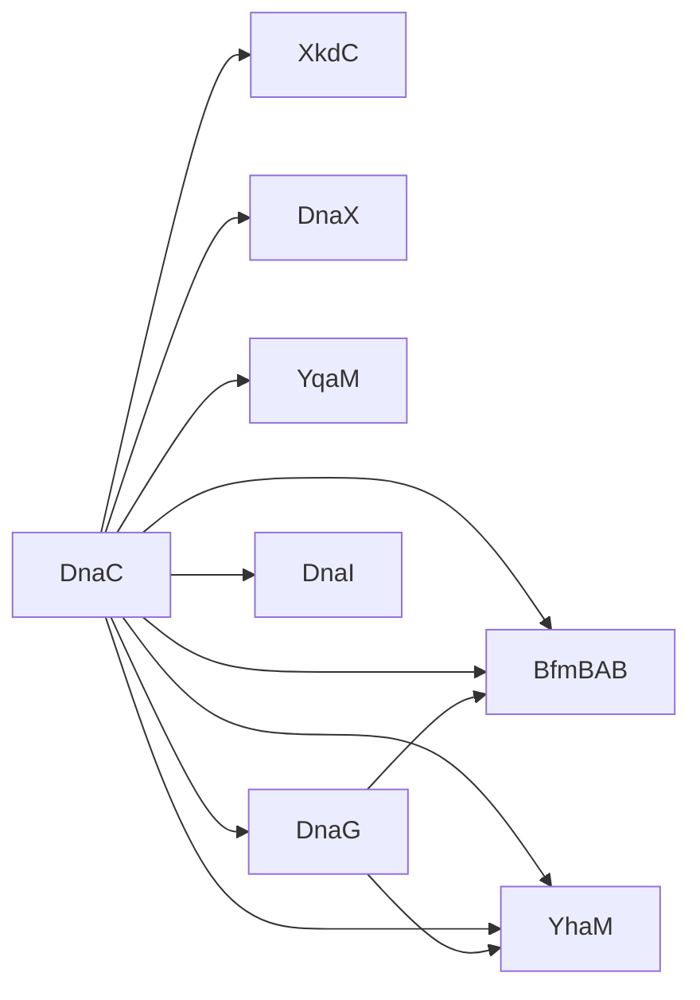
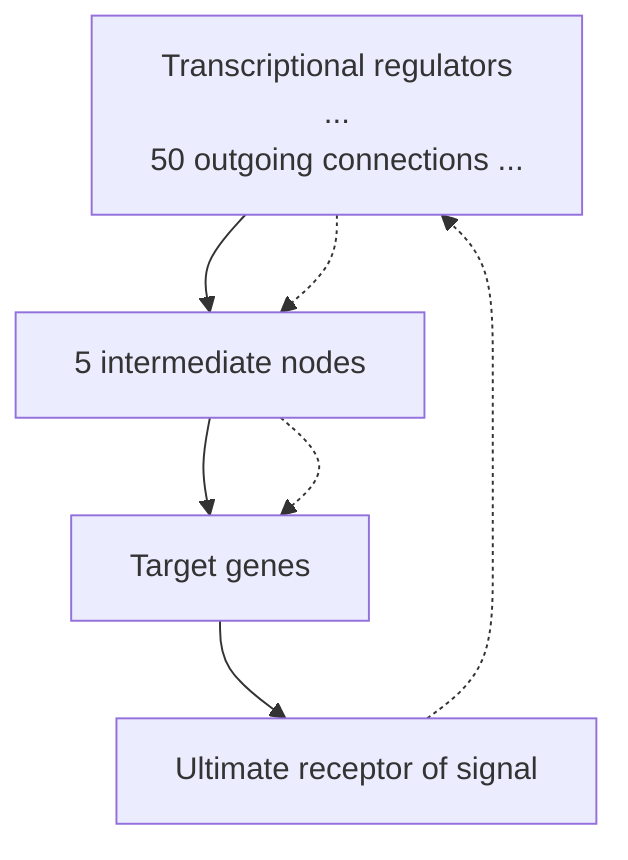
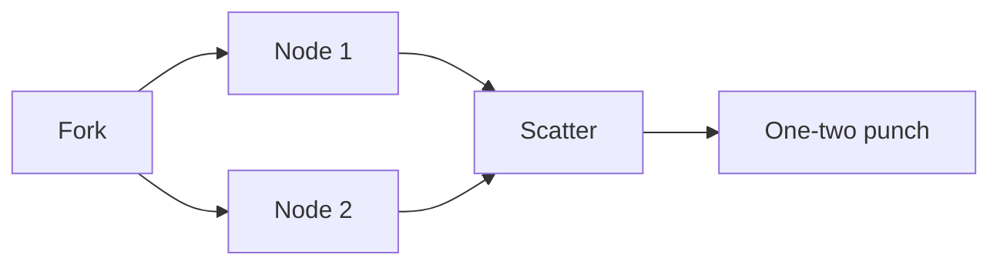

change in external conditions, or by the activity of another process.

Most experiments reveal only pairwise interactions. The challenges are to integrate pairwise interactions into a network and then to study the structure and dynamics of the system.

Many techniques detect physical interactions directly. These include:

• X-ray and NMR structure determinations can not only identify the components of the complex, but reveal how they interact, and whether conformational changes occur upon binding;
two-hybrid screening systems: transcriptional activators such as Gal4 contain a DNA-binding domain and an activation domain. Suppose these two domains are separated, and one test protein is fused to the DNA-binding domain and a second test protein is fused to the activation domain. Then a reporter protein will be expressed only if the components of the activator are brought together by formation of a complex between two test proteins. High-throughput methods allow parallel screening of a ‘bait’ protein for interaction with a large number of potential ‘prey proteins (see Table 9.3);

• chemical crosslinking fixes complexes so that they can be isolated. Subsequent proteolytic digestion and mass spectrometry permits identification of the components;

• co-immunoprecipitation: an antibody raised to a ‘bait’ protein binds the bait together with any other ‘prey’ proteins that interact with it. The interacting proteins can be purified and analysed, for instance by western blotting, or mass spectrometry;

• chromatin immunoprecipitation identifies DNA sequences that bind proteins. Treatment with formaldehyde crosslinks proteins and DNA, fixing the complexes that exist within a cell. Then, isolation of the chromatin and breaking the DNA into small fragments allows separation of proteins by binding to specific antibodies, carrying the DNA sequences along with them. Reversal of the crosslink followed by sequencing of the DNA identifies the specific DNA sequence to which each protein binds;

phage display: genes for a large number of proteins are individually fused to the gene for a phage coat protein, to create a population of phage each of which carries copies of one of the extra proteins exposed on its surface. Affinity purification against an immobilized ‘bait’ protein selects phage displaying potential ‘prey’ proteins. DNA extracted from the interacting phages reveals the amino acid sequences of these proteins;

surface plasmon resonance analyses the reflection of light from a gold surface to which a protein has been attached. The signal changes if a ligand binds to the immobilized protein (The method detects localized changes in the refractive index of the medium adjacent to the gold surface. This is related to the mass being immobilized.);

• fluorescence resonance energy transfer: if two proteins are tagged by different chromophores, transfer of excitation energy can be observed over distances up to about 60 Å.

Table 9.3 Protein interactions detected by two-hybrid screening systems\*

|  | H. pylori | S. cerevisiae | C. elegans | D. melanogaster |
| --- | --- | --- | --- | --- |
| Total proteome size | 1576 | 5585 | 33 469 | 13 843 |
| Proteins tested | 732 | 987/790 | 1415 | 4685 |
| Interactions detected | 1465 | 936/800 | 2131 | 4876 |

The two sets of numbers for yeast are the results of independent investigations.

\*From Aloy, P. and Russell, R.B. (2004). Ten thousand interactions for the molecular biologist. Nat. Biotechnol., **22**,

Other methods provide complementary information.

Domain recombination networks. Many eukaryotic proteins contain multiple domains. A feature of eukaryotic evolution is that a domain may appear in different proteins with different partners. In some cases proteins in a bacterial operon catalysing successive steps in a metabolic pathway are fused into a single multidomain protein in eukarya. The domains of the eukaryotic protein are individually homologous to the separate bacterial proteins. (Examples of proteins fused in eukarya and separate in prokaryotes are also known.) It is possible to create a network by defining an interaction between two protein domains whenever homologues of the two domains appear in the same protein. This is evidence for some functional link between the domains, even in species where the domains appear in separate proteins.
Coexpression patterns. Clustering of microarray data identifies proteins with common expression patterns. They may have the same tissue distribution, or be up- or downregulated in parallel in different physiological states. This is also suggestive evidence that they share some functional link. In the response of M. tuberculosis to isoniazid (Case Study 9.2), genes for the fatty acid synthesis complex are coordinately upregulated. They are on an operon-like gene cluster, and in fact these proteins do form a physical complex. On the other hand, alkyl hydroperoxidase (AHPC) is also upregulated in response to isoniazid. AHPC acts to relieve oxidative stress. There is no evidence that it physically interacts with the fatty acid synthesis complex, or that it mediates a metabolic transformation coupled to fatty acid synthesis. It is a second component of the response to isoniazid.
Phylogenetic distribution patterns. The phylogenetic profile of a protein is the set of organisms in which it and its homologues appear. Proteins in a common structural complex or pathway are functionally linked and expected to coevolve. Therefore proteins that share a phylogenetic profile are likely to have a functional link, or at least to have a common subcellular origin. There need be no sequence or structural similarity between the proteins that share a phylogenetic distribution pattern. A welcome feature of this method is that it derives information about the function of a protein from its relationship to nonhomologous proteins.

There are many ways to link proteins, including direct physical protein–protein interactions, twohybrid complementarity (see Table 9.3), domain recombination, coexpression patterns, and phylogenetic profiles. Each provides a basis for a protein interaction network. The networks formed by combining each set of interactions are different, although they overlap to a greater or lesser extent. They give different views of the kinds of relationships between proteins that exist in cells. It is possible to form a more comprehensive network by combining different types of interactions. For instance, the DIP database ([http://dip.doe-mbi.ucla.edu/](http://dip.doe-mbi.ucla.edu/)) is a curated collection of experimentally determined protein–protein interactions. It contains data about 44 349 interactions between 17 048 proteins from 107 organisms.

Plate XIV shows a portion of an interaction network of yeast proteins, based on sets of proteins that have been found together in solved structures.


Plate XIV A portion of an interaction network of yeast proteins. Part A (left) describes the interactions of individual proteins, and part B (right) shows the interactions within a subnetwork based on representations of different protein families, in different functional categories, linked in part A. This figure is based on structural data and modelling. Each relationship implies a physical interaction between the proteins. Some of the interactions involve stable complexes (for instance, RNA polymerase II); others involve transient complexes. (See Chapter 9.)

Picture courtesy P. Aloy and R.B. Russell.

## Web resource: Interaction databases

Intact: an open source molecular interaction database [http://www.ebi.ac.uk/intact/](http://www.ebi.ac.uk/intact/)

DIP: Database of Interacting Proteins

[http://dip.doe-mbi.ucla.edu/](http://dip.doe-mbi.ucla.edu/)

MIPS Comprehensive Yeast Genome Database

[http://mips.gsf.de/](http://mips.gsf.de/)

BIND: Biomolecular Interaction Network Database

[http://bind.ca/](http://bind.ca/)

MINT: a molecular interactions database

[http://cbm.bio.uniroma2.it/mint/](http://cbm.bio.uniroma2.it/mint/)

GRID: General Repository for Interaction Data Sets

[http://thebiogrid.org/](http://thebiogrid.org/)

Biogrid: a list of interaction databases

[http://wiki.thebiogrid.org/doku.php/tools](http://wiki.thebiogrid.org/doku.php/tools)

Visualization tools

[http://www.scowlp.org/scowlp/](http://www.scowlp.org/scowlp/)

A useful review article

Tuncbag, N., Kar, G., Keskin, O., Gursoy, A., and Nussinov, R. (2009). A survey of available tools and web

## CASE STUDY 9.3 Components of the primosome assembly in Bacillus subtilis

The first step in DNA replication in B. subtilis is the binding of initiator proteins to specific DNA sequences that serve as origins of replication. These then recruit a nucleoprotein complex called the primosome. A major component of the primosome is DnaC, a hexameric replicative helicase.3

It is believed that steps in the process include:

1. binding of an initiator protein, DnaA or PriA, to an appropriate single-stranded DNA sequence;
2. other proteins—DnaB, DnaC, and DnaI—are recruited. DnaB and DnaI are regulators of DnaC activity;
3. DnaC is loaded onto the single-stranded DNA, forming a hexameric assembly;
4. DnaG is recruited to prime DNA synthesis.

Scientists at the Institut National de la Récherche Agronomique created a database of the protein interaction network of B. subtilis.4

Figure 9.7 shows a small fragment of the network, limited to immediate neighbours of DnaC. The website is active: clicking on a node either adds the interaction partners of the node to the graph, or replaces the graph with another centred on the selected protein. By adding partners, one can look at more extended neighbourhoods of DnaC. By replacing the graph, one can walk through the network.


<details>
<summary>flowchart</summary>


</details>

Figure 9.7 DnaC and proteins that interact directly with it. Arrows linking partners point from ‘bait’ to ‘prey bidirectional arrows indicated cases where the interaction was detected in reciprocal experiments. In the original website the arrows are colour-coded according to the nature of the evidence for the interaction. Reproduced by permission.

## Regulatory networks

Regulatory networks pervade living processes. Control interactions are organized into linear or branched signal transduction cascades, and reticulated into control networks.

Any individual regulatory action requires (1) a stimulus, (2) transmission of a signal to a target, (3) a response, and (4) a ‘reset’ mechanism to restore the resting state (see Fig. 9.8). Many regulatory actions are mediated by protein–protein complexes. Transient complexes are common in regulation, as dissociation provides a natural reset mechanism.


<details>
<summary>flowchart</summary>

```mermaid
graph TD
  Input["Input impulse"] --> Sum((" ))
  ResetMechanism["Reset mechanism"] --> Sum
  Sum --> SignalTransmission["Signal transmission"]
  SignalTransmission --> OutputAction["Output action"]
  OutputAction --> Output["Output action"]
```
</details>

Figure 9.8 The elementary step in a regulatory network. An input impulse is received by a node, which transmits a signal to a downstream node, causing an output action. This is followed by reset of the upstream node to its inactive state. Combination of such elementary diagrams gives rise to the complex regulatory networks in biology.

Some stimuli arise from genetic programs. Some regulatory events are responses to current internal metabolite concentrations. Others originate outside the cell: a signal detected by surface receptors is transmitted across the membrane to an intracellular target.

Control may be exerted:

‘in the field’: by several mechanisms, such as: inhibitors, dimerization, ligand-induced conformational changes including but not limited to allosteric effects, GDP–GTP exchange or kinase-phosphorylase switches, and differential turnover rates;
• ‘at headquarters:’ through control over gene expression.

One signal can trigger many responses. Each response may be stimulatory (increasing an activity) or inhibitory (decreasing an activity). Transmission of signals may damp out stimuli or amplify them. There are ample opportunities for complexity, opportunities of which cells have taken extensive advantage.

G-protein-coupled receptors (GPCRs) illustrate the components of signal transduction. Recall that GPCRs contain seven transmembrane helices, with a binding site for triggering ligands on the extracellular side, and a binding site for the downstream recipient of the signal, a heterotrimeric G protein on the intracellular side.

G proteins consist of three subunits: $\mathbf { G } _ { \mathfrak { a } } , \mathbf { G } _ { \mathfrak { \beta } } ,$ and $\mathbf { G } _ { \gamma } , \mathbf { G } _ { \alpha }$ and $\mathbf { G } _ { \gamma }$ are anchored to the membrane. In the resting, inactive state, $\mathbf { G _ { a } }$ binds GDP. An activated GPCR binds to a specific G protein and catalyses GDP–GTP exchange in the $\mathbf { G _ { a } }$ subunit. This destabilizes the trimer, dissociating $\mathbf { G _ { a } }$

$$
\mathrm{G} _ {\alpha} (\mathrm{GDP}) \mathrm{G} _ {\beta} \mathrm{G} _ {\gamma} \rightleftharpoons \mathrm{G} _ {\alpha} (\mathrm{GTP}) + \mathrm{G} _ {\beta} \mathrm{G} _ {\gamma}
$$

The separated components, $\mathbf { G _ { a } }$ and $\mathbf { G } _ { \beta } \mathbf { G } _ { \gamma _ { 1 } }$ , activate downstream targets, such as adenylyl cyclase.

A single activated GPCR can interact successively with many G protein molecules, amplifying the signal. It is therefore essential to turn the signal off after it has had its effect. Mutations that render a GPCR constitutively active cause a number of diseases, the symptoms emerging from a war between the rogue receptor and the feedback mechanisms that are unequal to the task of restraining its effects. Different GPCRs have different mechanisms for restoring the resting state. Rhodopsin, for example, is inactivated by cleavage of the isomerized chromophore.

The activity of the heterotrimeric G proteins is turned off by the GTPase activity of $\mathbf { G } _ { \mathbf { a } } ,$ converting $\mathrm { G } _ { \mathfrak { q } } ( \mathrm { G T P } ) \rightarrow \mathrm { G } _ { \mathfrak { q } } ( \mathrm { G D P } ) . \mathrm { G } _ { \mathfrak { q } } ( \mathrm { G D P } )$ does not bind to its receptors, shutting down that pathway of signal transmission. Instead, $\mathrm { G _ { d } ( G D P ) }$ rebinds the $\mathbf { G } _ { \beta } \mathbf { G } _ { \gamma }$ subunits. This resets the system.

## Signal transduction and transcriptional control

The signal transduction network exerts control ‘in the field’ by a variety of mechanisms, including inhibitors, dimerization, ligand-induced conformational changes including but not limited to allosteric effects, GDP–GTP exchange or kinase-phosphorylase switches, and differential turnover rates. This component acts fast, on subsecond timescales. The transcriptional regulatory network exerts control ‘at headquarters’, through control over gene expression. This component is slower, acting on a timescale of minutes.

## General characteristics of all control pathways

• a single signal can trigger a single response or many responses;
• a single response can be controlled by a single signal or influenced by many signals;
• each response may be stimulatory (increasing an activity) or inhibitory (decreasing an activity);
• transmission of signals may damp out stimuli or amplify them.

## Structures of regulatory networks

Think of control, or regulatory networks, as assemblies of activities. Although mediated in part by physical assemblies of macromolecules—protein–protein and protein–nucleic acid complexes— regulatory networks:

1. tend to be unidirectional: a transcription activator may stimulate the expression of a metabolic enzyme, but the enzyme may not be involved directly in regulating the expression of the transcription factor;
2. have a logical component: it is not enough to describe the connectivity of a regulatory network. Any regulatory action may stimulate or repress the activity of its target. If two interactions combine to activate a target, activation may require both stimuli (logical ‘and’) or either stimulus may suffice (logical ‘or’);
3. produce dynamic patterns: signals may produce combinations of effects with specified time courses. Cell-cycle regulation is a classic example.

The structure of a regulatory network can be described by a graph in which edges indicate steps in pathways of control. Regulatory networks are directed graphs: the influence of vertex A on vertex B is expressed by a directed edge connecting A and B. An edge directed from vertex A to vertex B is called an outgoing connection from A and an incoming connection to B.


Conventionally, an arrow indicates a stimulatory interaction, and a T symbol indicates an inhibitory interaction. An edge connecting a vertex to itself indicates autoregulation. A doubleheaded arrow indicates reciprocal stimulation of two nodes; note that this is not the same as an undirected edge.

## Databases of regulatory networks

KEGG, which began as a database of metabolic pathways (See Chapter 8) is now also assembling regulatory networks ([http://www.genome.jp/kegg/pathway.html](http://www.genome.jp/kegg/pathway.html)).

The website of a project based at the San Diego Supercomputer Center, with the goal of providing an integrated research environment for investigation and analysis of molecular mechanisms, including but not limited to networks: [http://biologicalnetworks.net](http://biologicalnetworks.net).

Tools for network visualization are available at: [http://www.genmapp.org/](http://www.genmapp.org/)

## Structural biology of regulatory networks

Any regulatory interaction involves one or more proteins and nucleic acids. Examples of regulatory mechanisms include a protein binding a ligand, undergoing chemical modification such as phosphorylation/dephosphorylation, changing conformation, or all of the above. X-ray crystallography and NMR spectroscopy have helped us to elucidate some of the general mechanisms underlying control processes.

Many molecules involved in regulation are multidomain proteins. A domain is a segment of a protein that has independent stability and can appear in conjunction with different partners through evolutionary recombination. A multidomain protein contains a linear sequence of domains each of which is relatively free to interact with other molecules. Assembly of a protein from domains therefore permits the joining into one molecule of a set of functions. ‘Mixing and matching’ of domains gives evolution access to a wide variety of functional combinations. (See Figures 2.4 and 8.8.)

One important feature of regulatory proteins is recognition. An interaction domain is a part of a protein that confers specificity in ligation of a partner. Regulatory proteins contain a limited number of types of interaction domains, which have diverged to form large families with different individual specificities. For instance, the human genome contains 115 SH2 domains, and 253 SH3 domains. (Src-homology domains SH2 and SH3 are named for their homologies to domains of the src family of cytoplasmic tyrosine kinases.) Many individual interaction domains even interact with different partners as they participate in successive steps of a control cascade. Initial interactions may also trigger recruitment of additional proteins to form large regulatory complexes.

Many interaction domains are sensitive to the state of post-translational modification of their ligands, for instance binding preferentially to states of a ligand in which specific tyrosines, serines, or threonines are phosphorylated. These and other post-translational modifications function as switches, turning on or interrupting/resetting a signalling cascade.

Protein–protein complex formation allows a cell to detect a signal molecule in the external medium, and report its arrival to the cell interior, without the signal molecule itself ever needing to enter the cell. Many receptors use an ingenious dimerization mechanism: the receptor has external, transmembrane, and internal segments. An external ligand binds to two molecules of receptor. The juxtaposition of the external portions brings the internal portions together also, because they are tethered to the external regions by the transmembrane segments. Interaction between the interior segments triggers a conformational change that activates a process such as phosphorylation of a protein. This may initiate a signal transduction cascade that can amplify the original stimulus.

Figure 9.9 shows types of interaction domain complexes with ligands, including binding of peptides (which may be attached to proteins), protein–protein complexes, extracellular dimer formation upon binding a hormone, and a protein–nucleic acid complex.


Figure 9.9 Types of interaction involved in regulatory signalling. (a) Binding of a peptide by an SH3 domain [1CKA]. SH3 domains are common constituents of regulatory proteins. Functions of SH3 domains include signal transduction, protein and vesicle trafficking, cytoskeletal organization, cell polarization, and organelle biosynthesis. (b) Domain–domain interaction: PDZ domains in syntrophin (black) and neuronal nitric oxide synthase (green) [1QAV]. (c) Binding of a molecule of human growth hormone (green) to two molecules of the external segment of the human growth hormone receptor (black) (d) The homeodomain antennapedia–DNA complex [9ANT]. Homeodomains are highly conserved eukaryotic proteins, active in control of animal development. They regulate homeotic genes; that is, genes that specify locations of body parts. Antennapedia is a Drosophila protein responsible for initiating leg development. The earliest mutations found in antennapedia produced ectopic legs at the positions of, and instead of, antennae. Loss-of-function mutations convert legs into antennae. As with many DNA-binding proteins, an α-helix binds in the major groove of the DNA.

A more extensive album of protein–nucleic acid complexes appears in Introduction to Genomics (Lesk, 2011).

Understanding the mechanism of regulation will require the structures of large protein and protein– nucleic acid complexes. The sizes of many of the large complexes challenges the limits of NMR spectroscopy. X-ray diffraction has had major successes, but is at the mercy of being able to grow adequate crystals. Cryo-electron microscopy is another approach to structure determination of larger assemblies.

Electron microscopy of specimens at liquid nitrogen temperatures has revealed structures in the range $M_{\mathrm{r}} = 500\ 000$ to $4   \times   1 0 ^ { 8 }$ , 100–1500 Å in diameter. These results do not achieve atomic resolution. However, if the structures of individual components of a complex are known to high resolution from X-ray diffraction or NMR spectroscopy, the component structures can be fitted into the low-resolution structure determined by electron microscopy, to produce a detailed model of the entire assembly. (See Lesk, 2010, p. 119 ff.)

A limitation that remains is the difficulty of determining structures of transient complexes, or of systems showing substantial conformational changes upon assembly. The situation is shared with much of current molecular biology: we are coming to grips with static structures of increasing size, but awaiting the development of methods for treating the dynamics.

## The genetic switch of bacteriophage λ

Two classic control systems in biology are well understood at the molecular level: the E. coli Lac operon, and the lytic/lysogenic switch in bacteriophage λ. These are also the simplest examples of developmental pathways.

• The Lac operon is a set of genes appearing in tandem on the genome of E. coli that are jointly regulated in response to the presence of lactose and glucose in the medium. (A discussion of the lac operon appears in Lesk, 2011, chapter 7.)
• Phage λ can adopt an active or passive lifestyle, effected by alternative gene expression profiles. It is probably the simplest form of life that makes a decision.

λ is a bacteriophage, a virus that infects E. coli (see Fig. 9.10). The mature virion contains an icosahedral head that encapsulates the viral DNA, and a tail, which recognizes and attaches to the host, and functions as a syringe to inject the viral DNA. The virion contains ≈15 different proteins. The genome is a single molecule of double-stranded DNA 58 402 bp long, containing 50 genes, organized into seven operons. As in bacteria, an operon is a set of successive genes under coordinated transcriptional control.


<details>
<summary>natural_image</summary>

Microscopic view of rod-shaped bacterial cells with visible internal structures (no text or labels)
</details>

Figure 9.10 Bacteriophage λ. Bar at lower left indicates 100 nm.

Picture courtesy Professor R.B. Inman, University of Wisconsin. From ICTVdB – The Universal Virus Database, version 4, [http://www.ncbi.nlm.nih.gov/ICTVdb/ICTVdB/](http://www.ncbi.nlm.nih.gov/ICTVdb/ICTVdB/)

After attaching to an E. coli cell and injecting its DNA, the phage may follow either of two paths:

• in the lytic state, replication and intracellular reconstitution of daughter phage particles is followed, in about 45 min, by rupture of the host cell and release of the ≈100 progeny. The expression patterns of several distinct sets of genes are under control of a developmental programme during this process;
in the lysogenic state, the phage DNA becomes integrated into the bacterial genome, to form a prophage. Only one phage gene is expressed: the cI protein, which acts as a repressor to inhibit the expression of phage genes responsible for initiating viral multiplication, thereby maintaining the lysogenic state.

Here we shall focus on the subset of the λ regulatory network involved in the switch between lytic and lysogenic states.

Given a healthy host population, the lytic state perpetuates itself as progeny viruses infect additional bacterial cells.

The lysogenic state of the phage is stable under normal conditions. The viral DNA, integrated into the bacterial genome, replicates with the bacterial DNA. This creates a population of infected bacteria. Although the virus does not reproduce completely to form intact progeny phage, the viral DNA is replicated, as a passenger in the dividing cells.

Sleeping Beauty can be awakened, by damage, such as UV radiation, that threatens the host cell. The virus resumes active replication to escape conditions that endanger its host. Of course, this ensures that the host cell will not survive.

The strategy of the virus is to take advantage of a thriving host population to reproduce lytically, but to adopt lysogeny to get through ‘lean’ periods.

M. Ptashne and colleagues, and a large community of virologists, have clarified the molecular biology of phage λ in very great detail. Here we focus on the logic of the switch.

## What are the characteristics of the switch that must be implemented by DNA–protein interactions?

• The states of the switch must be mutually incompatible. Each state must repress the other.
• Under constant conditions each state must be self-maintaining. In other words, not only is the choice of one or the other commitment enforced; once selected, the chosen state persists until conditions change.
• In response to changing conditions it must be possible to move from one state to the other. We expect to find a simple trigger that leads to a complex cascade of consequences.

To implement this logic, the system has the following variables at its disposal.

• DNA sequences: in particular the sequences at sites of promotors and operators (see Box 9.4).

## Box 9.4 Sites of protein–DNA interactions in transcription control

A promoter is a site on DNA—typically ≈60 bp in prokaryotes—near the beginning of a gene. It binds RNA polymerase, required for initiation of transcription. RNA polymerase is a bacterial enzyme. However, part of the developmental programme of lytic phage λ takes place through the modification of the bacterial polymerase by viral proteins, to alter its response to termination signals. The result is to extend the region of transcription of viral genes in successive stages of the lytic cycle.

An operator is a site on DNA that binds regulatory proteins. A repressor, or negative regulator, blocks the site where RNA polymerase binds to the operator, preventing transcription. A positive regulator interacts with RNA polymerase to enhance its binding affinity to a promoter.

• Local flexibility in DNA structure: the ability of the DNA to form loops, bridged by interacting proteins bound to sites distant in the DNA sequence.
• DNA–protein interactions: relative affinities of different proteins for different sites, including RNA polymerase and regulatory proteins.
Interactions among protein–DNA complexes:
• positive cooperativity: enhancement of binding by stabilizing protein–protein interactions on the DNA;
negative cooperativity (or anticooperativity): especially the blocking, by binding of one protein, of the binding site of another.

Which proteins will bind DNA, and where, depends on the:

• intrinsic affinity of different sites for different proteins (a DNA-binding protein will choose the available site to which it has the highest affinity);
• cooperativity of protein binding;
• competition of proteins for sites.

Availability of a site may be denied by occlusion, caused by binding of another protein at or near the site. Conversely, favourable interaction with another protein bound at a neighbouring site may enhance affinity (cooperative binding). These effects may involve interactions among regulatory proteins, or of regulatory proteins with RNA polymerase (Table 9.4).

Table 9.4

| Protein(s) | Relative affinity |
| --- | --- |
| RNA polymerase itself | cro promoter > cI promoter |
| cro | OR3 > OR2 ≈ OR1 |
| cI | OR1 ≈ OR2 > OR3 |
| 2 × cI | OR1 + OR2 high, cooperative binding |
| 2 × cro | Non-cooperative binding |
| cro + RNA polymerase | cro promoter > 0,cl promoter=0 |
| cI + RNA polymerase | cI promoter > 0,cro promoter=0 |
| High concentration of cI + RNA polymerase | cI promoter = 0,cro promoter=0 |

## The materials

## 1. Proteins

• RNA polymerase, the enzyme that transcribes DNA into RNA. RNA polymerase binds to available promoter sites.
• cro, a transcription regulator that inhibits synthesis of cI.
• cI, or repressor, a transcription regulator that inhibits expression of cro, and regulates its own expression.

## 2. Sites on the phage DNA

• The accessibility of two adjacent promoters control the transcription of cI and cro.
Three operator sites, one within each promoter and a third overlapping both, that are binding sites for cro and cI. Figure 9.11 shows (a) the layout of promoter and operator sites on the DNA and (b, c) the two mutually exclusive states in which cro or cI are expressed.


Figure 9.11 (a) Region of phage λ genome containing promoters for cro and cI. (b) In the lytic state cro is expressed and cI is off. (c) In the lysogenic state, cro is off and cI (encoding repressor) is expressed. OR1, OR2, and OR3 are operator sites, binding sites for regulatory proteins. Each is about 15–20 bp long, or roughly two turns of DNA. OR1 overlaps the cro promoter, OR3 overlaps the cI promotor, and OR2 overlaps both. The relative affinities of cro and cI for the operator sites:

| Protein | Relative affinity | Effect |
| --- | --- | --- |
| cro | OR3 > OR1 = OR2 | Binding of cro to OR3 prevents cI synthesis |
| CI | OR1 ≈ OR2 > OR3 | Binding of 2 × cI to OR1/OR2 prevents cro synthesis |

create alternative states:

| State | cro | cI |
| --- | --- | --- |
| Lytic | on | off |
| Lysogenic | off | on |

The operation of the system depends on the relative values of the affinities of different operator sites for different proteins and for different combinations of proteins

The cI concentration— ≈ 100 molecules per cell—is high enough to prevent lytic infection by phage λ of an E. coli cell already containing lysogenized λ. This scheme—in particular the relative affinities of cI and cro for the different operator sites—explains the configurations of Figure 9.11b and c. The mutual incompatibility of the two states results from binding of transcriptional regulatory proteins to the operators, repressing one of the two genes and enhancing expression of the other. Binding of cI, preferentially and cooperatively to OR1 and OR2, turns off transcription of cro and, through favourable interaction with RNA polymerase on the DNA, stimulates transcription of cI. At higher concentrations of cI, after titration of the OR1 and OR2 sites, cI will bind to OR3, turning off cI transcription. This acts to regulate the ambient cI concentration.

The diagram shows the logical relationships between these two components. High concentrations of cro inhibit its further expression. The combination of both stimulatory and repressive links from cI to itself signifies the regulation of cI concentration: the autostimulatory link is active at low cI concentration and the autorepressive link is active at high cI concentration. The phage protein cII also activates expression of cI but using a different promoter.


cI binds as a tetramer to OR1/OR2. There is an additional set of promoters and operators OL1, OL2, and OL3 ≈2.3 kb from OR1, OR2, and OR3. A tetramer of cI, bound to OR1/OR2, and another tetramer of cI bound to OL1/OL2 can form an octamer, enhancing the affinity for DNA. To do this the DNA must loop around to allow apposition of the two tetramers.

## How to 'throw' the switch

To change from the lysogenic to the lytic state: UV irradiation or other hindrance to DNA replication causes bacterial protein RecA to cleave cI. This frees the OR1/OR2 sites to bind RNA polymerase, to express cro. cro has its highest affinity for the OR3 site, turning off synthesis of cI. As the concentration of cro builds up, it binds also to OR1 and OR2, turning off its own expression. Expression of cro also initiates a cascade of events that effect the transition to the lytic state.
• The switch from lytic to lysogenic state can occur only upon infection, of necessity by a phage that has emerged from a lytic event. The phage may either remain lytic (the default) or become lysogenic.

The choice appears to be determined primarily by the concentration of a phage protein cII. cII activates transcription of:

• cI, the repressor (but via a different operator than that shown in Fig. 9.11);
• int, a protein required for integration of phage DNA into bacterial genome;
• an antisense RNA that prevents the viral modification of bacterial RNA polymerase. This shuts down the lytic programme.

The transition to lysogeny requires build up of concentration of cII. The concentrations of cII and cIII appear to depend primarily on the dose of viral DNA. About 1% of cells infected by one virus become lysogenic. About 50% of cells infected simultaneously by two or more viruses become lysogenic.

A high multiplicity of infection implies a low ratio of bacteria to phage. For the phage to remain lytic under these conditions would threaten to deplete the population of bacteria, to the point where progeny phase could not find hosts to infect. Similar considerations rationalize the greater frequency of lysogenation if the host cell is starved.

A bacterial protease HflB destroys cII, and a viral protein cIII inhibits HflB. Readers may wonder why the cell would synthesize a molecule that promotes lysis, and why the phage would synthesize one that promotes lysogeny. Both the bacterium and the phage appear to be acting to reduce the number of their own immediate progeny. However, there may be long-term benefits for the populations as a whole. In a population of lysogenized bacteria occasionally a cell spontaneously goes lytic. The progeny phage do not damage the bacterial population—remember that lysogeny confers ‘immunity’ to phage infection—but may protect the bacterial population against competition with foreign invading susceptible bacteria. Sociobiologists may see this as an example of altruism.

It is interesting that the lytic/lysogenic choice of phage λ can be extracted as a fairly simple subset of a far more complicated regulatory network.

## The genetic regulatory network of Saccharomyces cerevisiae

A classic study of transcription regulation in yeast treated a network containing 3562 genes, corresponding to approximately half the known proteome of S. cerevisiae.<sup>5</sup> The genes included 142 that encode transcription regulators and 3420 that encode target genes exclusive of transcription regulators. There are 7074 known regulatory interactions among these genes, including effects of regulators on one another, and of regulators on nonregulatory targets.

Analysis of the overall network architecture reveals the following.

• The distribution of incoming connections to target genes has a mean value of 2.1 and is distributed exponentially. Most target genes receive direct input from about two transcriptional regulators. The probability that a gene is controlled by k transcription regulators, $k = 1 , 2 , \ldots ,$ is proportional to $e ^ { - a k } ,$ , with $\mathbf { q } = 0 . 8$
The distribution of outgoing connections has a mean value of 49.8, and obeys a power law. The probability that a given transcriptional regulator controls k genes is proportional to $k ^ { - \beta } ,$ with $\beta =$ 0.6. Power-law behaviour characterizes topologies in which a few nodes—the ‘hubs’—have many connections, and many nodes have few. In regulatory networks, hubs tend to be fairly far upstream, forming important foci of regulation with far-reaching control.
• The average number of intermediate nodes in a minimal path between a transcriptional regulator and a target gene is 4.7. The maximal number of intermediate nodes in a path between two nodes is 12.
The clustering coefficient of a node is a measure of the degree of local connectivity within a network. If all neighbours of a node are connected to one another, the clustering coefficient of the node = 1. If no pair of neighbours of a node is connected to each other, the clustering coefficient of the node = 0. The mean clustering coefficient, averaged over all nodes, is a measure of the overall density of the network. For the yeast transcriptional regulatory network, the mean clustering coefficient is 0.11.

Figure 9.12 is a cartoon-like sketch of a fragment of such a network, indicating rather loosely some of its general features. Nodes are divided into transcriptional regulators, shown as circles, and target genes, shown as squares. Target genes are distinguished by having no output connections. There is extensive interregulation among the transcription factors, to a much higher density of interconnections than can intelligibly be shown in this diagram. Think of a seething broth of transcription factors, within the shaded area, sending out signals to target genes. The shaded area indicates only the logical clustering of the transcriptional regulators. There is no suggestion about physical localization; indeed, transcriptional regulators interact with DNA, and almost never interact physically with the proteins, the expression of which they control.


<details>
<summary>flowchart</summary>


</details>

**Figure 9.12** Simplified sketch illustrating some features of an ‘average’ segment of the pathways in the yeast interaction network. Transcriptional regulators appear as circles. Target genes appear as squares. A transcriptional regulator typically has direct influence over about 50 genes, indicated by multiple connections from the filled black circle to the circles on the line below it. Roughly one in 10 of the neighbours of any node is connected to another neighbour, indicated by the horizontal arrow on the second row. The ultimate receptor of the signal lies at the end of a pathway typically containing about five intermediate nodes (shown in black). This ultimate target gene receives on the average about two inputs. This diagram shows only a small fragment of a network that is in fact quite dense.

Each transcriptional regulator directly influences approximately 50 genes on average, although, as with other ‘small-world’ networks following power-law distributions of connectivities, the distribution is very skewed: some ‘hubs’ have very many output connections, but most nodes have very few. A few of the interregulatory connections between transcription factors are shown in green in the figure. In about 10% of the cases, two neighbours of the same transcription factor interact with each other. A pathway from one regulator (filled black circle) to one ultimate receptor (filled black square), through five intermediate nodes, is shown in black. The intermediate nodes are other transcriptional regulators, connected both within the path drawn in black, and off this path. Even the transcription factor used as the origin of the path receives input connections. Although it is possible to identify target genes from the absence of outgoing connections, it is more difficult to identify ultimate initators of signal cascades.

The ultimate receptor is a target gene that receives regulatory input but itself has no output links. This target is expected to receive (on average) a second control input. The black target node receives input via a black arrow, along the selected path, and via a green arrow suggesting the second input. Of course the second input may arrive via a path that shares common nodes with the black path, including other routes from the filled black circle.

The dense forest of additional pathways, from which this fragment is extracted, is not shown. Some ‘back-of-the-envelope’ calculations: There are ≈3500 nodes, each receiving on the average of 2 input connections. There are ≈140 transcription factors, making an average of 50 output connections. The number of input connections must equal the number of output connections, and indeed 3500 × 2 = 140 × 50 = 7000.

Given the complexity, it is difficult to illustrate larger segments of the network in more detail than the simplified version appearing in Figure 9.12. However, dissections of yeast and other regulatory networks have defined certain recurrent motifs that serve as building blocks. These might be considered the ‘secondary structures’ of network architectures. (See Box 9.5.)

The high ratio of interactions to transcription regulators implies that we cannot expect to associate individual regulatory molecules with single, dedicated, activities (as we can, for the most part, with metabolic enzymes). Instead, the activity of the network involves the coordinated activities of many individual regulatory molecules.

## Adaptability of the yeast regulatory network

The yeast regulatory network achieves versatility and responsiveness by reconfiguring its activities. This is seen by comparing the changes in the activities of networks controlling yeast gene expression patterns in different physiological regimes: cell cycle, sporulation, diauxic shift (the change from anaerobic

## Box 9.5 Common motifs in biological control networks

Within the high complexity of typical regulatory networks, certain common patterns appear frequently. In the architecture of networks, these form building blocks that contribute to higher levels of organization. Shen-Orr, Milo, Mangan, and Alon\* have described examples, including the fork, the scatter, and the ‘one-two punch’ (a phrase from the boxing ring):


<details>
<summary>flowchart</summary>


</details>

The fork, also called the single-input motif, transmits a single incoming signal to two outputs. Successive forks, or forks with higher branching degrees, are an effective way to activate large sets of genes from a single impulse. Generalizations of the binary fork include more downstream genes under common control (more tines to the fork), and autoregulation of the control node. Forks can achieve general mobilization. Moreover, if the regulatory genes have different thresholds for activation, the dynamics of building up the signal can produce a temporal pattern of successive initiation of the expression of different genes.

The scatter configuration, also called the multiple input motif, can function as a logical ‘or’ operation: both downstream targets become active if either of the input impulses is active. Generalizations of the square scatter pattern shown may contain different numbers of nodes on both layers. Note that scatter patterns are superpositions of forks.

The ‘one-two punch’, also called the ‘feed-forward loop’, affects the output both directly through the vertical link; and indirectly and subsequently through the intermediate link. This motif can show interesting temporal behaviour if activation of the target requires simultaneous input from both direct and indirect paths (logical ‘and’). Because build up of the intermediate requires time, the direct signal will arrive before the indirect one. Therefore a short pulsed input to the complex will not activate the output: by the time the indirect signal builds up, the direct signal is no longer active. The system can thereby filter out transient stimuli in noisy inputs. Conversely, the active state of the system can shut down quickly upon withdrawal of the external trigger.

\*Shen-Orr, S.S., Milo, R., Mangan, S., and Alon, U. (2002). Network motifs in the transcriptional regulation network of Escherichia coli. Nat. Genet., **31**, 64–68.

fermentative metabolism to aerobic respiration as $\mathbf { O } _ { 2 }$ levels increase), DNA damage, and stress response. Cell cycling and sporulation involve the unfolding of endogenous gene expression programs; the others are responses to environmental changes.

Different states are characterized both by similarities and differences in gene expression patterns, and by the components of the regulatory network that are active. There is considerable shift in expression of target genes. About a quarter of the target genes are specialized to individual physiological states. That is, of the total of 3420 target genes, the expression of almost half (1514) do not show major changes in the different states. Of the 1906 that show altered expression levels in different states, almost half of them (803) are specialized to a single physiological state.

In contrast, different states show much more overlap in the usage of transcriptional regulators. For instance, for cell-cycle control, 280 target genes (8%) are differentially regulated by 70 (49%) of the transcription regulators. Clearly there is a much greater degree of specialization in the target genes. In general, half the transcription factors are active in at least three out of the five physiological regimes. However, in contrast with the high overlap of usage of the transcriptional regulators (the nodes), the overlap of the activities within the network (the connections) is relatively low. Different components of the interaction network organize the different gene expression patterns in different states.

Whereas different physiological states are characterized by substitutions of different sets of synthesized proteins, the regulatory network uses much of the same structure but reconfigures the pattern of activity. Think of the transcription factors as ‘hardware’ and the connections as