# 1: Probability and counting

原始 PDF 第 18–61 页。

# Probability and counting

Luck. Coincidence. Randomness. Uncertainty. Risk. Doubt. Fortune. Chance. You’ve probably heard these words countless times, but chances are that they were used in a vague, casual way. Unfortunately, despite its ubiquity in science and everyday life, probability can be deeply counterintuitive. If we rely on intuitions of doubtful validity, we run a serious risk of making inaccurate predictions or overconfident decisions. The goal of this book is to introduce probability as a logical framework for quantifying uncertainty and randomness in a principled way. We’ll also aim to strengthen intuition, both when our initial guesses coincide with logical reasoning and when we’re not so lucky.

## 1.1 Why study probability?

Mathematics is the logic of certainty; probability is the logic of uncertainty. Probability is extremely useful in a wide variety of fields, since it provides tools for understanding and explaining variation, separating signal from noise, and modeling complex phenomena. To give just a small sample from a continually growing list of applications:

1. Statistics: Probability is the foundation and language for statistics, enabling many powerful methods for using data to learn about the world.
2. Physics: Einstein famously said “God does not play dice with the universe”, but current understanding of quantum physics heavily involves probability at the most fundamental level of nature. Statistical mechanics is another major branch of physics that is built on probability.
3. Biology: Genetics is deeply intertwined with probability, both in the inheritance of genes and in modeling random mutations.
4. Computer science: Randomized algorithms make random choices while they are run, and in many important applications they are simpler and more efficient than any currently known deterministic alternatives. Probability also plays an essential role in studying the performance of algorithms, and in machine learning and artificial intelligence.

1

---

2

Introduction to Probability

5. Meteorology: Weather forecasts are (or should be) computed and expressed in terms of probability.

6. Gambling: Many of the earliest investigations of probability were aimed at answering questions about gambling and games of chance.

7. Finance: At the risk of redundancy with the previous example, it should be pointed out that probability is central in quantitative finance. Modeling stock prices over time and determining “fair” prices for financial instruments are based heavily on probability.

8. Political science: In recent years, political science has become more and more quantitative and statistical, with applications such as analyzing surveys of public opinion, assessing gerrymandering, and predicting elections.

9. Medicine: The development of randomized clinical trials, in which patients are randomly assigned to receive treatment or placebo, has transformed medical research in recent years. As the biostatistician David Harrington remarked, “Some have conjectured that it could be the most significant advance in scientific medicine in the twentieth century. . . . In one of the delightful ironies of modern science, the randomized trial ‘adjusts’ for both observed and unobserved heterogeneity in a controlled experiment by introducing chance variation into the study design.” [16]

10. Life: Life is uncertain, and probability is the logic of uncertainty. While it isn’t practical to carry out a formal probability calculation for every decision made in life, thinking hard about probability can help us avert some common fallacies, shed light on coincidences, and make better predictions.

Probability provides procedures for principled problem-solving, but it can also produce pitfalls and paradoxes. For example, we’ll see in this chapter that even Gottfried Wilhelm von Leibniz and Sir Isaac Newton, the two people who independently discovered calculus in the 17th century, were not immune to basic errors in probability. Throughout this book, we will use the following strategies to help avoid potential pitfalls.

1. Simulation: A beautiful aspect of probability is that it is often possible to study problems via simulation. Rather than endlessly debating an answer with someone who disagrees with you, you can run a simulation and see empirically who is right. Each chapter in this book ends with a section that gives examples of how to do calculations and simulations in R, a free statistical computing environment.

2. Biohazards: Studying common mistakes is important for gaining a stronger understanding of what is and is not valid reasoning in probability. In this book, common mistakes are called biohazards and are denoted by h (since making such mistakes can be hazardous to one’s health!).

---

Probability and counting

3

3. Sanity checks: After solving a problem one way, we will often try to solve the same problem in a different way or to examine whether our answer makes sense in simple and extreme cases.

## 1.2 Sample spaces and Pebble World

The mathematical framework for probability is built around sets. Imagine that an experiment is performed, resulting in one out of a set of possible outcomes. Before the experiment is performed, it is unknown which outcome will be the result; after, the result “crystallizes” into the actual outcome.

Definition 1.2.1 (Sample space and event). The sample space S of an experiment is the set of all possible outcomes of the experiment. An event A is a subset of the sample space S, and we say that A occurred if the actual outcome is in A.

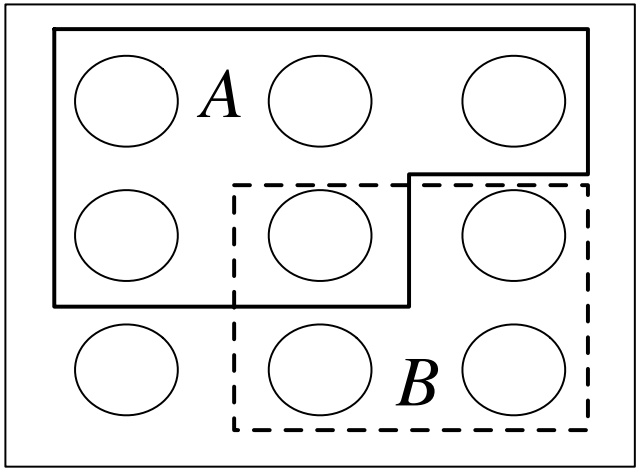

<details>
<summary>text_image</summary>

A
B
</details>

## FIGURE 1.1

A sample space as Pebble World, with two events A and B spotlighted.

The sample space of an experiment can be finite, countably infinite, or uncountably infinite (see Section A.1.5 of the math appendix for an explanation of countable and uncountable sets). When the sample space is finite, we can visualize it as Pebble World, as shown in Figure 1.1. Each pebble represents an outcome, and an event is a set of pebbles.

Performing the experiment amounts to randomly selecting one pebble. If all the pebbles are of the same mass, all the pebbles are equally likely to be chosen. This special case is the topic of the next two sections. In Section 1.6, we give a general definition of probability that allows the pebbles to differ in mass.

Set theory is very useful in probability, since it provides a rich language for express-

---

4

Introduction to Probability

ing and working with events; Section A.1 of the math appendix provides a review of set theory. Set operations, especially unions, intersections, and complements, make it easy to build new events in terms of already-defined events. These concepts also let us express an event in more than one way; often, one expression for an event is much easier to work with than another expression for the same event.

For example, let S be the sample space of an experiment and let A, $B \subseteq S$ be events. Then the union $A \cup B$ is the event that occurs if and only if at least one of A, B occurs, the intersection $A \cap B$ is the event that occurs if and only if both A and B occur, and the complement $A ^ { c }$ is the event that occurs if and only if A does not occur. We also have De Morgan’s laws:

$$
(A \cup B) ^ {c} = A ^ {c} \cap B ^ {c} \text {and} (A \cap B) ^ {c} = A ^ {c} \cup B ^ {c},
$$

since saying that it is not the case that at least one of A and B occur is the same as saying that A does not occur and B does not occur, and saying that it is not the case that both occur is the same as saying that at least one does not occur. Analogous results hold for unions and intersections of more than two events.

In the example shown in Figure 1.1, A is a set of 5 pebbles, B is a set of 4 pebbles, $A \cup B$ consists of the 8 pebbles in A or B (including the pebble that is in both), $A \cap B$ consists of the pebble that is in both A and $B ,$ and $A ^ { c }$ consists of the 4 pebbles that are not in A.

The notion of sample space is very general and abstract, so it is important to have some concrete examples in mind.

Example 1.2.2 (Coin flips). A coin is flipped 10 times. Writing Heads as H and Tails as $T ,$ a possible outcome (pebble) is HHHTHHT T HT, and the sample space is the set of all possible strings of length 10 of H’s and $T ^ { \prime } \mathrm { s }$ . We can (and will) encode H as 1 and $T$ as 0, so that an outcome is a sequence $( s _ { 1 } , \ldots , s _ { 1 0 } )$ with $s _ { j } \in \{ 0 , 1 \}$ and the sample space is the set of all such sequences. Now let’s look at some events:

1. Let $A _ { 1 }$ be the event that the first $\mathrm { f l i p }$ is Heads. As a set,

$$
A _ {1} = \{(1, s _ {2}, \dots , s _ {1 0}): s _ {j} \in \{0, 1 \} \text {for} 2 \leq j \leq 1 0 \}.
$$

This is a subset of the sample space, so it is indeed an event; saying that $A _ { 1 }$ occurs is the same thing as saying that the first flip is Heads. Similarly, let $A _ { j }$ be the event that the jth flip is Heads for $j = 2 , 3 , \ldots , 1 0$

2. Let B be the event that at least one flip was Heads. As a set,

$$
B = \bigcup_ {j = 1} ^ {1 0} A _ {j}.
$$

3. Let $C$ be the event that all the flips were Heads. As a set,

$$
C = \bigcap_ {j = 1} ^ {1 0} A _ {j}.
$$

---

Probability and counting

5

4. Let D be the event that there were at least two consecutive Heads. As a set,

$$
D = \bigcup_ {j = 1} ^ {9} (A _ {j} \cap A _ {j + 1}).
$$

Example 1.2.3 (Pick a card, any card). Pick a card from a standard deck of 52 cards. The sample space S is the set of all 52 cards (so there are 52 pebbles, one for each card). Consider the following four events:

• A: card is an ace.
• B: card has a black suit.
• D: card is a diamond.
• H: card is a heart.

As a set, H consists of 13 cards:

{Ace of Hearts, Two of Hearts, . . . , King of Hearts}.

We can create various other events in terms of the events A, B, D, and H. Unions, intersections, and complements are especially useful for this. For example:

$A \cap H$ is the event that the card is the Ace of Hearts.
$A \cap B$ is the event {Ace of Spades, Ace of Clubs}.
$A \cup D \cup H$ is the event that the card is red or an ace.
$( A \cup B ) ^ { c } = A ^ { c } \cap B ^ { c }$ is the event that the card is a red non-ace.

Also, note that $( D \cup H ) ^ { c } = D ^ { c } \cap H ^ { c } = B ,$ so B can be expressed in terms of D and H. On the other hand, the event that the card is a spade can’t be written in terms of A, B, D, H since none of them are fine-grained enough to be able to distinguish between spades and clubs.

There are many other events that could be defined using this sample space. In fact, the counting methods introduced later in this chapter show that there are $2 ^ { 5 2 } \approx 4 . 5 \times 1 0 ^ { 1 5 }$ events in this problem, even though there are only 52 pebbles.

What if the card drawn were a joker? That would indicate that we had the wrong sample space; we are assuming that the outcome of the experiment is guaranteed to be an element of S. 

As the preceding examples demonstrate, events can be described in English or in set notation. Sometimes the English description is easier to interpret while the set notation is easier to manipulate. Let S be a sample space and $s _ { \mathrm { a c t u a l } }$ be the actual outcome of the experiment (the pebble that ends up getting chosen when the experiment is performed). A mini-dictionary for converting between English and sets is given on the next page.

---

6

Introduction to Probability

<table><tr><td>English</td><td>Sets</td></tr><tr><td colspan="2">Events and occurrences</td></tr><tr><td>sample space</td><td>S</td></tr><tr><td>s is a possible outcome</td><td> $s \in S$ </td></tr><tr><td>A is an event</td><td> $A \subseteq S$ </td></tr><tr><td>A occurred</td><td> $s_{\text{actual}} \in A$ </td></tr><tr><td>something must happen</td><td> $s_{\text{actual}} \in S$ </td></tr><tr><td colspan="2">New events from old events</td></tr><tr><td>A or B (inclusive)</td><td> $A \cup B$ </td></tr><tr><td>A and B</td><td> $A \cap B$ </td></tr><tr><td>not A</td><td> $A^{c}$ </td></tr><tr><td>A or B, but not both</td><td> $(A \cap B^{c}) \cup (A^{c} \cap B)$ </td></tr><tr><td>at least one of  $A_{1}, \ldots, A_{n}$ </td><td> $A_{1} \cup \cdots \cup A_{n}$ </td></tr><tr><td>all of  $A_{1}, \ldots, A_{n}$ </td><td> $A_{1} \cap \cdots \cap A_{n}$ </td></tr><tr><td colspan="2">Relationships between events</td></tr><tr><td>A implies B</td><td> $A \subseteq B$ </td></tr><tr><td>A and B are mutually exclusive</td><td> $A \cap B = \emptyset$ </td></tr><tr><td> $A_{1}, \ldots, A_{n}$  are a partition of S</td><td> $A_{1} \cup \cdots \cup A_{n} = S, A_{i} \cap A_{j} = \emptyset$  for  $i \neq j$ </td></tr></table>

## 1.3 Naive definition of probability

Historically, the earliest definition of the probability of an event was to count the number of ways the event could happen and divide by the total number of possible outcomes for the experiment. We call this the naive definition since it is restrictive and relies on strong assumptions; nevertheless, it is important to understand, and useful when not misused.

Definition 1.3.1 (Naive definition of probability). Let A be an event for an experiment with a finite sample space S. The naive probability of A is

$$
P _ {\mathrm{naive}} (A) = \frac {| A |}{| S |} = \frac {\text {number of outcomes favorable to} A}{\text {total number of outcomes in} S}.
$$

(We use $| A |$ to denote the size of $A ;$ see Section A.1.5 of the math appendix.)

In terms of Pebble World, the naive definition just says that the probability of A is the fraction of pebbles that are in A. For example, in Figure 1.1 it says

$$
P _ {\mathrm{naive}} (A) = \frac {5}{9}, P _ {\mathrm{naive}} (B) = \frac {4}{9}, P _ {\mathrm{naive}} (A \cup B) = \frac {8}{9}, P _ {\mathrm{naive}} (A \cap B) = \frac {1}{9}.
$$

---

Probability and counting

7

For the complements of the events just considered,

$$
P _ {\text {naive}} (A ^ {c}) = \frac {4}{9}, P _ {\text {naive}} (B ^ {c}) = \frac {5}{9}, P _ {\text {naive}} ((A \cup B) ^ {c}) = \frac {1}{9}, P _ {\text {naive}} ((A \cap B) ^ {c}) = \frac {8}{9}.
$$

In general,

$$
P _ {\text {naive}} (A ^ {c}) = \frac {| A ^ {c} |}{| S |} = \frac {| S | - | A |}{| S |} = 1 - \frac {| A |}{| S |} = 1 - P _ {\text {naive}} (A).
$$

In Section 1.6, we will see that this result about complements always holds for probability, even when we go beyond the naive definition. A good strategy when trying to find the probability of an event is to start by thinking about whether it will be easier to find the probability of the event or the probability of its complement. De Morgan’s laws are especially useful in this context, since it may be easier to work with an intersection than a union, or vice versa.

The naive definition is very restrictive in that it requires S to be finite, with equal mass for each pebble. It has often been misapplied by people who assume equally likely outcomes without justification and make arguments to the effect of “either it will happen or it won’t, and we don’t know which, so it’s $50 - 50$ . In addition to sometimes giving absurd probabilities, this type of reasoning isn’t even internally consistent. For example, it would say that the probability of life on Mars is $1 / 2$ (“either there is or there isn’t life there”), but it would also say that the probability of intelligent life on Mars is 1/2, and it is clear intuitively—and by the properties of probability developed in Section 1.6—that the latter should have strictly lower probability than the former. But there are several important types of problems where the naive definition is applicable:

• when there is symmetry in the problem that makes outcomes equally likely. It is common to assume that a coin has a 50% chance of landing Heads when tossed, due to the physical symmetry of the coin.<sup>1</sup> For a standard, well-shuffled deck of cards, it is reasonable to assume that all orders are equally likely. There aren’t certain overeager cards that especially like to be near the top of the deck; any particular location in the deck is equally likely to house any of the 52 cards.
• when the outcomes are equally likely by design. For example, consider conducting a survey of n people in a population of N people. A common goal is to obtain a simple random sample, which means that the n people are chosen randomly with all subsets of size n being equally likely. If successful, this ensures that the naive definition is applicable, but in practice this may be hard to accomplish because of various complications, such as not having a complete, accurate list of contact information for everyone in the population.

<small><span class="docvortex-page-footnote" data-block-type="page_footnote" style="color:#6b7280"><sup>1</sup>See Diaconis, Holmes, and Montgomery [7] for a physical argument that the chance of a tossed coin coming up the way it started is about 0.51 (close to but slightly more than 1/2), and Gelman and Nolan [11] for an explanation of why the probability of Heads is close to 1/2 even for a coin that is manufactured to have different weights on the two sides (for standard coin-tossing; allowing the coin to spin is a different matter).</span></small>

---

8

Introduction to Probability

• when the naive definition serves as a useful null model. In this setting, we assume that the naive definition applies just to see what predictions it would yield, and then we can compare observed data with predicted values to assess whether the hypothesis of equally likely outcomes is tenable.

## 1.4 How to count

Calculating the naive probability of an event A involves counting the number of pebbles in A and the number of pebbles in the sample space S. Often the sets we need to count are extremely large. This section introduces some fundamental methods for counting; further methods can be found in books on combinatorics, the branch of mathematics that studies counting.

## 1.4.1 Multiplication rule

In some problems, we can directly count the number of possibilities using a basic but versatile principle called the multiplication rule. We’ll see that the multiplication rule leads naturally to counting rules for sampling with replacement and sampling without replacement, two scenarios that often arise in probability and statistics.

Theorem 1.4.1 (Multiplication rule). Consider a compound experiment consisting of two sub-experiments, Experiment A and Experiment B. Suppose that Experiment A has a possible outcomes, and for each of those outcomes Experiment B has b possible outcomes. Then the compound experiment has ab possible outcomes.

To see why the multiplication rule is true, imagine a tree diagram as in Figure 1.2. Let the tree branch a ways according to the possibilities for Experiment A, and for each of those branches create b further branches for Experiment B. Overall, there are $\underbrace{b + b + \cdots + b}_{a} = ab$ possibilities.

h 1.4.2. It is often easier to think about the experiments as being in chronological order, but there is no requirement in the multiplication rule that Experiment A has to be performed before Experiment B.

Example 1.4.3 (Runners). Suppose that 10 people are running a race. Assume that ties are not possible and that all 10 will complete the race, so there will be welldefined first place, second place, and third place winners. How many possibilities are there for the first, second, and third place winners?

Solution: There are 10 possibilities for who gets first place, then once that is fixed there are 9 possibilities for who gets second place, and once these are both fixed

---

Probability and counting

9

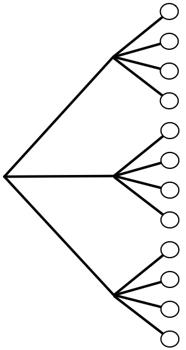

<details>
<summary>flowchart</summary>

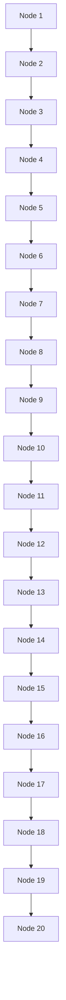
</details>

## FIGURE 1.2

Tree diagram illustrating the multiplication rule. If Experiment A has 3 possible outcomes, for each of which Experiment B has 4 possible outcomes, then overall there are $3 \cdot 4 = 1 2$ possible outcomes.

there are 8 possibilities for third place. So by the multiplication rule, there are 10 · 9 · 8 = 720 possibilities.

We did not have to consider the first place winner first. We could just as well have said that there are 10 possibilities for who got third place, then once that is fixed there are 9 possibilities for second place, and once those are both fixed there are 8 possibilities for first place. Or imagine that there are 3 platforms, which the first, second, and third place runners will stand on after the race. The platforms are gold, silver, and bronze, allocated to the first, second, and third place runners, respectively. Again there are $1 0   \cdot   9   \cdot   8   =   7 2 0$ possibilities for how the platforms will be occupied after the race, and there is no reason that the platforms must be considered in the order (gold, silver, bronze). 

Example 1.4.4 (Chessboard). How many squares are there in an $8 \times 8$ chessboard, as in Figure 1.3? Even the name $^ \mathrm { ~  ~ } { 8 \times 8 }$ chessboard” makes this easy: there are $8 \cdot 8 = 6 4$ squares on the board. The grid structure makes this clear, but we can also think of this as an example of the multiplication rule: to specify a square, we can specify which row and which column it is in. There are 8 choices of row, for each of which there are 8 choices of column.

Furthermore, we can see without doing any calculations that half the squares are white and half are black. Imagine rotating the chessboard 90 degrees clockwise. Then all the positions that had a white square now contain a black square, and vice versa, so the number of white squares must equal the number of black squares. We

---

10

Introduction to Probability

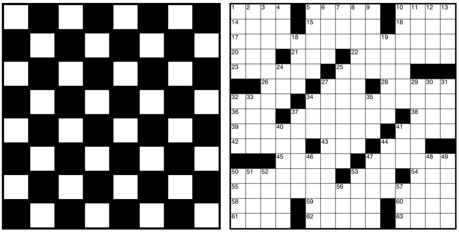

## FIGURE 1.3

An 8 × 8 chessboard (left) and a crossword puzzle grid (right). The chessboard has 8 · 8 = 64 squares, whereas counting the number of white squares in the crossword puzzle grid requires more work.

can also count the number of white squares using the multiplication rule: in each of the 8 rows there are 4 white squares, giving a total of 8 · 4 = 32 white squares.

In contrast, it would require more effort to count the number of white squares in the crossword puzzle grid shown in Figure 1.3. The multiplication rule does not apply, since different rows sometimes have different numbers of white squares. 

Example 1.4.5 (Ice cream cones). Suppose you are buying an ice cream cone. You can choose whether to have a cake cone or a waffle cone, and whether to have chocolate, vanilla, or strawberry as your flavor. This decision process can be visualized with a tree diagram, as in Figure 1.4.

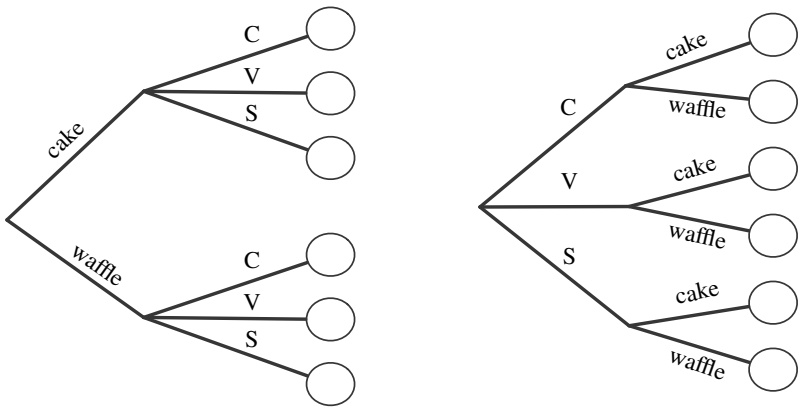

## FIGURE 1.4

Tree diagram for choosing an ice cream cone. Regardless of whether the type of cone or the flavor is chosen first, there are 2 · 3 = 3 · 2 = 6 possibilities.

---

Probability and counting

11

By the multiplication rule, there are $2 \cdot 3 = 6$ possibilities. This is a very simple example, but is worth thinking through in detail as a foundation for thinking about and visualizing more complicated examples. Soon we will encounter examples where drawing the tree in a legible size would take up more space than exists in the known universe, yet where conceptually we can still think in terms of the ice cream example. Some things to note:

1. It doesn’t matter whether you choose the type of cone first $( \mathrm { ` T d }$ like a waffle cone with chocolate ice cream”) or the flavor first (“I’d like chocolate ice cream on a waffle cone”). Either way, there are $2 \cdot 3 = 3 \cdot 2 = 6$ possibilities.

2. It doesn’t matter whether the same flavors are available on a cake cone as on a waffle cone. What matters is that there are exactly 3 flavor choices for each cone choice. If for some strange reason it were forbidden to have chocolate ice cream on a waffle cone, with no substitute flavor available (aside from vanilla and strawberry), there would be $3 + 2 = 5$ possibilities and the multiplication rule wouldn’t apply. In larger examples, such complications could make counting the number of possibilities vastly more difficult.

Now suppose you buy two ice cream cones on a certain day, one in the afternoon and the other in the evening. Write, for example, (cakeC, waffleV) to mean a cake cone with chocolate in the afternoon, followed by a waffle cone with vanilla in the evening. By the multiplication rule, there are $6 ^ { 2 } = 3 6$ possibilities in your delicious compound experiment.

But what if you’re only interested in what kinds of ice cream cones you had that day, not the order in which you had them, so you don’t want to distinguish, for example, between (cakeC, waffleV) and (waffleV, cakeC)? Are there now $3 6 / 2 = 1 8$ possibilities? No, since possibilities like (cakeC, cakeC) were already only listed once each. There are $6 \cdot 5 = 3 0$ ordered possibilities $( x , y )$ with $x \neq y ,$ which turn into 15 possibilities if we treat $( x , y )$ as equivalent to $( y , x )$ , plus 6 possibilities of the form $( x , x )$ , giving a total of 21 possibilities. Note that if the 36 original ordered pairs $( x , y )$ are equally likely, then the 21 possibilities here are not equally likely. 

Example 1.4.6 (Subsets). A set with n elements has $2 ^ { n }$ subsets, including the empty set ∅ and the set itself. This follows from the multiplication rule since for each element, we can choose whether to include it or exclude it. For example, the set $\{ 1 , 2 , 3 \}$ has the 8 subsets $\emptyset , \{ 1 \} , \{ 2 \} , \{ 3 \} , \{ 1 , 2 \} , \{ 1 , 3 \} , \{ 2 , 3 \} , \{ 1 , 2 , 3 \}$ . This result explains why in Example 1.2.3 there are $2 ^ { 5 2 }$ events that can be defined. 

We can use the multiplication rule to arrive at formulas for sampling with and without replacement. Many experiments in probability and statistics can be interpreted in one of these two contexts, so it is appealing that both formulas follow directly from the same basic counting principle.

Theorem 1.4.7 (Sampling with replacement). Consider n objects and making k choices from them, one at a time with replacement (i.e., choosing a certain object does not preclude it from being chosen again). Then there are $n ^ { k }$ possible outcomes

---

12

Introduction to Probability

(where order matters, in the sense that, e.g., choosing object 3 and then object 7 is counted as a different outcome than choosing object 7 and then object 3.)

For example, imagine a jar with n balls, labeled from 1 to n. We sample balls one at a time with replacement, meaning that each time a ball is chosen, it is returned to the jar. Each sampled ball is a sub-experiment with n possible outcomes, and there are k sub-experiments. Thus, by the multiplication rule there are $n ^ { k }$ ways to obtain a sample of size k.

Theorem 1.4.8 (Sampling without replacement). Consider n objects and making k choices from them, one at a time without replacement (i.e., choosing a certain object precludes it from being chosen again). Then there are $n ( n - 1 ) \cdot \cdot \cdot ( n - k + 1 )$ possible outcomes for $1 \leq k \leq n$ , and 0 possibilities for $k > n$ (where order matters). By convention, $n ( n - 1 ) \cdots ( n - k + 1 ) = n { \mathrm { ~ f o r ~ } } k = 1$

This result also follows directly from the multiplication rule: each sampled ball is again a sub-experiment, and the number of possible outcomes decreases by 1 each time. Note that for sampling k out of n objects without replacement, we need $k \leq n$ whereas in sampling with replacement the objects are inexhaustible.

Example 1.4.9 (Permutations and factorials). A permutation of $1 , 2 , \ldots , n$ is an arrangement of them in some order, e.g., 3, 5, 1, 2, 4 is a permutation of 1, 2, 3, 4, 5. By Theorem 1.4.8 with $k = n$ , there are n! permutations of 1, $2 , \ldots , n$ . For example, there are n! ways in which n people can line up for ice cream. (Recall that n! is $n(n - 1)(n - 2) \cdots 1$ for any positive integer n, and 0! = 1.) 

Theorems 1.4.7 and 1.4.8 are theorems about counting, but when the naive definition applies, we can use them to calculate probabilities. This brings us to our next example, a famous problem in probability called the birthday problem. The solution incorporates both sampling with replacement and sampling without replacement.

Example 1.4.10 (Birthday problem). There are k people in a room. Assume each person’s birthday is equally likely to be any of the 365 days of the year (we exclude February 29), and that people’s birthdays are independent (we will define independence formally later, but intuitively it means that knowing some people’s birthdays gives us no information about other people’s birthdays; this would not hold if, e.g., we knew that two of the people were twins). What is the probability that at least one pair of people in the group have the same birthday?

## Solution:

There are $3 6 5 ^ { k }$ ways to assign birthdays to the people in the room, since we can imagine the 365 days of the year being sampled k times, with replacement. By assumption, all of these possibilities are equally likely, so the naive definition of probability applies.

Used directly, the naive definition says we just need to count the number of ways to assign birthdays to k people such that there are two people who share a birthday.

---

Probability and counting

13

But this counting problem is hard, since it could be Emma and Steve who share a birthday, or Steve and Naomi, or all three of them, or the three of them could share a birthday while two others in the group share a different birthday, or various other possibilities.

Instead, let’s count the complement: the number of ways to assign birthdays to k people such that no two people share a birthday. This amounts to sampling the 365 days of the year without replacement, so the number of possibilities is $3 6 5 \cdot 3 6 4 \cdot 3 6 3 \cdots ( 3 6 5 - k + 1 )$ for $k \leq 3 6 5$ . Therefore the probability of no birthday matches in a group of k people is

$$
P (\text {no birthday match}) = \frac {3 6 5 \cdot 3 6 4 \cdots (3 6 5 - k + 1)}{3 6 5 ^ {k}},
$$

and the probability of at least one birthday match is

$$
P (\text {at least 1 birthday match}) = 1 - \frac {3 6 5 \cdot 3 6 4 \cdots (3 6 5 - k + 1)}{3 6 5 ^ {k}}.
$$

Figure 1.5 plots the probability of at least one birthday match as a function of k. The first value of k for which the probability of a match exceeds 0.5 is $k = 2 3$ . Thus, in a group of 23 people, there is a better than 50% chance that there is at least one birthday match. At $k = 5 7$ , the probability of a match already exceeds 99%.

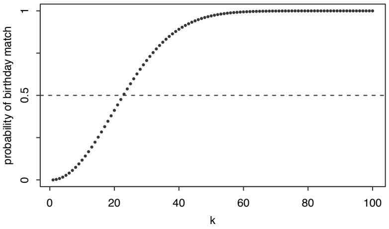

<details>
<summary>line</summary>

| k | Probability of birthday match |
| --- | --- |
| 0 | 0 |
| ~2 | ~0.01 |
| ~4 | ~0.03 |
| ~6 | ~0.07 |
| ~8 | ~0.12 |
| ~10 | ~0.18 |
| ~12 | ~0.25 |
| ~14 | ~0.32 |
| ~16 | ~0.39 |
| ~18 | ~0.45 |
| ~20 | ~0.50 |
| ~22 | ~0.55 |
| ~24 | ~0.60 |
| ~26 | ~0.65 |
| ~28 | ~0.70 |
| ~30 | ~0.75 |
| ~32 | ~0.79 |
| ~34 | ~0.83 |
| ~36 | ~0.86 |
| ~38 | ~0.89 |
| ~40 | ~0.91 |
| ~42 | ~0.93 |
| ~44 | ~0.94 |
| ~46 | ~0.95 |
| ~48 | ~0.96 |
| ~50 | ~0.97 |
| ~52 | ~0.97 |
| ~54 | ~0.98 |
| ~56 | ~0.98 |
| ~58 | ~0.99 |
| ~60 | ~0.99 |
| ~62 | ~0.99 |
| ~64 | ~0.99 |
| ~66 | ~0.99 |
| ~68 | ~0.99 |
| ~70 | ~0.99 |
| ~72 | ~0.99 |
| ~74 | ~0.99 |
| ~76 | ~0.99 |
| ~78 | ~0.99 |
| ~80 | ~0.99 |
| ~82 | ~0.99 |
| ~84 | ~0.99 |
| ~86 | ~0.99 |
| ~88 | ~0.99 |
| ~90 | ~0.99 |
| ~92 | ~0.99 |
| ~94 | ~0.99 |
| ~96 | ~0.99 |
| ~98 | ~0.99 |
| 100 | 1 |
</details>

## FIGURE 1.5

Probability that in a room of k people, at least two were born on the same day. This probability first exceeds 0.5 when $k = 2 3$

Of course, for $k = 3 6 6$ we are guaranteed to have a match, but it’s surprising that even with a much smaller number of people it’s overwhelmingly likely that there is a birthday match. For a quick intuition into why it should not be so surprising, note that with 23 people there are ${ \binom { 2 3 } { 2 } }   =   2 5 3$ pairs of people, any of which could be a birthday match.

---

14

Introduction to Probability

Problems 26 and 27 show that the birthday problem is much more than a fun party game, and much more than a way to build intuition about coincidences; there are also important applications in statistics and computer science. Problem 62 explores the more general setting in which the probability is not necessarily 1/365 for each day. It turns out that in the non-equal probability case, having at least one match becomes even more likely. 

h 1.4.11 (Labeling objects). Drawing a sample from a population is a very fundamental concept in statistics. It is important to think of the objects or people in the population as named or labeled. For example, if there are n balls in a jar, we can imagine that they have labels from 1 to n, even if the balls look the same to the human eye. In the birthday problem, we can give each person an ID (identification) number, rather than thinking of the people as indistinguishable particles or a faceless mob.

A related example is an instructive blunder made by Leibniz in a seemingly simple problem (see Gorroochurn [14] for discussion of this and a variety of other probability problems from a historical perspective).

Example 1.4.12 (Leibniz’s mistake). If we roll two fair dice, which is more likely: a sum of 11 or a sum of 12?

## Solution:

Label the dice A and B, and consider each die to be a sub-experiment. By the multiplication rule, there are 36 possible outcomes for ordered pairs of the form (value of A, value of B), and they are equally likely by symmetry. Of these, (5, 6) and (6, 5) are favorable to a sum of 11, while only (6, 6) is favorable to a sum of 12. Therefore a sum of 11 is twice as likely as a sum of 12; the probability is 1/18 for the former, and 1/36 for the latter.

However, Leibniz wrongly argued that a sum of 11 and a sum of 12 are equally likely, claiming that each of these sums can be attained in only one way. Here Leibniz was making the mistake of treating the two dice as indistinguishable objects, viewing (5, 6) and (6, 5) as the same outcome.

What are the antidotes to Leibniz’s mistake? First, as explained in h 1.4.11, we should label the objects in question instead of treating them as indistinguishable. If Leibniz had labeled his dice A and B, or green and orange, or left and right, he would not have made this mistake. Second, before we use counting for probability, we should ask ourselves whether the naive definition applies (see h 1.4.23 for another example showing that caution is needed before applying the naive definition). 

## 1.4.2 Adjusting for overcounting

In many counting problems, it is not easy to directly count each possibility once and only once. If, however, we are able to count each possibility exactly c times

---

Probability and counting

15

for some c, then we can adjust by dividing by c. For example, if we have exactly double-counted each possibility, we can divide by 2 to get the correct count. We call this adjusting for overcounting.

Example 1.4.13 (Committees and teams). Consider a group of four people.

(a) How many ways are there to choose a two-person committee?
(b) How many ways are there to break the people into two teams of two?

Solution:

(a) One way to count the possibilities is by listing them out: labeling the people as 1, 2, 3, 4, the possibilities are 12 , 13 , 14 , 23 24 , 34 .

Another approach is to use the multiplication rule with an adjustment for overcounting. By the multiplication rule, there are 4 ways to choose the first person on the committee and 3 ways to choose the second person on the committee, but this counts each possibility twice, since picking 1 and 2 to be on the committee is the same as picking 2 and 1 to be on the committee. Since we have overcounted by a factor of 2, the number of possibilities is $( 4 \cdot 3 ) / 2 = 6$

(b) Here are 3 ways to see that there are 3 ways to form th<u>e teams</u>. <u>Labelin</u>g the <u>people</u> as 1, 2, 3, 4, we can directly list out the possibilities: <u>12 34</u> , <u>13 24</u> , and <u>14 23</u> . Listing out all possibilities would quickly become tedious or infeasible with more people though. Another approach is to note that it suffices to specify person 1’s teammate (and then the other team is determined). A third way is to use (a) to see that there are 6 ways to choose one team. This overcounts by a factor of 2, since picking 1 and 2 to be a team is equivalent to picking 3 and 4 to be a team. So again the answer is $6 / 2 = 3$ 

A binomial coefficient counts the number of subsets of a certain size for a set, such as the number of ways to choose a committee of size k from a set of n people. Sets and subsets are by definition unordered, e.g., $\{ 3 , 1 , 4 \} = \{ 4 , 1 , 3 \}$ , so we are counting the number of ways to choose k objects out of n, without replacement and without distinguishing between the different orders in which they could be chosen.

Definition 1.4.14 (Binomial coefficient). For any nonnegative integers k and $n ,$ the binomial coefficient $\binom { n } { k }$ , read as $^ { \mathfrak { a } } n$ choose $k ^ { \flat }$ , is the number of subsets of size k for a set of size n.

For example, ${ \binom { 4 } { 2 } }   =   6 ,$ as shown in Example 1.4.13. The binomial coefficient $\binom { n } { k }$ is sometimes called a combination, but we do not use that terminology here since “combination” is such a useful general-purpose word. Algebraically, binomial coefficients can be computed as follows.

Theorem 1.4.15 (Binomial coefficient formula). For $k \leq n$ , we have

$$
\binom {n} {k} = \frac {n (n - 1) \cdots (n - k + 1)}{k !} = \frac {n !}{(n - k) ! k !}.
$$

---

16

Introduction to Probability

For $k > n$ , we have ${ \binom { n } { k } } = 0$

Proof. Let A be a set with $| A | = n$ . Any subset of A has size at most $n ,$ so ${ \binom { n } { k } } = 0$ for $k   >   n$ . Now let $k   \leq   n$ . By Theorem 1.4.8, there are $n ( n - 1 ) \cdots ( n - \overset{...} { k } + 1 )$ ways to make an ordered choice of k elements without replacement. This overcounts each subset of interest by a factor of $k !$ (since we don’t care how these elements are ordered), so we can get the correct count by dividing by $k ! .$ 

h 1.4.16. The binomial coefficient $\left( \begin{matrix} { n } \\ { k } \\ \end{matrix} \right)$ is often defined in terms of factorials, but keep in mind that $\left( \begin{matrix} { n } \\ { k } \\ \end{matrix} \right)$ is 0 if $k > n$ , even though the factorial of a negative number is undefined. Also, the middle expression in Theorem 1.4.15 is often better for computation than the expression with factorials, since factorials grow extremely fast. For example,

$$
\binom{1 0 0}{2} = \frac {1 0 0 \cdot 9 9}{2} = 4 9 5 0
$$

can even be done by hand, whereas computing ${ \binom { 1 0 0 } { 2 } } = 1 0 0 ! / ( 9 8 ! { \cdot } 2 ! )$ by first calculating 100! and 98! would be wasteful and possibly dangerous because of the extremely large numbers involved $( 1 0 0 ! \approx 9 . 3 3 \times 1 0 ^ { 1 5 7 } )$

Example 1.4.17 (Club officers). In a club with n people, there are $n ( n   -   1 ) ( n   -   2 )$ ways to choose a president, vice president, and treasurer, and there are

$$
\binom{n}{3} = \frac {n (n - 1) (n - 2)}{3 !}
$$

ways to choose 3 officers without predetermined titles.

Example 1.4.18 (Permutations of a word). How many ways are there to permute the letters in the word LALALAAA? To determine a permutation, we just need to choose where the 5 A’s go (or, equivalently, just decide where the $3 \; \mathrm { L ^ { \prime } s \; g o ) }$ . So there are

$$
\binom{8}{5} = \binom{8}{3} = \frac {8 \cdot 7 \cdot 6}{3 !} = 5 6 \text {permutations}.
$$

How many ways are there to permute the letters in the word STATISTICS? Here are two approaches. We could choose where to put the $\operatorname { S ^ { \prime } s } ,$ then where to put the $\mathrm { T } \mathrm { s }$ (from the remaining positions), then where to put the I’s, then where to put the A (and then the C is determined). Alternatively, we can start with 10! and then adjust for overcounting, dividing by 3!3!2! to account for the fact that the S’s can be permuted among themselves in any way, and likewise for the T’s and I’s. This gives

$$
\binom {1 0} {3} \binom {7} {3} \binom {4} {2} \binom {2} {1} = \frac {1 0 !}{3 ! 3 ! 2 !} = 5 0 4 0 0 \text {possibilities}.
$$

Example 1.4.19 (Binomial theorem). The binomial theorem states that

$$
(x + y) ^ {n} = \sum_ {k = 0} ^ {n} \binom {n} {k} x ^ {k} y ^ {n - k},
$$

---

Probability and counting

17

for any nonnegative integer n. To prove the binomial theorem, expand out the product

$$
\underbrace {(x + y) (x + y) \dots (x + y)} _ {n \text {factors}}.
$$

Just as $( a + b ) ( c + d ) = a c + a d + b c + b d$ is the sum of terms where we pick the a or the b from the first factor (but not both) and the c or the d from the second factor (but not both), the terms of $( x + y ) ^ { n }$ are obtained by picking either the x or the y (but not both) from each factor. There are ${n \choose k}$ ways to choose exactly k of the $x ^ { \flat } \mathbf { s } ,$ and each such choice yields the term $x ^ { k } y ^ { n - k }$ . The binomial theorem follows. 

We can use binomial coefficients to calculate probabilities in many problems for which the naive definition applies.

Example 1.4.20 (Full house in poker). A 5-card hand is dealt from a standard, well-shuffled 52-card deck. The hand is called a full house in poker if it consists of three cards of some rank and two cards of another rank, e.g., three $7 \mathrm { s }$ and two 10’s (in any order). What is the probability of a full house?

## Solution:

All of the $\binom { 5 2 } { 5 }$ possible hands are equally likely by symmetry, so the naive definition is applicable. To find the number of full house hands, use the multiplication rule (and imagine the tree). There are 13 choices for what rank we have three of; for concreteness, assume we have three $7 \mathrm { s }$ and focus on that branch of the tree. There are $\textstyle { \binom { 4 } { 3 } }$ ways to choose which $7 \mathrm { s }$ we have. Then there are 12 choices for what rank we have two of, say 10’s for concreteness, and $\textstyle { \binom { 4 } { 2 } }$ ways to choose two $1 0 ^ { \circ } \mathrm { s }$ . Thus,

$$
P (\text {full house}) = \frac {1 3 \binom {4} {3} 1 2 \binom {4} {2}}{\binom {5 2} {5}} = \frac {3 7 4 4}{2 5 9 8 9 6 0} \approx 0. 0 0 1 4 4.
$$

The decimal approximation is more useful when playing poker, but the answer in terms of binomial coefficients is exact and $s e l f _ { - }$ annotating (seeing $\binom { 5 2 } { 5 }$   is a much bigger hint about its origin than seeing 2598960). 

Example 1.4.21 (Newton-Pepys problem). Isaac Newton was consulted about the following problem by Samuel Pepys, who wanted the information for gambling purposes. Which of the following events has the highest probability?

A: At least one 6 appears when 6 fair dice are rolled.

B: At least two $6 ^ { \circ } \varsigma$ appear when 12 fair dice are rolled.

C: At least three $6 ^ { \circ }$ s appear when 18 fair dice are rolled.

## Solution:

The three experiments have $6 ^ { 6 } ,   6 ^ { 1 2 }$ , and $6 ^ { 1 8 }$ possible outcomes, respectively, and by symmetry the naive definition applies in all three experiments.

---

18

Introduction to Probability

A: Instead of counting the number of ways to obtain at least one 6, it is easier to count the number of ways to get no 6’s. Getting no $6 ^ { \circ } \mathrm { s }$ is equivalent to sampling the numbers 1 through 5 with replacement 6 times, so $5 ^ { 6 }$ outcomes are favorable to $A ^ { c }$ (and $6 ^ { 6 } - 5 ^ { 6 }$ are favorable to A). Thus

$$
P (A) = 1 - \frac {5 ^ {6}}{6 ^ {6}} \approx 0. 6 7.
$$

B: Again we count the outcomes in $B ^ { c }$ first. There are $5 ^ { 1 2 }$ ways to get no $6 ^ { \circ } \mathrm { s }$ in 12 die rolls. There are ${ \binom { 1 2 } { 1 } } 5 ^ { 1 1 }$ ways to get exactly one 6: we first choose which die lands 6, then sample the numbers 1 through 5 with replacement for the other 11 dice. Adding these, we get the number of ways to fail to obtain at least two $6 ^ { \circ } \mathrm { s }$ Then

$$
P (B) = 1 - \frac {5 ^ {1 2} + \binom {1 2} {1} 5 ^ {1 1}}{6 ^ {1 2}} \approx 0. 6 2.
$$

C: We count the outcomes in $C ^ { c }$ , i.e., the number of ways to get zero, one, or two $6 ^ { \circ } \mathrm { s }$ in 18 die rolls. There are $5 ^ { 1 8 }$ ways to get no 6’s, ${ \binom { 1 8 } { 1 } } { \vec { 5 } } ^ { 1 7 }$ ways to get exactly one 6, and ${ \binom { 1 8 } { 2 } } 5 ^ { 1 6 }$ ways to get exactly two $6 ^ { \circ } \mathrm { s }$ (choose which two dice will land 6, then decide how the other 16 dice will land).

$$
P (C) = 1 - \frac {5 ^ {1 8} + \binom {1 8} {1} 5 ^ {1 7} + \binom {1 8} {2} 5 ^ {1 6}}{6 ^ {1 8}} \approx 0. 6 0.
$$

Therefore A has the highest probability.

Newton arrived at the correct answer using similar calculations. Newton also provided Pepys with an intuitive argument for why A was the most likely of the three; however, his intuition was invalid. As explained in Stigler [24], using loaded dice could result in a different ordering of A, B, C, but Newton’s intuitive argument did not depend on the dice being fair. 

In this book, we care about counting not for its own sake, but because it sometimes helps us to find probabilities. Here is an example of a neat but treacherous counting problem; the solution is elegant, but it is rare that the result can be used with the naive definition of probability.

Example 1.4.22 (Bose-Einstein). How many ways are there to choose k times from a set of $n$ objects with replacement, if order doesn’t matter (we only care about how many times each object was chosen, not the order in which they were chosen)?

## Solution:

When order does matter, the answer is $n ^ { k }$ by the multiplication rule, but this problem is much harder. We will solve it by solving an isomorphic problem (the same problem in a different guise).

Let us find the number of ways to put k indistinguishable particles into n distinguishable boxes. That is, swapping the particles in any way is not considered a separate

---

Probability and counting

19

possibility: all that matters are the counts for how many particles are in each box. This scenario is known as a Bose-Einstein problem, since the physicists Satyendra Nath Bose and Albert Einstein studied related problems about indistinguishable particles in the 1920s, using their ideas to successfully predict the existence of a strange state of matter known as a Bose-Einstein condensate.

Any configuration can be encoded as a sequence of |’s and $\mathbf { \otimes } ^ { \prime } \mathrm { s }$ in a natural way, as illustrated in Figure 1.6.

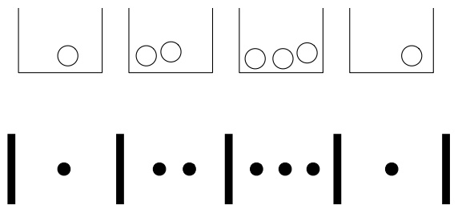

<details>
<summary>text_image</summary>

Sequence of geometric shapes with circles and dots, accompanied by a sequence of black dots below each shape.
</details>

## FIGURE 1.6

Bose-Einstein encoding: putting $k = 7$ indistinguishable particles into $n = 4$ distinguishable boxes can be expressed as a sequence of $\harpoonright \mathrm { s }$ and $\bullet \mathrm { ^ { \flat } s } ,$ where | denotes a wall and ● denotes a particle.

To be valid, a sequence must start and end with a |, and have exactly $n - 1$ |’s and exactly $k \spadesuit \mathrm { { ^ { \circ } s } }$ in between the starting and ending |’s; conversely, any such sequence is a valid encoding for some configuration of particles in boxes. Imagine that we have written down the starting and ending |’s, which represent the outer walls, and in between there are $n + k - 1$ fill-in-the-blank slots in between the outer walls. We need only choose where to put the $k \spadesuit \mathrm { { ^ { \prime } s } }$ (since then where the $n + k - 1$ interior |’s go is completely determined). So the number of possibilities is ${ \binom { n + k - 1 } { k } }$ . This counting method is sometimes called the stars and bars argument, where here we have dots in place of stars.

To relate this result back to the original question, we can let each box correspond to one of the n objects and use the particles as “check marks” to tally how many times each object is selected. For example, if a certain box contains exactly 3 particles, that means the object corresponding to that box was chosen exactly 3 times. The particles being indistinguishable corresponds to the fact that we don’t care about the order in which the objects are chosen. Thus, the answer to the original question is also ${ \binom { n + k - 1 } { k } }$

Another isomorphic problem is to count the number of solutions $( x _ { 1 } , \ldots , x _ { n } )$ to the equation $x _ { 1 } + x _ { 2 } + \cdots + x _ { n } = k$ , where the $x _ { i }$ are nonnegative integers. This is equivalent since we can think of $x _ { i }$ as the number of particles in the ith box.

h 1.4.23. The Bose-Einstein result should not be used in the naive definition of probability except in very special circumstances. For example, consider a survey where a sample of size k is collected by choosing people from a population of size n

---

20

Introduction to Probability

one at a time, with replacement and with equal probabilities. Then the $n ^ { k }$ ordered samples are equally likely, making the naive definition applicable, but the ${ \binom { n + k - 1 } { k } }$ unordered samples (where all that matters is how many times each person was sampled) are not equally likely.

As another example, with $n = 3 6 5$ days in a year and k people, how many possible unordered birthday lists are there? For example, for $k = 3 ,$ we want to count lists like (May 1, March 31, April 11), where all permutations are considered equivalent. We can’t do a simple adjustment for overcounting such as $n ^ { k } / 3 !$ since, e.g., there are 6 permutations of (May 1, March 31, April 11) but only 3 permutations of (March 31, March 31, April 11). By Bose-Einstein, the number of lists is ${ \binom { n + k - 1 } { k } }$ . But the ordered birthday lists are equally likely, not the unordered lists, so the Bose-Einstein value should not be used in calculating birthday probabilities. 

## 1.5 Story proofs

A story proof is a proof by interpretation. For counting problems, this often means counting the same thing in two different ways, rather than doing tedious algebra. A story proof often avoids messy calculations and goes further than an algebraic proof toward explaining why the result is true. The word “story” has several meanings, some more mathematical than others, but a story proof (in the sense in which we’re using the term) is a fully valid mathematical proof. Here are some examples of story proofs, which also serve as further examples of counting.

Example 1.5.1 (Choosing the complement). For any nonnegative integers n and k with $k \leq n$ , we have

$$
\binom{n}{k} = \binom{n}{n - k}.
$$

This is easy to check algebraically (by writing the binomial coefficients in terms of factorials), but a story proof makes the result easier to understand intuitively.

Story proof : Consider choosing a committee of size k in a group of n people. We know that there are $\left( \begin{matrix} { n } \\ { k } \\ \end{matrix} \right)$ possibilities. But another way to choose the committee is to specify which $n - k$ people are not on the committee; specifying who is on the committee determines who is not on the committee, and vice versa. So the two sides are equal, as they are two ways of counting the same thing. 

Example 1.5.2 (The team captain). For any positive integers n and k with $k \leq n$

$$
n \binom {n - 1} {k - 1} = k \binom {n} {k}.
$$

This is again easy to check algebraically (using the fact that $m ! = m ( m - 1 ) !$ for any positive integer $m )$ , but a story proof is more insightful.

---

Probability and counting

21

Story proof : Consider a group of n people, from which a team of k will be chosen, one of whom will be the team captain. To specify a possibility, we could first choose the team captain and then choose the remaining $k - 1$ team members; this gives the left-hand side. Equivalently, we could first choose the k team members and then choose one of them to be captain; this gives the right-hand side. 

Example 1.5.3 (Vandermonde’s identity). A famous relationship between binomial coefficients, called Vandermonde’s identity,<sup>2</sup>says that

$$
\binom{m + n}{k} = \sum_ {j = 0} ^ {k} \binom{m}{j} \binom{n}{k - j}.
$$

This identity will come up several times in this book. Trying to prove it with a brute force expansion of all the binomial coefficients would be a nightmare. But a story proves the result elegantly and makes it clear why the identity holds.

Story proof : Consider a student organization consisting of m juniors and n seniors, from which a committee of size k will be chosen. There are ${m+n \choose k}$ possibilities. If there are $j$ juniors in the committee, then there must be $k - j$ seniors in the committee. The right-hand side of the identity sums up the cases for $j .$ 

Example 1.5.4 (Partnerships). Let’s use a story proof to show that

$$
\frac {(2 n) !}{2 ^ {n} \cdot n !} = (2 n - 1) (2 n - 3) \dots 3 \cdot 1.
$$

Story proof : We will show that both sides count the number of ways to break 2n people into n partnerships. Take 2n people, and give them ID numbers from 1 to 2n. We can form partnerships by lining up the people in some order and then saying the first two are a pair, the next two are a pair, etc. This overcounts by a factor of n! · $2 ^ { n }$ since the order of pairs doesn’t matter, nor does the order within each pair. Alternatively, count the number of possibilities by noting that there are $2 n - 1$ choices for the partner of person 1, then $2 n - 3$ choices for person 2 (or person 3, if person 2 was already paired to person 1), and so on. 

## 1.6 Non-naive definition of probability

We have now seen several methods for counting outcomes in a sample space, allowing us to calculate probabilities if the naive definition applies. But the naive definition can only take us so far, since it requires equally likely outcomes and can’t handle

<small><span class="docvortex-page-footnote" data-block-type="page_footnote" style="color:#6b7280"><sup>2</sup>Vandermonde’s identity is named after the 18th century French mathematician Alexandre-Théophile Vandermonde, but it was discovered much earlier, and stated in 1303 by the Chinese mathematician Zhu Shijie.</span></small>

---

22

Introduction to Probability

an infinite sample space. To generalize the notion of probability, we’ll write down a short wish list of how we want probability to behave (in math, the items on the wish list are called axioms), and then define a probability function to be something that satisfies the properties we want!

Here is the general definition of probability that we’ll use for the rest of this book. It requires just two axioms, but from these axioms it is possible to prove a vast array of results about probability.

Definition 1.6.1 (General definition of probability). A probability space consists of a sample space S and a probability function P which takes an event $A \subseteq S$ as input and returns $P ( A )$ , a real number between 0 and 1, as output. The function $P$ must satisfy the following axioms:

1. $P(\varnothing) = 0,   P(S) = 1.$
2. If $A _ { 1 } , A _ { 2 } , \ldots$ are disjoint events, then

$$
P \left(\bigcup_ {j = 1} ^ {\infty} A _ {j}\right) = \sum_ {j = 1} ^ {\infty} P (A _ {j}).
$$

(Saying that these events are disjoint means that they are mutually exclusive: $A _ { i } \cap A _ { j } = \emptyset { \mathrm { ~ f o r ~ } } i \neq j . )$

In Pebble World, the definition says that probability behaves like mass: the mass of an empty pile of pebbles is 0, the total mass of all the pebbles is 1, and if we have non-overlapping piles of pebbles, we can get their combined mass by adding the masses of the individual piles. Unlike in the naive case, we can now have pebbles of differing masses, and we can also have a countably infinite number of pebbles as long as their total mass is 1.

We can even have uncountable sample spaces, such as having S be an area in the plane. In this case, instead of pebbles, we can visualize mud spread out over a region, where the total mass of the mud is 1.

Any function P (mapping events to numbers in the interval [0, 1]) that satisfies the two axioms is considered a valid probability function. However, the axioms don’t tell us how probability should be interpreted; different schools of thought exist.

The frequentist view of probability is that it represents a long-run frequency over a large number of repetitions of an experiment: if we say a coin has probability $1 / 2$ of Heads, that means the coin would land Heads 50% of the time if we tossed it over and over and over.

The Bayesian view of probability is that it represents a degree of belief about the event in question, so we can assign probabilities to hypotheses like “candidate A will win the election” or “the defendant is guilty” even if it isn’t possible to repeat the same election or the same crime over and over again.

---

Probability and counting

23

The Bayesian and frequentist perspectives are complementary, and both will be helpful for developing intuition in later chapters. Regardless of how we choose to interpret probability, we can use the two axioms to derive other properties of probability, and these results will hold for any valid probability function.

Theorem 1.6.2 (Properties of probability). Probability has the following properties, for any events A and B.

1. $P ( A ^ { c } ) = 1 - P ( A ) .$
2. If $A \subseteq B$ , then $P(A) \leq P(B)$
3. $P ( A \cup B ) = P ( A ) + P ( B ) - P ( A \cap B ) .$

## Proof.

1. Since A and $A ^ { c }$ are disjoint and their union is S, the second axiom gives

$$
P (S) = P (A \cup A ^ {c}) = P (A) + P (A ^ {c}),
$$

But $P ( S ) = 1$ by the first axiom. So $P(A)+P(A^{c})=1$

2. If $A \subseteq B$ , then we can write B as the union of A and $B \cap A ^ { c }$ , where $B \cap A ^ { c }$ is the part of B not also in A. This is illustrated in the Venn diagram below.

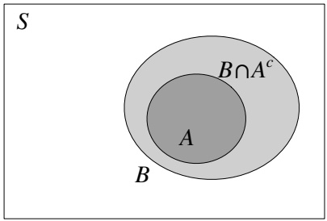

<details>
<summary>text_image</summary>

S
B∩Aᶜ
A
B
</details>

Since A and $B \cap A ^ { c }$ are disjoint, we can apply the second axiom:

$$
P (B) = P (A \cup (B \cap A ^ {c})) = P (A) + P (B \cap A ^ {c}).
$$

Probability is nonnegative, so $P ( B \cap A ^ { c } ) \geq 0$ , proving that $P(B) \geq P(A)$

3. The intuition for this result can be seen using a Venn diagram like the one below.

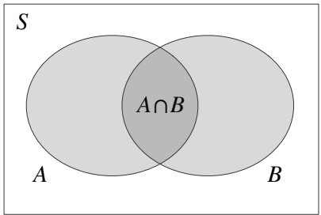

<details>
<summary>text_image</summary>

S
A∩B
A
B
</details>

---

24

Introduction to Probability

The shaded region represents $A \cup B$ , but the probability of this region is not the sum $P ( A )   +   P ( B )$ , because that would count the football-shaped region $A \cap B$ twice. To correct for this, we subtract $P ( A \cap B )$ . This is a useful intuition, but not a proof.

For a proof using the axioms of probability, we can write $A \cup B$ as the union of the disjoint events A and $B \cap A ^ { c }$ . Then by the second axiom,

$$
P (A \cup B) = P (A \cup (B \cap A ^ {c})) = P (A) + P (B \cap A ^ {c}).
$$

So it suffices to show that $P ( B \cap A ^ { c } ) = P ( B ) - P ( A \cap B )$ . Since $A \cap B$ and $B \cap A ^ { c }$ are disjoint and their union is B, another application of the second axiom gives us

$$
P (A \cap B) + P (B \cap A ^ {c}) = P (B).
$$

So $P(B \cap A^c) = P(B) - P(A \cap B)$ , as desired.

The third property is a special case of inclusion-exclusion, a formula for finding the probability of a union of events when the events are not necessarily disjoint. We showed above that for two events A and B,

$$
P (A \cup B) = P (A) + P (B) - P (A \cap B).
$$

For three events, inclusion-exclusion says

$$
\begin{array}{l} P (A \cup B \cup C) = P (A) + P (B) + P (C) \\ - P (A \cap B) - P (A \cap C) - P (B \cap C) \\ + P (A \cap B \cap C). \\ \end{array}
$$

For intuition, consider a triple Venn diagram like the one below.

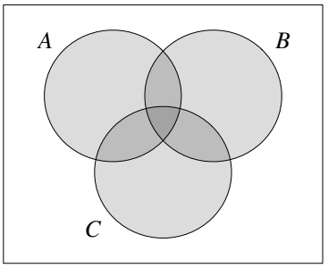

<details>
<summary>text_image</summary>

A
B
C
</details>

To get the total area of the shaded region $A \cup B \cup C$ , we start by adding the areas of the three circles, $P(A)+P(B)+P(C)$ . The three football-shaped regions have each been counted twice, so we then subtract $P ( A \cap B ) + P ( A \cap C ) + P ( B \cap C )$ Finally, the region in the center has been added three times and subtracted three times, so in order to count it exactly once, we must add it back again. This ensures that each region of the diagram has been counted once and exactly once.

Now we can write inclusion-exclusion for n events.

---

Probability and counting

25

Theorem 1.6.3 (Inclusion-exclusion). For any events $A _ { 1 } , \ldots , A _ { n }$

$$
\begin{array}{l} P \left(\bigcup_ {i = 1} ^ {n} A _ {i}\right) = \sum_ {i} P \left(A _ {i}\right) - \sum_ {i <   j} P \left(A _ {i} \cap A _ {j}\right) + \sum_ {i <   j <   k} P \left(A _ {i} \cap A _ {j} \cap A _ {k}\right) - \dots \\ + (- 1) ^ {n + 1} P (A _ {1} \cap \dots \cap A _ {n}). \\ \end{array}
$$

This formula can be proven by induction using just the axioms, but instead we’ll present a shorter proof in Chapter 4 after introducing some additional tools. The rationale behind the alternating addition and subtraction in the general formula is analogous to the special cases we’ve already considered.

The next example, de Montmort’s matching problem, is a famous application of inclusion-exclusion. Pierre Rémond de Montmort was a French mathematician who studied probability in the context of gambling and wrote a treatise [19] devoted to the analysis of various card games. He posed the following problem in 1708, based on a card game called Treize.

Example 1.6.4 (de Montmort’s matching problem). Consider a well-shuffled deck of n cards, labeled 1 through n. You flip over the cards one by one, saying the numbers 1 through n as you do so. You win the game if, at some point, the number you say aloud is the same as the number on the card being flipped over (for example, if the 7th card in the deck has the label 7). What is the probability of winning?

## Solution:

Let $A _ { i }$ be the event that the ith card in the deck has the number i written on it. We are interested in the probability of the union $A _ { 1 } \cup \cdots \cup A _ { n } { : }$ as long as at least one of the cards has a number matching its position in the deck, you will win the game. (An ordering for which you lose is called a derangement, though hopefully no one has ever become deranged due to losing at this game.)

To find the probability of the union, we’ll use inclusion-exclusion. First,

$$
P (A _ {i}) = \frac {1}{n}
$$

for all i. One way to see this is with the naive definition of probability, using the full sample space: there are n! possible orderings of the deck, all equally likely, and $( n   -   1 ) !$ of these are favorable to $A _ { i }$ (fix the card numbered i to be in the ith position in the deck, and then the remaining $n - 1$ cards can be in any order). Another way to see this is by symmetry: the card numbered i is equally likely to be in any of the n positions in the deck, so it has probability $1 / n$ of being in the ith spot. Second,

$$
P (A _ {i} \cap A _ {j}) = \frac {(n - 2) !}{n !} = \frac {1}{n (n - 1)},
$$

since we require the cards numbered i and j to be in the ith and jth spots in the

---

26

Introduction to Probability

deck and allow the remaining $n - 2$ cards to be in any order, so $( n - 2 ) !$ out of n! possibilities are favorable to $A _ { i } \cap A _ { j }$ . Similarly,

$$
P (A _ {i} \cap A _ {j} \cap A _ {k}) = \frac {1}{n (n - 1) (n - 2)},
$$

and the pattern continues for intersections of 4 events, etc.

In the inclusion-exclusion formula, there are n terms involving one event, $\textstyle { \binom { n } { 2 } }$ terms involving two events, ${ \binom { n } { 3 } }$ terms involving three events, and so forth. By the symmetry of the problem, all n terms of the form $P ( A _ { i } )$ are equal, all $\textstyle { \binom { n } { 2 } }$ terms of the form $P ( A _ { i } \cap A _ { j } )$ are equal, and the whole expression simplifies considerably:

$$
\begin{array}{l} P \left(\bigcup_ {i = 1} ^ {n} A _ {i}\right) = \frac {n}{n} - \frac {\binom {n} {2}}{n (n - 1)} + \frac {\binom {n} {3}}{n (n - 1) (n - 2)} - \dots + (- 1) ^ {n + 1} \cdot \frac {1}{n !} \\ = 1 - \frac {1}{2 !} + \frac {1}{3 !} - \dots + (- 1) ^ {n + 1} \cdot \frac {1}{n !}. \\ \end{array}
$$

Comparing this to the Taylor series for $1 / e$ (see Section A.8 of the math appendix),

$$
e ^ {- 1} = 1 - \frac {1}{1 !} + \frac {1}{2 !} - \frac {1}{3 !} + \dots ,
$$

we see that for large n, the probability of winning the game is extremely close to $1 - 1 / e ,$ or about 0.63. Interestingly, as n grows, the probability of winning approaches $1 - 1 / e$ instead of going to 0 or 1. With a lot of cards in the deck, the number of possible locations for matching cards increases while the probability of any particular match decreases, and these two forces offset each other and balance to give a probability of about $1 - 1 / e$ 

Inclusion-exclusion is a very general formula for the probability of a union of events, but it helps us the most when there is symmetry among the events $A _ { j } ;$ otherwise the sum can be extremely tedious. In general, when symmetry is lacking, we should try to use other tools before turning to inclusion-exclusion as a last resort.

## 1.7 Recap

Probability allows us to quantify uncertainty and randomness in a principled way. Probabilities arise when we perform an experiment: the set of all possible outcomes of the experiment is called the sample space, and a subset of the sample space is called an event. It is useful to be able to go back and forth between describing events in English and writing them down mathematically as sets (often using unions, intersections, and complements).

---

Probability and counting

27

Pebble World can help us visualize sample spaces and events when the sample space is finite. In Pebble World, each outcome is a pebble, and an event is a set of pebbles. If all the pebbles have the same mass (i.e., are equally likely), we can apply the naive definition of probability, which lets us calculate probabilities by counting.

To this end, we discussed several tools for counting. When counting the number of possibilities, we often use the multiplication rule. For example, there are n! permutations of the numbers 1, 2, . . . , n and there are $2 ^ { n }$ subsets of a set with n elements. If we can’t directly use the multiplication rule, we can sometimes count each possibility exactly c times for some c, and then divide by c to get the actual number of possibilities. For example, this strategy is useful for finding an expression for binomial coefficients in terms of factorials.

An important pitfall to avoid is misapplying the naive definition of probability, implicitly or explicitly assuming equally likely outcomes without justification. One technique to help avoid this is to give objects labels, for precision and so that we are not tempted to treat them as indistinguishable.

Moving beyond the naive definition, we define probability to be a function that takes an event and assigns to it a real number between 0 and 1. We require a valid probability function to satisfy two axioms:

2. If $A _ { 1 } , A _ { 2 } , \ldots$ are disjoint events, then

$$
P \left(\bigcup_ {j = 1} ^ {\infty} A _ {j}\right) = \sum_ {j = 1} ^ {\infty} P (A _ {j}).
$$

Many useful properties can be derived from these axioms. For example,

$$
P (A ^ {c}) = 1 - P (A)
$$

for any event A, and we have the inclusion-exclusion formula

$$
\begin{array}{l} P \left(\bigcup_ {i = 1} ^ {n} A _ {i}\right) = \sum_ {i} P (A _ {i}) - \sum_ {i <   j} P (A _ {i} \cap A _ {j}) + \sum_ {i <   j <   k} P (A _ {i} \cap A _ {j} \cap A _ {k}) - \dots \\ + (- 1) ^ {n + 1} P (A _ {1} \cap \dots \cap A _ {n}) \\ \end{array}
$$

for any events $A _ { 1 } , \ldots , A _ { n }$ . For $n = 2$ , this is the much nicer-looking result

$$
P (A _ {1} \cup A _ {2}) = P (A _ {1}) + P (A _ {2}) - P (A _ {1} \cap A _ {2}).
$$

Figure 1.7 illustrates how a probability function maps events to numbers between 0 and 1. We’ll add many new concepts to this diagram as we continue our journey through the field of probability.

---

28

Introduction to Probability

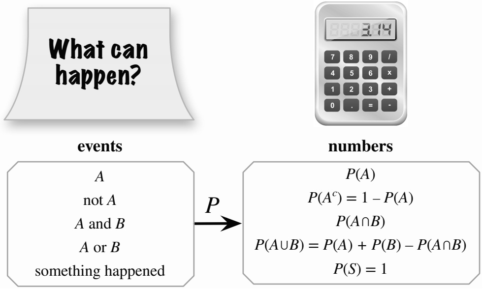

<details>
<summary>flowchart</summary>

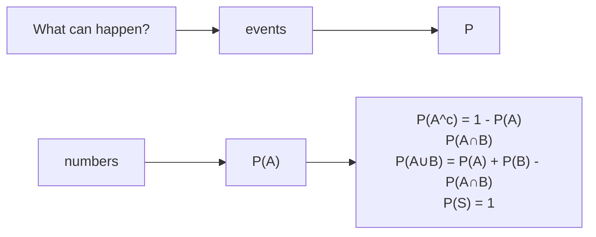
</details>

FIGURE 1.7

It is important to distinguish between events and probabilities. The former are sets, while the latter are numbers. Before the experiment is done, we generally don’t know whether or not a particular event will occur (happen). So we assign it a probability of happening, using a probability function P. We can use set operations to define new events in terms of old events, and the properties of probabilities to relate the probabilities of the new events to those of the old events.

---

Probability and counting

29

## 1.8 R

R is a very powerful, popular environment for statistical computing and graphics, freely available for Mac OS X, Windows, and UNIX systems. Knowing how to use R is an extremely useful skill. R and various supporting information can be obtained at [https://www.r-project.org](https://www.r-project.org). RStudio is an excellent alternative interface for R, freely available at [https://www.rstudio.com](https://www.rstudio.com).

In the R section at the end of each chapter, we provide R code to let you try out some of the examples from the chapter, especially via simulation. These sections are not intended to be a full introduction to R; many R tutorials are available for free online, and many books on R are available. But the R sections show how to implement various simulations, computations, and visualizations that naturally accompany the material from each chapter. The R code at the end of each chapter is also available at [http://stat110.net](http://stat110.net).

## Vectors

R is built around vectors, and getting familiar with “vectorized thinking” is very important for using R effectively. To create a vector, we can use the c command (which stands for combine or concatenate). For example,

$$
\mathrm{v} <   - \mathrm{c} (3, 1, 4, 1, 5, 9)
$$

defines v to be the vector (3, 1, 4, 1, 5, 9). (The left arrow <- is typed as < followed by -. The symbol = can be used instead, but the arrow is more suggestive of the fact that the variable on the left is being set equal to the value on the right.) Similarly, n <- 110 sets n equal to 110; R views n as a vector of length 1.

sum(v)

adds up the entries of v, max(v) gives the largest value, min(v) gives the smallest value, and length(v) gives the length.

A shortcut for getting the vector (1, 2, . . . , n) is to type 1:n; more generally, if m and n are integers then m:n gives the sequence of integers from m to n (in increasing order if m ≤ n and in decreasing order otherwise).

To access the ith entry of a vector v, use v[i]. We can also get subvectors easily:

$$
\mathrm{v} [ \mathrm{c} (1, 3, 5) ]
$$

gives the vector consisting of the 1st, 3rd, and 5th entries of v. It’s also possible to get a subvector by specifying what to exclude, using a minus sign:

$$
\mathrm{v} \left[ - (2: 4) \right]
$$

---

30

Introduction to Probability

gives the vector obtained by removing the 2nd through 4th entries of v (the parentheses are needed since -2:4 would be $( - 2 , - 1 , \ldots , 4 ) )$

Many operations in R are interpreted componentwise. For example, in math the cube of a vector doesn’t have a standard definition, but in R typing $\mathrm { v } ^ { - 3 }$ simply cubes each entry individually. Similarly,

is a very compact way to get the vector $\textstyle ( 1 , { \frac { 1 } { 2 ^ { 2 } } } , { \frac { 1 } { 3 ^ { 2 } } } , \ldots , { \frac { 1 } { 1 0 0 ^ { 2 } } } )$

In math, v + w is undefined if v and w are vectors of different lengths, but in R the shorter vector gets “recycled”! For example, v+3 adds 3 to each entry of v.

## Factorials and binomial coefficients

We can compute n! using factorial(n) and nk using choose(n,k). As we have seen, factorials grow extremely quickly. What is the largest n for which R returns a number for factorial(n)? Beyond that point, R will return Inf (infinity), with a warning message. But it may still be possible to use lfactorial(n) for larger values of n, which computes log(n!). Similarly, lchoose(n,k) computes log nk.

## Sampling and simulation

The sample command is a useful way of drawing random samples in R. (Technically, they are pseudo-random since there is an underlying deterministic algorithm, but they “look like” random samples for almost all practical purposes.) For example,

$$
\begin{array}{l} \mathrm{n} <   - 1 0; \mathrm{k} <   - 5 \\ \text {sample(n,k)} \end{array}
$$

generates an ordered random sample of 5 of the numbers from 1 to 10, without replacement, and with equal probabilities given to each number. To sample with replacement instead, just add in replace = TRUE:

$$
\begin{array}{l} \text {n< - 10; k< - 5} \\ \text {sample(n,k,replace = TRUE)} \end{array}
$$

To generate a random permutation of 1, 2, . . . , n we can use sample(n,n), which because of R’s default settings can be abbreviated to sample(n).

We can also use sample to draw from a non-numeric vector. For example, letters is built into R as the vector consisting of the 26 lowercase letters of the English alphabet, and sample(letters,7) will generate a random 7-letter “word” by sampling from the alphabet, without replacement.

---

Probability and counting

31

The sample command also allows us to specify general probabilities for sampling each number. For example,

$$
\text {sample} (4, 3, \text {replace} = \text {TRUE}, \text {prob} = \mathrm{c} (0. 1, 0. 2, 0. 3, 0. 4))
$$

samples three numbers between 1 and 4, with replacement, and with probabilities given by (0.1, 0.2, 0.3, 0.4). If the sampling is without replacement, then at each stage the probability of any not-yet-chosen number is proportional to its original probability.

Generating many random samples allows us to perform a simulation for a probability problem. The replicate command, which is explained below, is a convenient way to do this.

## Matching problem simulation

Let’s show by simulation that the probability of a matching card in Example 1.6.4 is approximately 1 − 1/e when the deck is sufficiently large. Using R, we can perform the experiment a bunch of times and see how many times we encounter at least one matching card:

```r
n <- 100
r <- replicate(10^4,sum(sample(n)==(1:n)))
sum(r>=1)/10^4
```

In the first line, we choose how many cards are in the deck (here, 100 cards). In the second line, let’s work from the inside out:

• sample(n)==(1:n) is a vector of length n, the ith element of which equals 1 if the ith card matches its position in the deck and 0 otherwise. That’s because for two numbers a and b, the expression a==b is TRUE if a = b and FALSE otherwise, and TRUE is encoded as 1 and FALSE is encoded as 0.
• sum adds up the elements of the vector, giving us the number of matching cards in this run of the experiment.
• replicate does this 104times. We store the results in r, a vector of length 10<sup>4</sup> containing the numbers of matched cards from each run of the experiment.

In the last line, we add up the number of times where there was at least one matching card, and we divide by the number of simulations.

To explain what the code is doing within the code rather than in separate documentation, we can add comments using the # symbol to mark the start of a comment. Comments are ignored by R but can make the code much easier to understand for the reader (who could be you—even if you will be the only one using your code, it is often hard to remember what everything means and how the code is supposed to work when looking at it a month after writing it). Short comments can be on the

---

32

Introduction to Probability

same line as the corresponding code; longer comments should be on separate lines. For example, a commented version of the above simulation is:

```r
n <- 100
r <- replicate(10^4,sum(sample(n)==(1:n))) # number of cards
sum(r>=1)/10^4
# shuffle; count matches
# proportion with a match
```

What did you get when you ran the code? We got 0.63, which is quite close to 1 − 1/e.

## Birthday problem calculation and simulation

The following code uses prod (which gives the product of a vector) to calculate the probability of at least one birthday match in a group of 23 people:

```txt
k <- 23
1-prod((365-k+1):365)/365^k
```

Better yet, R has built-in functions, pbirthday and qbirthday, for the birthday problem! pbirthday(k) returns the probability of at least one match if the room has k people. qbirthday(p) returns the number of people needed in order to have probability p of at least one match. For example, pbirthday(23) is 0.507 and qbirthday(0.5) is 23.

We can also find the probability of having at least one triple birthday match, i.e., three people with the same birthday; all we have to do is add coincident=3 to say we’re looking for triple matches. For example, pbirthday(23,coincident=3) returns 0.014, so 23 people give us only a 1.4% chance of a triple birthday match. qbirthday(0.5,coincident=3) returns 88, so we’d need 88 people to have at least a 50% chance of at least one triple birthday match.

To simulate the birthday problem, we can use

```r
b <- sample(1:365,23,replace=TRUE)
tabulate(b)
```

to generate random birthdays for 23 people and then tabulate the counts of how many people were born on each day (the command table(b) creates a prettier table, but is slower). We can run 10<sup>4</sup>repetitions as follows:

```r
r <- replicate(10^4, max(tabulate(sample(1:365,23,replace=TRUE))))
sum(r>=2)/10^4
```

If the probabilities of various days are not all equal, the calculation becomes much more difficult, but the simulation can easily be extended since sample allows us to specify the probability of each day (by default sample assigns equal probabilities, so in the above the probability is 1/365 for each day).

---

Probability and counting

33

## 1.9 Exercises

Exercises marked with s have detailed solutions at [http://stat110.net](http://stat110.net).

## Counting

1. How many ways are there to permute the letters in the word MISSISSIPPI?

2. (a) How many 7-digit phone numbers are possible, assuming that the first digit can’t be a 0 or a 1?

(b) Re-solve (a), except now assume also that the phone number is not allowed to start with 911 (since this is reserved for emergency use, and it would not be desirable for the system to wait to see whether more digits were going to be dialed after someone has dialed 911).

3. Fred is planning to go out to dinner each night of a certain week, Monday through Friday, with each dinner being at one of his ten favorite restaurants.

(a) How many possibilities are there for Fred’s schedule of dinners for that Monday through Friday, if Fred is not willing to eat at the same restaurant more than once?

(b) How many possibilities are there for Fred’s schedule of dinners for that Monday through Friday, if Fred is willing to eat at the same restaurant more than once, but is not willing to eat at the same place twice in a row (or more)?

4. A round-robin tournament is being held with n tennis players; this means that every player will play against every other player exactly once.

(a) How many possible outcomes are there for the tournament (the outcome lists out who won and who lost for each game)?

(b) How many games are played in total?

5. A knock-out tournament is being held with 2ntennis players. This means that for each round, the winners move on to the next round and the losers are eliminated, until only one person remains. For example, if initially there are $2 ^ { 4 } = 1 6$ players, then there are 8 games in the first round, then the 8 winners move on to round 2, then the 4 winners move on to round 3, then the 2 winners move on to round 4, the winner of which is declared the winner of the tournament. (There are various systems for determining who plays whom within a round, but these do not matter for this problem.)

(a) How many rounds are there?
(b) Count how many games in total are played, by adding up the numbers of games played in each round.
(c) Count how many games in total are played, this time by directly thinking about it without doing almost any calculation.

Hint: How many players need to be eliminated?

6. There are 20 people at a chess club on a certain day. They each find opponents and start playing. How many possibilities are there for how they are matched up, assuming that in each game it does matter who has the white pieces (in a chess game, one player has the white pieces and the other player has the black pieces)?

---

34

Introduction to Probability

7. Two chess players, A and B, are going to play 7 games. Each game has three possible outcomes: a win for A (which is a loss for B), a draw (tie), and a loss for A (which is a win for B). A win is worth 1 point, a draw is worth 0.5 points, and a loss is worth 0 points.

(a) How many possible outcomes for the individual games are there, such that overall player A ends up with 3 wins, 2 draws, and 2 losses?
(b) How many possible outcomes for the individual games are there, such that A ends up with 4 points and B ends up with 3 points?
(c) Now assume that they are playing a best-of-7 match, where the match will end when either player has 4 points or when 7 games have been played, whichever is first. For example, if after 6 games the score is 4 to 2 in favor of A, then A wins the match and they don’t play a 7th game. How many possible outcomes for the individual games are there, such that the match lasts for 7 games and A wins by a score of 4 to 3?

8. s (a) How many ways are there to split a dozen people into 3 teams, where one team has 2 people, and the other two teams have 5 people each?

(b) How many ways are there to split a dozen people into 3 teams, where each team has 4 people?

9. s (a) How many paths are there from the point (0, 0) to the point (110, 111) in the plane such that each step either consists of going one unit up or one unit to the right?

(b) How many paths are there from (0, 0) to (210, 211), where each step consists of going one unit up or one unit to the right, and the path has to go through (110, 111)?

10. To fulfill the requirements for a certain degree, a student can choose to take any 7 out of a list of 20 courses, with the constraint that at least 1 of the 7 courses must be a statistics course. Suppose that 5 of the 20 courses are statistics courses.

(a) How many choices are there for which 7 courses to take?
(b) Explain intuitively why the answer to (a) is not ${ \binom { 5 } { 1 } }   \cdot   { \binom { 1 9 } { 6 } }$

11. Let A and B be sets with $|A| = n, |B| = m.$

(a) How many functions are there from A to B (i.e., functions with domain A, assigning an element of B to each element of A)?
(b) How many one-to-one functions are there from A to B? (See Section A.2.1 of the math appendix for information about one-to-one functions.)

12. Four players, named A, B, C, and D, are playing a card game. A standard, well-shuffled deck of cards is dealt to the players (so each player receives a 13-card hand).

(a) How many possibilities are there for the hand that player A will get? (Within a hand, the order in which cards were received doesn’t matter.)
(b) How many possibilities are there overall for what hands everyone will get, assuming that it matters which player gets which hand, but not the order of cards within a hand?
(c) Explain intuitively why the answer to Part (b) is not the fourth power of the answer to Part (a).

13. A certain casino uses 10 standard decks of cards mixed together into one big deck, which we will call a superdeck. Thus, the superdeck has 52 · 10 = 520 cards, with 10 copies of each card. How many different 10-card hands can be dealt from the superdeck? The order of the cards does not matter, nor does it matter which of the original 10 decks the cards came from. Express your answer as a binomial coefficient.

Hint: Bose-Einstein.

14. You are ordering two pizzas. A pizza can be small, medium, large, or extra large, with any combination of 8 possible toppings (getting no toppings is allowed, as is getting all 8). How many possibilities are there for your two pizzas?

---

Probability and counting

35

## Story proofs

15. s Give a story proof that $\begin{array} { r } { \sum _ { k = 0 } ^ { n } \binom { n } { k } = 2 ^ { n } } \end{array}$

16. s Show that for all positive integers n and k with $n \geq k .$

$$
\binom{n}{k} + \binom{n}{k - 1} = \binom{n + 1}{k},
$$

doing this in two ways: (a) algebraically and (b) with a story, giving an interpretation for why both sides count the same thing.

Hint for the story proof: Imagine an organization consisting of $n + 1$ people, with one of them pre-designated as the president of the organization.

17. Give a story proof that

$$
\sum_ {k = 0} ^ {n} \binom{n}{k} ^ {2} = \binom{2 n}{n},
$$

for all positive integers n.

18. Give a story proof that

$$
\sum_ {k = 1} ^ {n} k \binom{n}{k} ^ {2} = n \binom{2 n - 1}{n - 1},
$$

for all positive integers n.

Hint: Consider choosing a committee of size n from two groups of size n each, where only one of the two groups has people eligible to become the chair of the committee.

19. Give a story proof that

$$
\sum_ {k = 2} ^ {n} \binom{k}{2} \binom{n - k + 2}{2} = \binom{n + 3}{5},
$$

for all integers $n \geq 2 .$

Hint: Consider the middle number in a subset of $\{ 1 , 2 , \ldots , n + 3 \}$ of size 5.

20. s (a) Show using a story proof that

$$
\binom{k}{k} + \binom{k + 1}{k} + \binom{k + 2}{k} + \dots + \binom{n}{k} = \binom{n + 1}{k + 1},
$$

where n and k are positive integers with $n \geq k$ . This is called the hockey stick identity. Hint: Imagine arranging a group of people by age, and then think about the oldest person in a chosen subgroup.

(b) Suppose that a large pack of Haribo gummi bears can have anywhere between 30 and 50 gummi bears. There are 5 delicious flavors: pineapple (clear), raspberry (red), orange (orange), strawberry (green, mysteriously), and lemon (yellow). There are 0 non-delicious flavors. How many possibilities are there for the composition of such a pack of gummi bears? You can leave your answer in terms of a couple binomial coefficients, but not a sum of lots of binomial coefficients.

21. Define $\left\{ { n \atop k } \right\}$ as the number of ways to partition $\{ 1 , 2 , \ldots , n \}$ into k nonempty subsets, or the number of ways to have n students split up into k groups such that each group has at least one student. For example, $\bar { \{ _ { 2 } \} } = 7$ because we have the following possibilities.

---

36

Introduction to Probability

• {1}, {2, 3, 4} • {1, 2}, {3, 4}
• {2}, {1, 3, 4}
• {3}, {1, 2, 4}
• {4}, {1, 2, 3}
• {1, 3}, {2, 4}
• {1, 4}, {2, 3}

Prove the following identities:

(a)

$$
\left\{ \begin{array}{c} n + 1 \\ k \end{array} \right\} = \left\{ \begin{array}{c} n \\ k - 1 \end{array} \right\} + k \left\{ \begin{array}{c} n \\ k \end{array} \right\}.
$$

Hint: I’m either in a group by myself or I’m not.

(b)

$$
\sum_ {j = k} ^ {n} \binom {n} {j} \left\{ \begin{array}{c} j \\ k \end{array} \right\} = \left\{ \begin{array}{c} n + 1 \\ k + 1 \end{array} \right\}.
$$

Hint: First decide how many people are not going to be in my group.

22. The Dutch mathematician R.J. Stroeker remarked:

Every beginning student of number theory surely must have marveled at the miraculous fact that for each natural number n the sum of the first n positive consecutive cubes is a perfect square. [26]

Furthermore, it is the square of the sum of the first n positive integers! That is,

$$
1 ^ {3} + 2 ^ {3} + \dots + n ^ {3} = (1 + 2 + \dots + n) ^ {2}.
$$

Usually this identity is proven by induction, but that does not give much insight into why the result is true, nor does it help much if we wanted to compute the left-hand side but didn’t already know this result. In this problem, you will give a story proof of the identity.

(a) Give a story proof of the identity

$$
1 + 2 + \dots + n = \binom{n + 1}{2}.
$$

Hint: Consider a round-robin tournament (see Exercise 4).

(b) Give a story proof of the identity

$$
1 ^ {3} + 2 ^ {3} + \dots + n ^ {3} = 6 \binom{n + 1}{4} + 6 \binom{n + 1}{3} + \binom{n + 1}{2}.
$$

It is then just basic algebra (not required for this problem) to check that the square of the right-hand side in (a) is the right-hand side in (b).

Hint: Imagine choosing a number between 1 and n and then choosing 3 numbers between 0 and n smaller than the original number, with replacement. Then consider cases based on how many distinct numbers were chosen.

## Naive definition of probability

23. Three people get into an empty elevator at the first floor of a building that has 10 floors. Each presses the button for their desired floor (unless one of the others has already pressed that button). Assume that they are equally likely to want to go to floors 2 through 10 (independently of each other). What is the probability that the buttons for 3 consecutive floors are pressed?

---

Probability and counting

37

24. s A certain family has 6 children, consisting of 3 boys and 3 girls. Assuming that all birth orders are equally likely, what is the probability that the 3 eldest children are the 3 girls?

25. s A city with 6 districts has 6 robberies in a particular week. Assume the robberies are located randomly, with all possibilities for which robbery occurred where equally likely. What is the probability that some district had more than 1 robbery?

26. A survey is being conducted in a city with 1 million residents. It would be far too expensive to survey all of the residents, so a random sample of size 1000 is chosen (in practice, there are many challenges with sampling, such as obtaining a complete list of everyone in the city, and dealing with people who refuse to participate). The survey is conducted by choosing people one at a time, with replacement and with equal probabilities.

(a) Explain how sampling with vs. without replacement here relates to the birthday problem.
(b) Find the probability that at least one person will get chosen more than once.

27. A hash table is a commonly used data structure in computer science, allowing for fast information retrieval. For example, suppose we want to store some people’s phone numbers. Assume that no two of the people have the same name. For each name x, a hash function h is used, letting h(x) be the location that will be used to store x’s phone number. After such a table has been computed, to look up x’s phone number one just recomputes h(x) and then looks up what is stored in that location.

The hash function h is deterministic, since we don’t want to get different results every time we compute h(x). But h is often chosen to be pseudorandom. For this problem, assume that true randomness is used. Let there be k people, with each person’s phone number stored in a random location (with equal probabilities for each location, independently of where the other people’s numbers are stored), represented by an integer between 1 and n. Find the probability that at least one location has more than one phone number stored there.

28. s A college has 10 time slots for its courses, and blithely assigns courses to completely random time slots, independently. The college offers exactly 3 statistics courses. What is the probability that 2 or more of the statistics courses are in the same time slot?

29. s For each part, decide whether the blank should be filled in with =, <, or >, and give a clear explanation.

(a) (probability that the total after rolling 4 fair dice is 21) (probability that the total after rolling 4 fair dice is 22)
(b) (probability that a random 2-letter word is a palindrome<sup>3</sup>) (probability that a random 3-letter word is a palindrome)

30. With definitions as in the previous problem, find the probability that a random n-letter word is a palindrome for n = 7 and for n = 8.

31. s Elk dwell in a certain forest. There are N elk, of which a simple random sample of size n are captured and tagged (“simple random sample” means that all Nn sets of n elk are equally likely). The captured elk are returned to the population, and then a new sample is drawn, this time with size m. This is an important method that is widely used in ecology, known as capture-recapture. What is the probability that exactly k of the m

<small><span class="docvortex-page-footnote" data-block-type="page_footnote" style="color:#6b7280">3<sub>A</sub> palindrome is an expression such as “A man, a plan, a canal: Panama” that reads the same backwards as forwards (ignoring spaces, capitalization, and punctuation). Assume for this problem that all words of the specified length are equally likely, that there are no spaces or punctuation, and that the alphabet consists of the lowercase letters a, b, . . . , z. A word is any string of letters from the alphabet; it does not need to be a word that has a meaning in the English language.</span></small>

---

38

Introduction to Probability

elk in the new sample were previously tagged? (Assume that an elk that was captured before doesn’t become more or less likely to be captured again.)

32. Four cards are face down on a table. You are told that two are red and two are black, and you need to guess which two are red and which two are black. You do this by pointing to the two cards you’re guessing are red (and then implicitly you’re guessing that the other two are black). Assume that all configurations are equally likely, and that you do not have psychic powers. Find the probability that exactly j of your guesses are correct, for j = 0, 1, 2, 3, 4.

33. s A jar contains r red balls and g green balls, where r and g are fixed positive integers. A ball is drawn from the jar randomly (with all possibilities equally likely), and then a second ball is drawn randomly.

(a) Explain intuitively why the probability of the second ball being green is the same as the probability of the first ball being green.
(b) Define notation for the sample space of the problem, and use this to compute the probabilities from (a) and show that they are the same.
(c) Suppose that there are 16 balls in total, and that the probability that the two balls are the same color is the same as the probability that they are different colors. What are r and g (list all possibilities)?

34. s A random 5-card poker hand is dealt from a standard deck of cards. Find the probability of each of the following possibilities (in terms of binomial coefficients).

(a) A flush (all 5 cards being of the same suit; do not count a royal flush, which is a flush with an ace, king, queen, jack, and 10).
(b) Two pair (e.g., two 3’s, two 7’s, and an ace).

35. A random 13-card hand is dealt from a standard deck of cards. What is the probability that the hand contains at least 3 cards of every suit?

36. A group of 30 dice are thrown. What is the probability that 5 of each of the values 1, 2, 3, 4, 5, 6 appear?

37. A deck of cards is shuffled well. The cards are dealt one by one, until the first time an ace appears.

(a) Find the probability that no kings, queens, or jacks appear before the first ace.
(b) Find the probability that exactly one king, exactly one queen, and exactly one jack appear (in any order) before the first ace.

38. Tyrion, Cersei, and ten other people are sitting at a round table, with their seating arrangement having been randomly assigned. What is the probability that Tyrion and Cersei are sitting next to each other? Find this in two ways:

(a) using a sample space of size 12!, where an outcome is fully detailed about the seating;
(b) using a much smaller sample space, which focuses on Tyrion and Cersei.

39. An organization with 2n people consists of n married couples. A committee of size k is selected, with all possibilities equally likely. Find the probability that there are exactly j married couples within the committee.

40. There are n balls in a jar, labeled with the numbers 1, 2, . . . , n. A total of k balls are drawn, one by one with replacement, to obtain a sequence of numbers.

(a) What is the probability that the sequence obtained is strictly increasing?
(b) What is the probability that the sequence obtained is increasing (but not necessarily strictly increasing, i.e., there can be repetitions)?

---

Probability and counting

39

41. Each of n balls is independently placed into one of n boxes, with all boxes equally likely. What is the probability that exactly one box is empty?

42. s A norepeatword is a sequence of at least one (and possibly all) of the usual 26 letters $\mathrm { a , } \mathrm { b , } \mathrm { c , } \mathrm { \ldots , } \mathrm { z , }$ with repetitions not allowed. For example, “course” is a norepeatword, but “statistics” is not. Order matters, e.g., “course” is not the same as “source”.

A norepeatword is chosen randomly, with all norepeatwords equally likely. Show that the probability that it uses all 26 letters is very close to $1 / e .$

## Axioms of probability

43. Show that for any events A and $B ,$

$$
P (A) + P (B) - 1 \leq P (A \cap B) \leq P (A \cup B) \leq P (A) + P (B).
$$

For each of these three inequalities, give a simple criterion for when the inequality is actually an equality (e.g., give a simple condition such that $P(A \cap B) = P(A \cup B)$ if and only if the condition holds).

44. Let A and B be events. The difference $B - A$ is defined to be the set of all elements of B that are not in A. Show that if $A \subseteq B$ , then

$$
P (B - A) = P (B) - P (A),
$$

directly using the axioms of probability.

45. Let A and B be events. The symmetric difference $A \triangle B$ is defined to be the set of all elements that are in A or B but not both. In logic and engineering, this event is also called the XOR (exclusive or ) of A and B. Show that

$$
P (A \triangle B) = P (A) + P (B) - 2 P (A \cap B),
$$

directly using the axioms of probability.

46. Let $A _ { 1 } , A _ { 2 } , \ldots , A _ { n }$ be events. Let $B _ { k }$ be the event exactly k of the $A _ { i }$ occur, and $C _ { k }$ be the event that at least k of the A<sub>i</sub> occur, for $0 \leq k \leq n$ . Find a simple expression for $P ( B _ { k } )$ in terms of $P ( C _ { k } )$ and $P ( C _ { k + 1 } )$

47. Events A and B are independent if $P(A \cap B) = P(A)P(B)$ (independence is explored in detail in the next chapter).

(a) Give an example of independent events A and B in a finite sample space S (with neither equal to ∅ or S), and illustrate it with a Pebble World diagram.

(b) Consider the experiment of picking a random point in the rectangle

$$
R = \{(x, y): 0 <   x <   1, 0 <   y <   1 \},
$$

where the probability of the point being in any particular region contained within R is the area of that region. Let $A _ { 1 }$ and $B _ { 1 }$ be rectangles contained within $R ,$ with areas not equal to 0 or 1. Let A be the event that the random point is in $A _ { 1 }$ , and B be the event that the random point is in $B _ { 1 }$ . Give a geometric description of when it is true that A and B are independent. Also, give an example where they are independent and another example where they are not independent.

(c) Show that if A and B are independent, then

$$
P (A \cup B) = P (A) + P (B) - P (A) P (B) = 1 - P (A ^ {c}) P (B ^ {c}).
$$

---

40

Introduction to Probability

48. s Arby has a belief system assigning a number $P _ { \mathrm { A r b y } } ( A )$ between 0 and 1 to every event A (for some sample space). This represents Arby’s degree of belief about how likely A is to occur. For any event A, Arby is willing to pay a price of $1 0 0 0 \cdot P _ { \operatorname { A r b y } } ( A )$ dollars to buy a certificate such as the one shown below:

## Certificate

The owner of this certificate can redeem it for \$1000 if A occurs. No value if A does not occur, except as required by federal, state, or local law. No expiration date.

Likewise, Arby is willing to sell such a certificate at the same price. Indeed, Arby is willing to buy or sell any number of certificates at this price, as Arby considers it the “fair” price.

Arby stubbornly refuses to accept the axioms of probability. In particular, suppose that there are two disjoint events A and B with

$$
P _ {\mathrm{Arby}} (A \cup B) \neq P _ {\mathrm{Arby}} (A) + P _ {\mathrm{Arby}} (B).
$$

Show how to make Arby go bankrupt, by giving a list of transactions Arby is willing to make that will guarantee that Arby will lose money (you can assume it will be known whether A occurred and whether B occurred the day after any certificates are bought/sold).

## Inclusion-exclusion

49. A fair die is rolled n times. What is the probability that at least 1 of the 6 values never appears?

50. s A card player is dealt a 13-card hand from a well-shuffled, standard deck of cards. What is the probability that the hand is void in at least one suit (“void in a suit” means having no cards of that suit)?

51. s For a group of 7 people, find the probability that all 4 seasons (winter, spring, summer, fall) occur at least once each among their birthdays, assuming that all seasons are equally likely.

52. A certain class has 20 students, and meets on Mondays and Wednesdays in a classroom with exactly 20 seats. In a certain week, everyone in the class attends both days. On both days, the students choose their seats completely randomly (with one student per seat). Find the probability that no one sits in the same seat on both days of that week.

53. Fred needs to choose a password for a certain website. Assume that he will choose an 8-character password, and that the legal characters are the lowercase letters $\mathrm { a ,   b ,   c ,   \ldots , }$ $\mathbf { Z } _ { \gamma }$ the uppercase letters $\mathrm { A ,   B ,   C ,   \ldots ,   Z , }$ and the numbers $0 ,   1 ,   \ldots ,   9 .$

(a) How many possibilities are there if he is required to have at least one lowercase letter in his password?
(b) How many possibilities are there if he is required to have at least one lowercase letter and at least one uppercase letter in his password?
(c) How many possibilities are there if he is required to have at least one lowercase letter, at least one uppercase letter, and at least one number in his password?

---

Probability and counting

41

54. s Alice attends a small college in which each class meets only once a week. She is deciding between 30 non-overlapping classes. There are 6 classes to choose from for each day of the week, Monday through Friday. Trusting in the benevolence of randomness, Alice decides to register for 7 randomly selected classes out of the 30, with all choices equally likely. What is the probability that she will have classes every day, Monday through Friday? (This problem can be done either directly using the naive definition of probability, or using inclusion-exclusion.)

55. A club consists of 10 seniors, 12 juniors, and 15 sophomores. An organizing committee of size 5 is chosen randomly (with all subsets of size 5 equally likely).

(a) Find the probability that there are exactly 3 sophomores in the committee.
(b) Find the probability that the committee has at least one representative from each of the senior, junior, and sophomore classes.

## Mixed practice

56. For each part, decide whether the blank should be filled in with =, <, or >, and give a clear explanation. In (a) and (b), order doesn’t matter.

(a) (number of ways to choose 5 people out of 10) (number of ways to choose 6 people out of 10)
(b) (number of ways to break 10 people into 2 teams of 5) (number of ways to break 10 people into a team of 6 and a team of 4)
(c) (probability that all 3 people in a group of 3 were born on January 1) (probability that in a group of 3 people, 1 was born on each of January 1, 2, and 3)

Martin and Gale play an exciting game of “toss the coin”, where they toss a fair coin until the pattern HH occurs (two consecutive Heads) or the pattern T H occurs (Tails followed immediately by Heads). Martin wins the game if and only if HH occurs before T H occurs.

(d) (probability that Martin wins) 1/2

57. Take a deep breath before attempting this problem. In the book Innumeracy [20], John Allen Paulos writes:

Now for better news of a kind of immortal persistence. First, take a deep breath. Assume Shakespeare’s account is accurate and Julius Caesar gasped [“Et tu, Brute!”] before breathing his last. What are the chances you just inhaled a molecule which Caesar exhaled in his dying breath?

Assume that one breath of air contains 10<sup>22</sup> molecules, and that there are 10<sup>44</sup> molecules in the atmosphere. (These are slightly simpler numbers than the estimates that Paulos gives; for the purposes of this problem, assume that these are exact. Of course, in reality there are many complications such as different types of molecules in the atmosphere, chemical reactions, variation in lung capacities, etc.)

Suppose that the molecules in the atmosphere now are the same as those in the atmosphere when Caesar was alive, and that in the 2000 years or so since Caesar, these molecules have been scattered completely randomly through the atmosphere. Also assume that Caesar’s last breath was sampled without replacement but that your breathing is sampled with replacement (without replacement makes more sense but with replacement is easier to work with, and is a good approximation since the number of molecules in the atmosphere is so much larger than the number of molecules in one breath).

---

42

Introduction to Probability

Find the probability that at least one molecule in the breath you just took was shared with Caesar’s last breath, and give a simple approximation in terms of e.

Hint: As discussed in the math appendix, $\begin{array} { r } { ( 1 + \frac { x } { n } ) ^ { n } \approx e ^ { x } } \end{array}$ for n large.

58. A widget inspector inspects 12 widgets and finds that exactly 3 are defective. Unfortunately, the widgets then get all mixed up and the inspector has to find the 3 defective widgets again by testing widgets one by one.

(a) Find the probability that the inspector will now have to test at least 9 widgets.
(b) Find the probability that the inspector will now have to test at least 10 widgets.

59. There are 15 chocolate bars and 10 children. In how many ways can the chocolate bars be distributed to the children, in each of the following scenarios?

(a) The chocolate bars are fungible (interchangeable).
(b) The chocolate bars are fungible, and each child must receive at least one.
Hint: First give each child a chocolate bar, and then decide what to do with the rest.
(c) The chocolate bars are not fungible (it matters which particular bar goes where).
(d) The chocolate bars are not fungible, and each child must receive at least one.

Hint: The strategy suggested in (b) does not apply. Instead, consider randomly giving the chocolate bars to the children, and apply inclusion-exclusion.

60. Given $n \geq 2$ numbers $( a _ { 1 } , a _ { 2 } , \ldots , a _ { n } )$ with no repetitions, a bootstrap sample is a sequence $( x _ { 1 } , x _ { 2 } , \ldots , x _ { n } )$ formed from the $a _ { j } { } ^ { \flat } \mathbf { s }$ by sampling with replacement with equal probabilities. Bootstrap samples arise in a widely used statistical method known as the bootstrap. For example, if $n = 2$ and $( a _ { 1 } , a _ { 2 } ) = ( 3 , 1 )$ , then the possible bootstrap samples are $( 3 , 3 ) , ( 3 , 1 ) , ( 1 , 3 )$ , and (1, 1).

(a) How many possible bootstrap samples are there for $( a _ { 1 } , \ldots , a _ { n } ) ?$
(b) How many possible bootstrap samples are there for $( a _ { 1 } , \ldots , a _ { n } )$ , if order does not matter (in the sense that it only matters how many times each $a _ { j }$ was chosen, not the order in which they were chosen)?
(c) One random bootstrap sample is chosen (by sampling from $a _ { 1 } , \ldots , a _ { n }$ with replacement, as described above). Show that not all unordered bootstrap samples (in the sense of (b)) are equally likely. Find an unordered bootstrap sample $\mathbf { b } _ { 1 }$ that is as likely as possible, and an unordered bootstrap sample $\mathbf { b } _ { 2 }$ that is as unlikely as possible. Let $p _ { 1 }$ be the probability of getting $\mathbf { b } _ { 1 }$ and $p _ { 2 }$ be the probability of getting $\mathbf { b } _ { 2 }$ (so $p _ { i }$ is the probability of getting the specific unordered bootstrap sample $\mathbf { b } _ { i } )$ . What is $p _ { 1 } / p _ { 2 } ?$ What is the ratio of the probability of getting an unordered bootstrap sample whose probability is $p _ { 1 }$ to the probability of getting an unordered sample whose probability is $p _ { 2 } ?$

61. s There are 100 passengers lined up to board an airplane with 100 seats (with each seat assigned to one of the passengers). The first passenger in line crazily decides to sit in a randomly chosen seat (with all seats equally likely). Each subsequent passenger takes their assigned seat if available, and otherwise sits in a random available seat. What is the probability that the last passenger in line gets to sit in their assigned seat? (This is a common interview problem, and a beautiful example of the power of symmetry.)

Hint: Call the seat assigned to the jth passenger in line “seat $j ^ { \prime \prime }$ (regardless of whether the airline calls it seat 23A or whatever). What are the possibilities for which seats are available to the last passenger in line, and what is the probability of each of these possibilities?

---

Probability and counting

43

62. In the birthday problem, we assumed that all 365 days of the year are equally likely (and excluded February 29). In reality, some days are slightly more likely as birthdays than others. For example, scientists have long struggled to understand why more babies are born $9$ months after a holiday. Let $\mathbf { p } = ( p _ { 1 } , p _ { 2 } , \ldots , p _ { 3 6 5 } )$ be the vector of birthday probabilities, with $p _ { j }$ the probability of being born on the jth day of the year (February 29 is still excluded, with no offense intended to Leap Dayers).

The kth elementary symmetric polynomial in the variables $x _ { 1 } , \ldots , x _ { n }$ is defined by

$$
e _ {k} (x _ {1}, \dots , x _ {n}) = \sum_ {1 \leq j _ {1} <   j _ {2} <   \dots <   j _ {k} \leq n} x _ {j _ {1}} \dots x _ {j _ {k}}.
$$

This just says to add up all of the $\left( \begin{matrix} { n } \\ { k } \\ \end{matrix} \right)$ terms we can get by choosing and multiplying k of the variables. For example, e1 $( x _ { 1 } , x _ { 2 } , x _ { 3 } ) = x _ { 1 } + x _ { 2 } + x _ { 3 } , \quad e _ { 2 } ( x _ { 1 } , x _ { 2 } , x _ { 3 } ) = x _ { 1 } x _ { 2 } +$ x1x3 + x2x3, and $e _ { 3 } ( x _ { 1 } , x _ { 2 } , x _ { 3 } ) = x _ { 1 } x _ { 2 } x _ { 3 }$

Now let $k \geq 2$ be the number of people.

(a) Find a simple expression for the probability that there is at least one birthday match, in terms of $\mathbf { p }$ and an elementary symmetric polynomial.

(b) Explain intuitively why it makes sense that $P ( \mathrm { a t }$ least one birthday match) is minimized when $\begin{array} { r } { p _ { j } = \frac { 1 } { 3 6 5 } } \end{array}$ for all $j ,$ by considering simple and extreme cases.

(c) The famous arithmetic mean-geometric mean inequality says that for $x , y \geq 0$

$$
\frac {x + y}{2} \geq \sqrt {x y}.
$$

This inequality follows from adding 4xy to both sides of $x^{2}-2xy+y^{2}=(x-y)^{2}\geq0$ Define $\mathbf { r } = ( r _ { 1 } , \ldots , r _ { 3 6 5 } )$ by $r _ { 1 } = r _ { 2 } = ( p _ { 1 } + p _ { 2 } ) / 2 ,   r _ { j } = p _ { j }$ for $3 \leq j \leq 3 6 5$ . Using the arithmetic mean-geometric mean bound and the fact, which you should verify, that

$$
e _ {k} (x _ {1}, \dots , x _ {n}) = x _ {1} x _ {2} e _ {k - 2} (x _ {3}, \dots , x _ {n}) + (x _ {1} + x _ {2}) e _ {k - 1} (x _ {3}, \dots , x _ {n}) + e _ {k} (x _ {3}, \dots , x _ {n}),
$$

show that

with strict inequality if $\mathbf { p } \neq \mathbf { r } ,$ where the “given $\mathbf { r } ^ { 9 9 }$ notation means that the birthday probabilities are given by r. Using this, show that the value of $\mathbf { p }$ that minimizes the probability of at least one birthday match is given by $\begin{array} { r } { p _ { j } = \frac { 1 } { 3 6 5 } } \end{array}$ for all $j .$

---


## Taylor & Francis

Taylor & Francis Group

http://taylorandfrancis.com
