# 2: Conditional probability

原始 PDF 第 62–119 页。

## Conditional probability

We have introduced probability as a language for expressing our degrees of belief or uncertainties about events. Whenever we observe new evidence (i.e., obtain data), we acquire information that may affect our uncertainties. A new observation that is consistent with an existing belief could make us more sure of that belief, while a surprising observation could throw that belief into question. Conditional probability is the concept that addresses this fundamental question: how should we update our beliefs in light of the evidence we observe?

## 2.1 The importance of thinking conditionally

Conditional probability is essential for scientific, medical, and legal reasoning, since it shows how to incorporate evidence into our understanding of the world in a logical, coherent manner. In fact, a useful perspective is that all probabilities are conditional; whether or not it’s written explicitly, there is always background knowledge (or assumptions) built into every probability.

Suppose, for example, that one morning we are interested in the event R that it will rain that day. Let $P ( R )$ be our assessment of the probability of rain before looking outside. If we then look outside and see ominous clouds in the sky, then presumably our probability of rain should increase; we denote this new probability by $P ( R | C )$ (read as “probability of R given $C ^ { \prime \prime } )$ , where C is the event of there being ominous clouds. When we go from $P ( R )$ to $P ( R | C )$ , we say that we are “conditioning on $C ^ { \flat \flat }$ . As the day progresses, we may obtain more and more information about the weather conditions, and we can continually update our probabilities. If we observe that events $B _ { 1 } , \ldots , B _ { n }$ occurred, then we write our new conditional probability of rain given this evidence as $P ( R | B _ { 1 } , \ldots , B _ { n } )$ . If eventually we observe that it does start raining, our conditional probability becomes 1.

Furthermore, we will see that conditioning is a very powerful problem-solving strategy, often making it possible to solve a complicated problem by decomposing it into manageable pieces with case-by-case reasoning. Just as in computer science a common strategy is to break a large problem up into bite-size pieces (or even byte-size pieces), in probability a common strategy is to reduce a complicated probability problem to a bunch of simpler conditional probability problems. In particular, we

45

---

46

Introduction to Probability

will discuss a strategy known as first-step analysis, which often allows us to obtain recursive solutions to problems where the experiment has multiple stages.

Due to the central importance of conditioning, both as the means by which we update beliefs to reflect evidence and as a problem-solving strategy, we say that

Conditioning is the soul of statistics.

## 2.2 Definition and intuition

Definition 2.2.1 (Conditional probability). If A and B are events with $P ( B ) > 0 ,$ then the conditional probability of A given B, denoted by $P ( A | B )$ , is defined as

$$
P (A | B) = \frac {P (A \cap B)}{P (B)}.
$$

Here A is the event whose uncertainty we want to update, and B is the evidence we observe (or want to treat as given). We call $P ( A )$ the prior probability of A and $P ( A | B )$ the posterior probability of A (“prior” means before updating based on the evidence, and “posterior” means after updating based on the evidence).

It is important to interpret the event appearing after the vertical conditioning bar as the evidence that we have observed or that is being conditioned on: $P ( A | B )$ is the probability of A given the evidence B, not the probability of some entity called $A | B$ . As discussed in h 2.4.1, there is no such event as $A | B$

For any event A, $P(A|A) \; = \; P(A \cap A)/P(A) \; = \; 1$ . Upon observing that A has occurred, our updated probability for A is 1. If this weren’t the case, we would demand a new definition of conditional probability!

Example 2.2.2 (Two cards). A standard deck of cards is shuffled well. Two cards are drawn randomly, one at a time without replacement. Let A be the event that the first card is a heart, and B be the event that the second card is red. Find $P ( A | B )$ and $P ( B | A )$

Solution:

By the naive definition of probability and the multiplication rule,

$$
P (A \cap B) = \frac {1 3 \cdot 2 5}{5 2 \cdot 5 1} = \frac {2 5}{2 0 4},
$$

since a favorable outcome is determined by choosing any of the 13 hearts and then any of the remaining 25 red cards. Also, $P ( A ) = 1 / 4$ since the 4 suits are equally likely, and

$$
P (B) = \frac {2 6 \cdot 5 1}{5 2 \cdot 5 1} = \frac {1}{2}
$$

---

Conditional probability

47

since there are 26 favorable possibilities for the second card, and for each of those, the first card can be any other card (recall from Chapter 1 that chronological order is not needed in the multiplication rule).

A neater way to see that $P ( B ) = 1 / 2$ is by symmetry: from a vantage point before having done the experiment, the second card is equally likely to be any card in the deck.

We now have all the pieces needed to apply the definition of conditional probability:

$$
P (A | B) = \frac {P (A \cap B)}{P (B)} = \frac {2 5 / 2 0 4}{1 / 2} = \frac {2 5}{1 0 2},
$$

$$
P (B | A) = \frac {P (B \cap A)}{P (A)} = \frac {2 5 / 2 0 4}{1 / 4} = \frac {2 5}{5 1}.
$$

This is a simple example, but already there are several things worth noting.

1. It’s extremely important to be careful about which events to put on which side of the conditioning bar. In particular, $P ( A | B ) \neq P ( B | A )$ . The next section explores how $P ( A | B )$ and $P ( B | A )$ are related in general. Confusing these two quantities is called the prosecutor’s fallacy and is discussed in Section 2.8. If instead we had defined B to be the event that the second card is a heart, then the two conditional probabilities would have been equal.

2. Both $P ( A | B )$ and $P ( B | A )$ make sense (intuitively and mathematically); the chronological order in which cards were chosen does not dictate which conditional probabilities we can look at. When we calculate conditional probabilities, we are considering what information observing one event provides about another event, not whether one event causes another. For further intuition, imagine that someone spreads out the cards and draws one card with their left hand and another card with their right hand, at the same time. Defining A and B based on the left hand’s card and the right hand’s card rather than the first card and second card would not change the structure of the problem in any important way.

3. We can also see that $P ( B | A ) = 2 5 / 5 1$ by a direct interpretation of what conditional probability means: if the first card drawn is a heart, then the remaining cards consist of 25 red cards and 26 black cards (all of which are equally likely to be drawn next), so the conditional probability of getting a red card is $2 5 / ( 2 5 + 2 6 ) = 2 5 / 5 1$ It is harder to find $P ( A | B )$ in this way: if we learn that the second card is red, we might think “that’s nice to know, but what we really want to know is whether it’s a heart!” The conditional probability results from later sections in this chapter give us methods for getting around this issue. 

To shed more light on what conditional probability means, here are two intuitive interpretations.

---

48

Introduction to Probability

Intuition 2.2.3 (Pebble World). Consider a finite sample space, with the outcomes visualized as pebbles with total mass 1. Since A is an event, it is a set of pebbles, and likewise for B. Figure 2.1(a) shows an example.

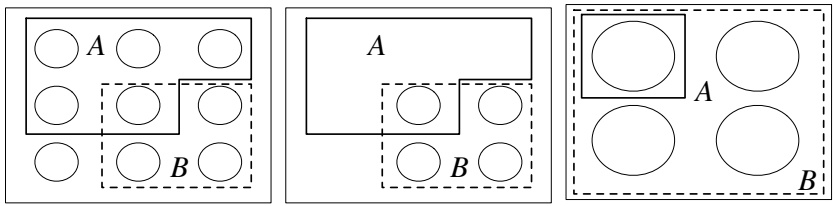

## FIGURE 2.1

Pebble World intuition for $P ( A | B )$ . From left to right: (a) Events A and B are subsets of the sample space. (b) Because we know B occurred, get rid of the outcomes in B<sup>c</sup>. (c) In the restricted sample space, renormalize so the total mass is still 1.

Now suppose that we learn that B occurred. In Figure 2.1(b), upon obtaining this information, we get rid of all the pebbles in $B ^ { c }$ because they are incompatible with the knowledge that B has occurred. Then $P ( A \cap B )$ is the total mass of the pebbles remaining in A. Finally, in Figure 2.1(c), we renormalize, that is, divide all the masses by a constant so that the new total mass of the remaining pebbles is 1. This is achieved by dividing by $P ( B )$ , the total mass of the pebbles in B. The updated mass of the outcomes corresponding to event A is the conditional probability $P(A|B)=P(A\cap B)/P(B)$

In this way, our probabilities have been updated in accordance with the observed evidence. Outcomes that contradict the evidence are discarded, and their mass is redistributed among the remaining outcomes, preserving the relative masses of the remaining outcomes. For example, if pebble 2 weighs twice as much as pebble 1 initially, and both are contained in B, then after conditioning on B it is still true that pebble 2 weighs twice as much as pebble 1. But if pebble 2 is not contained in B, then after conditioning on B its mass is updated to 0. 

Intuition 2.2.4 (Frequentist interpretation). Recall that the frequentist interpretation of probability is based on relative frequency over a large number of repeated trials. Imagine repeating our experiment many times, generating a long list of observed outcomes. The conditional probability of A given B can then be thought of in a natural way: it is the fraction of times that A occurs, restricting attention to the trials where B occurs.

In Figure 2.2, our experiment has outcomes which can be written as a string of 0’s and 1’s; B is the event that the first digit is 1 and A is the event that the second digit is 1. Conditioning on B, we circle all the repetitions where B occurred, and then we look at the fraction of circled repetitions in which event A also occurred.

In symbols, let $n _ { A } , n _ { B } , n _ { A B }$ be the number of occurrences of A, B, A∩B respectively in a large number n of repetitions of the experiment. The frequentist interpretation

---

Conditional probability

49

is that

$$
P (A) \approx \frac {n _ {A}}{n}, P (B) \approx \frac {n _ {B}}{n}, P (A \cap B) \approx \frac {n _ {A B}}{n}.
$$

Then $P ( A | B )$ is interpreted as $n _ { A B } / n _ { B }$ , which equals $( n _ { A B } / n ) / ( n _ { B } / n )$ . This interpretation again translates to $P(A|B)=P(A\cap B)/P(B)$ 

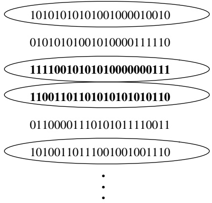

<details>
<summary>flowchart</summary>

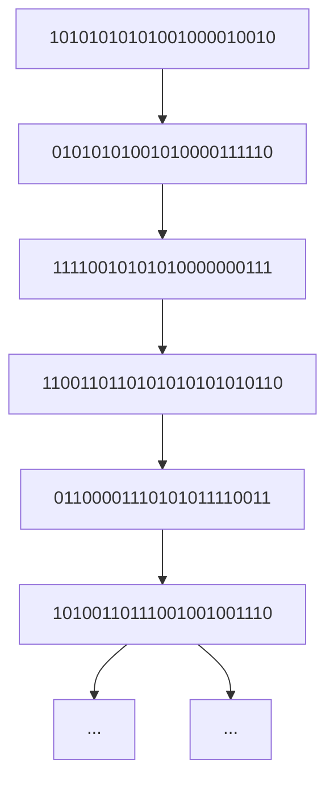
</details>

## FIGURE 2.2

Frequentist intuition for $P ( A | B )$ . The repetitions where B occurred are circled; among these, the repetitions where A occurred are highlighted in bold. $P ( A | B )$ is the long-run relative frequency of the repetitions where A occurs, within the subset of repetitions where B occurs.

For practice with applying the definition of conditional probability, let’s do some more examples. The next three examples all start with the same basic scenario of a family with two children, but subtleties arise depending on the exact assumptions and the exact information we condition on.

Example 2.2.5 (Two children). Martin Gardner posed the following puzzle in the 1950s, in his column in Scientific American.

Mr. Jones has two children. The older child is a girl. What is the probability that both children are girls?

Mr. Smith has two children. At least one of them is a boy. What is the probability that both children are boys?

At first glance this problem seems like it should be a simple application of conditional probability, but for decades there have been controversies about whether or why the two parts of the problem should have different answers, and the extent to which the problem is ambiguous. Gardner gave the answers 1/2 and $1 / 3$ to the two parts, respectively, which may seem paradoxical: why should it matter whether we learn the older child’s gender, as opposed to just learning one child’s gender?

It is important to clarify the assumptions of the problem. Several implicit assumptions are being made to obtain the answers that Gardner gave.

---

50

Introduction to Probability

• It assumes that gender is binary, so that each child can be definitively categorized as a boy or a girl. In fact, many people don’t neatly fit into either of the categories “male” or “female”, and identify themselves as having a non-binary gender.
• It assumes that $P ( \mathrm { b o y } )   =   P ( \mathrm { g i r l } )$ , both for the elder child and for the younger child. In fact, in most countries slightly more boys are born than girls. For example, in the United States it is commonly estimated that 105 boys are born for every 100 girls who are born.
• It assumes that the genders of the two children are independent, i.e., knowing the elder child’s gender gives no information about the younger child’s gender, and vice versa. This would be unrealistic if, e.g., the children were identical twins.

Under these (admittedly problematic) simplifying assumptions, we can solve the problem as follows.

Solution:

With the assumptions listed above, the definition of conditional probability gives

$$
P (\text {both girls} | \text {elder is a girl}) = \frac {P (\text {both girls, elder is a girl})}{P (\text {elder is a girl})} = \frac {1 / 4}{1 / 2} = 1 / 2,
$$

$$
P (\text {both girls} | \text {at least one girl}) = \frac {P (\text {both girls, at least one girl})}{P (\text {at least one girl})} = \frac {1 / 4}{3 / 4} = 1 / 3.
$$

(We solved the second part of the problem in terms of girls rather than boys to make it a bit easier to compare the two parts of the problem.) It may seem counterintuitive that the two results are different, since there is no reason for us to care whether the elder child is a girl as opposed to the younger child. Indeed, by symmetry,

$$
P (\text {both girls|younger is a girl}) = P (\text {both girls|elder is a girl}) = 1 / 2.
$$

However, there is no such symmetry between the conditional probabilities P(both girls|elder is a girl) and P(both girls|at least one girl). Saying that the elder child is a girl designates a specific child, and then the other child (the younger child) has a 50% chance of being a girl. “At least one” does not refer to a specific child. Conditioning on a specific child being a girl knocks away 2 of the 4 “pebbles” in the sample space $\{ G G , G B , B G , B B \}$ , where, for example, GB means the elder child is a girl and the younger child is a boy. In contrast, conditioning on at least one child being a girl knocks away only BB. 

Example 2.2.6 (Random child is a girl). A family has two children. You randomly run into one of the two, and learn that she is a girl. With assumptions as in the previous example, what is the conditional probability that both are girls? Also assume that you are equally likely to run into either child, and that which one you run into has nothing to do with gender.

---

Conditional probability

51

## Solution:

Intuitively, the answer should be $1 / 2 :$ imagine that the child we encountered is in front of us and the other is at home. Both being girls just says that the child who is at home is a girl, which seems to have nothing to do with the fact that the child in front of us is a girl. But let us check this more carefully, using the definition of conditional probability. This is also good practice with writing events in set notation.

Let $G _ { 1 } , G _ { 2 }$ , and $G _ { 3 }$ be the events that the elder, younger, and random child is a girl, respectively. By assumption, $P ( G _ { 1 } )   =   P ( G _ { 2 } )   =   P ( G _ { 3 } )   =   1 / 2$ . By the naive definition, or by independence as explained in Section 2.5, $P ( G _ { 1 } \cap G _ { 2 } ) = 1 / 4$ . Thus,

$$
P (G _ {1} \cap G _ {2} | G _ {3}) = P (G _ {1} \cap G _ {2} \cap G _ {3}) / P (G _ {3}) = (1 / 4) / (1 / 2) = 1 / 2,
$$

since $G _ { 1 } \cap G _ { 2 } \cap G _ { 3 } = G _ { 1 } \cap G _ { 2 }$ (if both children are girls, it guarantees that the random child is a girl).

Keep in mind though that in order to arrive at $1 / 2$ , an assumption was needed about how the random child was selected. In statistical language, we say that we collected a random sample; here the sample consists of one of the two children. One of the most important principles in statistics is that it is essential to think carefully about how the sample was collected, not just stare at the raw data without understanding where they came from. To take a simple extreme case, suppose that a repressive law forbids a boy from leaving the house if he has a sister. Then “the random child is a $\mathrm { g i r l } ^ { \mathfrak { s } }$ is equivalent to “at least one of the children is a $\mathrm { g i r l ^ { \prime \prime } }$ , so the problem reduces to the first part of Example 2.2.5. 

Example 2.2.7 (A girl born in winter). A family has two children. Find the probability that both children are girls, given that at least one of the two is a girl who was born in winter. In addition to the assumptions from Example 2.2.5, assume that the four seasons are equally likely and that gender is independent of season. (This means that knowing the gender gives no information about the probabilities of the seasons, and vice versa; see Section 2.5 for much more about independence.)

## Solution:

By definition of conditional probability,

$$
P (\text {both girls} | \text {at least one winter girl}) = \frac {P (\text {both girls, at least one winter girl})}{P (\text {at least one winter girl})}.
$$

Since the probability that a specific child is a winter-born girl is $1 / 8$ , the denominator equals

$$
P (\text {at least one winter girl}) = 1 - (7 / 8) ^ {2}.
$$

To compute the numerator, use the fact that “both girls, at least one winter $\mathrm { g i r l } ^ { \flat }$ is the same event as “both girls, at least one winter $\mathrm { c h i l d ^ { \prime \prime } }$ ; then use the assumption

---

52

Introduction to Probability

that gender and season are independent:

$$
\begin{array}{l} P (\text { both   girls,   at   least   one   winter   girl }) = P (\text { both   girls,   at   least   one   winter   child }) \\ = (1 / 4) P (\text {at least one winter child}) \\ = (1 / 4) (1 - P (\text {both are non - winter})) \\ = (1 / 4) (1 - (3 / 4) ^ {2}). \\ \end{array}
$$

Thus,

$$
P (\text {both girls|at least one winter girl}) = \frac {(1 / 4) (1 - (3 / 4) ^ {2})}{1 - (7 / 8) ^ {2}} = \frac {7 / 6 4}{1 5 / 6 4} = 7 / 1 5.
$$

At first this result seems absurd! In Example 2.2.5, the result was that the conditional probability of both children being girls, given that at least one is a girl, is $1 / 3 ;$ why should it be any different when we learn that at least one is a winter-born girl? The point is that information about the birth season brings “at least one is a $\mathrm { g i r l ^ { \prime \prime } }$ closer to $^ { \mathrm { a } }$ specific one is a $\mathrm { g i r l } ^ { \flat }$ . Conditioning on more and more specific information brings the probability closer and closer to $1 / 2 .$

For example, conditioning on “at least one is a girl who was born on a March 31 at 8:20 pm” comes very close to specifying a child, and learning information about a specific child does not give us information about the other child. The seemingly irrelevant information such as season of birth interpolates between the two parts of Example 2.2.5. Exercise 29 generalizes this example to an arbitrary characteristic that is independent of gender. 

## 2.3 Bayes’ rule and the law of total probability

The definition of conditional probability is simple—just a ratio of two probabilities— but it has far-reaching consequences. The first consequence is obtained easily by moving the denominator in the definition to the other side of the equation.

Theorem 2.3.1 (Probability of the intersection of two events). For any events A and B with positive probabilities,

$$
P (A \cap B) = P (B) P (A | B) = P (A) P (B | A).
$$

This follows from taking the definition of $P ( A | B )$ and multiplying both sides by $P ( B )$ , and then taking the definition of $P ( B | A )$ and multiplying both sides by $P ( A )$ . At first sight this theorem may not seem very useful: it is the definition of conditional probability, just written slightly differently, and anyway it seems circular to use $P ( A | B )$ to help find $P ( A \cap B )$ when $P ( A | B )$ was defined in terms of $P ( A \cap B )$ But we will see that the theorem is in fact very useful, since it often turns out to be

---

Conditional probability

53

possible to find conditional probabilities without going back to the definition, and in such cases Theorem 2.3.1 can help us more easily find $P ( A \cap B )$

Applying Theorem 2.3.1 repeatedly, we can generalize to the intersection of n events.

Theorem 2.3.2 (Probability of the intersection of n events). For any events $A _ { 1 } , \ldots , A _ { n }$ with $P ( A _ { 1 } , A _ { 2 } , \ldots , A _ { n - 1 } ) > 0$ ,

$$
P (A _ {1}, A _ {2}, \dots , A _ {n}) = P (A _ {1}) P (A _ {2} | A _ {1}) P (A _ {3} | A _ {1}, A _ {2}) \dots P (A _ {n} | A _ {1}, \dots , A _ {n - 1}),
$$

The commas denote intersections, e.g., $P ( A _ { 3 } | A _ { 1 } , A _ { 2 } )$ is $P ( A _ { 3 } | A _ { 1 } \cap A _ { 2 } )$

In fact, this is n! theorems in one, since we can permute $A _ { 1 } , \ldots , A _ { n }$ however we want without affecting the left-hand side. Often the right-hand side will be much easier to compute for some orderings than for others. For example,

$$
P (A _ {1}, A _ {2}, A _ {3}) = P (A _ {1}) P (A _ {2} | A _ {1}) P (A _ {3} | A _ {1}, A _ {2}) = P (A _ {2}) P (A _ {3} | A _ {2}) P (A _ {1} | A _ {2}, A _ {3}),
$$

and there are 4 other expansions of this form too. It often takes practice and thought to be able to know which ordering to use.

We are now ready to introduce the two main theorems of this chapter—Bayes’ rule and the law of total probability—which will allow us to compute conditional probabilities in a wide range of problems. Bayes’ rule is an extremely famous, extremely useful result that relates $P ( A | B )$ to $P ( B | A )$

Theorem 2.3.3 (Bayes’ rule).

$$
P (A | B) = \frac {P (B | A) P (A)}{P (B)}.
$$

This follows immediately from Theorem 2.3.1, which in turn followed immediately from the definition of conditional probability. Yet Bayes’ rule has important implications and applications in probability and statistics, since it is so often necessary to find conditional probabilities, and often $P ( B | A )$ is much easier to find directly than $P ( A | B )$ (or vice versa).

Another way to write Bayes’ rule is in terms of odds rather than probability.

Definition 2.3.4 (Odds). The odds of an event A are

$$
\mathrm{odds} (A) = P (A) / P (A ^ {c}).
$$

For example, if $P ( A )   =   2 / 3$ , we say the odds in favor of A are 2 to 1. (This is sometimes written as 2 : 1, and is sometimes stated as 1 to 2 odds against A; care is needed since some sources do not explicitly state whether they are referring to odds in favor or odds against an event.) Of course we can also convert from odds back to probability:

$$
P (A) = \mathrm{odds} (A) / (1 + \mathrm{odds} (A)).
$$

---

54

Introduction to Probability

By taking the Bayes’ rule expression for $P ( A | B )$ and dividing it by the Bayes’ rule expression for $P ( A ^ { c } | B )$ , we arrive at the odds form of Bayes’ rule.

Theorem 2.3.5 (Odds form of Bayes’ rule). For any events A and B with positive probabilities, the odds of A after conditioning on B are

$$
\frac {P (A | B)}{P (A ^ {c} | B)} = \frac {P (B | A)}{P (B | A ^ {c})} \frac {P (A)}{P (A ^ {c})}.
$$

In words, this says that the posterior odds $P ( A | B ) / P ( A ^ { c } | B )$ are equal to the prior odds $P ( A ) / P ( A ^ { c } )$ times the factor $P ( B | A ) / P ( B | A ^ { c } )$ , which is known in statistics as the likelihood ratio. Sometimes it is convenient to work with this form of Bayes rule to get the posterior odds, and then if desired we can convert from odds back to probability.

The law of total probability (LOTP) relates conditional probability to unconditional probability. It is essential for fulfilling the promise that conditional probability can be used to decompose complicated probability problems into simpler pieces, and it is often used in tandem with Bayes’ rule.

Theorem 2.3.6 (Law of total probability). Let $A _ { 1 } , \ldots , A _ { n }$ be a partition of the sample space $S ( \mathrm { i . e . } ,$ the $A _ { i }$ are disjoint events and their union is S), with $P ( A _ { i } ) > 0$ for all i. Then

$$
P (B) = \sum_ {i = 1} ^ {n} P (B | A _ {i}) P (A _ {i}).
$$

Proof. Since the $A _ { i }$ form a partition of S, we can decompose B as

$$
B = (B \cap A _ {1}) \cup (B \cap A _ {2}) \cup \dots \cup (B \cap A _ {n}).
$$

This is illustrated in Figure 2.3, where we have chopped B into the smaller pieces $B \cap A _ { 1 }$ through $B \cap A _ { n }$ . By the second axiom of probability, because these pieces are disjoint, we can add their probabilities to get $P ( B )$

$$
P (B) = P (B \cap A _ {1}) + P (B \cap A _ {2}) + \dots + P (B \cap A _ {n}).
$$

Now we can apply Theorem 2.3.1 to each of the $P ( B \cap A _ { i } )$

$$
P (B) = P (B | A _ {1}) P (A _ {1}) + \dots + P (B | A _ {n}) P (A _ {n}).
$$

The law of total probability tells us that to get the unconditional probability of $B ,$ we can divide the sample space into disjoint slices $A _ { i }$ , find the conditional probability of B within each of the slices, then take a weighted sum of the conditional probabilities, where the weights are the probabilities $P ( A _ { i } )$ . The choice of how to divide up the sample space is crucial: a well-chosen partition will reduce a complicated problem into simpler pieces, whereas a poorly chosen partition will only exacerbate our problems, requiring us to calculate n difficult probabilities instead of just one!

The next few examples show how we can use Bayes’ rule together with the law of total probability to update our beliefs based on observed evidence.

---

Conditional probability

55

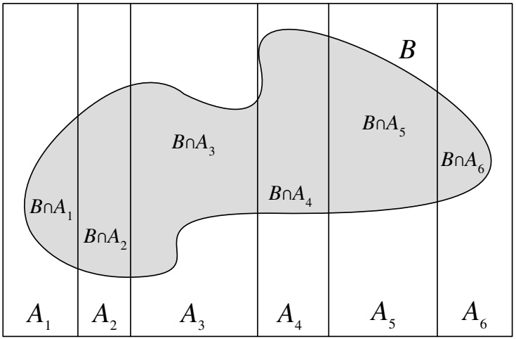

<details>
<summary>text_image</summary>

B∩A₁
B∩A₂
B∩A₃
B∩A₄
B
B∩A₅
B∩A₆
A₁
A₂
A₃
A₄
A₅
A₆
</details>

## FIGURE 2.3

The $A _ { i }$ partition the sample space; $P ( B )$ is equal to $\textstyle \sum _ { i } P ( B \cap A _ { i } )$

Example 2.3.7 (Random coin). You have one fair coin, and one biased coin which lands Heads with probability $3 / 4$ . You pick one of the coins at random and flip it three times. It lands Heads all three times. Given this information, what is the probability that the coin you picked is the fair one?

## Solution:

Let A be the event that the chosen coin lands Heads three times and let $F$ be the event that we picked the fair coin. We are interested in $P ( F | A )$ , but it is easier to find $P ( A | F )$ and $P ( A | F ^ { c } )$ since it helps to know which coin we have; this suggests using Bayes’ rule and the law of total probability. Doing so, we have

$$
\begin{array}{l} P (F | A) = \frac {P (A | F) P (F)}{P (A)} \\ = \frac {P (A | F) P (F)}{P (A | F) P (F) + P (A | F ^ {c}) P (F ^ {c})} \\ = \frac {(1 / 2) ^ {3} \cdot 1 / 2}{(1 / 2) ^ {3} \cdot 1 / 2 + (3 / 4) ^ {3} \cdot 1 / 2} \\ \approx 0. 2 3. \\ \end{array}
$$

Before flipping the coin, we thought we were equally likely to have picked the fair coin as the biased coin: $P ( F ) = P ( F ^ { c } ) = 1 / 2$ . Upon observing three Heads, however, it becomes more likely that we’ve chosen the biased coin than the fair coin, so $P ( F | A )$ is only about 0.23. 

h 2.3.8 (Prior vs. posterior). It would not be correct in the calculation in the above example to say after the first step, ${ } ^ { \llangle } P ( A ) = 1$ because we know A happened.” It is true that $P ( A | A ) = 1$ , but $P ( A )$ is the prior probability of A and $P ( F )$ is the prior probability of F—both are the probabilities before we observe any data in the

---

56

Introduction to Probability

experiment. These must not be confused with posterior probabilities conditional on the evidence A.

Example 2.3.9 (Testing for a rare disease). A patient named Fred is tested for a disease called conditionitis, a medical condition that afflicts 1% of the population. The test result is positive, i.e., the test claims that Fred has the disease. Let D be the event that Fred has the disease and T be the event that he tests positive.

Suppose that the test is $\textquotesingle 9 5 \%$ accurate”; there are different measures of the accuracy of a test, but in this problem it is assumed to mean that $P ( T | D ) \; = \; 0 . 9 5$ and $P ( T ^ { c } | D ^ { c } ) = 0 . 9 5$ . The quantity $P ( T | D )$ is known as the sensitivity or true positive rate of the test, and $P ( T ^ { c } | D ^ { c } )$ is known as the specificity or true negative rate.

Find the conditional probability that Fred has conditionitis, given the evidence provided by the test result.

Solution:

Applying Bayes’ rule and the law of total probability, we have

$$
\begin{array}{l} P (D | T) = \frac {P (T | D) P (D)}{P (T)} \\ = \frac {P (T | D) P (D)}{P (T | D) P (D) + P (T | D ^ {c}) P (D ^ {c})} \\ = \frac {0 . 9 5 \cdot 0 . 0 1}{0 . 9 5 \cdot 0 . 0 1 + 0 . 0 5 \cdot 0 . 9 9} \\ \approx 0. 1 6. \\ \end{array}
$$

So there is only a 16% chance that Fred has conditionitis, given that he tested positive, even though the test seems to be quite reliable!

Most people find it surprising to learn that the conditional probability of having the disease given a positive test result is only 16%, even though the test is 95% accurate (see Gigerenzer and Hoffrage [13]). The key to understanding this surprisingly low posterior probability of having the disease is to realize that there are two factors at play: the evidence from the test, and our prior information about the prevalence of the disease.

Although the test provides evidence in favor of disease, conditionitis is also a rare condition! The conditional probability $P ( D | T )$ reflects a balance between these two factors, appropriately weighing the rarity of the disease against the rarity of a mistaken test result.

For further intuition, consider a population of 10000 people as illustrated in Figure 2.4, where 100 have conditionitis and 9900 don’t; this corresponds to a 1% disease rate. If we tested everybody in the population, we’d expect that out of the 100 diseased individuals, 95 would test positive and 5 would test negative. Out of the 9900 healthy individuals, we’d expect $( 0 . 9 5 ) ( 9 9 0 0 ) \approx 9 4 0 5$ to test negative and 495 to test positive.

---

Conditional probability

57

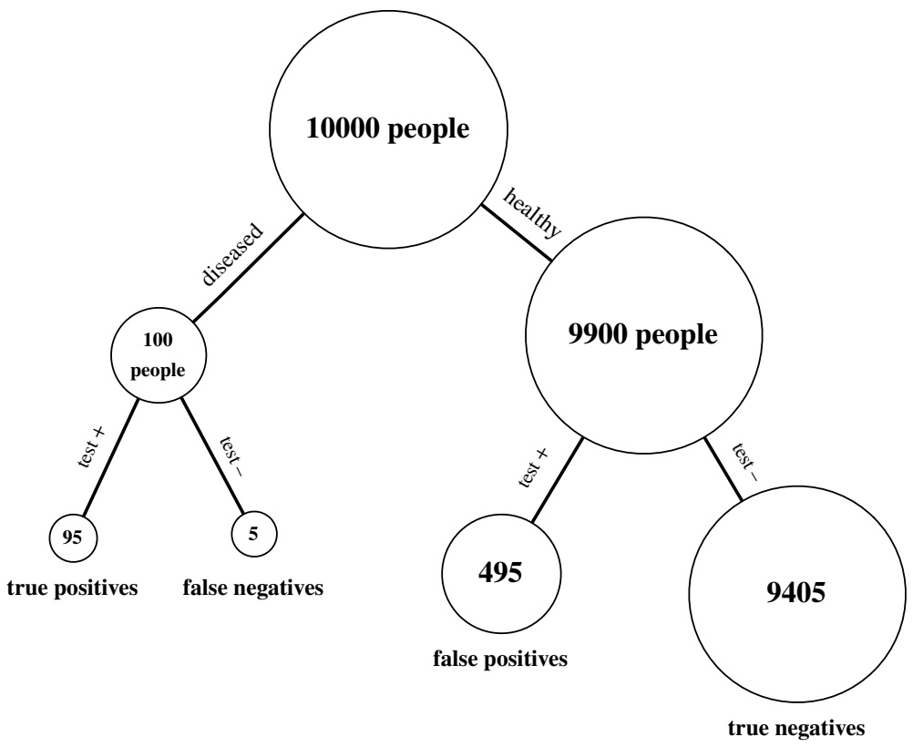

<details>
<summary>flowchart</summary>

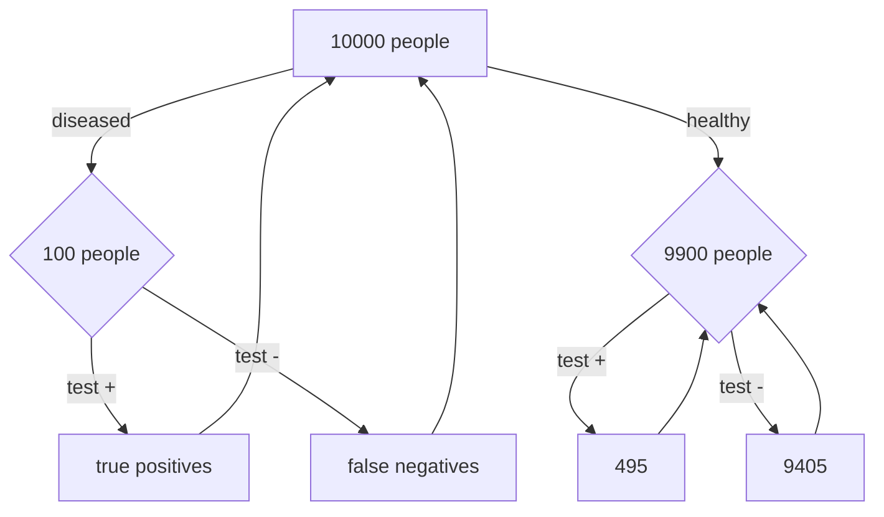
</details>

FIGURE 2.4

Testing for a rare disease in a population of 10000 people, where the prevalence of the disease is 1% and the true positive and true negative rates are both equal to 95%. Bubbles are not to scale.

---

58

Introduction to Probability

Now let’s focus in on those individuals who test positive; that is, let’s condition on a positive test result. The 95 true positives (i.e., the individuals who test positive and have the disease) are far outnumbered by the 495 false positives (i.e., the individuals who test positive despite not having the disease). So most people who test positive for the disease don’t actually have the disease! 

Example 2.3.10 (Six-fingered man). A crime has been committed in a certain country. The perpetrator is one (and only one) of the n men who live in the country. Initially, these n men are all deemed equally likely to be the perpetrator. An eyewitness then reports that the crime was committed by a man with six fingers on his right hand.

Let $p _ { 0 }$ be the probability that an innocent man has six fingers on his right hand, and $p _ { 1 }$ be the probability that the perpetrator has six fingers on his right hand, with $p _ { 0 } < p _ { 1 }$ . (We may have $p _ { 1 } < 1$ , since eyewitnesses are not 100% reliable.) Let $a = p _ { 0 } / p _ { 1 }$ and $b = ( 1 - p _ { 1 } ) / ( 1 - p _ { 0 } )$

Rugen lives in the country. He is found to have six fingers on his right hand.

(a) Given this information, what is the probability that Rugen is the perpetrator?
(b) Now suppose that all n men who live in the country have their hands checked, and Rugen is the only one with six fingers on his right hand. Given this information, what is the probability that Rugen is the perpetrator?

## Solution:

(a) Let R be the event that Rugen is guilty and M be the event that he has six fingers on his right hand. By Bayes’ rule and LOTP,

$$
P (R | M) = \frac {P (M | R) P (R)}{P (M | R) P (R) + P (M | R ^ {c}) P (R ^ {c})} = \frac {p _ {1} \cdot \frac {1}{n}}{p _ {1} \cdot \frac {1}{n} + p _ {0} \left(1 - \frac {1}{n}\right)} = \frac {1}{1 + a (n - 1)}.
$$

(b) Let N be the event that none of the men in the country other than Rugen have six fingers on their right hands. With notation as above,

$$
\begin{array}{l} P (R | M, N) = \frac {P (M , N | R) P (R)}{P (M , N | R) P (R) + P (M , N | R ^ {c}) P (R ^ {c})} \\ = \frac {p _ {1} (1 - p _ {0}) ^ {n - 1} \cdot \frac {1}{n}}{p _ {1} (1 - p _ {0}) ^ {n - 1} \cdot \frac {1}{n} + p _ {0} (1 - p _ {1}) (1 - p _ {0}) ^ {n - 2} \left(1 - \frac {1}{n}\right)} \\ = \frac {1}{1 + a b (n - 1)}. \\ \end{array}
$$



---

Conditional probability

59

## 2.4 Conditional probabilities are probabilities

When we condition on an event $E ,$ we update our beliefs to be consistent with this knowledge, effectively putting ourselves in a universe where we know that E occurred. Within our new universe, however, the laws of probability operate just as before. Conditional probability satisfies all the properties of probability! Therefore, any of the results we have derived about probability are still valid if we replace all unconditional probabilities with probabilities conditional on $E .$ In particular:

• Conditional probabilities are between 0 and 1.
$P ( S | E ) = 1 ,   P ( \emptyset | E ) = 0 .$
• If $A _ { 1 } , A _ { 2 } , \ldots$ are disjoint, then $\textstyle P ( \cup _ { j = 1 } ^ { \infty } A _ { j } | E ) = \sum _ { j = 1 } ^ { \infty } P ( A _ { j } | E )$
$P(A^{c}|E)=1-P(A|E)$
• Inclusion-exclusion: $P ( A \cup B | E ) = P ( A | E ) + P ( B | E ) - P ( A \cap B | E ) .$

h 2.4.1. When we write $P ( A | E )$ , it does not mean that $A | E$ is an event and we’re taking its probability; $A | E$ is not an event. Rather, $P ( \cdot | E )$ is a probability function which assigns probabilities in accordance with the knowledge that E has occurred, and $P ( \cdot )$ is a different probability function which assigns probabilities without regard for whether $E$ has occurred or not. When we take an event A and plug it into the $P ( \cdot )$ function, we’ll get a number, $P ( A )$ ; when we plug it into the $P ( \cdot | E )$ function, we’ll get another number, $P ( A | E )$ , which incorporates the information (if any) provided by knowing that $E$ occurred.

To prove mathematically that conditional probabilities are probabilities, fix an event $E$ with $P ( E ) > 0$ , and for any event A, define $\tilde { P } ( A ) = P ( A | E )$ . This notation helps emphasize the fact that we are fixing $E$ and treating $P ( \cdot | E )$ as our new probability function. We just need to check the two axioms of probability. First,

$$
\tilde {P} (\emptyset) = P (\emptyset | E) = \frac {P (\emptyset \cap E)}{P (E)} = 0, \tilde {P} (S) = P (S | E) = \frac {P (S \cap E)}{P (E)} = 1.
$$

Second, if $A _ { 1 } , A _ { 2 } , \ldots$ . are disjoint events, then

$$
\tilde {P} (A _ {1} \cup A _ {2} \cup \dots) = \frac {P ((A _ {1} \cap E) \cup (A _ {2} \cap E) \cup \cdots)}{P (E)} = \frac {\sum_ {j = 1} ^ {\infty} P (A _ {j} \cap E)}{P (E)} = \sum_ {j = 1} ^ {\infty} \tilde {P} (A _ {j}).
$$

So $\tilde { P }$ satisfies the axioms of probability.

Conversely, all probabilities can be thought of as conditional probabilities: whenever we make a probability statement, there is always some background information that we are conditioning on, even if we don’t state it explicitly. Consider the rain example from the beginning of this chapter. It would be natural to base the initial probability

---

60

Introduction to Probability

of rain today, $P ( R )$ , on the fraction of days in the past on which it rained. But which days in the past should we look at? If it’s November 1, should we only count past rainy days in autumn, thus conditioning on the season? What about conditioning on the exact month, or the exact day? We could ask the same about location: should we look at days when it rained in our exact location, or is it enough for it to have rained somewhere nearby?

In order to determine the seemingly unconditional probability $P ( R )$ , we actually have to make decisions about what background information to condition on! These choices require careful thought and different people may come up with different prior probabilities $P ( R )$ (though everyone can agree on how to update based on new evidence).

Since all probabilities are conditional on background information, we can imagine that there is always a vertical conditioning bar, with background knowledge K to the right of the vertical bar. Then the unconditional probability $P ( A )$ is just shorthand for $P ( A | K )$ ; the background knowledge is absorbed into the letter $P$ instead of being written explicitly.

To summarize our discussion in a nutshell:

Conditional probabilities are probabilities, and all probabilities are conditional.

We now state conditional forms of Bayes’ rule and the law of total probability. These are obtained by taking the ordinary forms of Bayes’ rule and LOTP and adding $E$ to the right of the vertical bar everywhere.

Theorem 2.4.2 (Bayes’ rule with extra conditioning). Provided that $P ( A \cap E ) > 0$ and $P(B \cap E) > 0$ , we have

$$
P (A | B, E) = \frac {P (B | A , E) P (A | E)}{P (B | E)}.
$$

Theorem 2.4.3 (LOTP with extra conditioning). Let $A _ { 1 } , \ldots , A _ { n }$ be a partition of S. Provided that $P ( A _ { i } \cap E ) > 0$ for all i, we have

$$
P (B | E) = \sum_ {i = 1} ^ {n} P (B | A _ {i}, E) P (A _ {i} | E).
$$

The extra conditioning forms of Bayes’ rule and LOTP can be proved similarly to how we verified that $\tilde { P }$ satisfies the axioms of probability, but they also follow directly from the “metatheorem” that conditional probabilities are probabilities.

Example 2.4.4 (Random coin, continued). Continuing with the scenario from Example 2.3.7, suppose that we have now seen our chosen coin land Heads three times. If we toss the coin a fourth time, what is the probability that it will land Heads once more?

---

Conditional probability

61

## Solution:

As before, let A be the event that the chosen coin lands Heads three times, and define a new event H for the chosen coin landing Heads on the fourth toss. We are interested in $P ( H | A )$ . It would be very helpful to know whether we have the fair coin. LOTP with extra conditioning gives us $P ( H | A )$ as a weighted average of $P ( H | F , A )$ and $P ( H | F ^ { c } , A )$ , and within these two conditional probabilities we do know whether we have the fair coin:

$$
\begin{array}{l} P (H | A) = P (H | F, A) P (F | A) + P (H | F ^ {c}, A) P (F ^ {c} | A) \\ \approx \frac {1}{2} \cdot 0. 2 3 + \frac {3}{4} \cdot (1 - 0. 2 3) \\ \approx 0. 6 9. \\ \end{array}
$$

The posterior probabilities $P ( F | A )$ and $P ( F ^ { c } | A )$ are from our answer to Example 2.3.7.

An equivalent way to solve this problem is to define a new probability function $\tilde { P }$ such that for any event B, $\tilde { P } ( B ) = P ( B | A )$ . This new function assigns probabilities that are updated with the knowledge that A occurred. Then by the ordinary law of total probability,

$$
\tilde {P} (H) = \tilde {P} (H | F) \tilde {P} (F) + \tilde {P} (H | F ^ {c}) \tilde {P} (F ^ {c}),
$$

which is exactly the same as our use of LOTP with extra conditioning. This once again illustrates the principle that conditional probabilities are probabilities. 

Example 2.4.5 (Unanimous agreement). The article “Why too much evidence can be a bad thing” by Lisa $\mathrm { Z y g a }$ [30] says:

Under ancient Jewish law, if a suspect on trial was unanimously found guilty by all judges, then the suspect was acquitted. This reasoning sounds counterintuitive, but the legislators of the time had noticed that unanimous agreement often indicates the presence of systemic error in the judicial process.

There are $n$ judges deciding a case. The suspect has prior probability $p$ of being guilty. Each judge votes whether to convict or acquit the suspect. With probability s, a systemic error occurs (e.g., the defense is incompetent). If a systemic error occurs, then the judges unanimously vote to convict (i.e., all n judges vote to convict).

Whether a systemic error occurs is independent of whether the suspect is guilty. Given that a systemic error doesn’t occur and that the suspect is guilty, each judge has probability $c$ of voting to convict, independently. Given that a systemic error doesn’t occur and that the suspect is not guilty, each judge has probability w of voting to convict, independently. Suppose that

$$
0 <   p <   1, 0 <   s <   1, \text {and} 0 <   w <   \frac {1}{2} <   c <   1.
$$

(a) For this part only, suppose that exactly k out of $n$ judges vote to convict, where $k < n$ . Given this information, find the probability that the suspect is guilty.

---

62

Introduction to Probability

(b) Now suppose that all n judges vote to convict. Given this information, find the probability that the suspect is guilty.

(c) Is the answer to (b), viewed as a function of $n ,$ an increasing function? Give a short, intuitive explanation in words.

## Solution:

(a) Since $k < n$ , a systemic error didn’t occur. We will implicitly condition on this in this part. Let G be the event that the suspect is guilty and X be the number of judges who vote to convict. Using Bayes’ rule, LOTP, and the Binomial PMF,

$$
P (G | X = k) = \frac {P (X = k | G) P (G)}{P (X = k)} = \frac {p c ^ {k} (1 - c) ^ {n - k}}{p c ^ {k} (1 - c) ^ {n - k} + (1 - p) w ^ {k} (1 - w) ^ {n - k}}.
$$

(b) Let $U$ be the event $X = n$ and B be the event that a systemic error occurs. Then

$$
P (G | U) = \frac {P (U | G) P (G)}{P (U)} = \frac {p P (U | G)}{p P (U | G) + (1 - p) P (U | G ^ {c})}.
$$

By LOTP with extra conditioning,

$$
P (U | G) = P (U | G, B) P (B | G) + P (U | G, B ^ {c}) P (B ^ {c} | G) = s + (1 - s) c ^ {n},
$$

$$
P (U | G ^ {c}) = P (U | G ^ {c}, B) P (B | G ^ {c}) + P (U | G ^ {c}, B ^ {c}) P (B ^ {c} | G ^ {c}) = s + (1 - s) w ^ {n}.
$$

Thus,

$$
P (G | U) = \frac {p (s + (1 - s) c ^ {n})}{p (s + (1 - s) c ^ {n}) + (1 - p) (s + (1 - s) w ^ {n})}.
$$

(c) No, since a large value of n yields a high chance of systemic error, and if a systemic error occurs then the judges’ votes are uninformative about whether the suspect is guilty. The answer to (b) reverts to the prior probability p as $n \to \infty$ 

We often want to condition on more than one piece of information, and we now have several ways of doing that. For example, here are some approaches for finding $P ( A | B , C )$

1. We can think of $B , C$ as the single event B∩C and use the definition of conditional probability to get

$$
P (A | B, C) = \frac {P (A , B , C)}{P (B , C)}.
$$

This is a natural approach if it’s easiest to think about B and $C$ in tandem. We can then try to evaluate the numerator and denominator. For example, we can use LOTP in both the numerator and the denominator, or we can write the numerator as $P ( B , C | A ) P ( A )$ (which would give us a version of Bayes’ rule) and use LOTP to help with the denominator.

2. We can use Bayes’ rule with extra conditioning on $C$ to get

$$
P (A | B, C) = \frac {P (B | A , C) P (A | C)}{P (B | C)}.
$$

---

Conditional probability

63

This is a natural approach if we want to think of everything in our problem as being conditioned on C.

3. We can use Bayes’ rule with extra conditioning on B to get

$$
P (A | B, C) = \frac {P (C | A , B) P (A | B)}{P (C | B)}.
$$

This is the same as the previous approach, except with the roles of B and C swapped. We mention it separately just to emphasize that it’s a bad idea to plug into a formula without thinking about which event should play which role.

It is both challenging and powerful that there are a variety of ways to approach this kind of conditioning problem.

## 2.5 Independence of events

We have now seen several examples where conditioning on one event changes our beliefs about the probability of another event. The situation where events provide no information about each other is called independence.

Definition 2.5.1 (Independence of two events). Events A and B are independent if

$$
P (A \cap B) = P (A) P (B).
$$

If $P(A) > 0$ and $P(B) > 0$ , then this is equivalent to

$$
P (A | B) = P (A),
$$

and also equivalent to $P(B|A)=P(B)$

In words, two events are independent if we can obtain the probability of their intersection by multiplying their individual probabilities. Alternatively, A and B are independent if learning that B occurred gives us no information that would change our probabilities for A occurring (and vice versa).

Note that independence is a symmetric relation: if A is independent of B, then B is independent of A.

h 2.5.2. Independence is completely different from disjointness. If A and B are disjoint, then $P ( A \cap B ) = 0 ,$ , so disjoint events can be independent only if $P ( A ) = 0$ or $P ( B ) = 0$ . Knowing that A occurs tells us that B definitely did not occur, so A clearly conveys information about B, meaning the two events are not independent (except if A or B already has zero probability).

Intuitively, it makes sense that if A provides no information about whether or not B occurred, then it also provides no information about whether or not $B ^ { c }$ occurred. We now prove a handy result along those lines.

---

64

Introduction to Probability

Proposition 2.5.3. If A and B are independent, then A and $B ^ { c }$ are independent, $A ^ { c }$ and B are independent, and $A ^ { c }$ and $B ^ { c }$ are independent.

Proof. Let A and B be independent. We will first show that A and $B ^ { c }$ are independent. If $P(A) = 0$ , then A is independent of every event, including $B ^ { c }$ . So assume $P ( A ) \neq 0$ . Then

$$
P (B ^ {c} | A) = 1 - P (B | A) = 1 - P (B) = P (B ^ {c}),
$$

so A and $B ^ { c }$ are independent. Swapping the roles of A and $B ,$ we have that $A ^ { c }$ and B are independent. Using the fact that A, B independent implies $A , B ^ { c }$ independent, with $A ^ { c }$ playing the role of A, we also have that $A ^ { c }$ and $B ^ { c }$ are independent. 

We also often need to talk about independence of three or more events.

Definition 2.5.4 (Independence of three events). Events A, B, and $C$ are said to be independent if all of the following equations hold:

$$
\begin{array}{l} P (A \cap B) = P (A) P (B), \\ P (A \cap C) = P (A) P (C), \\ P (B \cap C) = P (B) P (C), \\ \end{array}
$$

$$
P (A \cap B \cap C) = P (A) P (B) P (C).
$$

If the first three conditions hold, we say that A, B, and C are pairwise independent. Pairwise independence does not imply independence: it is possible that just learning about A or just learning about $B$ is of no use in predicting whether $C$ occurred, but learning that both A and B occurred could still be highly relevant for C. Here is a simple example of this distinction.

Example 2.5.5 (Pairwise independence doesn’t imply independence). Consider two fair, independent coin tosses, and let A be the event that the first is Heads, B the event that the second is Heads, and C the event that both tosses have the same result. Then A, B, and C are pairwise independent but not independent, since $P ( A \cap B \cap C ) = 1 / 4$ while $P(A)P(B)P(C)=1/8$ . The point is that just knowing about A or just knowing about B tells us nothing about $C ,$ but knowing what happened with both A and B gives us information about C (in fact, in this case it gives us perfect information about C). 

On the other hand, $P ( A   \cap   B   \cap   C )   =   P ( A ) P ( B ) P ( C )$ does not imply pairwise independence; this can be seen quickly by looking at the extreme case $P ( A ) = 0$ when the equation becomes $0 = 0$ , which tells us nothing about B and $C .$

We can define independence of any number of events similarly. Intuitively, the idea is that knowing what happened with any particular subset of the events gives us no information about what happened with the events not in that subset.

---

Conditional probability

65

Definition 2.5.6 (Independence of many events). For n events $A _ { 1 } , A _ { 2 } , \ldots , A _ { n }$ to be independent, we require any pair to satisfy $P ( A _ { i } \cap A _ { j } ) = P ( A _ { i } ) P ( A _ { j } )$ (for $i \neq j )$ any triplet to satisfy $P ( A _ { i } \cap A _ { j } \cap A _ { k } ) \: = \: P ( A _ { i } ) P ( A _ { j } ) P ( A _ { k } )$ (for $i , j ,$ k distinct), and similarly for all quadruplets, quintuplets, and so on. This can quickly become unwieldy, but later we will discuss other ways to think about independence. For infinitely many events, we say that they are independent if every finite subset of the events is independent.

Conditional independence is defined analogously to independence.

Definition 2.5.7 (Conditional independence). Events A and B are said to be conditionally independent given E if $P(A \cap B|E) = P(A|E)P(B|E)$

h 2.5.8. It is easy to make terrible blunders stemming from confusing independence and conditional independence. Two events can be conditionally independent given $E$ , but not independent given $E ^ { c }$ . Two events can be conditionally independent given $E ,$ but not independent. Two events can be independent, but not conditionally independent given $E .$

In particular, $P(A,B)=P(A)P(B)$ does not imply $P(A,B|E)=P(A|E)P(B|E)$ we can’t just insert “given $E ^ { \flat }$ everywhere, as we did in going from LOTP to $\mathrm { L O T P }$ with extra conditioning. This is because LOTP always holds (it is a consequence of the axioms of probability), whereas $P(A,B)$ may or may not equal $P(A)P(B)$ depending on what A and B are.

The next few examples illustrate these distinctions. Great care is needed in working with conditional probabilities and conditional independence!

Example 2.5.9 (Conditional independence given E vs. given $E ^ { c } )$ . Suppose there are two types of classes: good classes and bad classes. In good classes, if you work hard, you are very likely to get an A. In bad classes, the professor randomly assigns grades to students regardless of their effort. Let G be the event that a class is good, W be the event that you work hard, and A be the event that you receive an A. Then W and A are conditionally independent given $G ^ { c }$ , but they are not conditionally independent given G. 

Example 2.5.10 (Conditional independence doesn’t imply independence). Returning once more to the scenario from Example 2.3.7, suppose we have chosen either a fair coin or a biased coin with probability $3 / 4$ of Heads, but we do not know which one we have chosen. We flip the coin a number of times. Conditional on choosing the fair coin, the coin tosses are independent, with each toss having probability $1 / 2$ of Heads. Similarly, conditional on choosing the biased coin, the tosses are independent, each with probability $3 / 4$ of Heads.

However, the coin tosses are not unconditionally independent, because if we don’t know which coin we’ve chosen, then observing the sequence of tosses gives us information about whether we have the fair coin or the biased coin in our hand. This in turn helps us to predict the outcomes of future tosses from the same coin.

---

66

Introduction to Probability

To state this formally, let $F$ be the event that we’ve chosen the fair coin, and let $A _ { 1 }$ and $A _ { 2 }$ be the events that the first and second coin tosses land Heads. Conditional on $F ,   A _ { 1 }$ and $A _ { 2 }$ are independent, but $A _ { 1 }$ and $A _ { 2 }$ are not unconditionally independent because $A _ { 1 }$ provides information about $A _ { 2 }$ 

Example 2.5.11 (Independence doesn’t imply conditional independence). My friends Alice and Bob are the only two people who ever call me on the phone. Each day, they decide independently whether to call me that day. Let A be the event that Alice calls me next Friday and B be the event that Bob calls me next Friday. Assume A and B are unconditionally independent with $P ( A ) > 0$ and $P(B) > 0$

However, given that I receive exactly one call next Friday, A and B are no longer independent: the call is from Alice if and only if it is not from Bob. In other words, letting C be the event that I receive exactly one call next Friday, $P ( B | C ) > 0$ while $P ( B | A , C ) = 0$ , so A and B are not conditionally independent given C. 

Example 2.5.12. (Why is the baby crying?) A certain baby cries if and only if she is hungry, tired, or both. Let C be the event that the baby is crying, H be the event that she is hungry, and $T$ be the event that she is tired. Let $P(C)=c,P(H)=h$ and $P ( T ) = t$ , where none of $c , h , t$ are equal to 0 or 1. Let H and T be independent.

(a) Find $c _ { \gamma }$ in terms of h and t.
(b) Find $P ( H | C ) , P ( T | C )$ , and $P ( H , T | C )$
(c) Are H and T conditionally independent given C? Explain in two ways: algebraically using the quantities from (b), and with an intuitive explanation in words.

Solution:

(a) Since H and T are independent, we have

$$
P (C) = P (H \cup T) = P (H) + P (T) - P (H \cap T) = h + t - h t.
$$

(b) By Bayes’ rule,

$$
\begin{array}{l} P (H | C) = \frac {P (C | H) P (H)}{P (C)} = \frac {h}{c}, \\ P (T | C) = \frac {P (C | T) P (T)}{P (C)} = \frac {t}{c}, \\ P (H, T | C) = \frac {P (C | H , T) P (H , T)}{P (C)} = \frac {h t}{c}. \\ \end{array}
$$

(c) No, H and $T$ are not conditionally independent given $C ,$ since

$$
P (H, T | C) = \frac {h t}{c} <   \frac {h t}{c ^ {2}} = P (H | C) P (T | C).
$$

We can also see intuitively why they are not conditionally independent given C: if the baby is crying but not hungry, she must be tired. 

---

Conditional probability

67

## 2.6 Coherency of Bayes’ rule

An important property of Bayes’ rule is that it is coherent: if we receive multiple pieces of information and wish to update our probabilities to incorporate all the information, it does not matter whether we update sequentially, taking each piece of evidence into account one at a time, or simultaneously, using all the evidence at once. Suppose, for example, that we’re conducting a weeklong experiment that yields data at the end of each day. We could use Bayes’ rule every day to update our probabilities based on the data from that day. Or we could go on vacation for the week, come back on Friday afternoon, and update using the entire week’s worth of data. Either method will give the same result.

Let’s look at a concrete application of this principle.

Example 2.6.1 (Testing for a rare disease, continued). Fred, who tested positive for conditionitis in Example 2.3.9, decides to get tested a second time. The new test is independent of the original test (given his disease status) and has the same sensitivity and specificity. Unfortunately for Fred, he tests positive a second time. Find the probability that Fred has the disease, given the evidence, in two ways: in one step, conditioning on both test results simultaneously, and in two steps, first updating the probabilities based on the first test result, and then updating again based on the second test result.

## Solution:

Let D be the event that he has the disease, $T _ { 1 }$ that the first test result is positive, and $T _ { 2 }$ that the second test result is positive. In Example 2.3.9, we used Bayes’ rule and the law of total probability to find $P ( D | T _ { 1 } )$ . Another quick solution uses the odds form of Bayes’ rule:

$$
\frac {P (D | T _ {1})}{P (D ^ {c} | T _ {1})} = \frac {P (D)}{P (D ^ {c})} \frac {P (T _ {1} | D)}{P (T _ {1} | D ^ {c})} = \frac {1}{9 9} \cdot \frac {0 . 9 5}{0 . 0 5} \approx 0. 1 9.
$$

Since $P ( D | T _ { 1 } ) / ( 1 - P ( D | T _ { 1 } ) ) = 0 . 1 9$ , we have $P ( D | T _ { 1 } ) = 0 . 1 9 / ( 1 + 0 . 1 9 ) \approx 0 . 1 6 ,$ in agreement with our answer from before. The odds form of Bayes’ rule is faster in this case because we don’t need to compute the unconditional probability $P ( T _ { 1 } )$ in the denominator of the ordinary Bayes’ rule. Now, again using the odds form of Bayes’ rule, let’s find out what happens if Fred tests positive a second time.

One-step method: Updating based on both test results at once, we have

$$
\begin{array}{l} \frac {P (D \mid T _ {1} \cap T _ {2})}{P (D ^ {c} \mid T _ {1} \cap T _ {2})} = \frac {P (D)}{P (D ^ {c})} \frac {P (T _ {1} \cap T _ {2} \mid D)}{P (T _ {1} \cap T _ {2} \mid D ^ {c})} \\ = \frac {1}{9 9} \cdot \frac {0 . 9 5 ^ {2}}{0 . 0 5 ^ {2}} = \frac {3 6 1}{9 9} \approx 3. 6 4 6, \\ \end{array}
$$

which corresponds to a probability of 0.78.

---

68

Introduction to Probability

Two-step method: After the first test, the posterior odds of Fred having the disease are

$$
\frac {P (D | T _ {1})}{P (D ^ {c} | T _ {1})} = \frac {1}{9 9} \cdot \frac {0 . 9 5}{0 . 0 5} \approx 0. 1 9,
$$

from the above. These posterior odds become the new prior odds, and then updating based on the second test gives

$$
\begin{array}{l} \frac {P (D | T _ {1} \cap T _ {2})}{P (D ^ {c} | T _ {1} \cap T _ {2})} = \frac {P (D | T _ {1})}{P (D ^ {c} | T _ {1})} \frac {P (T _ {2} | D , T _ {1})}{P (T _ {2} | D ^ {c} , T _ {1})} \\ = \left(\frac {1}{9 9} \cdot \frac {0 . 9 5}{0 . 0 5}\right) \frac {0 . 9 5}{0 . 0 5} = \frac {3 6 1}{9 9} \approx 3. 6 4 6, \\ \end{array}
$$

which is the same result as above.

Note that with a second positive test result, the probability that Fred has the disease jumps from 0.16 to 0.78, making us much more confident that Fred is actually afflicted with conditionitis. The moral of the story is that getting a second opinion is a good idea! 

## 2.7 Conditioning as a problem-solving tool

Conditioning is a powerful tool for solving problems because it lets us engage in wishful thinking: when we encounter a problem that would be made easier if only we knew whether E happened or not, we can condition on $E$ and then on $E ^ { c }$ consider these possibilities separately, then combine them using LOTP.

## 2.7.1 Strategy: condition on what you wish you knew

Example 2.7.1 (Monty Hall). On the game show Let’s Make a Deal, hosted by Monty Hall, a contestant chooses one of three closed doors, two of which have a goat behind them and one of which has a car. Monty, who knows where the car is, then opens one of the two remaining doors. The door he opens always has a goat behind it (he never reveals the car!). If he has a choice, then he picks a door at random with equal probabilities. Monty then offers the contestant the option of switching to the other unopened door. If the contestant’s goal is to get the car, should she switch doors?

---

Conditional probability

69

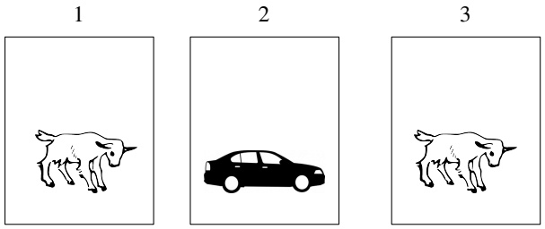

## Solution:

Let’s label the doors 1 through 3. Without loss of generality, we can assume the contestant picked door 1 (if she didn’t pick door 1, we could simply relabel the doors, or rewrite this solution with the door numbers permuted). Monty opens a door, revealing a goat. As the contestant decides whether or not to switch to the remaining unopened door, what does she really wish she knew? Naturally, her decision would be a lot easier if she knew where the car was! This suggests that we should condition on the location of the car. Let $C _ { i }$ be the event that the car is behind door $i ,$ for $i = 1 , 2 , 3$ . By the law of total probability,

$$
P (\text {get car}) = P (\text {get car} | C _ {1}) \cdot \frac {1}{3} + P (\text {get car} | C _ {2}) \cdot \frac {1}{3} + P (\text {get car} | C _ {3}) \cdot \frac {1}{3}.
$$

Suppose the contestant employs the switching strategy. If the car is behind door 1, then switching will fail, so $P ( \mathrm { g e t } ~ \mathrm { c a r } | C _ { 1 } ) = 0$ . If the car is behind door 2 or $3 ,$ then because Monty always reveals a goat, the remaining unopened door must contain the car, so switching will succeed. Thus,

$$
P (\text {get car}) = 0 \cdot \frac {1}{3} + 1 \cdot \frac {1}{3} + 1 \cdot \frac {1}{3} = \frac {2}{3},
$$

so the switching strategy succeeds $2 / 3$ of the time. The contestant should switch to the other door.

Figure 2.5 is a tree diagram of the argument we have just outlined: using the switching strategy, the contestant will win as long as the car is behind doors 2 or 3, which has probability $2 / 3$ . We can also give an intuitive frequentist argument in favor of switching. Imagine playing this game 1000 times. Typically, about 333 times your initial guess for the car’s location will be correct, in which case switching will fail. The other 667 or so times, you will win by switching.

There’s a subtlety though, which is that when the contestant chooses whether to switch, she also knows which door Monty opened. We showed that the unconditional probability of success is $2 / 3$ (when following the switching strategy), but let’s also show that the conditional probability of success for switching, given the information that Monty provides, is also $2 / 3$

Let $M _ { j }$ be the event that Monty opens door $j ,$ for $j = 2 , 3$ . Then

$$
P (\text {get car}) = P (\text {get car} | M _ {2}) P (M _ {2}) + P (\text {get car} | M _ {3}) P (M _ {3}),
$$

---

70

Introduction to Probability

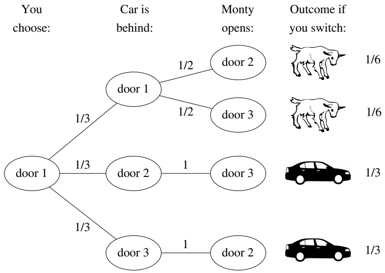

<details>
<summary>flowchart</summary>

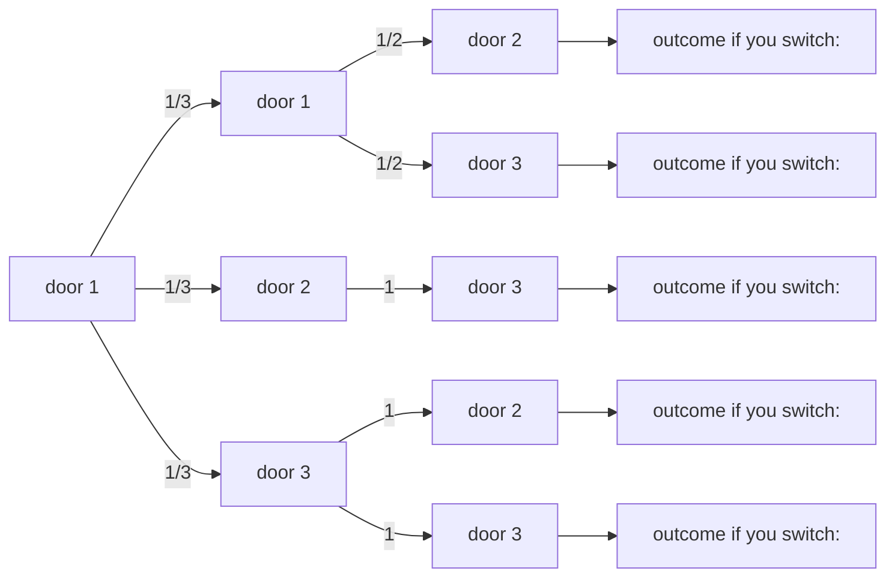
</details>

## FIGURE 2.5

Tree diagram of Monty Hall problem. Switching gets the car $2 / 3$ of the time.

where by symmetry $P ( M _ { 2 } ) = P ( M _ { 3 } ) = 1 / 2$ and $P ( \mathrm { g e t } ~ \mathrm { c a r } | M _ { 2 } )   =   P ( \mathrm { g e t } ~ \mathrm { c a r } | M _ { 3 } )$ The symmetry here is that there is nothing in the statement of the problem that distinguishes between door 2 and door $3 ;$ in contrast, Problem 40 considers a scenario where Monty enjoys opening door 2 more than he enjoys opening door 3.

Let $x = P ( \mathrm { g e t ~ c a r } | M _ { 2 } ) = P ( \mathrm { g e t ~ c a r } | M _ { 3 } )$ . Plugging in what we know,

$$
\frac {2}{3} = P (\text {get car}) = \frac {x}{2} + \frac {x}{2} = x,
$$

as claimed.

Bayes’ rule also works nicely for finding the conditional probability of success using the switching strategy, given the evidence. Suppose that Monty opens door 2. Using the notation and results above,

$$
P (C _ {1} | M _ {2}) = \frac {P (M _ {2} | C _ {1}) P (C _ {1})}{P (M _ {2})} = \frac {(1 / 2) (1 / 3)}{1 / 2} = \frac {1}{3}.
$$

So given that Monty opens door $^ { 2 , }$ there is a $1 / 3$ chance that the contestant’s original choice of door has the car, which means that there is a $2 / 3$ chance that the switching strategy will succeed.

Many people, upon seeing this problem for the first time, argue that there is no advantage to switching: “There are two doors remaining, and one of them has the car, so the chances are $50 - 50.$ After the last chapter, we recognize that this argument misapplies the naive definition of probability. Yet the naive definition, even when inappropriate, has a powerful hold on people’s intuitions. When Marilyn vos Savant presented a correct solution to the Monty Hall problem in her column

---

Conditional probability

71

for Parade magazine in 1990, she received thousands upon thousands of letters from readers (even mathematicians) insisting that she was wrong.

To build correct intuition, let’s consider an extreme case. Suppose that there are a million doors, 999,999 of which contain goats and 1 of which has a car. After the contestant’s initial pick, Monty opens 999,998 doors with goats behind them and offers the choice to switch. In this extreme case, it becomes clear that the probabilities are not 50-50 for the two unopened doors; very few people would stubbornly stick with their original choice. The same is true for the three-door case.

Just as we had to make assumptions about how we came across the random girl in Example 2.2.6, here the $2 / 3$ success rate of the switching strategy depends on the assumptions we make about how Monty decides which door to open. In the exercises, we consider several variants and generalizations of the Monty Hall problem, some of which change the desirability of the switching strategy. 

## 2.7.2 Strategy: condition on the first step

In problems with a recursive structure, it can often be useful to condition on the first step of the experiment. The next two examples apply this strategy, which we call first-step analysis.

Example 2.7.2 (Branching process). A single amoeba, Bobo, lives in a pond. After one minute Bobo will either die, split into two amoebas, or stay the same, with equal probability, and in subsequent minutes all living amoebas will behave the same way, independently. What is the probability that the amoeba population will eventually die out?

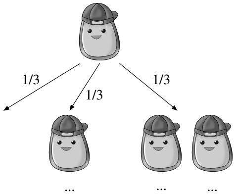

<details>
<summary>flowchart</summary>

```mermaid
graph TD
  A[""] -->|"1/3"| B[""]
  A -->|"1/3"| C[""]
  A -->|"1/3"| D[""]
```
</details>

## Solution:

Let D be the event that the population eventually dies out; we want to find $P ( D )$ We proceed by conditioning on the outcome at the first step: let $B _ { i }$ be the event that Bobo turns into $i$ amoebas after the first minute, for $i   =   0 , 1 , 2 .$ We know $P ( D | B _ { 0 } ) = 1$ and $P ( D | B _ { 1 } ) = P ( D )$ (if Bobo stays the same, we’re back to where we started). If Bobo splits into two, then we just have two independent versions

---

72

Introduction to Probability

of our original problem! We need both of the offspring to eventually die out, so $P ( D | B _ { 2 } ) = P ( D ) ^ { 2 }$ . Now we have exhausted all the possible cases and can combine them with the law of total probability:

$$
\begin{array}{l} P (D) = P (D | B _ {0}) \cdot \frac {1}{3} + P (D | B _ {1}) \cdot \frac {1}{3} + P (D | B _ {2}) \cdot \frac {1}{3} \\ = 1 \cdot \frac {1}{3} + P (D) \cdot \frac {1}{3} + P (D) ^ {2} \cdot \frac {1}{3}. \\ \end{array}
$$

Solving for $P ( D )$ gives $P(D)=1;$ the amoeba population will die out with probability 1.

The strategy of first-step analysis works here because the problem is self-similar in nature: when Bobo continues as a single amoeba or splits into two, we end up with another version or another two versions of our original problem. Conditioning on the first step allows us to express $P ( D )$ in terms of itself. 

Example 2.7.3 (Gambler’s ruin). Two gamblers, A and B, make a sequence of \$1 bets. In each bet, gambler A has probability p of winning, and gambler B has probability $q = 1 - p$ of winning. Gambler A starts with i dollars and gambler B starts with N − i dollars; the total wealth between the two remains constant since every time A loses a dollar, the dollar goes to B, and vice versa.

We can visualize this game as a random walk on the integers between 0 and N, where $p$ is the probability of going to the right in a given step: imagine a person who starts at position i and, at each time step, moves one step to the right with probability p and one step to the left with probability $q = 1 - p .$ The game ends when either A or B is ruined, i.e., when the random walk reaches 0 or N. What is the probability that A wins the game (walking away with all the money)?

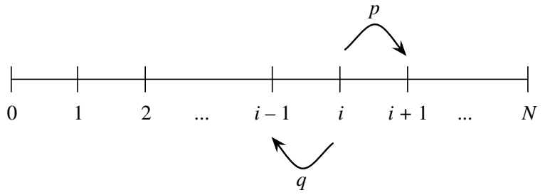

<details>
<summary>text_image</summary>

0 1 2 ... i - 1 i i + 1 ... N
p
q
</details>

## Solution:

We recognize that this game, like Bobo’s reproductive process, has a recursive structure: after the first step, it’s exactly the same game, except that A’s wealth is now either $i + 1 { \mathrm { ~ o r ~ } } i - 1$ . Let $p _ { i }$ be the probability that A wins the game, given that A starts with i dollars. We will use first-step analysis to solve for the $p _ { i }$ . Let W be the event that A wins the game. By LOTP, conditioning on the outcome of the first

---

Conditional probability

73

round, we have

$$
\begin{array}{l} p _ {i} = P (W | \mathrm{A} \text {starts at} i, \text {wins round 1}) \cdot p + P (W | \mathrm{A} \text {starts at} i, \text {loses round 1}) \cdot q \\ = P (W | \text {A starts at} i + 1) \cdot p + P (W | \text {A starts at} i - 1) \cdot q \\ = p _ {i + 1} \cdot p + p _ {i - 1} \cdot q. \\ \end{array}
$$

This must be true for all i from 1 to $N   -   1$ , and we also have the boundary conditions $p _ { 0 } = 0$ and $p _ { N } = 1$ . Now we can solve this equation, called a difference equation, to obtain the $p _ { i }$ . Section A.4 of the math appendix discusses how to solve difference equations, so we will omit some of the steps here.

The characteristic equation of the difference equation is $p x ^ { 2 } - x + q = 0$ , which has roots 1 and $q / p . { \mathrm { ~ I f ~ } } p \neq 1 / 2$ , these roots are distinct, and the general solution is

$$
p _ {i} = a \cdot 1 ^ {i} + b \cdot \left(\frac {q}{p}\right) ^ {i}.
$$

Using the boundary conditions $p _ { 0 } = 0$ and $p _ { N } = 1$ , we get

$$
a = - b = \frac {1}{1 - \left(\frac {q}{p}\right) ^ {N}},
$$

and we simply plug these back in to get the specific solution. If $p = 1 / 2 ,$ the roots of the characteristic polynomial are not distinct, so the general solution is

$$
p _ {i} = a \cdot 1 ^ {i} + b \cdot i \cdot 1 ^ {i}.
$$

The boundary conditions give $a = 0$ and $b = 1 / N$

In summary, the probability of A winning with a starting wealth of i is

$$
p _ {i} = \left\{ \begin{array}{l l} \frac {1 - \left(\frac {q}{p}\right) ^ {i}}{1 - \left(\frac {q}{p}\right) ^ {N}} & \text {if} p \neq 1 / 2, \\ \frac {i}{N} & \text {if} p = 1 / 2. \end{array} \right.
$$

The $p = 1 / 2$ case is consistent with the $p \neq 1 / 2$ case, in the sense that

$$
\lim _ {p \to \frac {1}{2}} \frac {1 - (\frac {q}{p}) ^ {i}}{1 - (\frac {q}{p}) ^ {N}} = \frac {i}{N}.
$$

To see this, let $x = q / p$ and let x approach 1. By L’Hôpital’s rule,

$$
\lim _ {x \to 1} \frac {1 - x ^ {i}}{1 - x ^ {N}} = \lim _ {x \to 1} \frac {i x ^ {i - 1}}{N x ^ {N - 1}} = \frac {i}{N}.
$$

The answer for the $p   =   1 / 2$ case has a simple interpretation: A’s probability of winning equals the proportion of the wealth that A starts out with. So if $p = 1 / 2$

---

74

Introduction to Probability

and A starts out with much less money than B, then A’s chance of winning the game is low. Having $p < 1 / 2$ may also make A’s chance of winning low, even if $p$ is only a little bit less than $1 / 2$ and the players start out with the same amount of money. For example, if $p = 0 . 4 9$ and each player starts out with \$100, then A has only about a $1 . 8 \%$ chance of winning the game.

We have focused on the probability of A winning the game, but what about B? Rather than starting from scratch, we can use symmetry: aside from notation, there is nothing in the description of the game to distinguish A from B. By symmetry, the probability of B winning from a starting wealth of $N - i$ is obtained by switching the roles of $q$ and $p ,$ and of i and $N - i$ . This gives

$$
P (\text {B wins} | \text {B starts at} N - i) = \left\{ \begin{array}{l l} \frac {1 - \left(\frac {p}{q}\right) ^ {N - i}}{1 - \left(\frac {p}{q}\right) ^ {N}} & \text {if} p \neq 1 / 2, \\ \frac {N - i}{N} & \text {if} p = 1 / 2. \end{array} \right.
$$

It can then be verified that for all i and all $p,   P( A wins ) + P( B wins ) = 1$ , so the game is guaranteed to end: the probability is 0 that it will oscillate forever. 

## 2.8 Pitfalls and paradoxes

The next two examples are fallacies of conditional thinking that have arisen in the legal context. The prosecutor’s fallacy is the confusion of $P ( A | B )$ with $P ( B | A )$ ; the defense attorney’s fallacy is the failure to condition on all the evidence.

h 2.8.1 (Prosecutor’s fallacy). In 1998, Sally Clark was tried for murder after two of her sons died shortly after birth. During the trial, an expert witness for the prosecution testified that the probability of a newborn dying of sudden infant death syndrome (SIDS) was $1 / 8 5 0 0$ , so the probability of two deaths due to SIDS in one family was $( 1 / \dot { 8 5 } 0 0 ) ^ { 2 }$ , or about one in 73 million. Therefore, he continued, the probability of Clark’s innocence was one in 73 million.

There are at least two major problems with this line of reasoning. First, the expert witness found the probability of the intersection of “first son dies of SIDS” and “second son dies of $\mathrm { S I D S ^ { \prime \prime } }$ by multiplying the individual event probabilities; as we know, this is only valid if deaths due to SIDS are independent within a family. This independence would not hold if genetic or other family-specific risk factors cause all newborns within certain families to be at increased risk of SIDS.

Second, the so-called expert has confused two different conditional probabilities: P(innocence|evidence) is different from P(evidence|innocence). The witness claims that the probability of observing two newborn deaths if the defendant were innocent is extremely low; that is, P(evidence|innocence) is small. What we are interested in,

---

Conditional probability

75

however, is P(innocence|evidence), the probability that the defendant is innocent given all the evidence. By Bayes’ rule,

$$
P (\text {innocence} | \text {evidence}) = \frac {P (\text {evidence} | \text {innocence}) P (\text {innocence})}{P (\text {evidence})},
$$

so to calculate the conditional probability of innocence given the evidence, we must take into account P(innocence), the prior probability of innocence. This probability is extremely high: although double deaths due to SIDS are rare, so are double infanticides! Expanding the denominator as

$$
P (\text {evidence} | \text {innocence}) P (\text {innocence}) + P (\text {evidence} | \text {guilt}) P (\text {guilt}),
$$

note that if P(guilt) is small enough so that the second term is negligible compared to the first term, then the denominator of P(innocence|evidence) is approximately equal to the numerator, making P(innocence|evidence) close to 1.

The posterior probability of innocence given the evidence depends strongly on both P(evidence|innocence), which is very low, and P(innocence), which is very high. The expert’s probability of $( 1 / 8 5 0 0 ) ^ { 2 }$ , questionable in and of itself, is only part of the equation.

Sadly, Clark was convicted of murder and sent to prison, partly based on the expert’s wrongheaded testimony, and spent over three years in jail before her conviction was overturned. The outcry over the misuse of conditional probability in the Sally Clark case led to the review of hundreds of other cases where similar faulty logic was used by the prosecution.

h 2.8.2 (Defense attorney’s fallacy). A woman has been murdered, and her husband is put on trial for this crime. Evidence comes to light that the defendant had a history of abusing his wife. The defense attorney argues that the evidence of abuse should be excluded on grounds of irrelevance, since only 1 in 10,000 men with wives they abuse subsequently murder their wives. Should the judge grant the defense attorney’s motion to bar this evidence from trial?

Suppose that the defense attorney’s 1-in-10,000 figure is correct, and further assume the following for a relevant population of husbands and wives: 1 in 10 husbands abuse their wives, 1 in 5 murdered wives were murdered by their husbands, and 50% of husbands who murder their wives previously abused them. Also, assume that if the husband of a murdered wife is not guilty of the murder, then the probability that he abused his wife reverts to the unconditional probability of abuse.

How to define the “relevant population” and how to estimate such probabilities are difficult issues. For example, should we look at citywide, statewide, national, or international statistics? How should we account for unreported abuse and unsolved murders? What if murder rates are changing over time? For this problem, assume that a reasonable choice of the relevant population has been agreed on, and that the stated probabilities are known to be correct.

---

76

Introduction to Probability

Let A be the event that the husband commits abuse against his wife, and let G be the event that the husband is guilty. The defense’s argument is that $P ( G | A ) = 1 / 1 0 { , } 0 0 0 ,$ so guilt is still extremely unlikely conditional on a previous history of abuse.

However, the defense attorney fails to condition on a crucial fact: in this case, we know that the wife was murdered. Therefore, the relevant probability is not $P ( G | A )$ but $P ( G | A , M )$ , where M is the event that the wife was murdered.

Bayes’ rule with extra conditioning gives

$$
\begin{array}{l} P (G | A, M) = \frac {P (A | G , M) P (G | M)}{P (A | G , M) P (G | M) + P (A | G ^ {c} , M) P (G ^ {c} | M)} \\ = \frac {0 . 5 \cdot 0 . 2}{0 . 5 \cdot 0 . 2 + 0 . 1 \cdot 0 . 8} \\ = \frac {5}{9}. \\ \end{array}
$$

So the posterior probability of guilt, $P ( G | A , M )$ , is over 5,000 times as large as the quantity $P ( G | A )$ that the defense attorney focused on. Conditioning on the evidence of abuse increases the probability of guilt from $P ( G | M ) = 0 . 2 \; \mathrm { t o } \; P ( G | A , M ) \approx 0 . 5 6$ so the defendant’s history of abuse gives very important information, contrary to the defense attorney’s argument.

In the above calculation of $P ( G | A , M )$ , we did not use the defense attorney’s $P ( G | A )$ number anywhere; it is irrelevant to our calculation because it does not account for the fact that the wife was murdered. We must condition on all the evidence.

We end this chapter with a paradox about conditional probability and aggregation of data.

Example 2.8.3 (Simpson’s paradox). Two doctors, Dr. Hibbert and Dr. Nick, each perform two types of surgeries: heart surgery and Band-Aid removal. Each surgery can be either a success or a failure. The two doctors’ respective records are given in the following tables, and shown graphically in Figure 2.6, where white dots represent successful surgeries and black dots represent failed surgeries.

|  | Heart | Band-Aid |
| --- | --- | --- |
| Success | 70 | 10 |
| Failure | 20 | 0 |

Dr. Hibbert

|  | Heart | Band-Aid |
| --- | --- | --- |
| Success | 2 | 81 |
| Failure | 8 | 9 |

Dr. Nick

Dr. Hibbert had a higher success rate than Dr. Nick in heart surgeries: 70 out of 90 versus 2 out of 10. Dr. Hibbert also had a higher success rate in Band-Aid removal: 10 out of 10 versus 81 out of 90. But if we aggregate across the two types of surgeries to compare overall surgery success rates, Dr. Hibbert was successful in 80 out of 100 surgeries while Dr. Nick was successful in 83 out of 100 surgeries: Dr. Nick’s overall success rate is higher!

---

Conditional probability

77

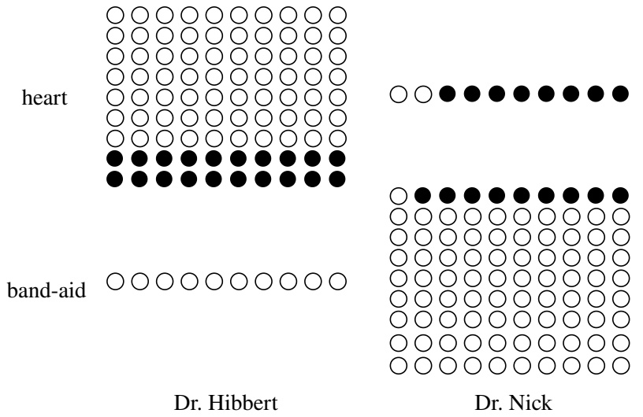

<details>
<summary>text_image</summary>

heart
band-aid
Dr. Hibbert
Dr. Nick
</details>

## FIGURE 2.6

An example of Simpson’s paradox. White dots represent successful surgeries and black dots represent failed surgeries. Dr. Hibbert is better in both types of surgery but has a lower overall success rate, because he is performing the harder type of surgery much more often than Dr. Nick is.

What’s happening is that Dr. Hibbert, presumably due to his reputation as the superior doctor, is performing a greater number of heart surgeries, which are inherently riskier than Band-Aid removals. His overall success rate is lower not because of lesser skill on any particular type of surgery, but because a larger fraction of his surgeries are risky.

Let’s use event notation to make this precise. For events A, B, and C, we say that we have a Simpson’s paradox if

$$
P (A | B, C) <   P (A | B ^ {c}, C)
$$

$$
P (A | B, C ^ {c}) <   P (A | B ^ {c}, C ^ {c}),
$$

but

$$
P (A | B) > P (A | B ^ {c}).
$$

In this case, let A be the event of a successful surgery, B be the event that Dr. Nick is the surgeon, and C be the event that the surgery is a heart surgery. The conditions for Simpson’s paradox are fulfilled because the probability of a successful surgery is lower under Dr. Nick than under Dr. Hibbert whether we condition on heart surgery or on Band-Aid removal, but the overall probability of success is higher for Dr. Nick.

The law of total probability tells us mathematically why this can happen:

$$
P (A | B) = P (A | C, B) P (C | B) + P (A | C ^ {c}, B) P (C ^ {c} | B)
$$

$$
P (A | B ^ {c}) = P (A | C, B ^ {c}) P (C | B ^ {c}) + P (A | C ^ {c}, B ^ {c}) P (C ^ {c} | B ^ {c}).
$$

---

78

Introduction to Probability

The above equations express $P ( A | B )$ as a weighted average of $P ( A | C , B )$ and $P ( A | C ^ { c } , B )$ , and $P ( A | B ^ { c } )$ as a weighted average of $P ( A | C , B ^ { c } )$ and $P ( A | C ^ { c } , B ^ { c } )$ . If the corresponding weights were the same in both of these weighted averages, then Simpson’s paradox could not occur. But the weights here are different:

$$
P (C | B) <   P (C | B ^ {c}) \text {and} P (C ^ {c} | B) > P (C ^ {c} | B ^ {c}),
$$

since Dr. Nick is much less likely than Dr. Hibbert to be performing a heart surgery.

Although we have

$$
P (A | C, B) <   P (A | C, B ^ {c})
$$

and

$$
P (A | C ^ {c}, B) <   P (A | C ^ {c}, B ^ {c}),
$$

the fact that the weights are so different results in the inequality flipping when we do not condition on whether or not C occurred:

$$
P (A | B) > P (A | B ^ {c}).
$$

Numerically, the two weighted averages are

$$
P (A | B) = 0. 8 3 = (2 / 1 0) \cdot 0. 1 + (8 1 / 9 0) \cdot 0. 9
$$

$$
P (A | B ^ {c}) = 0. 8 0 = (7 0 / 9 0) \cdot 0. 9 + (1 0 / 1 0) \cdot 0. 1.
$$

The first equation (corresponding to Dr. Nick) puts much more weight on the second term (corresponding to the easier surgery) than does the second equation.

Aggregation across different types of surgeries presents a misleading picture of the doctors’ abilities because we lose the information about which doctor tends to perform which type of surgery. When we think confounding variables like surgery type could be at play, we should examine the disaggregated data to see what is really going on.

Simpson’s paradox arises in many real-world contexts. In the following examples, you should try to identify the events A, B, and C that create the paradox.

Gender discrimination in college admissions: In the 1970s, men were significantly more likely than women to be admitted for graduate study at the University of California, Berkeley, leading to charges of gender discrimination. Yet within most individual departments, women were admitted at a higher rate than men. It was found that women tended to apply to the departments with more competitive admissions, while men tended to apply to less competitive departments.
• Baseball batting averages: It is possible for player 1 to have a higher batting average than player 2 in the first half of a baseball season and a higher batting average than player 2 in the second half of the season, yet have a lower overall batting average for the entire season. It depends on how many at-bats the players have in each half of the season. (An at-bat is when it’s a player’s turn to try to hit the ball; the player’s batting average is the number of hits the player gets divided by the player’s number of at-bats.)

---

Conditional probability

79

• Health effects of smoking: Cochran [4] found that within any age group, cigarette smokers had higher mortality rates than cigar smokers, but because cigarette smokers were on average younger than cigar smokers, overall mortality rates were lower for cigarette smokers. 

## 2.9 Recap

The conditional probability of A given B is

$$
P (A | B) = \frac {P (A \cap B)}{P (B)}.
$$

Conditional probability has exactly the same properties as probability, but $P ( \cdot | B )$ updates our uncertainty about events to reflect the observed evidence B. Events whose probabilities are unchanged after observing the evidence B are said to be independent of B. Two events can also be conditionally independent given a third event E. Conditional independence does not imply unconditional independence, nor does unconditional independence imply conditional independence.

Two important results about conditional probability are Bayes’ rule, which relates $P ( A | B )$ to $P ( B | A )$ , and the law of total probability, which allows us to get unconditional probabilities by partitioning the sample space and calculating conditional probabilities within each slice of the partition.

Bayes’ rule says that

$$
P (A | B) = \frac {P (B | A) P (A)}{P (B)},
$$

while LOTP says that

$$
P (B) = \sum_ {i = 1} ^ {n} P (B | A _ {i}) P (A _ {i}),
$$

for any partition $A _ { 1 } , \ldots , A _ { n }$ of the sample space. Bayes’ rule and LOTP are often used in tandem.

Conditioning is extremely helpful for problem-solving because it allows us to break a problem into smaller pieces, consider all possible cases separately, and then combine them. When using this strategy, we should try to condition on the information that, if known, would make the problem simpler, hence the saying condition on what you wish you knew. When a problem involves multiple stages, it can be helpful to condition on the first step to obtain a recursive relationship.

Common mistakes in thinking conditionally include:

• confusion of the prior probability $P ( A )$ with the posterior probability $P ( A | B )$

---

80

Introduction to Probability

• the prosecutor’s fallacy, confusing $P ( A | B )$ with $P ( B | A )$ ;
• the defense attorney’s fallacy, failing to condition on all the evidence;
• unawareness of Simpson’s paradox and the importance of thinking carefully about whether to aggregate data.

Figure 2.7 illustrates how probabilities can be updated as new evidence comes in sequentially. Imagine that there is some event A that we are interested in. On Monday morning, for example, our prior probability for A is $P ( A )$ . If we observe on Monday afternoon that B occurred, then we can use Bayes’ rule (or the definition of conditional probability) to compute the posterior probability $P ( A | B )$

We use this posterior probability for A as the new prior on Tuesday morning, and then we continue to collect evidence. Suppose that on Tuesday we observe that C occurred. Then we can compute the new posterior probability $P ( A | B , C )$ in various ways (in this context, probably the most natural way is to use Bayes’ rule with extra conditioning on B). This in turn becomes the new prior if we are going to continue to collect evidence.

## 2.10 R

## Simulating the frequentist interpretation

Recall that the frequentist interpretation of conditional probability based on a large number n of repetitions of an experiment is $P ( A | B ) \approx n _ { A B } / n _ { B }$ , where $n _ { A B }$ is the number of times that A ∩ B occurs and $n _ { B }$ is the number of times that B occurs. Let’s try this out by simulation, and verify the results of Example 2.2.5. So let’s simulate n families, each with two children.

```r
n <- 10^5
child1 <- sample(2,n,replace=TRUE)
child2 <- sample(2,n,replace=TRUE)
```

Here child1 is a vector of length n, where each element is a 1 or a 2. Letting 1 stand for “girl” and 2 stand for “boy”, this vector represents the gender of the elder child in each of the n families. Similarly, child2 represents the gender of the younger child in each family.

Alternatively, we could have used

```txt
sample(c("girl","boy"),n,replace=TRUE)
```

but it is more convenient working with numerical values.

Let A be the event that both children are girls and B the event that the elder is a girl.

---

Conditional probability

81

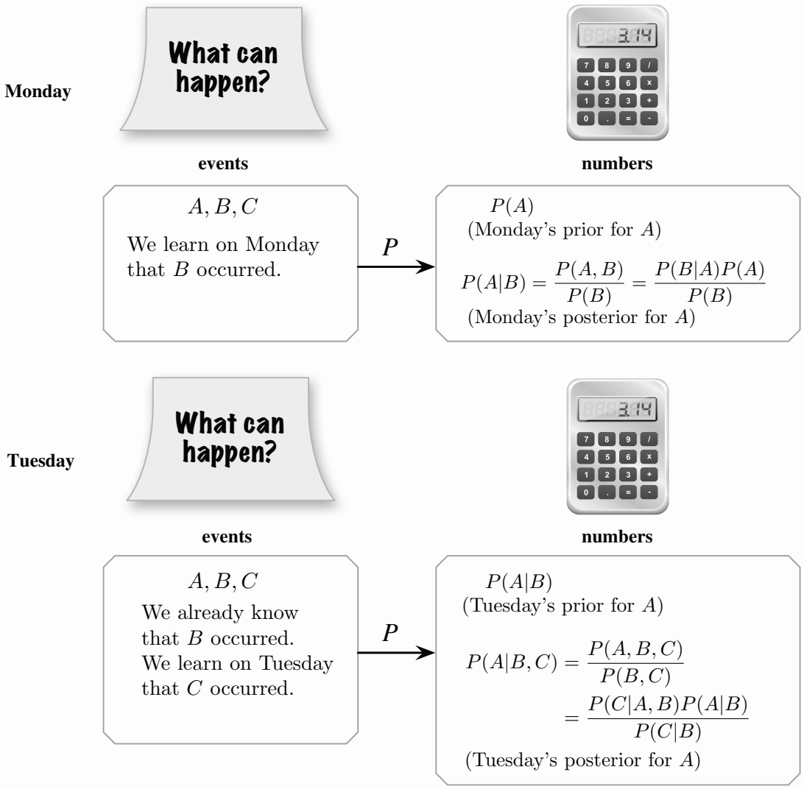

<details>
<summary>flowchart</summary>

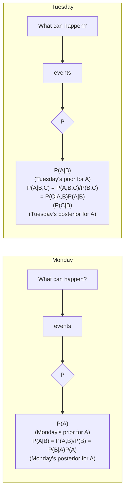
</details>

FIGURE 2.7

Conditional probability tells us how to update probabilities as new evidence comes in. Shown are the probabilities for an event A initially, after obtaining one piece of evidence B, and after obtaining a second piece of evidence C. The posterior for A after observing the first piece of evidence becomes the new prior before observing the second piece of evidence. After both B and C are observed, a new posterior for A can be found in various ways. This then becomes the new prior if more evidence will be collected.

---

82

Introduction to Probability

Following the frequentist interpretation, we count the number of repetitions where B occurred and name it n.b, and we also count the number of repetitions where A ∩ B occurred and name it n.ab. Finally, we divide n.ab by n.b to approximate $P ( A | B )$

```txt
n.b <- sum(child1==1)
n.ab <- sum(child1==1 & child2==1)
n.ab/n.b
```

The ampersand & is an elementwise AND, so n.ab is the number of families where both the first child and the second child are girls. When we ran this code, we got 0.50, which agrees with P(both girls|elder is a girl) = 1/2.

Now let A be the event that both children are girls and B the event that at least one of the children is a girl. Then A ∩ B is the same, but n.b needs to count the number of families where at least one child is a girl. This is accomplished with the elementwise OR operator | (this is not a conditioning bar; it is an inclusive OR, returning TRUE if at least one element is TRUE).

```txt
n.b <- sum(child1==1 | child2==1)
n.ab <- sum(child1==1 & child2==1)
n.ab/n.b
```

We got 0.33, which agrees with P(both girls|at least one girl) = 1/3.

## Monty Hall simulation

Many long, bitter debates about the Monty Hall problem could have been averted by trying it out with a simulation. To study how well the never-switch strategy performs, let’s generate $1 0 ^ { 5 }$ runs of the Monty Hall game. To simplify notation, assume the contestant always chooses door 1. Then we can generate a vector specifying which door has the car for each repetition:

```r
n <- 10^5
cardoor <- sample(3,n,replace=TRUE)
```

At this point we could generate the vector specifying which doors Monty opens, but that’s unnecessary since the never-switch strategy succeeds if and only if door 1 has the car! So the fraction of times when the never-switch strategy succeeds is sum(cardoor==1)/n, which was 0.334 in our simulation. This is very close to the true value, 1/3.

What if we want to play the Monty Hall game interactively? We can do this by programming a function. Entering the following code in R defines a function called monty, which can then be invoked by entering the command monty() any time you feel like playing the game!

---

Conditional probability

83

```r
monty <- function() {
    doors <- 1:3

    # randomly pick where the car is
    cardoor <- sample(doors,1)

    # prompt player
    print("Monty Hall says 'Pick a door, any door!'")

    # receive the player's choice of door (should be 1,2, or 3)
    chosen <- scan(what = integer(), nlines = 1, quiet = TRUE)

    # pick Monty's door (can't be the player's door or the car door)
    if (chosen != cardoor) montydoor <- doors[-c(chosen, cardoor)]
    else montydoor <- sample(doors[-chosen],1)

    # find out whether the player wants to switch doors
    print(paste("Monty opens door ", montydoor, "!", sep=""))
    print("Would you like to switch (y/n)?")
    reply <- scan(what = character(), nlines = 1, quiet = TRUE)

    # interpret what player wrote as "yes" if it starts with "y"
    if (substr(reply,1,1) == "y"){
        chosen <- doors[-c(chosen, montydoor)]
    }

    # announce the result of the game!
    if (chosen == cardoor) print("You won!")
    else print("You lost!")
}
```

The print command prints its argument to the screen. We combine this with the paste command since if we used print("Monty opens door montydoor") then R would literally print “Monty opens door montydoor”. The scan command interactively requests input from the user; we use what = integer() when we want the user to enter an integer and what = character() when we want the user to enter text. Using substr(reply,1,1) extracts the first character of reply, in case the user replies with “yes” or “yep” or “yeah!” rather than with “y”.

## 2.11 Exercises

Exercises marked with s have detailed solutions at [http://stat110.net](http://stat110.net).

---

84

Introduction to Probability

## Conditioning on evidence

1. s A spam filter is designed by looking at commonly occurring phrases in spam. Suppose that 80% of email is spam. In 10% of the spam emails, the phrase “free money” is used, whereas this phrase is only used in 1% of non-spam emails. A new email has just arrived, which does mention “free money”. What is the probability that it is spam?

2. s A woman is pregnant with twin boys. Twins may be either identical or fraternal. Suppose that $1 / 3$ of twins born are identical, that identical twins have a 50% chance of being both boys and a 50% chance of being both girls, and that for fraternal twins each twin independently has a 50% chance of being a boy and a 50% chance of being a girl. Given the above information, what is the probability that the woman’s twins are identical?

3. According to the CDC (Centers for Disease Control and Prevention), men who smoke are 23 times more likely to develop lung cancer than men who don’t smoke. Also according to the CDC, 21.6% of men in the U.S. smoke. What is the probability that a man in the U.S. is a smoker, given that he develops lung cancer?

4. Fred is answering a multiple-choice problem on an exam, and has to choose one of n options (exactly one of which is correct). Let K be the event that he knows the answer, and R be the event that he gets the problem right (either through knowledge or through luck). Suppose that if he knows the right answer he will definitely get the problem right, but if he does not know then he will guess completely randomly. Let $P ( K ) = p$

(a) Find $P ( K | R )$ (in terms of p and n).
(b) Show that $P ( K | R ) \geq p ,$ and explain why this makes sense intuitively. When (if ever) does $P ( K | R )$ equal $p ^ { ? }$

5. Three cards are dealt from a standard, well-shuffled deck. The first two cards are flipped over, revealing the Ace of Spades as the first card and the 8 of Clubs as the second card. Given this information, find the probability that the third card is an ace in two ways: using the definition of conditional probability, and by symmetry.
6. A hat contains 100 coins, where 99 are fair but one is double-headed (always landing Heads). A coin is chosen uniformly at random. The chosen coin is flipped 7 times, and it lands Heads all 7 times. Given this information, what is the probability that the chosen coin is double-headed? (Of course, another approach here would be to look at both sides of the coin—but this is a metaphorical coin.)
7. A hat contains 100 coins, where at least 99 are fair, but there may be one that is doubleheaded (always landing Heads); if there is no such coin, then all 100 are fair. Let D be the event that there is such a coin, and suppose that $P ( D )   =   1 / 2$ . A coin is chosen uniformly at random. The chosen coin is flipped 7 times, and it lands Heads all 7 times.

(a) Given this information, what is the probability that one of the coins is doubleheaded?
(b) Given this information, what is the probability that the chosen coin is doubleheaded?

8. The screens used for a certain type of cell phone are manufactured by 3 companies, A, B, and C. The proportions of screens supplied by A, B, and C are 0.5, 0.3, and 0.2, respectively, and their screens are defective with probabilities 0.01, 0.02, and 0.03, respectively. Given that the screen on such a phone is defective, what is the probability that Company A manufactured it?

9. (a) Show that if events $A _ { 1 }$ and $A _ { 2 }$ have the same prior probability $P(A_{1}) = P(A_{2})$ $A _ { 1 }$ implies B, and $A _ { 2 }$ implies $B ,$ then $A _ { 1 }$ and $A _ { 2 }$ have the same posterior probability $P ( A _ { 1 } | B ) = P ( A _ { 2 } | B )$ if it is observed that $B$ occurred.
(b) Explain why (a) makes sense intuitively, and give a concrete example.

---

Conditional probability

85

10. Fred is working on a major project. In planning the project, two milestones are set up, with dates by which they should be accomplished. This serves as a way to track Fred’s progress. Let $A _ { 1 }$ be the event that Fred completes the first milestone on time, $A _ { 2 }$ be the event that he completes the second milestone on time, and $A _ { 3 }$ be the event that he completes the project on time.

Suppose that $P ( A _ { j + 1 } | A _ { j } ) = 0 . 8$ but $P ( A _ { j + 1 } | A _ { j } ^ { c } ) = 0 . 3$ for $j = 1 , 2 ,$ since if Fred falls behind on his schedule it will be hard for him to get caught up. Also, assume that the second milestone supersedes the first, in the sense that once we know whether he is on time in completing the second milestone, it no longer matters what happened with the first milestone. We can express this by saying that $A _ { 1 }$ and $A _ { 3 }$ are conditionally independent given $A _ { 2 }$ and they’re also conditionally independent given $A _ { 2 } ^ { c }$

(a) Find the probability that Fred will finish the project on time, given that he completes the first milestone on time. Also find the probability that Fred will finish the project on time, given that he is late for the first milestone.
(b) Suppose that $P ( A _ { 1 } ) = 0 . 7 5$ . Find the probability that Fred will finish the project on time.

11. An exit poll in an election is a survey taken of voters just after they have voted. One major use of exit polls has been so that news organizations can try to figure out as soon as possible who won the election, before the votes are officially counted. This has been notoriously inaccurate in various elections, sometimes because of selection bias: the sample of people who are invited to and agree to participate in the survey may not be similar enough to the overall population of voters.

Consider an election with two candidates, Candidate A and Candidate B. Every voter is invited to participate in an exit poll, where they are asked whom they voted for; some accept and some refuse. For a randomly selected voter, let A be the event that they voted for $A ,$ and W be the event that they are willing to participate in the exit poll. Suppose that $P ( W | A ) = 0 . 7$ but $P ( W | A ^ { c } ) = 0 . 3$ . In the exit poll, 60% of the respondents say they voted for A (assume that they are all honest), suggesting a comfortable victory for A. Find $P ( A )$ , the true proportion of people who voted for A.

12. Alice is trying to communicate with Bob, by sending a message (encoded in binary) across a channel.

(a) Suppose for this part that she sends only one bit $( \mathrm { a } \; 0 \; \mathrm { o r } \; 1 )$ , with equal probabilities. If she sends a 0, there is a 5% chance of an error occurring, resulting in Bob receiving a 1; if she sends a 1, there is a 10% chance of an error occurring, resulting in Bob receiving a 0. Given that Bob receives a 1, what is the probability that Alice actually sent a 1?
(b) To reduce the chance of miscommunication, Alice and Bob decide to use a repetition code. Again Alice wants to convey a 0 or a 1, but this time she repeats it two more times, so that she sends 000 to convey 0 and 111 to convey 1. Bob will decode the message by going with what the majority of the bits were. Assume that the error probabilities are as in (a), with error events for different bits independent of each other. Given that Bob receives 110, what is the probability that Alice intended to convey a 1?

13. Company A has just developed a diagnostic test for a certain disease. The disease afflicts 1% of the population. As defined in Example 2.3.9, the sensitivity of the test is the probability of someone testing positive, given that they have the disease, and the specificity of the test is the probability that of someone testing negative, given that they don’t have the disease. Assume that, as in Example 2.3.9, the sensitivity and specificity are both 0.95.

Company B, which is a rival of Company A, offers a competing test for the disease. Company B claims that their test is faster and less expensive to perform than Company A’s test, is less painful (Company A’s test requires an incision), and yet has a higher

---

86

Introduction to Probability

overall success rate, where overall success rate is defined as the probability that a random person gets diagnosed correctly.

(a) It turns out that Company B’s test can be described and performed very simply: no matter who the patient is, diagnose that they do not have the disease. Check whether Company B’s claim about overall success rates is true.

(b) Explain why Company A’s test may still be useful.

(c) Company A wants to develop a new test such that the overall success rate is higher than that of Company B’s test. If the sensitivity and specificity are equal, how high does the sensitivity have to be to achieve their goal? If (amazingly) they can get the sensitivity equal to 1, how high does the specificity have to be to achieve their goal? If (amazingly) they can get the specificity equal to 1, how high does the sensitivity have to be to achieve their goal?

14. Consider the following scenario, from Tversky and Kahneman [27]:

Let A be the event that before the end of next year, Peter will have installed a burglar alarm system in his home. Let B denote the event that Peter’s home will be burglarized before the end of next year.

(a) Intuitively, which do you think is bigger, $P ( A | B )$ or $P ( A | B ^ { c } ) ?$ Explain your intuition.

(b) Intuitively, which do you think is bigger, $P ( B | A )$ or $P ( B | A ^ { c } ) ?$ Explain your intuition.

(c) Show that for any events A and B (with probabilities not equal to $_ { \mathrm { ~ 0 ~ o r ~ 1 ) ~ } }$ , the inequality $P ( A | B ) > P ( A | B ^ { c } )$ is equivalent to $P ( B | A ) > P ( B | A ^ { c } )$

(d) Tversky and Kahneman report that 131 out of 162 people whom they posed (a) and (b) to said that $P(A|B)>P(A|B^c)$ and $P ( B | A ) < P ( B | A ^ { c } )$ . What is a plausible explanation for why this was such a popular opinion despite (c) showing that it is impossible for these inequalities both to hold?

15. Let A and B be events with $0 < P ( A \cap B ) < P ( A ) < P ( B ) < P ( A \cup B ) < 1$ . You are hoping that both A and B occurred. Which of the following pieces of information would you be happiest to observe: that A occurred, that B occurred, or that $A \cup B$ occurred?

16. Show that $P ( A | B ) \leq P ( A )$ implies $P ( A | B ^ { c } ) \geq P ( A )$ , and give an intuitive explanation of why this makes sense.

17. In deterministic logic, the statement “A implies $B ^ { \prime \prime }$ is equivalent to its contrapositive, “not B implies not $A ^ { \flat }$ . In this problem we will consider analogous statements in probability, the logic of uncertainty. Let A and B be events with probabilities not equal to 0 or 1.

(a) Show that if $P ( B | A ) = 1$ , then $P ( A ^ { c } | B ^ { c } ) = 1$

Hint: Apply Bayes’ rule and LOTP.

(b) Show however that the result in (a) does not hold in general if = is replaced by ≈. In particular, find an example where $P ( B | A )$ is very close to 1 but $P ( A ^ { c } | B ^ { c } )$ is very close to 0.

Hint: What happens if A and B are independent?

18. Show that if $P ( A ) = 1$ , then $P ( A | B ) = 1$ for any B with $P(B) > 0$ . Intuitively, this says that if someone dogmatically believes something with absolute certainty, then no amount of evidence will change their mind. The principle of avoiding assigning probabilities of 0 or 1 to any event (except for mathematical certainties) was named Cromwell’s rule by the statistician Dennis Lindley, due to Cromwell saying to the Church of Scotland, “Think it possible you may be mistaken.”

Hint: Write $P(B)=P(B \cap A)+P(B \cap A^{c})$ , and then show that $P ( B \cap A ^ { c } ) = 0$

---

Conditional probability

87

19. Explain the following Sherlock Holmes saying in terms of conditional probability, carefully distinguishing between prior and posterior probabilities: “It is an old maxim of mine that when you have excluded the impossible, whatever remains, however improbable, must be the truth.”

20. The Jack of Spades (with cider), Jack of Hearts (with tarts), Queen of Spades (with a wink), and Queen of Hearts (without tarts) are taken from a deck of cards. These four cards are shuffled, and then two are dealt. Note: Literary references to cider, tarts, and winks do not need to be considered when solving this problem.

(a) Find the probability that both of these two cards are queens, given that the first card dealt is a queen.
(b) Find the probability that both are queens, given that at least one is a queen.
(c) Find the probability that both are queens, given that one is the Queen of Hearts.

21. A fair coin is flipped 3 times. The toss results are recorded on separate slips of paper (writing $\mathrm { { } ^ { \circ } H ^ { \flat } }$ if Heads and ${ } ^ { \langle } \mathrm { T } ^ { \flat \rangle }$ if Tails), and the 3 slips of paper are thrown into a hat.

(a) Find the probability that all 3 tosses landed Heads, given that at least 2 were Heads.
(b) Two of the slips of paper are randomly drawn from the hat, and both show the letter H. Given this information, what is the probability that all 3 tosses landed Heads?

22. s A bag contains one marble which is either green or blue, with equal probabilities. A green marble is put in the bag (so there are 2 marbles now), and then a random marble is taken out. The marble taken out is green. What is the probability that the remaining marble is also green?
23. s Let G be the event that a certain individual is guilty of a certain robbery. In gathering evidence, it is learned that an event $E _ { 1 }$ occurred, and a little later it is also learned that another event $E _ { 2 }$ also occurred. Is it possible that individually, these pieces of evidence increase the chance of guilt (so $P ( G | E _ { 1 } ) > P ( G )$ and $P ( G | E _ { 2 } ) > P ( G ) )$ , but together they decrease the chance of guilt (so $P ( G | E _ { 1 } , E _ { 2 } ) < P ( G ) ) ?$
24. Is it possible to have events $A _ { 1 } , A _ { 2 } , B , C$ with $P ( A _ { 1 } | B ) \: > \: P ( A _ { 1 } | C )$ and $P ( A _ { 2 } | B ) >$ $P ( A _ { 2 } | C )$ , yet $P ( A _ { 1 } \cup A _ { 2 } | B ) \textless \textlangle P ( A _ { 1 } \cup A _ { 2 } | C ) ?$ If so, find an example (with $a   ``/ theory$ interpreting the events, as well as giving specific numbers); otherwise, show that it is impossible for this phenomenon to happen.
25. s A crime is committed by one of two suspects, A and B. Initially, there is equal evidence against both of them. In further investigation at the crime scene, it is found that the guilty party had a blood type found in 10% of the population. Suspect A does match this blood type, whereas the blood type of Suspect B is unknown.

(a) Given this new information, what is the probability that A is the guilty party?
(b) Given this new information, what is the probability that $B   ^ { \prime } \mathrm { s }$ blood type matches that found at the crime scene?

26. s To battle against spam, Bob installs two anti-spam programs. An email arrives, which is either legitimate (event $L )$ or spam (event $L ^ { c } )$ , and which program $j$ marks as legitimate (event $\left| M _ { j } \right\rangle$ or marks as spam (event $M _ { j } ^ { c } )$ for $j \in \{ 1 , 2 \}$ . Assume that 10% of Bob’s email is legitimate and that the two programs are each “90% accurate” in the sense that $P ( M _ { j } | L ) = P ( M _ { j } ^ { c } | L ^ { c } ) = 9 / 1 0$ . Also assume that given whether an email is spam, the two programs’ outputs are conditionally independent.

(a) Find the probability that the email is legitimate, given that the 1st program marks it as legitimate (simplify).
(b) Find the probability that the email is legitimate, given that both programs mark it as legitimate (simplify).

---

88

Introduction to Probability

(c) Bob runs the 1st program and $M _ { 1 }$ occurs. He updates his probabilities and then runs the 2nd program. Let $\tilde { P } ( A ) = P ( A | M _ { 1 } )$ be the updated probability function after running the 1st program. Explain briefly in words whether or not $\tilde { P } ( L | M _ { 2 } ) = P ( L | M _ { 1 } \cap$ $\left| M _ { 2 } \right\rangle$ : is conditioning on $M _ { 1 } \cap M _ { 2 }$ in one step equivalent to first conditioning on $M _ { 1 }$ , then updating probabilities, and then conditioning on $M _ { 2 } ?$

27. Suppose that there are 5 blood types in the population, named type 1 through type 5, with probabilities $p _ { 1 } , p _ { 2 } , \ldots , p _ { 5 }$ . A crime was committed by two individuals. A suspect, who has blood type 1, has prior probability p of being guilty. At the crime scene, blood evidence is collected, which shows that one of the criminals has type 1 and the other has type 2.

Find the posterior probability that the suspect is guilty, given the evidence. Does the evidence make it more likely or less likely that the suspect is guilty, or does this depend on the values of the parameters $p , p _ { 1 } , \ldots , p _ { 5 } ?$ If it depends on these values, give a simple criterion for when the evidence makes it more likely that the suspect is guilty.

28. Fred has just tested positive for a certain disease.

(a) Given this information, find the posterior odds that he has the disease, in terms of the prior odds, the sensitivity of the test, and the specificity of the test.
(b) Not surprisingly, Fred is much more interested in P(have disease|test positive), known as the positive predictive value, than in the sensitivity P(test positive|have disease). A handy rule of thumb in biostatistics and epidemiology is as follows:

For a rare disease and a reasonably good test, specificity matters much more than sensitivity in determining the positive predictive value.

Explain intuitively why this rule of thumb works. For this part you can make up some specific numbers and interpret probabilities in a frequentist way as proportions in a large population, $\mathbf { e . g . }$ , assume the disease afflicts 1% of a population of 10000 people and then consider various possibilities for the sensitivity and specificity.

29. A family has two children. Let C be a characteristic that a child can have, and assume that each child has characteristic C with probability $p ,$ independently of each other and of gender. For example, C could be the characteristic “born in winter” as in Example 2.2.7. Under the assumptions of Example 2.2.5, show that the probability that both children are girls given that at least one is a girl with characteristic $C$ is $\frac { 2   -   p } { 4   -   p }$ . Note that this is $1 / 3 { \mathrm { ~ i f ~ } } p = 1$ (agreeing with the first part of Example 2.2.5) and approaches $1 / 2$ from below as $p \to 0$ (agreeing with Example 2.2.7).

## Independence and conditional independence

30. s A family has 3 children, creatively named A, B, and $C .$

(a) Discuss intuitively (but clearly) whether the event “A is older than $B ^ { \prime \prime }$ is independent of the event $^ { \circ } A$ is older than $C ^ { \flat \flat }$
(b) Find the probability that A is older than B, given that A is older than $C .$

31. s Is it possible that an event is independent of itself? If so, when is this the case?

32. s Consider four nonstandard dice (the Efron dice), whose sides are labeled as follows (the 6 sides on each die are equally likely).

A: 4, 4, 4, 4, 0, 0
B: 3, 3, 3, 3, 3, 3
C: 6, 6, 2, 2, 2, 2

---

Conditional probability

89

D: 5, 5, 5, 1, 1, 1

These four dice are each rolled once. Let A be the result for die A, B be the result for die B, etc.

(a) Find $P(A > B), P(B > C), P(C > D),  and   P(D > A)$

(b) Is the event $A > B$ independent of the event $B > C ?$ Is the event $B > C$ independent of the event $C > D ?$ Explain.

33. Alice, Bob, and 100 other people live in a small town. Let C be the set consisting of the 100 other people, let A be the set of people in C who are friends with Alice, and let B be the set of people in C who are friends with Bob. Suppose that for each person in $C ,$ Alice is friends with that person with probability $1 / 2 ,$ and likewise for Bob, with all of these friendship statuses independent.

(a) Let $D \subseteq C$ . Find $P ( A = D )$

(b) Find $P ( A \subseteq B )$

(c) Find $P ( A \cup B = C )$

34. Suppose that there are two types of drivers: good drivers and bad drivers. Let G be the event that a certain man is a good driver, A be the event that he gets into a car accident next year, and B be the event that he gets into a car accident the following year. Let $P ( G )   =   g$ and $P(A|G)   =   P(B|G)   =   p_1, P(A|G^c)   =   P(B|G^c)   =   p_2$ , with $p _ { 1 } < p _ { 2 }$ . Suppose that given the information of whether or not the man is a good driver, A and B are independent (for simplicity and to avoid being morbid, assume that the accidents being considered are minor and wouldn’t make the man unable to drive).

(a) Explain intuitively whether or not A and B are independent.

(b) Find $P ( G | A ^ { c } )$

(c) Find $P ( B | A ^ { c } )$

35. s You are going to play 2 games of chess with an opponent whom you have never played against before (for the sake of this problem). Your opponent is equally likely to be a beginner, intermediate, or a master. Depending on which, your chances of winning an individual game are 90%, 50%, or 30%, respectively.

(a) What is your probability of winning the first game?

(b) Congratulations: you won the first game! Given this information, what is the probability that you will also win the second game (assume that, given the skill level of your opponent, the outcomes of the games are independent)?

(c) Explain the distinction between assuming that the outcomes of the games are independent and assuming that they are conditionally independent given the opponent’s skill level. Which of these assumptions seems more reasonable, and why?

36. (a) Suppose that in the population of college applicants, being good at baseball is independent of having a good math score on a certain standardized test (with respect to some measure of “good”). A certain college has a simple admissions procedure: admit an applicant if and only if the applicant is good at baseball or has a good math score on the test.

Give an intuitive explanation of why it makes sense that among students that the college admits, having a good math score is negatively associated with being good at baseball, i.e., conditioning on having a good math score decreases the chance of being good at baseball.

---

90

Introduction to Probability

(b) Show that if A and B are independent and $C = A \cup B$ , then A and B are conditionally dependent given $C$ (as long as $P(A \cap B) > 0$ and $P(A \cup B) < 1)$ , with

$$
P (A | B, C) <   P (A | C).
$$

This phenomenon is known as Berkson’s paradox, especially in the context of admissions to a school, hospital, etc.

37. Two different diseases cause a certain weird symptom; anyone who has either or both of these diseases will experience the symptom. Let $D _ { 1 }$ be the event of having the first disease, $D _ { 2 }$ be the event of having the second disease, and W be the event of having the weird symptom. Suppose that $D _ { 1 }$ and $D _ { 2 }$ are independent with $P ( D _ { j } ) = p _ { j }$ , and that a person with neither of these diseases will have the weird symptom with probability $w _ { 0 }$ Let $q _ { j } = 1 - p _ { j }$ , and assume that $0 < p _ { j } < 1$

(a) Find $P ( W )$
(b) Find $P(D_1|W),P(D_2|W), \mathrm{and} P(D_1,D_2|W)$
(c) Determine algebraically whether or not $D _ { 1 }$ and $D _ { 2 }$ are conditionally independent given W.
(d) Suppose for this part only that $w _ { 0 } = 0$ . Give a clear, convincing intuitive explanation in words of whether $D _ { 1 }$ and $D _ { 2 }$ are conditionally independent given $W$

38. We want to design a spam filter for email. As described in Exercise 1, a major strategy is to find phrases that are much more likely to appear in a spam email than in a non-spam email. In that exercise, we only consider one such phrase: “free money”. More realistically, suppose that we have created a list of 100 words or phrases that are much more likely to be used in spam than in non-spam.

Let $W _ { j }$ be the event that an email contains the jth word or phrase on the list. Let

$$
p = P (\text {spam}), p _ {j} = P (W _ {j} | \text {spam}), r _ {j} = P (W _ {j} | \text {not spam}),
$$

where “spam” is shorthand for the event that the email is spam.

Assume that $W _ { 1 } , \ldots , W _ { 1 0 0 }$ are conditionally independent given that the email is spam, and conditionally independent given that it is not spam. A method for classifying emails (or other objects) based on this kind of assumption is called a naive Bayes classifier. (Here “naive” refers to the fact that the conditional independence is a strong assumption, not to Bayes being naive. The assumption may or may not be realistic, but naive Bayes classifiers sometimes work well in practice even if the assumption is not realistic.)

Under this assumption we know, for example, that

$$
P (W _ {1}, W _ {2}, W _ {3} ^ {c}, W _ {4} ^ {c}, \dots , W _ {1 0 0} ^ {c} | \text {spam}) = p _ {1} p _ {2} (1 - p _ {3}) (1 - p _ {4}) \dots (1 - p _ {1 0 0}).
$$

Without the naive Bayes assumption, there would be vastly more statistical and computational difficulties since we would need to consider $2 ^ { 1 0 0 ^ { \circ } } \approx 1 . 3 \times 1 0 ^ { 3 0 }$ events of the form $A _ { 1 } \cap A _ { 2 } \cdots \cap A _ { 1 0 0 }$ with each $A _ { j }$ equal to either $W _ { j }$ or $W _ { j } ^ { c }$ . A new email has just arrived, and it includes the 23rd, 64th, and 65th words or phrases on the list (but not the other 97). So we want to compute

$$
P (\mathrm{spam} | W _ {1} ^ {c}, \dots , W _ {2 2} ^ {c}, W _ {2 3}, W _ {2 4} ^ {c}, \dots , W _ {6 3} ^ {c}, W _ {6 4}, W _ {6 5}, W _ {6 6} ^ {c}, \dots , W _ {1 0 0} ^ {c}).
$$

Note that we need to condition on all the evidence, not just the fact that $W _ { 2 3 } { \cap } W _ { 6 4 } { \cap } W _ { 6 5 }$ occurred. Find the conditional probability that the new email is spam (in terms of $p$ and the $p _ { j }$ and $\boldsymbol { r } _ { j } )$

---

Conditional probability

91

## Monty Hall

39. s (a) Consider the following 7-door version of the Monty Hall problem. There are 7 doors, behind one of which there is a car (which you want), and behind the rest of which there are goats (which you don’t want). Initially, all possibilities are equally likely for where the car is. You choose a door. Monty Hall then opens 3 goat doors, and offers you the option of switching to any of the remaining 3 doors.

Assume that Monty Hall knows which door has the car, will always open 3 goat doors and offer the option of switching, and that Monty chooses with equal probabilities from all his choices of which goat doors to open. Should you switch? What is your probability of success if you switch to one of the remaining 3 doors?

(b) Generalize the above to a Monty Hall problem where there are $n \geq 3$ doors, of which Monty opens m goat doors, with $1 \leq m \leq n - 2$

40. s Consider the Monty Hall problem, except that Monty enjoys opening door 2 more than he enjoys opening door 3, and if he has a choice between opening these two doors, he opens door 2 with probability p, where $\textstyle { \frac { 1 } { 2 } } \leq p \leq 1$

To recap: there are three doors, behind one of which there is a car (which you want), and behind the other two of which there are goats (which you don’t want). Initially, all possibilities are equally likely for where the car is. You choose a door, which for concreteness we assume is door 1. Monty Hall then opens a door to reveal a goat, and offers you the option of switching. Assume that Monty Hall knows which door has the car, will always open a goat door and offer the option of switching, and as above assume that if Monty Hall has a choice between opening door 2 and door 3, he chooses door 2 with probability p (with $\textstyle { \frac { 1 } { 2 } } \leq p \leq 1 )$

(a) Find the unconditional probability that the strategy of always switching succeeds (unconditional in the sense that we do not condition on which of doors 2 or 3 Monty opens).
(b) Find the probability that the strategy of always switching succeeds, given that Monty opens door 2.
(c) Find the probability that the strategy of always switching succeeds, given that Monty opens door 3.

41. The ratings of Monty Hall’s show have dropped slightly, and a panicking executive producer complains to Monty that the part of the show where he opens a door lacks suspense: Monty always opens a door with a goat. Monty replies that the reason is so that the game is never spoiled by him revealing the car, but he agrees to update the game as follows.

Before each show, Monty secretly flips a coin with probability p of Heads. If the coin lands Heads, Monty resolves to open a door with a goat (with equal probabilities if there is a choice). Otherwise, Monty resolves to open a random door, with equal probabilities. Of course, Monty will not open the door that the contestant initially chooses. The contestant knows p but does not know the outcome of the coin flip. When the show starts, the contestant chooses a door. Monty (who knows where the car is) then opens a door. If the car is revealed, the game is over; if a goat is revealed, the contestant is offered the option of switching. Now suppose it turns out that the contestant chooses door 1 and then Monty opens door 2, revealing a goat. What is the contestant’s probability of success if they switch to door 3?

42. Consider the following variation of the Monty Hall problem, where in some situations Monty may not open a door and give the contestant the choice of whether to switch doors. Specifically, there are 3 doors, with 2 containing goats and 1 containing a car. The car is equally likely to be anywhere, and Monty knows where the car is. Let $0 \leq p \leq 1$

---

92

Introduction to Probability

The contestant chooses a door. If this initial choice has the car, Monty will open another door, revealing a goat (choosing with equal probabilities among his two choices of door), and then offer the contestant the choice of whether to switch to the other unopened door.

If the contestant’s initial choice has a goat, then with probability p Monty will open another door, revealing a goat, and then offer the contestant the choice of whether to switch to the other unopened door; but with probability $1 - p ,$ Monty will not open a door, and the contestant must stick with their initial choice.

The contestant decides in advance to use the following strategy: initially choose door 1. Then, if Monty opens a door and offers the choice of whether to switch, do switch.

(a) Find the unconditional probability that the contestant will get the car. Also, check what your answer reduces to in the extreme cases $p = 0$ and $p = 1$ , and briefly explain why your answer makes sense in these two cases.

(b) Monty now opens door 2, revealing a goat. So the contestant switches to door 3. Given this information, find the conditional probability that the contestant will get the car.

43. You are the contestant on the Monty Hall show. Monty is trying out a new version of his game, with rules as follows. You get to choose one of three doors. One door has a car behind it, another has a computer, and the other door has a goat (with all permutations equally likely). Monty, who knows which prize is behind each door, will open a door (but not the one you chose) and then let you choose whether to switch from your current choice to the other unopened door.

Assume that you prefer the car to the computer, the computer to the goat, and (by transitivity) the car to the goat.

(a) Suppose for this part only that Monty always opens the door that reveals your less preferred prize out of the two alternatives, e.g., if he is faced with the choice between revealing the goat or the computer, he will reveal the goat. Monty opens a door, revealing a goat (this is again for this part only). Given this information, should you switch? If you do switch, what is your probability of success in getting the car?

(b) Now suppose that Monty reveals your less preferred prize with probability $p ,$ and your more preferred prize with probability $q = 1 - p$ Monty opens a door, revealing a computer. Given this information, should you switch (your answer can depend on $p ) ?$ If you do switch, what is your probability of success in getting the car (in terms of $p ) ?$

44. Monty Hall has introduced a new twist in his game, by generalizing the assumption that the initial probabilities for where the car is are $( \textstyle { \frac { 1 } { 3 } } , \textstyle { \frac { 1 } { 3 } } , \textstyle { \frac { 1 } { 3 } } )$ . Specifically, there are three doors, behind one of which there is a car (which the contestant wants), and behind the other two of which there are goats (which the contestant doesn’t want). Initially, door i has probability $p _ { i }$ of having the car, where $p _ { 1 } , p _ { 2 } , p _ { 3 }$ are known constants such that $0 < p _ { 1 } \leq p _ { 2 } \leq p _ { 3 } < 1$ and $p _ { 1 } + p _ { 2 } + p _ { 3 } = 1$ . The contestant chooses a door. Then Monty opens a door (other than the one the contestant chose) and offers the contestant the option of switching to the other unopened door.

(a) Assume for this part that Monty knows in advance which door has the car. He always opens a door to reveal a goat, and if he has a choice of which door to open he chooses with equal probabilities. Suppose for this part that the contestant initially chooses door 3, and then Monty opens door 2, revealing a goat. Given the above information, find the conditional probability that door 3 has the car. Should the contestant switch doors? (If whether to switch depends on the ${ p _ { i } } ^ { \flat } \mathbf { s }$ , give a fully simplified criterion in terms of the $p _ { i } \mathrm { { ` s . ) } }$

(b) Now assume instead that Monty does not know in advance where the car is. He randomly chooses which door to open (other than the one the contestant chose), with equal probabilities. (The game is spoiled if he reveals the car.) Suppose again that the

---

Conditional probability

93

contestant initially chooses door 3, and then Monty opens door 2, revealing a goat. Given the above information, find the conditional probability that door 3 has the car. Should the contestant switch doors? (If whether to switch depends on the ${ p _ { i } } ^ { \flat } \mathbf { s }$ , give a fully simplified criterion in terms of the $p _ { i } \mathrm { { ` s . ) } }$

(c) Repeat (a), except with the contestant initially choosing door 1 rather than door 3.
(d) Repeat (b), except with the contestant initially choosing door 1 rather than door 3.

45. Monty Hall is trying out a new version of his game. In this version, instead of there always being 1 car and 2 goats, the prizes behind the doors are generated independently, with each door having probability p of having a car and $q = 1 - p$ of having a goat. In detail: There are three doors, behind each of which there is one prize: either a car or a goat. For each door, there is probability p that there is a car behind it and $q = 1 - p$ that there is a goat, independent of the other doors.

The contestant chooses a door. Monty, who knows the contents of each door, then opens one of the two remaining doors. In choosing which door to open, Monty will always reveal a goat if possible. If both of the remaining doors have the same kind of prize, Monty chooses randomly (with equal probabilities). After opening a door, Monty offers the contestant the option of switching to the other unopened door.

The contestant decides in advance to use the following strategy: first choose door 1. Then, after Monty opens a door, switch to the other unopened door.

(a) Find the unconditional probability that the contestant will get a car.
(b) Monty now opens door 2, revealing a goat. Given this information, find the conditional probability that the contestant will get a car.

46. Monty Hall is trying out a new version of his game, with rules as follows. The contestant gets to choose one of four doors. One door has a car behind it, another has an apple, another has a book, and another has a goat. All 24 permutations for which door has which prize are equally likely. In order from least preferred to most preferred, the contestant’s preferences are: goat, apple, book, car.

Monty, who knows which prize is behind each door, will open a door (other than the contestant’s initial choice) and then let the contestant choose whether to switch to another unopened door. Monty will reveal the least preferred prize (among the 3 doors other than the contestant’s initial choice) with probability $p ,$ the intermediately preferred prize with probability $1 - p ,$ and the most preferred prize never.

The contestant decides in advance to use the following strategy: Initially choose door 1. After Monty opens a door, switch to one of the other two unopened doors, randomly choosing between them (with probability $1 / 2$ each).

(a) Find the unconditional probability that the contestant will get the car.
Hint: Condition on where the car is.
(b) Find the unconditional probability that Monty will reveal the apple.
Hint: Condition on what is behind door 1.
(c) Monty now opens a door, revealing the apple. Given this information, find the conditional probability that the contestant will get the car.

47. You are the contestant on Monty Hall’s game show. Hoping to double the excitement of the game, Monty will offer you two opportunities to switch to another door. Specifically, the new rules are as follows. There are four doors. Behind one door there is a car (which you want); behind the other three doors there are goats (which you don’t want). Initially, all possibilities are equally likely for where the car is. Monty knows where the car is, and when he has a choice of which door to open, he chooses with equal probabilities.

You choose a door, which for concreteness we assume is door 1. Monty opens a door

---

94

Introduction to Probability

(other than door 1), revealing a goat, and then offers you the option to switch to another door. Monty then opens another door (other than your currently selected door), revealing another goat. So now there are two open doors (with goats) and two unopened doors. Again Monty offers you the option to switch.

You decide in advance to use one of the following four strategies: stay-stay, stay-switch, switch-stay, switch-switch, where, for example, “stay-switch” means that the first time Monty offers you the choice of switching, you stay with your current selection, but then the second time Monty offers you the choice, you do switch doors. In each part below the goal is to find or compare unconditional probabilities, i.e., from a vantage point of before the game has started.

(a) Find the probability of winning the car if you follow the stay-stay strategy.
(b) Find the probability of winning the car if you follow the stay-switch strategy.
(c) Find the probability of winning the car if you follow the switch-stay strategy.
(d) Find the probability of winning the car if you follow the switch-switch strategy.
(e) Which of these four strategies is the best?

## First-step analysis and gambler’s ruin

48. s A fair die is rolled repeatedly, and a running total is kept (which is, at each time, the total of all the rolls up until that time). Let $p _ { n }$ be the probability that the running total is ever exactly n (assume the die will always be rolled enough times so that the running total will eventually exceed n, but it may or may not ever equal n).

(a) Write down a recursive equation for $p _ { n }$ (relating $p _ { n }$ to earlier terms $p _ { k }$ in a simple way). Your equation should be true for all positive integers $n ,$ so give a definition of $p _ { 0 }$ and $p _ { k }$ for $k < 0$ so that the recursive equation is true for small values of n.

(b) Find $p _ { 7 }$

(c) Give an intuitive explanation for the fact that $p _ { n } \rightarrow 1 / 3 . 5 = 2 / 7$ as $n \to \infty$

49. A sequence of $n \geq 1$ independent trials is performed, where each trial ends in “success” or $`` failure$ (but not both). Let $p _ { i }$ be the probability of success in the ith trial, $q _ { i } = 1   -   p _ { i }$ and $b _ { i } = q _ { i } - 1 / 2$ , for $i = 1 , 2 , \ldots , n$ . Let $A _ { n }$ be the event that the number of successful trials is even.

(a) Show that for $n = 2,   P(A_2) = 1/2 + 2b_1b_2$

(b) Show by induction that

$$
P (A _ {n}) = 1 / 2 + 2 ^ {n - 1} b _ {1} b _ {2} \dots b _ {n}.
$$

(This result is very useful in cryptography. Also, note that it implies that if n coins are flipped, then the probability of an even number of Heads is $1 / 2$ if and only if at least one of the coins is fair.) Hint: Group some trials into a supertrial.

(c) Check directly that the result of (b) is true in the following simple cases: $p _ { i } = 1 / 2$ for some i; $p _ { i } = 0$ for all $i ;   p _ { i } = 1$ for all i.

50. s Calvin and Hobbes play a match consisting of a series of games, where Calvin has probability p of winning each game (independently). They play with a “win by two” rule: the first player to win two games more than his opponent wins the match. Find the probability that Calvin wins the match (in terms of $p )$ , in two different ways:

(a) by conditioning, using the law of total probability.
(b) by interpreting the problem as a gambler’s ruin problem.

---

Conditional probability

95

51. s A gambler repeatedly plays a game where in each round, he wins a dollar with probability $1 / 3$ and loses a dollar with probability $2 / 3$ . His strategy is “quit when he is ahead by $\mathbb { S } 2 ^ { \flat }$ . Suppose that he starts with a million dollars. Show that the probability that he’ll ever be ahead by \$2 is less than $1 / 4$

52. As in the gambler’s ruin problem, two gamblers, A and B, make a series of bets, until one of the gamblers goes bankrupt. Let A start out with i dollars and B start out with $N - i$ dollars, and let p be the probability of A winning a bet, with $\textstyle 0 < p < { \frac { 1 } { 2 } }$ . Each bet is for $\frac { 1 } { k }$ dollars, with k a positive integer, $e.g.. ,   k = 1$ is the original gambler’s ruin problem and $k = 2 0$ means they’re betting nickels. Find the probability that A wins the game, and determine what happens to this as $k \to \infty$

53. There are 100 equally spaced points around a circle. At 99 of the points, there are sheep, and at 1 point, there is a wolf. At each time step, the wolf randomly moves either clockwise or counterclockwise by 1 point. If there is a sheep at that point, he eats it. The sheep don’t move. What is the probability that the sheep who is initially opposite the wolf is the last one remaining?

54. An immortal drunk man wanders around randomly on the integers. He starts at the origin, and at each step he moves 1 unit to the right or 1 unit to the left, with probabilities p and $q = 1   -   p$ respectively, independently of all his previous steps. Let $S _ { n }$ be his position after n steps.

(a) Let $p _ { k }$ be the probability that the drunk ever reaches the value k, for all $k \geq 0$ Write down a difference equation for $p _ { k }$ (you do not need to solve it for this part).

(b) Find $p _ { k }$ , fully simplified; be sure to consider all 3 cases: $p   <   1 / 2 , p   =   1 / 2$ , and $p   >   1 / 2 .$ Feel free to assume that if $A _ { 1 } , A _ { 2 } , \ldots$ . are events with $A _ { j } \subseteq A _ { j + 1 }$ for all $j ,$ then $P ( A _ { n } ) \to P ( \cup _ { j = 1 } ^ { \infty } A _ { j } )$ as $n \to \infty$ (because it is true; this is known as continuity of probability).

## Simpson’s paradox

55. $\textcircled{s} \mathrm{~(a)}$ Is it possible to have events A, B, C such that $P ( A | C ) < P ( B | C )$ and $P ( A | C ^ { c } ) <$ $P ( B | C ^ { c } )$ , yet $P(A)   >   P(B)?$ That is, A is less likely than B given that C is true, and also less likely than B given that C is false, yet A is more likely than B if we’re given no information about C. Show this is impossible (with a short proof) or find a counterexample (with a story interpreting $A , B , C )$

(b) If the scenario in (a) is possible, is it a special case of Simpson’s paradox, equivalent to Simpson’s paradox, or neither? If it is impossible, explain intuitively why it is impossible even though Simpson’s paradox is possible.

56. s Consider the following conversation from an episode of The Simpsons:

Lisa: Dad, I think he’s an ivory dealer! His boots are ivory, his hat is ivory, and I’m pretty sure that check is ivory.

Homer: Lisa, a guy who has lots of ivory is less likely to hurt Stampy than a guy whose ivory supplies are low.

Here Homer and Lisa are debating the question of whether or not the man (named Blackheart) is likely to hurt Stampy the Elephant if they sell Stampy to him. They clearly disagree about how to use their observations about Blackheart to learn about the probability (conditional on the evidence) that Blackheart will hurt Stampy.

(a) Define clear notation for the various events of interest here.

(b) Express Lisa’s and Homer’s arguments (Lisa’s is partly implicit) as conditional probability statements in terms of your notation from (a).

---

96

Introduction to Probability

(c) Assume it is true that someone who has a lot of a commodity will have less desire to acquire more of the commodity. Explain what is wrong with Homer’s reasoning that the evidence about Blackheart makes it less likely that he will harm Stampy.

57. (a) There are two crimson jars (labeled $C _ { 1 }$ and $C _ { 2 } )$ and two mauve jars (labeled $M _ { 1 }$ and $\left| M _ { 2 } \right\rangle$ . Each jar contains a mixture of green gummi bears and red gummi bears. Show by example that it is possible that $C _ { 1 }$ has a much higher percentage of green gummi bears than $M _ { 1 }$ , and $C _ { 2 }$ has a much higher percentage of green gummi bears than $M _ { 2 } ,$ yet if the contents of $C _ { 1 }$ and $C _ { 2 }$ are merged into a new jar and likewise for $M _ { 1 }$ and $M _ { 2 }$ , then the combination of $C _ { 1 }$ and $C _ { 2 }$ has a lower percentage of green gummi bears than the combination of $M _ { 1 }$ and $M _ { 2 }$

(b) Explain how (a) relates to Simpson’s paradox, both intuitively and by explicitly defining events $A , B , C$ as in the statement of Simpson’s paradox.

58. As explained in this chapter, Simpson’s paradox says that it is possible to have events $A , B , C$ such that $\begin{aligned} { P ( A | B , C ) < P ( A | B ^ { c } , C ) } \\ \end{aligned}$ and $\begin{aligned} { P ( A | B , C ^ { c } ) < P ( A | B ^ { c } , C ^ { c } ) } \\ \end{aligned}$ , yet $P ( A | B ) > P ( A | B ^ { c } )$

(a) Can Simpson’s paradox occur if A and B are independent? If so, give a concrete example (with both numbers and an interpretation); if not, prove that it is impossible.

(b) Can Simpson’s paradox occur if A and C are independent? If so, give a concrete example (with both numbers and an interpretation); if not, prove that it is impossible.

(c) Can Simpson’s paradox occur if B and C are independent? If so, give a concrete example (with both numbers and an interpretation); if not, prove that it is impossible.

59. s The book Red State, Blue State, Rich State, Poor State by Andrew Gelman [12] discusses the following election phenomenon: within any U.S. state, a wealthy voter is more likely to vote for a Republican than a poor voter, yet the wealthier states tend to favor Democratic candidates!

(a) Assume for simplicity that there are only 2 states (called Red and Blue), each of which has 100 people, and that each person is either rich or poor, and either a Democrat or a Republican. Make up numbers consistent with the above, showing how this phenomenon is possible, by giving a $2 \times 2$ table for each state (listing how many people in each state are rich Democrats, etc.). So within each state, a rich voter is more likely to vote for a Republican than a poor voter, but the percentage of Democrats is higher in the state with the higher percentage of rich people than in the state with the lower percentage of rich people.

(b) In the setup of (a) (not necessarily with the numbers you made up there), let D be the event that a randomly chosen person is a Democrat (with all 200 people equally likely), and B be the event that the person lives in the Blue State. Suppose that 10 people move from the Blue State to the Red State. Write $P _ { \mathrm { o l d } }$ and $P _ { \mathrm { n e w } }$ for probabilities before and after they move. Assume that people do not change parties, so we have $P_{ new }(D) = P_{ old }(D)$ . Is it possible that both $P _ { \operatorname { n e w } } ( D | B ) \: > \: P _ { \operatorname { o l d } } ( D | B )$ and $P _ { \operatorname { n e w } } ( D | B ^ { c } ) > P _ { \operatorname { o l d } } ( D | B ^ { c } )$ are true? If so, explain how it is possible and why it does not contradict the law of total probability $\begin{aligned} { P ( D ) = } & { { } P ( D | B ) P ( B ) + P ( D | B ^ { c } ) P ( B ^ { c } ) } \\ \end{aligned}$ ; if not, show that it is impossible.

## Mixed practice

60. A patient is being given a blood test for the disease conditionitis. Let p be the prior probability that the patient has conditionitis. The blood sample is sent to one of two labs for analysis, lab A or lab B. The choice of which lab to use is made randomly, independent of the patient’s disease status, with probability $1 / 2$ for each lab.

---

Conditional probability

97

For lab A, the probability of someone testing positive given that they do have the disease is $a _ { 1 }$ , and the probability of someone testing negative given that they do not have the disease is $a _ { 2 }$ . The corresponding probabilities for lab B are $b _ { 1 }$ and $b _ { 2 }$

(a) Find the probability that the patient has the disease, given that they tested positive.
(b) Find the probability that the patient’s blood sample was analyzed by lab A, given that the patient tested positive.

61. Fred decides to take a series of n tests, to diagnose whether he has a certain disease (any individual test is not perfectly reliable, so he hopes to reduce his uncertainty by taking multiple tests). Let D be the event that he has the disease, $p   =   P ( D )$ be the prior probability that he has the disease, and $q = 1 - p$ Let $T _ { j }$ be the event that he tests positive on the jth test.

(a) Assume for this part that the test results are conditionally independent given Fred’s disease status. Let $a = P ( T _ { j } | D )$ and $b = P ( T _ { j } | D ^ { c } )$ , where a and b don’t depend on $j .$ Find the posterior probability that Fred has the disease, given that he tests positive on all n of the n tests.
(b) Suppose that Fred tests positive on all n tests. However, some people have a certain gene that makes them always test positive. Let G be the event that Fred has the gene. Assume that $P ( G ) = 1 / 2$ and that D and G are independent. If Fred does not have the gene, then the test results are conditionally independent given his disease status. Let $a _ { 0 } = P ( T _ { j } | D , G ^ { c } )$ and $b _ { 0 } = P ( T _ { j } | D ^ { c } , G ^ { c } )$ , where $a _ { 0 }$ and $b _ { 0 }$ don’t depend on $j .$ Find the posterior probability that Fred has the disease, given that he tests positive on all n of the tests.

62. A certain hereditary disease can be passed from a mother to her children. Given that the mother has the disease, her children independently will have it with probability $1 / 2$ Given that she doesn’t have the disease, her children won’t have it either. A certain mother, who has probability $1 / 3$ of having the disease, has two children.

(a) Find the probability that neither child has the disease.
(b) Is whether the elder child has the disease independent of whether the younger child has the disease? Explain.
(c) The elder child is found not to have the disease. A week later, the younger child is also found not to have the disease. Given this information, find the probability that the mother has the disease.

63. Three fair coins are tossed at the same time. Explain what is wrong with the following argument: “there is a 50% chance that the three coins all landed the same way, since obviously it is possible to find two coins that match, and then the other coin has a 50% chance of matching those two”.

64. An urn contains red, green, and blue balls. Let $r , g ,$ b be the proportions of red, green, blue balls, respectively $( r + g + b = 1 )$ .

(a) Balls are drawn randomly with replacement. Find the probability that the first time a green ball is drawn is before the first time a blue ball is drawn.
Hint: Explain how this relates to finding the probability that a draw is green, given that it is either green or blue.
(b) Balls are drawn randomly without replacement. Find the probability that the first time a green ball is drawn is before the first time a blue ball is drawn. Is the answer the same or different than the answer in $( \mathrm { a } ) ?$

Hint: Imagine the balls all lined up, in the order in which they will be drawn. Note that where the red balls are standing in this line is irrelevant.

---

98

Introduction to Probability

(c) Generalize the result from (a) to the following setting. Independent trials are performed, and the outcome of each trial is classified as being exactly one of type 1, type 2,. , or type n, with probabilities $p _ { 1 } , p _ { 2 } , \ldots , p _ { n } ,$ respectively. Find the probability that the first trial to result in type i comes before the first trial to result in type j, for $i \neq j$

65. Marilyn vos Savant was asked the following question for her column in Parade:

You’re at a party with 199 other guests when robbers break in and announce that they are going to rob one of you. They put 199 blank pieces of paper in a hat, plus one marked “you lose.” Each guest must draw, and the person who draws “you lose” will get robbed. The robbers offer you the option of drawing first, last, or at any time in between. When would you take your turn?

The draws are made without replacement, and for (a) are uniformly random.

(a) Determine whether it is optimal to draw first, last, or somewhere in between (or whether it does not matter), to maximize the probability of not being robbed. Give a clear, concise, and compelling explanation.
(b) More generally, suppose that there is one “you lose” piece of paper, with “weight” v, and there are n blank pieces of paper, each with “weight” w. At each stage, draws are made with probability proportional to weight, i.e., the probability of drawing a particular piece of paper is its weight divided by the sum of the weights of all the remaining pieces of paper. Determine whether it is better to draw first or second (or whether it does not matter); here $v > 0 , w > 0$ , and $n \geq 1$ are known constants.

66. A fair die is rolled repeatedly, until the running total is at least 100 (at which point the rolling stops). Find the most likely value of the final running total (i.e., the value of the running total at the first time when it is at least 100).

Hint: Consider the possibilities for what the running total is just before the last roll.

67. Homer has a box of donuts, which currently contains exactly c chocolate, g glazed, and j jelly donuts. Homer eats donuts one after another, each time choosing uniformly at random from the remaining donuts.

(a) Find the probability that the last donut remaining in the box is a chocolate donut.
(b) Find the probability of the following event: glazed is the first type of donut that Homer runs out of, and then jelly is the second type of donut that he runs out of.

Hint: Consider the last donut remaining, and the last donut that is either glazed or jelly.

68. Let D be the event that a person develops a certain disease, and C be the event that the person was exposed to a certain substance (e.g., D may correspond to lung cancer and C may correspond to smoking cigarettes). We are interested in whether exposure to the substance is related to developing the disease (and if so, how they are related).

The odds ratio is a very widely used measure in epidemiology of the association between disease and exposure, defined as

$$
\mathrm{OR} = \frac {\mathrm{odds} (D | C)}{\mathrm{odds} (D | C ^ {c})},
$$

where conditional odds are defined analogously to unconditional odds: odds $(A|B) =$ $\frac { P ( A | B ) } { P ( A ^ { c } | B ) }$ . The relative risk of the disease for someone exposed to the substance, another widely used measure, is

$$
\mathrm{RR} = \frac {P (D | C)}{P (D | C ^ {c})}.
$$

The relative risk is especially easy to interpret, e.g., RR = 2 says that someone exposed to the substance is twice as likely to develop the disease as someone who isn’t exposed (though this does not necessarily mean that the substance causes the increased chance of getting the disease, nor is there necessarily a causal interpretation for the odds ratio).

---

Conditional probability

99

(a) Show that if the disease is rare, both for exposed people and for unexposed people, then the relative risk is approximately equal to the odds ratio.

(b) Let $p _ { i j }$ for $i = 0 , 1$ and $j = 0 ,$ 1 be the probabilities in the following $2 \times 2$ table.

|  | $D$ | $D^{c}$ |
| --- | --- | --- |
| $C$ | $p_{11}$ | $p_{10}$ |
| $C^{c}$ | $p_{01}$ | $p_{00}$ |

For example, $p _ { 1 0 }   =   P ( C , D ^ { c } )$ . Show that the odds ratio can be expressed as a cross-product ratio, in the sense that

$$
\mathrm{OR} = \frac {p _ {1 1} p _ {0 0}}{p _ {1 0} p _ {0 1}}.
$$

(c) Show that the odds ratio has the neat symmetry property that the roles of C and D can be swapped without changing the value:

$$
\mathrm{OR} = \frac {\mathrm{odds} (C | D)}{\mathrm{odds} (C | D ^ {c})}.
$$

This property is one of the main reasons why the odds ratio is so widely used, since it turns out that it allows the odds ratio to be estimated in a wide variety of problems where relative risk would be hard to estimate well.

69. A researcher wants to estimate the percentage of people in some population who have used illegal drugs, by conducting a survey. Concerned that a lot of people would lie when asked a sensitive question like “Have you ever used illegal drugs?”, the researcher uses a method known as randomized response. A hat is filled with slips of paper, each of which says either “I have used illegal drugs” or “I have not used illegal drugs”. Let p be the proportion of slips of paper that say “I have used illegal drugs” (p is chosen by the researcher in advance).

Each participant chooses a random slip of paper from the hat and answers (truthfully) “yes” or “no” to whether the statement on that slip is true. The slip is then returned to the hat. The researcher does not know which type of slip the participant had. Let y be the probability that a participant will say “yes”, and d be the probability that a participant has used illegal drugs.

(a) Find $y ,$ in terms of d and $p .$
(b) What would be the worst possible choice of p that the researcher could make in designing the survey? Explain.
(c) Now consider the following alternative system. Suppose that proportion p of the slips of paper say “I have used illegal drugs”, but that now the remaining 1 − p say “I was born in winter” rather than “I have not used illegal drugs”. Assume that 1/4 of people are born in winter, and that a person’s season of birth is independent of whether they have used illegal drugs. Find $d ,$ in terms of y and $p .$

70. At the beginning of the play Rosencrantz and Guildenstern Are Dead by Tom Stoppard [25], Guildenstern is spinning coins and Rosencrantz is betting on the outcome for each. The coins have been landing Heads over and over again, prompting the following remark:

Guildenstern: A weaker man might be moved to re-examine his faith, if in nothing else at least in the law of probability.

The coin spins have resulted in Heads 92 times in a row.

(a) Fred and his friend are watching the play. Upon seeing the events described above, they have the following conversation:

---

100

Introduction to Probability

Fred: That outcome would be incredibly unlikely with fair coins. They must be using trick coins (maybe with double-headed coins), or the experiment must have been rigged somehow (maybe with magnets).

Fred’s friend: It’s true that the string HH. . . H of length 92 is very unlikely; the chance is $1 / 2 ^ { 9 2 }   \approx   2   \times   1 0 ^ { - 2 8 }$ with fair coins. But any other specific string of H’s and T’s with length 92 has exactly the same probability! The reason the outcome seems extremely unlikely is that the number of possible outcomes grows exponentially as the number of spins grows, so any outcome would seem extremely unlikely. You could just as well have made the same argument even without looking at the results of their experiment, which means you really don’t have evidence against the coins being fair.

Discuss these comments, to help Fred and his friend resolve their debate.

(b) Suppose there are only two possibilities: either the coins are all fair (and spun fairly), or double-headed coins are being used (in which case the probability of Heads is 1). Let $p$ be the prior probability that the coins are fair. Find the posterior probability that the coins are fair, given that they landed Heads in 92 out of 92 trials.

(c) Continuing from (b), for which values of $p$ is the posterior probability that the coins are fair greater than 0.5? For which values of $p$ is it less than 0.05?

71. There are n types of toys, which you are collecting one by one. Each time you buy a toy, it is randomly determined which type it has, with equal probabilities. Let $p_{ij}$ be the probability that just after you have bought your ith toy, you have exactly $j$ toy types in your collection, for $i \geq 1$ and $0 \leq j \leq n$ . (This problem is in the setting of the coupon collector problem, a famous problem which we study in Example 4.3.12.)

(a) Find a recursive equation expressing $p _ { i j }$ in terms of $p _ { i - 1 , j }$ and $p _ { i - 1 , j - 1 }$ , for $i \geq 2$ and $1 \leq j \leq n$

(b) Describe how the recursion from (a) can be used to calculate $p _ { i j }$

72. $A / B$ testing is a form of randomized experiment that is used by many companies to learn about how customers will react to different treatments. For example, a company may want to see how users will respond to a new feature on their website (compared with how users respond to the current version of the website) or compare two different advertisements.

As the name suggests, two different treatments, Treatment A and Treatment B, are being studied. Users arrive one by one, and upon arrival are randomly assigned to one of the two treatments. The trial for each user is classified as “success” (e.g., the user made a purchase) or “failure”. The probability that the nth user receives Treatment A is allowed to depend on the outcomes for the previous users. This set-up is known as a two-armed bandit.

Many algorithms for how to randomize the treatment assignments have been studied. Here is an especially simple (but fickle) algorithm, called a stay-with-a-winner procedure:

(i) Randomly assign the first user to Treatment A or Treatment B, with equal probabilities.
(ii) If the trial for the nth user is a success, stay with the same treatment for the $( n + 1 ) \mathrm { s t }$ user; otherwise, switch to the other treatment for the $( n + 1 ) \mathrm { s t }$ user.

Let a be the probability of success for Treatment A, and b be the probability of success for Treatment B. Assume that $a \neq b ,$ but that a and b are unknown (which is why the test is needed). Let $p _ { n }$ be the probability of success on the nth trial and $a _ { n }$ be the probability that Treatment A is assigned on the nth trial (using the above algorithm).

(a) Show that

$$
p _ {n} = (a - b) a _ {n} + b,
$$

$$
a _ {n + 1} = (a + b - 1) a _ {n} + 1 - b.
$$

---

Conditional probability

101

(b) Use the results from (a) to show that $p _ { n + 1 }$ satisfies the following recursive equation:

$$
p _ {n + 1} = (a + b - 1) p _ {n} + a + b - 2 a b.
$$

(c) Use the result from (b) to find the long-run probability of success for this algorithm, $\operatorname { l i m } _ { n \to \infty } p _ { n } ,$ assuming that this limit exists.

73. In humans (and many other organisms), genes come in pairs. A certain gene comes in two types (alleles): type a and type A. The genotype of a person for that gene is the types of the two genes in the pair: AA, Aa, or aa (aA is equivalent to Aa). Assume that the Hardy-Weinberg law applies here, which means that the frequencies of AA, Aa, aa in the population are $p ^ { 2 } , 2 p ( 1 - p ) , ( 1 - p ) ^ { 2 }$ respectively, for some p with $0 < p < 1$

When a woman and a man have a child, the child’s gene pair has one gene contributed by each parent. Suppose that the mother is equally likely to contribute either of the two genes in her gene pair, and likewise for the father, independently. Also suppose that the genotypes of the parents are independent of each other (with probabilities given by the Hardy-Weinberg law).

(a) Find the probabilities of each possible genotype (AA, Aa, aa) for a child of two random parents. Explain what this says about stability of the Hardy-Weinberg law from one generation to the next.

Hint: Condition on the genotypes of the parents.

(b) A person of type AA or aa is called homozygous (for the gene under consideration), and a person of type Aa is called heterozygous (for that gene). Find the probability that a child is homozygous, given that both parents are homozygous. Also, find the probability that a child is heterozygous, given that both parents are heterozygous.

(c) Suppose that having genotype aa results in a distinctive physical characteristic, so it is easy to tell by looking at someone whether or not they have that genotype. A mother and father, neither of whom are of type aa, have a child. The child is also not of type aa. Given this information, find the probability that the child is heterozygous.

Hint: Use the definition of conditional probability. Then expand both the numerator and the denominator using LOTP, conditioning on the genotypes of the parents.

74. A standard deck of cards will be shuffled and then the cards will be turned over one at a time until the first ace is revealed. Let B be the event that the next card in the deck will also be an ace.

(a) Intuitively, how do you think P(B) compares in size with 1/13 (the overall proportion of aces in a deck of cards)? Explain your intuition. (Give an intuitive discussion rather than a mathematical calculation; the goal here is to describe your intuition explicitly.)
(b) Let $C _ { j }$ be the event that the first ace is at position $j$ in the deck. Find $P ( B | C _ { j } )$ i n terms of j, fully simplified.
(c) Using the law of total probability, find an expression for $P ( B )$ as a sum. (The sum can be left unsimplified, but it should be something that could easily be computed in software such as R that can calculate sums.)
(d) Find a fully simplified expression for $P ( B )$ using a symmetry argument.

Hint: If you were deciding whether to bet on the next card after the first ace being an ace or to bet on the last card in the deck being an ace, would you have a preference?

---


## Taylor & Francis

Taylor & Francis Group

http://taylorandfrancis.com
