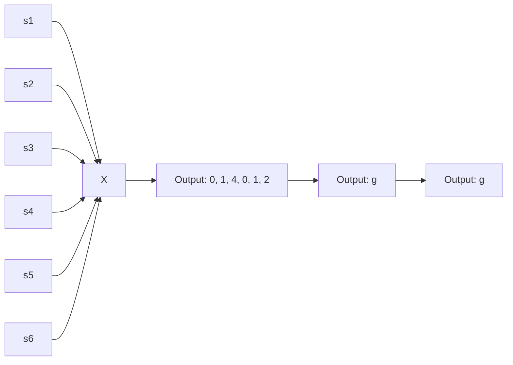
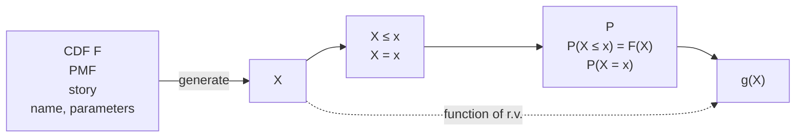

# 3: Random variables and their distributions

原始 PDF 第 120–165 页。

3

# Random variables and their distributions

In this chapter, we introduce random variables, an incredibly useful concept that simplifies notation and expands our ability to quantify uncertainty and summarize the results of experiments. Random variables are essential throughout the rest of this book, and throughout statistics, so it is crucial to think through what they mean, both intuitively and mathematically.

## 3.1 Random variables

To see why our current notation can quickly become unwieldy, consider again the gambler’s ruin problem from Chapter 2. In this problem, we may be very interested in how much wealth each gambler has at any particular time. So we could make up notation like letting $A _ { j k }$ be the event that gambler A has exactly j dollars after k rounds, and similarly defining an event $B _ { j k }$ for gambler B, for all j and k.

This is already too complicated. Furthermore, we may also be interested in other quantities, such as the difference in their wealths (gambler A’s minus gambler B’s) after k rounds, or the duration of the game (the number of rounds until one player is bankrupt). Expressing the event “the duration of the game is r rounds” in terms of the $A _ { j k }$ and $B _ { j k }$ would involve a long, awkward string of unions and intersections. And then what if we want to express gambler A’s wealth as the equivalent amount in euros rather than dollars? We can multiply a number in dollars by a currency exchange rate, but we can’t multiply an event by an exchange rate.

Instead of having convoluted notation that obscures how the quantities of interest are related, wouldn’t it be nice if we could say something like the following?

Let $X _ { k }$ be the wealth of gambler A after k rounds. Then $Y _ { k }   =   N   -   X _ { k }$ is the wealth of gambler B after k rounds (where N is the fixed total wealth); $X _ { k }   -   Y _ { k } = 2 X _ { k }   -   N$ is the difference in wealths after k rounds; $c _ { k } X _ { k }$ is the wealth of gambler A in euros after k rounds, where $c _ { k }$ is the euros per dollar exchange rate after k rounds; and the duration is $R = \operatorname* { m i n } \{ n : X _ { n } = 0 { \mathrm { ~ o r ~ } } Y _ { n } = 0 \}$

The notion of a random variable will allow us to do exactly this! It needs to be introduced carefully though, to make it both conceptually and technically correct. Sometimes a definition of “random variable” is given that is a barely paraphrased

103

---

104

Introduction to Probability

version of $^ { \mathrm { a } }$ random variable is a variable that takes on random values”, but such a feeble attempt at a definition fails to say where the randomness come from. Nor does it help us to derive properties of random variables: we’re familiar with working with algebraic equations like $x ^ { 2 } + y ^ { 2 }   =   1$ , but what are the valid mathematical operations if x and y are random variables? To make the notion of random variable precise, we define it as a function mapping the sample space to the real line. (See the math appendix for review of some concepts about functions.)

flowchart

## FIGURE 3.1

A random variable maps the sample space into the real line. The r.v. X depicted here is defined on a sample space with 6 elements, and has possible values 0, 1, and 4. The randomness comes from choosing a random pebble according to the probability function P for the sample space.

Definition 3.1.1 (Random variable). Given an experiment with sample space S, a random variable (r.v.) is a function from the sample space S to the real numbers R. It is common, but not required, to denote random variables by capital letters.

Thus, a random variable X assigns a numerical value X(s) to each possible outcome s of the experiment. The randomness comes from the fact that we have a random experiment (with probabilities described by the probability function P); the mapping itself is deterministic, as illustrated in Figure 3.1. The same r.v. is shown in a simpler way in the left panel of Figure 3.2, in which we inscribe the values inside the pebbles.

This definition is abstract but fundamental; one of the most important skills to develop when studying probability and statistics is the ability to go back and forth between abstract ideas and concrete examples. Relatedly, it is important to work on recognizing the essential pattern or structure of a problem and how it connects

---

Random variables and their distributions

105

to problems you have studied previously. We will often discuss stories that involve tossing coins or drawing balls from urns because they are simple, convenient scenarios to work with, but many other problems are isomorphic: they have the same essential structure, but in a different guise.

To start, let’s consider a coin-tossing example. The structure of the problem is that we have a sequence of trials where there are two possible outcomes for each trial. Here we think of the possible outcomes as H (Heads) and T (Tails), but we could just as well think of them as “success” and “failure” or as 1 and 0, for example.

Example 3.1.2 (Coin tosses). Consider an experiment where we toss a fair coin twice. The sample space consists of four possible outcomes: $S _ { \mathrm { ~ \tiny ~ \bar ~ } } =$ {HH, HT, T H, T T}. Here are some random variables on this space (for practice, you can think up some of your own). Each r.v. is a numerical summary of some aspect of the experiment.

• Let X be the number of Heads. This is a random variable with possible values 0, 1, and 2. Viewed as a function, X assigns the value 2 to the outcome HH, 1 to the outcomes HT and T H, and 0 to the outcome T T. That is,

$$
X (H H) = 2, X (H T) = X (T H) = 1, X (T T) = 0.
$$

• Let Y be the number of Tails. In terms of X, we have $Y = 2 - X$ . In other words, Y and $2 - X$ are the same r.v.: $Y ( s ) = 2 - X ( s )$ for all s.

• Let I be 1 if the first toss lands Heads and 0 otherwise. Then I assigns the value 1 to the outcomes HH and HT and 0 to the outcomes T H and T T. This r.v. is an example of what is called an indicator random variable since it indicates whether the first toss lands Heads, using 1 to mean “yes” and 0 to mean “no”.

We can also encode the sample space as $\{ ( 1 , 1 ) , ( 1 , 0 ) , ( 0 , 1 ) , ( 0 , 0 ) \}$ , where 1 is the code for Heads and 0 is the code for Tails. Then we can give explicit formulas for $X , Y , I ;$

$$
X (s _ {1}, s _ {2}) = s _ {1} + s _ {2}, Y (s _ {1}, s _ {2}) = 2 - s _ {1} - s _ {2}, I (s _ {1}, s _ {2}) = s _ {1},
$$

where for simplicity we write $X ( s _ { 1 } , s _ { 2 } )$ to mean $X ( ( s _ { 1 } , s _ { 2 } ) )$ , etc.

For most r.v.s we will consider, it is tedious or infeasible to write down an explicit formula in this way. Fortunately, it is usually unnecessary to do so, since (as we saw in this example) there are other ways to define an r.v., and (as we will see throughout the rest of this book) there are many ways to study the properties of an r.v. other than by doing computations with an explicit formula for what it maps each outcome s to. 

As in the previous chapters, for a sample space with a finite number of outcomes we can visualize the outcomes as pebbles, with the mass of a pebble corresponding to its probability, such that the total mass of the pebbles is 1. A random variable simply labels each pebble with a number. Figure 3.2 shows two random variables

---

106

Introduction to Probability

defined on the same sample space: the pebbles or outcomes are the same, but the real numbers assigned to the outcomes are different.

## FIGURE 3.2

Two random variables defined on the same sample space.

As we’ve mentioned earlier, the source of the randomness in a random variable is the experiment itself, in which a sample outcome $s   \in   S$ is chosen according to a probability function P. Before we perform the experiment, the outcome s has not yet been realized, so we don’t know the value of $X$ , though we could calculate the probability that X will take on a given value or range of values. After we perform the experiment and the outcome s has been realized, the random variable crystallizes into the numerical value $X ( s )$

Random variables provide numerical summaries of the experiment in question. This is very handy because the sample space of an experiment is often incredibly complicated or high-dimensional, and the outcomes $s   \in   S$ may be non-numeric. For example, the experiment may be to collect a random sample of people in a certain city and ask them various questions, which may have numeric (e.g., age or height) or non-numeric (e.g., political party or favorite movie) answers. The fact that r.v.s take on numerical values is a very convenient simplification compared to having to work with the full complexity of S at all times.

## 3.2 Distributions and probability mass functions

There are two main types of random variables used in practice: discrete r.v.s and continuous r.v.s. In this chapter and the next, our focus is on discrete r.v.s. Continuous r.v.s are introduced in Chapter 5.

Definition 3.2.1 (Discrete random variable). A random variable X is said to be discrete if there is a finite list of values $a _ { 1 } , a _ { 2 } , \ldots , a _ { n }$ or an infinite list of values $a _ { 1 } , a _ { 2 } , \ldots$ . such that $P ( X   =   a _ { j }$ for some $j )   =   1$ . If X is a discrete r.v., then the

---

Random variables and their distributions

107

finite or countably infinite set of values x such that $P ( X   =   x )   >   0$ is called the support of X.

Most commonly in applications, the support of a discrete r.v. is a set of integers. In contrast, a continuous r.v. can take on any real value in an interval (possibly even the entire real line); such r.v.s are defined more precisely in Chapter 5. It is also possible to have an r.v. that is a hybrid of discrete and continuous, such as by flipping a coin and then generating a discrete r.v. if the coin lands Heads and generating a continuous r.v. if the coin lands Tails. But the starting point for understanding such r.v.s is to understand discrete and continuous r.v.s.

Given a random variable, we would like to be able to describe its behavior using the language of probability. For example, we might want to answer questions about the probability that the r.v. will fall into a given range: if L is the lifetime earnings of a randomly chosen U.S. college graduate, what is the probability that L exceeds a million dollars? If M is the number of major earthquakes in California in the next five years, what is the probability that M equals 0?

The distribution of a random variable provides the answers to these questions; it specifies the probabilities of all events associated with the r.v., such as the probability of it equaling 3 and the probability of it being at least 110. We will see that there are several equivalent ways to express the distribution of an r.v. For a discrete r.v., the most natural way to do so is with a probability mass function, which we now define.

Definition 3.2.2 (Probability mass function). The probability mass function (PMF) of a discrete r.v. X is the function $p _ { X }$ given by $p _ { X } ( x ) = P ( X = x )$ . Note that this is positive if x is in the support of X, and 0 otherwise.

h 3.2.3. In writing $P ( X = x )$ , we are using $X = x$ to denote an event, consisting of all outcomes s to which X assigns the number x. This event is also written as $\{ X = x \}$ ; formally, $\{ X = x \}$ is defined as $\{ s \in S : X ( s ) = x \}$ , but writing $\{ X = x \}$ is shorter and more intuitive. Going back to Example 3.1.2, if X is the number of Heads in two fair coin tosses, then $\{ X   =   1 \}$ consists of the sample outcomes HT and T H, which are the two outcomes to which X assigns the number 1. Since $\{ H T , T H \}$ is a subset of the sample space, it is an event. So it makes sense to talk about $P ( X = 1 )$ , or more generally, $P ( X   =   x ) . { \mathrm { ~ I f ~ } } \{ X   =   x \}$ were anything other than an event, it would make no sense to calculate its probability! It does not make sense to write $\text{" }P(X) \text{" }$ ; we can only take the probability of an event, not of an r.v.

Let’s look at a few examples of PMFs.

Example 3.2.4 (Coin tosses continued). In this example we’ll find the PMFs of all the random variables in Example 3.1.2, the example with two fair coin tosses. Here are the r.v.s we defined, along with their PMFs:

• X, the number of Heads. Since X equals 0 if T T occurs, 1 if HT or T H occurs,

---

108

Introduction to Probability

and 2 if HH occurs, the PMF of X is the function $p _ { X }$ given by

$$
p _ {X} (0) = P (X = 0) = 1 / 4,
$$

$$
p _ {X} (1) = P (X = 1) = 1 / 2,
$$

$$
p _ {X} (2) = P (X = 2) = 1 / 4,
$$

and $p _ { X } ( x ) = 0$ for all other values of $x .$

$Y = 2 - X$ , the number of Tails. Reasoning as above or using the fact that

$$
P (Y = y) = P (2 - X = y) = P (X = 2 - y) = p _ {X} (2 - y),
$$

the PMF of Y is

$$
p _ {Y} (0) = P (Y = 0) = 1 / 4,
$$

$$
p _ {Y} (1) = P (Y = 1) = 1 / 2,
$$

$$
p _ {Y} (2) = P (Y = 2) = 1 / 4,
$$

and $p _ { Y } ( y ) = 0$ for all other values of $y .$

Note that X and Y have the same PMF (that is, pX and pY are the same function) even though X and Y are not the same r.v. (that is, X and Y are two different functions from {HH, HT, TH, T T} to the real line).

• I, the indicator of the first toss landing Heads. Since I equals 0 if T H or T T occurs and 1 if HH or HT occurs, the PMF of I is

$$
p _ {I} (0) = P (I = 0) = 1 / 2,
$$

$$
p _ {I} (1) = P (I = 1) = 1 / 2,
$$

and $p _ { I } ( i ) = 0$ for all other values of $i .$

## FIGURE 3.3

Left to right: PMFs of X, Y , and I, with X the number of Heads in two fair coin tosses, Y the number of Tails, and I the indicator of Heads on the first toss.

The PMFs of X, Y , and I are plotted in Figure 3.3. Vertical bars are drawn to make it easier to compare the heights of different points. 

---

Random variables and their distributions

109

Example 3.2.5 (Sum of die rolls). We roll two fair 6-sided dice. Let $T = X + Y$ be the total of the two rolls, where X and Y are the individual rolls. The sample space of this experiment has 36 equally likely outcomes:

$$
S = \{(1, 1), (1, 2), \dots , (6, 5), (6, 6) \}.
$$

For example, 7 of the 36 outcomes s are shown in the table below, along with the corresponding values of $X , Y ,$ and T. After the experiment is performed, we observe values for X and Y , and then the observed value of T is the sum of those values.

| s | X | Y | $X + Y$ |
| --- | --- | --- | --- |
| (1,2) | 1 | 2 | 3 |
| (1,6) | 1 | 6 | 7 |
| (2,5) | 2 | 5 | 7 |
| (3,1) | 3 | 1 | 4 |
| (4,3) | 4 | 3 | 7 |
| (5,4) | 5 | 4 | 9 |
| (6,6) | 6 | 6 | 12 |

Since the dice are fair, the PMF of X is

$$
P (X = j) = 1 / 6,
$$

for $j = 1 , 2 , \ldots , 6$ (and $P ( X = j ) = 0$ otherwise); we say that X has a Discrete Uniform distribution on $1 , 2 , \ldots , 6 .$ Similarly, Y is also Discrete Uniform on $1 , 2 , \ldots , 6 .$

Note that Y has the same distribution as X but is not the same random variable as X. In fact, we have

$$
P (X = Y) = 6 / 3 6 = 1 / 6.
$$

Two more r.v.s in this experiment with the same distribution as X are $7 - X$ and $7 - Y$ . To see this, we can use the fact that for a standard die, $7 - X$ is the value on the bottom if X is the value on the top. If the top value is equally likely to be any of the numbers $1 , 2 , \ldots , 6 ,$ then so is the bottom value. Note that even though $7   -   X$ has the same distribution as $X .$ , it is never equal to X in a run of the experiment!

Let’s now find the PMF of T. By the naive definition of probability,

$$
\begin{array}{l} P (T = 2) = P (T = 1 2) = 1 / 3 6, \\ P (T = 3) = P (T = 1 1) = 2 / 3 6, \\ P (T = 4) = P (T = 1 0) = 3 / 3 6, \\ P (T = 5) = P (T = 9) = 4 / 3 6, \\ P (T = 6) = P (T = 8) = 5 / 3 6, \\ P (T = 7) = 6 / 3 6. \\ \end{array}
$$

For all other values of t, $P ( T = t ) = 0$ . We can see directly that the support of $T$

---

110

Introduction to Probability

is $\{ 2 , 3 , \ldots , 1 2 \}$ just by looking at the possible totals for two dice, but as a check, note that

$$
P (T = 2) + P (T = 3) + \dots + P (T = 1 2) = 1,
$$

which shows that all possibilities have been accounted for. The symmetry property of T that appears above, $P ( T = t ) = P ( T = 1 4   -   t )$ , makes sense since each outcome $\{ X = x , Y = y \}$ which makes $T = t$ has a corresponding outcome $\{ X = 7 - x , Y =$ $\{ 7 - y \}$ of the same probability which makes $T = 1 4 - t$

stem

| t | PMF |
| --- | --- |
| 2 | ~0.03 |
| 3 | ~0.055 |
| 4 | ~0.085 |
| 5 | ~0.11 |
| 6 | ~0.14 |
| 7 | ~0.165 |
| 8 | ~0.14 |
| 9 | ~0.11 |
| 10 | ~0.085 |
| 11 | ~0.055 |
| 12 | ~0.03 |

## FIGURE 3.4

PMF of the sum of two die rolls.

The PMF of T is plotted in Figure 3.4; it has a triangular shape, and the symmetry noted above is very visible. 

Example 3.2.6 (Children in a U.S. household). Suppose we choose a household in the United States at random. Let X be the number of children in the chosen household. Since X can only take on integer values, it is a discrete r.v. The probability that X takes on the value x is proportional to the number of households in the United States with x children.

Using data from the 2010 General Social Survey [23], we can approximate the proportion of households with 0 children, 1 child, 2 children, etc., and hence approximate the PMF of X, which is plotted in Figure 3.5. 

We will now state the properties of a valid PMF.

Theorem 3.2.7 (Valid PMFs). Let X be a discrete r.v. with support $x _ { 1 } , x _ { 2 } , \ldots$ (assume these values are distinct and, for notational simplicity, that the support is countably infinite; the analogous results hold if the support is finite). The PMF $p _ { X }$ of X must satisfy the following two criteria:

• Nonnegative: $p _ { X } ( x ) > 0 { \mathrm { ~ i f ~ } } x = x _ { j }$ for some j, and $p _ { X } ( x ) = 0$ otherwise;
• Sums to 1: $\begin{array} { r } { \sum _ { j = 1 } ^ { \infty } p _ { X } ( x _ { j } ) = 1 } \end{array}$

---

Random variables and their distributions

111

stem

| x | PMF |
| --- | --- |
| 0 | ~0.28 |
| 1 | ~0.16 |
| 2 | ~0.26 |
| 3 | ~0.16 |
| 4 | ~0.07 |
| 5 | ~0.03 |
| 6 | ~0.02 |
| 7 | ~0.01 |
| 8 | ~0.02 |

## FIGURE 3.5

PMF of the number of children in a randomly selected U.S. household.

Proof. The first criterion is true since probability is nonnegative. The second is true since X must take on some value, and the events $\{ X = x _ { j } \}$ are disjoint, so

$$
\sum_ {j = 1} ^ {\infty} P (X = x _ {j}) = P \left(\bigcup_ {j = 1} ^ {\infty} \{X = x _ {j} \}\right) = P (X = x _ {1} \text {or} X = x _ {2} \text {or} \dots) = 1.\quad \blacksquare
$$

Conversely, if distinct values $x _ { 1 } , x _ { 2 } , \ldots$ are specified and we have a function satisfying the two criteria above, then this function is the PMF of some r.v.; we will show how to construct such an r.v. in Chapter 5.

We claimed earlier that the PMF is one way of expressing the distribution of a discrete r.v. This is because once we know the PMF of $X .$ we can calculate the probability that X will fall into a given subset of the real numbers by summing over the appropriate values of $x ,$ as the next example shows.

Example 3.2.8. Returning to Example 3.2.5, let T be the sum of two fair die rolls. We have already calculated the PMF of T. Now suppose we’re interested in the probability that $T$ is in the interval [1, 4]. There are only three values in the interval [1, 4] that $T$ can take on, namely, 2, 3, and 4. We know the probability of each of these values from the PMF of $T ,$ so

$$
P (1 \leq T \leq 4) = P (T = 2) + P (T = 3) + P (T = 4) = 6 / 3 6.
$$

In general, given a discrete r.v. X and a set B of real numbers, if we know the PMF of X we can find $P ( X \in B )$ , the probability that X is in B, by summing up the heights of the vertical bars at points in B in the plot of the PMF of X. Knowing the PMF of a discrete r.v. determines its distribution.

---

112

Introduction to Probability

## 3.3 Bernoulli and Binomial

Some distributions are so ubiquitous in probability and statistics that they have their own names. We will introduce these named distributions throughout the book, starting with a very simple but useful case: an r.v. that can take on only two possible values, 0 and 1.

Definition 3.3.1 (Bernoulli distribution). An r.v. X is said to have the Bernoulli distribution with parameter p if $P ( X   =   1 )   =   p$ and $P ( X   =   0 )   =   1   -   p ,$ where $0 < p < 1$ . We write this as $X \sim \mathrm { B e r n } ( p )$ . The symbol ∼ is read “is distributed $\mathrm { a s } ^ { \prime \prime }$

Any r.v. whose possible values are 0 and 1 has a Bern(p) distribution, with p the probability of the r.v. equaling 1. This number $p$ in Bern(p) is called the parameter of the distribution; it determines which specific Bernoulli distribution we have. Thus there is not just one Bernoulli distribution, but rather a family of Bernoulli distributions, indexed by $p .$ For example, if $X \sim \mathrm { B e r n } ( 1 / 3 )$ , it would be correct but incomplete to say $^ { \circ } X$ is Bernoulli”; to fully specify the distribution of $X ,$ we should both say its name (Bernoulli) and its parameter value $( 1 / 3 )$ , which is the point of the notation $X \sim \mathrm { B e r n } ( 1 / 3 )$

Any event has a Bernoulli r.v. that is naturally associated with it, equal to 1 if the event happens and 0 otherwise. This is called the indicator random variable of the event; we will see that such r.v.s are extremely useful.

Definition 3.3.2 (Indicator random variable). The indicator random variable of an event A is the r.v. which equals 1 if A occurs and 0 otherwise. We will denote the indicator r.v. of A by $I _ { A }$ or $I ( A )$ . Note that $I _ { A } \sim \mathrm { B e r n } ( p )$ with $p = P ( A )$

We often imagine Bernoulli r.v.s using coin tosses, but this is just convenient language for discussing the following general story.

Story 3.3.3 (Bernoulli trial). An experiment that can result in either a “success” or a “failure” (but not both) is called a Bernoulli trial. A Bernoulli random variable can be thought of as the indicator of success in a Bernoulli trial: it equals 1 if success occurs and 0 if failure occurs in the trial. 

Because of this story, the parameter p is often called the success probability of the Bern $( p )$ distribution. Once we start thinking about Bernoulli trials, it’s hard not to start thinking about what happens when we have more than one trial.

Story 3.3.4 (Binomial distribution). Suppose that n independent Bernoulli trials are performed, each with the same success probability $p .$ Let X be the number of successes. The distribution of X is called the Binomial distribution with parameters n and $p .$ We write $X   \sim   \mathrm { B i n } ( n , p )$ to mean that X has the Binomial distribution with parameters n and $p ,$ where n is a positive integer and $0 < p < 1$ 

Notice that we define the Binomial distribution not by its PMF, but by a story

---

Random variables and their distributions

113

about the type of experiment that could give rise to a random variable with a Binomial distribution. The most famous distributions in statistics all have stories which explain why they are so often used as models for data, or as the building blocks for more complicated distributions.

Thinking about the named distributions first and foremost in terms of their stories has many benefits. It facilitates pattern recognition, allowing us to see when two problems are essentially identical in structure; it often leads to cleaner solutions that avoid PMF calculations altogether; and it helps us understand how the named distributions are connected to one another. Here it is clear that Bern $( p )$ is the same distribution as $\operatorname { B i n } ( 1 , p )$ : the Bernoulli is a special case of the Binomial.

Using the story definition of the Binomial, let’s find its PMF.

Theorem 3.3.5 (Binomial PMF). If $X \sim \operatorname { B i n } ( n , p )$ , then the PMF of X is

$$
P (X = k) = \binom {n} {k} p ^ {k} (1 - p) ^ {n - k}
$$

for $k = 0 , 1 , \ldots , n$ (and $P ( X = k ) = 0 { \mathrm { ~ o t h e r w i s e } } )$

h 3.3.6. To save writing, it is often left implicit that a PMF is zero wherever it is not specified to be nonzero, but in any case it is important to understand what the support of a random variable is, and good practice to check that PMFs are valid. If two discrete r.v.s have the same PMF, then they also must have the same support. So we sometimes refer to the support of a discrete distribution; this is the support of any r.v. with that distribution.

Proof. An experiment consisting of n independent Bernoulli trials produces a sequence of successes and failures. The probability of any specific sequence of k successes and $n - k$ failures is $p ^ { k } ( 1 - p ) ^ { n - k }$ . There are $\binom { n } { k }$ such sequences, since we just need to select where the successes are. Therefore, letting $X$ be the number of successes,

$$
P (X = k) = \binom {n} {k} p ^ {k} (1 - p) ^ {n - k}
$$

for $k = 0 , 1 , \ldots , n ,$ and $P(X = k) = 0$ otherwise. This is a valid PMF because it is nonnegative and it sums to 1 by the binomial theorem. 

Figure 3.6 shows plots of the Binomial PMF for various values of $n$ and $p .$ Note that the PMF of the $\mathrm { B i n } ( 1 0 , 1 / 2 )$ distribution is symmetric about 5, but when the success probability is not $1 / 2 ,$ the PMF is skewed. For a fixed number of trials $n , X$ tends to be larger when the success probability is high and lower when the success probability is low, as we would expect from the story of the Binomial distribution. Also recall that in any PMF plot, the sum of the heights of the vertical bars must be 1.

We’ve used Story 3.3.4 to find the $\operatorname { B i n } ( n , p )$ PMF. The story also gives us a straightforward proof of the fact that if X is Binomial, then $n - X$ is also Binomial.

---

114

Introduction to Probability

FIGURE 3.6

Some Binomial PMFs. In the lower left, we plot the Bin(100, 0.03) PMF between 0 and 10 only, as the probability of more than 10 successes is close to 0.

---

Random variables and their distributions

115

Theorem 3.3.7. Let $X \sim \operatorname { B i n } ( n , p )$ , and $q = 1 - p$ (we often use $q$ to denote the failure probability of a Bernoulli trial). Then $n - X \sim \mathrm { B i n } ( n , q )$

Proof. Using the story of the Binomial, interpret X as the number of successes in n independent Bernoulli trials. Then $n - X$ is the number of failures in those trials. Interchanging the roles of success and failure, we have $n - X \sim \operatorname { B i n } ( n , q )$ Alternatively, we can check that $n - X$ has the $\operatorname { B i n } ( n , q )$ PMF. Let $Y = n - X$ . The PMF of $Y$ is

$$
P (Y = k) = P (X = n - k) = \binom{n}{n - k} p ^ {n - k} q ^ {k} = \binom{n}{k} q ^ {k} p ^ {n - k},
$$

for $k = 0 , 1 , \ldots , n$

Corollary 3.3.8. Let $X \sim \operatorname { B i n } ( n , p )$ with $p = 1 / 2$ and n even. Then the distribution of X is symmetric about $n / 2$ , in the sense that $P(X = n/2 + j) = P(X = n/2 - j)$ for all nonnegative integers $j$

Proof. By Theorem 3.3.7, $n - X$ is also $\operatorname { B i n } ( n , 1 / 2 )$ , so

$$
P (X = k) = P (n - X = k) = P (X = n - k)
$$

for all nonnegative integers k. Letting $k = n / 2 + j$ , the desired result follows. This explains why the $\mathrm { B i n } ( 1 0 , 1 / 2 )$ PMF is symmetric about 5 in Figure 3.6. 

Example 3.3.9 (Coin tosses continued). Going back to Example 3.1.2, we now know that $X \sim \mathrm { B i n } ( 2 , 1 / 2 ) ,   Y \sim \mathrm { B i n } ( 2 , 1 / 2 )$ , and $I \sim \mathrm { B e r n } ( 1 / 2 )$ . Consistent with Theorem 3.3.7, X and $Y = 2 - X$ have the same distribution, and consistent with Corollary 3.3.8, the distribution of X (and of $Y )$ is symmetric about 1. 

## 3.4 Hypergeometric

If we have an urn filled with w white and b black balls, then drawing n balls out of the urn with replacement yields a $\operatorname { B i n } ( n , w / ( w + b ) )$ distribution for the number of white balls obtained in n trials, since the draws are independent Bernoulli trials, each with probability $w / ( w   +   b )$ of success. If we instead sample without replacement, as illustrated in Figure 3.7, then the number of white balls follows a Hypergeometric distribution.

Story 3.4.1 (Hypergeometric distribution). Consider an urn with $w$ white balls and b black balls. We draw n balls out of the urn at random without replacement, such that all ${ \binom { w + b } { n } }$ samples are equally likely. Let X be the number of white balls in the sample. Then X is said to have the Hypergeometric distribution with parameters $w ,   b ,$ and $n ;$ we denote this by $X \sim \operatorname { H G e o m } ( w , b , n )$ 

---

116

Introduction to Probability

text_image

Diagram illustrating particle distribution in a container with solid black and white particles, showing a transformation or process arrow.

## FIGURE 3.7

Hypergeometric story. An urn contains $w = 6$ white balls and $b = 4$ black balls. We sample $n = 5$ without replacement. The number X of white balls in the sample is Hypergeometric; here we observe $X = 3$

As with the Binomial distribution, we can obtain the PMF of the Hypergeometric distribution from the story.

Theorem 3.4.2 (Hypergeometric PMF). If $X \sim \operatorname { H G e o m } ( w , b , n )$ , then the PMF of X is

$$
P (X = k) = \frac {\binom {w} {k} \binom {b} {n - k}}{\binom {w + b} {n}},
$$

for integers k satisfying $0 \leq k \leq w$ and $0 \leq n - k \leq b .$ and $P ( X = k ) = 0$ otherwise.

Proof. To get $P ( X = k )$ , we first count the number of possible ways to draw exactly k white balls and $n - k$ black balls from the urn (without distinguishing between different orderings for getting the same set of balls). If $k > w$ or $n - k > b$ , then the draw is impossible. Otherwise, there are ${ \binom { w } { k } } { \binom { \hat { b } } { n - k } }$ ways to draw k white and $n - k$ black balls by the multiplication rule, and there are ${ \binom { w + b } { n } }$ total ways to draw n balls. Since all samples are equally likely, the naive definition of probability gives

$$
P (X = k) = \frac {\binom {w} {k} \binom {b} {n - k}}{\binom {w + b} {n}}
$$

for integers k satisfying $0 \leq k \leq w$ and $0 \leq n   -   k \leq b$ This PMF is valid because the numerator, summed over all k, equals ${ w + b \choose n }$ by Vandermonde’s identity (Example 1.5.3), so the PMF sums to 1. 

The Hypergeometric distribution comes up in many scenarios which, on the surface, have little in common with white and black balls in an urn. The essential structure of the Hypergeometric story is that items in a population are classified using two sets of tags: in the urn story, each ball is either white or black (this is the first set of tags), and each ball is either sampled or not sampled (this is the second set of tags). Furthermore, at least one of these sets of tags is assigned completely at random (in the urn story, the balls are sampled randomly, with all sets of the correct size equally likely). Then $X \sim \operatorname { H G e o m } ( w , b , n )$ represents the number of twice-tagged items: in the urn story, balls that are both white and sampled.

---

Random variables and their distributions

117

The next two examples show seemingly dissimilar scenarios that are nonetheless isomorphic to the urn story.

Example 3.4.3 (Elk capture-recapture). A forest has N elk. Today, m of the elk are captured, tagged, and released into the wild. At a later date, n elk are recaptured at random. Assume that the recaptured elk are equally likely to be any set of n of the elk, e.g., an elk that has been captured does not learn how to avoid being captured again.

By the story of the Hypergeometric, the number of tagged elk in the recaptured sample is $\mathrm{HGecom}(m, N - m, n)$ . The m tagged elk in this story correspond to the white balls and the N − m untagged elk correspond to the black balls. Instead of sampling n balls from the urn, we recapture n elk from the forest. 

Example 3.4.4 (Aces in a poker hand). In a five-card hand drawn at random from a well-shuffled standard deck, the number of aces in the hand has the HGeom(4, 48, 5) distribution, which can be seen by thinking of the aces as white balls and the non-aces as black balls. Using the Hypergeometric PMF, the probability that the hand has exactly three aces is

$$
\frac {\binom {4} {3} \binom {4 8} {2}}{\binom {5 2} {5}} \approx 0. 0 0 1 7.
$$

The following table summarizes how the above examples can be thought of in terms of two sets of tags. In each example, the r.v. of interest is the number of items falling into both the second and the fourth columns: white and sampled, tagged and recaptured, ace and in one’s hand.

<table><tr><td>Story</td><td colspan="2">First set of tags</td><td colspan="2">Second set of tags</td></tr><tr><td>urn</td><td>white</td><td>black</td><td>sampled</td><td>not sampled</td></tr><tr><td>elk</td><td>tagged</td><td>untagged</td><td>recaptured</td><td>not recaptured</td></tr><tr><td>cards</td><td>ace</td><td>not ace</td><td>in hand</td><td>not in hand</td></tr></table>

The next theorem describes a symmetry between two Hypergeometric distributions with different parameters; the proof follows from swapping the two sets of tags in the Hypergeometric story.

Theorem 3.4.5. The $\operatorname { H G e o m } ( w , b , n )$ and HGeom $\left| \left( n , w + b - n , w \right) \right.$ distributions are identical. That is, if $X   \sim   \operatorname { H G e o m } ( w , b , n )$ and $Y \sim$ HGeom $( n , w + b - n , w )$ then X and Y have the same distribution.

Proof. Using the story of the Hypergeometric, imagine an urn with w white balls, b black balls, and a sample of size n made without replacement. Let $X \sim$ HGeom $( w , b , n )$ be the number of white balls in the sample, thinking of white/black as the first set of tags and sampled/not sampled as the second set of tags. Let $Y   \sim   \mathrm { H G e o m } ( n , w   +   b   -   n , w )$ be the number of sampled balls among the white balls, thinking of sampled/not sampled as the first set of tags and white/black as

---

118

Introduction to Probability

the second set of tags. Both X and $Y$ count the number of white sampled balls, so they have the same distribution.

Alternatively, we can check algebraically that X and Y have the same PMF:

$$
\begin{array}{l} P (X = k) = \frac {\binom {w} {k} \binom {b} {n - k}}{\binom {w + b} {n}} = \frac {w ! b ! n ! (w + b - n) !}{k ! (w + b) ! (w - k) ! (n - k) ! (b - n + k) !}, \\ P (Y = k) = \frac {\binom {n} {k} \binom {w + b - n} {w - k}}{\binom {w + b} {w}} = \frac {w ! b ! n ! (w + b - n) !}{k ! (w + b) ! (w - k) ! (n - k) ! (b - n + k) !}. \\ \end{array}
$$

We prefer the story proof because it is less tedious and more memorable.

h 3.4.6 (Binomial vs. Hypergeometric). The Binomial and Hypergeometric distributions are often confused. Both are discrete distributions taking on integer values between 0 and n for some n, and both can be interpreted as the number of successes in n Bernoulli trials (for the Hypergeometric, each tagged elk in the recaptured sample can be considered a success and each untagged elk a failure). However, a crucial part of the Binomial story is that the Bernoulli trials involved are independent. The Bernoulli trials in the Hypergeometric story are dependent, since the sampling is done without replacement: knowing that one elk in our sample is tagged decreases the probability that the second elk will also be tagged.

## 3.5 Discrete Uniform

A very simple story, closely connected to the naive definition of probability, describes picking a random number from some finite set of possibilities.

Story 3.5.1 (Discrete Uniform distribution). Let C be a finite, nonempty set of numbers. Choose one of these numbers uniformly at random (i.e., all values in $C$ are equally likely). Call the chosen number $X$ . Then $X$ is said to have the Discrete Uniform distribution with parameter $C ;$ we denote this by $X \sim \operatorname { D U n i f } ( C )$ 

The PMF of $X \sim \operatorname { D U n i f } ( C )$ is

$$
P (X = x) = \frac {1}{| C |}
$$

for $x \in C$ (and 0 otherwise), since a PMF must sum to 1. As with questions based on the naive definition of probability, questions based on a Discrete Uniform distribution reduce to counting problems. Specifically, for $X \sim \operatorname { D U n i f } ( C )$ and any $A \subseteq C$ , we have

$$
P (X \in A) = \frac {| A |}{| C |}.
$$

---

Random variables and their distributions

119

Example 3.5.2 (Random slips of paper). There are 100 slips of paper in a hat, each of which has one of the numbers $1 , 2 , \ldots , 1 0 0$ written on it, with no number appearing more than once. Five of the slips are drawn, one at a time.

First consider random sampling with replacement (with equal probabilities).

(a) What is the distribution of how many of the drawn slips have a value of at least 80 written on them?
(b) What is the distribution of the value of the jth draw (for $1 \leq j \leq 5 ) ?$
(c) What is the probability that the number 100 is drawn at least once?

Now consider random sampling without replacement (with all sets of five slips equally likely to be chosen).

(d) What is the distribution of how many of the drawn slips have a value of at least 80 written on them?

(e) What is the distribution of the value of the jth draw (for $1 \leq j \leq 5 ) ?$

(f) What is the probability that the number 100 is drawn in the sample?

## Solution:

(a) By the story of the Binomial, the distribution is Bin(5, 0.21).

(b) Let $X _ { j }$ be the value of the jth draw. By symmetry, $X _ { j } \sim \operatorname { D U n i f } ( 1 , 2 , \ldots , 1 0 0 )$ There aren’t certain slips that love being chosen on the jth draw and others that avoid being chosen then; all are equally likely.

(c) Taking complements,

$$
P (X _ {j} = 1 0 0 \text {for at least one} j) = 1 - P (X _ {1} \neq 1 0 0, \dots , X _ {5} \neq 1 0 0).
$$

By the naive definition of probability, this is

$$
1 - (9 9 / 1 0 0) ^ {5} \approx 0. 0 4 9.
$$

This solution just uses new notation for concepts from Chapter 1. It is useful to have this new notation since it is compact and flexible. In the above calculation, it is important to see why

$$
P (X _ {1} \neq 1 0 0, \dots , X _ {5} \neq 1 0 0) = P (X _ {1} \neq 1 0 0) \dots P (X _ {5} \neq 1 0 0).
$$

This follows from the naive definition in this case, but a more general way to think about such statements is through independence of r.v.s, a concept discussed in detail in Section 3.8.

(d) By the story of the Hypergeometric, the distribution is HGeom(21, 79, 5).
(e) Let $Y _ { j }$ be the value of the jth draw. By symmetry, $Y _ { j } { \sim } \mathrm { D U n i f } ( 1 , 2 , \ldots , 1 0 0 )$

---

120

Introduction to Probability

Learning any $Y _ { i }$ gives information about the other values (so $Y _ { 1 } , \ldots , Y _ { 5 }$ are not independent, as defined in Section 3.8), but symmetry still holds since, unconditionally, the jth slip drawn is equally likely to be any of the slips. This is the unconditional distribution of $Y _ { j }$ : we are working from a vantage point before drawing any of the slips.

For further insight into why each of $Y _ { 1 } , \ldots , Y _ { 5 }$ is Discrete Uniform and how to think about $Y _ { j }$ unconditionally, imagine that instead of one person drawing five slips, one at a time, there are five people who draw one slip each, all reaching into the hat simultaneously, with all possibilities equally likely for who gets which slip. This formulation does not change the problem in any important way, and it helps avoid getting distracted by irrelevant chronological details. Label the five people $1 , 2 , \ldots , 5$ in some way, e.g., from youngest to oldest, and let $Z _ { j }$ be the value drawn by person $j .$ . By symmetry, $Z _ { j } \sim \operatorname { D U n i f } ( 1 , 2 , \ldots , 1 0 0 )$ for each $j ;$ the $Z _ { j }$ ’s are dependent but, looked at individually, each person is drawing a uniformly random slip.

(f) The events $Y _ { 1 } \: = \: 1 0 0 , \ldots , Y _ { 5 } \: = \: 1 0 0$ are disjoint since we are now sampling without replacement, so

$$
P (Y _ {j} = 1 0 0 \text {for some} j) = P (Y _ {1} = 1 0 0) + \dots + P (Y _ {5} = 1 0 0) = 0. 0 5.
$$

Sanity check: This answer makes sense intuitively since we can just as well think of first choosing five random slips out of 100 blank slips and then randomly writing the numbers from 1 to 100 on the slips, which gives a $5 / 1 0 0$ chance that the number 100 is on one of the five chosen slips.

It would be bizarre if the answer to (c) were greater than or equal to the answer to (f), since sampling without replacement makes it easier to find the number 100. (For the same reason, when searching for a lost possession it makes more sense to sample locations without replacement than with replacement.) But it makes sense that the answer to (c) is only slightly less than the answer to (f), since it is unlikely in (c) that the same slip will be sampled more than once (though by the birthday problem it’s less unlikely than many people would guess).

More generally, if k slips are drawn without replacement, where $0 \leq k \leq 1 0 0$ , then the same reasoning gives that the probability of drawing the number 100 is $k / 1 0 0$ Note that this makes sense in the extreme case $k = 1 0 0$ , since in that case we draw all of the slips. 

## 3.6 Cumulative distribution functions

Another function that describes the distribution of an r.v. is the cumulative distribution function (CDF). Unlike the PMF, which only discrete r.v.s possess, the CDF is defined for all r.v.s.

---

Random variables and their distributions

121

Definition 3.6.1. The cumulative distribution function (CDF) of an r.v. X is the function $F _ { X }$ given by $F _ { X } ( x ) = P ( X \leq x )$ . When there is no risk of ambiguity, we sometimes drop the subscript and just write F (or some other letter) for a CDF.

The next example demonstrates that for discrete r.v.s, we can freely convert between CDF and PMF.

Example 3.6.2. Let $X \sim \mathrm { B i n } ( 4 , 1 / 2 )$ Figure 3.8 shows the PMF and CDF of X.

## FIGURE 3.8

Bin(4, 1/2) PMF and CDF. The height of the vertical bar $P ( X = 2 )$ in the PMF is also the height of the jump in the CDF at 2.

• From PMF to CDF: To find $P ( X \leq 1 . 5 )$ , which is the CDF evaluated at 1.5, we sum the PMF over all values of the support that are less than or equal to 1.5:

$$
P (X \leq 1. 5) = P (X = 0) + P (X = 1) = \left(\frac {1}{2}\right) ^ {4} + 4 \left(\frac {1}{2}\right) ^ {4} = \frac {5}{1 6}.
$$

Similarly, the value of the CDF at an arbitrary point x is the sum of the heights of the vertical bars of the PMF at values less than or equal to x.

• From CDF to PMF: The CDF of a discrete r.v. consists of jumps and flat regions. The height of a jump in the CDF at x is equal to the value of the PMF at x. For example, in Figure 3.8, the height of the jump in the CDF at 2 is the same as the height of the corresponding vertical bar in the PMF; this is indicated in the figure with curly braces. The flat regions of the CDF correspond to values outside the support of X, so the PMF is equal to 0 in those regions. 

Valid CDFs satisfy the following criteria.

Theorem 3.6.3 (Valid CDFs). Any CDF F has the following properties.

• Increasing: If $x _ { 1 } \leq x _ { 2 }$ , then $F ( x _ { 1 } ) \leq F ( x _ { 2 } )$

---

122

Introduction to Probability

• Right-continuous: As in Figure 3.8, the CDF is continuous except possibly for having some jumps. Wherever there is a jump, the CDF is continuous from the right. That is, for any a, we have

$$
F (a) = \lim _ {x \to a ^ {+}} F (x).
$$

• Convergence to 0 and 1 in the limits:

$$
\lim _ {x \to - \infty} F (x) = 0 \text {and} \lim _ {x \to \infty} F (x) = 1.
$$

Proof. The above criteria are true for all CDFs, but for simplicity we will only prove it for the case where F is the CDF of a discrete r.v. X whose possible values are $0 , 1 , 2 , \ldots . \mathrm { A s }$ an example of how to visualize the criteria, consider Figure 3.8: the CDF shown there is increasing (with some flat regions), continuous from the right (it is continuous except at jumps, and each jump has an open dot at the bottom and a closed dot at the top), and it converges to 0 as $x \to - \infty$ and to 1 as $x \to \infty$ (in this example, it reaches 0 and 1; in some examples, one or both of these values may be approached but never reached).

The first criterion is true since the event $\{ X \leq x _ { 1 } \}$ is a subset of the event $\{ X \leq x _ { 2 } \}$ so $P ( X \leq x _ { 1 } ) \leq P ( X \leq x _ { 2 } )$

For the second criterion, note that

$$
P (X \leq x) = P (X \leq \lfloor x \rfloor),
$$

where bxc is the greatest integer less than or equal to x. For example, $P(X \leq 4.9) =$ $P ( X \leq 4 )$ since X is integer-valued. So $F ( a + b ) = F ( a )$ for any $b > 0$ that is small enough so that $a + b < \lfloor a \rfloor + 1 ,   \mathrm { e . g . }$ , for $a = 4 . 9$ , this holds for $0 < b < 0 . 1$ . This implies $\begin{array} { r } { F ( a ) = \operatorname* { l i m } _ { x \to a ^ { + } } F ( x ) } \end{array}$ (in fact, it’s much stronger since it says $F ( x )$ equals $F ( a )$ when x is close enough to a and on the right).

For the third criterion, we have $F ( x ) = 0 { \mathrm { ~ f o r ~ } } x < 0 ,$ and

$$
\lim _ {x \to \infty} F (x) = \lim _ {x \to \infty} P (X \leq \lfloor x \rfloor) = \lim _ {x \to \infty} \sum_ {n = 0} ^ {\lfloor x \rfloor} P (X = n) = \sum_ {n = 0} ^ {\infty} P (X = n) = 1. \quad \blacksquare
$$

The converse is true too: we will show in Chapter 5 that given any function $F$ meeting these criteria, we can construct a random variable whose CDF is F.

To recap, we have now seen three equivalent ways of expressing the distribution of a random variable. Two of these are the PMF and the CDF: we know these two functions contain the same information, since we can always figure out the CDF from the PMF and vice versa. Generally the PMF is easier to work with for discrete r.v.s, since evaluating the CDF requires a summation.

---

Random variables and their distributions

123

A third way to describe a distribution is with a story that explains (in a precise way) how the distribution can arise. We used the stories of the Binomial and Hypergeometric distributions to derive the corresponding PMFs. Thus the story and the PMF also contain the same information, though we can often achieve more intuitive proofs with the story than with PMF calculations.

## 3.7 Functions of random variables

In this section we will discuss what it means to take a function of a random variable, and we will build understanding for why a function of a random variable is a random variable. That is, if X is a random variable, then $X ^ { 2 } , e ^ { X }$ , and sin(X) are also random variables, as is $g ( X )$ for any function $g : \mathbb { R } \rightarrow \mathbb { R }$

For example, imagine that two basketball teams (A and B) are playing a sevengame match, and let X be the number of wins for team A (so $X \sim \mathrm { B i n } ( 7 , 1 / 2 )$ if the teams are evenly matched and the games are independent). Let $g ( x ) = 7 - x ,$ and let $h ( x ) = 1 { \mathrm { ~ i f ~ } } x \geq 4$ and $h ( x ) = 0 { \mathrm { ~ i f ~ } } x < 4$ . Then $g ( X ) = 7 - X$ is the number of wins for team B, and $h ( X )$ is the indicator of team A winning the majority of the games. Since X is an r.v., both $g ( X )$ and $h ( X )$ are also r.v.s.

To see how to define functions of an r.v. formally, let’s rewind a bit. At the beginning of this chapter, we considered a random variable X defined on a sample space with 6 elements. Figure 3.1 used arrows to illustrate how X maps each pebble in the sample space to a real number, and the left half of Figure 3.2 showed how we can equivalently imagine X writing a real number inside each pebble.

Now we can, if we want, apply the same function g to all the numbers inside the pebbles. Instead of the numbers $X ( s _ { 1 } )$ through $X ( s _ { 6 } )$ , we now have the numbers $g ( X ( s _ { 1 } ) )$ through $g ( X ( s _ { 6 } ) )$ , which gives a new mapping from sample outcomes to real numbers—we’ve created a new random variable, $g ( X )$

Definition 3.7.1 (Function of an r.v.). For an experiment with sample space $S ,$ an $\operatorname { r . v . } X$ , and a function $g : \mathbb { R } \to \mathbb { R } ,   g ( X )$ is the r.v. that maps s to $g ( X ( s ) )$ for all $s \in S$

Taking $g ( x ) = { \sqrt { x } }$ for concreteness, Figure 3.9 shows that $g ( X )$ is the composition of the functions X and $g ,$ saying “first apply X, then apply $g ^ { \flat }$ . Figure 3.10 represents $g ( X )$ more succinctly by directly labeling the sample outcomes. Both figures show us that $g ( X )$ is an r.v.; if X crystallizes to 4, then $g ( X )$ crystallizes to 2.

Given a discrete r.v. X with a known PMF, how can we find the PMF of $Y = g(X) ?$ In the case where $g$ is a one-to-one function, the answer is straightforward: the support of $Y$ is the set of all $g ( x )$ with x in the support of $X$ , and

$$
P (Y = g (x)) = P (g (X) = g (x)) = P (X = x).
$$

---

124

Introduction to Probability

flowchart

FIGURE 3.9

The r.v. X is defined on a sample space with 6 elements, and has possible values 0, 1, and 4. The function g is the square root function. Composing X and g gives the random variable $g ( X ) = { \sqrt { X } }$ , which has possible values 0, 1, and 2.

text_image

1
s₁ 0 s₂ s₃ 1
0
s₄ 2 s₅ s₆ 1

FIGURE 3.10

Since $g ( X ) = { \sqrt { X } }$ labels each pebble with a number, it is an r.v.

---

Random variables and their distributions

125

The case where $Y = g ( X )$ with g one-to-one is illustrated in the following tables; the idea is that if the distinct possible values of X are $x _ { 1 } , x _ { 2 } , \ldots$ . with probabilities $p _ { 1 } , p _ { 2 } , \ldots$ (respectively), then the distinct possible values of Y are $g ( x _ { 1 } ) , g ( x _ { 2 } )$ with the same list $p _ { 1 } , p _ { 2 } , \ldots$ of probabilities.

| x | $P(X = x)$ |
| --- | --- |
| $x_{1}$ | $p_{1}$ |
| $x_{2}$ | $p_{2}$ |
| $x_{3}$ | $p_{3}$ |
| $\vdots$ | $\vdots$ |

PMF of X, in table form

| y | $P(Y = y)$ |
| --- | --- |
| $g(x_1)$ | $p_1$ |
| $g(x_2)$ | $p_2$ |
| $g(x_3)$ | $p_3$ |
| $\vdots$ | $\vdots$ |

PMF of Y , in table form

This suggests a strategy for finding the PMF of an r.v. with an unfamiliar distribution: try to express the r.v. as a one-to-one function of an r.v. with a known distribution. The next example illustrates this method.

Example 3.7.2 (Random walk). A particle moves n steps on a number line. The particle starts at 0, and at each step it moves 1 unit to the right or to the left, with equal probabilities. Assume all steps are independent. Let Y be the particle’s position after n steps. Find the PMF of Y .

## Solution:

Consider each step to be a Bernoulli trial, where right is considered a success and left is considered a failure. Then the number of steps the particle takes to the right is a $\operatorname { B i n } ( n , 1 / 2 )$ random variable, which we can name X. If $X = j$ , then the particle has taken j steps to the right and $n - j$ steps to the left, giving a final position of $j - (n - j) = 2j - n$ . So we can express Y as a one-to-one function of X, namely, $Y = 2X - n$ . Since X takes values in $\{ 0 , 1 , 2 , \ldots , n \}$ , Y takes values in $\{ - n , 2 - n , 4 - n , \ldots , n \}$

The PMF of Y can then be found from the PMF of X:

$$
P (Y = k) = P (2 X - n = k) = P (X = (n + k) / 2) = \binom{n}{\frac {n + k}{2}} \left(\frac {1}{2}\right) ^ {n},
$$

if k is an integer between −n and n (inclusive) such that $n { + } k$ is an even number. 

If g is not one-to-one, then for a given y, there may be multiple values of x such that $g ( x ) = y$ . To compute $P ( g ( X ) = y )$ , we need to sum up the probabilities of X taking on any of these candidate values of x.

Theorem 3.7.3 (PMF of $g ( X ) )$ . Let X be a discrete r.v. and $g : \mathbb { R } \rightarrow \mathbb { R }$ . Then the support of $g ( X )$ is the set of all y such that $g ( x ) = y$ for at least one x in the support of X, and the PMF of $g ( X )$ is

$$
P (g (X) = y) = \sum_ {x: g (x) = y} P (X = x),
$$

---

126

Introduction to Probability

for all y in the support of $g ( X )$

Example 3.7.4. Continuing as in the previous example, let D be the particle’s distance from the origin after n steps. Assume that n is even. Find the PMF of D.

Solution:

We can write $D = | Y | ;$ this is a function of Y , but it isn’t one-to-one. The event $D = 0$ is the same as the event $Y = 0$ . For $k = 2 , 4 , \ldots , n$ , the event $D = k$ is the same as the event $\{ Y = k \} \cup \{ Y = - k \}$ . So the PMF of D is

$$
\begin{array}{l} P (D = 0) = \binom{n}{\frac {n}{2}} \left(\frac {1}{2}\right) ^ {n}, \\ P (D = k) = P (Y = k) + P (Y = - k) = 2 \binom{n}{\frac {n + k}{2}} \left(\frac {1}{2}\right) ^ {n}, \\ \end{array}
$$

for $k = 2 , 4 , \ldots , n$ . In the final step we used symmetry (imagine a new random walk that moves left each time our random walk moves right, and vice versa) to see that $P(Y = k) = P(Y = -k)$ 

The same reasoning we have used to handle functions of one random variable can be extended to deal with functions of multiple random variables. We have already seen an example of this with the addition function (which maps two numbers x, y to their sum $x + y )$ : in Example 3.2.5, we saw how to view $T = X + Y$ as an r.v. in its own right, where X and $Y$ are obtained by rolling dice.

Definition 3.7.5 (Function of two r.v.s). Given an experiment with sample space S, if X and $Y$ are r.v.s that map $s \in S$ to $X ( s )$ and $Y ( s )$ respectively, then $g ( X , Y )$ is the r.v. that maps s to $g(X(s),Y(s))$

Note that we are assuming that X and Y are defined on the same sample space S. Usually we assume that S is chosen to be rich enough to encompass whatever r.v.s we wish to work with. For example, if X is based on a coin flip and Y is based on a die roll, and we initially were using the sample space $S _ { 1 } = \{ H , T \}$ for X and the sample space $S _ { 2 } = \{ 1 , 2 , 3 , 4 , 5 , 6 \}$ for Y , we can easily redefine X and Y so that both are defined on the richer space $S = S _ { 1 } \times S _ { 2 } = \{ ( s _ { 1 } , s _ { 2 } ) : s _ { 1 } \in S _ { 1 } , s _ { 2 } \in S _ { 2 } \}$

One way to understand the mapping from S to R represented by the r.v. $g ( X , Y )$ is with a table displaying the values of X, Y , and $g ( X , Y )$ under various possible outcomes. Interpreting $X   +   Y$ as an r.v. is intuitive: if we observe $X = x$ and $Y = y$ then $X   +   Y$ crystallizes to $x   +   y$ . For a less familiar example like max $( X , Y )$ , students often are unsure how to interpret it as an r.v. But the idea is the same: if we observe $X = x { \mathrm { ~ a n d ~ } } Y = y$ , then $\operatorname* { m a x } ( X , Y )$ crystallizes to $\operatorname* { m a x } ( x , y )$

Example 3.7.6 (Maximum of two die rolls). We roll two fair 6-sided dice. Let X be the number on the first die and Y the number on the second die. The following table gives the values of $X ,   Y$ , and $\operatorname* { m a x } ( X , Y )$ under $7$ of the 36 outcomes in the sample space, analogously to the table in Example 3.2.5.

---

Random variables and their distributions

127

| s | X | Y | max(X,Y) |
| --- | --- | --- | --- |
| (1,2) | 1 | 2 | 2 |
| (1,6) | 1 | 6 | 6 |
| (2,5) | 2 | 5 | 5 |
| (3,1) | 3 | 1 | 3 |
| (4,3) | 4 | 3 | 4 |
| (5,4) | 5 | 4 | 5 |
| (6,6) | 6 | 6 | 6 |

So $\operatorname* { m a x } ( X , Y )$ assigns a numerical value to each sample outcome. The PMF is

$$
P (\max (X, Y) = 1) = 1 / 3 6,
$$

$$
P (\max (X, Y) = 2) = 3 / 3 6,
$$

$$
P (\max (X, Y) = 3) = 5 / 3 6,
$$

$$
P (\max (X, Y) = 4) = 7 / 3 6,
$$

$$
P (\max (X, Y) = 5) = 9 / 3 6,
$$

$$
P (\max (X, Y) = 6) = 1 1 / 3 6.
$$

These probabilities can be obtained by tabulating the values of $\operatorname* { m a x } ( x , y )$ in a $6 \times 6$ grid and counting how many times each value appears in the grid, or with calculations such as

$$
\begin{array}{l} P (\max (X, Y) = 5) = P (X = 5, Y \leq 4) + P (X \leq 4, Y = 5) + P (X = 5, Y = 5) \\ = 2 P (X = 5, Y \leq 4) + 1 / 3 6 \\ = 2 (4 / 3 6) + 1 / 3 6 = 9 / 3 6. \\ \end{array}
$$

h 3.7.7 (Category errors and sympathetic magic). Many common mistakes in probability can be traced to confusing two of the following fundamental objects with each other: distributions, random variables, events, and numbers. Such mistakes are examples of category errors. In general, a category error is a mistake that doesn’t just happen to be wrong, but in fact is necessarily wrong since it is based on the wrong category of object. For example, answering the question “How many people live in Boston?” with $\text{" } -42 \text{" }$ or $a _ { \pi }$ or “pink elephants” would be a category error—we may not know the population size of a city, but we do know that it is a nonnegative integer at any point in time. To help avoid being categorically wrong, always think about what category an answer should have.

An especially common category error is to confuse a random variable with its distribution. We call this error sympathetic magic; this term comes from anthropology, where it is used for the belief that one can influence an object by manipulating a representation of that object. The following saying sheds light on the distinction between a random variable and its distribution:

The word is not the thing; the map is not the territory. – Alfred Korzybski

---

128

Introduction to Probability

We can think of the distribution of a random variable as a map or blueprint describing the r.v. Just as different houses can share the same blueprint, different r.v.s can have the same distribution, even if the experiments they summarize, and the sample spaces they map from, are not the same.

Here are two examples of sympathetic magic:

• Given an r.v. X, trying to get the PMF of 2X by multiplying the PMF of X by 2. It does not make sense to multiply a PMF by 2, since the probabilities would no longer sum to 1. As we saw above, if X takes on values $x _ { j }$ with probabilities $p _ { j }$ , then 2X takes on values $2 x _ { j }$ with probabilities $p _ { j }$ . Therefore the PMF of 2X is a horizontal stretch of the PMF of X; it is not a vertical stretch, as would result from multiplying the PMF by 2. Figure 3.11 shows the PMF of a discrete r.v. X with support {0, 1, 2, 3, 4}, along with the PMF of 2X, which has support {0, 2, 4, 6, 8}. Note that X can take on odd values, but 2X is necessarily even.

FIGURE 3.11

PMF of X (above) and PMF of 2X (below).

---

Random variables and their distributions

129

• Claiming that because X and Y have the same distribution, X must always equal Y , i.e., $P ( X = Y ) = 1$ . Just because two r.v.s have the same distribution does not mean they are always equal, or ever equal. We saw this in Example 3.2.5. As another example, consider flipping a fair coin once. Let X be the indicator of Heads and $Y = 1 - X$ be the indicator of Tails. Both X and Y have the Bern(1/2) distribution, but the event X = Y is impossible. The PMFs of X and Y are the same function, but X and Y are different mappings from the sample space to the real numbers.

If Z is the indicator of Heads in a second flip (independent of the first flip), then Z is also Bern(1/2), but Z is not the same r.v. as X. Here

$$
P (Z = X) = P (H H \text {or} T T) = 1 / 2.
$$

## 3.8 Independence of r.v.s

Just as we had the notion of independence of events, we can define independence of random variables. Intuitively, if two r.v.s X and Y are independent, then knowing the value of X gives no information about the value of Y , and vice versa. The definition formalizes this idea.

Definition 3.8.1 (Independence of two r.v.s). Random variables X and Y are said to be independent if

$$
P (X \leq x, Y \leq y) = P (X \leq x) P (Y \leq y),
$$

for all $x , y \in \mathbb { R }$

In the discrete case, this is equivalent to the condition

$$
P (X = x, Y = y) = P (X = x) P (Y = y),
$$

for all x, y with x in the support of X and y in the support of Y .

The definition for more than two r.v.s is analogous.

Definition 3.8.2 (Independence of many r.v.s). Random variables $X _ { 1 } , \ldots , X _ { n }$ are independent if

$$
P (X _ {1} \leq x _ {1}, \dots , X _ {n} \leq x _ {n}) = P (X _ {1} \leq x _ {1}) \dots P (X _ {n} \leq x _ {n}),
$$

for all $x _ { 1 } , \ldots , x _ { n } \in \mathbb { R }$ . For infinitely many r.v.s, we say that they are independent if every finite subset of the r.v.s is independent.

Comparing this to the criteria for independence of n events, it may seem strange that the independence of $X _ { 1 } , \ldots , X _ { n }$ requires just one equality, whereas for events we

---

130

Introduction to Probability

needed to verify pairwise independence for all $\left( \begin{matrix} { n } \\ { 2 } \\ \end{matrix} \right)$ pairs, three-way independence for all ${ \binom { n } { 3 } }$ triplets, and so on. However, upon closer examination of the definition, we see that independence of r.v.s requires the equality to hold for all possible $x _ { 1 } , \ldots , x _ { n } { \mathrm {  —  } }$ infinitely many conditions! If we can find even a single list of values $x _ { 1 } , \ldots , x _ { n }$ for which the above equality fails to hold, then $X _ { 1 } , \ldots , X _ { n }$ are not independent.

h 3.8.3. If $X _ { 1 } , \ldots , X _ { n }$ are independent, then they are pairwise independent, i.e., $X _ { i }$ is independent of $X _ { j }$ for $i \neq j$ . The idea behind proving that $X _ { i }$ and $X _ { j }$ are independent is to let all the $x _ { k }$ other than $x _ { i } , x _ { j }$ go to $\infty$ in the definition of independence, since we already know $X _ { k } < \infty$ is true (though it takes some work to give a complete justification for the limit). But pairwise independence does not imply independence in general, as we saw in Chapter 2 for events.

Example 3.8.4. In a roll of two fair dice, if X is the number on the first die and $Y$ is the number on the second die, then $X + Y$ is not independent of $X - Y$ since

$$
0 = P (X + Y = 1 2, X - Y = 1) \neq P (X + Y = 1 2) P (X - Y = 1) = \frac {1}{3 6} \cdot \frac {5}{3 6}.
$$

Knowing the total is 12 tells us the difference must be 0, so the r.v.s provide information about each other. 

If X and Y are independent then it is also true, e.g., that $X ^ { 2 }$ is independent of $Y ^ { 4 }$ since if $X ^ { 2 }$ provided information about $Y ^ { 4 }$ , then X would give information about Y (using $X ^ { 2 }$ and $Y ^ { 4 }$ as intermediaries: X determines $X ^ { 2 }$ , which would give information about $Y ^ { 4 }$ , which in turn would give information about Y ). More generally, we have the following result (for which we omit a formal proof).

Theorem 3.8.5 (Functions of independent r.v.s). If X and Y are independent r.v.s, then any function of X is independent of any function of $Y$

Definition 3.8.6 (i.i.d.). We will often work with random variables that are inde pendent and have the same distribution. We call such r.v.s independent and identically distributed, or i.i.d. for short.

h 3.8.7 (i. vs. i.d.). “Independent” and “identically distributed” are two oftenconfused but completely different concepts. Random variables are independent if they provide no information about each other; they are identically distributed if they have the same PMF (or equivalently, the same CDF). Whether two r.v.s are independent has nothing to do with whether they have the same distribution. We can have r.v.s that are:

• independent and identically distributed. Let X be the result of a die roll, and let Y be the result of a second, independent die roll. Then X and Y are i.i.d.
• independent and not identically distributed. Let X be the result of a die roll, and let Y be the closing price of the Dow Jones (a stock market index) a month from now. Then X and Y provide no information about each other (one would fervently hope), and X and Y do not have the same distribution.

---

Random variables and their distributions

131

• dependent and identically distributed. Let X be the number of Heads in n independent fair coin tosses, and let Y be the number of Tails in those same n tosses. Then X and Y are both distributed Bin $( n , 1 / 2 )$ , but they are highly dependent: if we know X, then we know Y perfectly.
• dependent and not identically distributed. Let X be the indicator of whether the majority party retains control of the House of Representatives in the U.S. after the next election, and let Y be the average favorability rating of the majority party in polls taken within a month of the election. Then X and $Y$ are dependent, and X and Y do not have the same distribution.

By taking a sum of i.i.d. Bernoulli r.v.s, we can write down the story of the Binomial distribution in an algebraic form.

Theorem 3.8.8. If $X \sim \operatorname { B i n } ( n , p )$ , viewed as the number of successes in n independent Bernoulli trials with success probability $p ,$ then we can write $X = X _ { 1 } { + } { \cdots + } X _ { n }$ where the $X _ { i }$ are i.i.d. Bern $( p )$

Proof. Let $X _ { i } = 1$ if the ith trial was a success, and 0 if the ith trial was a failure. It’s as though we have a person assigned to each trial, and we ask each person to raise their hand if their trial was a success. If we count the number of raised hands (which is the same as adding up the $X _ { i } )$ , we get the total number of successes. 

An important fact about the Binomial distribution is that the sum of independent Binomial r.v.s with the same success probability is also Binomial.

Theorem 3.8.9. If $X   \sim   \mathrm { B i n } ( n , p ) ,   Y   \sim   \mathrm { B i n } ( m , p )$ , and X is independent of $Y$ , then $X + Y \sim \mathrm { B i n } ( n + m , p )$

Proof. We present three proofs, since each illustrates a useful technique.

1. LOTP: We can directly find the PMF of $X + Y$ by conditioning on $X   (or   Y$ whichever we prefer) and using the law of total probability:

$$
\begin{array}{l} P (X + Y = k) = \sum_ {j = 0} ^ {k} P (X + Y = k | X = j) P (X = j) \\ = \sum_ {j = 0} ^ {k} P (Y = k - j) P (X = j) \\ = \sum_ {j = 0} ^ {k} \binom {m} {k - j} p ^ {k - j} q ^ {m - k + j} \binom {n} {j} p ^ {j} q ^ {n - j} \\ = p ^ {k} q ^ {n + m - k} \sum_ {j = 0} ^ {k} \binom{m}{k - j} \binom{n}{j} \\ = \binom{n + m}{k} p ^ {k} q ^ {n + m - k}. \\ \end{array}
$$

---

132

Introduction to Probability

In the second line, we used the independence of X and Y to justify dropping the conditioning in

$$
P (X + Y = k | X = j) = P (Y = k - j | X = j) = P (Y = k - j),
$$

and in the last line, we used the fact that

$$
\sum_ {j = 0} ^ {k} \binom{m}{k - j} \binom{n}{j} = \binom{n + m}{k}
$$

by Vandermonde’s identity. The resulting expression is the $\mathrm { B i n } ( n + m , p )$ PMF, so $X + Y \sim \mathrm { B i n } ( n + m , p )$

2. Representation: A much simpler proof is to represent both X and Y as the sum of i.i.d. Bern(p) r.v.s: $X = X _ { 1 } + \cdots + X _ { n }$ and $Y = Y _ { 1 } + \cdots + Y _ { m }$ , where the $X _ { i }$ and $Y _ { j }$ are all i.i.d. Bern(p). Then $X + Y$ is the sum of n + m i.i.d. Bern(p) r.v.s, so its distribution, by the previous theorem, is $\mathrm { B i n } ( n + m , p )$

3. Story: By the Binomial story, X is the number of successes in n independent trials and $Y$ is the number of successes in m additional independent trials, all with the same success probability, so $X + Y$ is the total number of successes in the $n   +   m$ trials, which is the story of the $\operatorname { B i n } ( n + m , p )$ distribution.

Of course, if we have a definition for independence of r.v.s, we should have an analogous definition for conditional independence of r.v.s.

Definition 3.8.10 (Conditional independence of r.v.s). Random variables X and Y are conditionally independent given an r.v. Z if for all $x , y \in \mathbb { R }$ and all z in the support of $Z ,$

$$
P (X \leq x, Y \leq y | Z = z) = P (X \leq x | Z = z) P (Y \leq y | Z = z).
$$

For discrete r.v.s, an equivalent definition is to require

$$
P (X = x, Y = y | Z = z) = P (X = x | Z = z) P (Y = y | Z = z).
$$

As we might expect from the name, this is the definition of independence, except that we condition on $Z = z$ everywhere, and require the equality to hold for all $z$ in the support of $Z .$

Definition 3.8.11 (Conditional PMF). For any discrete r.v.s X and $Z ,$ the function $P ( X   =   x | Z   =   z )$ , when considered as a function of x for fixed $z ,$ is called the conditional PMF of X given $Z = z$

Independence of r.v.s does not imply conditional independence, nor vice versa. First let us show why independence does not imply conditional independence.

---

Random variables and their distributions

133

Example 3.8.12 (Matching pennies). Consider the simple game called matching pennies. Each of two players, A and B, has a fair penny. They flip their pennies independently. If the pennies match, A wins; otherwise, B wins. Let X be 1 if A’s penny lands Heads and −1 otherwise, and define Y similarly for B (the r.v.s X and Y are called random signs).

Let $Z = X Y$ , which is 1 if A wins and −1 if B wins. Then X and Y are unconditionally independent, but given $Z = 1$ , we know that $X = Y$ (the pennies match). So X and Y are conditionally dependent given Z. 

Example 3.8.13 (Two friends). Consider again the “I have only two friends who ever call me” scenario from Example 2.5.11, except now with r.v. notation. Let X be the indicator of Alice calling me next Friday, Y be the indicator of Bob calling me next Friday, and Z be the indicator of exactly one of them calling me next Friday. Then X and Y are independent (by assumption). But given $Z = 1$ , we have that X and Y are completely dependent: given that $Z = 1$ , we have $Y = 1 - X$ 

Next let’s see why conditional independence does not imply independence.

Example 3.8.14 (Mystery opponent). Suppose that you are going to play two games of tennis against one of two identical twins. Against one of the twins, you are evenly matched, and against the other you have a 3/4 chance of winning. Suppose that you can’t tell which twin you are playing against until after the two games. Let Z be the indicator of playing against the twin with whom you’re evenly matched, and let X and Y be the indicators of victory in the first and second games, respectively.

Conditional on $Z = 1$ , X and Y are i.i.d. $\mathrm { B e r n } ( 1 / 2 )$ , and conditional on $Z   =   0$ X and Y are i.i.d. Bern $( 3 / 4 )$ . So X and Y are conditionally independent given Z. Unconditionally, X and Y are dependent because observing $X = 1$ makes it more likely that we are playing the twin who is worse. That is,

$$
P (Y = 1 | X = 1) > P (Y = 1).
$$

Past games give us information which helps us infer who our opponent is, which in turn helps us predict future games! Note that this example is isomorphic to the “random coin” scenario from Example 2.3.7. 

## 3.9 Connections between Binomial and Hypergeometric

The Binomial and Hypergeometric distributions are connected in two important ways. As we will see in this section, we can get from the Binomial to the Hypergeometric by conditioning, and we can get from the Hypergeometric to the Binomial by taking a limit. We’ll start with a motivating example.

Example 3.9.1 (Fisher exact test). A scientist wishes to study whether women or

---

134

Introduction to Probability

men are more likely to have a certain disease, or whether they are equally likely. A random sample of n women and m men is gathered, and each person is tested for the disease (assume for this problem that the test is completely accurate). The numbers of women and men in the sample who have the disease are X and $Y$ respectively, with $X \sim \operatorname { B i n } ( n , p _ { 1 } )$ and $Y \sim \mathrm { B i n } ( m , p _ { 2 } )$ , independently. Here $p _ { 1 }$ and $p _ { 2 }$ are unknown, and we are interested in testing whether $p _ { 1 } = p _ { 2 }$ (this is known as a null hypothesis in statistics).

Consider a $2 \times 2$ table with rows corresponding to disease status and columns corresponding to gender. Each entry is the count of how many people have that disease status and gender, so $n + m$ is the sum of all 4 entries. Suppose that it is observed that $X + Y = r$

The Fisher exact test is based on conditioning on both the row and column sums, so $n , m , r$ are all treated as fixed, and then seeing if the observed value of X is “extreme” compared to this conditional distribution. Assuming the null hypothesis, find the conditional PMF of X given $X + Y = r .$

Solution:

First we’ll build the $2 \times 2$ table, treating $n ,   m ,$ and $r$ as fixed.

|  | Women | Men | Total |
| --- | --- | --- | --- |
| Disease | x | r - x | r |
| No disease | n - x | m - r + x | n + m - r |
| Total | n | m | n + m |

Next, let’s compute the conditional PMF $P(X = x|X + Y = r)$ . By Bayes’ rule,

$$
\begin{array}{l} P (X = x \mid X + Y = r) = \frac {P (X + Y = r \mid X = x) P (X = x)}{P (X + Y = r)} \\ = \frac {P (Y = r - x) P (X = x)}{P (X + Y = r)}. \\ \end{array}
$$

The step $P ( X   +   Y = r | X = x ) = P ( Y = r   -   x )$ is justified by the independence of X and Y . Assuming the null hypothesis and letting $p = p _ { 1 } = p _ { 2 }$ , we have $X \sim \operatorname { B i n } ( n , p )$ and $Y \sim \mathrm { B i n } ( m , p )$ , independently, so $X + Y \sim \mathrm { B i n } ( n + m , p )$ . Thus,

$$
\begin{array}{l} P (X = x \mid X + Y = r) = \frac {\binom {m} {r - x} p ^ {r - x} (1 - p) ^ {m - r + x} \binom {n} {x} p ^ {x} (1 - p) ^ {n - x}}{\binom {n + m} {r} p ^ {r} (1 - p) ^ {n + m - r}} \\ = \frac {\binom {n} {x} \binom {m} {r - x}}{\binom {n + m} {r}}. \\ \end{array}
$$

So the conditional distribution of X is Hypergeometric with parameters $n , m , r .$

To understand why the Hypergeometric appeared, seemingly out of nowhere, let’s connect this problem to the elk story for the Hypergeometric. In the elk story, we are

---

Random variables and their distributions

135

interested in the distribution of the number of tagged elk in the recaptured sample. By analogy, think of women as tagged elk and men as untagged elk. Instead of recapturing $r$ elk at random from the forest, we infect $X + Y = r$ people with the disease; under the null hypothesis, the set of diseased people is equally likely to be any set of $r$ people. Thus, conditional on $X + Y = r ,$ X represents the number of women among the $r$ diseased individuals. This is exactly analogous to the number of tagged elk in the recaptured sample, which is distributed HGeom $( n , m , r )$

An interesting fact, which turns out to be useful in statistics, is that the conditional distribution of X does not depend on $p ;$ unconditionally, $X   \sim   \mathrm { B i n } ( n , p )$ , but $p$ disappears from the parameters of the conditional distribution! This makes sense upon reflection, since once we know $X + Y = r$ , we can work directly with the fact that we have a population with r diseased and $n + m - r$ healthy people, without worrying about the value of $p$ that originally generated the population. 

This motivating example serves as a proof of the following theorem.

Theorem 3.9.2. If $X   \sim   \mathrm { B i n } ( n , p ) ,   Y   \sim   \mathrm { B i n } ( m , p )$ , and X is independent of $Y .$ then the conditional distribution of X given $X + Y = r$ is $\operatorname { H G e o m } ( n , m , r )$

In the other direction, the Binomial is a limiting case of the Hypergeometric.

Theorem 3.9.3. If $X   \sim   \operatorname { H G e o m } ( w , b , n )$ and $N   =   w   +   b   \rightarrow   \infty$ such that $p =$ $w / ( w + b )$ remains fixed, then the PMF of $X$ converges to the $\mathrm { B i n } ( n , p ) \mathrm { P M F }$

Proof. We take the stated limit of the HGeom $( w , b , n )$ PMF:

$$
\begin{array}{l} P (X = k) = \frac {\binom{w}{k} \binom{b}{n - k}}{\binom{w + b}{n}} \\ = \binom {n} {k} \frac {\binom {w + b - n} {w - k}}{\binom {w + b} {w}} \quad \text {by Theorem 3.4.5} \\ = \binom {n} {k} \frac {w !}{(w - k) !} \frac {b !}{(b - n + k) !} \frac {(w + b - n) !}{(w + b) !} \\ = \binom {n} {k} \frac {w (w - 1) \dots (w - k + 1) b (b - 1) \dots (b - n + k + 1)}{(w + b) (w + b - 1) \dots (w + b - n + 1)} \\ = \binom{n}{k} \frac {p \left(p - \frac {1}{N}\right) \dots \left(p - \frac {k - 1}{N}\right) q \left(q - \frac {1}{N}\right) \dots \left(q - \frac {n - k - 1}{N}\right)}{\left(1 - \frac {1}{N}\right) \left(1 - \frac {2}{N}\right) \dots \left(1 - \frac {n - 1}{N}\right)}. \\ \end{array}
$$

As $N \to \infty$ , the denominator goes to 1, and the numerator goes to $p ^ { k } q ^ { n - k }$ . Thus

$$
P (X = k) \rightarrow \binom{n}{k} p ^ {k} q ^ {n - k},
$$

which is the $\operatorname { B i n } ( n , p )$ PMF.

The stories of the Binomial and Hypergeometric provide intuition for this result: given an urn with w white balls and b black balls, the Binomial distribution arises

---

136

Introduction to Probability

from sampling n balls from the urn with replacement, while the Hypergeometric arises from sampling without replacement. As the number of balls in the urn grows very large relative to the number of balls that are drawn, sampling with replacement and sampling without replacement become essentially equivalent. In practical terms, this theorem tells us that if $N = w + b$ is large relative to n, we can approximate the HGeom $( w , b , n )$ PMF by the Bin $( n , w / ( w + b ) )$ PMF.

The birthday problem implies that it is surprisingly likely that some ball will be sampled more than once if sampling with replacement; for example, if 1,200 out of 1,000,000 balls are drawn randomly with replacement, then there is about a 51% chance that some ball will be drawn more than once! But this becomes less and less likely as N grows, and even if it is likely that there will be a few coincidences, the approximation can still be reasonable if it is very likely that the vast majority of balls in the sample are sampled only once each.

## 3.10 Recap

A random variable (r.v.) is a function assigning a real number to every possible outcome of an experiment. The distribution of an r.v. X is a full specification of the probabilities for the events associated with X, such as $\{ X = 3 \}$ and $\{ 1 \leq X \leq 5 \}$ The distribution of a discrete r.v. can be defined using a PMF, a CDF, or a story. The PMF of X is the function $P ( X = x )$ for $x \in \mathbb { R }$ . The CDF of X is the function $P ( X \leq x )$ for $x \in \mathbb { R }$ . A story for X describes an experiment that could give rise to a random variable with the same distribution as X.

For a PMF to be valid, it must be nonnegative and sum to 1. For a CDF to be valid, it must be increasing, right-continuous, converge to 0 as $x \to - \infty$ , and converge to 1 as $x \to \infty$

It is important to distinguish between a random variable and its distribution: the distribution is a blueprint for building the r.v., but different r.v.s can have the same distribution, just as different houses can be built from the same blueprint.

Four named discrete distributions are the Bernoulli, Binomial, Hypergeometric, and Discrete Uniform. Each of these is actually a family of distributions, indexed by parameters; to fully specify one of these distributions, we need to give both the name and the parameter values.

• A Bern(p) r.v. is the indicator of success in a Bernoulli trial with probability of success p.
• A $\operatorname { B i n } ( n , p )$ r.v. is the number of successes in n independent Bernoulli trials, all with the same probability p of success.

---

Random variables and their distributions

137

• A HGeom $( w , b , n )$ r.v. is the number of white balls obtained in a sample of size n drawn without replacement from an urn of w white and b black balls.
• A DUnif(C) r.v. is obtained by randomly choosing an element of the finite set $C ,$ with equal probabilities for each element.

A function of a random variable is still a random variable. If we know the PMF of X, we can find $P ( g ( X ) = k )$ , the PMF of $g ( X )$ , by translating the event $\{ g ( X ) = k \}$ into an equivalent event involving X, then using the PMF of X.

Two random variables are independent if knowing the value of one r.v. gives no information about the value of the other. This is unrelated to whether the two r.v.s are identically distributed. In Chapter $^ { 7 , }$ we will learn how to deal with dependent random variables by considering them jointly rather than separately.

We have now seen four fundamental types of objects in probability: distributions, random variables, events, and numbers. Figure 3.12 shows connections between these four fundamental objects. A CDF can be used as a blueprint for generating an r.v., and then there are various events describing the behavior of the r.v., such as the events $X \leq x$ for all x. Knowing the probabilities of these events determines the CDF, taking us full circle. For a discrete r.v. we can also use the PMF as a blueprint, and go from distribution to r.v. to events and back again.

flowchart

FIGURE 3.12

Four fundamental objects in probability: distributions (blueprints), random variables, events, and numbers. From a CDF F we can generate an r.v. X. From $X$ , we can generate many other r.v.s by taking functions of $X$ . There are various events describing the behavior of X. Most notably, for any constant x the events $X \leq x$ and $X = x$ are of interest. Knowing the probabilities of these events for all x gives us the CDF and (in the discrete case) the PMF, taking us full circle.

---

138

Introduction to Probability

## 3.11 R

## Distributions in R

All of the named distributions that we’ll encounter in this book have been implemented in R. In this section we’ll explain how to work with the Binomial and Hypergeometric distributions in R. We will also explain in general how to generate r.v.s from any discrete distribution with a finite support. Typing help(distributions) gives a handy list of built-in distributions; many others are available through R packages that can be loaded.

In general, for many named discrete distributions, three functions starting with d, p, and r will give the PMF, CDF, and random generation, respectively. Note that the function starting with p is not the PMF, but rather is the CDF.

## Binomial distribution

The Binomial distribution is associated with the following three R functions: dbinom, pbinom, and rbinom. For the Bernoulli distribution we can just use the Binomial functions with n = 1.

• dbinom is the Binomial PMF. It takes three inputs: the first is the value of x at which to evaluate the PMF, and the second and third are the parameters n and p. For example, dbinom(3,5,0.2) returns the probability $P ( X = 3 )$ where $X \sim \mathrm { B i n } ( 5 , 0 . 2 )$ . In other words,

$$
\mathrm{dbinom} (3, 5, 0. 2) = \binom {5} {3} (0. 2) ^ {3} (0. 8) ^ {2} = 0. 0 5 1 2.
$$

• pbinom is the Binomial CDF. It takes three inputs: the first is the value of x at which to evaluate the CDF, and the second and third are the parameters. pbinom(3,5,0.2) is the probability $P ( X \leq 3 )$ where $X \sim \mathrm { B i n } ( 5 , 0 . 2 )$ . So

$$
\mathrm{pbinom} (3, 5, 0. 2) = \sum_ {k = 0} ^ {3} \binom {5} {k} (0. 2) ^ {k} (0. 8) ^ {5 - k} = 0. 9 9 3 3.
$$

• rbinom is a function for generating Binomial random variables. For rbinom, the first input is how many r.v.s we want to generate, and the second and third inputs are still the parameters. Thus the command rbinom $( 7   , 5   , 0   . 2 )$ produces realizations of seven i.i.d. Bin(5, 0.2) r.v.s. When we ran this command, we got

but you’ll probably get something different when you try it!

---

Random variables and their distributions

139

We can also evaluate PMFs and CDFs at an entire vector of values. For example, recall that 0:n is a quick way to list the integers from 0 to $n .$ The command dbinom $( 0 : 5 , 5 , 0 . 2 )$ returns 6 numbers, $P(X = 0),P(X = 1),\ldots,P(X = 5)$ , where $X \sim \mathrm { B i n } ( 5 , 0 . 2 )$

## Hypergeometric distribution

The Hypergeometric distribution also has three functions: dhyper, phyper, and rhyper. As one might expect, dhyper is the Hypergeometric PMF, phyper is the Hypergeometric CDF, and rhyper generates Hypergeometric r.v.s. Since the Hypergeometric distribution has three parameters, each of these functions takes four inputs. For dhyper and phyper, the first input is the value at which we wish to evaluate the PMF or CDF, and the remaining inputs are the parameters of the distribution.

Thus dhyper $( \mathtt { k } , \mathtt { w } , \mathtt { b } , \mathtt { n } )$ returns $P ( X ~ = ~ k )$ where $X \sim \operatorname { H G e o m } ( w , b , n )$ , and phyper $( \mathtt { k } , \mathtt { w } , \mathtt { b } , \mathtt { n } )$ returns $P ( X \leq k )$ . For rhyper, the first input is the number of r.v.s we want to generate, and the remaining inputs are the parameters; rhyper $(100, \mathrm{w}, \mathrm{b}, \mathrm{n})$ generates 100 i.i.d. HGeom $( w , b , n )$ r.v.s.

## Discrete distributions with finite support

We can generate r.v.s from any discrete distribution with finite support using the sample command. When we first introduced the sample command, we said that it can be used in the form sample $( \mathbf { n } , \mathbf { k } )$ or sample(n,k,replace=TRUE) to sample k times from the integers 1 through n, either without or with replacement. For example, to generate 5 independent DUnif(1, 2, . . . , 100) r.v.s, we can use the command sample(100,5,replace=TRUE).

It turns out that sample is far more versatile. If we want to sample from the values $x _ { 1 } , \ldots , x _ { n }$ with probabilities $p _ { 1 } , \ldots , p _ { n }$ , we simply create a vector x containing all the $x _ { i }$ and a vector p containing all the $p _ { i }$ , then feed them into sample. Suppose we want realizations of i.i.d. r.v.s $X _ { 1 } , \ldots , X _ { 1 0 0 }$ whose PMF is

$$
P (X _ {j} = 0) = 0. 2 5,
$$

$$
P (X _ {j} = 1) = 0. 5,
$$

$$
P (X _ {j} = 5) = 0. 1,
$$

$$
P (X _ {j} = 1 0) = 0. 1 5,
$$

and $P ( X _ { j } \; = \; x ) \; = \; 0$ for all other values of x. First, we use the c function to create vectors with the support of the distribution and the corresponding probabilities.

$$
\mathrm{x} <   - \mathrm{c} (0, 1, 5, 1 0)
$$

$$
\mathrm{p} <   - \mathrm{c} (0. 2 5, 0. 5, 0. 1, 0. 1 5)
$$

---

140

Introduction to Probability

Next, we use sample. Here’s how to get 100 draws from the PMF above:

$$
\text {sample} (x, 1 0 0, \text {prob} = p, \text {replace} = \text {TRUE})
$$

The inputs are the vector x to sample from, the sample size (100 in this case), the probabilities p to use when sampling from x (if this is omitted, the probabilities are assumed equal), and whether to sample with replacement.

## 3.12 Exercises

Exercises marked with s have detailed solutions at [http://stat110.net](http://stat110.net).

## PMFs and CDFs

1. People are arriving at a party one at a time. While waiting for more people to arrive they entertain themselves by comparing their birthdays. Let X be the number of people needed to obtain a birthday match, i.e., before person X arrives no two people have the same birthday, but when person X arrives there is a match. Find the $\mathrm { P M F }$ of $X$

2. (a) Independent Bernoulli trials are performed, with probability $1 / 2$ of success, until there has been at least one success. Find the PMF of the number of trials performed.

(b) Independent Bernoulli trials are performed, with probability $1 / 2$ of success, until there has been at least one success and at least one failure. Find the PMF of the number of trials performed.

3. Let X be an r.v. with CDF $F ,$ and $Y = \mu + \sigma X$ , where $\mu$ and $\sigma$ are real numbers with $\sigma > 0$ . (Then Y is called a location-scale transformation of $X ;$ we will encounter this concept many times in Chapter 5 and beyond.) Find the CDF of $Y ,$ in terms of $F$

4. Let n be a positive integer and

$$
F (x) = \frac {\lfloor x \rfloor}{n}
$$

for $0 \leq x \leq n,   F(x) = 0$ for $x < 0$ , and $F ( x ) = 1$ for $x > n ,$ where $\lfloor x \rfloor$ is the greatest integer less than or equal to x. Show that F is a CDF, and find the PMF that it corresponds to.

5. (a) Show that $\textstyle p ( n ) = { \big ( } { \frac { 1 } { 2 } } { \big ) } ^ { n + 1 }$ for $n = 0 , 1 , 2 , \ldots$ . is a valid PMF for a discrete r.v.

(b) Find the CDF of a random variable with the PMF from (a).

6. s Benford’s law states that in a very large variety of real-life data sets, the first digit approximately follows a particular distribution with about a 30% chance of a 1, an 18% chance of a 2, and in general

$$
P (D = j) = \log_ {1 0} \left(\frac {j + 1}{j}\right), \text {for} j \in \{1, 2, 3, \dots , 9 \},
$$

where D is the first digit of a randomly chosen element. Check that this is a valid PMF (using properties of logs, not with a calculator).

7. Bob is playing a video game that has 7 levels. He starts at level 1, and has probability $p _ { 1 }$ of reaching level 2. In general, given that he reaches level $j ,$ he has probability $p _ { j }$ of reaching level $j + 1$ , for $1 \leq j \leq 6$ . Let X be the highest level that he reaches. Find the PMF of X (in terms of $p _ { 1 } , \ldots , p _ { 6 } )$

---

Random variables and their distributions

141

8. There are 100 prizes, with one worth \$1, one worth $\S 2 , \ldots$ , and one worth \$100. There are 100 boxes, each of which contains one of the prizes. You get 5 prizes by picking random boxes one at a time, without replacement. Find the PMF of how much your most valuable prize is worth (as a simple expression in terms of binomial coefficients).

9. Let $F _ { 1 }$ and $F _ { 2 }$ be CDFs, $0 < p < 1$ , and $F ( x ) = p F _ { 1 } ( x ) + ( 1 - p ) F _ { 2 } ( x )$ for all x.

(a) Show directly that F has the properties of a valid CDF (see Theorem 3.6.3). The distribution defined by F is called a mixture of the distributions defined by $F _ { 1 }$ and $F _ { 2 }$
(b) Consider creating an r.v. in the following way. Flip a coin with probability p of Heads. If the coin lands Heads, generate an r.v. according to $F _ { 1 } ;$ if the coin lands Tails, generate an r.v. according to $F _ { 2 }$ . Show that the r.v. obtained in this way has CDF F.

10. (a) Is there a discrete distribution with support $1 , 2 , 3 , \ldots ,$ such that the value of the PMF at n is proportional to $1 / n ?$

Hint: See the math appendix for a review of some facts about series.

(b) Is there a discrete distribution with support 1, $2 , 3 , \ldots ,$ such that the value of the PMF at n is proportional to $1 / n ^ { 2 } ?$

11. s Let X be an r.v. whose possible values are 0, 1, 2, . . . , with CDF F. In some countries, rather than using a CDF, the convention is to use the function G defined by $G ( x ) =$ $P ( X < x )$ to specify a distribution. Find a way to convert from F to G, i.e., if F is a known function, show how to obtain $G ( x )$ for all real x.

12. (a) Give an example of r.v.s X and Y such that $F _ { X } ( x ) \leq F _ { Y } ( x )$ for all x, where the inequality is strict for some x. Here $F _ { X }$ is the CDF of X and $F _ { Y }$ is the CDF of Y . For the example you gave, sketch the CDFs of both X and Y on the same axes. Then sketch their PMFs on a second set of axes.

(b) In Part (a), you found an example of two different CDFs where the first is less than or equal to the second everywhere. Is it possible to find two different PMFs where the first is less than or equal to the second everywhere? In other words, find discrete r.v.s X and Y such that $P ( X = x ) \leq P ( Y = x )$ for all x, where the inequality is strict for some x, or show that it is impossible to find such r.v.s.

13. Let X, Y, Z be discrete r.v.s such that X and Y have the same conditional distribution given Z, i.e., for all a and z we have

$$
P (X = a | Z = z) = P (Y = a | Z = z).
$$

Show that X and Y have the same distribution (unconditionally, not just when given $Z )$

14. Let X be the number of purchases that Fred will make on the online site for a certain company (in some specified time period). Suppose that the PMF of X is $P(X = k) =$ $e ^ { - \lambda \bar { \lambda } ^ { k } / \bar { k } ! }$ for $k   =   0 , 1 , 2 , \ldots$ . This distribution is called the Poisson distribution with parameter λ, and it will be studied extensively in later chapters.

(a) Find $P ( X \geq 1 )$ and $P ( X \geq 2 )$ without summing infinite series.

(b) Suppose that the company only knows about people who have made at least one purchase on their site (a user sets up an account to make a purchase, but someone who has never made a purchase there doesn’t appear in the customer database). If the company computes the number of purchases for everyone in their database, then these data are draws from the conditional distribution of the number of purchases, given that at least one purchase is made. Find the conditional PMF of X given $X   \geq   1$ . (This conditional distribution is called a truncated Poisson distribution.)

---

142

Introduction to Probability

## Named distributions

15. Find the CDF of an r.v. $X \sim \operatorname { D U n i f } ( 1 , 2 , \ldots , n )$
16. Let $X \sim \operatorname { D U n i f } ( C )$ , and B be a nonempty subset of C. Find the conditional distribution of X, given that X is in B.
17. An airline overbooks a flight, selling more tickets for the flight than there are seats on the plane (figuring that it’s likely that some people won’t show up). The plane has 100 seats, and 110 people have booked the flight. Each person will show up for the flight with probability 0.9, independently. Find the probability that there will be enough seats for everyone who shows up for the flight.

18. s (a) In the World Series of baseball, two teams (call them A and B) play a sequence of games against each other, and the first team to win four games wins the series. Let p be the probability that A wins an individual game, and assume that the games are independent. What is the probability that team A wins the series?

(b) Give a clear intuitive explanation of whether the answer to (a) depends on whether the teams always play 7 games (and whoever wins the majority wins the series), or the teams stop playing more games as soon as one team has won 4 games (as is actually the case in practice: once the match is decided, the two teams do not keep playing more games).

19. In a chess tournament, n games are being played, independently. Each game ends in a win for one player with probability 0.4 and ends in a draw (tie) with probability 0.6. Find the PMFs of the number of games ending in a draw, and of the number of players whose games end in draws.

20. Suppose that a lottery ticket has probability p of being a winning ticket, independently of other tickets. A gambler buys 3 tickets, hoping this will triple the chance of having at least one winning ticket.

(a) What is the distribution of how many of the 3 tickets are winning tickets?

(b) Show that the probability that at least 1 of the 3 tickets is winning is $3 p - 3 p ^ { 2 } + p ^ { 3 }$ in two different ways: by using inclusion-exclusion, and by taking the complement of the desired event and then using the PMF of a certain named distribution.

(c) Show that the gambler’s chances of having at least one winning ticket do not quite triple (compared with buying only one ticket), but that they do approximately triple if p is small.

21. s Let $X \sim \operatorname { B i n } ( n , p )$ and $Y \sim \operatorname { B i n } ( m , p )$ , independent of X. Show that $X - Y$ is not Binomial.

22. There are two coins, one with probability p1 of Heads and the other with probability $p _ { 2 }$ of Heads. One of the coins is randomly chosen (with equal probabilities for the two coins). It is then flipped $n \geq 2$ times. Let X be the number of times it lands Heads.

(a) Find the PMF of X.
(b) What is the distribution of X if $p _ { 1 } = p _ { 2 } ?$
(c) Give an intuitive explanation of why X is not Binomial for $p _ { 1 } \neq p _ { 2 }$ (its distribution is called a mixture of two Binomials). You can assume that n is large for your explanation, so that the frequentist interpretation of probability can be applied.

23. There are n people eligible to vote in a certain election. Voting requires registration. Decisions are made independently. Each of the n people will register with probability p1. Given that a person registers, they will vote with probability p2. Given that a person votes, they will vote for Kodos (who is one of the candidates) with probability $p _ { 3 }$ . What is the distribution of the number of votes for Kodos (give the PMF, fully simplified, or the name of the distribution, including its parameters)?

---

Random variables and their distributions

143

24. Let X be the number of Heads in 10 fair coin tosses.

(a) Find the conditional PMF of X, given that the first two tosses both land Heads.
(b) Find the conditional PMF of X, given that at least two tosses land Heads.

25. s Alice flips a fair coin n times and Bob flips another fair coin $n + 1$ times, resulting in independent $X \sim \mathrm { B i n } ( n , { \textstyle { \frac { 1 } { 2 } } } )$ and $Y \sim \mathrm { B i n } ( n + 1 , { \textstyle { \frac { 1 } { 2 } } } )$

(a) Show that $P(X < Y) = P(n - X < n + 1 - Y)$
(b) Compute $P(X < Y)$

Hint: Use (a) and the fact that X and Y are integer-valued.

26. If $X \sim \operatorname { H G e o m } ( w , b , n )$ , what is the distribution of $n - X ?$ Give a short proof.
27. Recall de Montmort’s matching problem from Chapter 1: in a deck of n cards labeled 1 through n, a match occurs when the number on the card matches the card’s position in the deck. Let X be the number of matching cards. Is X Binomial? Is X Hypergeometric?
28. s There are n eggs, each of which hatches a chick with probability p (independently). Each of these chicks survives with probability r, independently. What is the distribution of the number of chicks that hatch? What is the distribution of the number of chicks that survive? (Give the PMFs; also give the names of the distributions and their parameters, if applicable.)
29. s A sequence of n independent experiments is performed. Each experiment is a success with probability p and a failure with probability $q = 1 - p .$ Show that conditional on the number of successes, all valid possibilities for the list of outcomes of the experiment are equally likely.
30. A certain company has n + m employees, consisting of n women and m men. The company is deciding which employees to promote.

(a) Suppose for this part that the company decides to promote t employees, where $1 \leq t \leq n + m$ , by choosing t random employees (with equal probabilities for each set of t employees). What is the distribution of the number of women who get promoted?
(b) Now suppose that instead of having a predetermined number of promotions to give, the company decides independently for each employee, promoting the employee with probability p. Find the distributions of the number of women who are promoted, the number of women who are not promoted, and the number of employees who are promoted.
(c) In the set-up from (b), find the conditional distribution of the number of women who are promoted, given that exactly t employees are promoted.

31. Once upon a time, a famous statistician offered tea to a lady. The lady claimed that she could tell whether milk had been added to the cup before or after the tea. The statistician decided to run some experiments to test her claim.

(a) The lady is given 6 cups of tea, where it is known in advance that 3 will be milkfirst and 3 will be tea-first, in a completely random order. The lady gets to taste each and then guess which 3 were milk-first. Assume for this part that she has no ability whatsoever to distinguish milk-first from tea-first cups of tea. Find the probability that at least 2 of her 3 guesses are correct.
(b) Now the lady is given one cup of tea, with probability $1 / 2$ of it being milk-first. She needs to say whether she thinks it was milk-first. Let $p _ { 1 }$ be the lady’s probability of being correct given that it was milk-first, and $p _ { 2 }$ be her probability of being correct given that it was tea-first. She claims that the cup was milk-first. Find the posterior odds that the cup is milk-first, given this information.

---

144

Introduction to Probability

32. In Evan’s history class, 10 out of 100 key terms will be randomly selected to appear on the final exam; Evan must then choose 7 of those 10 to define. Since he knows the format of the exam in advance, Evan is trying to decide how many key terms he should study.

(a) Suppose that Evan decides to study s key terms, where s is an integer between 0 and 100. Let X be the number of key terms appearing on the exam that he has studied. What is the distribution of X? Give the name and parameters, in terms of s.
(b) Using R or other software, calculate the probability that Evan knows at least $7$ o f the 10 key terms that appear on the exam, assuming that he studies $s = 7 5$ key terms.

33. A book has n typos. Two proofreaders, Prue and Frida, independently read the book. Prue catches each typo with probability $p _ { 1 }$ and misses it with probability $q _ { 1 } = 1 - p _ { 1 }$ independently, and likewise for Frida, who has probabilities $p _ { 2 }$ of catching and $q _ { 2 } = 1   -   p _ { 2 }$ of missing each typo. Let $X _ { 1 }$ be the number of typos caught by Prue, $X _ { 2 }$ be the number caught by Frida, and X be the number caught by at least one of the two proofreaders.

(a) Find the distribution of X.
(b) For this part only, assume that $p _ { 1 }   =   p _ { 2 }$ . Find the conditional distribution of $X _ { 1 }$ given that $X _ { 1 } + X _ { 2 } = t$

34. There are n students at a certain school, of whom $X \sim \operatorname { B i n } ( n , p )$ are Statistics majors. A simple random sample of size m is drawn (“simple random sample” means sampling without replacement, with all subsets of the given size equally likely).

(a) Find the $\mathrm { P M F }$ of the number of Statistics majors in the sample, using the law of total probability (don’t forget to say what the support is). You can leave your answer as a sum (though with some algebra it can be simplified, by writing the binomial coefficients in terms of factorials and using the binomial theorem).
(b) Give a story proof derivation of the distribution of the number of Statistics majors in the sample; simplify fully.

Hint: Does it matter whether the students declare their majors before or after the random sample is drawn?

35. s Players A and B take turns in answering trivia questions, starting with player A answering the first question. Each time A answers a question, she has probability $p _ { 1 }$ getting it right. Each time B plays, he has probability $p _ { 2 }$ of getting it right.

(a) If A answers m questions, what is the PMF of the number of questions she gets right?
(b) If A answers m times and B answers n times, what is the PMF of the total number of questions they get right (you can leave your answer as a sum)? Describe exactly when/whether this is a Binomial distribution.
(c) Suppose that the first player to answer correctly wins the game (with no predetermined maximum number of questions that can be asked). Find the probability that A wins the game.

36. There are n voters in an upcoming election in a certain country, where n is a large, even number. There are two candidates: Candidate A (from the Unite Party) and Candidate B (from the Untie Party). Let X be the number of people who vote for Candidate A. Suppose that each voter chooses randomly whom to vote for, independently and with equal probabilities.

(a) Find an exact expression for the probability of a tie in the election (so the candidates end up with the same number of votes).

---

Random variables and their distributions

145

(b) Use Stirling’s approximation, which approximates the factorial function as

$$
n! \approx \sqrt {2 \pi n} \left(\frac {n}{e}\right) ^ {n},
$$

to find a simple approximation to the probability of a tie. Your answer should be of the form $1 / { \sqrt { c n } } ,$ with c a constant (which you should specify).

37. s A message is sent over a noisy channel. The message is a sequence x1, $x _ { 2 } , \ldots , x _ { n }$ of n bits $( x _ { i } \in \{ 0 , 1 \} )$ . Since the channel is noisy, there is a chance that any bit might be corrupted, resulting in an error (a 0 becomes a 1 or vice versa). Assume that the error events are independent. Let $p$ be the probability that an individual bit has an error $( 0 < p < 1 / 2 )$ . Let $y _ { 1 } , y _ { 2 } , \ldots , y _ { n }$ be the received message (so $y _ { i } = x _ { i }$ if there is no error in that bit, but $y _ { i } = 1 - x _ { i }$ if there is an error there).

To help detect errors, the nth bit is reserved for a parity check: $x _ { n }$ is defined to be 0 if $x _ { 1 } + x _ { 2 } + \cdots + x _ { n - 1 }$ is even, and 1 if $x _ { 1 } + x _ { 2 } + \cdots + x _ { n - 1 }$ is odd. When the message is received, the recipient checks whether $y _ { n }$ has the same parity as $y _ { 1 } + y _ { 2 } + \cdots + y _ { n - 1 }$ . If the parity is wrong, the recipient knows that at least one error occurred; otherwise, the recipient assumes that there were no errors.

(a) For $n   =   5 , p   =   0 . 1$ , what is the probability that the received message has errors which go undetected?
(b) For general n and p, write down an expression (as a sum) for the probability that the received message has errors which go undetected.
(c) Give a simplified expression, not involving a sum of a large number of terms, for the probability that the received message has errors which go undetected.

Hint for (c): Letting

$$
a = \sum_ {k \text {even}, k \geq 0} \binom {n} {k} p ^ {k} (1 - p) ^ {n - k} \text {and} b = \sum_ {k \text {odd}, k \geq 1} \binom {n} {k} p ^ {k} (1 - p) ^ {n - k},
$$

the binomial theorem makes it possible to find simple expressions for $a + b$ and $a - b ,$ which then makes it possible to obtain a and b.

## Independence of r.v.s

38. (a) Give an example of dependent r.v.s X and Y such that $P(X < Y) = 1$

(b) Give an example of independent r.v.s X and Y such that $P(X < Y) = 1$

39. Give an example of two discrete random variables X and Y on the same sample space such that X and Y have the same distribution, with support $\{ 1 , 2 , \ldots , 1 0 \}$ , but the event $X = Y$ never occurs. If X and Y are independent, is it still possible to construct such an example?

40. Suppose X and Y are discrete r.v.s such that $P(X = Y) = 1$ . This means that X and Y always take on the same value.

(a) Do X and Y have the same PMF?
(b) Is it possible for X and Y to be independent?

41. If $X , Y , Z$ are r.v.s such that X and Y are independent and Y and $Z$ are independent, does it follow that X and Z are independent?

Hint: Think about simple and extreme examples.

---

146

Introduction to Probability

42. s Let X be a random day of the week, coded so that Monday is 1, Tuesday is 2, etc. (so X takes values $1 , 2 , \ldots , 7 ,$ with equal probabilities). Let Y be the next day after X (again represented as an integer between 1 and 7). Do X and Y have the same distribution? What is $P(X < Y)?$

43. (a) Is it possible to have two r.v.s X and Y such that X and Y have the same distribution but $P ( X < Y ) \geq p ,$ where:

$p = 0 . 9 7$
$p = 0 . 9 9 ?$
• p = 0.9999999999999?
$p = 1 ?$

For each, give an example showing it is possible, or prove it is impossible.

Hint: Do the previous question first.

(b) Consider the same question as in Part (a), but now assume that X and Y are independent. Do your answers change?

44. For x and y binary digits (0 or 1), let $x \oplus y$ be 0 if $x = y$ and $1 { \mathrm { ~ i f ~ } } x \neq y$ (this operation is called exclusive or (often abbreviated to XOR), or addition mod 2 ).

(a) Let $X   \sim   \mathrm { B e r n } ( p )$ and $Y \sim \operatorname { B e r n } ( 1 / 2 )$ , independently. What is the distribution of $X \oplus Y ?$
(b) With notation as in (a), is $X \oplus Y$ independent of X? Is $X \oplus Y$ independent of $Y ?$ Be sure to consider both the case $p = 1 / 2$ and the case $p \neq 1 / 2$
(c) Let $X _ { 1 } , \ldots , X _ { n }$ be i.i.d. Bern(1/2). For each nonempty subset J of $\{ 1 , 2 , \ldots , n \}$ , let

$$
Y _ {J} = \bigoplus_ {j \in J} X _ {j},
$$

where the notation means to $" \mathrm{add''}$ in the ⊕ sense all the elements of $J ;$ the order in which this is done doesn’t matter since x ⊕ $y = y \oplus x$ and $( x \oplus y ) \oplus z = x \oplus ( y \oplus z )$ Show that $Y _ { J }   \sim   \mathrm { B e r n } ( 1 / 2 )$ and that these $2 ^ { n } - 1$ r.v.s are pairwise independent, but not independent. For example, we can use this to simulate 1023 pairwise independent fair coin tosses using only 10 independent fair coin tosses.

Hint: Apply the previous parts with $p = 1 / 2$ . Show that if J and K are two different nonempty subsets of $\{ 1 , 2 , \ldots , n \}$ , then we can write $Y _ { J } = A   \oplus   B , Y _ { K } = A   \oplus   C ,$ where A consists of the $X _ { i }$ with $i \in J \cap K$ , B consists of the $X _ { i }$ with $i \in J \cap K ^ { c }$ , and C consists of the $X _ { i }$ with $i \in J ^ { c } \cap K$ . Then $A , B , C$ are independent since they are based on disjoint sets of $X _ { i } .$ Also, at most one of these sets of $X _ { i }$ can be empty. If $J \cap K   =   \emptyset$ , then $Y _ { J } = B , Y _ { K } = C$ . Otherwise, compute $P(Y_{J} = y,Y_{K} = z)$ by conditioning on whether $A = 1$

## Mixed practice

45. s A new treatment for a disease is being tested, to see whether it is better than the standard treatment. The existing treatment is effective on 50% of patients. It is believed initially that there is a $2 / 3$ chance that the new treatment is effective on 60% of patients, and a $1 / 3$ chance that the new treatment is effective on 50% of patients. In a pilot study, the new treatment is given to 20 random patients, and is effective for 15 of them.

(a) Given this information, what is the probability that the new treatment is better than the standard treatment?
(b) A second study is done later, giving the new treatment to 20 new random patients. Given the results of the first study, what is the PMF for how many of the new patients the new treatment is effective on? (Letting p be the answer to (a), your answer can be left in terms of $p . )$

---

Random variables and their distributions

147

46. Independent Bernoulli trials are performed, with success probability $1 / 2$ for each trial. An important question that often comes up in such settings is how many trials to perform. Many controversies have arisen in statistics over the issue of how to analyze data coming from an experiment where the number of trials can depend on the data collected so far.

For example, if we can follow the rule “keep performing trials until there are more than twice as many failures as successes, and then stop”, then naively looking at the ratio of failures to successes (if and when the process stops) will give more than 2:1 rather than the true theoretical 1:1 ratio; this could be a very misleading result! However, it might never happen that there are more than twice as many failures as successes; in this problem, you will find the probability of that happening.

(a) Two gamblers, A and B, make a series of bets, where each has probability $1 / 2$ of winning a bet, but A gets \$2 for each win and loses \$1 for each loss (a very favorable game for A!). Assume that the gamblers are allowed to borrow money, so they can and do gamble forever. Let $p _ { k }$ be the probability that A, starting with \$k, will ever reach \$0, for each $k \geq 0$ . Explain how this story relates to the original problem, and how the original problem can be solved if we can find $p _ { k }$

(b) Find $p _ { k }$

Hint: As in the gambler’s ruin, set up and solve a difference equation for $p _ { k }$ . We have $p _ { k } \to 0$ as $k \to \infty$ (you don’t need to prove this, but it should make sense since the game is so favorable to A, which will result in A’s fortune going to $\infty ;   \mathrm { a }$ formal proof, not required here, could be done using the law of large numbers, an important theorem from Chapter 10). The solution can be written neatly in terms of the golden ratio.

(c) Find the probability of ever having more than twice as many failures as successes with independent $\mathrm { B e r n } ( 1 / 2 )$ trials, as originally desired.

47. A copy machine is used to make n pages of copies per day. The machine has two trays in which paper gets loaded, and each page used is taken randomly and independently from one of the trays. At the beginning of the day, the trays are refilled so that they each have m pages.

(a) Let pbinom $( x , n , p )$ be the CDF of the $\operatorname { B i n } ( n , p )$ distribution, evaluated at $x .$ In terms of pbinom, find a simple expression for the probability that both trays have enough paper on any particular day, when this probability is strictly between 0 and 1 (also specify the values of m for which the probability is 0 and the values for which it is 1).

Hint: Be careful about whether inequalities are strict, since the Binomial is discrete.

(b) Using a computer, find the smallest value of m for which there is at least a 95% chance that both trays have enough paper on a particular day, for $n = 1 0 , n = 1 0 0 , n = 1 0 0 0$ and $n = 1 0 0 0 0$

Hint: If you use R, you may find the following commands useful:

$\tt g \; \textless - \; f u n c t i o n ( m , n )$ [your answer from $( a ) J$ defines a function g such that $g ( m , n )$ is your answer from $(a), \mathrm{g}(1:100,100)$ gives the vector $( g ( 1 , 1 0 0 ) , \ldots , g ( 1 0 0 , 1 0 0 ) )$ which $(v>0.95)$ gives the indices of the components of vector v that exceed 0.95, and min(w) gives the minimum of a vector $\mathbf { w }$

---

## Taylor & Francis

Taylor & Francis Group

http://taylorandfrancis.com
