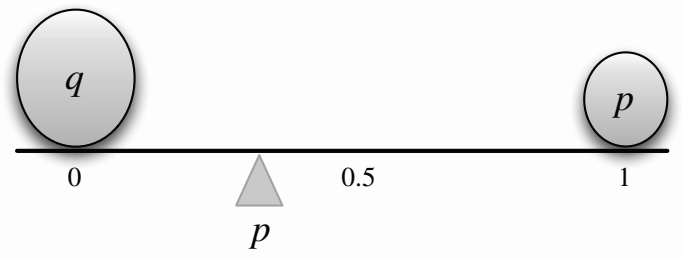
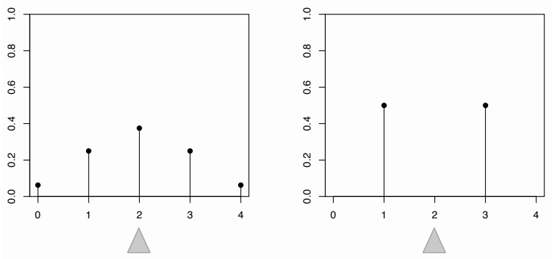
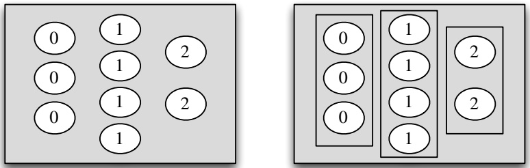
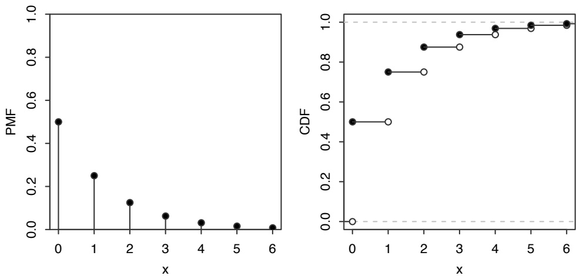
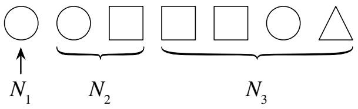
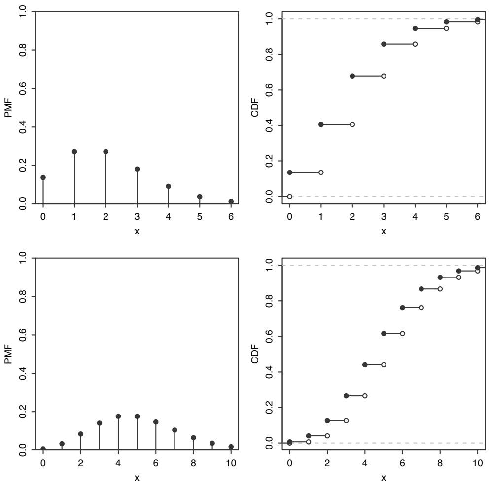
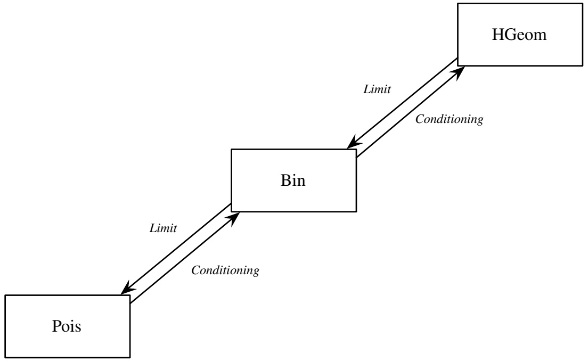
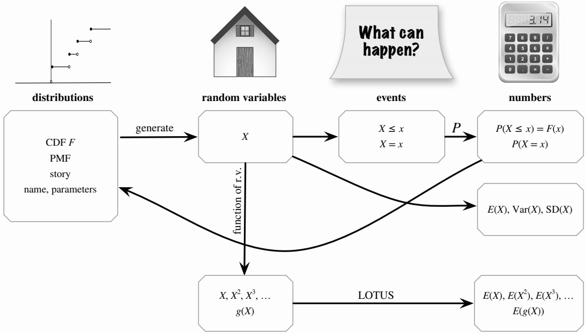
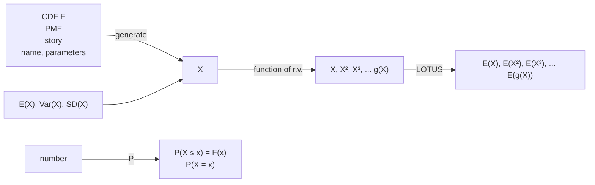

# 4: Expectation

原始 PDF 第 166–229 页。

4

Expectation

## 4.1 Definition of expectation

In the previous chapter, we introduced the distribution of a random variable, which gives us full information about the probability that the r.v. will fall into any particular set. For example, we can say how likely it is that the r.v. will exceed 1000, that it will equal 5, or that it will be in the interval [0, 7]. It can be unwieldy to manage so many probabilities though, so often we want just one number summarizing the “average” value of the r.v.

There are several senses in which the word “average” is used, but by far the most commonly used is the mean of an r.v., also known as its expected value. In addition, much of statistics is about understanding variability in the world, so it is often important to know how “spread out” the distribution is; we will formalize this with the concepts of variance and standard deviation. As we’ll see, variance and standard deviation are defined in terms of expected values, so the uses of expected values go far beyond just computing averages.

Given a list of numbers $x _ { 1 } , x _ { 2 } , \ldots , x _ { n }$ , the familiar way to average them is to add them up and divide by n. This is called the arithmetic mean, and is defined by

$$
\bar {x} = \frac {1}{n} \sum_ {j = 1} ^ {n} x _ {j}.
$$

More generally, we can define a weighted mean of $x _ { 1 } , \ldots , x _ { n }$ as

$$
\text {weighted - mean} (x) = \sum_ {j = 1} ^ {n} x _ {j} p _ {j},
$$

where the weights $p _ { 1 } , \ldots , p _ { n }$ are pre-specified nonnegative numbers that add up to 1 (so the unweighted mean ¯x is obtained when $p _ { j } = 1 / n$ for all $j )$

The definition of expectation for a discrete r.v. is inspired by the weighted mean of a list of numbers, with weights given by probabilities.

Definition 4.1.1 (Expectation of a discrete r.v.). The expected value (also called the expectation or mean) of a discrete r.v. X whose distinct possible values are

149

---

150

Introduction to Probability

$x _ { 1 } , x _ { 2 } , \ldots$ is defined by

$$
E (X) = \sum_ {j = 1} ^ {\infty} x _ {j} P (X = x _ {j}).
$$

If the support is finite, then this is replaced by a finite sum. We can also write

$$
E (X) = \sum_ {x} \underbrace {x} _ {\text {value}} \underbrace {P (X = x)} _ {\text {PMF at} x},
$$

where the sum is over the support of X (in any case, x $P ( X = x )$ is 0 for any x not in the support). The expectation is undefined if $\textstyle \sum _ { j = 1 } ^ { \infty } | x _ { j } | { \stackrel { \cdot } { P } } ( X = x _ { j } )$ diverges, since then the series for $E ( X )$ diverges or its value depends on the order in which the $x _ { j }$ are listed.

In words, the expected value of X is a weighted average of the possible values that X can take on, weighted by their probabilities. Let’s check that the definition makes sense in a few simple examples:

1. Let X be the result of rolling a fair 6-sided die, so X takes on the values 1, 2, 3, 4, 5, 6, with equal probabilities. Intuitively, we should be able to get the average by adding up these values and dividing by 6. Using the definition, the expected value is

$$
E (X) = \frac {1}{6} (1 + 2 + \dots + 6) = 3. 5,
$$

as we expected. Note that X never equals its mean in this example. This is similar to the fact that the average number of children per household in some country could be 1.8, but that doesn’t mean that a typical household has 1.8 children!

2. Let $X \sim \mathrm { B e r n } ( p )$ and $q = 1 - p .$ Then

$$
E (X) = 1 p + 0 q = p,
$$

which makes sense intuitively since it is between the two possible values of X, compromising between 0 and 1 based on how likely each is. This is illustrated in Figure 4.1 for a case with $p   <   1 / 2 { : }$ two pebbles are being balanced on a seesaw. For the seesaw to balance, the fulcrum (shown as a triangle) must be at $p ,$ which in physics terms is the center of mass.

The frequentist interpretation would be to consider a large number of independent Bernoulli trials, each with probability $p$ of success. Writing 1 for “success” and 0 for “failure”, in the long run we would expect to have data consisting of a list of numbers where the proportion of 1’s is very close to $p .$ The average of a list of 0’s and 1’s is the proportion of 1’s.

3. Let X have 3 distinct possible values, $a _ { 1 } , a _ { 2 } , a _ { 3 }$ , with probabilities $p _ { 1 } , p _ { 2 } , p _ { 3 }$ respectively. Imagine running a simulation where n independent draws

---

Expectation

151



<details>
<summary>text_image</summary>

q
0
p
0.5
1
p
</details>

## FIGURE 4.1

Center of mass of two pebbles, depicting that $E ( X ) = p$ for $X \sim \mathrm { B e r n } ( p )$ . Here $q$ and $p$ denote the masses of the two pebbles.

from the distribution of X are generated. For n large, we would expect to have about $p _ { 1 } n \; a _ { 1 }  \mathrm { ' s , } \; p _ { 2 } n \; a _ { 2 }  \mathrm { ' s }$ , and $p _ { 3 } n ~ { a _ { 3 } } ^ { \mathrm { { ' } } } \mathrm { { s } } .$ . (We will look at a more mathematical version of this example when we study the law of large numbers in Chapter 10.) If the simulation results are close to these expected results, then the arithmetic mean of the simulation results is approximately

$$
\frac {p _ {1} n \cdot a _ {1} + p _ {2} n \cdot a _ {2} + p _ {3} n \cdot a _ {3}}{n} = p _ {1} a _ {1} + p _ {2} a _ {2} + p _ {3} a _ {3} = E (X).
$$

Note that $E ( X )$ depends only on the distribution of X. This follows directly from the definition, but is worth recording since it is fundamental.

Proposition 4.1.2. If X and Y are discrete r.v.s with the same distribution, then $E(X) = E(Y)$ (if either side exists).

Proof. In the definition of $E ( X )$ , we only need to know the PMF of $X$ .

The converse of the above proposition is false since the expected value is just a onenumber summary, not nearly enough to specify the entire distribution; it’s a measure of where the “center” is but does not determine, for example, how spread out the distribution is or how likely the r.v. is to be positive. Figure 4.2 shows an example of two different PMFs with the same expected value (balancing point).

h 4.1.3 (Replacing an r.v. by its expectation). For any discrete r.v. X, the expected value $E ( X )$ is a number (if it exists). A common mistake is to replace an r.v. by its expectation without justification, which is wrong both mathematically (X is a function, $E ( X )$ is a constant) and statistically (it ignores the variability of X), except in the degenerate case where X is a constant.

Notation 4.1.4. We often abbreviate $E ( X )$ to EX. Similarly, we often abbreviate $E ( X ^ { 2 } )$ to $E X ^ { 2 }$ , and $E ( X ^ { n } )$ to $E X ^ { n }$

h 4.1.5. Paying attention to the order of operations is crucial when working with expectation. As stated above, $E X ^ { 2 }$ is the expectation of the random variable $X ^ { 2 }$ , not the square of the number EX. Unless the parentheses explicitly indicate otherwise,

---

152

Introduction to Probability



## FIGURE 4.2

The expected value does not determine the distribution: different PMFs can have the same balancing point.

for the expectation of an r.v. raised to a power, first we take the power and then we take the expectation. For example, $E ( X - 1 ) ^ { 4 }$ is $E\left( (X - 1)^{4} \right)$ , not $(E(X - 1))^4$

## 4.2 Linearity of expectation

The most important property of expectation is linearity: the expected value of a sum of r.v.s is the sum of the individual expected values.

Theorem 4.2.1 (Linearity of expectation). For any r.v.s $X , Y$ and any constant $c _ { \gamma }$

$$
E (X + Y) = E (X) + E (Y),
$$

$$
E (c X) = c E (X).
$$

The second equation says that we can take out constant factors from an expectation; this is both intuitively reasonable and easily verified from the definition. The first equation, $E ( X + Y ) = E ( X ) + E ( Y )$ , also seems reasonable when X and $Y$ are independent. What may be surprising is that it holds even if X and $Y$ are dependent! To build intuition for this, consider the extreme case where X always equals $Y .$ Then $X + Y = 2 X$ , and both sides of $E(X + Y) = E(X) + E(Y)$ are equal to $2 E ( X )$ , so linearity still holds even in the most extreme case of dependence.

Linearity is true for all r.v.s, not just discrete r.v.s, but in this chapter we will prove it only for discrete r.v.s. Before proving linearity, it is worthwhile to recall some basic facts about averages. If we have a list of numbers, say $( 1 , 1 , 1 , 1 , 1 , 3 , 3 , 5 )$ , we can calculate their mean by adding all the values and dividing by the length of the list, so that each element of the list gets a weight of $\frac{1}{8}$ :

$$
\frac {1}{8} (1 + 1 + 1 + 1 + 1 + 3 + 3 + 5) = 2.
$$

---

Expectation

153

But another way to calculate the mean is to group together all the 1’s, all the $\mathbf { 3 ^ { \prime } s } ,$ and all the 5’s, and then take a weighted average, giving appropriate weights to 1’s, $3 ^ { \flat } \mathrm { s } ,$ and 5’s:

$$
\frac {5}{8} \cdot 1 + \frac {2}{8} \cdot 3 + \frac {1}{8} \cdot 5 = 2.
$$

This insight—that averages can be calculated in two ways, ungrouped or grouped— is all that is needed to prove linearity! Recall that X is a function which assigns a real number to every outcome s in the sample space. The r.v. X may assign the same value to multiple sample outcomes. When this happens, our definition of expectation groups all these outcomes together into a super-pebble whose weight, $P ( X   =   x )$ , is the total weight of the constituent pebbles. This grouping process is illustrated in Figure 4.3 for a hypothetical r.v. taking values in $\{ 0 , 1 , 2 \}$ . So our definition of expectation corresponds to the grouped way of taking averages.



## FIGURE 4.3

Left: X assigns a number to each pebble in the sample space. Right: Grouping the pebbles by the value that X assigns to them, the 9 pebbles become 3 super-pebbles. The weight of a super-pebble is the sum of the weights of the constituent pebbles.

The advantage of this definition is that it allows us to work with the distribution of X directly, without returning to the sample space. The disadvantage comes when we have to prove theorems like this one, for if we have another r.v. Y on the same sample space, the super-pebbles created by Y are different from those created from X, with different weights $P ( Y = y )$ ; this makes it difficult to combine $\textstyle \sum _ { x } x P ( X = x )$ and $\textstyle \sum _ { y } y P ( Y = y )$

Fortunately, we know there’s another equally valid way to calculate an average: we can take a weighted average of the values of individual pebbles. In other words, if $X ( s )$ is the value that X assigns to pebble s, we can take the weighted average

$$
E (X) = \sum_ {s} X (s) P (\{s \}),
$$

where $P ( \{ s \} )$ is the weight of pebble s. This corresponds to the ungrouped way of taking averages. The advantage of this definition is that it breaks down the sample space into the smallest possible units, so we are now using the same weights $P ( \{ s \} )$ for every random variable defined on this sample space. If Y is another random

---

154

Introduction to Probability

variable, then

$$
E (Y) = \sum_ {s} Y (s) P (\{s \}).
$$

We can combine $\textstyle \sum _ { s } X ( s ) P ( \{ s \} )$ and $\textstyle \sum _ { s } Y ( s ) P ( \{ s \} )$ , which gives

$$
E (X) + E (Y) = \sum_ {s} X (s) P (\{s \}) + \sum_ {s} Y (s) P (\{s \}) = \sum_ {s} (X + Y) (s) P (\{s \}) = E (X + Y).
$$

Another intuition for linearity of expectation is via the concept of simulation. If we simulate many, many times from the distribution of $X ,$ the histogram of the simulated values will look very much like the true PMF of $X$ . In particular, the arithmetic mean of the simulated values will be very close to the true value of $E ( X )$ (the precise nature of this convergence is described by the law of large numbers, an important theorem that we will discuss in detail in Chapter 10).

Let X and Y be r.v.s summarizing a certain experiment. Suppose we perform the experiment n times, where n is a very large number, and we write down the values realized by X and $Y$ each time. For each repetition of the experiment, we obtain an X value, a Y value, and (by adding them) an $X + Y$ value. In Figure 4.4, each row represents a repetition of the experiment. The left column contains the draws of X, the middle column contains the draws of $Y ,$ and the right column contains the draws of $X + Y$

There are two ways to calculate the sum of all the numbers in the last column. The straightforward way is just to add all the numbers in that column. But an equally valid way is to add all the numbers in the first column, add all the numbers in the second column, and then add the two column sums.

Dividing by n everywhere, what we’ve argued is that the following procedures are equivalent:

• Taking the arithmetic mean of all the numbers in the last column. By the law of large numbers, this is very close to $E ( X + Y )$
• Taking the arithmetic mean of the first column and the arithmetic mean of the second column, then adding the two column means. By the law of large numbers, this is very close to $E ( X ) + E ( Y )$

Linearity of expectation thus emerges as a simple fact about arithmetic (we’re just adding numbers in two different orders)! Notice that nowhere in our argument did we rely on whether X and $Y$ were independent. In fact, in Figure 4.4, X and $Y$ appear to be dependent: Y tends to be large when X is large, and $Y$ tends to be small when $X$ is small (in the language of Chapter 7, we say that X and Y are positively correlated). But this dependence is irrelevant: shuffling the draws of $Y$ could completely alter the pattern of dependence between X and $Y ,$ but would have no effect on the column sums.

---

Expectation

155

| X | Y | $X + Y$ |
| --- | --- | --- |
| 3 | 4 | 7 |
| 2 | 2 | 4 |
| 6 | 8 | 14 |
| 10 | 23 | 33 |
| 1 | -3 | -2 |
| 1 | 0 | 1 |
| 5 | 9 | 14 |
| 4 | 1 | 5 |
| ⋮ | ⋮ | ⋮ |

$$
\frac {1}{n} \sum_ {i = 1} ^ {n} x _ {i} + \frac {1}{n} \sum_ {i = 1} ^ {n} y _ {i} = \frac {1}{n} \sum_ {i = 1} ^ {n} (x _ {i} + y _ {i})
$$

$$
E (X) + E (Y) = E (X + Y)
$$

## FIGURE 4.4

Intuitive view of linearity of expectation. Each row represents a repetition of the experiment; the three columns are the realized values of $X ,   Y$ , and $X + Y$ , respectively. Adding all the numbers in the last column is equivalent to summing the first column and the second column separately, then adding the two column sums. So the mean of the last column is the sum of the first and second column means; this is linearity of expectation.

---

156

Introduction to Probability

Linearity is an extremely handy tool for calculating expected values, often allowing us to bypass the definition of expected value altogether. Let’s use linearity to find the expectations of the Binomial and Hypergeometric distributions.

Example 4.2.2 (Binomial expectation). For $X \sim \mathrm { B i n } ( n , p )$ , let’s find $E ( X )$ in two ways. By definition of expectation,

$$
E (X) = \sum_ {k = 0} ^ {n} k P (X = k) = \sum_ {k = 0} ^ {n} k \binom {n} {k} p ^ {k} q ^ {n - k}.
$$

From Example 1.5.2, we know $\begin{array} { r } { k \binom { n } { k } = n \binom { n - 1 } { k - 1 } } \end{array}$ , so

$$
\begin{array}{l} \sum_ {k = 0} ^ {n} k \binom {n} {k} p ^ {k} q ^ {n - k} = n \sum_ {k = 0} ^ {n} \binom {n - 1} {k - 1} p ^ {k} q ^ {n - k} \\ = n p \sum_ {k = 1} ^ {n} \binom {n - 1} {k - 1} p ^ {k - 1} q ^ {n - k} \\ = n p \sum_ {j = 0} ^ {n - 1} \binom {n - 1} {j} p ^ {j} q ^ {n - 1 - j} \\ = n p. \\ \end{array}
$$

The sum in the penultimate line equals 1 because it is the sum of the $\operatorname { B i n } ( n - 1 , p )$ $\mathrm { P M F }$ (or by the binomial theorem). Therefore, $E ( X ) = n p .$

This proof required us to remember combinatorial identities and manipulate binomial coefficients. Using linearity of expectation, we obtain a much shorter path to the same result. Let’s write X as the sum of n independent $\operatorname { B e r n } ( p )$ r.v.s:

$$
X = I _ {1} + \dots + I _ {n},
$$

where each $I _ { j }$ has expectation $E ( I _ { j } ) = 1 p + 0 q = p$ . By linearity,

$$
E (X) = E (I _ {1}) + \dots + E (I _ {n}) = n p.
$$

Example 4.2.3 (Hypergeometric expectation). Let $X   \sim   \operatorname { H G e o m } ( w , b , n )$ , interpreted as the number of white balls in a sample of size n drawn without replacement from an urn with w white and b black balls. As in the Binomial case, we can write X as a sum of Bernoulli random variables,

$$
X = I _ {1} + \dots + I _ {n},
$$

where $I _ { j }$ equals 1 if the jth ball in the sample is white and 0 otherwise. By symmetry, $I _ { j } \sim \mathrm { B e r n } ( p )$ with $p = w / ( w   +   b )$ , since unconditionally the jth ball drawn is equally likely to be any of the balls.

Unlike in the Binomial case, the $I _ { j }$ are not independent, since the sampling is without replacement: given that a ball in the sample is white, there is a lower

---

Expectation

157

chance that another ball in the sample is white. However, linearity still holds for dependent random variables! Thus,

$$
E (X) = n w / (w + b).
$$

As another example of the power of linearity, we can give a quick proof of the intuitive idea that “bigger r.v.s have bigger expectations”.

Proposition 4.2.4 (Monotonicity of expectation). Let X and Y be r.v.s such that $X \geq Y$ with probability 1. Then $E ( X ) \geq E ( Y )$ , with equality holding if and only if $X = Y$ with probability 1.

Proof. This result holds for all r.v.s, but we will prove it only for discrete r.v.s since this chapter focuses on discrete r.v.s. The r.v. $Z   =   X - Y$ is nonnegative (with probability 1), so $E ( Z ) \geq 0$ since $E ( Z )$ is defined as a sum of nonnegative terms. By linearity,

$$
E (X) - E (Y) = E (X - Y) \geq 0,
$$

as desired. If $E(X) = E(Y)$ , then by linearity we also have $E ( Z ) = 0$ , which implies that $P(X = Y) = P(Z = 0) = 1$ since if even one term in the sum defining $E ( Z )$ is positive, then the whole sum is positive. 

## 4.3 Geometric and Negative Binomial

We now introduce two more famous discrete distributions, the Geometric and Negative Binomial, and calculate their expected values.

Story 4.3.1 (Geometric distribution). Consider a sequence of independent Bernoulli trials, each with the same success probability $p \in ( 0 , 1 )$ , with trials performed until a success occurs. Let X be the number of failures before the first successful trial. Then X has the Geometric distribution with parameter $p ;$ we denote this by $X \sim \operatorname { G e o m } ( p )$ 

For example, if we flip a fair coin until it lands Heads for the first time, then the number of Tails before the first occurrence of Heads is distributed as Geom(1/2).

To get the Geometric PMF from the story, imagine the Bernoulli trials as a string of 0’s (failures) ending in a single 1 (success). Each 0 has probability $q = 1 - p$ and the final 1 has probability $p ,$ so a string of k failures followed by one success has probability $q ^ { k } p$

Theorem 4.3.2 (Geometric PMF). If $X \sim \operatorname { G e o m } ( p )$ , then the PMF of X is

$$
P (X = k) = q ^ {k} p
$$

for $k = 0 , 1 , 2 , \ldots ,$ where $q = 1 - p$

---

158

Introduction to Probability

This is a valid PMF because, summing a geometric series (see the math appendix for a review of geometric series), we have

$$
\sum_ {k = 0} ^ {\infty} q ^ {k} p = p \sum_ {k = 0} ^ {\infty} q ^ {k} = p \cdot \frac {1}{1 - q} = 1.
$$

Just as the binomial theorem shows that the Binomial PMF is valid, a geometric series shows that the Geometric PMF is valid! A geometric series can also be used to obtain the Geometric CDF.

Theorem 4.3.3 (Geometric CDF). If $X \sim \operatorname { G e o m } ( p )$ , then the CDF of X is

$$
F (x) = \left\{ \begin{array}{l} 1 - q ^ {\lfloor x \rfloor + 1}, \text {if} x \geq 0; \\ 0, \text {if} x <   0, \end{array} \right.
$$

where $q = 1 - p$ and $[ x ]$ is the greatest integer less than or equal to x.

Proof. Let F be the CDF of X. We will find $F ( x )$ first for the case $x < 0$ , then for the case that x is a nonnegative integer, and lastly for the case that x is a nonnegative real number. For $x < 0,   F(x) = 0$ since X can’t be negative. For n a nonnegative integer,

$$
F (n) = \sum_ {k = 0} ^ {n} P (X = k) = p \sum_ {k = 0} ^ {n} q ^ {k} = p \cdot \frac {1 - q ^ {n + 1}}{1 - q} = 1 - q ^ {n + 1}.
$$

We can also get the same result from the fact that the event $X \geq n + 1$ means that the first $n + 1$ trials were failures:

$$
F (n) = 1 - P (X > n) = 1 - P (X \geq n + 1) = 1 - q ^ {n + 1}.
$$

For real $x \geq 0$

$$
F (x) = P (X \leq x) = P (X \leq \lfloor x \rfloor),
$$

since X always takes on integer values. For example,

$$
P (X \leq 3. 7) = P (X \leq 3) + P (3 <   X \leq 3. 7) = P (X \leq 3).
$$

Therefore, F is as claimed.

Figure 4.3 displays the Geom(0.5) PMF and CDF from 0 to 6. All Geometric PMFs have a similar shape; the greater the success probability p, the more quickly the PMF decays to 0.

h 4.3.4 (Conventions for the Geometric). There are differing conventions for the definition of the Geometric distribution; some sources define the Geometric as the total number of trials, including the success. In this book, the Geometric distribution excludes the success, and the First Success distribution includes the success.

---

Expectation

159



FIGURE 4.5

Geom(0.5) PMF and CDF.

Definition 4.3.5 (First Success distribution). In a sequence of independent Bernoulli trials with success probability $p ,$ let $Y$ be the number of trials until the first successful trial, including the success. Then $Y$ has the First Success distribution with parameter $p ;$ we denote this by $Y \sim \mathrm { F S } ( p )$

It is easy to convert back and forth between the two but important to be careful about which convention is being used. If $Y \sim \mathrm { F S } ( p )$ then $Y - 1 \sim \mathrm { G e o m } ( p )$ , and we can convert between the PMFs of $Y$ and $Y - 1$ by writing

$$
P (Y = k) = P (Y - 1 = k - 1).
$$

Conversely, if $X \sim \operatorname { G e o m } ( p )$ , then $X + 1 \sim \mathrm { F S } ( p )$

Example 4.3.6 (Geometric expectation). Let $X \sim \operatorname { G e o m } ( p )$ . By definition,

$$
E (X) = \sum_ {k = 0} ^ {\infty} k q ^ {k} p,
$$

where $q = 1 - p$ . This sum looks unpleasant; it’s not a geometric series because of the extra k multiplying each term. But we notice that each term looks similar to $k q ^ { k - 1 }$ , the derivative of $q ^ { k }$ (with respect to $q )$ , so let’s start there:

$$
\sum_ {k = 0} ^ {\infty} q ^ {k} = \frac {1}{1 - q}.
$$

This geometric series converges since $0   <   q   <   1$ . Differentiating both sides with respect to $q ,$ we get

$$
\sum_ {k = 0} ^ {\infty} k q ^ {k - 1} = \frac {1}{(1 - q) ^ {2}}.
$$

---

160

Introduction to Probability

Finally, if we multiply both sides by $p q$ , we recover the original sum we wanted to find:

$$
E (X) = \sum_ {k = 0} ^ {\infty} k q ^ {k} p = p q \sum_ {k = 0} ^ {\infty} k q ^ {k - 1} = p q \frac {1}{(1 - q) ^ {2}} = \frac {q}{p}.
$$

In Example 9.1.8, we will give a story proof of the same result, based on first-step analysis: condition on the result of the first trial in the story interpretation of X. If the first trial is a success, we know $X = 0$ and if it’s a failure, we have one wasted trial and then are back where we started. 

Example 4.3.7 (First Success expectation). Since we can write $Y   \sim   \mathrm { F S } ( p )$ as $Y = X + 1$ where $X \sim \operatorname { G e o m } ( p )$ , we have

$$
E (Y) = E (X + 1) = \frac {q}{p} + 1 = \frac {1}{p}.
$$

The Negative Binomial distribution generalizes the Geometric distribution: instead of waiting for just one success, we can wait for any predetermined number r of successes.

Story 4.3.8 (Negative Binomial distribution). In a sequence of independent Bernoulli trials with success probability p, if X is the number of failures before the rth success, then X is said to have the Negative Binomial distribution with parameters r and p, denoted $X \sim \mathrm { N B i n } ( r , p )$ 

Both the Binomial and the Negative Binomial distributions are based on independent Bernoulli trials; they differ in the stopping rule and in what they are counting. The Binomial counts the number of successes in a fixed number of trials; the Negative Binomial counts the number of failures until a fixed number of successes.

In light of these similarities, it comes as no surprise that the derivation of the Negative Binomial PMF bears a resemblance to the corresponding derivation for the Binomial.

Theorem 4.3.9 (Negative Binomial PMF). If $X \sim \mathrm { N B i n } ( r , p )$ , then the PMF of X is

$$
P (X = n) = \binom{n + r - 1}{r - 1} p ^ {r} q ^ {n}
$$

for $n = 0 , 1 , 2 \ldots$ , where $q = 1 - p$

Proof. Imagine a string of 0’s and 1’s, with 1’s representing successes. The probability of any specific string of n 0’s and r 1’s is $p ^ { r } q ^ { n }$ . How many such strings are there? Because we stop as soon as we hit the rth success, the string must terminate in a 1. Among the other $n   +   r   -   1$ positions, we choose $r - 1$ places for the remaining 1’s to go. So the overall probability of exactly n failures before the rth success is

$$
P (X = n) = \binom {n + r - 1} {r - 1} p ^ {r} q ^ {n}, \quad n = 0, 1, 2, \dots .
$$

---

Expectation

161

Just as a Binomial r.v. can be represented as a sum of i.i.d. Bernoullis, a Negative Binomial r.v. can be represented as a sum of i.i.d. Geometrics.

Theorem 4.3.10. Let $X \sim \mathrm { N B i n } ( r , p )$ , viewed as the number of failures before the rth success in a sequence of independent Bernoulli trials with success probability $p .$ Then we can write $X = X _ { 1 } + \cdots + X _ { r }$ where the $X _ { i }$ are i.i.d. Geom(p).

Proof. Let $X _ { 1 }$ be the number of failures until the first success, $X _ { 2 }$ be the number of failures between the first success and the second success, and in general, $X _ { i }$ be the number of failures between the $( i - 1 )$ st success and the ith success.

Then $X _ { 1 }   \sim   \mathrm { G e o m } ( p )$ by the story of the Geometric distribution. After the first success, the number of additional failures until the next success is still Geometric! So $X _ { 2 } \sim \operatorname { G e o m } ( p )$ , and similarly for all the $X _ { i }$ . Furthermore, the $X _ { i }$ are independent because the trials are all independent of each other. Adding the $X _ { i }$ , we get the total number of failures before the rth success, which is X. 

Using linearity, the expectation of the Negative Binomial now follows without any additional calculations.

Example 4.3.11 (Negative Binomial expectation). Let $X   \sim   \mathrm { N B i n } ( r , p )$ . By the previous theorem, we can write $X = X _ { 1 }   + \cdots + X _ { r }$ , where the $X _ { i }$ are i.i.d. Geom(p). By linearity,

$$
E (X) = E (X _ {1}) + \dots + E (X _ {r}) = r \cdot \frac {q}{p}.
$$

The next example is a famous problem in probability and an instructive application of the Geometric and First Success distributions. It is usually stated as a problem about collecting coupons, hence its name, but we’ll use toys instead of coupons.

Example 4.3.12 (Coupon collector). Suppose there are n types of toys, which you are collecting one by one, with the goal of getting a complete set. When collecting toys, the toy types are random (as is sometimes the case, for example, with toys included in cereal boxes or included with kids’ meals from a fast food restaurant). Assume that each time you collect a toy, it is equally likely to be any of the n types. What is the expected number of toys needed until you have a complete set?

## Solution:

Let N be the number of toys needed; we want to find $E ( N )$ . Our strategy will be to break up N into a sum of simpler r.v.s so that we can apply linearity. So write

$$
N = N _ {1} + N _ {2} + \dots + N _ {n},
$$

where $N _ { 1 }$ is the number of toys until the first toy type you haven’t seen before (which is always 1, as the first toy is always a new type), $N _ { 2 }$ is the additional number of toys until the second toy type you haven’t seen before, and so forth. Figure 4.6 illustrates these definitions with $n = 3$ toy types.

---

162

Introduction to Probability



<details>
<summary>text_image</summary>

N₁
↑
N₂
N₃
</details>

## FIGURE 4.6

Coupon collector, $n = 3$ . Here $N _ { 1 }$ is the time (number of toys collected) until the first new toy type, $N _ { 2 }$ is the additional time until the second new type, and $N _ { 3 }$ is the additional time until the third new type. The total number of toys for a complete set is $N _ { 1 } + N _ { 2 } + N _ { 3 }$

By the story of the FS distribution, $N _ { 2 } \sim \mathrm { F S } ( ( n   -   1 ) / n )$ : after collecting the first toy type, there’s a $1 / n$ chance of getting the same toy you already had (failure) and an $( n - 1 ) / n$ chance you’ll get something new (success). Similarly, $N _ { 3 }$ , the additional number of toys until the third new toy type, is distributed $\operatorname { F S } ( ( n   -   2 ) / n )$ . In general,

$$
N _ {j} \sim \mathrm{FS} ((n - j + 1) / n).
$$

By linearity,

$$
\begin{array}{l} E (N) = E (N _ {1}) + E (N _ {2}) + E (N _ {3}) + \dots + E (N _ {n}) \\ = 1 + \frac {n}{n - 1} + \frac {n}{n - 2} + \dots + n \\ = n \sum_ {j = 1} ^ {n} \frac {1}{j}. \\ \end{array}
$$

For large n, this is very close to $n ( \log n + 0 . 5 7 7 )$

Before we leave this example, let’s take a moment to connect it to our proof of Theorem 4.3.10, the representation of the Negative Binomial as a sum of i.i.d. Geometrics. In both problems, we are waiting for a specified number of successes, and we approach the problem by considering the intervals between successes. There are two major differences:

• In Theorem 4.3.10, we exclude the successes themselves, so the number of failures between two successes is Geometric. In the coupon collector problem, we include the successes because we want to count the total number of toys, so we have First Success r.v.s instead.
• In Theorem 4.3.10, the probability of success in each trial never changes, so the total number of failures is a sum of i.i.d. Geometrics. In the coupon collector problem, the probability of success decreases after each success, since it becomes harder and harder to find a new toy type you haven’t seen before; so the $N _ { j }$ are not identically distributed, though they are independent. 

h 4.3.13 (Expectation of a nonlinear function of an r.v.). Expectation is linear,

---

Expectation

163

but in general we do not have $E ( g ( X ) )   =   g ( E ( X ) )$ for arbitrary functions $g .$ We must be careful not to move the E around when g is not linear. The next example shows a situation in which $E ( g ( X ) )$ is very different from $g ( E ( X ) )$ .

Example 4.3.14 (St. Petersburg paradox). Suppose a wealthy stranger offers to play the following game with you. You will flip a fair coin until it lands Heads for the first time, and you will receive \$2 if the game lasts for 1 round, \$4 if the game lasts for 2 rounds, \$8 if the game lasts for 3 rounds, and in general, $\mathbb { S } 2 ^ { n }$ if the game lasts for n rounds. What is the fair value of this game (the expected payoff)? How much would you be willing to pay to play this game once?

## Solution:

Let X be your winnings from playing the game. By definition, $X = 2 ^ { N }$ where N is the number of rounds that the game lasts. Then X is 2 with probability $1 / 2 ,$ 4 with probability $1 / 4 ,$ , 8 with probability $1 / 8 ,$ , and so on, so

$$
E (X) = \frac {1}{2} \cdot 2 + \frac {1}{4} \cdot 4 + \frac {1}{8} \cdot 8 + \dots = \infty .
$$

The expected winnings are infinite! On the other hand, the number of rounds N that the game lasts is the number of tosses until the first Heads, so $N \sim \mathrm { F S } ( 1 / 2 )$ and $E ( N ) = 2$ . Thus $E ( 2 ^ { N } ) = \infty$ while $2 ^ { E ( N ) } = 4$ . Infinity certainly does not equal 4, illustrating the danger of confusing $E ( g ( X ) )$ with $g ( E ( X ) )$ when $g$ is not linear.

This problem is often considered a paradox because although the game’s expected payoff is infinite, most people would not be willing to pay very much to play the game (even if they could afford to lose the money). One explanation is to note that the amount of money in the real world is finite. Suppose that if the game lasts longer than 40 rounds, the wealthy stranger flees the country and you get nothing. Since $2 ^ { 4 0 } \approx 1 . 1 \times 1 0 ^ { 1 2 }$ , this still gives you the potential to earn over a trillion dollars, and anyway it’s incredibly unlikely that the game will last longer than 40 rounds. But in this setting, your expected value is

$$
E (X) = \sum_ {n = 1} ^ {4 0} \frac {1}{2 ^ {n}} \cdot 2 ^ {n} + \sum_ {n = 4 1} ^ {\infty} \frac {1}{2 ^ {n}} \cdot 0 = 4 0.
$$

Is this drastic reduction because the wealthy stranger may flee the country? Let’s suppose instead that the wealthy stranger caps your winnings at $2 ^ { 4 0 }$ , so if the game lasts more than 40 rounds you will get this amount rather than walking away empty-handed. Now your expected value is

$$
E (X) = \sum_ {n = 1} ^ {4 0} \frac {1}{2 ^ {n}} \cdot 2 ^ {n} + \sum_ {n = 4 1} ^ {\infty} \frac {1}{2 ^ {n}} \cdot 2 ^ {4 0} = 4 0 + 1 = 4 1,
$$

an increase of only \$1 from the previous scenario. The $\infty$ in the St. Petersburg paradox is driven by an infinite “tail” of extremely rare events where you get extremely large payoffs. Cutting off this tail at some point, which makes sense in the real world, dramatically reduces the expected value of the game. 

---

164

Introduction to Probability

## 4.4 Indicator r.v.s and the fundamental bridge

This section is devoted to indicator random variables, which we already encountered in the previous chapter but will treat in much greater detail here. In particular, we will show that indicator r.v.s are an extremely useful tool for calculating expected values.

Recall from the previous chapter that the indicator r.v. $I _ { A }$ (or $I ( A ) )$ for an event A is defined to be 1 if A occurs and 0 otherwise. So $I _ { A }$ is a Bernoulli random variable, where success is defined as $^ { \circ } A$ occurs” and failure is defined as $^ { \circ } A$ does not occur”. Some useful properties of indicator r.v.s are summarized below.

Theorem 4.4.1 (Indicator r.v. properties). Let A and B be events. Then the following properties hold.

1. $( I _ { A } ) ^ { k } = I _ { A }$ for any positive integer $k .$
2. $I _ { A ^ { c } } = 1 - I _ { A } .$
3. $I _ { A \cap B } = I _ { A } I _ { B } .$

Proof. Property 1 holds since $0 ^ { k } = 0$ and $1 ^ { k } = 1$ for any positive integer k. Property 2 holds since $1 - I _ { A }$ is 1 if A does not occur and 0 if A occurs. Property 3 holds since $I _ { A } I _ { B }$ is 1 if both $I _ { A }$ and $I _ { B }$ are 1, and 0 otherwise. Property 4 holds since

$$
I _ {A \cup B} = 1 - I _ {A ^ {c} \cap B ^ {c}} = 1 - I _ {A ^ {c}} I _ {B ^ {c}} = 1 - (1 - I _ {A}) (1 - I _ {B}) = I _ {A} + I _ {B} - I _ {A} I _ {B}.
$$

Indicator r.v.s provide a link between probability and expectation; we call this fact the fundamental bridge.

Theorem 4.4.2 (Fundamental bridge between probability and expectation). There is a one-to-one correspondence between events and indicator r.v.s, and the probability of an event A is the expected value of its indicator r.v. $I _ { A }$

$$
P (A) = E (I _ {A}).
$$

Proof. For any event A, we have an indicator r.v. $I _ { A }$ . This is a one-to-one correspondence since A uniquely determines $I _ { A }$ and vice versa (to get from $I _ { A }$ back to $A ,$ we can use the fact that $A   =   \{ s   \in   S   :   I _ { A } ( s )   =   1 \} )$ . Since $I _ { A } \sim \mathrm { B e r n } ( p )$ with $p = P ( A )$ , we have $E ( I _ { A } ) = P ( A )$ 

The fundamental bridge connects events to their indicator r.v.s, and allows us to express any probability as an expectation. As an example, we give a short proof of inclusion-exclusion and a related inequality known as Boole’s inequality or Bonferroni’s inequality using indicator r.v.s.

---

Expectation

165

Example 4.4.3 (Boole, Bonferroni, and inclusion-exclusion). Let $A _ { 1 } , A _ { 2 } , \ldots , A _ { n }$ be events. Note that

$$
I (A _ {1} \cup \dots \cup A _ {n}) \leq I (A _ {1}) + \dots + I (A _ {n}),
$$

since if the left-hand side is 0 this is immediate, and if the left-hand side is 1 then at least one term on the right-hand side must be 1. Taking the expectation of both sides and using linearity and the fundamental bridge, we have

$$
P (A _ {1} \cup \dots \cup A _ {n}) \leq P (A _ {1}) + \dots + P (A _ {n}),
$$

which is called Boole’s inequality or Bonferroni’s inequality. To prove inclusionexclusion for $n   =   2$ , we can take the expectation of both sides in Property 4 of Theorem 4.4.1. For general n, we can use properties of indicator r.v.s as follows:

$$
\begin{array}{l} 1 - I (A _ {1} \cup \dots \cup A _ {n}) = I (A _ {1} ^ {c} \cap \dots \cap A _ {n} ^ {c}) \\ = (1 - I (A _ {1})) \dots (1 - I (A _ {n})) \\ = 1 - \sum_ {i} I \left(A _ {i}\right) + \sum_ {i <   j} I \left(A _ {i}\right) I \left(A _ {j}\right) - \dots + (- 1) ^ {n} I \left(A _ {1}\right) \dots I \left(A _ {n}\right). \\ \end{array}
$$

Taking the expectation of both sides, by the fundamental bridge we have proven the inclusion-exclusion theorem. 

Conversely, the fundamental bridge is also extremely useful in many expected value problems. We can often express a complicated discrete r.v. whose distribution we don’t know as a sum of indicator r.v.s, which are extremely simple. The fundamental bridge lets us find the expectation of the indicators; then, using linearity, we obtain the expectation of our original r.v. This strategy is extremely useful and versatile— in fact, we already used it when deriving the expectations of the Binomial and Hypergeometric distributions earlier in this chapter!

Recognizing problems that are amenable to this strategy and then defining the indicator r.v.s takes practice, so it is important to study a lot of examples and solve a lot of problems. In applying the strategy to a random variable that counts the number of [noun]s, we should have an indicator for each potential [noun]. This [noun] could be a person, place, or thing; we will see examples of all three types.

We’ll start by revisiting two problems from Chapter 1, de Montmort’s matching problem and the birthday problem.

Example 4.4.4 (Matching continued). We have a well-shuffled deck of n cards, labeled 1 through n. A card is a match if the card’s position in the deck matches the card’s label. Let X be the number of matches; find E(X).

## Solution:

First let’s check whether X could have any of the named distributions we have studied. The Binomial and Hypergeometric are the only two candidates since the value of X must be an integer between 0 and n. But neither of these distributions

---

166

Introduction to Probability

has the right support because X can’t take on the value $n - 1 { \mathrm { : ~ i f ~ } } n - 1$ cards are matches, then the nth card must be a match as well. So X does not follow a named distribution we have studied, but we can readily find its mean using indicator r.v.s: let’s write $X = I _ { 1 } + I _ { 2 } + \cdots + I _ { n }$ , where

$$
I _ {j} = \left\{ \begin{array}{l l} 1 & \text {if the jth card in the deck is a match,} \\ 0 & \text {otherwise.} \end{array} \right.
$$

In other words, $I _ { j }$ is the indicator for $A _ { j }$ , the event that the jth card in the deck is a match. We can imagine that each $I _ { j }$ “raises its hand” to be counted if its card is a match; adding up the raised hands, we get the total number of matches, $X$

By the fundamental bridge,

$$
E (I _ {j}) = P (A _ {j}) = \frac {1}{n}
$$

for all $j$ . So by linearity,

$$
E (X) = E (I _ {1}) + \dots + E (I _ {n}) = n \cdot \frac {1}{n} = 1.
$$

The expected number of matched cards is 1, regardless of $n .$ Even though the $I _ { j }$ are dependent in a complicated way that makes the distribution of X neither Binomial nor Hypergeometric, linearity still holds. 

Example 4.4.5 (Distinct birthdays, birthday matches). In a group of $n$ people, under the usual assumptions about birthdays, what is the expected number of distinct birthdays among the n people, i.e., the expected number of days on which at least one of the people was born? What is the expected number of birthday matches, i.e., pairs of people with the same birthday?

Solution:

Let X be the number of distinct birthdays, and write $X = I _ { 1 } + \dots + I _ { 3 6 5 }$ , where

$$
I _ {j} = \left\{ \begin{array}{l l} 1 & \text {if the jth day is represented,} \\ 0 & \text {otherwise.} \end{array} \right.
$$

We create an indicator for each day of the year because X counts the number of days of the year that are represented. By the fundamental bridge,

$$
E (I _ {j}) = P (j \text {th day is represented}) = 1 - P (\text {no one born on day} j) = 1 - \left(\frac {3 6 4}{3 6 5}\right) ^ {n}
$$

for all $j .$ Then by linearity,

$$
E (X) = 3 6 5 \left(1 - \left(\frac {3 6 4}{3 6 5}\right) ^ {n}\right).
$$

Now let $Y$ be the number of birthday matches. Label the people as $1 , 2 , \ldots , n$ , and order the $\textstyle { \binom { n } { 2 } }$ pairs of people in some definite way. Then we can write

$$
Y = J _ {1} + \dots + J _ {\binom {n} {2}},
$$

---

Expectation

167

where $J _ { i }$ is the indicator of the ith pair of people having the same birthday. We create an indicator for each pair of people since Y counts the number of pairs of people with the same birthday. The probability of any two people having the same birthday is $1 / 3 6 5$ , so again by the fundamental bridge and linearity,

$$
E (Y) = \frac {\binom {n} {2}}{3 6 5}.
$$

In addition to the fundamental bridge and linearity, the last two examples used a basic form of symmetry to simplify the calculations greatly: within each sum of indicator r.v.s, each indicator had the same expected value. For example, in the matching problem the probability of the jth card being a match does not depend on $j ,$ so we can just take n times the expected value of the first indicator r.v.

Other forms of symmetry can also be extremely helpful when available. The next two examples showcase a form of symmetry that stems from having equally likely permutations. Note how symmetry, linearity, and the fundamental bridge are used in tandem to make seemingly very hard problems manageable.

Example 4.4.6 (Putnam problem). A permutation $a _ { 1 } , a _ { 2 } , \ldots , a _ { n }$ of $1 , 2 , \ldots , n$ has a local maximum at j if $a _ { j } > a _ { j - 1 }$ and $a _ { j } > a _ { j + 1 }$ (for $2 \leq j \leq n - 1$ ; for $j = 1$ a local maximum at j means $a _ { 1 } > a _ { 2 }$ while for $j = n$ , it means $a _ { n }   >   a _ { n - 1 } )$ . For example, 4, 2, 5, 3, 6, 1 has 3 local maxima, at positions 1, 3, and 5. The Putnam exam (a famous, hard math competition, on which the median score is often a 0) from 2006 posed the following question: for $n \geq 2$ , what is the average number of local maxima of a random permutation of $1 , 2 , \ldots , n$ , with all n! permutations equally likely?

## Solution:

This problem can be solved quickly using indicator r.v.s, symmetry, and the fundamental bridge. Let $I _ { 1 } , \ldots , I _ { n }$ be indicator r.v.s, where $I _ { j }$ is 1 if there is a local maximum at position $j ,$ and 0 otherwise. We are interested in the expected value of $\textstyle \sum _ { j = 1 } ^ { n } I _ { j }$ . For $1 < j < n ,   E I _ { j } = 1 / 3$ since having a local maximum at $j$ is equivalent to $a _ { j }$ being the largest of $a _ { j - 1 } , a _ { j } , a _ { j + 1 }$ , which has probability $1 / 3$ since all orders are equally likely. For $j = 1$ or $j = n$ , we have $E I _ { j } = 1 / 2$ since then there is only one neighbor. Thus, by linearity,

$$
E \left(\sum_ {j = 1} ^ {n} I _ {j}\right) = 2 \cdot \frac {1}{2} + (n - 2) \cdot \frac {1}{3} = \frac {n + 1}{3}.
$$

The next example introduces the Negative Hypergeometric distribution, which completes the following table. The table shows the distributions for four sampling schemes: the sampling can be done with or without replacement, and the stopping rule can require a fixed number of draws or a fixed number of successes.

---

168

Introduction to Probability

|  | With replacement | Without replacement |
| --- | --- | --- |
| Fixed number of trials | Binomial | Hypergeometric |
| Fixed number of successes | Negative Binomial | Negative Hypergeometric |

Example 4.4.7 (Negative Hypergeometric). An urn contains w white balls and b black balls, which are randomly drawn one by one without replacement, until r white balls have been obtained. The number of black balls drawn before drawing the rth white ball has a Negative Hypergeometric distribution with parameters $w , b , r$ . We denote this distribution by $\mathrm { N H G e o m } ( w , b , r )$ . Of course, we assume that $r \leq w$ . For example, if we shuffle a deck of cards and deal them one at a time, the number of cards dealt before uncovering the first ace is NHGeom(4, 48, 1).

As another example, suppose a college offers g good courses and b bad courses (for some definition of “good” and “bad”), and a student wants to find 4 good courses to take. Not having any idea which of the courses are good, the student randomly tries out courses one at a time, stopping when they have obtained 4 good courses. Then the number of bad courses the student tries out is $\mathrm { N H G e o m } ( g , b , 4 )$

We can obtain the PMF of $X \sim \operatorname { N H G e o m } ( w , b , r )$ by noting that, in the urn context, $X = k$ means that the $( r + k )$ th ball chosen is white and exactly $r - 1$ of the first $r + k - 1$ balls chosen are white. This gives

$$
P (X = k) = \frac {\binom {w} {r - 1} \binom {b} {k}}{\binom {w + b} {r + k - 1}} \cdot \frac {w - r + 1}{w + b - r - k + 1}
$$

for $k = 0 , 1 , \ldots , b$ (and 0 otherwise).

Alternatively, we can imagine that we continue drawing balls until the urn has been emptied out; this is valid since whether or not we continue to draw balls after obtaining the rth white ball has no effect on X. Think of the $w + b$ balls as lined up in a random order, the order in which they will be drawn.

Then $X = k$ means that among the first $r + k - 1$ balls there are exactly $r - 1$ white balls, then there is a white ball, and then among the last $w + b - r - k$ balls there are exactly $w - r$ white balls. All ${ \binom { w + b } { w } }$ possibilities for the locations of the white balls in the line are equally likely. So by the naive definition of probability, we have the following slightly simpler expression for the PMF:

$$
P (X = k) = \frac {\binom {r + k - 1} {r - 1} \binom {w + b - r - k} {w - r}}{\binom {w + b} {w}},
$$

for $k = 0 , 1 , \ldots , b$ (and 0 otherwise).

Finding the expected value of a Negative Hypergeometric r.v. directly from the definition of expectation results in complicated sums. But the answer is very simple: for $X \sim \operatorname { N H G e o m } ( w , b , r )$ , we have $E ( X ) = r b / ( w + 1 )$

Let’s prove this using indicator r.v.s. As explained above, we can assume that we

---

Expectation

169

continue drawing balls until the urn is empty. First consider the case $r = 1$ . Label the black balls as $1 , 2 , \ldots , b ,$ and let $I _ { j }$ be the indicator of black ball $j$ being drawn before any white balls have been drawn. Then $P ( I _ { j } = 1 ) = 1 / ( w + 1 )$ since, listing out the order in which black ball $j$ and the white balls are drawn (ignoring the other balls), all orders are equally likely by symmetry, and $I _ { j } = 1$ is equivalent to black ball $j$ being first in this list. So by linearity,

$$
E \left(\sum_ {j = 1} ^ {b} I _ {j}\right) = \sum_ {j = 1} ^ {b} E (I _ {j}) = b / (w + 1).
$$

Sanity check: This answer makes sense since it is increasing in $b ,$ decreasing in $w ,$ and correct in the extreme cases $b   =   0$ (when no black balls will be drawn) and $w   =   0$ (when all the black balls will be exhausted before drawing a nonexistent white ball). Moreover, note that $b / ( w + 1 )$ looks similar to, but is strictly smaller than, $b / w ,$ which is the expected value of a Geom $( w / ( w + b ) ) { \mathrm { ~ r . v ~ } }$ . It makes sense that sampling without replacement should give a smaller expected waiting time than sampling with replacement. Similarly, if you are searching for something you lost, it makes more sense to choose locations to check without replacement, rather than wasting time looking over and over again in locations you already ruled out.

For general $r ,$ write $X = X _ { 1 } + X _ { 2 } + \cdots + X _ { r }$ , where $X _ { 1 }$ is the number of black balls before the first white ball, $X _ { 2 }$ is the number of black balls after the first white ball but before the second white ball, etc. By essentially the same argument we used to handle the $r = 1 { \mathrm { ~ c a s e } } .$ we have $E ( X _ { j } ) = b / ( w + 1 )$ for each $j .$ So by linearity,

$$
E (X) = r b / (w + 1).
$$

Closely related to indicator r.v.s is an alternative expression for the expectation of a nonnegative integer-valued r.v. X. Rather than summing up values of X times values of the PMF of X, we can sum up probabilities of the form $P ( X > n )$ (known as tail probabilities), over nonnegative integers $n .$

Theorem 4.4.8 (Expectation via survival function). Let X be a nonnegative integer-valued r.v. Let F be the CDF of $X ,$ and $G ( x ) = 1 - F ( x ) = P ( X > x )$ . The function $G$ is called the survival function of X. Then

$$
E (X) = \sum_ {n = 0} ^ {\infty} G (n).
$$

That is, we can obtain the expectation of X by summing up the survival function (or, stated otherwise, summing up tail probabilities of the distribution).

Proof. For simplicity, we will prove the result only for the case that X is bounded, i.e., there is a nonnegative integer b such that X is always at most b. We can represent X as a sum of indicator r.v.s: $X = I _ { 1 } + I _ { 2 } + \cdots + I _ { b }$ , where $I _ { n } = I ( X \geq n )$ . For

---

170

Introduction to Probability

example, if $X   =   7$ occurs, then $I _ { 1 }$ through $I _ { 7 }$ equal 1 while the other indicators equal 0.

By linearity and the fundamental bridge, and the fact that $\{ X \geq k \}$ is the same event as $\{ X > k - 1 \}$ ,

$$
E (X) = \sum_ {k = 1} ^ {b} E (I _ {k}) = \sum_ {k = 1} ^ {b} P (X \geq k) = \sum_ {n = 0} ^ {b - 1} P (X > n) = \sum_ {n = 0} ^ {\infty} G (n).
$$

As a quick example, we use the above result to give another derivation of the mean of a Geometric r.v.

Example 4.4.9 (Geometric expectation redux). Let $X \sim \operatorname { G e o m } ( p )$ , and $q = 1 - p .$ Using the Geometric story, $\{ X > n \}$ is the event that the first $n + 1$ trials are all failures. So by Theorem 4.4.8,

$$
E (X) = \sum_ {n = 0} ^ {\infty} P (X > n) = \sum_ {n = 0} ^ {\infty} q ^ {n + 1} = \frac {q}{1 - q} = \frac {q}{p},
$$

confirming what we already knew about the mean of a Geometric.

## 4.5 Law of the unconscious statistician (LOTUS)

As we saw in the St. Petersburg paradox, $E ( g ( X ) )$ does not equal $g ( E ( X ) )$ in general if $g$ is not linear. So how do we correctly calculate $E(g(X))?$ Since $g ( X )$ is an r.v., one way is to first find the distribution of $g ( X )$ and then use the definition of expectation. Perhaps surprisingly, it turns out that it is possible to find $E ( g ( X ) )$ directly using the distribution of $X$ , without first having to find the distribution of $g ( X )$ . This is done using the law of the unconscious statistician (LOTUS).

Theorem 4.5.1 (LOTUS). If X is a discrete r.v. and $g$ is a function from R to R, then

$$
E (g (X)) = \sum_ {x} g (x) P (X = x),
$$

where the sum is taken over all possible values of $X$ .

This means that we can get the expected value of $g ( X )$ knowing only $P ( X = x )$ the PMF of $X$ ; we don’t need to know the PMF of $g ( X )$ . The name comes from the fact that in going from $E ( X )$ to $E ( g ( X ) )$ it is tempting just to change x to $g ( x )$ in the definition, which can be done very easily and mechanically, perhaps in a state of unconsciousness. On second thought, it may sound too good to be true that finding the distribution of $g ( X )$ is not needed for this calculation, but LOTUS says it is true.

---

Expectation

171

Before proving LOTUS in general, let’s see why it is true in some special cases. Let X have support $0 , 1 , 2 , \ldots$ . with probabilities $p _ { 0 } , p _ { 1 } , p _ { 2 } , \ldots$ , so the $\mathrm { P M F }$ is $P(X = n) =$ $p _ { n }$ . Then $X ^ { 3 }$ has support $0 ^ { 3 } , 1 ^ { 3 } , 2 ^ { 3 } , \ldots$ . with probabilities $p _ { 0 } , p _ { 1 } , p _ { 2 } , \ldots ,$ so

$$
E (X) = \sum_ {n = 0} ^ {\infty} n p _ {n},
$$

$$
E (X ^ {3}) = \sum_ {n = 0} ^ {\infty} n ^ {3} p _ {n}.
$$

As claimed by LOTUS, to edit the expression for $E ( X )$ into an expression for $E ( X ^ { 3 } )$ we can just change the n in front of the $p _ { n }$ to an $n ^ { 3 }$ . This was an easy example since the function $g ( x ) = x ^ { 3 }$ is one-to-one. But LOTUS holds much more generally. The key insight needed for the proof of LOTUS for general $g$ is the same as the one we used for the proof of linearity: the expectation of $g ( X )$ can be written in ungrouped form as

$$
E (g (X)) = \sum_ {s} g (X (s)) P (\{s \}),
$$

where the sum is over all the pebbles in the sample space, but we can also group the pebbles into super-pebbles according to the value that X assigns to them. Within the super-pebble $X = x ,   g ( X )$ always takes on the value $g ( x )$ . Therefore,

$$
\begin{array}{l} E (g (X)) = \sum_ {s} g (X (s)) P (\{s \}) \\ = \sum_ {x} \sum_ {s: X (s) = x} g (X (s)) P (\{s \}) \\ = \sum_ {x} g (x) \sum_ {s: X (s) = x} P (\{s \}) \\ = \sum_ {x} g (x) P (X = x). \\ \end{array}
$$

In the last step, we used the fact that $\textstyle \sum _ { s : X ( s ) = x } P ( \{ s \} )$ is the weight of the superpebble $X = x$

## 4.6 Variance

One important application of LOTUS is for finding the variance of a random variable. Like expected value, variance is a single-number summary of the distribution of a random variable. While the expected value tells us the center of mass of a distribution, the variance tells us how spread out the distribution is.

Definition 4.6.1 (Variance and standard deviation). The variance of an r.v. X is

$$
\mathrm{Var} (X) = E (X - E X) ^ {2}.
$$

---

172

Introduction to Probability

The square root of the variance is called the standard deviation (SD):

$$
\mathrm{SD} (X) = \sqrt {\mathrm{Var} (X)}.
$$

Recall that when we write $E(X - EX)^{2}$ , we mean the expectation of the random variable $(X - EX)^{2}$ , not $(E(\dot{X} - EX))^2$ (which is 0 by linearity).

The variance of X measures how far X is from its mean on average, but instead of simply taking the average difference between X and its mean EX, we take the average squared difference. To see why, note that the average deviation from the mean, $E(X - EX)$ , always equals 0 by linearity; positive and negative deviations cancel each other out. By squaring the deviations, we ensure that both positive and negative deviations contribute to the overall variability. However, because variance is an average squared distance, it has the wrong units: if X is in dollars, Var(X) is in squared dollars. To get back to our original units, we take the square root; this gives us the standard deviation.

One might wonder why variance isn’t defined as $E [ X { - } E X ]$ which would achieve the goal of counting both positive and negative deviations while maintaining the same units as X. This measure of variability isn’t nearly as popular as $E(X - EX)^{2}$ , for a variety of reasons. Most notably, the absolute value function isn’t differentiable at 0, whereas the squaring function is differentiable everywhere and is central in various fundamental mathematical results such as the Pythagorean theorem.

An equivalent expression for variance is $\operatorname { V a r } ( X ) = E ( X ^ { 2 } ) - ( E X ) ^ { 2 }$ . This formula is often easier to work with when doing actual calculations. Since this is the variance formula we will use over and over again, we state it as its own theorem.

Theorem 4.6.2. For any r.v. X,

$$
\mathrm{Var} (X) = E (X ^ {2}) - (E X) ^ {2}.
$$

Proof. Let $\mu = E X$ . Expanding $( X - \mu ) ^ { 2 }$ and using linearity, the variance of X is

$$
E (X - \mu) ^ {2} = E (X ^ {2} - 2 \mu X + \mu^ {2}) = E (X ^ {2}) - 2 \mu E X + \mu^ {2} = E (X ^ {2}) - \mu^ {2}.
$$

Variance has the following properties. The first two are easily verified from the definition, the third will be addressed in a later chapter, and the last one is proven just after stating it.

$\operatorname { V a r } ( X + c ) = \operatorname { V a r } ( X )$ for any constant c. Intuitively, if we shift a distribution to the left or right, that should affect the center of mass of the distribution but not its spread.
$\operatorname { V a r } ( c X ) = c ^ { 2 } \operatorname { V a r } ( X )$ for any constant c.
• If X and Y are independent, then $\operatorname { V a r } ( X + Y )   =   \operatorname { V a r } ( X ) + \operatorname { V a r } ( Y )$ We prove this and discuss it more in Chapter 7. This is not true in general if X and Y are dependent. For example, in the extreme case where X always equals Y , we have

$$
\operatorname{Var} (X + Y) = \operatorname{Var} (2 X) = 4 \operatorname{Var} (X) > 2 \operatorname{Var} (X) = \operatorname{Var} (X) + \operatorname{Var} (Y)
$$

---

Expectation

173

if $\operatorname { V a r } ( X ) > 0$ (which will be true unless X is a constant, as the next property shows).

$\operatorname { V a r } ( X )   \geq   0 ,$ , with equality if and only if $P ( X   =   a )   =   1$ for some constant a. In other words, the only random variables that have zero variance are constants (which can be thought of as degenerate $\mathrm { r . v . s ) }$ ; all other r.v.s have positive variance.

To prove the last property, note that Var(X) is the expectation of the nonnegative $\mathrm { r . v . } \quad ( X \mathrm { ~ - ~ } E X ) ^ { 2 }$ , so $\operatorname { V a r } ( X )   \geq   0$ . If $P ( X   =   a )   =   1$ for some constant $a ,$ then $E ( X ) = a$ and $E ( X ^ { 2 } ) = { \dot { a } } ^ { 2 }$ , so $\operatorname { V a r } ( X ) = 0$ . Conversely, suppose that $\operatorname { V a r } ( X ) = 0$ Then $E ( X - E X ) ^ { 2 } = 0$ , which shows that $( X - E X ) ^ { 2 } = 0$ has probability 1, which in turn shows that X equals its mean with probability 1.

h 4.6.3 (Variance is not linear). Unlike expectation, variance is not linear. The constant comes out squared in $\operatorname { V a r } ( c X ) = c ^ { 2 } \operatorname { V a r } ( X )$ , and the variance of the sum of r.v.s may not be the sum of their variances if they are dependent.

Example 4.6.4 (Geometric and Negative Binomial variance). In this example we’ll use LOTUS to compute the variance of the Geometric distribution.

Let $X \sim \operatorname { G e o m } ( p )$ . We already know $E ( X ) = q / p .$ . By LOTUS,

$$
E (X ^ {2}) = \sum_ {k = 0} ^ {\infty} k ^ {2} P (X = k) = \sum_ {k = 0} ^ {\infty} k ^ {2} p q ^ {k} = \sum_ {k = 1} ^ {\infty} k ^ {2} p q ^ {k}.
$$

We’ll find this using a tactic similar to how we found the expectation, starting from the geometric series

$$
\sum_ {k = 0} ^ {\infty} q ^ {k} = \frac {1}{1 - q}
$$

and taking derivatives. After differentiating once with respect to $q ,$ we have

$$
\sum_ {k = 1} ^ {\infty} k q ^ {k - 1} = \frac {1}{(1 - q) ^ {2}}.
$$

We start the sum from $k = 1$ since the $k = 0$ term is 0 anyway. If we differentiate again, we’ll get $k ( k - 1 )$ instead of $k ^ { 2 }$ as we want, so let’s replenish our supply of $q ^ { \prime } \mathrm { s }$ by multiplying both sides by $q .$ This gives

$$
\sum_ {k = 1} ^ {\infty} k q ^ {k} = \frac {q}{(1 - q) ^ {2}}.
$$

Now we are ready to take another derivative:

$$
\sum_ {k = 1} ^ {\infty} k ^ {2} q ^ {k - 1} = \frac {1 + q}{(1 - q) ^ {3}},
$$

so

$$
E (X ^ {2}) = \sum_ {k = 1} ^ {\infty} k ^ {2} p q ^ {k} = p q \frac {1 + q}{(1 - q) ^ {3}} = \frac {q (1 + q)}{p ^ {2}}.
$$

---

174

Introduction to Probability

Finally,

$$
\operatorname{Var} (X) = E (X ^ {2}) - (E X) ^ {2} = \frac {q (1 + q)}{p ^ {2}} - \left(\frac {q}{p}\right) ^ {2} = \frac {q}{p ^ {2}}.
$$

This is also the variance of the First Success distribution, since shifting by a constant does not affect the variance.

Since an $\mathrm { N B i n } ( r , p )$ r.v. can be represented as a sum of $r \mathrm { i . i . d }$ . Geom $( p )$ r.v.s by Theorem 4.3.10, and since variance is additive for independent random variables, it follows that the variance of the $\mathrm { N B i n } ( r , p )$ distribution is $r \cdot { \frac { q } { p ^ { 2 } } }$ 

LOTUS is an all-purpose tool for computing $E ( g ( X ) )$ for any $g ,$ but as it usually leads to complicated sums, it should be used as a last resort. For variance calculations, our trusty indicator r.v.s can sometimes be used in place of LOTUS, as in the next example.

Example 4.6.5 (Binomial variance). Let’s find the variance of $X \sim \operatorname { B i n } ( n , p )$ using indicator r.v.s to avoid tedious sums. Represent $X = I _ { 1 } + I _ { 2 } + \cdots + I _ { n }$ , where $I _ { j }$ is the indicator of the jth trial being a success. Each $I _ { j }$ has variance

$$
\mathrm{Var} (I _ {j}) = E (I _ {j} ^ {2}) - (E (I _ {j})) ^ {2} = p - p ^ {2} = p (1 - p).
$$

(Recall that $I _ { j } ^ { 2 } = I _ { j }$ , so $E ( I _ { j } ^ { 2 } ) = E ( I _ { j } ) = p . )$

Since the $I _ { j }$ are independent, we can add their variances to get the variance of their sum:

$$
\operatorname{Var} (X) = \operatorname{Var} (I _ {1}) + \dots + \operatorname{Var} (I _ {n}) = n p (1 - p).
$$

Alternatively, we can find $E ( X ^ { 2 } )$ by first finding $E { \binom { X } { 2 } }$ . The latter sounds more complicated, but actually it is simpler since $\textstyle { \binom { X } { 2 } }$ is the number of pairs of successful trials. Creating an indicator r.v. for each pair of trials, we have

$$
E \binom{X}{2} = \binom{n}{2} p ^ {2}.
$$

Thus,

$$
n (n - 1) p ^ {2} = E (X (X - 1)) = E (X ^ {2}) - E (X) = E (X ^ {2}) - n p,
$$

which again gives

$$
\mathrm{Var} (X) = E (X ^ {2}) - (E X) ^ {2} = (n (n - 1) p ^ {2} + n p) - (n p) ^ {2} = n p (1 - p).
$$

Exercise 48 uses this strategy to find the variance of the Hypergeometric.

## 4.7 Poisson

The last discrete distribution that we’ll introduce in this chapter is the Poisson, which is an extremely popular distribution for modeling discrete data. We’ll introduce its PMF, mean, and variance, and then discuss its story in more detail.

---

Expectation

175

Definition 4.7.1 (Poisson distribution). An r.v. X has the Poisson distribution with parameter λ, where $\lambda > 0$ , if the PMF of X is

$$
P (X = k) = \frac {e ^ {- \lambda} \lambda^ {k}}{k !}, \quad k = 0, 1, 2, \dots .
$$

We write this as $X \sim  Pois (\lambda)$

This is a valid PMF because of the Taylor series $\begin{array} { r } { \sum _ { k = 0 } ^ { \infty } \frac { \lambda ^ { k } } { k ! } = e ^ { \lambda } } \end{array}$

Example 4.7.2 (Poisson expectation and variance). Let $X   \sim   \mathrm { P o i s } ( \lambda )$ . We will show that the mean and variance are both equal to λ. For the mean, we have

$$
\begin{array}{l} E (X) = e ^ {- \lambda} \sum_ {k = 0} ^ {\infty} k \frac {\lambda^ {k}}{k !} \\ = e ^ {- \lambda} \sum_ {k = 1} ^ {\infty} k \frac {\lambda^ {k}}{k !} \\ = \lambda e ^ {- \lambda} \sum_ {k = 1} ^ {\infty} \frac {\lambda^ {k - 1}}{(k - 1) !} \\ = \lambda e ^ {- \lambda} e ^ {\lambda} = \lambda . \\ \end{array}
$$

First we dropped the $k = 0$ term because it was 0. Then we took a λ out of the sum so that what was left inside was just the Taylor series for $e ^ { \lambda }$

To get the variance, we first find $E ( X ^ { 2 } )$ . By LOTUS,

$$
E (X ^ {2}) = \sum_ {k = 0} ^ {\infty} k ^ {2} P (X = k) = e ^ {- \lambda} \sum_ {k = 0} ^ {\infty} k ^ {2} \frac {\lambda^ {k}}{k !}.
$$

From here, the derivation is very similar to that of the variance of the Geometric. Differentiate the familiar series

$$
\sum_ {k = 0} ^ {\infty} \frac {\lambda^ {k}}{k !} = e ^ {\lambda}
$$

with respect to λ and replenish:

$$
\begin{array}{l} \sum_ {k = 1} ^ {\infty} k \frac {\lambda^ {k - 1}}{k !} = e ^ {\lambda}, \\ \sum_ {k = 1} ^ {\infty} k \frac {\lambda^ {k}}{k !} = \lambda e ^ {\lambda}. \\ \end{array}
$$

Rinse and repeat:

$$
\begin{array}{l} \sum_ {k = 1} ^ {\infty} k ^ {2} \frac {\lambda^ {k - 1}}{k !} = e ^ {\lambda} + \lambda e ^ {\lambda} = e ^ {\lambda} (1 + \lambda), \\ \sum_ {k = 1} ^ {\infty} k ^ {2} \frac {\lambda^ {k}}{k !} = e ^ {\lambda} \lambda (1 + \lambda). \\ \end{array}
$$

---

176

Introduction to Probability

Finally,

$$
E (X ^ {2}) = e ^ {- \lambda} \sum_ {k = 0} ^ {\infty} k ^ {2} \frac {\lambda^ {k}}{k !} = e ^ {- \lambda} e ^ {\lambda} \lambda (1 + \lambda) = \lambda (1 + \lambda),
$$

so

$$
\mathrm{Var} (X) = E (X ^ {2}) - (E X) ^ {2} = \lambda (1 + \lambda) - \lambda^ {2} = \lambda .
$$

Thus, the mean and variance of a Pois(λ) r.v. are both equal to λ.


Figure 4.7 shows the PMF and CDF of the Pois(2) and Pois(5) distributions from k = 0 to k = 10. It appears that the mean of the Pois(2) is around 2 and the mean of the Pois(5) is around 5, consistent with our findings above. The PMF of the Pois(2) is highly skewed, but as λ grows larger, the skewness is reduced and the PMF becomes more bell-shaped.



FIGURE 4.7

Top: Pois(2) PMF and CDF. Bottom: Pois(5) PMF and CDF.

The Poisson distribution is often used in situations where we are counting the

---

Expectation

177

number of successes in a particular region or interval of time, and there are a large number of trials, each with a small probability of success. For example, the following random variables could follow a distribution that is approximately Poisson.

• The number of emails you receive in an hour. There are a lot of people who could potentially email you in that hour, but it is unlikely that any specific person will actually email you in that hour. Alternatively, imagine subdividing the hour into milliseconds. There are $3 . 6   \times   1 0 ^ { 6 }$ seconds in an hour, but in any specific millisecond it is unlikely that you will get an email.
• The number of chips in a chocolate chip cookie. Imagine subdividing the cookie into small cubes; the probability of getting a chocolate chip in a single cube is small, but the number of cubes is large.
• The number of earthquakes in a year in some region of the world. At any given time and location, the probability of an earthquake is small, but there are a large number of possible times and locations for earthquakes to occur over the course of the year.

The parameter λ is interpreted as the rate of occurrence of these rare events; in the examples above, λ could be 20 (emails per hour), 10 (chips per cookie), and 2 (earthquakes per year). The Poisson paradigm says that in applications similar to the ones above, we can approximate the distribution of the number of events that occur by a Poisson distribution.

Approximation 4.7.3 (Poisson paradigm). Let $A _ { 1 } , \ldots , A _ { n }$ be events with $p _ { j } =$ $P ( A _ { j } )$ , where $n$ is large, the $p _ { j }$ are small, and the $A _ { j }$ are independent or weakly dependent. Let

$$
X = \sum_ {j = 1} ^ {n} I (A _ {j})
$$

count how many of the $A _ { j }$ occur. Then X is approximately distributed as Pois(λ), with $\begin{array} { r } { \lambda = \sum _ { j = 1 } ^ { n } p _ { j } } \end{array}$

Proving that the above approximation is good is difficult, and would require first giving precise definitions of weak dependence (there are various ways to measure dependence of r.v.s) and of good approximations (there are various ways to measure how good an approximation is). A remarkable theorem is that if the $A _ { j }$ are independent, $N \sim  Pois (\lambda)$ , and B is any set of nonnegative integers, then

$$
| P (X \in B) - P (N \in B) | \leq \min \left(1, \frac {1}{\lambda}\right) \sum_ {j = 1} ^ {n} p _ {j} ^ {2}.
$$

This gives an upper bound on how much error is incurred from using a Poisson approximation. It also makes more precise how small the $p _ { j }$ should be: we want $\textstyle \sum _ { j = 1 } ^ { n } p _ { j } ^ { 2 }$ to be very small, or at least very small compared to λ. The result can be shown using an advanced technique known as the Stein-Chen method.

---

178

Introduction to Probability

The Poisson paradigm is also called the law of rare events. The interpretation of “rare” is that the $p _ { j }$ are small, not that λ is small. For example, in the email example, the low probability of getting an email from a specific person in a particular hour is offset by the large number of people who could send you an email in that hour.

In the examples we gave above, the number of events that occur isn’t exactly Poisson because a Poisson random variable has no upper bound, whereas how many of $A _ { 1 } , \ldots , A _ { n }$ occur is at most $n ,$ and there is a limit to how many chocolate chips can be crammed into a cookie. But the Poisson distribution often gives good approximations. Note that the conditions for the Poisson paradigm to hold are fairly flexible: the n trials can have different success probabilities, and the trials don’t have to be independent, though they should not be very dependent. So there are a wide variety of situations that can be cast in terms of the Poisson paradigm. This makes the Poisson a popular model, or at least a starting point, for data whose values are nonnegative integers (called count data in statistics).

Example 4.7.4 (Balls in boxes). There are k distinguishable balls and n distinguishable boxes. The balls are randomly placed in the boxes, with all $n ^ { k }$ possibilities equally likely. Problems in this setting are called occupancy problems, and are at the core of many widely used algorithms in computer science.

(a) Find the expected number of empty boxes (fully simplified, not as a sum).
(b) Find the probability that at least one box is empty. Express your answer as a sum of at most n terms.
(c) Now let $n   =   1 0 0 0 ,   k   =   5 8 0 6$ . The expected number of empty boxes is then approximately 3. Find a good approximation as a decimal for the probability that at least one box is empty. The handy fact $e ^ { 3 } \approx 2 0$ may help.

Solution:

(a) Let $I _ { j }$ be the indicator r.v. for the jth box being empty. Then

$$
E (I _ {j}) = P (I _ {j} = 1) = \left(1 - \frac {1}{n}\right) ^ {k}.
$$

By linearity,

$$
E \left(\sum_ {j = 1} ^ {n} I _ {j}\right) = \sum_ {j = 1} ^ {n} E (I _ {j}) = n \left(1 - \frac {1}{n}\right) ^ {k}.
$$

(b) The probability is 1 for $k   <   n$ . In general, let $A _ { j }$ be the event that box $j$ is empty. By inclusion-exclusion,

$$
\begin{array}{l} P (A _ {1} \cup A _ {2} \cup \dots \cup A _ {n}) = \sum_ {j = 1} ^ {n} (- 1) ^ {j + 1} \binom {n} {j} P (A _ {1} \cap A _ {2} \cap \dots \cap A _ {j}) \\ = \sum_ {j = 1} ^ {n - 1} (- 1) ^ {j + 1} \binom {n} {j} \left(1 - \frac {j}{n}\right) ^ {k}. \\ \end{array}
$$

---

Expectation

179

(c) The number X of empty boxes is approximately Pois(3), since there are a lot of boxes but each is very unlikely to be empty; the probability that a specific box is empty is $(1 - \frac{1}{n})^k = \frac{1}{n} \cdot E(X) \approx 0.003$ . So

$$
P (X \geq 1) = 1 - P (X = 0) \approx 1 - e ^ {- 3} \approx 1 - \frac {1}{2 0} = 0. 9 5.
$$

Poisson approximation greatly simplifies obtaining a good approximate solution to the birthday problem discussed in Chapter 1, and makes it possible to obtain good approximations to various variations which would be hard to solve exactly.

Example 4.7.5 (Birthday problem continued). If we have m people and make the usual assumptions about birthdays, then each pair of people has probability $p   =   1 / 3 6 5$ of having the same birthday, and there are $\binom { m } { 2 }$ pairs. By the Poisson paradigm the distribution of the number X of birthday matches is approximately Pois(λ), where $\lambda = { \binom { m } { 2 } } { \frac { 1 } { 3 6 5 } }$ . Then the probability of at least one match is

$$
P (X \geq 1) = 1 - P (X = 0) \approx 1 - e ^ {- \lambda}.
$$

For $m = 2 3 , \lambda = 2 5 3 / 3 6 5$ and $1   -   e ^ { - \lambda } \approx 0 . 5 0 0 0 0 2$ , which agrees with our finding from Chapter 1 that we need 23 people to have a 50-50 chance of a matching birthday.

Note that even though m = 23 is fairly small, the relevant quantity in this problem is actually $\binom { m } { 2 }$ , which is the total number of “trials” for a successful birthday match, so the Poisson approximation still performs well. 

Example 4.7.6 (Near-birthday problem). What if we want to find the number of people required in order to have a 50-50 chance that two people would have birthdays within one day of each other (i.e., on the same day or one day apart)? Unlike the original birthday problem, this is difficult to obtain an exact answer for, but the Poisson paradigm still applies. The probability that any two people have birthdays within one day of each other is 3/365 (choose a birthday for the first person, and then the second person needs to be born on that day, the day before, or the day after). Again there are $\binom { m } { 2 }$ possible pairs, so the number of within-one-day matches is approximately Pois(λ) where $\lambda = { \binom { m } { 2 } } { \textstyle \frac { 3 } { 3 6 5 } }$ . Then a calculation similar to the one above tells us that we need m = 14 or more. This was a quick approximation, but it turns out that $m = 1 4$ is the exact answer! 

Example 4.7.7 (Birth-minute and birth-hour). There are 1600 sophomores at a certain college. Throughout this example, make the usual assumptions as in the birthday problem.

(a) Find a Poisson approximation for the probability that there are two sophomores who were born not only on the same day of the year, but also at the same hour and the same minute (e.g., both sophomores were born at 8:20 pm on March 31, not necessarily in the same year).

(b) With assumptions as in (a), what is the probability that there are four sophomores who were born not only on the same day, but also at the same hour (e.g., all were born between 2 pm and 3 pm on March 31, not necessarily in the same year)?

---

180

Introduction to Probability

Give two different Poisson approximations for this value, one based on creating an indicator r.v. for each quadruplet of sophomores, and the other based on creating an indicator r.v. for each possible day-hour. Which do you think is more accurate?

## Solution:

(a) This is the birthday problem, with $c = 3 6 5 \cdot 2 4 \cdot 6 0 = 5 2 5 6 0 0$ categories rather than 365 categories.<sup>1</sup> Let $n   =   1 6 0 0$ . Creating an indicator r.v. for each pair of sophomores, by linearity the expected number of pairs born on the same day-hourminute is

$$
\lambda_ {1} = \binom{n}{2} \frac {1}{c}.
$$

By Poisson approximation, the probability of at least one match is approximately

$$
1 - \exp (- \lambda_ {1}) \approx 0. 9 1 2 2.
$$

This approximation is very accurate: typing pbirthday(1600, cl $^ { 1 } { \tt { a s s e s } } { \tt { = } } 3 6 5 { \tt { * } } 2 4 { \tt { * } } 6 0 )$ in R yields 0.9125.

(b) Now there are $b = 3 6 5 \cdotp 2 4 = 8 7 6 0$ categories. Let’s explore two different methods of Poisson approximation.

Method 1 : Create an indicator for each set of 4 sophomores. By linearity, the expected number of sets of 4 sophomores born on the same day-hour is

$$
\lambda_ {2} = \binom{n}{4} \frac {1}{b ^ {3}}.
$$

Poisson approximation gives that the desired probability is approximately

$$
1 - \exp (- \lambda_ {2}) \approx 0. 3 3 3.
$$

Method 2 : Create an indicator for each possible day-hour. Let $I _ { j }$ be the indicator for at least 4 people having been born on the jth day-hour of the year (ordered chronologically), for $1 \leq j \leq b .$ Let $p = 1 / b$ and $q = 1 - p .$ Then

$$
\begin{array}{l} E (I _ {j}) = P (I _ {j} = 1) \\ = 1 - P (\text {at most 3 people born on the jth day - hour}) \\ = 1 - q ^ {n} - n p q ^ {n - 1} - \binom {n} {2} p ^ {2} q ^ {n - 2} - \binom {n} {3} p ^ {3} q ^ {n - 3}. \\ \end{array}
$$

The expected number of day-hours on which at least 4 sophomores were born is

$$
\lambda_ {3} = b \cdot E (I _ {1}),
$$

with $E ( I _ { 1 } )$ as above. We then have the Poisson approximation

$$
1 - \exp (- \lambda_ {3}) \approx 0. 2 9 5.
$$

<small><span class="docvortex-page-footnote" data-block-type="page_footnote" style="color:#6b7280"><sup>1</sup>The song “Seasons of Love” from Rent gives a musical interpretation of this fact.</span></small>

---

Expectation

181

The command pbirthday(1600, classes = 8760, coincident=4) in R gives that the correct answer is 0.296. So Method 2 is more accurate than Method 1.

An intuitive explanation for why Method 1 is less accurate is that there is a more substantial dependence in the indicators in that method. For example, being given that sophomores 1, 2, 3, 4 share the same birth day-hour greatly increases the chance that sophomores 1, 2, 3, 5 share the same birth day-hour. In contrast, knowing that at least 4 sophomores were born on a specific day-hour provides very little information about whether at least 4 were born on a different specific day-hour. 

## 4.8 Connections between Poisson and Binomial

The Poisson and Binomial distributions are closely connected, and their relationship is exactly parallel to the relationship between the Binomial and Hypergeometric distributions that we examined in the previous chapter: we can get from the Poisson to the Binomial by conditioning, and we can get from the Binomial to the Poisson by taking a limit.

Our results will rely on the fact that the sum of independent Poissons is Poisson, just as the sum of independent Binomials is Binomial. We’ll prove this result using the law of total probability for now; in Chapter 6 we’ll learn a faster method that uses a tool called the moment generating function. Chapter 13 gives further insight into these results.

Theorem 4.8.1 (Sum of independent Poissons). If $X \sim \mathrm{Poisson}(\lambda_1), Y \sim \mathrm{Poisson}(\lambda_2)$ and X is independent of $Y$ , then $X + Y \sim  Pois (\lambda_1 + \lambda_2)$

Proof. To get the PMF of $X   +   Y$ , condition on X and use the law of total probability:

$$
\begin{array}{l} P (X + Y = k) = \sum_ {j = 0} ^ {k} P (X + Y = k | X = j) P (X = j) \\ = \sum_ {j = 0} ^ {k} P (Y = k - j) P (X = j) \\ = \sum_ {j = 0} ^ {k} \frac {e ^ {- \lambda_ {2}} \lambda_ {2} ^ {k - j}}{(k - j) !} \frac {e ^ {- \lambda_ {1}} \lambda_ {1} ^ {j}}{j !} \\ = \frac {e ^ {- (\lambda_ {1} + \lambda_ {2})}}{k !} \sum_ {j = 0} ^ {k} \binom{k}{j} \lambda_ {1} ^ {j} \lambda_ {2} ^ {k - j} \\ = \frac {e ^ {- (\lambda_ {1} + \lambda_ {2})} (\lambda_ {1} + \lambda_ {2}) ^ {k}}{k !}. \\ \end{array}
$$

---

182

Introduction to Probability

The last step used the binomial theorem. Since we’ve arrived at the $\mathrm{Poisson}(\lambda_1 + \lambda_2)$ PMF, we have $X + Y \sim  Pois (\lambda_1 + \lambda_2)$

The story of the Poisson distribution provides intuition for this result. If there are two different types of events occurring at rates $\lambda _ { 1 }$ and $\lambda _ { 2 }$ , independently, then the overall event rate is $\lambda _ { 1 } + \lambda _ { 2 }$ 

Theorem 4.8.2 (Poisson given a sum of Poissons). If $X \sim  Pois (\lambda_1), Y \sim  Pois (\lambda_2)$ and X is independent of $Y$ , then the conditional distribution of X given $X + Y = n$ is Bin $( n , \lambda _ { 1 } / ( \lambda _ { 1 } + \lambda _ { 2 } ) )$

Proof. Exactly as in the corresponding proof for the Binomial and Hypergeometric, we use Bayes’ rule to compute the conditional PMF $P(X = k|X + Y = n)$

$$
\begin{array}{l} P (X = k | X + Y = n) = \frac {P (X + Y = n | X = k) P (X = k)}{P (X + Y = n)} \\ = \frac {P (Y = n - k) P (X = k)}{P (X + Y = n)}. \\ \end{array}
$$

Now we plug in the PMFs of $X , \; Y$ , and $X + Y;$ the last of these is distributed $\mathrm{Poisson}(\lambda_1 + \lambda_2)$ by the previous theorem. This gives

$$
\begin{array}{l} P (X = k | X + Y = n) = \frac {\left(\frac {e ^ {- \lambda_ {2}} \lambda_ {2} ^ {n - k}}{(n - k) !}\right) \left(\frac {e ^ {- \lambda_ {1}} \lambda_ {1} ^ {k}}{k !}\right)}{\frac {e ^ {- (\lambda_ {1} + \lambda_ {2})} (\lambda_ {1} + \lambda_ {2}) ^ {n}}{n !}} \\ = \binom{n}{k} \frac {\lambda_ {1} ^ {k} \lambda_ {2} ^ {n - k}}{(\lambda_ {1} + \lambda_ {2}) ^ {n}} \\ = \binom {n} {k} \left(\frac {\lambda_ {1}}{\lambda_ {1} + \lambda_ {2}}\right) ^ {k} \left(\frac {\lambda_ {2}}{\lambda_ {1} + \lambda_ {2}}\right) ^ {n - k}, \\ \end{array}
$$

which is the Bin $\left( n , \lambda _ { 1 } / ( \lambda _ { 1 } + \lambda _ { 2 } ) \right)$ PMF, as desired.

Conversely, if we take the limit of the $\operatorname { B i n } ( n , p )$ distribution as $n \to \infty$ and $p \rightarrow 0$ with np fixed, we arrive at a Poisson distribution. This provides the basis for the Poisson approximation to the Binomial distribution.

Theorem 4.8.3 (Poisson approximation to Binomial). If $X \sim \mathrm { B i n } ( n , p )$ and we let $n \to \infty$ and $p \rightarrow 0$ such that $\lambda = n p$ remains fixed, then the PMF of X converges to the Pois(λ) PMF. More generally, the same conclusion holds if $n \to \infty$ and $p \rightarrow 0$ in such a way that np converges to a constant λ.

This is a special case of the Poisson paradigm, where the $A _ { j }$ are independent with the same probabilities, so that $\textstyle \sum _ { j = 1 } ^ { n } I ( A _ { j } )$ has a Binomial distribution. In this special case, we can prove that the Poisson approximation makes sense just by taking a limit of the Binomial PMF.

---

Expectation

183

Proof. We will prove this for the case that $\lambda = n p$ is fixed while $n \to \infty$ and $p \rightarrow 0$ by showing that the Bin $( n , p )$ PMF converges to the $\operatorname { P o i s } ( \lambda )$ PMF. For $0 \leq k \leq n$

$$
\begin{array}{l} P (X = k) = \binom {n} {k} p ^ {k} (1 - p) ^ {n - k} \\ = \frac {n (n - 1) \dots (n - k + 1)}{k !} \left(\frac {\lambda}{n}\right) ^ {k} \left(1 - \frac {\lambda}{n}\right) ^ {n} \left(1 - \frac {\lambda}{n}\right) ^ {- k} \\ = \frac {\lambda^ {k}}{k !} \frac {n (n - 1) \dots (n - k + 1)}{n ^ {k}} \left(1 - \frac {\lambda}{n}\right) ^ {n} \left(1 - \frac {\lambda}{n}\right) ^ {- k}. \\ \end{array}
$$

Letting $n \to \infty$ with k fixed,

$$
\begin{array}{l} \frac {n (n - 1) \dots (n - k + 1)}{n ^ {k}} \rightarrow 1, \\ \left(1 - \frac {\lambda}{n}\right) ^ {n} \rightarrow e ^ {- \lambda}, \\ \left(1 - \frac {\lambda}{n}\right) ^ {- k} \rightarrow 1, \\ \end{array}
$$

where the $e ^ { - \lambda }$ comes from the compound interest formula from Section A.2.5 of the math appendix. So

$$
P (X = k) \rightarrow \frac {e ^ {- \lambda} \lambda^ {k}}{k !},
$$

which is the Pois(λ) PMF.

This theorem implies that if $n$ is large, $p$ is small, and $n p$ is moderate, we can approximate the $\operatorname { B i n } ( n , p )$ PMF by the ${ \mathrm { P o i s } } ( n p )$ PMF. The main thing that matters here is that $p$ should be small; in fact, the result mentioned after the statement of the Poisson paradigm says in this case that the error in approximating $P ( X \in B ) \approx$ $P ( N \in B )$ for $X \sim \mathrm { B i n } ( n , p ) , N \sim \mathrm { P o i s } ( n p )$ is at most min $( p , n p ^ { 2 } )$

Example 4.8.4 (Visitors to a website). The owner of $\mathbf { a }$ certain website is studying the distribution of the number of visitors to the site. Every day, a million people independently decide whether to visit the site, with probability $p   =   2 \times 1 0 ^ { - 6 }$ of visiting. Give a good approximation for the probability of getting at least three visitors on a particular day.

## Solution:

Let $X   \sim   \mathrm { B i n } ( n , p )$ be the number of visitors, where $n   =   1 0 ^ { 6 }$ . It is easy to run into computational difficulties or numerical errors in exact calculations with this distribution since $n$ is so large and $p$ is so small. But since $n$ is large, $p$ is small, and $n p = 2$ is moderate, Pois(2) is a good approximation. This gives

$$
P (X \geq 3) = 1 - P (X <   3) \approx 1 - e ^ {- 2} - e ^ {- 2} \cdot 2 - e ^ {- 2} \cdot \frac {2 ^ {2}}{2 !} = 1 - 5 e ^ {- 2} \approx 0. 3 2 3 3,
$$

which turns out to be extremely accurate.



---

184

Introduction to Probability

## 4.9 \*Using probability and expectation to prove existence

An amazing and beautiful fact is that we can use probability and expectation to prove the existence of objects with properties we care about. This technique is called the probabilistic method, and it is based on two simple but surprisingly powerful ideas. Suppose I want to show that there exists an object in a collection with a certain property. This desire seems at first to have nothing to do with probability; I could simply examine each object in the collection one by one until finding an object with the desired property.

The probabilistic method rejects such painstaking inspection in favor of random selection: our strategy is to pick an object at random from the collection and show that there is a positive probability of the random object having the desired property. Note that we are not required to compute the exact probability, but merely to show it is greater than 0. If we can show that the probability of the property holding is positive, then we know that there must exist an object with the property—even if we don’t know how to explicitly construct such an object.

Similarly, suppose each object has a score, and I want to show that there exists an object with a “good” score—that is, a score exceeding a particular threshold. Again, we proceed by choosing a random object and considering its score, X. We know there is an object in the collection whose score is at least E(X)—it’s impossible for every object to be below average! If E(X) is already a good score, then there must also be an object in the collection with a good score. Thus we can show the existence of an object with a good score by showing that the average score is already good.

Let’s state the two key ideas formally.

• The possibility principle: Let A be the event that a randomly chosen object in a collection has a certain property. If $P ( A ) > 0$ , then there exists an object with the property.
• The good score principle: Let X be the score of a randomly chosen object. If $E ( X ) \geq c ,$ then there is an object with a score of at least c.

To see why the possibility principle is true, consider its contrapositive: if there is no object with the desired property, then the probability of a randomly chosen object having the property is 0. Similarly, the contrapositive of the good score principle is “if all objects have a score below c, then the average score is below c”, which is true since a weighted average of numbers less than c is a number less than c.

The probabilistic method doesn’t tell us how to find an object with the desired property; it only assures us that one exists.

Example 4.9.1. A group of 100 people are assigned to 15 committees of size 20, such that each person serves on 3 committees. Show that there exist 2 committees that have at least 3 people in common.

---

Expectation

185

## Solution:

A direct approach is inadvisable here: one would have to list all possible committee assignments and compute, for each one, the number of people in common in every pair of committees. The probabilistic method lets us bypass brute-force calculations. To prove the existence of two committees with an overlap of at least three people, we’ll calculate the average overlap of two randomly chosen committees in an arbitrary committee assignment. So choose two committees at random, and let X be the number of people on both committees. We can represent $X = I _ { 1 }   +   I _ { 2 }   +   \cdots   +   I _ { 1 0 0 }$ where $I _ { j } = 1$ if the jth person is on both committees and 0 otherwise. By symmetry, all of the indicators have the same expected value, so $E ( X ) = 1 0 0 E ( I _ { 1 } )$ , and we just need to find $E ( I _ { 1 } )$

By the fundamental bridge, $E ( I _ { 1 } )$ is the probability that person 1 (whom we’ll name Bob) is on both committees (which we’ll call A and B). There are a variety of ways to calculate this probability; one way is to think of Bob’s committees as 3 tagged elk in a population of 15. Then A and B are a sample of 2 elk, made without replacement. Using the HGeom(3, 12, 2) PMF, the probability that both of these elk are tagged (i.e., the probability that both committees contain Bob) is ${ \textstyle { \binom { 3 } { 2 } } { \binom { 1 2 } { 0 } } / { \binom { 1 5 } { 2 } } = 1 / 3 5 }$ Therefore,

$$
E (X) = 1 0 0 / 3 5 = 2 0 / 7,
$$

which is just shy of the desired “good score” of 3. But hope is not lost! The good score principle says there exist two committees with an overlap of at least $2 0 / 7 ,$ but since the overlap between two committees must be an integer, an overlap of at least $2 0 / 7$ implies an overlap of at least 3. Thus, there exist two committees with at least 3 people in common. 

## 4.9.1 \*Communicating over a noisy channel

Another major application of the probabilistic method is in information theory, the subject which studies (among other things) how to achieve reliable communication across a noisy channel. Consider the problem of trying to send a message when there is noise. This problem is encountered by millions of people every day, such as when talking on the phone (you may be misheard). Suppose that the message you want to send is represented as a binary vector $x \in \{ 0 , 1 \} ^ { k }$ , and that you want to use a code to improve the chance that your message will get through successfully.

Definition 4.9.2 (Codes and rates). Given positive integers k and n, a code is a function c that assigns to each input message $x \in \{ 0 , 1 \} ^ { k }$ a codeword $c ( x ) \in \{ 0 , 1 \} ^ { n }$ The rate of this code is $k / n$ (the number of input bits per output bit). After $c ( x )$ is sent, a decoder takes the received message, which may be a corrupted version of $c ( x )$ , and attempts to recover the correct x.

For example, an obvious code would be to repeat yourself a bunch of times, sending x a bunch of times in a row, say m (with m odd); this is called a repetition code. The

---

186

Introduction to Probability

receiver could then decode by going with the majority, e.g., decoding the first bit of x as a 1 if that bit was received more times as a 1 than as a 0. But this code may be very inefficient; to get the probability of failure very small, you may need to repeat yourself many times, resulting in a very low rate $1 / m$ of communication.

Claude Shannon, the founder of information theory, showed something amazing: even in a very noisy channel, there is a code allowing for very reliable communication at a rate that does not go to 0 as we require the probability of failure to be lower and lower. His proof was even more amazing: he studied the performance of a completely random code. Richard Hamming, who worked with Shannon at Bell Labs, described Shannon’s approach as follows.

Courage is another attribute of those who do great things. Shannon is a good example. For some time he would come to work at about 10:00 am, play chess until about 2:00 pm and go home.

The important point is how he played chess. When attacked he seldom, if ever, defended his position, rather he attacked back. Such a method of playing soon produces a very interrelated board. He would then pause a bit, think and advance his queen saying, “I ain’t [scared] of nothin’.” It took me a while to realize that of course that is why he was able to prove the existence of good coding methods. Who but Shannon would think to average over all random codes and expect to find that the average was close to ideal? I learned from him to say the same to myself when stuck, and on some occasions his approach enabled me to get significant results. [15]

We will prove a version of Shannon’s result, for the case of a channel where each transmitted bit gets flipped (from 0 to 1 or from 1 to 0) with probability p, independently. First we need two definitions. A natural measure of distance between binary vectors, named after Hamming, is as follows.

Definition 4.9.3 (Hamming distance). For two binary vectors v and w of the same length, the Hamming distance $d ( v , w )$ is the number of positions in which they differ. We can write this as

$$
d (v, w) = \sum_ {i} | v _ {i} - w _ {i} |.
$$

The following function arises very frequently in information theory.

Definition 4.9.4 (Binary entropy function). For $0   <   p   <   1$ , the binary entropy function H is given by

$$
H (p) = - p \log_ {2} p - (1 - p) \log_ {2} (1 - p).
$$

We also define $H ( 0 ) = H ( 1 ) = 0 .$

The interpretation of $H ( p )$ in information theory is that it is a measure of how much information we get from observing a Bern(p) r.v.; $H ( 1 / 2 ) = 1$ says that a fair coin flip provides 1 bit of information, while $H ( 1 ) = 0$ says that with a coin that

---

Expectation

187

always lands Heads, there’s no information gained from being told the result of the flip, since we already know the result.

Now consider a channel where each transmitted bit gets flipped with probability $p ,$ independently. Intuitively, it may seem that smaller $p$ is always better, but note that $p = 1 / 2$ is actually the worst-case scenario. In that case, technically known as a useless channel, it is impossible to send information over the channel: the output will be independent of the input! Analogously, in deciding whether to watch a movie, would you rather hear a review from someone you always disagree with or someone you agree with half the time? We now prove that for $0 < p < 1 / 2$ , it is possible to communicate very reliably with rate very close to $1 - H ( p )$

Theorem 4.9.5 (Shannon). Consider a channel where each transmitted bit gets flipped with probability $p ,$ independently. Let $0 < p < 1 / 2$ and $\epsilon > 0$ . There exists a code with rate at least $1 - H ( p ) - \epsilon$ that can be decoded with probability of error less than .

Proof. We can assume that $1 - H ( p ) - \epsilon > 0$ , since otherwise there is no constraint on the rate. Let n be a large positive integer (chosen according to conditions given below), and

$$
k = \lceil n (1 - H (p) - \epsilon) \rceil + 1.
$$

The ceiling function is there since k must be an integer. Choose $p ^ { \prime } \in ( p , 1 / 2 )$ such that $| H ( p ^ { \prime } ) - H ( p ) | < \epsilon / 2$ (this can be done since $H$ is continuous). We will now study the performance of a random code C. To generate a random code $C ,$ we need to generate a random encoded message $C ( x )$ for all possible input messages x.

For each $x \in \{ 0 , 1 \} ^ { k }$ , choose $C ( x )$ to be a uniformly random vector in $\{ 0 , 1 \} ^ { n }$ (making these choices independently). So we can think of $C ( x )$ as a vector consisting of n i.i.d. Bern $( 1 / 2 )$ r.v.s. The rate $k / n$ exceeds $1 - H ( p ) - \epsilon$ by definition, but let’s see how well we can decode the received message!

Let $x \in \{ 0 , 1 \} ^ { k }$ be the input message, $C ( x )$ be the encoded message, and $Y \in \{ 0 , 1 \} ^ { n }$ be the received message. For now, treat x as deterministic. But $C ( x )$ is random since the codewords are chosen randomly, and $Y$ is random since $C ( x )$ is random and due to the random noise in the channel. Intuitively, we hope that $C ( x )$ will be close to $Y$ (in Hamming distance) and $C ( z )$ will be far from $Y$ for all $z \neq x$ , in which case it will be clear how to decode $Y$ and the decoding will succeed. To make this precise, decode $Y$ as follows:

If there exists a unique $z \in \{ 0 , 1 \} ^ { k }$ such that $d ( C ( z ) , Y ) \leq n p ^ { \prime }$ , decode $Y$ to that $z ;$ otherwise, declare decoder failure.

We will show that for n large enough, the probability of the decoder failing to recover the correct x is less than . There are two things that could go wrong:

(a) $d ( C ( x ) , Y ) > n p ^ { \prime } ,$ or
(b) There could be some impostor $z \neq$ x with $d ( C ( z ) , Y ) \leq n p ^ { \prime }$

---

188

Introduction to Probability

Note that $d ( C ( x ) , Y )$ is an $\mathbf { r } . \mathbf { v } . ,$ so $d ( C ( x ) , Y )   >   n p ^ { \prime }$ is an event. To handle (a), represent

$$
d (C (x), Y) = B _ {1} + \dots + B _ {n} \sim \mathrm{Bin} (n, p),
$$

where $B _ { i }$ is the indicator of the ith bit being flipped. The law of large numbers (see Chapter 10) says that as n grows, the r.v. $d ( C ( x ) , Y ) / n$ will get very close to $p$ (its expected value), and so will be very unlikely to exceed $p ^ { \prime } ;$

$$
P (d (C (x), Y) > n p ^ {\prime}) = P \left(\frac {B _ {1} + \cdots + B _ {n}}{n} > p ^ {\prime}\right) \to 0 \text {as} n \to \infty .
$$

So by choosing n large enough, we can make

$$
P (d (C (x), Y) > n p ^ {\prime}) <   \epsilon / 4.
$$

To handle (b), note that $d ( C ( z ) , Y )   \sim   \mathrm { B i n } ( n , 1 / 2 )$ for $z \neq x ,$ since the $n$ bits in $C ( z )$ are i.i.d. Bern $( 1 / 2 )$ , independent of $Y$ (to show this in more detail, condition on $Y$ using LOTP). Let $B \sim \mathrm { B i n } ( n , 1 / 2 )$ . By Boole’s inequality,

$$
P (d (C (z), Y) \leq n p ^ {\prime} \text {for some} z \neq x) \leq (2 ^ {k} - 1) P (B \leq n p ^ {\prime}).
$$

To simplify notation, suppose that $n p ^ { \prime }$ is an integer. A crude way to upper bound a sum of m terms is to use m times the largest term, and a crude way to upper bound a binomial coefficient ${ \binom { n } { j } }$ is to use $r ^ { - j } ( 1 - r ) ^ { - ( n - j ) }$ for any $r \in ( 0 , 1 )$ . Combining these two crudities,

$$
P (B \leq n p ^ {\prime}) = \frac {1}{2 ^ {n}} \sum_ {j = 0} ^ {n p ^ {\prime}} \binom {n} {j} \leq \frac {n p ^ {\prime} + 1}{2 ^ {n}} \binom {n} {n p ^ {\prime}} \leq (n p ^ {\prime} + 1) 2 ^ {n H (p ^ {\prime}) - n},
$$

using the fact that $( p ^ { \prime } ) ^ { - n p ^ { \prime } } ( q ^ { \prime } ) ^ { - n q ^ { \prime } } = 2 ^ { n H ( p ^ { \prime } ) }$ for $q ^ { \prime } = 1 - p ^ { \prime }$ . Thus,

$$
2 ^ {k} P (B \leq n p ^ {\prime}) \leq (n p ^ {\prime} + 1) 2 ^ {n (1 - H (p) - \epsilon) + 2 + n (H (p) + \epsilon / 2) - n} = 4 (n p ^ {\prime} + 1) 2 ^ {- n \epsilon / 2} \rightarrow 0,
$$

so we can choose n to make $P ( d ( C ( z ) , Y ) \leq n p ^ { \prime }$ for some $z \neq x ) < \epsilon / 4 .$

Assume that k and n have been chosen in accordance with the above, and let $F ( c , x )$ be the event of failure when code c is used with input message x. Putting together the above results, we have shown that for a random $C$ and any fixed $x ,$

$$
P (F (C, x)) <   \epsilon / 2.
$$

It follows that for each $x ,$ there is a code c with $P ( F ( c , x ) ) < \epsilon / 2$ , but this is not good enough: we want one code that works well for all x! Let X be a uniformly random input message in $\{ 0 , 1 \} ^ { k }$ , independent of C. By LOTP, we have

$$
P (F (C, X)) = \sum_ {x} P (F (C, x)) P (X = x) <   \epsilon / 2.
$$

---

Expectation

189

Again using LOTP, but this time conditioning on $C ,$ we have

$$
\sum_ {c} P (F (c, X)) P (C = c) = P (F (C, X)) <   \epsilon / 2.
$$

Therefore, there exists a code c such that $P ( F ( c , X ) ) < \epsilon / 2 , \mathrm { i . e . }$ , a code c such that the probability of failure for a random input message X is less than $\epsilon / 2$ . Lastly, we will improve $c _ { \gamma }$ obtaining a code that works well for all x, not just a random x. We do this by expurgating the worst $5 0 \%$ of the $x ^ { \prime } \mathrm { s }$ . That is, remove as legal input messages the $2 ^ { k - 1 }$ values of x with the highest failure probabilities for code c. For all remaining $x ,$ we have $P ( F ( c , x ) ) < \epsilon ,$ since otherwise more than half of the $x \in \{ 0 , 1 \} ^ { k }$ would have more than double the average failure probability (see Markov’s inequality in Chapter 10 for more about this kind of argument). By relabeling the remaining x using vectors in $\{ 0 , 1 \} ^ { k - 1 }$ , we obtain a code $c ^ { \prime }   :   \{ 0 , 1 \} ^ { k - 1 }   \to   \{ 0 , 1 \} ^ { n }$ with rate $( k - 1 ) / n \geq 1 - H ( p ) - \epsilon$ and probability less than  of failure for all input messages in $\{ 0 , 1 \} ^ { k - 1 }$ 

There is also a converse to the above theorem, showing that if we require the rate to be at least $1 - H ( p ) + \epsilon ,$ it is impossible to find codes that make the probability of error arbitrarily small. This is why $1 - H ( p )$ is called the capacity of the channel. Shannon also obtained analogous results for much more general channels. These results give theoretical bounds on what can be achieved, without saying explicitly which codes to use. Decades of subsequent work have been devoted to developing specific codes that work well in practice, by coming close to the Shannon bound and allowing for efficient encoding and decoding.

## 4.10 Recap

The expectation of a discrete r.v. X is

$$
E (X) = \sum_ {x} x P (X = x).
$$

An equivalent “ungrouped” way of calculating expectation is

$$
E (X) = \sum_ {s} X (s) P (\{s \}),
$$

where the sum is taken over pebbles in the sample space. Expectation is a single number summarizing the center of mass of a distribution. A single-number summary of the spread of a distribution is the variance, defined by

$$
\mathrm{Var} (X) = E (X - E X) ^ {2} = E (X ^ {2}) - (E X) ^ {2}.
$$

The square root of the variance is called the standard deviation.

---

190

Introduction to Probability

Expectation is linear:

$$
E (c X) = c E (X) \text {and} E (X + Y) = E (X) + E (Y),
$$

regardless of whether X and Y are independent or not. Variance is not linear:

$$
\mathrm{Var} (c X) = c ^ {2} \mathrm{Var} (X),
$$

and

$$
\operatorname{Var} (X + Y) \neq \operatorname{Var} (X) + \operatorname{Var} (Y)
$$

in general (an important exception is when X and Y are independent).

A very important strategy for calculating the expectation of a discrete r.v. X is to express it as a sum of indicator r.v.s, and then apply linearity and the fundamental bridge. This technique is especially powerful because the indicator r.v.s need not be independent; linearity holds even for dependent r.v.s. The strategy can be summarized in the following three steps.

1. Represent the r.v. X as a sum of indicator r.v.s. To decide how to define the indicators, think about what X is counting. For example, if X is the number of local maxima, as in the Putnam problem, then we should create an indicator for each local maximum that could occur.
2. Use the fundamental bridge to calculate the expected value of each indicator. When applicable, symmetry may be very helpful at this stage.
3. By linearity of expectation, $E ( X )$ can be obtained by adding up the expectations of the indicators.

Another tool for computing expectations is LOTUS, which says we can calculate the expectation of $g ( X )$ using only the PMF of X, via

$$
E (g (X)) = \sum_ {x} g (x) P (X = x).
$$

If g is non-linear, it is a grave mistake to attempt to calculate $E ( g ( X ) )$ by swapping the E and the g.

Four new discrete distributions to add to our list are the Geometric, Negative Binomial, Negative Hypergeometric, and Poisson distributions. A Geom(p) r.v. is the number of failures before the first success in a sequence of independent Bernoulli trials with probability p of success, and an $\mathrm { N B i n } ( r , p )$ r.v. is the number of failures before r successes. The Negative Hypergeometric is similar to the Negative Binomial except, in terms of drawing balls from an urn, the Negative Hypergeometric samples without replacement and the Negative Binomial samples with replacement. (We also introduced the First Success distribution, which is just a Geometric shifted so that the success is included.)

A Poisson r.v. is often used as an approximation for the number of successes that

---

Expectation

191

occur when there are many independent or weakly dependent trials, where each trial has a small probability of success. In the Binomial story, all the trials have the same probability $p$ of success, but in the Poisson approximation, different trials can have different (but small) probabilities $p _ { j }$ of success.

The Poisson, Binomial, and Hypergeometric distributions are mutually connected via the operations of conditioning and taking limits, as illustrated in Figure 4.8. In the rest of this book, we’ll continue to introduce new named distributions and add them to this family tree, until everything is connected!



<details>
<summary>flowchart</summary>


</details>

FIGURE 4.8

Relationships between the Poisson, Binomial, and Hypergeometric.

Figure 4.9 expands upon the corresponding figure from the previous chapter, further exploring the connections between the four fundamental objects we have considered: distributions, random variables, events, and numbers.

---

192

Introduction to Probability



<details>
<summary>flowchart</summary>


</details>

FIGURE 4.9

Four fundamental objects in probability: distributions, random variables, events, and numbers. From an r.v. X, we can generate many other r.v.s by taking functions of X, and we can use LOTUS to find their expected values. The mean, variance, and standard deviation of X express the average and spread of the distribution of X (in particular, they only depend on F, not directly on X itself).

## 4.11 R

## Geometric, Negative Binomial, and Poisson

The three functions for the Geometric distribution in R are dgeom, pgeom, and rgeom, corresponding to the PMF, CDF, and random generation. For dgeom and pgeom, we need to supply the following as inputs: (1) the value at which to evaluate the PMF or CDF, and (2) the parameter p. For rgeom, we need to input (1) the number of random variables to generate and (2) the parameter $p .$

For example, to calculate $P ( X = 3 )$ and $P ( X \leq 3 )$ where $X \sim \mathrm { G e o m } ( 0 . 5 )$ , we use dgeom(3,0.5) and pgeom(3,0.5), respectively. To generate 100 i.i.d. Geom(0.8) r.v.s, we use rgeom(100,0.8). If instead we want 100 i.i.d. FS(0.8) r.v.s, we just need to add 1 to include the success: rgeom(100,0.8)+1.

For the Negative Binomial distribution, we have dnbinom, pnbinom, and rnbinom.

---

Expectation

193

These take three inputs. For example, to calculate the NBin(5, 0.5) PMF at 3, we type dnbinom(3,5,0.5).

Finally, for the Poisson distribution, the three functions are dpois, ppois, and rpois. These take two inputs. For example, to find the Pois(10) CDF at 2, we type ppois(2,10).

## Matching simulation

Continuing with Example 4.4.4, let’s use simulation to calculate the expected number of matches in a deck of cards. As in Chapter 1, we let n be the number of cards in the deck and perform the experiment $1 0 ^ { 4 }$ 10 times using replicate.

```r
n <- 100
r <- replicate(10^4,sum(sample(n)==(1:n)))
```

Now r contains the number of matches from each of the $1 0 ^ { 4 }$ simulations. But instead of looking at the probability of at least one match, as in Chapter 1, we now want to find the expected number of matches. We can approximate this by the average of all the simulation results, that is, the arithmetic mean of the elements of r. This is accomplished with the mean function:

```txt
mean(r)
```

The command mean(r) is equivalent to sum(r)/length(r). The result we get is very close to 1, confirming the calculation we did in Example 4.4.4 using indicator r.v.s. You can verify that no matter what value of n you choose, mean(r) will be very close to 1.

## Distinct birthdays simulation

Let’s calculate the expected number of distinct birthdays in a group of k people by simulation. We’ll let k = 20, but you can choose whatever value of k you like.

```r
k <- 20
r <- replicate(10^4,{bdays <- sample(365,k,replace=TRUE);
            length(unique(bdays))})
```

In the second line, replicate repeats the expression in the curly braces $1 0 ^ { 4 }$ times, so we just need to understand what is inside the curly braces. First, we sample k times with replacement from the numbers 1 through 365 and call these the birthdays of the k people, bdays. Then, unique(bdays) removes duplicates in the vector bdays, and length(unique(bdays)) calculates the length of the vector after duplicates have been removed. The two commands need to be separated by a semicolon.

Now r contains the number of distinct birthdays that we observed in each of the $1 0 ^ { 4 }$ simulations. The average number of distinct birthdays across the $1 0 ^ { 4 }$ simulations

---

194

Introduction to Probability

is mean(r). We can compare the simulated value to the theoretical value that we found in Example 4.4.5 using indicator r.v.s:

mean(r)

365\*(1-(364/365)^k)

When we ran the code, both the simulated and theoretical values gave us approximately 19.5.

## 4.12 Exercises

Exercises marked with s have detailed solutions at [http://stat110.net](http://stat110.net).

## Expectations and variances

1. Bobo, the amoeba from Chapter 2, currently lives alone in a pond. After one minute Bobo will either die, split into two amoebas, or stay the same, with equal probability. Find the expectation and variance for the number of amoebas in the pond after one minute.

2. In the Gregorian calendar, each year has either 365 days (a normal year) or 366 days (a leap year). A year is randomly chosen, with probability 3/4 of being a normal year and 1/4 of being a leap year. Find the mean and variance of the number of days in the chosen year.

3. (a) A fair die is rolled. Find the expected value of the roll.

(b) Four fair dice are rolled. Find the expected total of the rolls.

4. A fair die is rolled some number of times. You can choose whether to stop after 1, 2, or 3 rolls, and your decision can be based on the values that have appeared so far. You receive the value shown on the last roll of the die, in dollars. What is your optimal strategy (to maximize your expected winnings)? Find the expected winnings for this strategy.

Hint: Start by considering a simpler version of this problem, where there are at most 2 rolls. For what values of the first roll should you continue for a second roll?

5. Find the mean and variance of a Discrete Uniform r.v. on 1, 2, . . . , n.

Hint: See the math appendix for some useful facts about sums.

6. Two teams are going to play a best-of-7 match (the match will end as soon as either team has won 4 games). Each game ends in a win for one team and a loss for the other team. Assume that each team is equally likely to win each game, and that the games played are independent. Find the mean and variance of the number of games played.

7. A certain small town, whose population consists of 100 families, has 30 families with 1 child, 50 families with 2 children, and 20 families with 3 children. The birth rank of one of these children is 1 if the child is the firstborn, 2 if the child is the secondborn, and 3 if the child is the thirdborn.

(a) A random family is chosen (with equal probabilities), and then a random child within that family is chosen (with equal probabilities). Find the PMF, mean, and variance of the child’s birth rank.

---

Expectation

195

(b) A random child is chosen in the town (with equal probabilities). Find the PMF, mean, and variance of the child’s birth rank.

8. A certain country has four regions: North, East, South, and West. The populations of these regions are 3 million, 4 million, 5 million, and 8 million, respectively. There are 4 cities in the North, 3 in the East, 2 in the South, and there is only 1 city in the West. Each person in the country lives in exactly one of these cities.

(a) What is the average size of a city in the country? (This is the arithmetic mean of the populations of the cities, and is also the expected value of the population of a city chosen uniformly at random.)

Hint: Give the cities names (labels).

(b) Show that without further information it is impossible to find the variance of the population of a city chosen uniformly at random. That is, the variance depends on how the people within each region are allocated between the cities in that region.

(c) A region of the country is chosen uniformly at random, and then a city within that region is chosen uniformly at random. What is the expected population size of this randomly chosen city?

Hint: First find the selection probability for each city.

(d) Explain intuitively why the answer to (c) is larger than the answer to (a).

9. Consider the following simplified scenario based on Who Wants to Be a Millionaire?, a game show in which the contestant answers multiple-choice questions that have 4 choices per question. The contestant (Fred) has answered 9 questions correctly already, and is now being shown the 10th question. He has no idea what the right answers are to the 10th or 11th questions are. He has one “lifeline” available, which he can apply on any question, and which narrows the number of choices from 4 down to 2. Fred has the following options available.

(a) Walk away with \$16,000.
(b) Apply his lifeline to the 10th question, and then answer it. If he gets it wrong, he will leave with \$1,000. If he gets it right, he moves on to the 11th question. He then leaves with \$32,000 if he gets the 11th question wrong, and \$64,000 if he gets the 11th question right.
(c) Same as the previous option, except not using his lifeline on the 10th question, and instead applying it to the 11th question (if he gets the 10th question right).

Find the expected value of each of these options. Which option has the highest expected value? Which option has the lowest variance?

10. Consider the St. Petersburg paradox (Example 4.3.14), except that you receive \$n rather than \$2<sup>n</sup>if the game lasts for n rounds. What is the fair value of this game? What if the payoff is \$n<sup>2</sup>?

11. Martin has just heard about the following exciting gambling strategy: bet \$1 that a fair coin will land Heads. If it does, stop. If it lands Tails, double the bet for the next toss, now betting \$2 on Heads. If it does, stop. Otherwise, double the bet for the next toss to \$4. Continue in this way, doubling the bet each time and then stopping right after winning a bet. Assume that each individual bet is fair, i.e., has an expected net winnings of 0. The idea is that

$$
1 + 2 + 2 ^ {2} + 2 ^ {3} + \dots + 2 ^ {n} = 2 ^ {n + 1} - 1,
$$

so the gambler will be \$1 ahead after winning a bet, and then can walk away with a profit.

Martin decides to try out this strategy. However, he only has \$31, so he may end up walking away bankrupt rather than continuing to double his bet. On average, how much money will Martin win?

---

196

Introduction to Probability

12. Let X be a discrete r.v. with support $- n , - n + 1 , \ldots , 0 , \ldots , n - 1$ , n for some positive integer n. Suppose that the PMF of X satisfies the symmetry property $P(X = -k) =$ $P ( X = k )$ for all integers k. Find $E ( X )$

13. s Are there discrete random variables X and $Y$ such that $E(X) > 100E(Y)$ but $Y$ is greater than X with probability at least 0.99?

14. Let X have PMF

$$
P (X = k) = c p ^ {k} / k \text {for} k = 1, 2, \dots ,
$$

where p is a parameter with $0 \: < \: p \: < \: 1$ and $c$ is a normalizing constant. We have $c = - 1 / \log ( 1 - p )$ , as seen from the Taylor series

$$
- \log (1 - p) = p + \frac {p ^ {2}}{2} + \frac {p ^ {3}}{3} + \dots
$$

This distribution is called the Logarithmic distribution (because of the log in the above Taylor series), and has often been used in ecology. Find the mean and variance of $X$

15. Player A chooses a random integer between 1 and 100, with probability $p _ { j }$ of choosing $j ( { \mathrm { f o r ~ } } j = 1 , 2 , \ldots , 1 0 0 )$ . Player B guesses the number that player A picked, and receives from player A that amount in dollars if the guess is correct (and 0 otherwise).

(a) Suppose for this part that player B knows the values of $p _ { j }$ . What is player B’s optimal strategy (to maximize expected earnings)?

(b) Show that if both players choose their numbers so that the probability of picking j is proportional to $1 / j$ , then neither player has an incentive to change strategies, assuming the opponent’s strategy is fixed. (In game theory terminology, this says that we have found a Nash equilibrium.)

(c) Find the expected earnings of player B when following the strategy from (b). Express your answer both as a sum of simple terms and as a numerical approximation. Does the value depend on what strategy player A uses?

16. The dean of Blotchville University boasts that the average class size there is 20. But the reality experienced by the majority of students there is quite different: they find themselves in huge courses, held in huge lecture halls, with hardly enough seats or Haribo gummi bears for everyone. The purpose of this problem is to shed light on the situation. For simplicity, suppose that every student at Blotchville University takes only one course per semester.

(a) Suppose that there are 16 seminar courses, which have 10 students each, and 2 large lecture courses, which have 100 students each. Find the dean’s-eye-view average class size (the simple average of the class sizes) and the student’s-eye-view average class size (the average class size experienced by students, as it would be reflected by surveying students and asking them how big their classes are). Explain the discrepancy intuitively.

(b) Give a short proof that for any set of class sizes (not just those given above), the dean’s-eye-view average class size will be strictly less than the student’s-eye-view average class size, unless all classes have exactly the same size.

Hint: Relate this to the fact that variances are nonnegative.

17. The sociologist Elizabeth Wrigley-Field posed the following puzzle [29]:

American fertility fluctuated dramatically in the decades surrounding the Second World War. Parents created the smallest families during the Great Depression, and the largest families during the postwar Baby Boom. Yet children born during the Great Depression came from larger families than those born during the Baby Boom. How can this be?

---

Expectation

197

(a) For a particular era, let $n _ { k }$ be the number of American families with exactly k children, for each $k \geq 0$ . (Assume for simplicity that American history has cleanly been separated into eras, where each era has a well-defined set of families, and each family has a well-defined set of children; we are ignoring the fact that a particular family’s size may change over time, that children grow up, etc.) For each $j \geq 0$ , let

$$
m _ {j} = \sum_ {k = 0} ^ {\infty} k ^ {j} n _ {k}.
$$

For a family selected randomly in that era (with all families equally likely), find the expected number of children in the family. Express your answer only in terms of the ${ m _ { j } } ^ { \prime } \mathbf { s } .$

(b) For a child selected randomly in that era (with all children equally likely), find the expected number of children in the child’s family, only in terms of the ${ m _ { j } } ^ { \prime } \mathbf { s }$

(c) Give an intuitive explanation in words for which of the answers to (a) and (b) is larger, or whether they are equal. Explain how this relates to the Wrigley-Field puzzle.

## Named distributions

18. s A fair coin is tossed repeatedly, until it has landed Heads at least once and has landed Tails at least once. Find the expected number of tosses.

19. s A coin is tossed repeatedly until it lands Heads for the first time. Let X be the number of tosses that are required (including the toss that landed Heads), and let $p$ be the probability of Heads, so that $\dot { \left[ \boldsymbol { X } \sim \mathrm { F S } ( \boldsymbol { p } ) \right. }$ . Find the CDF of X, and for $p = 1 / 2$ sketch its graph.

20. Let $X \sim \mathrm { B i n } ( 1 0 0 , 0 . 9 )$ . For each of the following parts, construct an example showing that it is possible, or explain clearly why it is impossible. In this problem, Y is a random variable on the same probability space as $X ;$ note that X and Y are not necessarily independent.

(a) Is it possible to have $Y \sim  Pois (0.01)$ with $P(X \geq Y) = 1?$

(b) Is it possible to have Y ∼ Bin(100, 0.5) with $P(X \geq Y) = 1?$

(c) Is it possible to have $Y \sim \mathrm { B i n } ( 1 0 0 , 0 . 5 )$ with $P(X \leq Y) = 1?$

21. s Let $X \sim \mathrm { B i n } ( n , { \textstyle { \frac { 1 } { 2 } } } )$ and $Y \sim \mathrm { B i n } ( n + 1 , { \textstyle { \frac { 1 } { 2 } } } )$ , independently.

(a) Let $V   =   \operatorname* { m i n } ( X , Y )$ be the smaller of X and Y , and let $W   =   \operatorname* { m a x } ( X , Y )$ be the larger of X and Y . So if X crystallizes to x and Y crystallizes to $y ,$ then V crystallizes to min $\mathbf { \ell } ( x , y )$ and W crystallizes to $\operatorname* { m a x } ( x , y )$ . Find $E ( V ) + E ( W )$

(b) Show that $E | X - Y | = E ( W ) - E ( V )$ , with notation as in (a).

(c) Compute $\operatorname { V a r } ( n - X )$ in two different ways.

22. s Raindrops are falling at an average rate of 20 drops per square inch per minute. What would be a reasonable distribution to use for the number of raindrops hitting a particular region measuring 5 inches<sup>2</sup>in t minutes? Why? Using your chosen distribution, compute the probability that the region has no rain drops in a given 3-second time interval.

23. s Alice and Bob have just met, and wonder whether they have a mutual friend. Each has 50 friends, out of 1000 other people who live in their town. They think that it’s unlikely that they have a friend in common, saying “each of us is only friends with 5% of the people here, so it would be very unlikely that our two 5%’s overlap.”

Assume that Alice’s 50 friends are a random sample of the 1000 people (equally likely

---

198

Introduction to Probability

to be any 50 of the 1000), and similarly for Bob. Also assume that knowing who Alice’s friends are gives no information about who Bob’s friends are.

(a) Compute the expected number of mutual friends Alice and Bob have.
(b) Let X be the number of mutual friends they have. Find the PMF of X.
(c) Is the distribution of X one of the important distributions we have looked at? If so, which?

24. Let $X   \sim   \mathrm { B i n } ( n , p )$ and $Y   \sim   \mathrm { N B i n } ( r , p )$ . Using a story about a sequence of Bernoulli trials, prove that $P(X < r) = P(Y > n - r)$

25. s Calvin and Hobbes play a match consisting of a series of games, where Calvin has probability $p$ of winning each game (independently). They play with a “win by two” rule: the first player to win two games more than his opponent wins the match. Find the expected number of games played.

Hint: Consider the first two games as a pair, then the next two as a pair, etc.

26. Nick and Penny are independently performing independent Bernoulli trials. For concreteness, assume that Nick is flipping a nickel with probability $p _ { 1 }$ of Heads and Penny is flipping a penny with probability p<sub>2</sub> of Heads. Let $X _ { 1 } , X _ { 2 } , \ldots$ be Nick’s results and $Y _ { 1 } , Y _ { 2 } , \ldots$ . be Penny’s results, with $X _ { i } \sim \operatorname { B e r n } ( p _ { 1 } )$ and $Y _ { j } \sim \operatorname { B e r n } ( p _ { 2 } )$

(a) Find the distribution and expected value of the first time at which they are simultaneously successful, i.e., the smallest n such that $X _ { n } = Y _ { n } = 1$
Hint: Define a new sequence of Bernoulli trials and use the story of the Geometric.
(b) Find the expected time until at least one has a success (including the success).
Hint: Define a new sequence of Bernoulli trials and use the story of the Geometric.
(c) For $p _ { 1 } = p _ { 2 }$ , find the probability that their first successes are simultaneous, and use this to find the probability that Nick’s first success precedes Penny’s.

27. s Let X and Y be Pois(λ) r.v.s, and $T   =   X + Y$ . Suppose that X and Y are not independent, and in fact $X = Y$ . Prove or disprove the claim that $T \sim  Pois (2\lambda)$ in this scenario.
28. William is on a treasure hunt. There are t pieces of treasure, each of which is hidden in one of n locations. William searches these locations one by one, without replacement, until he has found all the treasure. (Assume that no location contains more than one piece of treasure, and that William will find the treasure piece when he searches a location that does have treasure.) Let X be the number of locations that William searches during his treasure hunt. Find the distribution of X, and find $E ( X )$
29. Let $X \sim \operatorname { G e o m } ( p )$ , and define the function f by $f(x) = P(X = x)$ , for all real $x .$ Find $E ( f ( X ) )$ . (The notation $f ( X )$ means first evaluate $f ( x )$ in terms of p and $x ,$ and then plug in X for $x ;$ it is not correct to say $`` f(X)=P(X=X)=1  .)$
30. (a) Use LOTUS to show that for $X \sim  Pois (\lambda)$ and any function $g ,$

$$
E (X g (X)) = \lambda E (g (X + 1)),
$$

assuming that both sides exist. This is called the Stein-Chen identity for the Poisson.

(b) Find the third moment $E ( X ^ { 3 } )$ for $X \sim  Pois (\lambda)$ by using the identity from (a) and a bit of algebra to reduce the calculation to the fact that X has mean λ and variance λ.

31. In many problems about modeling count data, it is found that values of zero in the data are far more common than can be explained well using a Poisson model (we can make $P ( X = 0 )$ large for $X \sim  Pois (\lambda)$ by making λ small, but that also constrains the mean and variance of X to be small since both are λ). The Zero-Inflated Poisson distribution

---

Expectation

199

is a modification of the Poisson to address this issue, making it easier to handle frequent zero values gracefully.

A Zero-Inflated Poisson r.v. X with parameters p and λ can be generated as follows. First flip a coin with probability of p of Heads. Given that the coin lands Heads, $X = 0$ Given that the coin lands Tails, X is distributed $\operatorname { P o i s } ( \lambda )$ . Note that if $X = 0$ occurs, there are two possible explanations: the coin could have landed Heads (in which case the zero is called a structural zero), or the coin could have landed Tails but the Poisson r.v. turned out to be zero anyway.

For example, if X is the number of chicken sandwiches consumed by a random person in a week, then $X = 0$ for vegetarians (this is a structural zero), but a chicken-eater could still have $X = 0$ occur by chance (since they might happen not to eat any chicken sandwiches that week).

(a) Find the PMF of a Zero-Inflated Poisson r.v. X.
(b) Explain why X has the same distribution as $( 1 - I ) Y$ , where $I \sim \mathrm { B e r n } ( p )$ is independent of $Y \sim  Pois (\lambda)$ .
(c) Find the mean of X in two different ways: directly using the PMF of X, and using the representation from (b). For the latter, you can use the fact (which we prove in Chapter 7) that if r.v.s Z and W are independent, then $E ( Z W ) = E ( Z ) E ( W )$
(d) Find the variance of X.

32. s A discrete distribution has the memoryless property if for X a random variable with that distribution, $P ( X \geq j + k | X \geq j ) = P ( X \geq k )$ for all nonnegative integers $j , k$

(a) If X has a memoryless distribution with CDF F and PMF $p _ { i } = P ( X = i )$ , find an expression for $P ( X \geq j + k )$ in terms of $F ( j ) , F ( k ) , p _ { j } , p _ { k }$
(b) Name a discrete distribution which has the memoryless property. Justify your answer with a clear interpretation in words or with a computation.

33. Find values of $w , b , r$ such that the Negative Hypergeometric distribution with parameters $w , b , r$ reduces to a Discrete Uniform on $\{ 0 , 1 , \ldots , n \}$ . Justify your answer both in terms of the story of the Negative Hypergeometric and in terms of its PMF.

## Indicator r.v.s

34. s Randomly, k distinguishable balls are placed into n distinguishable boxes, with all possibilities equally likely. Find the expected number of empty boxes.

35. s A group of 50 people are comparing their birthdays (as usual, assume their birthdays are independent, are not February 29, etc.). Find the expected number of pairs of people with the same birthday, and the expected number of days in the year on which at least two of these people were born.

36. s A group of $n \geq 4$ people are comparing their birthdays (as usual, assume their birthdays are independent, are not February 29, etc.). Let $I _ { i j }$ be the indicator r.v. of i and j having the same birthday (for $i < j )$ . Is I<sub>12</sub> independent of $I _ { 3 4 } ?$ Is $I _ { 1 2 }$ independent of $I _ { 1 3 } ?$ Are the $I _ { i j }$ independent?

37. s A total of 20 bags of Haribo gummi bears are randomly distributed to 20 students. Each bag is obtained by a random student, and the outcomes of who gets which bag are independent. Find the average number of bags of gummi bears that the first three students get in total, and find the average number of students who get at least one bag.

38. Each of $n \geq 2$ people puts their name on a slip of paper (no two have the same name). The slips of paper are shuffled in a hat, and then each person draws one (uniformly at random at each stage, without replacement). Find the average number of people who draw their own names.

---

200

Introduction to Probability

39. Two researchers independently select simple random samples from a population of size N, with sample sizes m and n (for each researcher, the sampling is done without replacement, with all samples of the prescribed size equally likely). Find the expected size of the overlap of the two samples.

40. In a sequence of n independent fair coin tosses, what is the expected number of occurrences of the pattern HT H (consecutively)? Note that overlap is allowed, e.g., HT HT H contains two overlapping occurrences of the pattern.

41. You have a well-shuffled 52-card deck. On average, how many pairs of adjacent cards are there such that both cards are red?

42. Suppose there are n types of toys, which you are collecting one by one. Each time you collect a toy, it is equally likely to be any of the n types. What is the expected number of distinct toy types that you have after you have collected t toys? (Assume that you will definitely collect t toys, whether or not you obtain a complete set before then.)

43. A building has n floors, labeled $1 , 2 , \ldots , n .$ At the first floor, k people enter the elevator, which is going up and is empty before they enter. Independently, each decides which of floors $2 , 3 , \ldots , n$ to go to and presses that button (unless someone has already pressed it).

(a) Assume for this part only that the probabilities for floors $2 , 3 , \ldots , n$ are equal. Find the expected number of stops the elevator makes on floors $2 , 3 , \ldots , n$
(b) Generalize (a) to the case that floors $2 , 3 , \ldots , n$ have probabilities $p _ { 2 } , \ldots , p _ { n }$ (respectively); you can leave your answer as a finite sum.

44. s There are 100 shoelaces in a box. At each stage, you pick two random ends and tie them together. Either this results in a longer shoelace (if the two ends came from different pieces), or it results in a loop (if the two ends came from the same piece). What are the expected number of steps until everything is in loops, and the expected number of loops after everything is in loops? (This is a famous interview problem; leave the latter answer as a sum.)

Hint: For each step, create an indicator r.v. for whether a loop was created then, and note that the number of free ends goes down by 2 after each step.

45. Show that for any events $A _ { 1 } , \ldots , A _ { n }$

$$
P (A _ {1} \cap A _ {2} \dots \cap A _ {n}) \geq \sum_ {j = 1} ^ {n} P (A _ {j}) - n + 1.
$$

Hint: First prove a similar-looking statement about indicator r.v.s, by interpreting what the events $I ( A _ { 1 } \cap A _ { 2 } \cdots \cap A _ { n } ) = 1$ and $I ( A _ { 1 } \cap A _ { 2 } \cdots \cap A _ { n } ) = 0$ mean.

46. You have a well-shuffled 52-card deck. You turn the cards face up one by one, without replacement. What is the expected number of non-aces that appear before the first ace? What is the expected number between the first ace and the second ace?

47. You are being tested for psychic powers. Suppose that you do not have psychic powers. A standard deck of cards is shuffled, and the cards are dealt face down one by one. Just after each card is dealt, you name any card (as your prediction). Let X be the number of cards you predict correctly. (See Diaconis [5] for much more about the statistics of testing for psychic powers.)

(a) Suppose that you get no feedback about your predictions. Show that no matter what strategy you follow, the expected value of X stays the same; find this value. (On the other hand, the variance may be very different for different strategies. For example, saying “Ace of Spades” every time gives variance 0.)

Hint: Indicator r.v.s.

---

Expectation

201

(b) Now suppose that you get partial feedback: after each prediction, you are told immediately whether or not it is right (but without the card being revealed). Suppose you use the following strategy: keep saying a specific card’s name (e.g., “Ace of Spades”) until you hear that you are correct. Then keep saying a different card’s name (e.g., “Two of Spades”) until you hear that you are correct (if ever). Continue in this way, naming the same card over and over again until you are correct and then switching to a new card, until the deck runs out. Find the expected value of X, and show that it is very close to $e - 1$

Hint: Indicator r.v.s.

(c) Now suppose that you get complete feedback: just after each prediction, the card is revealed. Call a strategy “stupid” if it allows, e.g., saying “Ace of Spades” as a guess after the Ace of Spades has already been revealed. Show that any non-stupid strategy gives the same expected value for $X ;$ find this value.

Hint: Indicator r.v.s.

48. s Let X be Hypergeometric with parameters w, $b ,$ n .

(a) Find $E { \binom { X } { 2 } }$ by thinking, without any complicated calculations.

(b) Use (a) to find the variance of X. You should get

$$
\mathrm{Var} (X) = \frac {N - n}{N - 1} n p q,
$$

where $N = w + b , p = w / N , q = 1 - p .$

49. There are n prizes, with values \$1, $\S 2 , \; \ldots , \; \S n$ . You get to choose k random prizes, without replacement. What is the expected total value of the prizes you $\mathrm { g e t ? }$

Hint: Express the total value in the form $a _ { 1 } I _ { 1 } { + } { \cdots } { + } a _ { n } I _ { n }$ , where the $a _ { j }$ are constants and the $I _ { j }$ are indicator r.v.s. Or find the expected value of the jth prize received directly.

50. Ten random chords of a circle are chosen, independently. To generate each of these chords, two independent uniformly random points are chosen on the circle (intuitively, “uniformly” means that the choice is completely random, with no favoritism toward certain angles; formally, it means that the probability of any arc is proportional to the length of that arc). On average, how many pairs of chords intersect?

Hint: Consider two random chords. An equivalent way to generate them is to pick four independent uniformly random points on the circle, and then pair them up randomly.

51. s A hash table is being used to store the phone numbers of k people, storing each person’s phone number in a uniformly random location, represented by an integer between 1 and n (see Exercise 27 from Chapter 1 for a description of hash tables). Find the expected number of locations with no phone numbers stored, the expected number with exactly one phone number, and the expected number with more than one phone number (should these quantities add up to n?).

52. A coin with probability p of Heads is flipped n times. The sequence of outcomes can be divided into runs (blocks of $H ^ { \flat } \mathrm { s }$ or blocks of $T ^ { \flat } \mathrm { s } )$ , e.g., HHHT T HT T T H becomes <u>HHH T T H T T T H</u> , which has 5 runs. Find the expected number of runs.

Hint: Start by finding the expected number of tosses (other than the first) where the outcome is different from the previous one.

53. A coin with probability p of Heads is flipped 4 times. Let X be the number of occurrences of HH (for example, T HHT has 1 occurrence and HHHH has 3 occurrences). Find $E ( X )$ and Var(X).

---

202

Introduction to Probability

54. A population has N people, with ID numbers from 1 to N. Let $y _ { j }$ be the value of some numerical variable for person $j ,$ and

$$
\bar {y} = \frac {1}{N} \sum_ {j = 1} ^ {N} y _ {j}
$$

be the population average of the quantity. For example, if $y _ { j }$ is the height of person $j$ then $\bar { y }$ is the average height in the population, and if $y _ { j }$ is 1 if person $j$ holds a certain belief and 0 otherwise, then $\bar { y }$ is the proportion of people in the population who hold that belief. In this problem, $y _ { 1 } , y _ { 2 } , \ldots , y _ { n }$ are thought of as constants rather than random variables.

A researcher is interested in learning about $\bar { y } ,$ but it is not feasible to measure $y _ { j }$ for all $j .$ Instead, the researcher gathers a random sample of size $n ,$ by choosing people one at a time, with equal probabilities at each stage and without replacement. Let $W _ { j }$ be the value of the numerical variable $( \mathbf { e . g . }$ , height) for the jth person in the sample. Even though $y _ { 1 } , \ldots , y _ { n }$ are constants, $W _ { j }$ is a random variable because of the random sampling. A natural way to estimate the unknown quantity $\bar { y }$ is using

$$
\bar {W} = \frac {1}{n} \sum_ {j = 1} ^ {n} W _ {j}.
$$

Show that $E ( \bar { W } ) = \bar { y }$ in two different ways:

(a) by directly evaluating $E ( W _ { j } )$ using symmetry;

(b) by showing that $\bar { W }$ can be expressed as a sum over the population by writing

$$
\bar {W} = \frac {1}{n} \sum_ {j = 1} ^ {N} I _ {j} y _ {j},
$$

where $I _ { j }$ is the indicator of person $j$ being included in the sample, and then using linearity and the fundamental bridge.

55. s Consider the following algorithm, known as bubble sort, for sorting a list of n distinct numbers into increasing order. Initially they are in a random order, with all orders equally likely. The algorithm compares the numbers in positions 1 and 2, and swaps them if needed, then it compares the new numbers in positions 2 and 3, and swaps them if needed, etc., until it has gone through the whole list. Call this one “sweep” through the list. After the first sweep, the largest number is at the end, so the second sweep (if needed) only needs to work with the first $n - 1$ positions. Similarly, the third sweep (if needed) only needs to work with the first $n - 2$ positions, etc. Sweeps are performed until $n - 1$ sweeps have been completed or there is a swapless sweep.

For example, if the initial list is 53241 (omitting commas), then the following 4 sweeps are performed to sort the list, with a total of 10 comparisons:

$$
\begin{array}{l} 5 3 2 4 1 \rightarrow 3 5 2 4 1 \rightarrow 3 2 5 4 1 \rightarrow 3 2 4 5 1 \rightarrow 3 2 4 1 5. \\ 3 2 4 1 5 \rightarrow 2 3 4 1 5 \rightarrow 2 3 4 1 5 \rightarrow 2 3 1 4 5. \\ 2 3 1 4 5 \rightarrow 2 3 1 4 5 \rightarrow 2 1 3 4 5. \\ 2 1 3 4 5 \rightarrow 1 2 3 4 5. \\ \end{array}
$$

(a) An inversion is a pair of numbers that are out of order (e.g., 12345 has no inversions, while 53241 has 8 inversions). Find the expected number of inversions in the original list.

(b) Show that the expected number of comparisons is between $\frac { 1 } { 2 } \left( \begin{matrix} { n } \\ { 2 } \end{matrix} \right)$ and $\textstyle { \binom { n } { 2 } }$

Hint: For one bound, think about how many comparisons are made if $n - 1$ sweeps are done; for the other bound, use Part (a).

---

Expectation

203

56. A certain basketball player practices shooting free throws over and over again. The shots are independent, with probability p of success.

(a) In n shots, what is the expected number of streaks of 7 consecutive successful shots? (Note that, for example, 9 in a row counts as 3 streaks.)

(b) Now suppose that the player keeps shooting until making 7 shots in a row for the first time. Let X be the number of shots taken. Show that $E ( X ) \leq 7 / p ^ { 7 }$

Hint: Consider the first 7 trials as a block, then the next 7 as a block, etc.

57. s An urn contains red, green, and blue balls. Balls are chosen randomly with replacement (each time, the color is noted and then the ball is put back). Let $r , g , b$ be the probabilities of drawing a red, green, blue ball, respectively $( r + g + b = 1 )$

(a) Find the expected number of balls chosen before obtaining the first red ball, not including the red ball itself.

(b) Find the expected number of different colors of balls obtained before getting the first red ball.

(c) Find the probability that at least 2 of n balls drawn are red, given that at least 1 is red.

58. s Job candidates $C _ { 1 } , C _ { 2 } , \ldots$ are interviewed one by one, and the interviewer compares them and keeps an updated list of rankings (if n candidates have been interviewed so far, this is a list of the n candidates, from best to worst). Assume that there is no limit on the number of candidates available, that for any n the candidates $C _ { 1 } , C _ { 2 } , \ldots , C _ { n }$ are equally likely to arrive in any order, and that there are no ties in the rankings given by the interview.

Let X be the index of the first candidate to come along who ranks as better than the very first candidate $C _ { 1 }$ (so $C _ { X }$ is better than $C _ { 1 }$ , but the candidates after 1 but prior to $X { \mathrm { ~ ( i f ~ a n y ) } }$ are worse than $C _ { 1 }$ . For example, if $C _ { 2 }$ and $C _ { 3 }$ are worse than $C _ { 1 }$ but $C _ { 4 }$ is better than $C _ { 1 }$ , then $X = 4$ . All 4! orderings of the first 4 candidates are equally likely, so it could have happened that the first candidate was the best out of the first 4 candidates, in which case $X > 4$

What is $E ( X )$ (which is a measure of how long, on average, the interviewer needs to wait to find someone better than the very first candidate)?

Hint: Find $P ( X > n )$ by interpreting what $X > n$ says about how $C _ { 1 }$ compares with other candidates, and then apply the result of Theorem 4.4.8.

59. People are arriving at a party one at a time. While waiting for more people to arrive they entertain themselves by comparing their birthdays. Let X be the number of people needed to obtain a birthday match, i.e., before person X arrives there are no two people with the same birthday, but when person X arrives there is a match.

Assume for this problem that there are 365 days in a year, all equally likely. By the result of the birthday problem from Chapter 1, for 23 people there is a 50.7% chance of a birthday match (and for 22 people there is a less than 50% chance). But this has to do with the median of X (defined below); we also want to know the mean of $X$ , and in this problem we will find it, and see how it compares with 23.

(a) A median of a random variable Y is a value m for which $P ( Y   \leq   m )   \geq   1 / 2$ and $P ( Y \geq m ) \geq 1 / 2$ (this is also called a median of the distribution of $Y ;$ note that the notion is completely determined by the CDF of Y ). Every distribution has a median, but for some distributions it is not unique. Show that 23 is the unique median of $X$

---

204

Introduction to Probability

(b) Show that $X = I _ { 1 } + I _ { 2 } + \cdots + I _ { 3 6 6 }$ , where $I _ { j }$ is the indicator r.v. for the event $X \geq j$ Then find $E ( X )$ in terms of ${ p _ { j } } ^ { \prime } \mathbf { s }$ defined by $p _ { 1 } = p _ { 2 } = 1$ and for $3 \leq j \leq 3 6 6$

$$
p _ {j} = \left(1 - \frac {1}{3 6 5}\right) \left(1 - \frac {2}{3 6 5}\right) \dots \left(1 - \frac {j - 2}{3 6 5}\right).
$$

(c) Compute $E ( X )$ numerically. In R, the pithy command cumprod(1-(0:364)/365) produces the vector $( p _ { 2 } , \ldots , p _ { 3 6 6 } )$
(d) Find the variance of X, both in terms of the $p _ { j }$ ’s and numerically.

Hint: What is $I _ { i } ^ { 2 }$ , and what is $I _ { i } I _ { j }$ for $i < j ?$ Use this to simplify the expansion

$$
X ^ {2} = I _ {1} ^ {2} + \dots + I _ {3 6 6} ^ {2} + 2 \sum_ {j = 2} ^ {3 6 6} \sum_ {i = 1} ^ {j - 1} I _ {i} I _ {j}.
$$

Note: In addition to being an entertaining game for parties, the birthday problem has many applications in computer science, such as in a method called the birthday attack in cryptography. It can be shown that if there are n days in a year and n is large, then

$$
E (X) \approx \sqrt {\frac {\pi n}{2}} + \frac {2}{3}.
$$

60. Elk dwell in a certain forest. There are N elk, of which a simple random sample of size n is captured and tagged (so all ${ \binom { N } { n } }$ sets of n elk are equally likely). The captured elk are returned to the population, and then a new sample is drawn. This is an important method that is widely used in ecology, known as capture-recapture. If the new sample is also a simple random sample, with some fixed size, then the number of tagged elk in the new sample is Hypergeometric.

For this problem, assume that instead of having a fixed sample size, elk are sampled one by one without replacement until m tagged elk have been recaptured, where m is specified in advance (of course, assume that $1   \leq   m   \leq   n   \leq   N )$ . An advantage of this sampling method is that it can be used to avoid ending up with a very small number of tagged elk (maybe even zero), which would be problematic in many applications of capture-recapture. A disadvantage is not knowing how large the sample will be.

(a) Find the PMFs of the number of untagged elk in the new sample (call this X) and of the total number of elk in the new sample (call this Y ).
(b) Find the expected sample size EY using symmetry, linearity, and indicator r.v.s.
(c) Suppose that m, n, N are such that EY is an integer. If the sampling is done with a fixed sample size equal to $E Y$ rather than sampling until exactly m tagged elk are obtained, find the expected number of tagged elk in the sample. Is it less than m, equal to m, or greater than m (for $n < N ) ?$

## LOTUS

61. s For $X \sim  Pois (\lambda)$ , find E(X!) (the average factorial of X), if it is finite.

62. For $X \sim  Pois (\lambda)$ , find $E ( 2 ^ { X } )$ , if it is finite.

63. For $X \sim \operatorname { G e o m } ( p )$ , find $E ( 2 ^ { X } )$ (if it is finite) and $E ( 2 ^ { - X } )$ (if it is finite). For each, make sure to clearly state what the values of $p$ are for which it is finite.

64. s Let $X \sim \operatorname { G e o m } ( p )$ and let t be a constant. Find $E ( e ^ { t X } )$ , as a function of t (this is known as the moment generating function; we will see in Chapter 6 how this function is useful).

---

Expectation

205

65. s The number of fish in a certain lake is a $\operatorname { P o i s } ( \lambda )$ random variable. Worried that there might be no fish at all, a statistician adds one fish to the lake. Let Y be the resulting number of fish (so Y is 1 plus a $\operatorname { P o i s } ( \lambda )$ random variable).

(a) Find $E ( Y ^ { 2 } )$

(b) Find $E ( 1 / Y )$

66. s Let X be a Pois(λ) random variable, where λ is fixed but unknown. Let $\theta = e ^ { - 3 \lambda }$ and suppose that we are interested in estimating θ based on the data. Since X is what we observe, our estimator is a function of X, call it $g ( X )$ . The bias of the estimator $g ( X )$ is defined to be $E ( g ( X ) ) - \theta ,   \mathrm { i . e . }$ , how far off the estimate is on average; the estimator is unbiased if its bias is 0.

(a) For estimating λ, the r.v. X itself is an unbiased estimator. Compute the bias of the estimator $T = e ^ { - \tilde { 3 } X }$ . Is it unbiased for estimating θ?

(b) Show that $g ( X ) = ( - 2 ) ^ { X }$ is an unbiased estimator for θ. (In fact, it turns out to be the only unbiased estimator for θ.)

(c) Explain intuitively why $g ( X )$ is a silly choice for estimating θ, despite (b), and show how to improve it by finding an estimator $h ( X )$ for θ that is always at least as good as $g ( X )$ and sometimes strictly better than $g ( X )$ . That is,

$$
| h (X) - \theta | \leq | g (X) - \theta |,
$$

with the inequality sometimes strict.

## Poisson approximation

67. s Law school courses often have assigned seating to facilitate the Socratic method. Suppose that there are 100 first-year law students, and each takes the same two courses: Torts and Contracts. Both are held in the same lecture hall (which has 100 seats), and the seating is uniformly random and independent for the two courses.

(a) Find the probability that no one has the same seat for both courses (exactly; you should leave your answer as a sum).

(b) Find a simple but accurate approximation to the probability that no one has the same seat for both courses.

(c) Find a simple but accurate approximation to the probability that at least two students have the same seat for both courses.

68. s A group of n people play “Secret Santa” as follows: each puts their name on a slip of paper in a hat, picks a name randomly from the hat (without replacement), and then buys a gift for that person. Unfortunately, they overlook the possibility of drawing one’s own name, so some may have to buy gifts for themselves (on the bright side, some may like self-selected gifts better). Assume $n \geq 2$

(a) Find the expected value of the number X of people who pick their own names.

(b) Find the expected number of pairs of people, A and B, such that A picks B’s name and B picks A’s name (where $A \neq B$ and order doesn’t matter).

(c) What is the approximate distribution of X if n is large (specify the parameter value or values)? What does $P ( X = 0 )$ converge to as $n \to \infty ?$

---

206

Introduction to Probability

69. A survey is being conducted in a city with a million $( 1 0 ^ { 6 } )$ people. A sample of size 1000 is collected by choosing people in the city at random, with replacement and with equal probabilities for everyone in the city. Find a simple, accurate approximation to the probability that at least one person will get chosen more than once (in contrast, Exercise 26 from Chapter 1 asks for an exact answer).

Hint: Indicator r.v.s are useful here, but creating 1 indicator for each of the million people is not recommended since it leads to a messy calculation. Feel free to use the fact that $9 9 9 \approx 1 0 0 0$

70. s Ten million people enter a certain lottery. For each person, the chance of winning is one in ten million, independently.

(a) Find a simple, good approximation for the PMF of the number of people who win the lottery.
(b) Congratulations! You won the lottery. However, there may be other winners. Assume now that the number of winners other than you is $W \sim \mathrm { P o i s ( 1 ) }$ , and that if there is more than one winner, then the prize is awarded to one randomly chosen winner. Given this information, find the probability that you win the prize (simplify).

71. In a group of 90 people, find a simple, good approximation for the probability that there is at least one pair of people such that they share a birthday and their biological mothers share a birthday. Assume that no one among the 90 people is the biological mother of another one of the 90 people, nor do two of the 90 people have the same biological mother. Express your answer as a fully simplified fraction in the form $a / b ,$ where a and b are positive integers and $b \leq 1 0 0$

Make the usual assumptions as in the birthday problem. To simplify the calculation, you can use the approximations $3 6 5 \approx 3 6 0$ and $8 9 \approx 9 0$ , and the fact that $e ^ { x } \approx 1 + x$ for $x \approx 0$

72. Use Poisson approximations to investigate the following types of coincidences. The usual assumptions of the birthday problem apply.

(a) How many people are needed to have a 50% chance that at least one of them has the same birthday as you?
(b) How many people are needed to have a 50% chance that there is at least one pair of people who not only were born on the same day of the year, but also were born at the same hour (e.g., two people born between 2 pm and 3 pm are considered to have been born at the same hour)?
(c) Considering that only 1/24 of pairs of people born on the same day were born at the same hour, why isn’t the answer to (b) approximately 24 · 23?

(d) With 100 people, there is a 64% chance that there is at least one set of 3 people with the same birthday (according to R, using pbirthday(100,classes=365,coincident=3) to compute it). Provide two different Poisson approximations for this value, one based on creating an indicator r.v. for each triplet of people, and the other based on creating an indicator r.v. for each day of the year. Which is more accurate?

73. A chess tournament has 100 players. In the first round, they are randomly paired to determine who plays whom (so 50 games are played). In the second round, they are again randomly paired, independently of the first round. In both rounds, all possible pairings are equally likely. Let X be the number of people who play against the same opponent twice.

(a) Find the expected value of X.
(b) Explain why X is not approximately Poisson.
(c) Find good approximations to $P ( X = 0 )$ and $P ( X = 2 )$ , by thinking about games in the second round such that the same pair played each other in the first round.

---

Expectation

207

## \*Existence

74. s Each of 111 people names their 5 favorite movies out of a list of 11 movies.

(a) Alice and Bob are 2 of the 111 people. Assume for this part only that Alice’s 5 favorite movies out of the 11 are random, with all sets of 5 equally likely, and likewise for Bob, independently. Find the expected number of movies in common to Alice’s and Bob’s lists of favorite movies.

(b) Show that there are 2 movies such that at least 21 of the people name both of these movies as favorites.

75. s The circumference of a circle is colored with red and blue ink such that 2/3 of the circumference is red and 1/3 is blue. Prove that no matter how complicated the coloring scheme is, there is a way to inscribe a square in the circle such that at least three of the four corners of the square touch red ink.

76. s A hundred students have taken an exam consisting of 8 problems, and for each problem at least 65 of the students got the right answer. Show that there exist two students who collectively got everything right, in the sense that for each problem, at least one of the two got it right.

77. s Ten points in the plane are designated. You have ten circular coins (of the same radius). Show that you can position the coins in the plane (without stacking them) so that all ten points are covered.

Hint: Consider a honeycomb tiling of the plane (this is a way to divide the plane into hexagons). You can use the fact from geometry that if a circle is inscribed in a hexagon then the ratio of the area of the circle to the area of the hexagon is $\textstyle { \frac { \pi } { 2 { \sqrt { 3 } } } } > 0 . 9$

78. s Let S be a set of binary strings $a _ { 1 } \ldots a _ { n }$ of length n (where juxtaposition means concatenation). We call S k-complete if for any indices $1 \leq i _ { 1 } < \cdots < i _ { k } \leq n$ and any binary string $b _ { 1 } \ldots b _ { k }$ of length k, there is a string $s _ { 1 } \ldots s _ { n }$ in S such that $s _ { i _ { 1 } } s _ { i _ { 2 } } \ldots s _ { i _ { k } } =$ $b _ { 1 } b _ { 2 } \ldots b _ { k }$ . For example, for $n = 3$ , the set S = {001, 010, 011, 100, 101, 110} is 2-complete since all 4 patterns of 0’s and 1’s of length 2 can be found in any 2 positions. Show that if ${ \textstyle { \binom { n } { k } } 2 ^ { k } ( 1 - 2 ^ { - k } ) ^ { m } < 1 }$ , then there exists a k-complete set of size at most m.

## Mixed practice

79. A hacker is trying to break into a password-protected website by randomly trying to guess the password. Let m be the number of possible passwords.

(a) Suppose for this part that the hacker makes random guesses (with equal probability), with replacement. Find the average number of guesses it will take until the hacker guesses the correct password (including the successful guess).

(b) Now suppose that the hacker guesses randomly, without replacement. Find the average number of guesses it will take until the hacker guesses the correct password (including the successful guess).

Hint: Use symmetry.

(c) Show that the answer to (a) is greater than the answer to (b) (except in the degenerate case m = 1), and explain why this makes sense intuitively.

(d) Now suppose that the website locks out any user after n incorrect password attempts, so the hacker can guess at most n times. Find the PMF of the number of guesses that the hacker makes, both for the case of sampling with replacement and for the case of sampling without replacement.

---

208

Introduction to Probability

80. A fair 20-sided die is rolled repeatedly, until a gambler decides to stop. The gambler receives the amount shown on the die when the gambler stops. The gambler decides in advance to roll the die until a value of m or greater is obtained, and then stop (where m is a fixed integer with $1 \leq m \leq 2 0 )$

(a) What is the expected number of rolls (simplify)?
(b) What is the expected square root of the number of rolls (as a sum)?

81. s A group of 360 people is going to be split into 120 teams of 3 (where the order of teams and the order within a team don’t matter).

(a) How many ways are there to do this?

(b) The group consists of 180 married couples. A random split into teams of 3 is chosen, with all possible splits equally likely. Find the expected number of teams containing married couples.

82. s The gambler de Méré asked Pascal whether it is more likely to get at least one six in 4 rolls of a die, or to get at least one double-six in 24 rolls of a pair of dice. Continuing this pattern, suppose that a group of n fair dice is rolled $4 \cdot 6 ^ { n - 1 }$ times.

(a) Find the expected number of times that “all sixes” is achieved (i.e., how often among the $4 \cdot 6 ^ { n - 1 }$ rolls it happens that all n dice land 6 simultaneously).
(b) Give a simple but accurate approximation of the probability of having at least one occurrence of $\mathrm { { ` a l l } }$ sixes”, for n large (in terms of e but not n).

(c) de Méré finds it tedious to re-roll so many dice. So after one normal roll of the n dice, in going from one roll to the next, with probability $6 / 7$ he leaves the dice in the same configuration and with probability $1 / 7$ he re-rolls. For example, if $n = 3$ and the 7th roll is (3, 1, 4), then $6 / 7$ of the time the 8th roll remains $( 3 , 1 , 4 )$ and $1 / 7$ of the time the 8th roll is a new random outcome. Does the expected number of times that “all sixes” is achieved stay the same, increase, or decrease (compared with $( \mathrm { a } ) ) ?$ Give a short but clear explanation.

83. s Five people have just won a \$100 prize, and are deciding how to divide the \$100 up between them. Assume that whole dollars are used, not cents. Also, for example, giving \$50 to the first person and \$10 to the second is different from vice versa.

(a) How many ways are there to divide up the \$100, such that each gets at least \$10?
(b) Assume that the \$100 is randomly divided up, with all of the possible allocations counted in (a) equally likely. Find the expected amount of money that the first person receives.
(c) Let $A _ { j }$ be the event that the jth person receives more than the first person (for $\widehat { 2 \leq j \leq 5 ) }$ , when the \$100 is randomly allocated as in (b). Are $A _ { 2 }$ and $A _ { 3 }$ independent?

84. s Joe’s iPod has 500 different songs, consisting of 50 albums of 10 songs each. He listens to 11 random songs on his iPod, with all songs equally likely and chosen independently (so repetitions may occur).

(a) What is the PMF of how many of the 11 songs are from his favorite album?
(b) What is the probability that there are 2 (or more) songs from the same album among the 11 songs he listens to?
(c) A pair of songs is a match if they are from the same album. If, say, the 1st, 3rd, and 7th songs are all from the same album, this counts as 3 matches. Among the 11 songs he listens to, how many matches are there on average?

---

Expectation

209

85. s Each day that the Mass Cash lottery is run in Massachusetts, 5 of the integers from 1 to 35 are chosen (randomly and without replacement).

(a) When playing this lottery, find the probability of guessing exactly 3 numbers right, given that you guess at least 1 of the numbers right.
(b) Find an exact expression for the expected number of days needed so that all of the 355  possible lottery outcomes will have occurred.
(c) Approximate the probability that after 50 days of the lottery, every number from 1 to 35 has been picked at least once.

86. A certain country has three political parties, denoted by A, B, and C. Each adult in the country is a member of exactly one of the three parties. There are n adults in the country, consisting of $n _ { A }$ members of party A, nB members of party B, and nC members of party C, where $n _ { A } , n _ { B } , n _ { C }$ are positive integers with $n _ { A } + n _ { B } + n _ { C } = n .$

A simple random sample of size m is chosen from the adults in the country (the sampling is done without replacement, and all possible samples of size m are equally likely). Let X be the number of members of party A in the sample, Y be the number of members of party B in the sample, and Z be the number of members of party C in the sample.

(a) Find $P(X = x,Y = y,Z = z)$ , for x, y, z nonnegative integers with $x + y + z = m$
(b) Find E(X).
(c) Find Var(X), and briefly explain why your answer makes sense in the extreme cases m = 1 and m = n.

87. The U.S. Senate consists of 100 senators, with 2 from each of the 50 states. There are d Democrats in the Senate. A committee of size c is formed, by picking a random set of senators such that all sets of size c are equally likely.

(a) Find the expected number of Democrats on the committee.
(b) Find the expected number of states represented on the committee (by at least one senator).
(c) Find the expected number of states such that both of the state’s senators are on the committee.
(d) Each state has a junior senator and a senior senator (based on which of them has served longer). A committee of size 20 is formed randomly, with all sets of 20 senators equally likely. Find the distribution of the number of junior senators on the committee, and the expected number of junior senators on the committee.
(e) For the committee from (d), find the expected number of states such that both senators from that state are on the committee.

88. A certain college has g good courses and b bad courses, where g and b are positive integers. Alice, who is hoping to find a good course, randomly shops courses one at a time (without replacement) until she finds a good course.

(a) Find the expected number of bad courses that Alice shops before finding a good course (as a simple expression in terms of g and b).
(b) Should the answer to (a) be less than, equal to, or greater than $b / g ?$ Explain this using properties of the Geometric distribution.

---

210

Introduction to Probability

89. A DNA sequence can be represented as a sequence of letters, where the alphabet has 4 letters: $\mathrm { A , } \mathrm { C , } \mathrm { T , } \mathrm { G }$ . Suppose such a sequence is generated randomly, where the letters are independent and the probabilities of $\mathrm { A , } \mathrm { C , } \mathrm { T , } \mathrm { G }$ are $p _ { A } , p _ { C } , p _ { T } , p _ { G }$ , respectively.

(a) In a DNA sequence of length 115, what is the variance of the number of occurrences of the letter C?
(b) In a DNA sequence of length 115, what is the expected number of occurrences of the expression CATCAT? Note that, for example, the expression CATCATCAT counts as 2 occurrences.
(c) In a DNA sequence of length 6, what is the probability that the expression CAT occurs at least once?

90. Alice is conducting a survey in a town with population size 1000. She selects a simple random sample of size 100 (i.e., sampling without replacement, such that all samples of size 100 are equally likely). Bob is also conducting a survey in this town. Bob selects a simple random sample of size 20, independent of Alice’s sample. Let A be the set of people in Alice’s sample and B be the set of people in Bob’s sample.

(a) Find the expected number of people in $A \cap B .$
(b) Find the expected number of people in $A \cup B$
(c) The 1000 people consist of 500 married couples. Find the expected number of couples such that both members of the couple are in Bob’s sample.

91. The Wilcoxon rank sum test is a widely used procedure for assessing whether two groups of observations come from the same distribution. Let group 1 consist of i.i.d. $X _ { 1 } , \ldots , X _ { m }$ with CDF F and group 2 consist of i.i.d. $Y _ { 1 } , \ldots , Y _ { n }$ with CDF $G ,$ with all of these r.v.s independent. Assume that the probability of 2 of the observations being equal is 0 (this will be true if the distributions are continuous).

After the $m + n$ observations are obtained, they are listed in increasing order, and each is assigned a rank between 1 and $m + n { : }$ the smallest has rank 1, the second smallest has rank 2, etc. Let $R _ { j }$ be the rank of $X _ { j }$ among all the observations for $1 \leq j \leq m$ and let $\begin{array} { r } { R = \sum _ { j = 1 } ^ { m } R _ { j } } \end{array}$ be the sum of the ranks for group 1.

Intuitively, the Wilcoxon rank sum test is based on the idea that a very large value of R is evidence that observations from group 1 are usually larger than observations from group 2 (and vice versa if R is very small). But how large is “very large” and how small is “very small”? Answering this precisely requires studying the distribution of the test statistic R.

(a) The null hypothesis in this setting is that $F = G$ . Show that if the null hypothesis is true, then $E ( R ) = m ( m + n + 1 ) / 2$
(b) The power of a test is an important measure of how good the test is about saying to reject the null hypothesis if the null hypothesis is false. To study the power of the Wilcoxon rank sum test, we need to study the distribution of R in general. So for this part, we do not assume $F = G$ . Let $p = P(X_1 > Y_1)$ . Find $E ( R )$ in terms of $m , n , p .$

Hint: Write $R _ { j }$ in terms of indicator r.v.s for $X _ { j }$ being greater than various other r.v.s.

92. The legendary Caltech physicist Richard Feynman and two editors of The Feynman Lectures on Physics (Michael Gottlieb and Ralph Leighton) posed the following problem about how to decide what to order at a restaurant. You plan to eat m meals at a certain restaurant, where you have never eaten before. Each time, you will order one dish.

The restaurant has n dishes on the menu, with $n \geq m$ . Assume that if you had tried all the dishes, you would have a definite ranking of them from 1 (your least favorite) to n (your favorite). If you knew which your favorite was, you would be happy to order it always (you never get tired of it).

---

Expectation

211

Before you’ve eaten at the restaurant, this ranking is completely unknown to you. After you’ve tried some dishes, you can rank those dishes amongst themselves, but don’t know how they compare with the dishes you haven’t yet tried. There is thus an explorationexploitation tradeoff : should you try new dishes, or should you order your favorite among the dishes you have tried before?

A natural strategy is to have two phases in your series of visits to the restaurant: an exploration phase, where you try different dishes each time, and an exploitation phase, where you always order the best dish you obtained in the exploration phase. Let k be the length of the exploration phase (so $m - k$ is the length of the exploitation phase).

Your goal is to maximize the expected sum of the ranks of the dishes you eat there (the rank of a dish is the “true” rank from 1 to n that you would give that dish if you could try all the dishes). Show that the optimal choice is

$$
k = \sqrt {2 (m + 1)} - 1,
$$

or this rounded up or down to an integer if needed. Do this in the following steps:

(a) Let X be the rank of the best dish that you find in the exploration phase. Find the expected sum of the ranks of all the dishes you eat (including both phases), in terms of k, n, and E(X).

(b) Find the PMF of X, as a simple expression in terms of binomial coefficients.

(c) Show that

$$
E (X) = \frac {k (n + 1)}{k + 1}.
$$

Hint: Use Example 1.5.2 (about the team captain) and Exercise 20 from Chapter 1 (about the hockey stick identity).

(d) Use calculus to find the optimal value of k.

---


## Taylor & Francis

Taylor & Francis Group

http://taylorandfrancis.com
