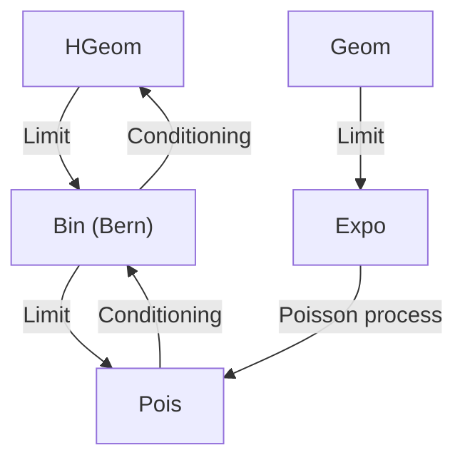
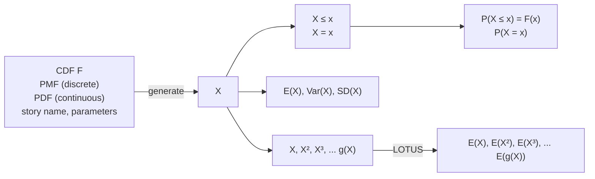

# 5: Continuous random variables

原始 PDF 第 230–283 页。

## Continuous random variables

So far we have been working with discrete random variables, whose possible values can be written down as a list. In this chapter we will discuss continuous r.v.s, which can take on any real value in an interval (possibly of infinite length, such as (0, ∞) or the entire real line). First we’ll look at properties of continuous r.v.s in general. Then we’ll introduce three famous continuous distributions—the Uniform, Normal, and Exponential—which, in addition to having important stories in their own right, serve as building blocks for many other useful continuous distributions.

## 5.1 Probability density functions


## FIGURE 5.1

Discrete vs. continuous r.v.s. Left: The CDF of a discrete r.v. has jumps at each point in the support. Right: The CDF of a continuous r.v. increases smoothly.

Recall that for a discrete r.v., the CDF jumps at every point in the support, and is flat everywhere else. In contrast, for a continuous r.v. the CDF increases smoothly; see Figure 5.1 for a comparison of discrete vs. continuous CDFs.

Definition 5.1.1 (Continuous r.v.). An r.v. has a continuous distribution if its

213

---

214

Introduction to Probability

CDF is differentiable. We also allow there to be endpoints (or finitely many points) where the CDF is continuous but not differentiable, as long as the CDF is differentiable everywhere else. A continuous random variable is a random variable with a continuous distribution.

For discrete r.v.s, the CDF is awkward to work with because of its jumpiness, and its derivative is almost useless since it’s undefined at the jumps and 0 everywhere else. But for continuous r.v.s, the CDF is often convenient to work with, and its derivative is a very useful function, called the probability density function.

Definition 5.1.2 (Probability density function). For a continuous r.v. X with CDF $F$ , the probability density function (PDF) of X is the derivative f of the CDF, given by $f(x) = F^{\prime}(x)$ . The support of $X$ , and of its distribution, is the set of all x where $f(x) > 0$

An important way in which continuous r.v.s differ from discrete r.v.s is that for a continuous r.v. X, $P ( X = x ) = 0$ for all x. This is because $P ( X = x )$ is the height of a jump in the CDF at x, but the CDF of X has no jumps! Since the PMF of a continuous r.v. would just be 0 everywhere, we work with a PDF instead.

The PDF is analogous to the PMF in many ways, but there is a key difference: for a PDF f, the quantity $f ( x )$ is not a probability, and in fact it is possible to have $f ( x )   >   1$ for some values of x. To obtain a probability, we need to integrate the PDF. The fundamental theorem of calculus tells us how to get from the PDF back to the CDF.

Proposition 5.1.3 (PDF to CDF). Let X be a continuous r.v. with PDF $f .$ Then the CDF of X is given by

$$
F (x) = \int_ {- \infty} ^ {x} f (t) d t.
$$

Proof. By definition of PDF, $F$ is an antiderivative of $f .$ So by the fundamental theorem of calculus,

$$
\int_ {- \infty} ^ {x} f (t) d t = F (x) - F (- \infty) = F (x).
$$

The above result is analogous to how we obtained the value of a discrete CDF at x by summing the PMF over all values less than or equal to $x ;$ here we integrate the PDF over all values up to x, so the CDF is the accumulated area under the PDF. Since we can freely convert between the PDF and the CDF using the inverse operations of integration and differentiation, both the PDF and CDF carry complete information about the distribution of a continuous r.v.

Since the PDF determines the distribution, we should be able to use it to find the probability of X falling into an interval $( a , b )$ . A handy fact is that we can include or exclude the endpoints as we wish without altering the probability, since the endpoints have probability 0:

$$
P (a <   X <   b) = P (a <   X \leq b) = P (a \leq X <   b) = P (a \leq X \leq b).
$$

---

Continuous random variables

215

h 5.1.4 (Including or excluding endpoints). We can be carefree about including or excluding endpoints as above for continuous r.v.s, but we must not be careless about this for discrete r.v.s.

By definition of CDF and the fundamental theorem of calculus,

$$
P (a <   X \leq b) = F (b) - F (a) = \int_ {a} ^ {b} f (x) d x.
$$

Therefore, to find the probability of X falling in the interval $( a , b ] { \mathrm { ~ ( o r ~ } } ( a , b ) ,   [ a , b )$ or $[ a , b ] )$ using the PDF, we simply integrate the PDF from a to b. In general, for an arbitrary region $A \subseteq \mathbb { R }$

$$
P (X \in A) = \int_ {A} f (x) d x.
$$

In summary:

To get a desired probability, integrate the PDF over the appropriate range.

Just as a valid PMF must be nonnegative and sum to 1, a valid PDF must be nonnegative and integrate to 1.

Theorem 5.1.5 (Valid PDFs). The PDF f of a continuous r.v. must satisfy the following two criteria:

• Nonnegative: $f(x) \geq 0;$
• Integrates to 1: $\begin{array} { r } { \int _ { - \infty } ^ { \infty } f ( x ) d x = 1 } \end{array}$

Proof. The first criterion is true because probability is nonnegative; if $f ( x _ { 0 } )$ were negative, then we could integrate over a tiny region around $x _ { 0 }$ and get a negative probability. Alternatively, note that the PDF at $x _ { 0 }$ is the slope of the CDF at $x _ { 0 }$ , so $f ( x _ { 0 } ) < 0$ would imply that the CDF is decreasing at $x _ { 0 }$ , which is not allowed. The second criterion is true since $\textstyle \int _ { - \infty } ^ { \infty } f ( x )$ dx is the probability of X falling somewhere on the real line, which is 1. 

Conversely, any such function f is the PDF of some r.v. This is because if f satisfies these properties, we can integrate it as in Proposition 5.1.3 to get a function F satisfying the properties of a CDF. Then a version of Universality of the Uniform, the main concept in Section 5.3, can be used to create an r.v. with CDF F.

Now let’s look at some specific examples of PDFs. The two distributions in the following examples are named the Logistic and Rayleigh distributions, but we won’t discuss their stories here; their appearance is intended mainly as a way of getting comfortable with PDFs.

Example 5.1.6 (Logistic). The Logistic distribution has CDF

$$
F (x) = \frac {e ^ {x}}{1 + e ^ {x}}, \quad x \in \mathbb {R}.
$$

---

216

Introduction to Probability

To get the PDF, we differentiate the CDF, which gives

$$
f (x) = \frac {e ^ {x}}{(1 + e ^ {x}) ^ {2}}, \quad x \in \mathbb {R}.
$$

Let $X \sim$ Logistic. To find $P(-2 < X < 2)$ , integrate the PDF from $^ { - 2 }$ to $2 ;$

$$
P (- 2 <   X <   2) = \int_ {- 2} ^ {2} \frac {e ^ {x}}{(1 + e ^ {x}) ^ {2}} d x = F (2) - F (- 2) \approx 0. 7 6.
$$

The integral was easy to evaluate since we already knew that $F$ was an antiderivative for $f ,$ and we had a nice expression for $F .$ Otherwise, we could have made the substitution $u = 1 + e ^ { x }$ , so du $= e ^ { x } d x$ , giving

$$
\int_ {- 2} ^ {2} \frac {e ^ {x}}{(1 + e ^ {x}) ^ {2}} d x = \int_ {1 + e ^ {- 2}} ^ {1 + e ^ {2}} \frac {1}{u ^ {2}} d u = \left(- \frac {1}{u}\right) \Big | _ {1 + e ^ {- 2}} ^ {1 + e ^ {2}} \approx 0. 7 6.
$$

Figure 5.2 shows the Logistic PDF (left) and CDF (right). On the PDF, the probability $P ( - 2 \; < \; X \; < \; 2 )$ is represented by the shaded area; on the CDF, it is represented by the height of the curly brace. You can check that the properties of a valid PDF and CDF are satisfied. 


## FIGURE 5.2

Logistic PDF and CDF. The probability $P(-2 < X < 2)$ is indicated by the shaded area under the PDF and the height of the curly brace on the CDF.

Example 5.1.7 (Rayleigh). The Rayleigh distribution has CDF

$$
F (x) = 1 - e ^ {- x ^ {2} / 2}, \quad x > 0.
$$

To get the PDF, we differentiate the CDF, which gives

$$
f (x) = x e ^ {- x ^ {2} / 2}, \quad x > 0.
$$

---

Continuous random variables

217

For $x \leq 0$ , both the CDF and the PDF are equal to 0.

Let X ∼ Rayleigh. To find $P ( X > 2 )$ , we need to integrate the PDF from 2 to $\infty$ We can do that by making the substitution $u = - x ^ { 2 } / 2$ , but since we already have the CDF in a nice form we know the integral is $F(\infty)-F(2)=1-F(2)$

$$
P (X > 2) = \int_ {2} ^ {\infty} x e ^ {- x ^ {2} / 2} d x = 1 - F (2) \approx 0. 1 4.
$$

The Rayleigh PDF and CDF are plotted in Figure 5.3. Again, probability is represented by a shaded area on the PDF and a vertical height on the CDF. 


## FIGURE 5.3

Rayleigh PDF and CDF. The probability $P ( X > 2 )$ is indicated by the shaded area under the PDF and the height of the curly brace on the CDF.

Although the height of a PDF at x does not represent a probability, it is closely related to the probability of falling into a tiny interval around $x ,$ as the following intuition explains.

Intuition 5.1.8 (Units). Let F be the CDF and f be the PDF of a continuous r.v. X. As mentioned earlier, $f ( x )$ is not a probability; for example, we could have $f ( 3 )   >   1$ , and we know $P ( X   =   3 )   =   0$ . But thinking about the probability of X being very close to 3 gives us a way to interpret $f ( 3 )$ . Specifically, the probability of X being in a tiny interval of length , centered at 3, will essentially be $f ( 3 ) \epsilon$ This is because

$$
P (3 - \epsilon / 2 <   X <   3 + \epsilon / 2) = \int_ {3 - \epsilon / 2} ^ {3 + \epsilon / 2} f (x) d x \approx f (3) \epsilon ,
$$

if the interval is so tiny that f is approximately the constant $f ( 3 )$ on that interval. In general, we can think of $f ( x ) d x$ as the probability of X being in an infinitesimally small interval containing x, of length dx.

In practice, X often has units in some system of measurement, such as units of

---

218

Introduction to Probability

distance, time, area, or mass. Thinking about the units is not only important in applied problems, but also it often helps in checking that answers make sense.

Suppose for concreteness that X is a length, measured in centimeters (cm). Then $f ( x ) = d F ( x ) / d x$ is the probability per cm at x, which explains why $f ( x )$ is a probability density. Probability is a dimensionless quantity (a number without physical units), so the units of $f ( x )$ are $\mathrm { c m } ^ { - 1 }$ . Therefore, to be able to get a probability again, we need to multiply $f ( x )$ by a length. When we do an integral such as $\begin{array} { r } { \dot { \int _ { 0 } ^ { 5 } f ( x ) d x } , } \end{array}$ this is achieved by the often-forgotten dx. 

Intuition 5.1.9 (Simulation). For another intuitive way to think about PDFs, consider the following graphical way to simulate a draw X from a continuous distribution, based on looking at the graph of the PDF. To generate X, choose a uniformly random point under the PDF curve; this means that the probability of any region under the curve is the area of that region. Then let X be the x-coordinate of the random point. This is illustrated in Figure 5.4.


<details>
<summary>area</summary>

| X | PDF |
| --- | --- |
| 0 | 0 |
| 1 | ~0.45 |
| 2 | ~0.55 |
| 3 | ~0.65 |
| 4 | ~0.85 |
| 5 | ~0.75 |
| 6 | ~0.75 |
| 7 | ~0.85 |
| 8 | ~0.65 |
| 9 | ~0.65 |
| 10 | 0 |
</details>

FIGURE 5.4

A complicated PDF (no numbers are shown on the vertical axis since the scale is whatever it needs to be to make the area under the curve 1). To generate an r.v. X with this PDF, choose a uniformly random point $( x , y )$ under the curve and let $X = x$ . This method works since, for example, X will be in the interval [3, 6] if and only if the randomly chosen point $( x , y )$ is in the shaded region.

Then X has the desired distribution since, by construction, $P ( a \leq X \leq b )$ is the area under the PDF curve between the lines $x   =   a$ and $x   =   b .$ Thinking about this method helps build intuition for PDFs, by giving us a feel for random variables sampled according to a particular PDF curve. 

---

Continuous random variables

219

The definition of expectation for continuous r.v.s is analogous to the definition for discrete r.v.s: replace the sum with an integral and the PMF with the PDF.

Definition 5.1.10 (Expectation of a continuous r.v.). The expected value (also called the expectation or mean) of a continuous r.v. X with PDF f is

$$
E (X) = \int_ {- \infty} ^ {\infty} x f (x) d x.
$$

As in the discrete case, the expectation of a continuous r.v. may or may not exist. When discussing expectations, it would be very tedious to have to add “(if it exists)” after every mention of an expectation not yet shown to exist, so we will often leave this implicit.

The integral is taken over the entire real line, but if the support of X is not the entire real line we can just integrate over the support. The units in this definition make sense: if X is measured in centimeters, then so is E(X), since $xf(x)dx$ has units of cm · $\mathrm { c m ^ { - 1 } \cdot c m = c m }$

With this definition, the expected value retains its interpretation as a center of mass. As shown in Figure 5.5, using the Rayleigh PDF for illustrative purposes, the expected value is the balancing point of the PDF, just as it was the balancing point of the PMF in the discrete case.


<details>
<summary>line</summary>

| X | Y |
| --- | --- |
| 0 | 0 |
| 1 | ~0.6 |
| 2 | ~0.3 |
| 3 | ~0.05 |
| 4 | ~0.01 |
| 5 | 0 |
</details>

FIGURE 5.5

The expected value of a continuous r.v. is the balancing point of the PDF.

Linearity of expectation holds for continuous r.v.s, as it did for discrete r.v.s (we will show this later in Example 7.2.4). LOTUS also holds for continuous r.v.s, replacing the sum with an integral and the PMF with the PDF:

---

220

Introduction to Probability

Theorem 5.1.11 (LOTUS, continuous). If X is a continuous r.v. with PDF f and g is a function from R to R, then

$$
E (g (X)) = \int_ {- \infty} ^ {\infty} g (x) f (x) d x.
$$

We now have all the tools we need to tackle the named distributions of this chapter, starting with the Uniform distribution.

## 5.2 Uniform

Intuitively, a Uniform r.v. on the interval $( a , b )$ is a completely random number between a and b. We formalize the notion of “completely random” on an interval by specifying that the PDF should be constant over the interval.

Definition 5.2.1 (Uniform distribution). A continuous r.v. U is said to have the Uniform distribution on the interval $( a , b )$ if its PDF is

$$
f (x) = \left\{ \begin{array}{l l} \frac {1}{b - a} & \text {if} a <   x <   b, \\ 0 & \text {otherwise.} \end{array} \right.
$$

We denote this by $U \sim \operatorname { U n i f } ( a , b )$

This is a valid PDF because the area under the curve is just the area of a rectangle with width $b - a$ and height $1 / ( b - a )$ . The CDF is the accumulated area under the PDF:

$$
F (x) = \left\{ \begin{array}{l l} 0 & \text {if} x \leq a, \\ \frac {x - a}{b - a} & \text {if} a <   x <   b, \\ 1 & \text {if} x \geq b. \end{array} \right.
$$

The Uniform distribution that we will most frequently use is the $\mathrm { U n i f } ( 0 , 1 )$ distribution, also called the standard Uniform. The $\mathrm { U n i f } ( 0 , 1 )$ PDF and CDF are particularly simple: $f ( x ) = 1$ and $F ( x ) = x$ for $0 < x < 1$ . Figure 5.6 shows the $\mathrm { U n i f } ( 0 , 1 )$ PDF and CDF side by side.

For a general $\operatorname { U n i f } ( a , b )$ distribution, the PDF is constant on $( a , b )$ , and the CDF is ramp-shaped, increasing linearly from 0 to 1 as x ranges from a to b.

For Uniform distributions, probability is proportional to length.

Proposition 5.2.2. Let $U \sim \operatorname { U n i f } ( a , b )$ , and let $( c , d )$ be a subinterval of $( a , b )$ , of length $l   (so   l = d - c )$ Then the probability of U being in $( c , d )$ is proportional to l. For example, a subinterval that is twice as long has twice the probability of containing U, and a subinterval of the same length has the same probability.

---

Continuous random variables

221


## FIGURE 5.6

Unif(0, 1) PDF and CDF.

Proof. Since the PDF of U is the constant $\frac { 1 } { b { - } a }$ on $( a , b )$ , the area under the PDF from c to d is $\frac { l } { b { - } a }$ , which is a constant times l. 

The above proposition is a very special property of the Uniform; for any other distribution, there are intervals of the same length that have different probabilities. Even after conditioning on a Uniform r.v. being in a certain subinterval, we still have a Uniform distribution and thus still have probability proportional to length (within that subinterval); we show this below.

Proposition 5.2.3. Let $U   \sim   \mathrm { U n i f } ( a , b )$ , and let $( c , d )$ be a subinterval of $( a , b )$ Then the conditional distribution of U given $U \in ( c , d )$ is $\operatorname { U n i f } ( c , d )$

Proof. For u in $( c , d )$ , the conditional CDF at u is

$$
P \left(U \leq u | U \in (c, d)\right) = \frac {P (U \leq u , c <   U <   d)}{P (U \in (c , d))} = \frac {P (U \in (c , u ])}{P (U \in (c , d))} = \frac {u - c}{d - c}.
$$

The conditional CDF is 0 for $u \leq c$ and 1 for $u \geq d .$ So the conditional distribution of $U$ is as claimed. 

Example 5.2.4. Let’s illustrate the above propositions for $U \sim \mathrm { U n i f } ( 0 , 1 )$ . In this special case, the support has length 1, so probability is length: the probability of U falling into the interval (0, 0.3) is 0.3, as is the probability of falling into (0.3, 0.6), (0.4, 0.7), or any other interval of length 0.3 within (0, 1).

Now suppose that we learn that $U   \in   ( 0 . 4 , 0 . 7 )$ . Given this information, the conditional distribution of $U$ is $\mathrm { U n i f } ( 0 . 4 , 0 . 7 )$ . Then the conditional probability of $U   \in   ( 0 . 4 , 0 . 6 )$ is $2 / 3$ , since $( 0 . 4 , 0 . 6 )$ provides $2 / 3$ of the length of $( 0 . 4 , 0 . 7 )$ . The conditional probability of $U \in ( 0 , 0 . 6 )$ is also $2 / 3 ,$ since we discard the points to the left of 0.4 when conditioning on $U \in ( 0 . 4 , 0 . 7 )$ 

---

222

Introduction to Probability

Next, let’s derive the mean and variance of $U \; \sim \; \mathrm { U n i f } ( a , b )$ The expectation is extremely intuitive: the PDF is constant, so its balancing point should be the midpoint of $( a , b )$ . This is exactly what we find by using the definition of expectation for continuous r.v.s:

$$
E (U) = \int_ {a} ^ {b} x \cdot \frac {1}{b - a} d x = \frac {1}{b - a} \left(\frac {b ^ {2}}{2} - \frac {a ^ {2}}{2}\right) = \frac {a + b}{2}.
$$

For the variance, we first find $E ( U ^ { 2 } )$ using the continuous version of LOTUS:

$$
E (U ^ {2}) = \int_ {a} ^ {b} x ^ {2} \frac {1}{b - a} d x = \frac {1}{3} \cdot \frac {b ^ {3} - a ^ {3}}{b - a}.
$$

Then

$$
\mathrm{Var} (U) = E (U ^ {2}) - (E U) ^ {2} = \frac {1}{3} \cdot \frac {b ^ {3} - a ^ {3}}{b - a} - \left(\frac {a + b}{2}\right) ^ {2},
$$

which reduces, after factoring $b ^ { 3 }   -   a ^ { 3 } = ( b   -   a ) ( a ^ { 2 }   +   a b   +   b ^ { 2 } )$ and simplifying, to

$$
\mathrm{Var} (U) = \frac {(b - a) ^ {2}}{1 2}.
$$

The above derivation isn’t terribly painful, but there is an easier path, using a technique that is often useful for continuous distributions. The technique is called location-scale transformation, and it relies on the observation that shifting and scaling a Uniform r.v. produces another Uniform r.v. Shifting is considered a change of location and scaling is a change of scale, hence the term location-scale. For example, if X is Uniform on the interval (1, 2), then $X + 5$ is Uniform on the interval (6, 7), 2X is Uniform on the interval (2, 4), and $2 X + 5$ is Uniform on $( 7 , 9 )$

Definition 5.2.5 (Location-scale transformation). Let X be a random variable and $Y = \sigma X   +   \mu$ , where $\sigma$ and $\mu$ are constants with $\sigma > 0$ . Then we say that Y has been obtained as a location-scale transformation of X. Here $\mu$ controls how the location is changed and $\sigma$ controls how the scale is changed.

h 5.2.6. In a location-scale transformation, starting with $X \sim \operatorname { U n i f } ( a , b )$ and transforming it to $Y = c X + d$ where c and d are constants with $c > 0 ,   Y$ is a linear function of X and Uniformity is preserved: $Y   \sim   \mathrm { U n i f } ( c a + d , c b + d )$ But if $Y$ is defined as a nonlinear transformation of $X$ , then Y will not be Uniform in general. For example, for $X \sim \operatorname { U n i f } ( a , b )$ with $0 \leq a < b ,$ the transformed r.v. $Y = X ^ { 2 }$ has support $( a ^ { 2 } , b ^ { 2 } )$ but is not Uniform on that interval. Chapter 8 explores transformations of r.v.s in detail.

In studying Uniform distributions, a useful strategy is to start with an r.v. that has the simplest Uniform distribution, figure things out in the friendly simple case, and then use a location-scale transformation to handle the general case.

Let’s see how this works for finding the expectation and variance of the $\operatorname { U n i f } ( a , b )$

---

Continuous random variables

223

distribution. The location-scale strategy says to start with $U \sim \mathrm { U n i f } ( 0 , 1 )$ . Since the PDF of $U$ is just 1 on the interval (0, 1), it is easy to see that

$$
E (U) = \int_ {0} ^ {1} x d x = \frac {1}{2},
$$

$$
E (U ^ {2}) = \int_ {0} ^ {1} x ^ {2} d x = \frac {1}{3},
$$

$$
\operatorname{Var} (U) = \frac {1}{3} - \frac {1}{4} = \frac {1}{1 2}.
$$

Now that we know the answers for $U ,$ transforming U into a general $\operatorname { U n i f } ( a , b )$ r.v. takes just two steps. First we change the support from an interval of length 1 to an interval of length $b - a ,$ so we multiply $U$ by the scaling factor $b - a$ b − a to obtain a $\mathrm { U n i f } ( 0 , b - a ) ~ \mathrm { r . v }$ . Then we shift everything until the left endpoint of the support is at a. Thus, if $U \sim \mathrm { U n i f } ( 0 , 1 )$ , the random variable

$$
\tilde {U} = a + (b - a) U
$$

is distributed $\operatorname { U n i f } ( a , b )$ . Now the mean and variance of $\tilde { U }$ follow directly from properties of expectation and variance. By linearity of expectation,

$$
E (\tilde {U}) = E (a + (b - a) U) = a + (b - a) E (U) = a + \frac {b - a}{2} = \frac {a + b}{2}.
$$

By the fact that additive constants don’t affect the variance while multiplicative constants come out squared,

$$
\mathrm{Var} (\tilde {U}) = \mathrm{Var} (a + (b - a) U) = \mathrm{Var} ((b - a) U) = (b - a) ^ {2} \mathrm{Var} (U) = \frac {(b - a) ^ {2}}{1 2}.
$$

These agree with our previous answers.

The technique of location-scale transformation will work for any family of distributions such that shifting and scaling an r.v. whose distribution in the family produces another r.v. whose distribution is in the family. This technique does not apply to families of discrete distributions (with a fixed support) since, for example, shifting or scaling $X \sim \operatorname { B i n } ( n , p )$ changes the support and produces an r.v. that is no longer Binomial. A Binomial r.v. must be able to take on all integer values between 0 and some upper bound, but $X + 4\  can't$ take on any value in {0, 1, 2, 3} and 2X can only take even values, so neither of these r.v.s has a Binomial distribution.

h 5.2.7 (Beware of sympathetic magic). When using location-scale transformations, the shifting and scaling should be applied to the random variables themselves, not to their PDFs. To confuse these two would be an instance of sympathetic magic (see h 3.7.7), and would result in invalid PDFs. For example, let $U   \sim   \mathrm { U n i f } ( 0 , 1 )$ , so the PDF f has $f ( x )   =   1 \mathrm { ~ o n ~ } ( 0 , 1 )$ (and $f ( x )   =   0$ elsewhere). Then $3 U + 1 \sim \mathrm { U n i f } ( 1 , 4 )$ , but $3 f + 1$ is the function that equals 4 on (0, 1) and 1 elsewhere, which is not a valid PDF since it does not integrate to 1.

---

224

Introduction to Probability

## 5.3 Universality of the Uniform

In this section, we will discuss a remarkable property of the Uniform distribution: given a Unif(0, 1) r.v., we can construct an r.v. with any continuous distribution we want. Conversely, given an r.v. with an arbitrary continuous distribution, we can create a Unif(0, 1) r.v. We call this the universality of the Uniform, because it tells us the Uniform is a universal starting point for building r.v.s with other distributions. Universality of the Uniform also goes by many other names, such as the probability integral transform, inverse transform sampling, the quantile transformation, and even the fundamental theorem of simulation.

To keep the proofs simple, we will state universality of the Uniform for a case where we know the inverse of the desired CDF exists. Similar ideas can be used to simulate a random draw from any desired CDF as a function of a Unif(0, 1) r.v.

Theorem 5.3.1 (Universality of the Uniform). Let F be a CDF which is a continuous function and strictly increasing on the support of the distribution. This ensures that the inverse function $F ^ { - 1 }$ exists, as a function from (0, 1) to R. We then have the following results.

1. Let $U \sim \mathrm { U n i f } ( 0 , 1 )$ and $X = F ^ { - 1 } ( U )$ . Then X is an r.v. with CDF F.
2. Let X be an r.v. with CDF F. Then $F ( X ) \sim \operatorname { U n i f } ( 0 , 1 )$

Let’s make sure we understand what each part of the theorem is saying. The first part says that if we start with $U \sim \mathrm { U n i f } ( 0 , 1 )$ and a CDF F, then we can create an r.v. whose CDF is F by plugging U into the inverse CDF $F ^ { - 1 }$ . Since $F ^ { - 1 }$ is a function (known as the quantile function), U is an r.v., and a function of an r.v. is an r.v., $F ^ { - 1 } ( U )$ is an r.v.; universality of the Uniform says its CDF is F.

The second part of the theorem goes in the reverse direction, starting from an r.v. X whose CDF is F and then creating a Unif(0, 1) r.v. Again, F is a function, X is an r.v., and a function of an r.v. is an r.v., so $F ( X )$ is an r.v. Since any CDF is between 0 and 1 everywhere, $F ( X )$ must take values between 0 and 1. Universality of the Uniform says that the distribution of $F ( X )$ is Uniform on (0, 1).

h 5.3.2. The second part of universality of the Uniform involves plugging a random variable X into its own CDF F. This may seem strangely self-referential, but it makes sense because F is just a function (that satisfies the properties of a valid CDF), and a function of an r.v. is an r.v. There is a potential notational confusion, however: $F(x) = P(X \leq x)$ by definition, but it would be incorrect to say $\text{" }F(X)=$ $P ( X   \leq   X )   =   1$ Rather, we should first find an expression for the CDF as a function of x, then replace x with X to obtain an r.v. For example, if the CDF of X is $F ( x ) = 1 - e ^ { - x }$ for $x > 0$ , then $F ( X ) = 1 - e ^ { - X }$

---

Continuous random variables

225

Understanding the statement of the theorem is the difficult part; the proof is just a couple of lines for each direction.

Proof.

1. Let $U \sim \mathrm { U n i f } ( 0 , 1 )$ and $X = F ^ { - 1 } ( U )$ . For all real $x .$

$$
P (X \leq x) = P (F ^ {- 1} (U) \leq x) = P (U \leq F (x)) = F (x),
$$

so the CDF of X is $F ,$ as claimed. For the last equality, we used the fact that $P ( U \leq u ) = u$ for $u \in ( 0 , 1 )$

2. Let X have CDF $F ,$ and find the CDF of $Y = F ( X )$ . Since Y takes values in $( 0 , 1 )$ $P ( Y \leq y )$ equals 0 for $y \leq 0$ and equals 1 for $y \geq 1$ . For $y \in ( 0 , 1 )$

$$
P (Y \leq y) = P (F (X) \leq y) = P (X \leq F ^ {- 1} (y)) = F (F ^ {- 1} (y)) = y.
$$

Thus Y has the $\mathrm { U n i f } ( 0 , 1 )$ CDF.

To gain more insight into what the quantile function $F ^ { - 1 }$ and universality of the Uniform mean, let’s consider an example that is familiar to millions of students: percentiles on an exam.

Example 5.3.3 (Percentiles). A large number of students take a certain exam, graded on a scale from 0 to 100. Let X be the score of a random student. Continuous distributions are easier to deal with here, so let’s approximate the discrete distribution of scores using a continuous distribution. Suppose that X is continuous, with a CDF F that is strictly increasing on (0, 100). In reality, there are only finitely many students and only finitely many possible scores, but a continuous distribution may be a good approximation.

Suppose that the median score on the exam is 60, i.e., half of the students score above 60 and the other half score below 60 (a convenient aspect of assuming a continuous distribution is that we don’t need to worry about how many students had scores equal to 60). That is, $F ( 6 0 ) = 1 / 2$ , or, equivalently, $F ^ { - 1 } ( 1 / 2 ) = 6 0$

If Fred scores a 72 on the exam, then his percentile is the fraction of students who score below a 72. This is $F ( 7 2 )$ , which is some number in $( 1 / 2 , 1 )$ since 72 is above the median. In general, a student with score x has percentile $F ( x )$ . Going the other way, if we start with a percentile, say 0.95, then $F ^ { - 1 } ( 0 . 9 5 )$ is the score that has that percentile. A percentile is also called a quantile, which is why $F ^ { - 1 }$ is called the quantile function. The function $F$ converts scores to quantiles, and the function $F ^ { - 1 }$ converts quantiles to scores.

The strange operation of plugging X into its own CDF now has a natural interpretation: $F ( X )$ is the percentile attained by a random student. It often happens that the distribution of scores on an exam looks very non-Uniform. For example, there is no reason to think that 10% of the scores are between $7 0$ and 80, even though (70, 80) covers 10% of the range of possible scores.

---

226

Introduction to Probability

On the other hand, the distribution of percentiles of the students is Uniform: the universality property says that $F ( X ) \sim \operatorname { U n i f } ( 0 , 1 )$ . For example, 50% of the students have a percentile of at least 0.5. Universality of the Uniform is expressing the fact that 10% of the students have a percentile between 0 and 0.1, 10% have a percentile between 0.1 and 0.2, 10% have a percentile between 0.2 and 0.3, and so on—a fact that is clear from the definition of percentile. 

To illustrate universality of the Uniform, we will apply it to the two distributions we encountered in the previous section, the Logistic and Rayleigh.

Example 5.3.4 (Universality with Logistic). The Logistic CDF is

$$
F (x) = \frac {e ^ {x}}{1 + e ^ {x}}, \quad x \in \mathbb {R}.
$$

Suppose we have $U \sim \mathrm { U n i f } ( 0 , 1 )$ and wish to generate a Logistic r.v. Part 1 of the universality property says that $F ^ { - 1 } ( U ) \sim$ Logistic, so we first invert the CDF to get $F ^ { - 1 }$

$$
F ^ {- 1} (u) = \log \left(\frac {u}{1 - u}\right).
$$

Then we plug in U for u:

$$
F ^ {- 1} (U) = \log \left(\frac {U}{1 - U}\right).
$$

Therefore log $\begin{array} { r } { \left( \frac { U } { 1 - U } \right) \sim \mathrm { L o g i s t i c } } \end{array}$

We can verify directly that log $\left( { \frac { U } { 1 { - } U } } \right)$ has the required CDF: start from the definition of CDF, do some algebra to isolate U on one side of the inequality, and then use the CDF of the Uniform distribution. Let’s work through these calculations once for practice:

$$
\begin{array}{l} P \left(\log \left(\frac {U}{1 - U}\right) \leq x\right) = P \left(\frac {U}{1 - U} \leq e ^ {x}\right) \\ = P \left(U \leq e ^ {x} (1 - U)\right) \\ = P \left(U \leq \frac {e ^ {x}}{1 + e ^ {x}}\right) \\ = \frac {e ^ {x}}{1 + e ^ {x}}, \\ \end{array}
$$

which is indeed the Logistic CDF.

We can also use simulation to visualize how universality of the Uniform works. To this end, we generated 1 million Unif(0, 1) random variables. We then transformed each of these values u into log $\left( { \frac { u } { 1 - u } } \right)$ ; if the universality of the Uniform is correct, the transformed numbers should follow a Logistic distribution.

---

Continuous random variables

227


## FIGURE 5.7

Top: Histogram of $1 0 ^ { 6 }$ draws of $U \sim \mathrm { U n i f } ( 0 , 1 )$ , with $\mathrm { U n i f } ( 0 , 1 )$ PDF for comparison. Bottom: Histogram of $1 0 ^ { 6 }$ draws of log $\left( { \frac { U } { 1 { - } U } } \right)$ , with Logistic PDF for comparison.

Figure 5.7 displays a histogram of the realizations of U alongside the $\mathrm { U n i f } ( 0 , 1 )$ PDF; below that, we have a histogram of the realizations of log $\left( { \frac { U } { 1 { - } U } } \right)$ next to the Logistic PDF. As we can see, the second histogram looks very much like the Logistic PDF. Thus, by applying $F ^ { - 1 }$ , we were able to transform our Uniform draws into Logistic draws, exactly as claimed by the universality of the Uniform.

Conversely, Part 2 of the universality property states that if X ∼ Logistic, then

$$
F (X) = \frac {e ^ {X}}{1 + e ^ {X}} \sim \mathrm{Unif} (0, 1).
$$

Example 5.3.5 (Universality with Rayleigh). The Rayleigh CDF is

$$
F (x) = 1 - e ^ {- x ^ {2} / 2}, \quad x > 0.
$$

The quantile function (the inverse of the CDF) is

$$
F ^ {- 1} (u) = \sqrt {- 2 \log (1 - u)},
$$

so if $U \sim \mathrm { U n i f } ( 0 , 1 )$ , then $F ^ { - 1 } ( U ) = { \sqrt { - 2 \log ( 1 - U ) } } \sim \mathrm { R a y l e i g h }$

We again generated 1 million realizations of $U \sim \mathrm { U n i f } ( 0 , 1 )$ and transformed them

---

228

Introduction to Probability


## FIGURE 5.8

Top: Histogram of 1 million draws from $U \sim \mathrm { U n i f } ( 0 , 1 )$ , with $\mathrm { U n i f } ( 0 , 1 )$ PDF for comparison. Bottom: Histogram of 1 million draws from $\sqrt { - 2 \log ( 1 - U ) }$ , with Rayleigh PDF for comparison.

to produce 1 million realizations of $\sqrt { - 2 \log ( 1 - U ) }$ . As Figure 5.8 shows, the realizations of $\sqrt { - 2 \log ( 1 - U ) }$ look very similar to the Rayleigh PDF, as predicted by the universality of the Uniform.

Conversely, if X ∼ Rayleigh, then $F ( X ) = 1 - e ^ { - X ^ { 2 } / 2 } \sim \mathrm { U n i f } ( 0 , 1 )$

Next, let us consider the extent to which universality of the Uniform holds for discrete random variables. The CDF F of a discrete r.v. has jumps and flat regions, so $F ^ { - 1 }$ does not exist (in the usual sense). But Part 1 still holds in the sense that given a Uniform random variable, we can construct an r.v. with any discrete distribution we want. The difference is that instead of working with the CDF, which is not invertible, it is more straightforward to work with the PMF.

Suppose we want to use $U   \sim   \mathrm { U n i f } ( 0 , 1 )$ to construct a discrete r.v. X with PMF $p _ { j } = P ( X = j )$ for $j = 0 , 1 , 2 , \ldots , n$ . As illustrated in Figure 5.9, we can chop up the interval $( 0 , 1 )$ into pieces of lengths $p _ { 0 } , p _ { 1 } , \ldots , p _ { n }$ . By the properties of a valid PMF, the sum of the ${ p _ { j } } ^ { \prime } \mathrm { s }$ is 1, so this perfectly divides up the interval, without overshooting or undershooting.

Now define X to be the r.v. which equals 0 if U falls into the $p _ { 0 }$ interval, 1 if U falls into the $p _ { 1 }$ interval, 2 if U falls into the $p _ { 2 }$ interval, and so on. Then X is a discrete

---

Continuous random variables

229


<details>
<summary>text_image</summary>

0 1 2 ... n-1 n
| | | | | | | |
p₀ p₁ p₂ pₙ₋₁ pₙ
</details>

## FIGURE 5.9

Given a PMF, chop up the interval (0, 1) into pieces, with lengths given by the PMF values.

r.v. taking on values 0 through n. The probability that $X = j$ is the probability that U falls into the interval of length $p _ { j }$ . But for a Unif(0, 1) r.v., probability is length, so $P ( X = j )$ is precisely $p _ { j }$ , as desired!

The same trick will work for a discrete r.v. that can take on infinitely many values, such as a Poisson; we’ll need to chop (0, 1) into infinitely many pieces, but the total length of the pieces is still 1.

We now know how to take an arbitrary PMF and create an r.v. with that PMF. This fulfills our promise from Chapter 3 that any function with the properties given in Theorem 3.2.7 is the PMF of some r.v.

h 5.3.6. Part 2 of universality of the Uniform, on the other hand, fails for discrete r.v.s. A function of a discrete r.v. is still discrete, so if X is discrete, then $F ( X )$ is still discrete. So $F ( X )$ doesn’t have a Uniform distribution. For example, if $X \sim \mathrm { B e r n } ( p )$ then F(X) has only two possible values: $F ( 0 ) = 1 - p$ and $F ( 1 ) = 1$

The upshot of universality is that we can use a Uniform r.v. U to generate r.v.s from both continuous and discrete distributions: in the continuous case, we can plug U into the inverse CDF, and in the discrete case, we can chop up the unit interval according to the desired PMF. Part 1 of universality of the Uniform is often useful in practice when running simulations (since the software being used may know how to generate Uniform r.v.s but not know how to generate r.v.s with the distribution of interest), though the extent to which it is useful depends on how tractable it is to compute the inverse CDF. Part 2 is important for certain widely used techniques in statistical inference, by providing a transformation that converts an r.v. with an unknown distribution to an r.v. with a known, simple distribution: the Uniform.

Using our analogy of distributions as blueprints and r.v.s as houses, the beauty of the universality property is that the Uniform distribution is a very simple blueprint, and it’s easy to create a house from that blueprint; universality of the Uniform then gives us a simple rule for remodeling the Uniform house into a house with any other blueprint, no matter how complicated!

To conclude this section, we give an elegant identity that is often useful for finding the expectation of a nonnegative r.v. The identity also has a neat visual interpreta-

---

230

Introduction to Probability

tion related to universality of the Uniform, LOTUS, and the relationship between CDFs and quantile functions.

Definition 5.3.7. The survival function of an r.v. X with CDF F is the function G given by $G(x)=1-F(x)=P(X>x)$

Theorem 5.3.8 (Expectation by integrating the survival function). Let X be a nonnegative r.v. Its expectation can be found by integrating its survival function:

$$
E (X) = \int_ {0} ^ {\infty} P (X > x) d x.
$$

This result is the continuous analog of Theorem 4.4.8 (note though that it holds for any nonnegative r.v., not just for continuous nonnegative r.v.s). Actuaries sometimes call it the Darth Vader rule, for obscure reasons; statisticians are more likely to refer to it as finding the expectation by integrating the survival function.

Proof. For any number $x \geq 0$ , we can write

$$
x = \int_ {0} ^ {x} d t = \int_ {0} ^ {\infty} I (x > t) d t,
$$

where $I ( x > t )$ is 1 if $x \geq t$ and 0 otherwise. So

$$
X (s) = \int_ {0} ^ {\infty} I (X (s) > t) d t,
$$

for each s in the sample space. We can write this more compactly as

$$
X = \int_ {0} ^ {\infty} I (X > t) d t.
$$

Taking the expectation of both sides and swapping the E with the integral (which can be justified using results from real analysis), we have

$$
E (X) = E \left(\int_ {0} ^ {\infty} I (X > t) d t\right) = \int_ {0} ^ {\infty} E (I (X > t)) d t = \int_ {0} ^ {\infty} P (X > t) d t.
$$

For a visual explanation of this identity, we can graph a CDF and interpret a certain area in two different ways: as the integral of the survival function, and as the integral of the quantile function.

A prototypical CDF of a nonnegative, continuous r.v. with CDF F is shown in Figure 5.10, with the area between the CDF curve and the horizontal line $p = 1$ shaded. This area can be found by integrating $1 - F ( x )$ , the difference between the line and the curve, from 0 to ∞.

But another way to find this area is to turn your head sideways and integrate with

---

Continuous random variables

231


<details>
<summary>area</summary>

| Point | X | Y |
| --- | --- | --- |
| Intersection of Curve | ~35 | ~0.75 |
</details>

## FIGURE 5.10

The area above a certain CDF and below the line $p = 1$ is shaded. This area can be interpreted in two ways: as the integral of the survival function, or as the integral of the quantile function.

respect to the vertical axis variable p rather than the horizontal axis variable $x .$ This gives the integral of the quantile function, which, letting $U \sim \mathrm { U n i f } ( 0 , 1 )$ , is

$$
\int_ {0} ^ {1} F ^ {- 1} (p) d p = E (F ^ {- 1} (U)) = E (X),
$$

by LOTUS and universality of the Uniform. So again we have

$$
\int_ {0} ^ {\infty} (1 - F (x)) d x = \int_ {0} ^ {1} F ^ {- 1} (p) d p = E (X).
$$

## 5.4 Normal

The Normal distribution is a famous continuous distribution with a bell-shaped PDF. It is extremely widely used in statistics because of a theorem, the central limit theorem, which says that under very weak assumptions, the sum of a large number of i.i.d. random variables has an approximately Normal distribution, regardless of the distribution of the individual r.v.s. This means we can start with independent r.v.s from almost any distribution, discrete or continuous, but once we add up a bunch of them, the distribution of the resulting r.v. looks like a Normal distribution.

---

232

Introduction to Probability

The central limit theorem is a topic for Chapter 10, but in the meantime, we’ll introduce the properties of the Normal PDF and CDF and derive the expectation and variance of the Normal distribution. To do this, we will again use the strategy of location-scale transformation by starting with the simplest Normal distribution, the standard Normal, which is centered at 0 and has variance 1. After deriving the properties of the standard Normal, we’ll be able to get to any Normal distribution we want by shifting and scaling.

Definition 5.4.1 (Standard Normal distribution). A continuous r.v. $Z$ is said to have the standard Normal distribution if its PDF $\varphi$ is given by

$$
\varphi (z) = \frac {1}{\sqrt {2 \pi}} e ^ {- z ^ {2} / 2}, \quad - \infty <   z <   \infty .
$$

We write this as $Z \sim \mathcal { N } ( 0 , 1 )$ since, as we will show, $Z$ has mean 0 and variance 1.

The constant $\frac { 1 } { \sqrt { 2 \pi } }$ in front of the PDF may look surprising (why is something with $\pi$ needed in front of something with $e _ { \gamma }$ when there are no circles in sight?), but it’s exactly what is needed to make the PDF integrate to 1. Such constants are called normalizing constants because they normalize the total area under the PDF to 1. We’ll verify soon that this is a valid PDF.

The standard Normal CDF Φ is the accumulated area under the PDF:

$$
\Phi (z) = \int_ {- \infty} ^ {z} \varphi (t) d t = \int_ {- \infty} ^ {z} \frac {1}{\sqrt {2 \pi}} e ^ {- t ^ {2} / 2} d t.
$$

Some people, upon seeing the function $\Phi$ for the first time, express dismay that it is left in terms of an integral. Unfortunately, we have little choice in the matter: it turns out to be mathematically impossible to find a closed-form expression for the antiderivative of $\varphi ,$ meaning that we cannot express $\Phi$ as a finite sum of more familiar functions like polynomials or exponentials. But closed-form or no, it’s still a well-defined function: if we give Φ an input $z ,$ it returns the accumulated area under the PDF from −∞ up to z.

Notation 5.4.2. We can tell the Normal distribution must be special because the standard Normal PDF and CDF get their own Greek letters. By convention, we use $\varphi$ for the standard Normal PDF and Φ for the CDF. We will often use $Z$ to denote a standard Normal random variable.

The standard Normal PDF and CDF are plotted in Figure 5.11. The PDF is bellshaped and symmetric about 0, and the CDF is S-shaped. These have the same general shape as the Logistic PDF and CDF that we saw Example 5.1.6, but the Normal PDF decays to 0 much more quickly.

There are several important symmetry properties that can be deduced from the standard Normal PDF and CDF.

1. Symmetry of PDF: $\varphi$ satisfies $\varphi ( z ) = \varphi ( - z )$ , i.e., $\varphi$ is an even function.

---

Continuous random variables

233


FIGURE 5.11 Standard Normal PDF $\varphi$ (left) and CDF Φ (right).

2. Symmetry of tail areas: The area under the PDF curve to the left of $- 2 ,$ which is $P ( Z \leq - 2 ) = \Phi ( - 2 )$ by definition, equals the area to the right of 2, which is $P ( Z \geq 2 ) = 1 - \Phi ( 2 )$ . In general, we have

$$
\Phi (z) = 1 - \Phi (- z)
$$

for all $之 .$ This can be seen visually by looking at the PDF curve, and mathematically by substituting $u   =   - t$ below and using the fact that PDFs integrate to 1:

$$
\Phi (- z) = \int_ {- \infty} ^ {- z} \varphi (t) d t = \int_ {z} ^ {\infty} \varphi (u) d u = 1 - \int_ {- \infty} ^ {z} \varphi (u) d u = 1 - \Phi (z).
$$

3. Symmetry of $Z$ and $- Z ;$ If $Z \sim \mathcal { N } ( 0 , 1 )$ , then $- Z \sim \mathcal { N } ( 0 , 1 )$ as well. To see this, note that the CDF of $- Z$ is

$$
P (- Z \leq z) = P (Z \geq - z) = 1 - \Phi (- z),
$$

but that is $\Phi ( z )$ , according to what we just argued. So $- Z$ has CDF Φ.

We need to prove three key facts about the standard Normal, and then we’ll be ready to handle general Normal distributions: we need to show that $\varphi$ is a valid PDF, that $E ( Z ) = 0$ , and that $\operatorname { V a r } ( Z ) = 1$

To verify the validity of $\varphi ,$ we’ll show that the total area under $e ^ { - z ^ { 2 } / 2 }$ is $\sqrt { 2 \pi }$ However, we can’t find the antiderivative of $e ^ { - z ^ { 2 } / 2 }$ directly, again because of the annoying fact that the antiderivative isn’t expressible in closed form. But this doesn’t mean we can’t do definite integrals, with some ingenuity.

An amazing trick saves the day here: write down the integral twice. Usually, writing

---

234

Introduction to Probability

down the same problem repeatedly is more a sign of frustration than a problemsolving strategy. But in this case, it allows a neat conversion to polar coordinates:

$$
\begin{array}{l} \left(\int_ {- \infty} ^ {\infty} e ^ {- z ^ {2} / 2} d z\right) \left(\int_ {- \infty} ^ {\infty} e ^ {- z ^ {2} / 2} d z\right) = \left(\int_ {- \infty} ^ {\infty} e ^ {- x ^ {2} / 2} d x\right) \left(\int_ {- \infty} ^ {\infty} e ^ {- y ^ {2} / 2} d y\right) \\ = \int_ {- \infty} ^ {\infty} \int_ {- \infty} ^ {\infty} e ^ {- \frac {x ^ {2} + y ^ {2}}{2}} d x d y \\ = \int_ {0} ^ {2 \pi} \int_ {0} ^ {\infty} e ^ {- r ^ {2} / 2} r d r d \theta . \\ \end{array}
$$

In the first step, we used the fact that z is just a dummy variable in each integral, so we are allowed to give it a different name (or two different names, one for each integral). The extra $r$ that appears in the final step comes from the Jacobian of the transformation to polar coordinates, as explained in Section A.7.2 of the math appendix. That $r$ is also what saves us from the impossibility of the original integral, since we can now use the substitution $u = r ^ { 2 } / 2 ,   d u = r d r$ . This gives

$$
\begin{array}{l} \int_ {0} ^ {2 \pi} \int_ {0} ^ {\infty} e ^ {- r ^ {2} / 2} r d r d \theta = \int_ {0} ^ {2 \pi} \left(\int_ {0} ^ {\infty} e ^ {- u} d u\right) d \theta \\ = \int_ {0} ^ {2 \pi} 1 d \theta = 2 \pi . \\ \end{array}
$$

Therefore,

$$
\int_ {- \infty} ^ {\infty} e ^ {- z ^ {2} / 2} d z = \sqrt {2 \pi},
$$

as we wanted to show.

The expectation of the standard Normal has to be 0, by the symmetry of the PDF; no other balancing point would make sense. We can also see this symmetry by looking at the definition of $E ( Z )$

$$
E (Z) = \frac {1}{\sqrt {2 \pi}} \int_ {- \infty} ^ {\infty} z e ^ {- z ^ {2} / 2} d z,
$$

and since $g ( z ) = z e ^ { - z ^ { 2 } / 2 }$ is an odd function (see Section A.2.3 of the math appendix for more on even and odd functions), the area under $g$ from $- \infty$ to 0 cancels the area under g from 0 to $\infty .$ . Therefore $E ( Z ) = 0$ . In fact, the same argument shows that $E ( Z ^ { n } ) = 0$ for any odd positive integer $n .$ 1

Getting the mean was easy (one might even say it was EZ), but the variance

<small><span class="docvortex-page-footnote" data-block-type="page_footnote" style="color:#6b7280">1<sub>A</sub> subtlety is that ∞ − ∞ is undefined, so we also want to check that the area under the curve z<sup>n</sup><sub>e</sub>−z<sup>2</sup>/2from 0 to ∞ is finite. But this is true since e−z<sup>2</sup>/2goes to 0 extremely quickly (faster than exponential decay), more than offsetting the growth of the polynomial z<sup>n</sup>.</span></small>

---

Continuous random variables

235

calculation is a bit more involved. By LOTUS,

$$
\begin{array}{l} \mathrm{Var} (Z) = E (Z ^ {2}) - (E Z) ^ {2} = E (Z ^ {2}) \\ = \frac {1}{\sqrt {2 \pi}} \int_ {- \infty} ^ {\infty} z ^ {2} e ^ {- z ^ {2} / 2} d z \\ = \frac {2}{\sqrt {2 \pi}} \int_ {0} ^ {\infty} z ^ {2} e ^ {- z ^ {2} / 2} d z \\ \end{array}
$$

The last step uses the fact that $z ^ { 2 } e ^ { - z ^ { 2 } / 2 }$ is an even function. Now we use integration by parts with $u = z$ and $d v = z e ^ { - z ^ { 2 } / 2 } d z$ , so $d u = d z$ and $v = - e ^ { - z ^ { 2 } / 2 }$ :

$$
\begin{array}{l} \operatorname{Var} (Z) = \frac {2}{\sqrt {2 \pi}} \left(- z e ^ {- z ^ {2} / 2} \bigg | _ {0} ^ {\infty} + \int_ {0} ^ {\infty} e ^ {- z ^ {2} / 2} d z\right) \\ = \frac {2}{\sqrt {2 \pi}} \left(0 + \frac {\sqrt {2 \pi}}{2}\right) \\ = 1. \\ \end{array}
$$

The first term of the integration by parts equals 0 because $e ^ { - z ^ { 2 } / 2 }$ decays much faster than z grows, and the second term is $\sqrt { 2 \pi } / 2$ because it’s half of the total area under $e ^ { - z ^ { 2 } / 2 }$ , which we’ve already proved is $\sqrt { 2 \pi }$ . So indeed, the standard Normal distribution has mean 0 and variance 1.

The general Normal distribution has two parameters, denoted $\mu$ and $\sigma ^ { 2 }$ , which correspond to the mean and variance (so the standard Normal is the special case where $\mu = 0$ and $\sigma ^ { 2 } = 1 )$ . Starting with a standard Normal r.v. $Z \sim \mathcal { N } ( 0 , 1 )$ , we can get a Normal r.v. with any mean and variance by a location-scale transformation (shifting and scaling).

Definition 5.4.3 (Normal distribution). If $Z \sim \mathcal { N } ( 0 , 1 )$ , then

$$
X = \mu + \sigma Z
$$

is said to have the Normal distribution with mean $\mu$ and variance $\sigma ^ { 2 }$ , for any real $\mu$ and $\sigma ^ { 2 }$ with $\sigma > 0$ . We denote this by $X \sim \mathcal { N } ( \mu , \sigma ^ { 2 } )$

It’s clear by properties of expectation and variance that X does in fact have mean $\mu$ and variance $\sigma ^ { 2 }$ :

$$
\begin{array}{l} E (\mu + \sigma Z) = E (\mu) + \sigma E (Z) = \mu , \\ \operatorname{Var} (\mu + \sigma Z) = \operatorname{Var} (\sigma Z) = \sigma^ {2} \operatorname{Var} (Z) = \sigma^ {2}. \\ \end{array}
$$

Note that we multiply $Z$ by the standard deviation $\sigma ,$ not $\sigma ^ { 2 }$ ; else the units would be wrong and $X$ would have variance $\sigma ^ { 4 }$

Of course, if we can get from $Z$ to $X .$ , then we can get from X back to $Z .$ The process of getting a standard Normal from a non-standard Normal is called, appropriately enough, standardization. For $X \sim \mathcal { N } ( \mu , \sigma ^ { 2 } )$ , the standardized version of X is

$$
\frac {X - \mu}{\sigma} \sim \mathcal {N} (0, 1).
$$

---

236

Introduction to Probability

We can use standardization to find the CDF and PDF of X in terms of the standard Normal CDF and PDF.

Theorem 5.4.4 (Normal CDF and PDF). Let $X \sim \mathcal { N } ( \mu , \sigma ^ { 2 } )$ . Then the CDF of X is

$$
F (x) = \Phi \left(\frac {x - \mu}{\sigma}\right),
$$

and the PDF of X is

$$
f (x) = \varphi \left(\frac {x - \mu}{\sigma}\right) \frac {1}{\sigma}.
$$

Proof. For the CDF, we start from the definition $F ( x ) = P ( X \leq x )$ , standardize, and use the CDF of the standard Normal:

$$
F (x) = P (X \leq x) = P \left(\frac {X - \mu}{\sigma} \leq \frac {x - \mu}{\sigma}\right) = \Phi \left(\frac {x - \mu}{\sigma}\right).
$$

Then we differentiate to get the PDF, remembering to apply the chain rule:

$$
\begin{array}{l} f (x) = \frac {d}{d x} \Phi \left(\frac {x - \mu}{\sigma}\right) \\ = \varphi \left(\frac {x - \mu}{\sigma}\right) \frac {1}{\sigma}. \\ \end{array}
$$

We can also write out the PDF as

$$
f (x) = \frac {1}{\sqrt {2 \pi} \sigma} \exp \left(- \frac {(x - \mu) ^ {2}}{2 \sigma^ {2}}\right).
$$

Finally, three important benchmarks for the Normal distribution are the probabilities of falling within one, two, and three standard deviations of the mean. The 68-95-99.7% rule tells us that these probabilities are what the name suggests.

Theorem 5.4.5 (68-95-99.7% rule). If $X \sim \mathcal { N } ( \mu , \sigma ^ { 2 } )$ , then

$$
\begin{array}{l} P (| X - \mu | <   \sigma) \approx 0. 6 8, \\ P (| X - \mu | <   2 \sigma) \approx 0. 9 5, \\ P (| X - \mu | <   3 \sigma) \approx 0. 9 9 7. \\ \end{array}
$$

We can use this rule to get quick approximations of Normal probabilities.<sup>2</sup> Often it is easier to apply the rule after standardizing, in which case we have

$$
\begin{array}{l} P (| Z | <   1) \approx 0. 6 8, \\ P (| Z | <   2) \approx 0. 9 5, \\ P (| Z | <   3) \approx 0. 9 9 7. \\ \end{array}
$$

<small><span class="docvortex-page-footnote" data-block-type="page_footnote" style="color:#6b7280"><sup>2</sup>The 68-95-99.7% rule says that 95% of the time, a Normal random variable will fall within ±2 standard deviations of its mean. An even more accurate approximation says that 95% of the time, a Normal r.v. is within ±1.96 SDs of its mean. This explains why the number 1.96 comes up very often in statistics in the context of 95% confidence intervals, which are often created by taking an estimate and putting a buffer zone of 1.96 SDs on either side.</span></small>

---

Continuous random variables

237

Example 5.4.6 (Practice with the standard Normal CDF). Let $X \sim \mathcal { N } ( - 1 , 4 )$ What is $P ( | X | < 3 )$ , exactly (in terms of Φ) and approximately?

## Solution:

The event $| X | < 3$ is the same as the event $- 3 < X < 3$ . We use standardization to express this event in terms of the standard Normal r.v. $Z = ( X - ( - 1 ) ) / 2$ , then apply the 68-95-99.7% rule to get an approximation. The exact answer is

$$
P (- 3 <   X <   3) = P \left(\frac {- 3 - (- 1)}{2} <   \frac {X - (- 1)}{2} <   \frac {3 - (- 1)}{2}\right) = P (- 1 <   Z <   2),
$$

which is $\Phi ( 2 ) - \Phi ( - 1 )$ . The $68 - 95 - 99.7\%$ rule tells us that $P ( - 1 < Z < 1 ) \approx 0 . 6 8$ and $P ( - 2 < Z < 2 ) \approx 0 . 9 5$ . In other words, going from ±1 standard deviation to ±2 standard deviations adds approximately $0 . 9 5 - 0 . 6 8 = 0 . 2 7$ to the area under the curve. By symmetry, this is evenly divided between the areas $P(-2 < Z < -1)$ and $P ( 1 < Z < 2 )$ . Therefore,

$$
P (- 1 <   Z <   2) = P (- 1 <   Z <   1) + P (1 <   Z <   2) \approx 0. 6 8 + \frac {0 . 2 7}{2} = 0. 8 1 5.
$$

This is close to the correct value, $\Phi ( 2 ) - \Phi ( - 1 ) \approx 0 . 8 1 8 6 .$

As we will see later in the book, several important distributions can be obtained through transforming Normal r.v.s in natural ways, e.g., squaring or exponentiating. Chapter 8 delves into transformations in depth, but meanwhile there is a lot that we can do just using LOTUS and properties of CDFs.

Example 5.4.7 (Folded Normal). Let $Y = | Z |$ with $Z \sim \mathcal { N } ( 0 , 1 )$ The distribution of Y is called a Folded Normal with parameters $\mu = 0$ and $\sigma ^ { 2 } = 1$ . In this example, we will derive the mean, variance, and distribution of Y . At first sight, Y may seem tricky to deal with since the absolute value function is not differentiable at 0 (due to its sharp corner), but Y has a perfectly valid continuous distribution.

(a) Find $E ( Y )$
(b) Find Var(Y ).
(c) Find the CDF and PDF of Y .

## Solution:

(a) We will derive the PDF of Y later in this example, but to find $E ( Y )$ , LOTUS says we can work directly with the PDF of $Z ;$

$$
E (Y) = E | Z | = \int_ {- \infty} ^ {\infty} | z | \frac {1}{\sqrt {2 \pi}} e ^ {- z ^ {2} / 2} d z = 2 \int_ {0} ^ {\infty} z \frac {1}{\sqrt {2 \pi}} e ^ {- z ^ {2} / 2} d z = \sqrt {\frac {2}{\pi}}.
$$

(b) Note that $Y ^ { 2 } = Z ^ { 2 }$ , so we do not need to do another integral! We have

$$
E (Y ^ {2}) = E (Z ^ {2}) = \mathrm{Var} (Z) = 1,
$$

---

238

Introduction to Probability

so

$$
\mathrm{Var} (Y) = E (Y ^ {2}) - (E (Y)) ^ {2} = 1 - \frac {2}{\pi}.
$$

(c) For $y \leq 0$ , the CDF of Y is $F_Y(y) = P(Y \leq y) = 0$ . For $y > 0$ , the CDF is

$$
F _ {Y} (y) = P (Y \leq y) = P (| Z | \leq y) = P (- y \leq Z \leq y) = \Phi (y) - \Phi (- y) = 2 \Phi (y) - 1.
$$

So the PDF of $Y$ is $2 \varphi ( y )$ for $y \geq 0$ , and 0 otherwise, where $\varphi$ is the $\mathcal { N } ( 0 , 1 )$ PDF.

Sanity check: Note that $2 \Phi ( y ) - 1   \to   2 - 1   =   1 { \mathrm { ~ a s ~ } } y   \to   \infty ,$ as it must, and that the CDF of Y is a continuous function since Φ is continuous and at 0 there is not a jump: $2\Phi(0) - 1 = 0$ . Also, the PDF of Y makes sense since taking the absolute value of $Z { \mathrm { ~ ` f o l d s  } }$ the probability mass of a negative range of values of $Z$ over to the positive side, $\mathbf { e . g . }$ , the probability for $Z$ values between −2 and −1 contributes to the probability for $Y$ values between 1 and 2. This results in zero density for negative values and double the density for positive values. 

## 5.5 Exponential

The Exponential distribution is the continuous counterpart to the Geometric distribution. Recall that a Geometric random variable counts the number of failures before the first success in a sequence of Bernoulli trials. The story of the Exponential distribution is analogous, but we are now waiting for a success in continuous time, where successes arrive at a rate of λ successes per unit of time. The average number of successes in a time interval of length t is $\lambda t ,$ though the actual number of successes varies randomly. An Exponential random variable represents the waiting time until the first arrival of a success.

Definition 5.5.1 (Exponential distribution). A continuous r.v. X is said to have the Exponential distribution with parameter λ, where $\lambda > 0 .$ if its PDF is

$$
f (x) = \lambda e ^ {- \lambda x}, \quad x > 0.
$$

We denote this by $X \sim \operatorname { E x p o } ( \lambda )$

The corresponding CDF is

$$
F (x) = 1 - e ^ {- \lambda x}, \quad x > 0.
$$

The $\mathrm { E x p o ( 1 ) }$ PDF and CDF are plotted in Figure 5.12. Note the resemblance to the Geometric PMF and CDF pictured in Chapter 4. Exercise 43 explores the sense in which the Geometric converges to the Exponential, in the limit where the Bernoulli trials are performed faster and faster but with smaller and smaller success probabilities.

---

Continuous random variables

239


## FIGURE 5.12

Expo(1) PDF and CDF.

We’ve seen how all Uniform and Normal distributions are related to one another via location-scale transformations, and we might wonder whether the Exponential distribution allows this too. Exponential r.v.s are defined to have support $( 0 , \infty )$ and shifting would change the left endpoint. But scale transformations work nicely, and we can use scaling to get from the simple Expo(1) to the general Expo(λ): if $X \sim \mathrm { E x p o ( 1 ) }$ , then

$$
Y = \frac {X}{\lambda} \sim \mathrm{Expo} (\lambda),
$$

since

$$
P (Y \leq y) = P \left(\frac {X}{\lambda} \leq y\right) = P (X \leq \lambda y) = 1 - e ^ {- \lambda y}, \quad y > 0.
$$

Conversely, if $Y \sim \operatorname { E x p o } ( \lambda )$ , then $\lambda Y \sim  Expo (1)$

This means that just as we did for the Uniform and the Normal, we can get the mean and variance of the Exponential distribution by starting with $X \sim \mathrm { E x p o ( 1 ) }$ . Both $E ( X )$ and $\operatorname { V a r } ( X )$ are obtained using standard integration by parts calculations. This gives

$$
\begin{array}{l} E (X) = \int_ {0} ^ {\infty} x e ^ {- x} d x = 1, \\ E (X ^ {2}) = \int_ {0} ^ {\infty} x ^ {2} e ^ {- x} d x = 2, \\ \mathrm{Var} (X) = E (X ^ {2}) - (E X) ^ {2} = 1. \\ \end{array}
$$

In the next chapter we’ll introduce a new tool called the moment generating function, which will let us get these results without integration.

---

240

Introduction to Probability

For $Y = X / \lambda \sim \operatorname { E x p o } ( \lambda )$ we then have

$$
E (Y) = \frac {1}{\lambda} E (X) = \frac {1}{\lambda},
$$

$$
\mathrm{Var} (Y) = \frac {1}{\lambda^ {2}} \mathrm{Var} (X) = \frac {1}{\lambda^ {2}},
$$

so the mean and variance of the Expo(λ) distribution are $1 / \lambda$ and $1 / \lambda ^ { 2 }$ , respectively. As we’d expect intuitively, the faster the rate of arrivals λ, the shorter the average waiting time.

The Exponential distribution has a very special property called the memoryless property, which says that even if you’ve waited for hours or days without success, the success isn’t any more likely to arrive soon. In fact, you might as well have just started waiting 10 seconds ago. The definition formalizes this idea.

Definition 5.5.2 (Memoryless property). A continuous distribution is said to have the memoryless property if a random variable X from that distribution satisfies

$$
P (X \geq s + t | X \geq s) = P (X \geq t)
$$

for all $s , t \geq 0 .$

Here s represents the time you’ve already spent waiting; the definition says that after you’ve waited s minutes, the probability you’ll have to wait another t minutes is exactly the same as the probability of having to wait t minutes with no previous waiting time under your belt. Another way to state the memoryless property is that conditional on $X \geq s .$ , the additional waiting time $X - s$ is still distributed Expo(λ). In particular, this implies

$$
E (X | X \geq s) = s + E (X) = s + \frac {1}{\lambda}.
$$

(Conditional expectation is explained in detail in Chapter 9, but the meaning should already be clear: for any r.v. X and event A, $E ( X | A )$ is the expected value of X given A; this can be defined by replacing the unconditional PMF or PDF of X in the definition of $E ( X )$ by the conditional PMF or PDF of X given A.)

Using the definition of conditional probability, we can directly verify that the Exponential distribution has the memoryless property. Let $X \sim \operatorname { E x p o } ( \lambda )$ . Then

$$
P (X \geq s + t | X \geq s) = \frac {P (X \geq s + t)}{P (X \geq s)} = \frac {e ^ {- \lambda (s + t)}}{e ^ {- \lambda s}} = e ^ {- \lambda t} = P (X \geq t).
$$

What are the implications of the memoryless property? If you’re waiting at a bus stop and the time until the bus arrives has an Exponential distribution, then conditional on your having waited 30 minutes, the bus isn’t due to arrive soon. The distribution simply forgets that you’ve been waiting for half an hour, and your remaining wait time is the same as if you had just shown up to the bus stop. If the

---

Continuous random variables

241

lifetime of a machine has an Exponential distribution, then no matter how long the machine has been functional, conditional on having lived that long, the machine is as good as new: there is no wear-and-tear effect that makes the machine more likely to break down soon. If human lifetimes were Exponential, then conditional on having survived to the age of 80, your remaining lifetime would have the same distribution as that of a newborn baby!

Clearly, the memoryless property is not an appropriate description for human or machine lifetimes. Why then do we care about the Exponential distribution?

1. Some physical phenomena, such as radioactive decay, truly do exhibit the memoryless property, so the Exponential is an important model in its own right.

2. The Exponential distribution is well-connected to other named distributions. In the next section, we’ll see how the Exponential and Poisson distributions can be united by a shared story, and we’ll discover many more connections in later chapters.

3. The Exponential serves as a building block for more flexible distributions, such as the Weibull distribution (introduced in Chapter 6), that allow for a wear-and-tear effect (where older units are due to break down) or a survival-of-the-fittest effect (where the longer you’ve lived, the stronger you get). To understand these distributions, we first have to understand the Exponential.

The memoryless property is a very special property of the Exponential distribution: no other continuous distribution on $( 0 , \infty )$ is memoryless! Let’s prove this.

Theorem 5.5.3. If X is a positive continuous random variable with the memoryless property, then X has an Exponential distribution.

Proof. Suppose X is a positive continuous r.v. with the memoryless property. Let F be the CDF of X and G be the survival function of X, given by $G ( x ) = 1 - F ( x )$ We will show that $G ( x ) = e ^ { - \lambda x }$ for some λ, by first showing that $G ( x t ) = G ( t ) ^ { x }$ for all real $x > 0$ . The memoryless property says that

$$
G (s + t) = G (s) G (t)
$$

for all $s , t \geq 0$ . Putting $s = t ,$ we have

$$
G (2 t) = G (t) ^ {2},
$$

so

$$
G (3 t) = G (2 t + t) = G (2 t) G (t) = G (t) ^ {3}, G (4 t) = G (t) ^ {4}, \dots
$$

We now have

$$
G (m t) = G (t) ^ {m}
$$

---

242

Introduction to Probability

for m a positive integer. Let’s extend this in stages. Replacing t by $t / 2$ in $G(2t) =$ $G ( t ) ^ { 2 }$ , we have $G ( t / \dot { 2 } ) = G ( t ) ^ { 1 / 2 }$ . Similarly,

$$
G \left(\frac {t}{n}\right) = G (t) ^ {1 / n}
$$

for any positive integer n. It follows that

$$
G \left(\frac {m}{n} t\right) = \left(G \left(\frac {t}{n}\right)\right) ^ {m} = G (t) ^ {m / n}
$$

for any positive integers m, n, so

$$
G (x t) = G (t) ^ {x}
$$

for all positive rational numbers x. Any positive real number can be written as a limit of positive rational numbers so, using the fact that G is a continuous function, the above equation holds for all positive real numbers $x .$ Taking $t = 1$ , we have

$$
G (x) = G (1) ^ {x} = e ^ {- \lambda x},
$$

where $\lambda = - \log ( G ( 1 ) ) > 0$ . This is exactly the form we wanted for $G ,$ so $X$ has an Exponential distribution. 

The memoryless property is defined analogously for discrete distributions: a discrete distribution is memoryless if for X an r.v. with that distribution,

$$
P (X \geq j + k | X \geq j) = P (X \geq k)
$$

for all nonnegative integers $j , k .$ In view of the analogy between the Geometric and Exponential stories (or if you have solved Exercise 32 from Chapter 4), you might guess that the Geometric distribution is memoryless. If so, you would be correct! If we’re waiting for the first Heads in a sequence of fair coin tosses, and in a streak of bad luck we happen to get ten Tails in a row, this has no impact on how many additional tosses we’ll need: the coin isn’t due for a Heads, nor conspiring against us to perpetually land Tails. The coin is memoryless. The Geometric is the only memoryless discrete distribution taking values in $\{ 0 , 1 , 2 , \ldots \}$ , and the Exponential is the only memoryless continuous distribution taking values in (0, ∞).

As practice with the memoryless property, the following example chronicles the adventures of Fred, who experiences firsthand the frustrations of the memoryless property after moving to a town with a memoryless public transportation system.

Example 5.5.4 (Blissville and Blotchville). Fred lives in Blissville, where buses always arrive exactly on time, with the time between successive buses fixed at 10 minutes. Having lost his watch, he arrives at the bus stop at a uniformly random time on a certain day (assume that buses run 24 hours a day, every day, and that the time that Fred arrives is independent of the bus arrival process).

---

Continuous random variables

243

(a) What is the distribution of how long Fred has to wait for the next bus? What is the average time that Fred has to wait?

(b) Given that the bus has not yet arrived after 6 minutes, what is the probability that Fred will have to wait at least 3 more minutes?

(c) Fred moves to Blotchville, a city with inferior urban planning and where buses are much more erratic. Now, when any bus arrives, the time until the next bus arrives is an Exponential random variable with mean 10 minutes. Fred arrives at the bus stop at a random time (assume that Blotchville has followed and will follow this system for all of eternity, and that the time that Fred arrives is independent of the bus arrival process). What is the distribution of Fred’s waiting time for the next bus? What is the average time that Fred has to wait?

(d) When Fred complains to a friend how much worse transportation is in Blotchville, the friend says: “Stop whining so much! You arrive at a uniform instant between the previous bus arrival and the next bus arrival. The average length of that interval between buses is 10 minutes, but since you are equally likely to arrive at any time in that interval, your average waiting time is only 5 minutes.”

Fred disagrees, both from experience and from solving Part (c) while waiting for the bus. Explain what is wrong with the friend’s reasoning.

## Solution:

(a) The distribution is Uniform on (0, 10), so the mean is 5 minutes.

(b) Let T be the waiting time. Then

$$
P (T \geq 6 + 3 | T > 6) = \frac {P (T \geq 9 , T > 6)}{P (T > 6)} = \frac {P (T \geq 9)}{P (T > 6)} = \frac {1 / 1 0}{4 / 1 0} = \frac {1}{4}.
$$

In particular, Fred’s waiting time in Blissville is not memoryless; conditional on having waited 6 minutes already, there’s only a $1 / 4$ chance that he’ll have to wait at least another 3 minutes, whereas if he had just showed up, there would be a $P ( T \geq 3 ) = 7 / 1 0$ chance of having to wait at least 3 minutes.

(c) By the memoryless property, the distribution is Exponential with parameter $1 / 1 0$ (and mean 10 minutes) regardless of when Fred arrives; how much longer the next bus will take to arrive is independent of how long ago the previous bus arrived. The average time that Fred has to wait is 10 minutes.

(d) Fred’s friend is making the mistake, explained in h 4.1.3, of replacing a random variable (the time between buses) by its expectation (10 minutes), thereby ignoring the variability in interarrival times. The average length of a time interval between two buses is 10 minutes, but Fred is not equally likely to arrive at any of these intervals: Fred is more likely to arrive during a long interval between buses than to arrive during a short interval between buses. For example, if one interval between buses is 50 minutes and another interval is 5 minutes, then Fred is 10 times more likely to arrive during the 50-minute interval.

---

244

Introduction to Probability

This phenomenon is known as length-biased sampling, and it comes up in many reallife situations. For example, asking randomly chosen mothers how many children they have yields a different distribution from asking randomly chosen people how many siblings they have, including themselves. Asking students the sizes of their classes and averaging those results may give a much higher value than taking a list of classes and averaging the sizes of each; this is called the class size paradox. See exercises 16 and 17 from Chapter 4 for more about the class size paradox and length-biased sampling.

Fred’s adventures in Blissville and Blotchville continue in the exercises (see also MacKay [17] for more of Fred’s adventures). The bus arrivals in Blotchville follow a Poisson process, which is the topic of the next section. 

## 5.6 Poisson processes

The Exponential distribution is closely connected to the Poisson distribution, as suggested by our use of λ for the parameters of both distributions. In this section we will see that the Exponential and Poisson are linked by a common story, which is the story of the Poisson process. A Poisson process is a sequence of arrivals occurring at different points on a timeline, such that the number of arrivals in a particular interval of time has a Poisson distribution. Poisson processes are discussed in much greater detail in Chapter 13, but we already have the tools to understand the definition and basic properties.

Definition 5.6.1 (Poisson process). A process of arrivals in continuous time is called a Poisson process with rate λ if the following two conditions hold:

1. The number of arrivals that occur in an interval of length t is a Pois(λt) random variable.
2. The numbers of arrivals that occur in disjoint intervals are independent of each other. For example, the numbers of arrivals in the intervals (0, 10), [10, 12), and [15, ∞) are independent.

In this section, we will focus on Poisson processes on (0, ∞), but we can also define Poisson processes on $( - \infty , \infty )$ or other intervals, and in Chapter 13 we will introduce Poisson processes in more than one dimension. A sketch of a Poisson process on (0, ∞) is pictured in Figure 5.13. Each X marks the spot of an arrival.

For concreteness, suppose that the arrivals are emails landing in an inbox according to a Poisson process with rate λ. There are several things we might want to know about this process. One question we could ask is: in one hour, how many emails will arrive? The answer comes directly from the definition, which tells us that the

---

Continuous random variables

245


<details>
<summary>text_image</summary>

0
T₁
T₂ T₃
T₄ T₅
</details>

## FIGURE 5.13

A Poisson process on $( 0 , \infty )$ . Each X corresponds to an arrival.

number of emails in an hour follows a $\operatorname { P o i s } ( \lambda )$ distribution. Notice that the number of emails is a nonnegative integer, so a discrete distribution is appropriate.

But we could also flip the question around and ask: how long does it take until the first email arrives (measured relative to some fixed starting point)? The waiting time for the first email is a positive real number, so a continuous distribution on $( 0 , \infty )$ is appropriate. Let $T _ { 1 }$ be the time until the first email arrives. To find the distribution of $T _ { 1 }$ , we just need to understand one crucial fact: saying that the waiting time for the first email is greater than t is the same as saying that no emails have arrived between 0 and t. In other words, if $N _ { t }$ is the number of emails that arrive at or before time t, then

$$
T _ {1} > t \text {is the same event as} N _ {t} = 0.
$$

We call this the count-time duality because it connects a discrete $\mathrm { r . v . , } N _ { t }$ , which counts the number of arrivals, with a continuous r.v., $T _ { 1 }$ , which marks the time of the first arrival. More generally, the count-time duality says that

$$
T _ {n} > t \text {is the same event as} N _ {t} <   n.
$$

Saying that the nth arrival has not happened yet as of time t is equivalent to saying that, up until time t, there have been fewer than n arrivals.

If two events are the same, they have the same probability. Since $N _ { t } \sim \operatorname { P o i s } ( \lambda t )$ by the definition of Poisson process,

$$
P (T _ {1} > t) = P (N _ {t} = 0) = \frac {e ^ {- \lambda t} (\lambda t) ^ {0}}{0 !} = e ^ {- \lambda t}.
$$

Therefore $P ( T _ { 1 } \leq t ) = 1 - e ^ { - \lambda t }$ , so $T _ { 1 } \sim \operatorname { E x p o } ( \lambda ) !$ The time until the first arrival in a Poisson process of rate λ has an Exponential distribution with parameter λ.

What about $T _ { 2 } - T _ { 1 }$ , the time between the first and second arrivals? Since disjoint intervals in a Poisson process are independent by definition, the past is irrelevant once the first arrival occurs. Thus $T _ { 2 } - T _ { 1 }$ is independent of the time until the first arrival, and by the same argument as before, $T _ { 2 } - T _ { 1 }$ also has an Exponential distribution with rate λ.

Similarly, $T _ { 3 } { - } T _ { 2 } \sim \operatorname { E x p o } ( \lambda )$ independently of $T _ { 1 }$ and $T _ { 2 } { - } T _ { 1 }$ . Continuing in this way, we deduce that all the interarrival times are i.i.d. Expo(λ) random variables. Thus, Poisson processes tie together two important distributions, one discrete and one

---

246

Introduction to Probability

continuous, and the use of a common symbol λ for both the Poisson and Exponential parameters is felicitous notation, for λ is the arrival rate in the process that unites the two distributions.

h 5.6.2. The total time until the second arrival, $T _ { 2 }$ , is the sum of two independent $\mathrm{Expo}(\lambda) \text { r.v.s, } T_{1}$ and $T _ { 2 } - T _ { 1 }$ . This does not have an Exponential distribution, but rather a Gamma distribution, which is introduced in Chapter 8.

The story of the Poisson process provides intuition for the fact, shown below, that the minimum of independent Exponential r.v.s is another Exponential r.v.

Example 5.6.3 (Minimum of independent Expos). Let $X _ { 1 } , \ldots , X _ { n }$ be independent, with $X _ { j } \sim \operatorname { E x p o } ( \lambda _ { j } )$ . Let $L = \operatorname* { m i n } ( X _ { 1 } , \ldots , X _ { n } )$ . Show that $L \sim \operatorname { E x p o } ( \lambda _ { 1 } + \cdots + \lambda _ { n } )$ and interpret this intuitively.

Solution:

We can find the distribution of L by considering its survival function $P ( L   >   t )$ since the survival function is 1 minus the CDF.

$$
\begin{array}{l} P (L > t) = P (\min (X _ {1}, \dots , X _ {n}) > t) = P (X _ {1} > t, \dots , X _ {n} > t) \\ = P (X _ {1} > t) \dots P (X _ {n} > t) = e ^ {- \lambda_ {1} t} \dots e ^ {- \lambda_ {n} t} = e ^ {- (\lambda_ {1} + \dots + \lambda_ {n}) t}. \\ \end{array}
$$

The second equality holds since saying that the minimum of the $X _ { j }$ is greater than t is the same as saying that all of the $X _ { j }$ are greater than t. The third equality holds by independence of the $X _ { j }$ . Thus, L has the survival function (and the CDF) of an Exponential distribution with parameter $\lambda _ { 1 } + \cdots + \lambda _ { n }$

Intuitively, we can interpret the $\lambda _ { j }$ as the rates of n independent Poisson processes. We can imagine, for example, $X _ { 1 }$ as the waiting time for a green car to pass by, $X _ { 2 }$ as the waiting time for a blue car to pass by, and so on, assigning a color to each $X _ { j }$ . Then $L$ is the waiting time for a car with any of these colors to pass by, so it makes sense that $L$ has a combined rate of $\lambda _ { 1 } + \cdots + \lambda _ { n }$ 

h 5.6.4. The minimum of independent Exponentials is Exponential, but the maximum of independent Exponentials is not Exponential. However, the result about such a minimum turns out to be useful in studying such a maximum, as illustrated in the next two examples.

Example 5.6.5 (Maximum of 3 independent Exponentials). Three students are working independently on their probability homework. All 3 start at 1 pm on a certain day, and each takes an Exponential time with mean 6 hours to complete the homework. What is the earliest time at which all 3 students will have completed the homework, on average?

Solution: Label the students as 1, 2, 3, and let $X _ { j }$ be how long it takes student $j$ to finish the homework. Let $\lambda = 1 / 6 ,$ and let $T$ be the time when all 3 students will have completed the homework, so $T = \max(X_1, X_2, X_3)$ with $X _ { i } \sim \operatorname { E x p o } ( \lambda )$ . The CDF of T is

$$
P (T \leq t) = P (X _ {1} \leq t, X _ {2} \leq t, X _ {3} \leq t) = (1 - e ^ {- \lambda t}) ^ {3}.
$$

---

Continuous random variables

247

So the PDF of T is

$$
f _ {T} (t) = 3 \lambda e ^ {- \lambda t} (1 - e ^ {- \lambda t}) ^ {2}.
$$

In particular, T is not Exponential.

Finding $E ( T )$ by integrating $t f _ { T } ( t )$ is possible but not especially pleasant. A neater approach is to use the memoryless property and the fact that the minimum of independent Exponentials is Exponential. We can decompose

$$
T = T _ {1} + T _ {2} + T _ {3},
$$

where $T _ { 1 } { = } \operatorname* { m i n } ( X _ { 1 } , X _ { 2 } , X _ { 3 } )$ is how long it takes for one student to complete the homework, $T _ { 2 }$ is the additional time it takes for a second student to complete the homework, and $T _ { 3 }$ is the additional time until all 3 have completed the homework. Then $T _ { 1 } \sim \mathrm { E x p o } ( 3 \lambda )$ , by the result of Example 5.6.3.

By the memoryless property, at the first time when a student completes the homework the other two students are starting from fresh, so $T _ { \mathrm { 2 } } \sim \mathrm { E x p o } ( 2 \lambda )$ . Again by the memoryless property, $T _ { 3 } \sim \mathrm { E x p o } ( \lambda )$ . The memoryless property also implies that $T _ { 1 } , T _ { 2 } , T _ { 3 }$ are independent (which would be very useful if we were finding Var(T)). By linearity,

$$
E (T) = \frac {1}{3 \lambda} + \frac {1}{2 \lambda} + \frac {1}{\lambda} = 2 + 3 + 6 = 1 1,
$$

which shows that on average, the 3 students will have all completed the homework at midnight, 11 hours after they started. 

Example 5.6.6 (Machine repair). A certain machine often breaks down and needs to be fixed. At time 0, the machine is working. It works for an Expo(λ) period of time (measured in days), and then breaks down. It then takes an Expo(λ) amount of time to get it fixed, after which it will work for an Expo(λ) time until it breaks down again, after which it will take an Expo(λ) time to get it fixed, etc. Assume that these Expo(λ) r.v.s are i.i.d.

(a) A transition occurs when the machine switches from working to being broken, or switches from being broken to working. Find the distribution of the number of transitions that occur in the time interval (0, t).

(b) Hoping to reduce the frequency of breakdowns, the machine is redesigned so that it can continue to function even if one component has failed. The redesigned machine has 5 components, each of which works for an Expo(λ) amount of time and then fails, independently. The machine works properly if and only if at most one component has failed. Currently, all 5 components are working (none have failed). Find the expected time until the machine breaks down.

## Solution:

(a) The times between transitions are i.i.d. Expo(λ), so the times at which transitions occur follow a Poisson process of rate λ. So the desired distribution is Pois(λt).
(b) The time until a component fails is Expo(5λ). Then by the memoryless property,

---

248

Introduction to Probability

the additional time until another component fails is Expo(4λ). So the expected time until the machine breaks down is

$$
\frac {1}{5 \lambda} + \frac {1}{4 \lambda} = \frac {9}{2 0 \lambda}.
$$

## 5.7 Symmetry of i.i.d. continuous r.v.s

Continuous r.v.s that are independent and identically distributed have an important symmetry property: all possible orderings are equally likely. Intuitively, this is because if all we are told is that $X _ { 1 } , \ldots , X _ { n }$ are i.i.d., then they are interchangeable, in the sense that we have been given no information that distinguishes one $X _ { i }$ from another $X _ { j }$ . This is reminiscent of the fact that it is common for someone to say “Do you want the good news first or the bad news first?” but rare for someone to say $^ { c } \mathrm { I }$ have two pieces of news. Which do you want to hear first?”, since in the latter case no distinguishing information has been provided for the two pieces of news.

Proposition 5.7.1. Let $X _ { 1 } , \ldots , X _ { n }$ be i.i.d. from a continuous distribution. Then

$$
P (X _ {a _ {1}} <   X _ {a _ {2}} <   \dots <   X _ {a _ {n}}) = \frac {1}{n !}
$$

for any permutation $a _ { 1 } , a _ { 2 } , \ldots , a _ { n }$ of $1 , 2 , \ldots , n$

Proof. Let F be the CDF of $X _ { j }$ . By symmetry, all orderings of $X _ { 1 } , \ldots , X _ { n }$ are equally likely. For example, $P ( \dot { X _ { 3 } } \: < \: X _ { 2 } \: < \: X _ { 1 } ) \: = \: P ( X _ { 1 } \: < \: X _ { 2 } \: < \: X _ { 3 } )$ since both sides have exactly the same structure: they are both of the form $P ( A < B < C )$ where $A , B , C$ are i.i.d. draws from F. For any i and $j$ with $i \neq j$ , the probability of the tie $X _ { i } = X _ { j }$ is 0 since $X _ { i }$ and $X _ { j }$ are independent continuous r.v.s. So the probability of there being at least one tie among $X _ { 1 } , \ldots , X _ { n }$ is also 0, since

$$
P \left(\bigcup_ {i \neq j} \{X _ {i} = X _ {j} \}\right) \leq \sum_ {i \neq j} P (X _ {i} = X _ {j}) = 0.
$$

Thus, $X _ { 1 } , \ldots , X _ { n }$ are distinct with probability 1, and the probability of any particular ordering is $1 / n !$

h 5.7.2. This proposition may fail if the r.v.s are dependent. Let $n \: = \: 2$ , and consider the extreme case where $X _ { 1 }$ and $X _ { 2 }$ are so dependent that they are always equal, i.e., $X _ { 1 } = X _ { 2 }$ with probability 1. Then $P ( X _ { 1 } < X _ { 2 } ) = P ( X _ { 2 } < X _ { 1 } ) = 0$ . For dependent $X _ { 1 } , X _ { 2 }$ we can also make $P ( X _ { 1 } < X _ { 2 } ) \neq P ( X _ { 2 } < X _ { 1 } )$ . For an example, see Exercise 42 from Chapter 3.

h 5.7.3. If X and Y are i.i.d. continuous r.v.s, then

$$
P (X <   Y) = P (Y <   X) = \frac {1}{2},
$$

---

Continuous random variables

249

by symmetry and since the probability of a tie is 0. In contrast, if X and Y are i.i.d. discrete r.v.s, it is still true that $P(X < Y) = P(Y < X)$ by symmetry, but this number is less than $1 / 2$ because of the possibility of a tie. For example, if X and $Y$ are i.i.d. nonnegative integer-valued r.v.s with $P ( X = j ) = c _ { j }$ , then

$$
1 = P (X <   Y) + P (X = Y) + P (Y <   X) = 2 P (X <   Y) + P (X = Y),
$$

so

$$
P (X <   Y) = \frac {1}{2} \cdot (1 - P (X = Y)) = \frac {1}{2} \cdot \left(1 - \sum_ {j = 0} ^ {\infty} c _ {j} ^ {2}\right) <   \frac {1}{2}.
$$

The ranks of a list of distinct numbers are defined by giving the smallest number a rank of 1, the second smallest a rank of 2, and so on. For example, the ranks for 3.14, 2.72, 1.41, 1.62 are 4, 3, 1, 2. Proposition 5.7.1 says that the ranks of i.i.d. continuous $X _ { 1 } , \ldots , X _ { n }$ are a uniformly random permutation of the numbers $1 , \ldots , n$ The next example shows how we can use this symmetry property in conjunction with indicator r.v.s in problems involving records, such as the record level of rainfall or the record performance on a high jump.

Example 5.7.4 (Records). Athletes compete one at a time at the high jump. Let $X _ { j }$ be how high the jth jumper jumped, with $X _ { 1 } , X _ { 2 } , \ldots { \mathrm { ~ i . i . d } }$ . with a continuous distribution. We say that the jth jumper sets a record if $X _ { j }$ is greater than all of $X _ { j - 1 } , \ldots , X _ { 1 }$

(a) Is the event “the 110th jumper sets a record” independent of the event “the 111th jumper sets a record”?

(b) Find the mean number of records among the first n jumpers. What happens to the mean as $n \rightarrow \infty ?$

(c) A double record occurs at time j if both the jth and (j −1)st jumpers set records. Find the mean number of double records among the first n jumpers. What happens to the mean as $n \rightarrow \infty ?$

## Solution:

(a) Let $I _ { j }$ be the indicator r.v. for the jth jumper setting a record. By symmetry, $P ( I _ { j } = \dot { 1 ) } = 1 / j$ (as any of the first $j$ jumps is equally likely to be the highest of those jumps). Also,

$$
P (I _ {1 1 0} = 1, I _ {1 1 1} = 1) = \frac {1 0 9 !}{1 1 1 !} = \frac {1}{1 1 0 \cdot 1 1 1},
$$

since in order for both the 110th and 111th jumps to be records, we need the highest of the first 111 jumps to be in position 111 and the second highest to be in position 110, and the remaining 109 can be in any order. So

$$
P (I _ {1 1 0} = 1, I _ {1 1 1} = 1) = P (I _ {1 1 0} = 1) P (I _ {1 1 1} = 1),
$$

---

250

Introduction to Probability

which shows that the 110th jumper setting a record is independent of the 111th jumper setting a record. Intuitively, this makes sense since learning that the 111th jumper sets a record gives us no information about the “internal” matter of how the first 110 jumps are arranged amongst themselves.

(b) By linearity, the expected number of records among the firstn jumpers is $\textstyle \sum _ { j = 1 } ^ { n } { \frac { 1 } { j } }$ , which goes to ∞ as n → ∞ since the harmonic series diverges.
(c) Let $J _ { j }$ be the indicator r.v. for a double record occurring at time j, for $2 \leq j \leq n$ Then $\begin{array} { r } { \check { P ( J _ { j } = 1 ) } = \frac { 1 } { j ( j - 1 ) } } \end{array}$ , following the logic of Part (a). So the expected number of double records is

$$
\sum_ {j = 2} ^ {n} \frac {1}{j (j - 1)} = \sum_ {j = 2} ^ {n} \left(\frac {1}{j - 1} - \frac {1}{j}\right) = 1 - \frac {1}{n},
$$

since all the other terms cancel out. Thus, the expected number of records goes to ∞ as $n \to \infty$ , but the expected number of double records goes to 1. 

## 5.8 Recap

A continuous r.v. can take on any value in an interval, although the probability that it equals any particular value is 0. The CDF of a continuous r.v. is differentiable, and the derivative is called the probability density function (PDF). Probability is given by area under the PDF curve, not by the value of the PDF at a point. We must integrate the PDF to get a probability. The table below summarizes and compares some important concepts in the discrete case and the continuous case.

<table><tr><td></td><td>Discrete r.v.</td><td>Continuous r.v.</td></tr><tr><td>CDF</td><td> $F(x) = P(X \leq x)$ </td><td> $F(x) = P(X \leq x)$ </td></tr><tr><td rowspan="2">PMF/PDF</td><td> $P(X = x)$ </td><td> $f(x) = F'(x)$ </td></tr><tr><td>PMF is height of jump of  $F$  at  $x$ .PMF is nonnegative.PMF sums to 1. $P(X \in A) = \sum_{x \in A} P(X = x)$ .</td><td>PDF is derivative of  $F$ .PDF is nonnegative.PDF integrates to 1. $P(X \in A) = \int_{A} f(x) dx$ .</td></tr><tr><td>Expectation</td><td> $E(X) = \sum_{x} xP(X = x)$ </td><td> $E(X) = \int_{-\infty}^{\infty} xf(x) dx$ </td></tr><tr><td>LOTUS</td><td> $E(g(X)) = \sum_{x} g(x)P(X = x)$ </td><td> $E(g(X)) = \int_{-\infty}^{\infty} g(x)f(x)dx$ </td></tr></table>

---

Continuous random variables

251

Three important continuous distributions are the Uniform, Normal, and Exponential. A $\operatorname { U n i f } ( a , b )$ r.v. is a “completely random” number in the interval $( a , b )$ , and it has the property that probability is proportional to length. The universality of the Uniform tells us how we can use a $\mathrm { U n i f } ( 0 , 1 )$ r.v. to construct r.v.s from other distributions we may be interested in; it also says that if we plug a continuous r.v. into its own CDF, the resulting r.v. has a $\mathrm { U n i f } ( 0 , 1 )$ distribution.

A $\mathcal { N } ( \mu , \sigma ^ { 2 } )$ r.v. has a symmetric bell-shaped PDF centered at $\mu ,$ with $\sigma$ controlling how spread out the curve is. The mean is $\mu$ and standard deviation is $\sigma .$ The 68-95-99.7% rule gives important benchmarks for the probability of a Normal r.v. falling within 1, 2, and 3 standard deviations of its mean.

An Expo(λ) r.v. represents the waiting time for the first success in continuous time, analogous to how a Geometric r.v. represents the number of failures before the first success in discrete time; the parameter $\lambda$ can be interpreted as the rate at which successes arrive. The Exponential distribution has the memoryless property, which says that conditional on our having waited a certain amount of time without success, the distribution of the remaining wait time is exactly the same as if we hadn’t waited at all. In fact, the Exponential is the only positive continuous distribution with the memoryless property.

A Poisson process is a sequence of arrivals in continuous time such that the number of arrivals in an interval is Poisson (with mean proportional to the length of the interval) and disjoint intervals have independent numbers of arrivals. The interarrival times in a Poisson process of rate λ are i.i.d. Expo(λ) r.v.s.

A useful symmetry property of i.i.d. r.v.s $X _ { 1 } , X _ { 2 } , \ldots , X _ { n }$ is that all orderings are equally likely. For example, $P ( X _ { 1 } \: < \: X _ { 2 } \: < \: X _ { 3 } ) \: = \: P ( X _ { 3 } \: < \: X _ { 2 } \: < \: X _ { 1 } )$ . If the $X _ { j }$ are continuous in addition to being i.i.d., then we can also conclude, e.g., that $P ( X _ { 1 } < X _ { 2 } < X _ { 3 } ) = 1 / 6$ , whereas in the discrete case we also have to account for the possibility of ties.

A new strategy that we learned for continuous distributions is location-scale transformation, which says that if shifting and scaling will not take us outside the family of distributions we’re studying, then we can start with the simplest member of the family, find the answer for the simple case, then use shifting and scaling to arrive at the general case. For the three main distributions of this chapter, this approach works as follows.

• Uniform: If $U \sim \mathrm { U n i f } ( 0 , 1 )$ , then $\tilde { U } = a + ( b - a ) U \sim \mathrm { U n i f } ( a , b )$
• Normal: If $Z \sim \mathcal { N } ( 0 , 1 )$ , then $X = \mu + \sigma Z \sim \mathcal { N } ( \mu , \sigma ^ { 2 } )$
• Exponential: If $X   \sim   \mathrm { E x p o ( 1 ) }$ , then $Y   =   X / \lambda   \sim   \mathrm { E x p o } ( \lambda )$ . We do not consider shifts here since a nonzero shift would prevent the support from being $( 0 , \infty )$

We can now add the Exponential and Geometric distributions to our diagram of connections between distributions: the Exponential is a continuous limit of the Geometric, and the Poisson and Exponential are connected by the Poisson process.

---

252

Introduction to Probability


<details>
<summary>flowchart</summary>


</details>

And in our map of the four fundamental objects in probability, we add the PDF as another blueprint for continuous random variables.


<details>
<summary>flowchart</summary>


</details>

FIGURE 5.14

Four fundamental objects in probability: distributions, random variables, events, and numbers. For a continuous r.v. X, we have $P ( X = x ) = 0$ , so we use the PDF as a blueprint in place of the PMF.

---

Continuous random variables

253

## 5.9 R

In this section we will introduce continuous distributions in R, learn how to make basic plots, demonstrate the universality of the Uniform by simulation, and simulate arrival times in a Poisson process.

## Uniform, Normal, and Exponential distributions

For continuous distributions, the function that starts with d is the PDF instead of the PMF. Thus, we have the following functions:

• dunif, punif, runif. To evaluate the Unif(a, b) PDF at x, we use dunif $( \mathbf { x } , \mathbf { a } , \mathbf { b } )$ For the CDF, we use punif(x,a,b). To generate n realizations from the Unif(a, b) distribution, we use runif(n,a,b).
• dnorm, pnorm, rnorm. To evaluate the $\mathcal { N } ( \mu , \sigma ^ { 2 } )$ PDF at $x ,$ we use dnorm(x,mu,sigma), where mu is the mean $\mu$ and sigma is the standard deviation (not variance) σ. For the CDF, we use pnorm(x,mu,sigma). To generate n realizations from the $\mathcal { N } ( \mu , \sigma ^ { 2 } )$ distribution, we use rnorm(n,mu,sigma).

h 5.9.1 (Normal parameters in R). Note that we have to input the standard deviation, not the variance! For example, to get the $\mathcal { N } ( 1 0 , 3 )$ CDF at 12, we use pnorm(12,10,sqrt(3)). Ignoring this is a common, disastrous coding error.

• dexp, pexp, rexp. To evaluate the Expo(λ) PDF at x, we use dexp(x,lambda). For the CDF, we use pexp(x,lambda). To generate n realizations from the Expo(λ) distribution, we use rexp(n,lambda).

Due to the importance of location-scale transformations for continuous distributions, R has default parameter settings for each of these three families. The default for the Uniform is Unif(0, 1), the default for the Normal is $\mathcal { N } ( 0 , 1 )$ , and the default for the Exponential is Expo(1). For example, dunif(0.5), with no additional inputs, evaluates the Unif(0, 1) PDF at 0.5, and rnorm(10), with no additional inputs, generates 10 realizations from the $\mathcal { N } ( 0 , 1 )$ distribution. This means there are two ways to generate a $\mathcal { N } ( \mu , \sigma ^ { 2 } )$ random variable in R. After choosing our values of $\mu$ and $\sigma ,$ such as

```txt
mu <- 1
sigma <- 2
```

we can do either of the following:

```txt
rnorm(1,mu,sigma)
mu + sigma*rnorm(1)
```

Either way, we end up generating a draw from the $\mathcal { N } ( \mu , \sigma ^ { 2 } )$ distribution.

---

254

Introduction to Probability

## Plots in R

A simple way to plot a function in R is with the curve command. For example,

curve(dnorm, from=-3, to=3, n=1000)

creates a plot of the standard Normal PDF from −3 to 3. What is actually happening is that R evaluates the function at a finite number of closely spaced points and connects the points with very short lines to create the illusion of a curve. The input n=1000 tells R to evaluate at 1000 points so that the curve looks very smooth; if we were to choose n=20, the piecewise linearity would become very apparent.

Another command that creates plots is called, fittingly, plot. This command has many, many possible inputs to customize what the plot looks like; for the sake of demonstration, we’ll plot the standard Normal PDF once again, using plot instead of curve.

The most important inputs to plot are a vector of x values and a vector of y values to plot. A useful command for this purpose is seq. As introduced in Chapter 1, seq(a,b,d) creates the vector of values ranging from a to b, with successive entries spaced apart by d.

$$
\mathrm{x} <   - \operatorname{seq} (- 3, 3, 0. 0 1)
$$

$$
\mathrm{y} <   - \mathrm{dnorm} (\mathrm{x})
$$

So x consists of all numbers from −3 to 3, spaced 0.01 apart, and y contains the values of the Normal PDF at each of the points in x. Now we simply plot the two with plot(x,y). The default is a scatterplot. For a line plot, we use $\tt p l o t ( x , y , t y p e = 1 )$ . We can also set the axis labels and plot title with xlab, ylab, and main.

$$
\text {plot} (x, y, \text {type} = " l", x \text {lab} = " x", y \text {lab} = " d \text {norm} (x) ", \text {main} = " N (0, 1) \text {PDF}")
$$

The axis limits can be set manually with xlim and ylim. If, for example, you wanted the vertical axis to range from 0 to 1, you would add ylim=c(0,1) inside the plot command.

Finally, to change the color of the plot, add col="orange" or col="green", or whatever your favorite color is!

## Universality with Logistic

We proved in Example 5.3.4 that for $U \sim \mathrm { U n i f } ( 0 , 1 )$ , the r.v. log(U/(1 − U)) follows a Logistic distribution. In R, we can simply generate a large number of Unif(0, 1) realizations and transform them.

$$
\mathrm{u} <   - \text {runif} (1 0 ^ {\wedge} 4)
$$

$$
\mathrm{x} <   - \log (\mathrm{u} / (1 - \mathrm{u}))
$$

---

Continuous random variables

255

Now x contains $1 0 ^ { 4 }$ realizations from the distribution of log $( U / ( 1   -   U ) )$ . We can visualize them with a histogram, using the command hist(x). The histogram resembles a Logistic PDF, which is reassuring. To control how fine-grained the histogram is, we can set the number of breaks in the histogram: hist(x,breaks=100) produces a finer histogram, while hist(x,breaks=10) produces a coarser histogram.

## Poisson process simulation

To simulate n arrivals in a Poisson process with rate λ, we first generate the interarrival times as i.i.d. Exponentials and store them in a vector:

```r
n <- 50
lambda <- 10
x <- rexp(n,lambda)
```

Then we convert the interarrival times into arrival times using the cumsum function, which stands for “cumulative sum”.

```r
t <- cumsum(x)
```

The vector t now contains all the simulated arrival times.

## 5.10 Exercises

Exercises marked with s have detailed solutions at [http://stat110.net](http://stat110.net).

## PDFs and CDFs

1. The Rayleigh distribution from Example 5.1.7 has PDF

$$
f (x) = x e ^ {- x ^ {2} / 2}, \quad x > 0.
$$

Let X have the Rayleigh distribution.

(a) Find $P ( 1 < X < 3 )$
(b) Find the first quartile, median, and third quartile of X; these are defined to be the values $q _ { 1 } , q _ { 2 } , q _ { 3 }$ (respectively) such that $P ( X \leq q _ { j } ) = j / 4$ for $j = 1 , 2 , 3$

2. (a) Make up a PDF f, with an application for which that PDF would be plausible, where $f ( x ) > 1$ for all x in a certain interval.
(b) Show that if a PDF f has $f ( x ) > 1$ for all x in a certain interval, then that interval must have length less than 1.

3. Let F be the CDF of a continuous $\mathbf { r } . \mathbf { v } . ,$ and $f = F ^ { \prime }$ be the PDF.

(a) Show that g defined by $g ( x ) = 2 F ( x ) f ( x )$ is also a valid PDF.
(b) Show that h defined by $\begin{array} { r } { h ( x ) = \frac { 1 } { 2 } f ( - x ) + \frac { 1 } { 2 } f ( x ) } \end{array}$ is also a valid PDF.

---

256

Introduction to Probability

4. Let X be a continuous r.v. with CDF F and PDF f.

(a) Find the conditional CDF of X given $X > c ,$ for c a constant with $P ( X > c ) \neq 0$ That is, find $P ( X \leq x | X > a )$ for all $c _ { \gamma }$ in terms of F.
(b) Find the conditional PDF of X given $X > c$ (this is the derivative of the conditional CDF).
(c) Check that the conditional PDF from (b) is a valid PDF, by showing directly that it is nonnegative and integrates to 1.

5. A circle with a random radius $R \sim \mathrm { U n i f } ( 0 , 1 )$ is generated. Let A be its area.

(a) Find the mean and variance of A, without first finding the CDF or PDF of A.
(b) Find the CDF and PDF of A.

6. The 68-95-99.7% rule gives approximate probabilities of a Normal r.v. being within 1, 2, and 3 standard deviations of its mean. Derive analogous rules for the following distributions.

(a) Unif(0, 1).
(b) Expo(1).
(c) Expo(1/2). Discuss whether there is one such rule that applies to all Exponential distributions, just as the 68-95-99.7% rule applies to all Normal distributions, not just to the standard Normal.

7. Let

$$
F (x) = \frac {2}{\pi} \sin^ {- 1} \left(\sqrt {x}\right), \text {for} 0 <   x <   1,
$$

F(x) = 0 for $x \leq 0 ,$ and F(x) = 1 for $x \geq 1$

(a) Check that F is a valid CDF, and find the corresponding PDF f. This distribution is called the Arcsine distribution, though it also goes by the name $\mathrm { B e t a } ( 1 / 2 , 1 / 2 )$ (we will explore the Beta in depth in Chapter 8).
(b) Explain how it is possible for f to be a valid PDF even though f(x) goes to ∞ as x approaches 0 from the right and as x approaches 1 from the left.

8. The Beta distribution with parameters $a = 3, b = 2$ has PDF

$$
f (x) = 1 2 x ^ {2} (1 - x), \text {for} 0 <   x <   1.
$$

(We will discuss the Beta in detail in Chapter 8.) Let X have this distribution.

(a) Find the CDF of X.
(b) Find $P ( 0 < X < 1 / 2 )$
(c) Find the mean and variance of X (without quoting results about the Beta distribution).

9. The Cauchy distribution has PDF

$$
f (x) = \frac {1}{\pi (1 + x ^ {2})},
$$

for all real x. (We will introduce the Cauchy from another point of view in Chapter 7.) Find the CDF of a random variable with the Cauchy PDF.

Hint: Recall that the derivative of the inverse tangent function arctan(x) is $\frac { 1 } { 1 { + } x ^ { 2 } }$

---

Continuous random variables

257

# Uniform and universality of the Uniform

10. Let $U \sim \mathrm { U n i f } ( 0 , 8 )$

(a) Find $P ( U \in ( 0 , 2 ) \cup ( 3 , 7 ) )$ without using calculus.
(b) Find the conditional distribution of U given $U \in ( 3 , 7 )$

11. s Let U be a Uniform r.v. on the interval (−1, 1) (be careful about minus signs).

(a) Compute $E ( U ) , \operatorname { V a r } ( U )$ , and $E ( U ^ { 4 } )$
(b) Find the CDF and PDF of $U ^ { 2 }$ . Is the distribution of $U ^ { 2 }$ Uniform on (0, 1)?

12. s A stick is broken into two pieces, at a uniformly random breakpoint. Find the CDF and average of the length of the longer piece.

13. A stick of length 1 is broken at a uniformly random point, yielding two pieces. Let X and Y be the lengths of the shorter and longer pieces, respectively, and let $R = X / Y$ be the ratio of the lengths X and Y .

(a) Find the CDF and PDF of R.
(b) Find the expected value of R (if it exists).
(c) Find the expected value of $1 / R$ (if it exists).

14. Let $U _ { 1 } , \ldots , U _ { n }$ be i.i.d. Unif(0, 1), and $X = \operatorname* { m a x } ( U _ { 1 } , \ldots , U _ { n } )$ . What is the PDF of X? What is EX?

Hint: Find the CDF of X first, by translating the event $X \leq x$ into an event involving $U _ { 1 } , \ldots , U _ { n }$

15. Let $U \sim \mathrm { U n i f } ( 0 , 1 )$ . Using U, construct $X \sim \operatorname { E x p o } ( \lambda )$

16. s Let $U \sim \mathrm { U n i f } ( 0 , 1 )$ , and

$$
X = \log \left(\frac {U}{1 - U}\right).
$$

Then X has the Logistic distribution, as defined in Example 5.1.6.

(a) Write down (but do not compute) an integral giving $E ( X ^ { 2 } )$
(b) Find E(X) without using calculus.

Hint: A useful symmetry property here is that 1 − U has the same distribution as U.

17. Let $U \sim \mathrm { U n i f } ( 0 , 1 )$ . As a function of U, create an r.v. X with CDF $F ( x ) = 1 - e ^ { - x ^ { 3 } }$ for $x > 0 .$

18. The Pareto distribution with parameter $a > 0$ has PDF $f ( x ) = a / x ^ { a + 1 }$ for $x \geq 1$ (and 0 otherwise). This distribution is often used in statistical modeling.

(a) Find the $\mathrm { C D F }$ of a Pareto r.v. with parameter $^ { a ; }$ check that it is a valid CDF.

(b) Suppose that for a simulation you want to run, you need to generate i.i.d. Pareto(a) r.v.s. You have a computer that knows how to generate i.i.d. Unif(0, 1) r.v.s but does not know how to generate Pareto r.v.s. Show how to do this.

## Normal

19. Let $Z \sim \mathcal { N } ( 0 , 1 )$ . Create an r.v. $Y \sim \mathcal { N } ( 1 , 4 )$ , as a simple-looking function of Z. Make sure to check that your Y has the correct mean and variance.

---

258

Introduction to Probability

20. Engineers sometimes work with the “error function”

$$
\mathrm{erf} (z) = \frac {2}{\sqrt {\pi}} \int_ {0} ^ {z} e ^ {- x ^ {2}} d x,
$$

instead of the standard Normal CDF Φ.

(a) Show that the following conversion between Φ and erf holds for all z:

$$
\Phi (z) = \frac {1}{2} + \frac {1}{2} \mathrm{erf} \left(\frac {z}{\sqrt {2}}\right).
$$

(b) Show that erf is an odd function, i.e., er $\operatorname { f } ( - z ) = - \operatorname { e r f } ( z )$

21. (a) Find the points of inflection of the $\mathcal { N } ( 0 , 1 )$ PDF $\varphi ,$ i.e., the points where the curve switches from convex (second derivative positive) to concave (second derivative negative) or vice versa.

(b) Use the result of (a) and a location-scale transformation to find the points of inflection of the $\mathcal { N } ( \mu , \sigma ^ { 2 } )$ PDF.

22. The distance between two points needs to be measured, in meters. The true distance between the points is 10 meters, but due to measurement error we can’t measure the distance exactly. Instead, we will observe a value of $1 0 + \epsilon ,$ where the error  is distributed $\mathcal { N } ( 0 , 0 . 0 4 )$ . Find the probability that the observed distance is within 0.4 meters of the true distance (10 meters). Give both an exact answer in terms of $\Phi$ and an approximate numerical answer.

23. Alice is trying to transmit to Bob the answer to a yes-no question, using a noisy channel. She encodes $\alpha _ { \mathrm { y e s } } ,$ as 1 and $" \mathrm{no} "$ as 0, and sends the appropriate value. However, the channel adds noise; specifically, Bob receives what Alice sends plus a $\mathcal { N } ( 0 , \sigma ^ { 2 } )$ noise term (the noise is independent of what Alice sends). If Bob receives a value greater than $1 / 2$ he interprets it as “yes”; otherwise, he interprets it as $"  no  "$

(a) Find the probability that Bob understands Alice correctly.

(b) What happens to the result from (a) if σ is very small? What about if $\sigma$ is very large? Explain intuitively why the results in these extreme cases make sense.

24. A woman is pregnant, with a due date of January 10, 2020. Of course, the actual date on which she will give birth is not necessarily the due date. On a timeline, define time 0 to be the instant when January 10, 2020 begins. Suppose that the time T when the woman gives birth has a Normal distribution, centered at 0 and with standard deviation 8 days. What is the probability that she gives birth on her due date? (Your answer should be in terms of $\Phi ,$ and simplified.)

25. We will show in the next chapter that if $X _ { 1 }$ and $X _ { 2 }$ are independent with $X _ { i } \sim$ $\mathcal { N } ( \mu _ { i } , \sigma _ { i } ^ { 2 } )$ , then $X _ { 1 } { + } X _ { 2 } { \sim } \mathcal { N } ( \mu _ { 1 } { + } \mu _ { 2 } , \sigma _ { 1 } ^ { 2 } { + } \sigma _ { 2 } ^ { 2 } )$ . Use this result to find $P ( X   <   Y )$ for $X \sim \mathcal { N } ( a , b ) , Y \sim \mathcal { N } ( c , d )$ with X and Y independent.

Hint: Write $P(X < Y) = P(X - Y < 0)$ and then standardize $X - Y$ . Check that your answer makes sense in the special case where X and Y are i.i.d.

26. Walter and Carl both often need to travel from Location A to Location B. Walter walks, and his travel time is Normal with mean w minutes and standard deviation σ minutes (travel time can’t be negative without using a tachyon beam, but assume that w is so much larger than $\sigma$ that the chance of a negative travel time is negligible).

Carl drives his car, and his travel time is Normal with mean c minutes and standard deviation 2σ minutes (the standard deviation is larger for Carl due to variability in traffic conditions). Walter’s travel time is independent of Carl’s. On a certain day, Walter and Carl leave from Location A to Location B at the same time.

---

Continuous random variables

259

(a) Find the probability that Carl arrives first (in terms of Φ and the parameters). For this you can use the important fact, proven in the next chapter, that if $X _ { 1 }$ and $X _ { 2 }$ are independent with $X _ { i } \sim \mathcal { N } ( \mu _ { i } , \sigma _ { i } ^ { 2 } )$ , then $X _ { 1 } + X _ { 2 } \sim \mathcal { N } ( \mu _ { 1 } + \mu _ { 2 } , \sigma _ { 1 } ^ { 2 } + \sigma _ { 2 } ^ { 2 } )$

(b) Give a fully simplified criterion (not in terms of Φ), such that Carl has more than a 50% chance of arriving first if and only if the criterion is satisfied.

(c) Walter and Carl want to make it to a meeting at Location B that is scheduled to begin w +10 minutes after they depart from Location A. Give a fully simplified criterion (not in terms of Φ) such that Carl is more likely than Walter to make it on time for the meeting if and only if the criterion is satisfied.

27. Let $Z \sim \mathcal { N } ( 0 , 1 )$ . We know from the 68-95-99.7% rule that there is a 68% chance of $Z$ being in the interval $( - 1 , 1 )$ . Give a visual explanation of whether or not there is an interval $( a , b )$ that is shorter than the interval (−1, 1), yet which has at least as large a chance as $( - 1 , 1 )$ of containing $Z .$

28. Let $Y \sim \mathcal { N } ( \mu , \sigma ^ { 2 } )$ . Use the fact that $P ( | Y - \mu | < 1 . 9 6 \sigma ) \approx 0 . 9 5$ to construct a random interval $( a ( Y ) , b ( Y ) )$ (that is, an interval whose endpoints are r.v.s), such that the probability that $\mu$ is in the interval is approximately 0.95. This interval is called a confidence interval for $\mu ;$ such intervals are often desired in statistics when estimating unknown parameters based on data.

29. Let $Y = | X | ,$ with $X \sim \mathcal { N } ( \mu , \sigma ^ { 2 } )$ . This is a well-defined continuous $\mathbf { r } . \mathbf { v } . ,$ even though the absolute value function is not differentiable at 0 (due to the sharp corner).

(a) Find the CDF of Y in terms of Φ. Be sure to specify the CDF everywhere.

(b) Find the PDF of $Y .$

(c) Is the PDF of $Y$ continuous at 0? If not, is this a problem as far as using the PDF to find probabilities?

30. s Let $Z   \sim   \mathcal { N } ( 0 , 1 )$ and let $S$ be a random sign independent of $Z , \; \mathrm { i . e . } , \; S$ is 1 with probability $1 / 2$ and −1 with probability $1 / 2 .$ Show that $S Z \sim \mathcal { N } ( 0 , 1 )$

31. s Let $Z \sim \mathcal { N } ( 0 , 1 )$ . Find $E \left( \Phi ( Z ) \right)$ without using LOTUS, where Φ is the CDF of $Z .$

32. s Let $Z \sim \mathcal { N } ( 0 , 1 )$ and $X = Z ^ { 2 }$ . Then the distribution of X is called Chi-Square with 1 degree of freedom. This distribution appears in many statistical methods.

(a) Find a good numerical approximation to $P ( 1 \leq X \leq 4 )$ using facts about the Normal distribution, without querying a calculator/computer/table about values of the Normal CDF.

(b) Let Φ and $\varphi$ be the CDF and PDF of $Z ,$ respectively. Show that for any $t > 0$ $I ( Z > t ) \leq ( Z / t ) I ( Z > t )$ . Using this and LOTUS, derive $M i l l s$ inequality, which is the following lower bound on Φ:

$$
\Phi (t) \geq 1 - \varphi (t) / t.
$$

33. Let $Z \sim \mathcal { N } ( 0 , 1 )$ , with CDF Φ. We will show in Chapter 8 that the PDF of $Z ^ { 2 }$ is the function g given by

$$
g (w) = \frac {1}{\sqrt {2 \pi w}} e ^ {- w / 2}
$$

for $w > 0 .$ , and $g ( w ) = 0$ for $w \leq 0$

(a) Find expressions for $E ( Z ^ { 4 } )$ as integrals in two different ways, one based on the PDF of Z and the other based on the PDF of $Z ^ { 2 }$

(b) Find $E ( Z ^ { 2 } + Z + \Phi ( Z ) )$

---

260

Introduction to Probability

34. s Let $Z \sim \mathcal { N } ( 0 , 1 )$ . A measuring device is used to observe $Z ,$ but the device can only handle positive values, and gives a reading of 0 if $Z \leq 0 ;$ this is an example of censored data. So assume that $X = Z I _ { Z > 0 }$ is observed rather than $Z ,$ where $I _ { Z > 0 }$ is the indicator of $Z > 0$ . Find $E ( X )$ and $\operatorname { V a r } ( X )$

35. Let $Z \sim \mathcal { N } ( 0 , 1 )$ , and c be a nonnegative constant. Find $E ( \operatorname* { m a x } ( Z - c , 0 ) )$ , in terms of the standard Normal CDF Φ and PDF $\varphi .$ (This kind of calculation often comes up in quantitative finance.)

Hint: Use LOTUS, and handle the max symbol by adjusting the limits of integration appropriately. As a check, make sure that your answer reduces to $1 / \sqrt { 2 \pi }$ <u>wh</u>en $c = 0 ;$ this must be the case since we showed in Example 5.4.7 that $E | Z |   =   { \sqrt { 2 / \pi } } ,$ and we have $| Z | = \operatorname* { m a x } ( Z , 0 ) + \operatorname* { m a x } ( - Z , 0 )$ so by symmetry

$$
E | Z | = E (\max (Z, 0)) + E (\max (- Z, 0)) = 2 E (\max (Z, 0)).
$$

## Exponential

36. s A post office has 2 clerks. Alice enters the post office while 2 other customers, Bob and Claire, are being served by the 2 clerks. She is next in line. Assume that the time a clerk spends serving a customer has an Expo(λ) distribution.

(a) What is the probability that Alice is the last of the 3 customers to be done being served?

Hint: No integrals are needed.

(b) What is the expected total time that Alice needs to spend at the post office?

37. Let T be the time until a radioactive particle decays, and suppose (as is often done in physics and chemistry) that $T \sim \operatorname{Exp}(\lambda)$

(a) The half-life of the particle is the time at which there is a 50% chance that the particle has decayed (in statistical terminology, this is the median of the distribution of T). Find the half-life of the particle.

(b) Show that for $\epsilon \textbf { a }$ small, positive constant, the probability that the particle decays in the time interval $[ t , t + \epsilon ]$ , given that it has survived until time $t ,$ does not depend on t and is approximately proportional to .

Hint: $e ^ { x } \approx 1 + x { \mathrm { ~ i f ~ } } x \approx 0 .$

(c) Now consider n radioactive particles, with i.i.d. times until decay $T _ { 1 } , \ldots , T _ { n } \; \sim$ Expo(λ). Let L be the first time at which one of the particles decays. Find the CDF of L. Also, find E(L) and Var(L).

(d) Continuing (c), find the mean and variance of $M = \operatorname* { m a x } ( T _ { 1 } , \ldots , T _ { n } )$ , the last time at which one of the particles decays, without using calculus.

Hint: Draw a timeline, apply (c), and remember the memoryless property.

38. s Fred wants to sell his car, after moving back to Blissville (where he is happy with the bus system). He decides to sell it to the first person to offer at least \$18,000 for it. Assume that the offers are independent Exponential random variables with mean \$12,000, and that Fred is able to keep getting offers until he obtains one that meets his criterion.

(a) Find the expected number of offers Fred will have.

(b) Find the expected amount of money that Fred will get for the car.

---

Continuous random variables

261

39. As in the previous problem, Fred wants to sell his car, and the offers for his car are i.i.d. Exponential r.v.s with mean \$12,000. Assume now though that he will wait until he has 3 offers (no matter how large or small they are), and then accept the largest of the 3 offers. Find the expected amount of money that Fred will get for his car.

40. (a) Fred visits Blotchville again. He finds that the city has installed an electronic display at the bus stop, showing the time when the previous bus arrived. The times between arrivals of buses are still independent Exponentials with mean 10 minutes. Fred waits for the next bus, and then records the time between that bus and the previous bus. On average, what length of time between buses does he see?

(b) Fred then visits Blunderville, where the times between buses are also 10 minutes on average, and independent. Yet to his dismay, he finds that on average he has to wait more than 1 hour for the next bus when he arrives at the bus stop! How is it possible that the average Fred-to-bus time is greater than the average bus-to-bus time even though Fred arrives at some time between two bus arrivals? Explain this intuitively, and construct a specific discrete distribution for the times between buses showing that this is possible.

41. Fred and Gretchen are waiting at a bus stop in Blotchville. Two bus routes, Route 1 and Route 2, have buses that stop at this bus stop. For Route i, buses arrive according to a Poisson process with rate $\lambda _ { i }$ buses/minute. The Route 1 process is independent of the Route 2 process. Fred is waiting for a Route 1 bus, and Gretchen is waiting for a Route 2 bus.

(a) Given that Fred has already waited for 20 minutes, on average how much longer will he have to wait for his bus?

(b) Find the probability that at least n Route 1 buses will pass by before the first Route 2 bus arrives. The following result from Chapter 7 may be useful here: for independent random variables $X _ { 1 } \sim \operatorname { E x p o } ( \lambda _ { 1 } ) , X _ { 2 } \sim \operatorname { E x p o } ( \lambda _ { 2 } )$ , we have $P ( X _ { 1 } < X _ { 2 } ) = \lambda _ { 1 } / ( \lambda _ { 1 } { + } \lambda _ { 2 } )$

(c) For this part only, assume that $\lambda_{1} = \lambda_{2} = \lambda$ . Find the expected time it will take until both Fred and Gretchen have caught their buses.

42. s Joe is waiting in continuous time for a book called The Winds of Winter to be released. Suppose that the waiting time T until news of the book’s release is posted, measured in years relative to some starting point, has an Exponential distribution with $\lambda = 1 / 5$

Joe is not so obsessive as to check multiple times a day; instead, he checks the website once at the end of each day. Therefore, he observes the day on which the news was posted, rather than the exact time T. Let X be this measurement, where $X = 0$ means that the news was posted within the first day (after the starting point), X = 1 means it was posted on the second day, etc. (assume that there are 365 days in a year). Find the PMF of X. Is this a named distribution that we have studied?

43. The Exponential is the analog of the Geometric in continuous time. This problem explores the connection between Exponential and Geometric in more detail, asking what happens to a Geometric in a limit where the Bernoulli trials are performed faster and faster but with smaller and smaller success probabilities.

Suppose that Bernoulli trials are being performed in continuous time; rather than only thinking about first trial, second trial, etc., imagine that the trials take place at points on a timeline. Assume that the trials are at regularly spaced times $0 , \Delta t , 2 \Delta t , \ldots ,$ where $\Delta t$ is a small positive number. Let the probability of success of each trial be $\lambda \Delta t ,$ where λ is a positive constant. Let G be the number of failures before the first success (in discrete time), and $T$ be the time of the first success (in continuous time).

(a) Find a simple equation relating G to $T .$

Hint: Draw a timeline and try out a simple example.

---

262

Introduction to Probability

(b) Find the CDF of $T .$

Hint: First find $P ( T > t )$

(c) Show that as $\Delta t \to 0 .$ the CDF of $T$ converges to the Expo(λ) CDF, evaluating all the CDFs at a fixed $t \geq 0$

Hint: Use the compound interest limit (see Section A.2.5 of the math appendix).

44. The Laplace distribution has PDF

$$
f (x) = \frac {1}{2} e ^ {- | x |}
$$

for all real $x .$ The Laplace distribution is also called a symmetrized Exponential distribution. Explain this in the following two ways.

(a) Plot the PDFs and explain how they relate.

(b) Let $X \sim \mathrm { E x p o ( 1 ) }$ and S be a random sign (1 or −1, with equal probabilities), with S and X independent. Find the PDF of SX (by first finding the CDF), and compare the PDF of SX and the Laplace PDF.

45. Emails arrive in an inbox according to a Poisson process with rate 20 emails per hour. Let $T$ be the time at which the 3rd email arrives, measured in hours after a certain fixed starting time. Find $P ( T > 0 . 1 )$ without using calculus.

Hint: Apply the count-time duality.

46. Let $T$ be the lifetime of a certain person (how long that person lives), and let $T$ have CDF F and PDF $f .$ The hazard function of $T$ is defined by

$$
h (t) = \frac {f (t)}{1 - F (t)}.
$$

(a) Explain why h is called the hazard function and in particular, why $h ( t )$ is the probability density for death at time t, given that the person survived up until then.
(b) Show that an Exponential r.v. has constant hazard function and conversely, if the hazard function of $T$ is a constant then $T$ must be $\operatorname { E x p o } ( \lambda )$ for some λ.

47. Let $T$ be the lifetime of a person (or animal or gadget), with CDF $F$ and PDF $f .$ Let h be the hazard function, defined as in the previous problem. If we know $F$ then we can calculate $f ,$ and then in turn we can calculate $h .$ In this problem, we consider the reverse problem: how to recover F and f from knowing $h .$

(a) Show that the CDF and hazard function are related by

$$
F (t) = 1 - \exp \left(- \int_ {0} ^ {t} h (s) d s\right),
$$

for all $t > 0$

Hint: Let $G ( t ) = 1   -   F ( t )$ be the survival function, and consider the derivative of log $G ( t )$

(b) Show that the PDF and hazard function are related by

$$
f (t) = h (t) \exp \left(- \int_ {0} ^ {t} h (s) d s\right),
$$

for all $t > 0$

Hint: Apply the result of (a).

---

Continuous random variables

263

48. s Find $E ( X ^ { 3 } )$ for $X   \sim   \mathrm { E x p o } ( \lambda )$ , using LOTUS and the fact that $E ( X )   =   1 / \lambda$ and $\operatorname { V a r } ( X ) = 1 / \lambda ^ { 2 }$ , and integration by parts at most once. In the next chapter, we’ll learn how to find $E ( X ^ { n } )$ for all n.

49. s The Gumbel distribution is the distribution of − log X with X ∼ Expo(1).

(a) Find the CDF of the Gumbel distribution.

(b) Let $X _ { 1 } , X _ { 2 } , \ldots$ . be i.i.d. Expo(1) and let $M _ { n } = \operatorname* { m a x } ( X _ { 1 } , \ldots , X _ { n } )$ . Show that $M _ { n } -$ log n converges in distribution to the Gumbel distribution, i.e., as $n \to \infty$ the CDF of $M _ { n } - \log n$ converges to the Gumbel CDF.

## Mixed practice

50. Explain intuitively why $P(X < Y) = P(Y < X)$ if X and Y are i.i.d., but equality may not hold if X and Y are not independent or not identically distributed.

51. Let X be an r.v. (discrete or continuous) such that $0 \; \leq \; X \; \leq \; 1$ always holds. Let $\mu = E ( X )$

(a) Show that

$$
\mathrm{Var} (X) \leq \mu - \mu^ {2} \leq \frac {1}{4}.
$$

Hint: With probability 1, we have $X ^ { 2 } \leq X$

(b) Show that there is only one possible distribution for X for which $\operatorname { V a r } ( X )   =   1 / 4$ What is the name of this distribution?

52. The Rayleigh distribution from Example 5.1.7 has PDF

$$
f (x) = x e ^ {- x ^ {2} / 2}, \quad x > 0.
$$

Let X have the Rayleigh distribution.

(a) Find $E ( X )$ without using much calculus, by interpreting the integral in terms of known results about the Normal distribution.

(b) Find $E ( X ^ { 2 } )$

Hint: A nice approach is to use LOTUS and the substitution $u = x ^ { 2 } / 2$ , and then interpret the resulting integral in terms of known results about the Exponential distribution.

53. s Consider an experiment where we observe the value of a random variable X, and estimate the value of an unknown constant θ using some random variable $T = g ( X )$ that is a function of X. The r.v. T is called an estimator. Think of X as the data observed in the experiment, and θ as an unknown parameter related to the distribution of X.

For example, consider the experiment of flipping a coin n times, where the coin has an unknown probability θ of Heads. After the experiment is performed, we have observed the value of $X \sim \operatorname { B i n } ( n , \theta )$ . The most natural estimator for θ is then $X / n .$

The bias of an estimator T for θ is defined as $b ( T ) = E ( T ) - \theta$ . The mean squared error is the average squared error when using $T ( X )$ to estimate θ:

$$
\mathrm{MSE} (T) = E (T - \theta) ^ {2}.
$$

Show that

$$
\mathrm{MSE} (T) = \mathrm{Var} (T) + (b (T)) ^ {2}.
$$

This implies that for fixed MSE, lower bias can only be attained at the cost of higher variance and vice versa; this is a form of the bias-variance tradeoff, a phenomenon which arises throughout statistics.

---

264

Introduction to Probability

54. s (a) Suppose that we have a list of the populations of every country in the world.

Guess, without looking at data yet, what percentage of the populations have the digit 1 as their first digit (e.g., a country with a population of 1,234,567 has first digit 1 and a country with population 89,012,345 does not).

(b) After having done $( \mathrm { a } )$ , look through a list of populations and count how many start with a 1. What percentage of countries is this? Benford’s law states that in a very large variety of real-life data sets, the first digit approximately follows a particular distribution with about a 30% chance of a 1, an 18% chance of a 2, and in general

$$
P (D = j) = \log_ {1 0} \left(\frac {j + 1}{j}\right), \text {for} j \in \{1, 2, 3, \dots , 9 \},
$$

where $D$ is the first digit of a randomly chosen element. (Exercise 6 from Chapter 3 asks for a proof that this is a valid PMF.) How closely does the percentage found in the data agree with that predicted by Benford’s law?

(c) Suppose that we write the random value in some problem $( \mathbf { e . g . }$ , the population of a random country) in scientific notation as $X \times 1 0 ^ { N }$ , where N is a nonnegative integer and $1 \leq X < 1 0$ . Assume that X is a continuous r.v. with PDF

$$
f (x) = c / x, \text {for} 1 \leq x \leq 1 0,
$$

and 0 otherwise, with c a constant. What is the value of c (be careful with the bases of $\mathrm { l o g s ) ? }$ Intuitively, we might hope that the distribution of X does not depend on the choice of units in which $X$ is measured. $\mathrm { T o }$ see whether this holds, let $Y = a X$ with $a > 0$ . What is the PDF of $Y$ (specifying where it is nonzero)?

(d) Show that if we have a random number $X \times 1 0 ^ { N }$ (written in scientific notation) and X has the PDF $f$ from (c), then the first digit (which is also the first digit of $X )$ has Benford’s law as its PMF.

Hint: What does $D = j$ correspond to in terms of the values of X?

55. $\textcircled{s} \mathrm{~(a)}$ Let $X _ { 1 } , X _ { 2 } , \ldots$ . be independent $\mathcal { N } ( 0 , 4 ) \; \operatorname { r . v . s . }$ , and let J be the smallest value of $j$ such that $X _ { j } > 4 { \mathrm { ( i . e . } }$ , the index of the first $X _ { j }$ exceeding 4). In terms of Φ, find $E ( J )$

(b) Let $f$ and $g$ be PDFs with $f ( x )   >   0$ and $g ( x )   >   0$ for all x. Let X be a random variable with PDF $f .$ Find the expected value of the ratio

$$
R = \frac {g (X)}{f (X)}.
$$

Such ratios come up very often in statistics, when working with a quantity known as a likelihood ratio and when using a computational technique known as importance sampling.

(c) Define

$$
F (x) = e ^ {- e ^ {- x}}.
$$

This is a CDF and is a continuous, strictly increasing function. Let X have CDF $F ,$ and define $W = F ( X )$ . What are the mean and variance of $W ?$

56. Let $X , Y , Z \sim \mathcal { N } ( 0 , 1 )$ be i.i.d.

(a) Find an expression for $E \left( Z ^ { 2 }   \Phi ( Z ) \right)$ as an integral.
(b) Find $P ( \Phi ( Z ) < 2 / 3 )$
(c) Find $P(X < Y < Z)$

---

Continuous random variables

265

57. Let $X , Y , Z \sim \mathcal { N } ( 0 , 1 )$ be i.i.d., and $W = ( \Phi ( Z ) ) ^ { 2 }$

(a) Find the CDF and PDF of W.
(b) Let $f _ { W }$ be the PDF of $W$ and $\varphi$ be the PDF of Z. Find unsimplified expressions for $E ( W ^ { 3 } )$ as integrals in two different ways, one based on $f _ { W }$ and one based on $\varphi .$
(c) Find $P(X + 2Y < 2Z + 3)$ , in terms of Φ.

Hint: Move all of the r.v.s to one side of the inequality.

58. Let $Z \sim \mathcal { N } ( 0 , 1 )$ and $Y = \operatorname* { m a x } ( Z , 0 )$ . So $Y$ is $Z$ if $Z > 0 ,$ and $Y$ is 0 if $Z \leq 0$

(a) Find an expression for $E ( Y )$ as an integral (which can be unsimplified).

(b) Let $Y _ { 1 } , Y _ { 2 } , \ldots$ be independent $\mathbf { r . v . s , }$ each with the same distribution as $Y$ Let $N = \operatorname* { m i n } \{ n : Y _ { n } = 0 \}$ , i.e., N is the smallest value such that $Y _ { N } = 0$ . Find $E ( N )$

(c) Find the CDF of Y in terms of Φ. (Be sure to specify it for all real numbers.)

59. The unit circle $\{ ( x , y ) : x ^ { 2 } + y ^ { 2 } = 1 \}$ is divided into three arcs by choosing three random points A, B, C on the circle (independently and uniformly), forming arcs between A and $B ,$ between A and C, and between B and C. Let L be the length of the arc containing the point (1, 0). What is $E ( L ) ?$ Study this by working through the following steps.

(a) Explain what is wrong with the following argument: “The total length of the arcs is 2π, the circumference of the circle. So by symmetry and linearity, each arc has length $2 \pi / 3$ on average. Referring to the arc containing $( 1 , 0 )$ is just a way to specify one of the arcs (it wouldn’t matter if $( 1 , 0 )$ were replaced by $( 0 , - 1 )$ or any other specific point on the circle in the statement of the problem). So the expected value of $L$ is $2 \pi / 3 . ^ { \circ }$

(b) Let the arc containing $( 1 , 0 )$ be divided into two pieces: the piece extending counterclockwise from $( 1 , 0 )$ and the piece extending clockwise from (1, 0). Write $L = L _ { 1 } + L _ { 2 }$ where $L _ { 1 }$ and $L _ { 2 }$ are the lengths of the counterclockwise and clockwise pieces, respectively. Find the CDF, PDF, and expected value of $L _ { 1 }$

(c) Use (b) to find $E ( L )$

60. s As in Example 5.7.4, athletes compete one at a time at the high jump. Let $X _ { j }$ be how high the jth jumper jumped, with $X _ { 1 } , X _ { 2 } , \ldots$ i.i.d. with a continuous distribution. We say that the jth jumper is “best in recent memory” if they jump higher than the previous 2 jumpers (for $j \geq 3 ;$ the first 2 jumpers don’t qualify).

(a) Find the expected number of best in recent memory jumpers among the 3rd through nth jumpers.

(b) Let $A _ { j }$ be the event that the jth jumper is the best in recent memory. Find $\widetilde { P } ( A _ { 3 } ) , P ( \widetilde { A } _ { 4 } )$ , and $P ( A _ { 3 } \cap A _ { 4 } )$ . Are $A _ { 3 }$ and $A _ { 4 }$ independent?

61. Tyrion, Cersei, and n other guests arrive at a party at i.i.d. times drawn from a continuous distribution with support [0, 1], and stay until the end (time 0 is the party’s start time and time 1 is the end time). The party will be boring at times when neither Tyrion nor Cersei is there, fun when exactly one of them is there, and awkward when both $\mathrm { T y }$ rion and Cersei are there.

(a) On average, how many of the n other guests will arrive at times when the party is fun?

(b) Jaime and Robert are two of the other guests. $\mathrm { B y }$ computing both sides in the definition of independence, determine whether the event “Jaime arrives at a fun time” is independent of the event “Robert arrives at a fun time”.

(c) Give a clear intuitive explanation of whether the two events from (b) are independent, and whether they are conditionally independent given the arrival times of everyone else, i.e., everyone except Jaime and Robert.

---

266

Introduction to Probability

62. Let $X _ { 1 } , X _ { 2 } , \ldots$ . be the annual rainfalls in Boston (measured in inches) in the years 2101, $2 1 0 2 ,   \ldots ,$ respectively. Assume that annual rainfalls are i.i.d. draws from a continuous distribution. A rainfall value is a record high if it is greater than those in all previous years (starting with 2101), and a record low if it is lower than those in all previous years.

(a) In the 22nd century (the years 2101 through 2200, inclusive), find the expected number of years that have either a record low or a record high rainfall.
(b) On average, in how many years in the 22nd century is there a record low followed in the next year by a record high? (Only the record low is required to be in the 22nd century, not the record high.)
(c) By definition, the year 2101 is a record high (and record low). Let N be the number of years required to get a new record high. Find $P ( N > n )$ for all positive integers n, and use this to find the PMF of N.

Hint: Note that $P(N = n) + P(N > n) = P(N > n - 1)$

(d) With notation as above, show that $E ( N )$ is infinite.
