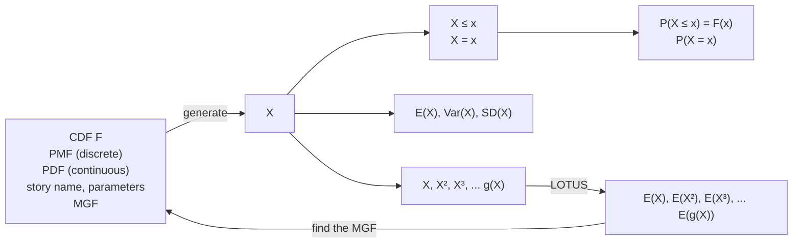

# 6: Moments

原始 PDF 第 284–319 页。

## Moments

The nth moment of an r.v. X is $E ( X ^ { n } )$ . In this chapter, we explore how the moments of an r.v. shed light on its distribution. We have already seen that the first two moments are useful since they provide the mean $E ( X )$ and variance $E ( X ^ { 2 } ) - ( E X ) ^ { 2 }$ which are important summaries of the average value of X and how spread out its distribution is. But there is much more to a distribution than its mean and variance. We’ll see that the third and fourth moments tell us about the asymmetry of a distribution and the behavior of the tails or extreme values, two properties that are not captured by the mean and variance. After introducing moments, we’ll discuss the moment generating function (MGF), which not only helps us compute moments but also provides a useful alternative way to specify a distribution.

## 6.1 Summaries of a distribution

The mean is called a measure of central tendency because it tells us something about the center of a distribution, specifically its center of mass. Other measures of central tendency that are commonly used in statistics are the median and the mode, which we now define.

Definition 6.1.1 (Median). We say that c is a median of a random variable X if $P ( X \leq c ) \geq 1 / 2$ and $P ( X \geq c ) \geq 1 / 2$ . (The simplest way this can happen is if the CDF of X hits 1/2 exactly at $c _ { \gamma }$ but we know that some CDFs have jumps.)

Definition 6.1.2 (Mode). For a discrete r.v. X, we say that c is a mode of X if it maximizes the PMF: $P(X = c) \geq P(X = x)$ for all x. For a continuous r.v. X with PDF $f ,$ we say that c is a mode if it maximizes the PDF: $f ( c ) \geq f ( x )$ for all x.

As with the mean, the median and mode of an r.v. depend only on its distribution, so we can talk about the mean, median, or mode of a distribution without referring to any particular r.v. that has that distribution. For example, if $Z \sim \mathcal { N } ( 0 , 1 )$ then the median of $Z$ is 0 (since $\Phi ( 0 )   =   1 / 2$ by symmetry), and we also say that the standard Normal distribution has median 0.

Intuitively, the median is a value c such that half the mass of the distribution falls on either side of c (or as close to half as possible, for discrete r.v.s), and the mode is a value that has the greatest mass or density out of all values in the support of

267

---

268

Introduction to Probability

X. If the CDF F is a continuous, strictly increasing function, then $F ^ { - 1 } ( 1 / 2 )$ is the median (and is unique).

Note that a distribution can have multiple medians and multiple modes. Medians have to occur side by side; modes can occur all over the distribution. In Figure 6.1, we show a distribution supported on $[ - 5 , - 1 ] \cup [ 1 , 5 ]$ that has two modes and infinitely many medians. The PDF is 0 between −1 and 1, so all values between −1 and 1 are medians of the distribution because half of the mass falls on either side. The two modes are at −3 and 3.


<details>
<summary>line</summary>

| X | PDF |
| --- | --- |
| -5 | ~0.00 |
| -4 | ~0.12 |
| -3 | 0.40 |
| -2 | ~0.08 |
| -1 | ~0.00 |
| 0 | ~0.00 |
| 1 | ~0.00 |
| 2 | ~0.12 |
| 3 | 0.40 |
| 4 | ~0.12 |
| 5 | ~0.00 |
</details>

## FIGURE 6.1

A distribution with two modes (−3 and 3) and infinitely many medians (all x in the interval [−1, 1]).

Example 6.1.3 (Mean, median, and mode for salaries). A certain company has 100 employees. Let $s _ { 1 } , s _ { 2 } , \ldots , s _ { 1 0 0 }$ be their salaries, sorted in increasing order (we can still do this even if some salaries appear more than once). Let X be the salary of a randomly selected employee (chosen uniformly). The mean, median, and mode for the data set $s _ { 1 } , s _ { 2 } , \ldots , s _ { 1 0 0 }$ are defined to be the corresponding quantities for X.

What is a typical salary? What is the most useful one-number summary of the salary data? The answer, as is often the case, is it depends on the goal. Different summaries reveal different characteristics of the data, so it may be hard to choose just one number—and it is often unnecessary to do so, since usually we can provide several summaries (and plot the data too). Here we briefly compare the mean, median, and mode, though often it makes sense to report all three (and other summaries too).

If the salaries are all different, the mode doesn’t give a useful one-number summary since there are 100 modes. If there are only a few possible salaries in the company, the mode becomes more useful. But even then it could happen that, for example, 34 people receive salary a, 33 receive salary b, and 33 receive salary c. Then a is

---

Moments

269

the unique mode, but if we only report a we are ignoring b and $c _ { \gamma }$ which just barely missed being modes and which together account for almost $2 / 3$ of the data.

Next, let’s consider the median. There are two numbers $\mathrm { { ^ { \circ } i n } }$ the $\mathrm { m i d d l e  , ~ } s _ { 5 0 }$ and $s _ { 5 1 }$ . In fact, any number $m$ with $s _ { 5 0 } \leq m \leq s _ { 5 1 }$ is a median, since there is at least a 50% chance that the random employee’s salary is in $\{ s _ { 1 } , \ldots , s _ { 5 0 } \}$ (in which case it is at most $m )$ and at least a 50% chance that it is in $\{ s _ { 5 1 } , \ldots , s _ { 1 0 0 } \}$ (in which case it is at least $m )$ . The usual convention is to choose $m   =   ( s _ { 5 0 }   +   s _ { 5 1 } ) / 2$ , the mean of the two numbers in the middle. If the number of employees had been odd, this issue would not have come up; in that case, there is a unique median, the number in the middle when all the salaries are listed in increasing order.

Compared with the mean, the median is much less sensitive to extreme values. For example, if the $\mathrm { C E O ^ { \circ } s }$ salary is changed from being slightly more than anyone else’s to vastly more than anyone else’s, that could have a large impact on the mean but it has no impact on the median. This robustness is a reason that the median could be a more sensible summary than the mean of what the typical salary is. On the other hand, suppose that we want to know the total cost the company is paying for its employees’ salaries. If we only know a mode or a median, we can’t extract this information, but if we know the mean we can just multiply it by 100. 

Suppose that we are trying to guess what a not-yet-observed r.v. X will be, by making a prediction $c .$ The mean and the median both seem like natural guesses for $c _ { \gamma }$ but which is better? That depends on how “better” is defined. Two natural ways to judge how good c is are the mean squared error $E ( X - c ) ^ { 2 }$ and the mean absolute error $E | X - c |$ . The following result says what the best guesses are in both cases.

Theorem 6.1.4. Let X be an r.v. with mean $\mu ,$ and let m be a median of $X$ .

• The value of $c$ that minimizes the mean squared error $E ( X - c ) ^ { 2 } { \mathrm { ~ i s ~ } } c = \mu .$
• A value of $c$ that minimizes the mean absolute error $E | X - c |   is   c = m$

Proof. We will first prove a useful identity:

$$
E (X - c) ^ {2} = \mathrm{Var} (X) + (\mu - c) ^ {2}.
$$

This can be checked by expanding everything out, but a faster way is to use the fact that adding a constant doesn’t affect the variance:

$$
\operatorname{Var} (X) = \operatorname{Var} (X - c) = E (X - c) ^ {2} - (E (X - c)) ^ {2} = E (X - c) ^ {2} - (\mu - c) ^ {2}.
$$

It follows that $c   =   \mu$ is the unique choice that minimizes $E ( X - c ) ^ { 2 }$ , since that choice makes $( \mu - c ) ^ { 2 } = 0$ and any other choice makes $( \mu - c ) ^ { 2 } > 0$

Next, let’s consider the mean absolute error. Let $a \neq m$ . We need to show that $E | X - m | \leq E | X - a |$ , which is equivalent to $E ( | X - a | - | X - m | ) \geq 0$ . Assume that $m < a$ (the case $m > a$ can be handled similarly). If $X \leq m$ then

$$
| X - a | - | X - m | = a - X - (m - X) = a - m,
$$

---

270

Introduction to Probability

and if $X > m$ then

$$
| X - a | - | X - m | \geq X - a - (X - m) = m - a.
$$

Let

$$
Y = | X - a | - | X - m |.
$$

We can split the definition of $E ( Y )$ into 2 parts based on whether $X \leq m$ occurs, using indicator r.v.s. Let I be the indicator r.v. for $X \leq m$ , so $1 - I$ is the indicator r.v. for $X > m$ . Then

$$
\begin{array}{l} E (Y) = E (Y I) + E (Y (1 - I)) \\ \geq (a - m) E (I) + (m - a) E (1 - I) \\ = (a - m) P (X \leq m) + (m - a) P (X > m) \\ = (a - m) P (X \leq m) - (a - m) (1 - P (X \leq m)) \\ = (a - m) (2 P (X \leq m) - 1). \\ \end{array}
$$

By definition of median, we have $2 P ( X   \leq   m ) - 1   \geq   0$ . Thus, $E ( Y )   \geq   0 ,$ which implies $E ( | X - m | ) \leq E ( | X - a | )$ 


<details>
<summary>violin</summary>

| x | PDF (Black Line) | PDF (Grey Line) |
| --- | --- | --- |
| -5 | 0 | ~0.01 |
| 0 | 0 | ~0.10 |
| 0.2 | ~0.68 | ~0.11 |
| 2.5 | ~0.12 | ~0.12 |
| 5 | ~0.03 | ~0.09 |
| 10 | 0 | ~0.02 |
</details>

## FIGURE 6.2

Two PDFs with mean 2 and variance 12. The light curve is Normal and symmetric; the dark curve is Log-Normal and right-skewed.

Regardless of which measure of central tendency we use in a particular application, it is usually important also to know about the spread of the distribution as measured by, for example, the variance. However, there are also major features of a distribution that are not captured by the mean and variance. For example, the two PDFs in Figure 6.2 both have mean 2 and variance 12. The light curve is the $\mathcal { N } ( 2 , 1 2 )$ PDF and the dark curve belongs to the Log-Normal family of distributions (the Log-Normal is defined later in this chapter). The Normal curve is symmetric about 2, so

---

Moments

271

its mean, median, and mode are all 2. In contrast, the Log-Normal is heavily skewed to the right; this means its right tail is very long compared to its left tail. It has mean 2, but median 1 and mode 0.25. From the mean and variance alone, we would not be able to capture the difference between the asymmetry of the Log-Normal and the symmetry of the Normal.

Now consider Figure 6.3, which shows the PMF of a $\mathrm { B i n } ( 1 0 , 0 . 9 )$ r.v. on the left and the PMF of 8 plus a Bin(10, 0.1) r.v. on the right. Both of these distributions have mean, median, and mode equal to 9 and variance equal to 0.9, but they look drastically different. We say that the PMF on the left is left-skewed and the PMF on the right is right-skewed. In this chapter we’ll learn that a standard measure of the asymmetry of a distribution is based on the third moment.


FIGURE 6.3

Left: Bin(10, 0.9) is left-skewed. Right: Bin(10, 0.1), shifted to the right by 8, is right-skewed but has the same mean, median, mode, and variance as Bin(10, 0.9).

The previous two examples considered asymmetric distributions, but symmetric distributions with the same mean and variance can also look very different. The left plot in Figure 6.4 shows two symmetric PDFs with mean 0 and variance 1. The light curve is the $\mathcal { N } ( 0 , 1 )$ PDF and the dark curve is the t<sub>3</sub> PDF, scaling it to have variance 1 (we’ll define the $t _ { 3 }$ distribution in Chapter 10). The dark curve has a sharper peak and heavier tails than the light curve. The tail behavior is magnified in the right plot, where it is easy to see that the dark curve decays to 0 much more gradually, making outcomes far out in the tail much more likely than for the light curve. As we’ll learn in this chapter, a standard measure of the heaviness of the tails of a distribution is based on the fourth moment.

In the next section, we will go into further detail of how to interpret moments, especially the first four moments.

---

272

Introduction to Probability


## FIGURE 6.4

Left: $\mathcal { N } ( 0 , 1 )$ PDF (light) and a scaled $t _ { 3 }$ PDF (dark). Both have mean 0 and variance 1, but the latter has a sharper peak and heavier tails. Right: magnified version of right tail behavior.

## 6.2 Interpreting moments

Definition 6.2.1 (Kinds of moments). Let X be an r.v. with mean µ and variance $\sigma ^ { 2 }$ . For any positive integer n, the nth moment of X is $E ( X ^ { n } )$ , the nth central moment is $E ( ( X   -   \mu ) ^ { n } )$ , and the nth standardized moment is $\hat { E } ( \left( \textstyle \frac { X - \mu } { \sigma } \right) ^ { n } )$ . Throughout the previous sentence, “if it exists” is left implicit.

In particular, the mean is the first moment and the variance is the second central moment. The term moment is borrowed from physics. Let X be a discrete r.v. with distinct possible values $x _ { 1 } , \ldots , x _ { n }$ , and imagine a pebble with mass $m _ { j } = P ( X = x _ { j } )$ positioned at $x _ { j }$ on a number line, for each j (as illustrated in Figure 6.5). In physics,

$$
E (X) = \sum_ {j = 1} ^ {n} m _ {j} x _ {j}
$$

is called the center of mass of the system, and

$$
\mathrm{Var} (X) = \sum_ {j = 1} ^ {n} m _ {j} (x _ {j} - E (X)) ^ {2}
$$

is called the moment of inertia about the center of mass.

We’ll now define skewness, a single-number summary of asymmetry which, as alluded to earlier, is based on the third moment. In fact, skewness is defined to be the third standardized moment.

---

Moments

273


<details>
<summary>text_image</summary>

m₁
x₁
m₂
x₂
E(X)
m₃
x₃
m₄
x₄
m₅
x₅
</details>

## FIGURE 6.5

Physics interpretation of moments. The mean (first moment) of an $\mathbf { r } . \mathbf { V } .$ corresponds to the center of mass of a collection of pebbles, and the variance (second central moment) corresponds to the moment of inertia about the center of mass.

Definition 6.2.2 (Skewness). The skewness of an r.v. X with mean $\mu$ and variance $\sigma ^ { 2 }$ is the third standardized moment of $X$ :

$$
\operatorname{Skew} (X) = E \left(\frac {X - \mu}{\sigma}\right) ^ {3}.
$$

By standardizing first, we make the definition of Skew(X) not depend on the location or the scale of $X$ , which is reasonable since we already have $\mu$ and $\sigma$ to provide information about location and scale. Also, standardizing first gives the nice property that the units in which $X$ is measured $( \mathrm { e . g . }$ , inches vs. meters) will not affect the skewness.

To understand how skewness measures asymmetry, we first need to discuss what it means for an r.v. to be symmetric.

Definition 6.2.3 (Symmetry of an $\mathrm { r . v . ) }$ . We say that an $\mathbf { r } . \mathbf { V }$ . X has a symmetric distribution about $\mu$ if $X - \mu$ has the same distribution as $\mu - X$ . We also say that X is symmetric or that the distribution of X is symmetric; these all have the same meaning.

The number $\mu$ in the above definition must be $E ( X )$ if the mean exists, since

$$
E (X) - \mu = E (X - \mu) = E (\mu - X) = \mu - E (X)
$$

simplifies to $E ( X ) = \mu$ . Because of this, it is common to say $^ { \circ } X$ is symmetric” as shorthand for $^ { \circ } X$ is symmetric about its mean” (if the mean exists). The number $\mu$ is also a median of the distribution, since if $X - \mu$ has the same distribution as $\mu - X$ , then

$$
P (X - \mu \leq 0) = P (\mu - X \leq 0),
$$

so

$$
P (X \leq \mu) = P (X \geq \mu),
$$

which implies that

$$
P (X \leq \mu) = 1 - P (X > \mu) \geq 1 - P (X \geq \mu) = 1 - P (X \leq \mu),
$$

showing that $P ( X \leq \mu ) \geq 1 / 2$ and $P ( X \geq \mu ) \geq 1 / 2$

---

274

Introduction to Probability

h 6.2.4. Sometimes people say $^ { \circ } X$ is symmetric” to mean $^ { \circ } X$ is symmetric about $0 ^ { \circ }$ . Note that if X is symmetric about $\mu ,$ then $X   -   \mu$ is symmetric about 0. Symmetry about 0 is especially convenient since then $- X$ and X have the same distribution, and the PDF of X (if X is continuous) is an even function, as shown below.

Intuitively, symmetry means that the PDF of X to the left of $\mu$ is the mirror image of the PDF of X to the right of $\mu$ (for X continuous, and the same holds for the PMF if X is discrete). For example, we have seen before that $X   \sim   \mathcal { N } ( \mu , \sigma ^ { 2 } )$ is symmetric; in terms of the definition, this is because $X - \mu$ and $\mu - X$ are both $\mathcal { N } ( 0 , \sigma ^ { 2 } )$ . We have also seen from Corollary 3.3.8 that $X \sim \operatorname { B i n } ( n , p )$ is symmetric when $p = 1 / 2$

We can also give an algebraic description of what the PDF of a symmetric continuous r.v. looks like.

Proposition 6.2.5 (Symmetry in terms of the PDF). Let X be a continuous r.v. with PDF $f .$ Then X is symmetric about $\mu$ if and only if $f(x) = f(2\mu - x)$ for all $x .$ .

Proof. Let $F$ be the CDF of X. If symmetry holds, we have

$$
F (x) = P (X - \mu \leq x - \mu) = P (\mu - X \leq x - \mu) = P (X \geq 2 \mu - x) = 1 - F (2 \mu - x).
$$

Taking the derivative of both sides yields $f ( x )   =   f ( 2 \mu - x )$ . Conversely, suppose that $f(x) = f(2\mu - x)$ holds for all x. Integrating both sides, we have

$$
P (X - \mu \leq t) = P (X \leq \mu + t) = \int_ {- \infty} ^ {\mu + t} f (x) d x = \int_ {- \infty} ^ {\mu + t} f (2 \mu - x) d x,
$$

which, after the substitution $w = 2 \mu - x$ , becomes

$$
\int_ {\mu - t} ^ {\infty} f (w) d w = P (X \geq \mu - t) = P (\mu - X \leq t).
$$

Odd central moments give some] information about symmetry.

Proposition 6.2.6 (Odd central moments of a symmetric distribution). Let X be symmetric about its mean $\mu .$ Then for any odd number $m ,$ the mth central moment $E ( X - \mu ) ^ { m }$ is 0 if it exists.

Proof. Since $X - \mu$ has the same distribution as $\mu - X$ , they have the same mth moment (if it exists):

$$
E (X - \mu) ^ {m} = E (\mu - X) ^ {m}.
$$

Let $Y = ( X - \mu ) ^ { m }$ . Then $( \mu - X ) ^ { m } = ( - ( X - \mu ) ) ^ { m } = ( - 1 ) ^ { m } Y = - Y$ , so the above equation just says $E(Y) = -E(Y)$ . So $E ( Y ) = 0$ 

---

Moments

275

This leads us to consider using an odd standardized moment as a measure of the skew of a distribution. The first standardized moment is always 0, so the third standardized moment is taken as the definition of skewness. Positive skewness is indicative of having a long right tail relative to the left tail, and negative skewness is indicative of the reverse. (The converse of the above proposition is false, though: there exist asymmetric distributions whose odd central moments are all 0.)

Why not use, say, the fifth standardized moment instead of the third? One reason is that the third standardized moment is usually easier to calculate. Another reason is that we may want to estimate skewness from a data set. It is usually easier to estimate lower moments than higher moments in a stable way since, for example, a large, noisy observation will have a very large, very noisy fifth power. Nevertheless, just as the mean isn’t the only useful notion of average and the variance isn’t the only useful notion of spread, the third standardized moment isn’t the only useful notion of skew.

Another important descriptive feature of a distribution is how heavy its tails are. For a given variance, is the variability explained more by a few rare (extreme) events or by a moderate number of moderate deviations from the mean? This is an important consideration for risk management in finance: for many financial assets, the distribution of returns has a heavy left tail caused by rare but severe crisis events, and failure to account for these rare events can have disastrous consequences, as demonstrated by the 2008 financial crisis.

As with measuring skew, no single measure can perfectly capture the tail behavior, but there is a widely used summary based on the fourth standardized moment.

Definition 6.2.7 (Kurtosis). The kurtosis of an r.v. X with mean $\mu$ and variance $\sigma ^ { 2 }$ is a shifted version of the fourth standardized moment of X:

$$
\operatorname{Kurt} (X) = E \left(\frac {X - \mu}{\sigma}\right) ^ {4} - 3.
$$

h 6.2.8. The reason for subtracting 3 is that this makes any Normal distribution have kurtosis 0 (as shown in Section 6.5). This provides a convenient basis for comparison. However, some sources define the kurtosis without the 3, in which case they call our version “excess kurtosis”.

Figure 6.6 shows three named distributions and lists the skewness and kurtosis of each. The Expo(1) and Pois(4) distributions (left and middle) both have positive skewness and positive kurtosis, indicating that they are right-skewed and their tails are heavier than those of a Normal distribution. The $\mathrm { U n i f } ( 0 , 1 )$ distribution (right) has zero skewness and negative kurtosis: zero skewness because the distribution is symmetric about its mean, and negative kurtosis because it has no tails!

---

276

Introduction to Probability


## FIGURE 6.6

Skewness and kurtosis of some named distributions. Left: Expo(1) PDF, skewness = 2, kurtosis = 6. Middle: Pois(4) PMF, skewness = 0.5, kurtosis = 0.25. Right: Unif(0, 1) PDF, skewness = 0, kurtosis = −1.2.

## 6.3 Sample moments

In statistical inference, a central problem is how to use data to estimate unknown parameters of a distribution, or functions of unknown parameters. It is especially common to want to estimate the mean and variance of a distribution. If the data are i.i.d. random variables $X _ { 1 } , \ldots , X _ { n }$ where the mean $E ( X _ { j } )$ is unknown, then the most obvious way to estimate the mean is simply to average the $X _ { j }$ , taking the arithmetic mean.

For example, if the observed data are 3, 1, 1, 5, then a simple, natural way to estimate the mean of the distribution that generated the data is to use $( 3   +   1   +   1   +   5 ) / 4 = 2 . 5$ This is called the sample mean. Similarly, if we want to estimate the second moment of the distribution that generated the data 3, 1, 1, 5, then a simple, natural way is to use $( 3 ^ { 2 } + 1 ^ { 2 } + 1 ^ { 2 } + 5 ^ { 2 } ) / \dot { 4 } = 9$ . This is called the sample second moment. In general, sample moments are defined as follows.

Definition 6.3.1 (Sample moments). Let $X _ { 1 } , \ldots , X _ { n }$ be i.i.d. random variables. The kth sample moment is the r.v.

$$
M _ {k} = \frac {1}{n} \sum_ {j = 1} ^ {n} X _ {j} ^ {k}.
$$

The sample mean ${ \bar { X } } _ { n }$ is the first sample moment:

$$
\bar {X} _ {n} = \frac {1}{n} \sum_ {j = 1} ^ {n} X _ {j}.
$$

In contrast, the population mean or true mean is $E ( X _ { j } )$ , the mean of the distribution from which the $X _ { j }$ were drawn.

---

Moments

277

The law of large numbers, which we prove in Chapter 10, shows that the kth sample moment of i.i.d. random variables $X _ { 1 } , \ldots , X _ { n }$ converges to the kth moment $E ( X _ { 1 } ^ { k } )$ as $n \to \infty$ . Also, the expected value of the kth sample moment is the kth moment. In statistical terms, we say that the kth sample moment is unbiased for estimating the kth moment. It is easy to check this by linearity:

$$
E \left(\frac {1}{n} \sum_ {j = 1} ^ {n} X _ {j} ^ {k}\right) = \frac {1}{n} \left(E (X _ {1} ^ {k}) + \dots + E (X _ {n} ^ {k})\right) = E (X _ {1} ^ {k}).
$$

The mean and variance of the sample mean are often needed, and have nice expressions that are often needed in statistics.

Theorem 6.3.2 (Mean and variance of sample mean). Let $X _ { 1 } , \ldots , X _ { n }$ be i.i.d. r.v.s with mean $\mu$ and variance $\sigma ^ { 2 }$ . Then the sample mean ${ \bar { X } } _ { n }$ is unbiased for estimating $\mu .$ That is,

$$
E (\bar {X} _ {n}) = \mu .
$$

The variance of ${ \bar { X } } _ { n }$ is given by

$$
\mathrm{Var} (\bar {X} _ {n}) = \frac {\sigma^ {2}}{n}.
$$

Proof. We have $E ( { \bar { X } } _ { n } )   =   \mu$ since we showed above that the kth sample moment is unbiased for estimating the kth moment. For the variance, we will use the fact (shown in the next chapter) that the variance of the sum of independent r.v.s is the sum of the variances:

$$
\mathrm{Var} (\bar {X} _ {n}) = \frac {1}{n ^ {2}} \mathrm{Var} (X _ {1} + \dots + X _ {n}) = \frac {n}{n ^ {2}} \mathrm{Var} (X _ {1}) = \frac {\sigma^ {2}}{n}.
$$

For estimating the variance of the distribution of i.i.d. r.v.s $X _ { 1 } , \ldots , X _ { n } ,$ a natural approach building on the above concepts is to mimic the formula $\operatorname { V a r } ( X ) = E ( X ^ { 2 } ) -$ $( E X ) ^ { 2 }$ by taking the second sample moment and subtracting the square of the sample mean. There are advantages to this method, but a more common method is as follows.

Definition 6.3.3 (Sample variance and sample standard deviation). Let $X _ { 1 } , \ldots , X _ { n }$ be i.i.d. random variables. The sample variance is the r.v.

$$
S _ {n} ^ {2} = \frac {1}{n - 1} \sum_ {j = 1} ^ {n} (X _ {j} - \bar {X} _ {n}) ^ {2}.
$$

The sample standard deviation is the square root of the sample variance.

The idea of the above definition is to mimic the formula $\operatorname { V a r } ( X ) = E ( X   -   E ( X ) ) ^ { 2 }$ by averaging the squared distances of the $X _ { j }$ from the sample mean, except with $n - 1$ rather than $n$ in the denominator. The motivation for the $n - 1$ is that this makes

---

278

Introduction to Probability

the sample variance $S _ { n } ^ { 2 }$ unbiased for estimating $\sigma ^ { 2 } , \; \mathrm { i . e . }$ , it is correct on average. However, the sample standard deviation $S _ { n }$ is not unbiased for estimating $\sigma ;$ we will see in Chapter 10 which way the inequality goes. In any case, unbiasedness is only one of several criteria by which to judge an estimation procedure. For example, in some problems we can get a lower mean squared error in return for allowing a little bit of bias, and this tradeoff may be worthwhile.

Theorem 6.3.4 (Unbiasedness of sample variance). Let $X _ { 1 } , \ldots , X _ { n }$ be i.i.d. r.v.s with mean $\mu$ and variance $\sigma ^ { 2 }$ . Then the sample variance $S _ { n } ^ { 2 }$ is unbiased for estimating $\sigma ^ { 2 }$ , i.e.,

$$
E (S _ {n} ^ {2}) = \sigma^ {2}.
$$

Proof. The key to the proof is the handy identity

$$
\sum_ {j = 1} ^ {n} (X _ {j} - c) ^ {2} = \sum_ {j = 1} ^ {n} (X _ {j} - \bar {X} _ {n}) ^ {2} + n (\bar {X} _ {n} - c) ^ {2},
$$

which holds for all $c .$ To verify the identity, add and subtract ${ \bar { X } } _ { n }$ in the left-hand sum:

$$
\begin{array}{l} \sum_ {j = 1} ^ {n} (X _ {j} - c) ^ {2} = \sum_ {j = 1} ^ {n} \left((X _ {j} - \bar {X} _ {n}) + (\bar {X} _ {n} - c)\right) ^ {2} \\ = \sum_ {j = 1} ^ {n} (X _ {j} - \bar {X} _ {n}) ^ {2} + 2 \sum_ {j = 1} ^ {n} (X _ {j} - \bar {X} _ {n}) (\bar {X} _ {n} - c) + \sum_ {j = 1} ^ {n} (\bar {X} _ {n} - c) ^ {2} \\ = \sum_ {j = 1} ^ {n} (X _ {j} - \bar {X} _ {n}) ^ {2} + n (\bar {X} _ {n} - c) ^ {2}. \\ \end{array}
$$

For the last line, we used the fact that $\bar { X } _ { n } - c$ does not depend on $j$ and the fact that

$$
\sum_ {j = 1} ^ {n} (X _ {j} - \bar {X} _ {n}) = \sum_ {j = 1} ^ {n} X _ {j} - \sum_ {j = 1} ^ {n} \bar {X} _ {n} = n \bar {X} _ {n} - n \bar {X} _ {n} = 0.
$$

Now let us apply the identity, choosing $c = \mu$ . Taking the expectation of both sides,

$$
n E (X _ {1} - \mu) ^ {2} = E \left(\sum_ {j = 1} ^ {n} (X _ {j} - \bar {X} _ {n}) ^ {2}\right) + n E (\bar {X} _ {n} - \mu) ^ {2}.
$$

By definition of variance, $E ( X _ { 1 } - \mu ) ^ { 2 } = \operatorname { V a r } ( X _ { 1 } ) = \sigma ^ { 2 }$ , and $E ( \bar { X } _ { n } - \mu ) ^ { 2 } = \operatorname { V a r } ( \bar { X } _ { n } ) =$ $\sigma ^ { 2 } / n$ . Plugging these results in above and simplifying, we have $E ( S _ { n } ^ { 2 } ) = \sigma ^ { 2 }$ 

Similarly, we can define the sample skewness to be

$$
\frac {\frac {1}{n} \sum_ {j = 1} ^ {n} (X _ {j} - \bar {X} _ {n}) ^ {3}}{S _ {n} ^ {3}},
$$

---

Moments

279

and the sample kurtosis to be

$$
\frac {\frac {1}{n} \sum_ {j = 1} ^ {n} (X _ {j} - \bar {X} _ {n}) ^ {4}}{S _ {n} ^ {4}} - 3.
$$

Beyond the fourth moment, it rapidly gets harder to interpret moments graphically and harder to estimate them well from data if they are unknown. However, in the rest of this chapter we will see that it can still be useful to know all the moments of a distribution. We will also study a way of computing moments that is often easier than LOTUS. Both the usefulness and the computation of moments are closely connected to a blueprint called the moment generating function, to which we devote most of the rest of this chapter.

## 6.4 Moment generating functions

A generating function is a clothesline on which we hang up a sequence of numbers for display. – Herbert Wilf [28]

Generating functions are a powerful tool in combinatorics and probability, bridging between sequences of numbers and the world of calculus. In probability, they are useful for studying both discrete and continuous distributions. The general idea behind a generating function is as follows: starting with a sequence of numbers, create a continuous function—the generating function—that encodes the sequence. We then have all the tools of calculus at our disposal for manipulating the generating function.

A moment generating function, as its name suggests, is a generating function that encodes the moments of a distribution. Here is the definition, followed by a few examples.

Definition 6.4.1 (Moment generating function). The moment generating function (MGF) of an r.v. X is $M ( t ) = E ( e ^ { t X } )$ , as a function of $t ,$ if this is finite on some open interval $( - a , a )$ containing 0. Otherwise we say the MGF of X does not exist.

A natural question at this point is “What is the interpretation of $t ? ^ { \flat \flat }$ The answer is that t has no interpretation in particular; it’s just a bookkeeping device that we introduce in order to be able to use calculus instead of working with a discrete sequence of moments.

Note that $M ( 0 ) = 1$ for any valid MGF $M ;$ whenever you compute an MGF, plug in 0 and see if you get 1, as a quick check!

Example 6.4.2 (Bernoulli MGF). For $X \sim \operatorname { B e r n } ( p ) ,   e ^ { t X }$ takes on the value $e ^ { t }$ with probability $p$ and the value 1 with probability $q ,$ so $M ( t ) = E ( e ^ { t X } ) = p e ^ { t } + q$ . Since this is finite for all values of $t ,$ the MGF is defined on the entire real line. 

---

280

Introduction to Probability

Example 6.4.3 (Geometric MGF). For $X \sim \operatorname { G e o m } ( p )$

$$
M (t) = E (e ^ {t X}) = \sum_ {k = 0} ^ {\infty} e ^ {t k} q ^ {k} p = p \sum_ {k = 0} ^ {\infty} (q e ^ {t}) ^ {k} = \frac {p}{1 - q e ^ {t}}
$$

for $q e ^ { t } < 1$ , i.e., for t in $( - \infty , \log ( 1 / q ) )$ , which is an open interval containing 0. 

Example 6.4.4 (Uniform MGF). Let $U \sim \operatorname { U n i f } ( a , b )$ . Then the MGF of U is

$$
M (t) = E (e ^ {t U}) = \frac {1}{b - a} \int_ {a} ^ {b} e ^ {t u} d u = \frac {e ^ {t b} - e ^ {t a}}{t (b - a)}
$$

for $t \neq 0$ , and $M ( 0 ) = 1$

The next three theorems give three reasons why the MGF is important. First, the MGF encodes the moments of an r.v. Second, the MGF of an r.v. determines its distribution, like the CDF and PMF/PDF. Third, MGFs make it easy to find the distribution of a sum of independent r.v.s. Let’s take these one by one.

Theorem 6.4.5 (Moments via derivatives of the MGF). Given the MGF of X, we can get the nth moment of X by evaluating the nth derivative of the MGF at 0: $E ( X ^ { n } ) = M ^ { ( n ) } ( 0 )$

Proof. This can be seen by noting that the Taylor expansion of $M ( t )$ about 0 is

$$
M (t) = \sum_ {n = 0} ^ {\infty} M ^ {(n)} (0) \frac {t ^ {n}}{n !},
$$

while on the other hand, we also have

$$
M (t) = E (e ^ {t X}) = E \left(\sum_ {n = 0} ^ {\infty} X ^ {n} \frac {t ^ {n}}{n !}\right).
$$

We are allowed to interchange the expectation and the infinite sum because certain technical conditions are satisfied (this is where we invoke the condition that $E ( e ^ { t X } )$ is finite in an interval around 0), so

$$
M (t) = \sum_ {n = 0} ^ {\infty} E (X ^ {n}) \frac {t ^ {n}}{n !}.
$$

Matching the coefficients of the two expansions, we get $E ( X ^ { n } ) = M ^ { ( n ) } ( 0 )$

The above theorem is surprising in that for a continuous r.v. X, to compute moments would seemingly require doing integrals with LOTUS, but with the MGF it is possible to find moments by taking derivatives rather than doing integrals!

Theorem 6.4.6 (MGF determines the distribution). The MGF of a random variable determines its distribution: if two r.v.s have the same MGF, they must have the same distribution. In fact, if there is even a tiny interval $( - a , a )$ containing 0 on which the MGFs are equal, then the r.v.s must have the same distribution.

---

Moments

281

The above theorem is a difficult result in analysis, so we will not prove it here.

Theorem 6.4.7 (MGF of a sum of independent $\mathrm { r . v . s ) }$ . If X and $Y$ are independent, then the MGF of $X + Y$ is the product of the individual MGFs:

$$
M _ {X + Y} (t) = M _ {X} (t) M _ {Y} (t).
$$

This is true because if X and Y are independent, then $E(e^{t(X+Y)}) = E(e^{tX})E(e^{tY})$ (this follows from results discussed in Chapter 7). Using this fact, we can get the MGFs of the Binomial and Negative Binomial, which are sums of independent Bernoullis and Geometrics, respectively.

Example 6.4.8 (Binomial MGF). The MGF of a Bern(p) r.v. is $p e ^ { t } + q ,$ so the MGF of a Bin $( n , p )$ r.v. is

$$
M (t) = (p e ^ {t} + q) ^ {n}.
$$


<details>
<summary>line</summary>

| t | MGF |
| --- | --- |
| -1.0 | ~0.5 |
| -0.5 | ~0.7 |
| 0.0 | ~1.0 |
| 0.5 | ~1.8 |
| 1.0 | ~3.5 |
</details>

## FIGURE 6.7

Bin $( 2 , 1 / 2 )$ MGF, $\begin{array} { r } { M ( t ) = \left( \frac { 1 } { 2 } e ^ { t } + \frac { 1 } { 2 } \right) ^ { 2 } } \end{array}$ . The slope of the MGF at $t = 0$ is 1, so the mean of the distribution is 1. The concavity or second derivative of the MGF at $t = 0   is   3/2$ , so the second moment of the distribution is $3 / 2$

Figure 6.7 plots the MGF of the $\mathrm { B i n } ( 2 , 1 / 2 )$ distribution, $\begin{array} { r } { M ( t )   =   \left( \frac { 1 } { 2 } e ^ { t } + \frac { 1 } { 2 } \right) ^ { 2 } } \end{array}$ , between $t = - 1$ and $t = 1$ . As with all MGFs, the value of the MGF is 1 at $t = 0$ . The first and second moments of the distribution are the first and second derivatives of the MGF, evaluated at $t = 0$ ; these correspond to the slope and concavity of the plotted curve at $t = 0$ . These two derivatives are 1 and $3 / 2$ , corresponding to the fact that the Bin $\left| ( 2 , 1 / 2 ) \right.$ distribution has mean 1 and variance $3 / 2 - 1 ^ { 2 } = 1 / 2$ 

Example 6.4.9 (Negative Binomial MGF). We know the MGF of a Geom(p) r.v. is $\frac { p } { 1 { - } q e ^ { t } }$ for $q e ^ { t } < 1$ , so the MGF of $X \sim \mathrm { N B i n } ( r , p )$ is

$$
M (t) = \left(\frac {p}{1 - q e ^ {t}}\right) ^ {r}, \text {for} q e ^ {t} <   1.
$$


---

282

Introduction to Probability

h 6.4.10. Not all $\mathbf { r } . \mathbf { v } . \mathbf { S }$ have an MGF. Some r.v.s X don’t even have $E ( X )$ exist, or don’t have $E ( X ^ { n } )$ exist for some $n > 1$ , in which case the MGF clearly will not exist. But even if all the moments of X exist, the MGF may not exist if the moments grow too quickly. Luckily, there is a way to fix this: inserting an imaginary number! The function $\psi ( t )   =   E ( e ^ { i t X } )$ with $i   =   \sqrt { - 1 }$ is called the characteristic function by statisticians and the Fourier transform by everyone else. It turns out that the characteristic function always exists. In this book we will focus on the MGF rather than the characteristic function, to avoid having to handle imaginary numbers.

As we saw in the previous chapter, location and scale transformations are a fundamental way to build a family of distributions from an initial distribution. For example, starting with $Z   \sim   \mathcal { N } ( 0 , 1 )$ , we can scale by $\sigma$ and shift by $\mu$ to obtain $X = \mu + \sigma Z \sim \mathcal { N } ( \mu , \sigma ^ { 2 } )$ . In general, if we have an r.v. X with mean $\mu$ and standard deviation $\sigma > 0$ , we can create the standardized version $( X - \mu ) / \sigma$ , and vice versa. Conveniently, it is easy to relate the MGFs of two r.v.s connected by such a transformation.

Proposition 6.4.11 (MGF of location-scale transformation). If X has MGF $M ( t )$ then the MGF of $a + b X$ is

$$
E (e ^ {t (a + b X)}) = e ^ {a t} E (e ^ {b t X}) = e ^ {a t} M (b t).
$$

For example, let’s use this proposition to help obtain the MGFs of the Normal and Exponential distributions.

Example 6.4.12 (Normal MGF). The MGF of a standard Normal r.v. Z is

$$
M _ {Z} (t) = E (e ^ {t Z}) = \int_ {- \infty} ^ {\infty} e ^ {t z} \frac {1}{\sqrt {2 \pi}} e ^ {- z ^ {2} / 2} d z.
$$

After completing the square, we have

$$
M _ {Z} (t) = e ^ {t ^ {2} / 2} \int_ {- \infty} ^ {\infty} \frac {1}{\sqrt {2 \pi}} e ^ {- (z - t) ^ {2} / 2} d z = e ^ {t ^ {2} / 2},
$$

since the $\mathcal { N } ( t , 1 )$ PDF integrates to 1. Thus, the MGF of $X = \mu + \sigma Z \sim \mathcal { N } ( \mu , \sigma ^ { 2 } )$ is

$$
M _ {X} (t) = e ^ {\mu t} M _ {Z} (\sigma t) = e ^ {\mu t} e ^ {(\sigma t) ^ {2} / 2} = e ^ {\mu t + \frac {1}{2} \sigma^ {2} t ^ {2}}.
$$

Example 6.4.13 (Exponential MGF). The MGF of $X \sim \mathrm { E x p o ( 1 ) }$ is

$$
M (t) = E (e ^ {t X}) = \int_ {0} ^ {\infty} e ^ {t x} e ^ {- x} d x = \int_ {0} ^ {\infty} e ^ {- x (1 - t)} d x = \frac {1}{1 - t} \quad \text {for} t <   1.
$$

So the MGF of $Y = X / \lambda \sim \operatorname { E x p o } ( \lambda )$ is

$$
M _ {Y} (t) = M _ {X} \left(\frac {t}{\lambda}\right) = \frac {\lambda}{\lambda - t} \quad \text {for} t <   \lambda .
$$



---

Moments

283

## 6.5 Generating moments with MGFs

We now give some examples of using an MGF to find moments. . Theorem 6.4.5 shows that we can get moments by differentiating the MGF and evaluating at 0, rather than doing a complicated sum or integral by LOTUS. Better yet, in some cases we can simultaneously find all the moments of a distribution via a Taylor expansion, rather than differentiating over and over again.

Example 6.5.1 (Exponential moments). In this example we will show how to use the Exponential MGF to get all the moments of the Exponential distribution simultaneously! Let $X \sim \mathrm { E x p o ( 1 ) }$ . The MGF of X is $M ( t ) = 1 / ( 1 - t )$ for $t < 1$

As shown in Theorem 6.4.5, we could obtain the moments by taking derivatives of the MGF and evaluating at 0. In this case, though, we recognize $1 / ( 1 - t )$ a s a geometric series, valid in an interval around 0. For $| t | < 1$ ,

$$
M (t) = \frac {1}{1 - t} = \sum_ {n = 0} ^ {\infty} t ^ {n} = \sum_ {n = 0} ^ {\infty} n! \frac {t ^ {n}}{n !}.
$$

On the other hand, we know that $E ( X ^ { n } )$ is the coefficient of the term involving $t ^ { n }$ in the Taylor expansion of $M ( t )$

$$
M (t) = \sum_ {n = 0} ^ {\infty} E (X ^ {n}) \frac {t ^ {n}}{n !}.
$$

Thus we can match coefficients to conclude that $E ( X ^ { n } ) = n !$ for all $n .$ We not only did not have to do a LOTUS integral, but also we did not, for example, have to take 10 derivatives to get the 10th moment—we got the moments all at once.

To find the moments of $Y \sim \operatorname { E x p o } ( \lambda )$ , use a scale transformation: we can express $Y = X / \lambda$ where $X \sim \mathrm { E x p o ( 1 ) }$ . Therefore $Y ^ { n } = X ^ { n } / \lambda ^ { n }$ and

$$
E (Y ^ {n}) = \frac {n !}{\lambda^ {n}}.
$$

In particular, we have found the mean and variance of $Y$ , making good on our promise from Chapter $5 ;$

$$
E (Y) = \frac {1}{\lambda},
$$

$$
\mathrm{Var} (Y) = E (Y ^ {2}) - (E Y) ^ {2} = \frac {2}{\lambda^ {2}} - \frac {1}{\lambda^ {2}} = \frac {1}{\lambda^ {2}}.
$$

Example 6.5.2 (Standard Normal moments). In this example we will find all the moments of the standard Normal distribution. Let $Z   \sim   \mathcal { N } ( 0 , 1 )$ . We can use the same trick of matching the coefficients of the Taylor expansion.

$$
M (t) = e ^ {t ^ {2} / 2} = \sum_ {n = 0} ^ {\infty} \frac {(t ^ {2} / 2) ^ {n}}{n !} = \sum_ {n = 0} ^ {\infty} \frac {t ^ {2 n}}{2 ^ {n} \cdot n !} = \sum_ {n = 0} ^ {\infty} \frac {(2 n) !}{2 ^ {n} \cdot n !} \frac {t ^ {2 n}}{(2 n) !}.
$$

---

284

Introduction to Probability

Therefore

$$
E (Z ^ {2 n}) = \frac {(2 n) !}{2 ^ {n} \cdot n !},
$$

and the odd moments of $Z$ are equal to $0 ,$ which must be true due to the symmetry of the standard Normal. From the story proof about partnerships in Example 1.5.4, we know that $\frac { ( 2 n ) ! } { 2 ^ { n } { \cdot } n ! }$ is the product of the odd numbers from 1 through $2 n - 1$ , so

$$
E (Z ^ {2}) = 1, E (Z ^ {4}) = 1 \cdot 3, E (Z ^ {6}) = 1 \cdot 3 \cdot 5, \dots
$$

This result also shows that the kurtosis of a Normal r.v. is 0. For $X \sim \mathcal { N } ( \mu , \sigma ^ { 2 } )$

$$
\operatorname{Kurt} (X) = E \left(\frac {X - \mu}{\sigma}\right) ^ {4} - 3 = E (Z ^ {4}) - 3 = 3 - 3 = 0.
$$

Example 6.5.3 (Log-Normal moments). Now let’s consider the Log-Normal distribution. We say that Y is Log-Normal with parameters $\mu$ and $\sigma ^ { 2 }$ , denoted by $Y \sim \mathcal { L N } ( \mu , \sigma ^ { 2 } ) , \mathrm { i f } Y = e ^ { X }$ where X $\sim \mathcal { N } ( \mu , \sigma ^ { 2 } )$

h 6.5.4. Log-Normal does not mean “log of a Normal”, since a Normal can be negative. Rather, Log-Normal means “log is Normal”. It is important to distinguish between the mean and variance of the Log-Normal and the mean and variance of the underlying Normal. Here we are defining $\mu$ and $\sigma ^ { 2 }$ to be the mean and variance of the underlying Normal, which is the most common convention.

Interestingly, the Log-Normal MGF does not exist, since $E ( e ^ { t Y } )$ is infinite for all $t > 0$ . Consider the case where $Y = e ^ { Z }$ for $Z \sim \mathcal { N } ( 0 , 1 )$ ; by LOTUS,

$$
E (e ^ {t Y}) = E (e ^ {t e ^ {Z}}) = \int_ {- \infty} ^ {\infty} e ^ {t e ^ {z}} \frac {1}{\sqrt {2 \pi}} e ^ {- z ^ {2} / 2} d z = \int_ {- \infty} ^ {\infty} \frac {1}{\sqrt {2 \pi}} e ^ {t e ^ {z} - z ^ {2} / 2} d z.
$$

For any $t > 0 ,   t e ^ { z } - z ^ { 2 } / 2$ goes to infinity as $z \mathrm { g r o w s }$ , so the above integral diverges. Since $E ( e ^ { t Y } )$ is not finite on an open interval around $0 ,$ the MGF of $Y$ does not exist. The same reasoning holds for a general Log-Normal distribution.

However, even though the Log-Normal MGF does not exist, we can still obtain all the moments of the Log-Normal, using the MGF of the Normal. For $Y = e ^ { X }$ with $X \sim \mathcal { N } ( \mu , \sigma ^ { 2 } )$ ,

$$
E (Y ^ {n}) = E (e ^ {n X}) = M _ {X} (n) = e ^ {n \mu + \frac {1}{2} n ^ {2} \sigma^ {2}}.
$$

In other words, the nth moment of the Log-Normal is the MGF of the Normal evaluated at $t = n$ . Letting

$$
m = E (Y) = e ^ {\mu + \frac {1}{2} \sigma^ {2}},
$$

we have, after some algebra,

$$
\mathrm{Var} (Y) = E (Y ^ {2}) - m ^ {2} = m ^ {2} (e ^ {\sigma^ {2}} - 1).
$$

All Log-Normal distributions are right-skewed. For example, Figure 6.2 shows a

---

Moments

285

Log-Normal PDF in dark, with mean 2 and variance 12. This is the distribution of $e ^ { X }$ for $X \sim \mathcal { N } ( 0 , 2 \log 2 )$ , and it is clearly right-skewed. To quantify this, let us compute the skewness of the Log-Normal r.v. $Y = e ^ { X }$ for $X \sim \mathcal { N } ( 0 , \sigma ^ { 2 } )$ . Letting $m = E(Y) = e^{\frac{1}{2}\sigma^{2}}$ , we have $E ( Y ^ { n } ) = m ^ { n ^ { 2 } }$ and $\operatorname { V a r } ( Y ) = m ^ { 2 } ( m ^ { 2 } - 1 )$ , and the third central moment is

$$
\begin{array}{l} E (Y - m) ^ {3} = E (Y ^ {3} - 3 m Y ^ {2} + 3 m ^ {2} Y - m ^ {3}) \\ = E (Y ^ {3}) - 3 m E (Y ^ {2}) + 2 m ^ {3} \\ = m ^ {9} - 3 m ^ {5} + 2 m ^ {3}. \\ \end{array}
$$

Thus, the skewness is

$$
\mathrm{Skew} (Y) = \frac {E (Y - m) ^ {3}}{\mathrm{SD} ^ {3} (Y)} = \frac {m ^ {9} - 3 m ^ {5} + 2 m ^ {3}}{m ^ {3} (m ^ {2} - 1) ^ {3 / 2}} = (m ^ {2} + 2) \sqrt {m ^ {2} - 1},
$$

where in the last step we factored $m^{6}-3m^{2}+2=(m^{2}+2)(m-1)^{2}(m+1)^{2}$ . The skewness is positive since $m > 1$ , and it increases very quickly as σ grows. 

In the next example, we introduce the Weibull distribution, which is one of the most widely used distributions in survival analysis (the study of the duration of time until an event occurs, e.g., modeling how long someone with a particular disease will live).

Example 6.5.5 (Weibull distribution). As you may remember from the previous chapter, the Exponential distribution is memoryless, which makes it unrealistic for, $\mathbf { e . g . }$ , modeling a human lifetime. Remarkably, simply raising an Exponential r.v. to a power dramatically improves the flexibility and applicability of the distribution.

Let $T = X ^ { 1 / \gamma }$ , with $X   \sim   \mathrm { E x p o } ( \lambda )$ and $\lambda , \gamma > 0$ . The distribution of $T$ is called the Weibull distribution, and we denote this by $T \sim \operatorname { W e i } ( \lambda , \gamma )$ . This generalizes the Exponential, with the case $\gamma = 1$ reducing back to the Exponential.

Weibull distributions are widely used in biostatistics, epidemiology, and engineering; there is even an 800-page book devoted to this distribution: The Weibull Distribution: A Handbook by Horst Rinne [21].

The PDF of $T$ is

$$
f (t) = \gamma \lambda e ^ {- \lambda t ^ {\gamma}} t ^ {\gamma - 1}
$$

for $t > 0$ , as can be shown by relating the CDF of $T$ to the CDF of $X ,$ or by using transformation results from Chapter 8. The PDF looks somewhat complicated, but often when working with a Weibull random variable we can use the strategy of first transforming it back to an Exponential.

For simplicity and concreteness, let’s look at a specific Weibull distribution, letting $\lambda = 1$ and $\gamma = 1 / 3$

(a) Find $P ( T > s + t | T > s )$ for $s , t > 0$ . Does T have the memoryless property?
(b) Find the mean and variance of $T ,$ and the nth moment $E ( T ^ { n } )$ for $n = 1 , 2 , \ldots .$

---

286

Introduction to Probability

(c) Determine whether or not the MGF of T exists.

Solution:

(a) The CDF of $T$ is

$$
P (T \leq t) = P (X ^ {3} \leq t) = P (X \leq t ^ {1 / 3}) = 1 - e ^ {- t ^ {1 / 3}},
$$

for $t > 0$ . So

$$
P (T > s + t | T > s) = \frac {P (T > s + t)}{P (T > s)} = \frac {e ^ {- (s + t) ^ {1 / 3}}}{e ^ {- s ^ {1 / 3}}},
$$

which is not the same as $P ( T > t ) = e ^ { - t ^ { 1 / 3 } }$ . Thus, $T$ does not have the memoryless property. Nor could it, since it is not Exponential.

(b) Example 6.5.1 shows that the moments of X are given by $E ( X ^ { n } )   =   n !$ . This allows us to find the moments of $T$ without doing any additional work! Specifically,

$$
E (T ^ {n}) = E (X ^ {3 n}) = (3 n)!.
$$

The mean and variance of $T$ are

$$
E (T) = 3! = 6, \mathrm{Var} (T) = 6! - 6 ^ {2} = 6 8 4.
$$

(c) By LOTUS,

$$
E (e ^ {t T}) = E (e ^ {t X ^ {3}}) = \int_ {0} ^ {\infty} e ^ {t x ^ {3} - x} d x.
$$

This integral diverges for $t \; > \; 0$ since the $t x ^ { 3 }$ term dominates over the $x ;$ more precisely, we have $t x ^ { 3 } - x > x$ for all x sufficiently large (specifically, for $x > \sqrt { 2 / t } )$ so this integral diverges by comparison with the divergent integral $\textstyle \int _ { 0 } ^ { \infty } e ^ { x } d x$ . So the MGF of $T$ does not exist, even though all the moments of $T$ do exist. 

h 6.5.6. Several different parameterizations of the Weibull are commonly used, e.g., we are including a scale in the Exponential and then raising to a power, but it is also common to take an Expo(1) to a power and then rescale. So care is needed when reading various references: always check which convention is being used. Our parameterization here is widely used in medical statistics, and is convenient to work with since we are just raising an Expo(λ) r.v. to a power.

## 6.6 Sums of independent r.v.s via MGFs

Since the MGF of a sum of independent r.v.s is just the product of the individual MGFs, we now have a new strategy for finding the distribution of a sum of independent r.v.s: multiply the individual MGFs together and see if the product is recognizable as the MGF of a named distribution. The next two examples illustrate this strategy.

---

Moments

287

Example 6.6.1 (Sum of independent Poissons). Using MGFs, we can easily show that the sum of independent Poissons is Poisson. First let’s find the MGF of $X \sim$ Pois(λ):

$$
E (e ^ {t X}) = \sum_ {k = 0} ^ {\infty} e ^ {t k} \frac {e ^ {- \lambda} \lambda^ {k}}{k !} = e ^ {- \lambda} \sum_ {k = 0} ^ {\infty} \frac {(\lambda e ^ {t}) ^ {k}}{k !} = e ^ {- \lambda} e ^ {\lambda e ^ {t}} = e ^ {\lambda (e ^ {t} - 1)}.
$$

Now let $Y \sim \mathrm { P o i s } ( \mu )$ be independent of $X$ . The MGF of $X + Y$ is

$$
E (e ^ {t X}) E (e ^ {t Y}) = e ^ {\lambda (e ^ {t} - 1)} e ^ {\mu (e ^ {t} - 1)} = e ^ {(\lambda + \mu) (e ^ {t} - 1)},
$$

which is the $\operatorname { P o i s } ( \lambda   +   \mu )$ MGF. Since the MGF determines the distribution, we have proven that $X + Y \sim \mathrm { P o i s } ( \lambda + \mu )$ . Contrast this with the proof from Chapter 4 (Theorem 4.8.1), which required using the law of total probability and summing over all possible values of X. The proof using MGFs is far less tedious. 

h 6.6.2. It is important that X and Y be independent in the above example. To see why, consider an extreme form of dependence: $X = Y$ . In that case, $X + Y = 2X$ which can’t possibly be Poisson since its value is always an even number!

Example 6.6.3 (Sum of independent Normals). If we have $X _ { 1 } \sim \mathcal { N } ( \mu _ { 1 } , \sigma _ { 1 } ^ { 2 } )$ and $X _ { 2 } \sim \mathcal { N } ( \mu _ { 2 } , \sigma _ { 2 } ^ { 2 } )$ independently, then the MGF of $X _ { 1 } + X _ { 2 }$ is

$$
M _ {X _ {1} + X _ {2}} (t) = M _ {X _ {1}} (t) M _ {X _ {2}} (t) = e ^ {\mu_ {1} t + \frac {1}{2} \sigma_ {1} ^ {2} t ^ {2}} \cdot e ^ {\mu_ {2} t + \frac {1}{2} \sigma_ {2} ^ {2} t ^ {2}} = e ^ {(\mu_ {1} + \mu_ {2}) t + \frac {1}{2} (\sigma_ {1} ^ {2} + \sigma_ {2} ^ {2}) t ^ {2}},
$$

which is the $\mathcal { N } ( \mu _ { 1 } + \mu _ { 2 } , \sigma _ { 1 } ^ { 2 } + \sigma _ { 2 } ^ { 2 } )$ MGF. Again, because the MGF determines the distribution, it must be the case that $X _ { 1 } + X _ { 2 } \sim \mathcal { N } ( \mu _ { 1 } + \mu _ { 2 } , \sigma _ { 1 } ^ { 2 } + \sigma _ { 2 } ^ { 2 } )$ . Thus the sum of independent Normals is Normal, and the means and variances simply add. 

Example 6.6.4 (Sum is Normal). A converse to the previous example also holds: if $X _ { 1 }$ and $X _ { 2 }$ are independent and $X _ { 1 } { + } X _ { 2 }$ is Normal, then $X _ { 1 }$ and $X _ { 2 }$ must be Normal! This is known as Cramér’s theorem. Proving this in full generality is difficult, but it becomes much easier if $X _ { 1 }$ and $X _ { 2 }$ are i.i.d. with MGF $M ( t )$ . Without loss of generality, we can assume $X _ { 1 } + X _ { 2 } \sim \mathcal { N } ( 0 , 1 )$ , and then its MGF is

$$
e ^ {t ^ {2} / 2} = E (e ^ {t (X _ {1} + X _ {2})}) = E (e ^ {t X _ {1}}) E (e ^ {t X _ {2}}) = (M (t)) ^ {2},
$$

so $M ( t ) = e ^ { t ^ { 2 } / 4 }$ , which is the $\mathcal { N } ( 0 , 1 / 2 )$ MGF. Thus, $X _ { 1 } , X _ { 2 } \sim \mathcal { N } ( 0 , 1 / 2 )$

In Chapter 8 we’ll discuss a more general technique for finding the distribution of a sum of r.v.s, which applies when the individual MGFs don’t exist, or when the product of the individual MGFs is not recognizable and we would like to get the PMF/PDF instead.

## 6.7 \*Probability generating functions

In this section we discuss probability generating functions, which are similar to MGFs but are guaranteed to exist for nonnegative integer-valued r.v.s. First we’ll use PGFs

---

288

Introduction to Probability

to conquer a seemingly intractable counting problem. Then we’ll prove that the PGF of a nonnegative integer-valued r.v. determines its distribution, which we omitted in the more general MGF setting.

Definition 6.7.1 (Probability generating function). The probability generating function (PGF) of a nonnegative integer-valued r.v. X with PMF $p _ { k } = P ( X = k )$ is the generating function of the PMF. By LOTUS, this is

$$
E (t ^ {X}) = \sum_ {k = 0} ^ {\infty} p _ {k} t ^ {k}.
$$

The PGF converges to a value in [−1, 1] for all t in [−1, 1] since $\textstyle \sum _ { k = 0 } ^ { \infty } p _ { k } = 1$ and $| p _ { k } t ^ { k } | \leq p _ { k }$ for $| t | \leq 1$

The MGF is closely related to the PGF, when both exist: for $t > 0$

$$
E (t ^ {X}) = E (e ^ {X \log t})
$$

is the MGF evaluated at log t.

Example 6.7.2 (Generating dice probabilities). Frederick Mosteller, the founder of the Harvard Statistics Department, once recounted the following life-changing moment:

A key moment in my life occurred in one of those classes during my sophomore year. We had the question: When three dice are rolled what is the chance that the sum of the faces will be 10? The students in this course were very good, but we all got the answer largely by counting on our fingers. When we came to class, I said to the teacher, “That’s all very well—we got the answer—but if we had been asked about six dice and the probability of getting 18, we would still be home counting. How do you do problems like that?” He said, “I don’t know, but I know a man who probably does and I’ll ask him.”

One day I was in the library and Professor Edwin G. Olds of the Mathematics Department came in. He shouted at me, “I hear you’re interested in the three dice problem.” He had a huge voice, and you know how libraries are. I was embarrassed. “Well, come and see me,” he said, “and I’ll show you about it.” “Sure,” I said. But I was saying to myself, “I’ll never go.” Then he said, “What are you doing?” I showed him. “That’s nothing important,” he said. “Let’s go now.”

So we went to his office, and he showed me a generating function. It was the most marvelous thing I had ever seen in mathematics. It used mathematics that, up to that time, in my heart of hearts, I had thought was something that mathematicians just did to create homework problems for innocent students in high school and college. I don’t know where I had got ideas like that about various parts of mathematics. Anyway, I was stunned when I saw how Olds used this mathematics that I hadn’t believed in. He used it in such an unusually outrageous way. It was a total retranslation of the meaning of the numbers. [1]

---

Moments

289

Let X be the total from rolling 6 fair dice, and let $X _ { 1 } , \ldots , X _ { 6 }$ be the individual rolls. What is $P(X = 18) ?$ It turns out that there are 3431 ways to obtain a sum of 18, so the probability is $3 4 3 1 / 6 ^ { 6 } \approx 0 . 0 7 3 5$ . Listing out all possibilities is extremely tedious, and the tedium would be compounded with the worry of having somehow missed a case. And what if we laboriously listed out all 3431 cases, and then were asked to find $P(X = 19) ?$

The PGF of X lets us count the cases in a systematic way. The PGF of $X _ { 1 }$ is

$$
E (t ^ {X _ {1}}) = \frac {1}{6} (t + t ^ {2} + \dots + t ^ {6}).
$$

Since the $X _ { j }$ are i.i.d., the PGF of X is

$$
E \left(t ^ {X}\right) = E \left(t ^ {X _ {1}} \dots t ^ {X _ {6}}\right) = E \left(t ^ {X _ {1}}\right) \dots E \left(t ^ {X _ {6}}\right) = \frac {t ^ {6}}{6 ^ {6}} (1 + t + \dots + t ^ {5}) ^ {6}.
$$

By definition, the coefficient of $t ^ { 1 8 }$ in the PGF is $P ( X   =   1 8 )$ . So the number of ways to get a sum of 18 is the coefficient of $t ^ { 1 8 }$ in $t ^ { 6 } ( \dot { 1 + t + \cdots + t ^ { 5 } } ) ^ { 6 }$ , which is the coefficient of $t ^ { 1 2 }$ in $( 1 + t + \cdots + t ^ { 5 } ) ^ { 6 }$ . Multiplying this out by hand is tedious, but it is vastly easier than listing out 3431 cases, and it can also be done easily on a computer without having to write a special program.

Better yet, we can use the fact that $1 + t + \cdots + t ^ { 5 }$ is a geometric series to write

$$
(1 + t + \dots + t ^ {5}) ^ {6} = \frac {(1 - t ^ {6}) ^ {6}}{(1 - t) ^ {6}}.
$$

(Assume that $| t |   <   1$ , which we can do since, as with the MGF, we just need to know how the PGF behaves in an open interval containing 0.) The above equation is just algebra since we have the bookkeeping device t, but would have been hard to fathom if everything were still in sequence notation. By the binomial theorem, the numerator is

$$
(1 - t ^ {6}) ^ {6} = \sum_ {j = 0} ^ {6} \binom{6}{j} (- 1) ^ {j} t ^ {6 j}.
$$

For the denominator, write

$$
\frac {1}{(1 - t) ^ {6}} = (1 + t + t ^ {2} + \dots) ^ {6} = \sum_ {k = 0} ^ {\infty} a _ {k} t ^ {k}.
$$

Here $a _ { k }$ is the number of ways to choose one term from each of the six $( 1 { + } t { + } t ^ { 2 } { + } \dots )$ factors, such that the degrees add up to k. For example, for $k = 2 0$ one possibility is to choose the $t ^ { 3 } , 1 , t ^ { 2 } , \dot { t } ^ { 1 0 } , 1 , t ^ { 5 }$ terms, respectively, since these choices contribute one $t ^ { 2 0 }$ term when the product is expanded out. So $a _ { k }$ is the number of solutions to $y _ { 1 } + y _ { 2 } + \dots + y _ { 6 } = k$ , with the $y _ { j }$ nonnegative integers. We saw how to count this number of solutions in Chapter 1: $a _ { k }$ is the Bose-Einstein value ${ \binom { 6 + k - 1 } { k } } = { \binom { k + 5 } { 5 } }$ . So

$$
\frac {1}{(1 - t) ^ {6}} = \sum_ {k = 0} ^ {\infty} \binom{k + 5}{5} t ^ {k}.
$$

---

290

Introduction to Probability

For $0 < t < 1$ , another way to see why this equation holds is to write it as

$$
\sum_ {k = 0} ^ {\infty} \binom{k + 5}{5} (1 - t) ^ {6} t ^ {k} = 1,
$$

which we already knew to be true since the $\mathrm { N B i n } ( 6 , 1   -   t )$ PMF must sum to 1. (The identity for $( 1 - t ) ^ { - 6 }$ is an example of a generalization of the binomial theorem to allow for negative integer powers; this helps explain why the Negative Binomial is called that despite being neither negative nor Binomial!)

Putting together the above results, we just need the coefficient of $t ^ { 1 2 }$ in

$$
\left(\sum_ {j = 0} ^ {2} \binom {6} {j} (- 1) ^ {j} t ^ {6 j}\right) \left(\sum_ {k = 0} ^ {1 2} \binom {k + 5} {5} t ^ {k}\right),
$$

where we summed only up to $j = 2$ and $k = 1 2$ in the two factors since any further terms will not contribute to the coefficient of $t ^ { 1 2 }$ . This lets us reduce the 3431 cases down to just three cases: $( j , k )$ is (0, 12), (1, 6), or $( 2 , 0 )$ . The coefficient of $t ^ { 1 2 }$ is

$$
\binom {1 7} {5} - 6 \binom {1 1} {5} + \binom {6} {2} = 3 4 3 1,
$$

since, for example, when $j = 1$ and $k = 6$ we get the term

$$
- \binom {6} {1} t ^ {6} \cdot \binom {6 + 5} {5} t ^ {6} = - 6 \binom {1 1} {5} t ^ {1 2}.
$$

Thus,

$$
P (X = 1 8) = \frac {3 4 3 1}{6 ^ {6}}.
$$

Since the PGF is just a handy bookkeeping device for the PMF, it fully determines the distribution (for any nonnegative integer-valued r.v.). The theorem below shows how to pluck the PMF values down from the “clothesline” of the PGF.

Theorem 6.7.3. Let X and Y be nonnegative integer-valued r.v.s, with PGFs $g _ { X }$ and $g _ { Y }$ respectively. Suppose that $g _ { X } ( t )   =   g _ { Y } ( t )$ for all t in $( - a , a )$ , where $0   <   a   <   1$ . Then X and $Y$ have the same distribution, and their PMF can be recovered by taking derivatives of $g _ { X }$ :

$$
P (X = k) = P (Y = k) = \frac {g _ {X} ^ {(k)} (0)}{k !}.
$$

Proof. Write

$$
g _ {X} (t) = \sum_ {k = 0} ^ {\infty} p _ {k} t ^ {k}.
$$

---

Moments

291

Then $g _ { X } ( 0 ) = p _ { 0 }$ , so $P ( X = 0 )$ has been recovered—from knowing the function $g _ { X }$ we can extract the value of $P ( X = 0 )$ . The derivative is

$$
g _ {X} ^ {\prime} (t) = \sum_ {k = 1} ^ {\infty} k p _ {k} t ^ {k - 1},
$$

so $g _ { X } ^ { \prime } ( 0 ) = p _ { 1 }$ (swapping the derivative and the infinite sum is justified by results in real analysis). Then $P ( X = 1 )$ has been recovered. Continuing in this way, we can recover the entire PMF by taking derivatives. 

Example 6.7.4. Let $X   \sim   \mathrm { B i n } ( n , p )$ . The PGF of a Bern(p) r.v. is $p t + q$ (with $q = 1 - p )$ , so the PGF of X is $g ( t ) = ( p t + q ) ^ { n }$ . The above theorem says that any r.v. with this PGF must in fact be Binomial. Furthermore, we can recover the $\mathrm { P M F }$ by computing

$$
g (0) = q ^ {n},   g ^ {\prime} (0) = n p q ^ {n - 1},   g ^ {\prime \prime} (0) / 2! = \binom {n} {2} p ^ {2} q ^ {n - 2}, \dots
$$

We can avoid having to take derivatives by using the binomial theorem to write

$$
g (t) = (p t + q) ^ {n} = \sum_ {k = 0} ^ {n} \binom {n} {k} p ^ {k} q ^ {n - k} t ^ {k},
$$

from which we can directly read off the Binomial PMF.

While we’re working with the Binomial PGF, let’s see how it can be used to get the moments of a Binomial. Letting $p _ { k } = P ( X = k )$ , we have

$$
g ^ {\prime} (t) = n p (p t + q) ^ {n - 1} = \sum_ {k = 1} ^ {n} k p _ {k} t ^ {k - 1},
$$

so

$$
g ^ {\prime} (1) = n p = \sum_ {k = 1} ^ {n} k p _ {k} = E (X).
$$

Taking the derivative again,

$$
g ^ {\prime \prime} (t) = n (n - 1) p ^ {2} (p t + q) ^ {n - 2} = \sum_ {k = 2} ^ {n} k (k - 1) p _ {k} t ^ {k - 2},
$$

so

$$
E (X (X - 1)) = g ^ {\prime \prime} (1) = n (n - 1) p ^ {2}.
$$

Rearranging these results gives another proof that $\operatorname { V a r } ( X )   =   n p q$ . Continuing in this way, we have computed what are called the factorial moments of the Binomial:

$$
E (X (X - 1) \dots (X - k + 1)) = k! \binom {n} {k} p ^ {k}.
$$

Dividing by k! on both sides, this implies $E { \binom { X } { k } }   =   { \binom { n } { k } } p ^ { k }$ , which can also be seen with a story proof: ${ \binom { X } { k } }$ is the number of ways to choose k out of the X successful Bernoulli trials, which is the number of ways to choose k out of the n original trials such that all k are successes. Creating an indicator r.v. for each of the $\left( \begin{matrix} { n } \\ { k } \\ \end{matrix} \right)$ subsets of size k and using linearity, the result follows. 

---

292

Introduction to Probability

## 6.8 Recap

A useful way to study a distribution is via its moments. The first 4 moments are widely used as a basis for quantitatively describing what the distribution looks like, though many other descriptions are also possible. In particular, the first moment is the mean, the second central moment is the variance, the third standardized moment measures skew (asymmetry), and the fourth standardized moment minus 3 is a measure of how heavy the tails are.

Moments are useful for far more than studying the location and shape of a distribution, especially when the moment generating function (MGF) exists (which is stronger than saying that all the moments exist). The MGF of an r.v. X is the function M defined by

$$
M (t) = E (e ^ {t X}),
$$

if this is finite for all t in some open interval containing 0. If the MGF exists, then

$$
M (0) = 1, M ^ {\prime} (0) = E (X), M ^ {\prime \prime} (0) = E (X ^ {2}), M ^ {\prime \prime \prime} (0) = E (X ^ {3}), \dots
$$

MGFs are useful for three main reasons: for computing moments (as an alternative to LOTUS), for studying sums of independent r.v.s, and since they fully determine the distribution and thus serve as an additional blueprint for a distribution.

We also introduced the Log-Normal and Weibull distributions in this chapter, both of which are widely used in practice. The Log-Normal and Weibull are connected to the Normal and Exponential, respectively, via simple transformations. The log of a Log-Normal r.v. is Normal, and raising a Wei(λ, γ) r.v. to the power γ yields an Expo(λ) r.v. Often the best way to study a Log-Normal is to transform it back to Normal, and likewise for Weibull and Exponential. Chapter 8 goes into much more detail about how to work with transformations.

Figure 6.8 augments our map of the connections between fundamental objects in probability. If the MGF of X exists, then the sequence $E(X),E(X^{2}),E(X^{3})$ of moments provides enough information (at least in principle) to determine the distribution of X.

---

Moments

293


<details>
<summary>flowchart</summary>


</details>

## FIGURE 6.8

For an r.v. X, we can study its moments $E ( X ) , E ( X ^ { 2 } ) , \ldots .$ These can be computed using LOTUS or by the MGF (if it exists). If the MGF exists, it determines the distribution, taking us full circle and adding to our list of blueprints.

## 6.9 R

## Functions

The MGF of an r.v. is a function. As an example of defining and working with functions in R, let’s use the $\mathcal { N } ( 0 , 1 )$ MGF, which is given by $M ( t )   =   e ^ { t ^ { 2 } / \widetilde { 2 } }$ . The code

$$
\mathrm{M} <   - \text {function(t)} \{\exp (\mathrm{t} ^ {\wedge} 2 / 2) \}
$$

defines M to be this function. The function(t) says that we’re defining a function of one variable t (called the argument of the function). Then, for example, M(0) evaluates the function at 0, M(1:10) evaluates the function at 1, 2, . . . , 10, and curve(M,from=-3,to=3) plots the graph of M from −3 to 3. Writing

$$
\mathrm{M} <   - \text {function} (\mathrm{x}) \{\exp (\mathrm{x} ^ {\wedge} 2 / 2) \}
$$

would define the same function M, except that now the argument is named x. Giving the arguments names is helpful for functions of more than one variable, since R then saves us from having to remember the order in which to write the

---

294

Introduction to Probability

arguments, and allows us to assign default values. For example, the $\mathcal { N } ( \mu , \sigma ^ { 2 } )$ MGF is given by $g ( t ) = \exp ( \mu t + \sigma ^ { 2 } t ^ { 2 } / 2 )$ , which depends on $t , \mu ,$ and σ. We can define this in R by

$$
\mathrm{g} <   - \text {function} (\mathrm{t}, \text {mean} = 0, \mathrm{sd} = 1) \{\exp (\text {mean} * \mathrm{t} + \mathrm{sd} ^ {\wedge} 2 * \mathrm{t} ^ {\wedge} 2 / 2) \}
$$

What is $\mathrm{g}(1,2,3)?$ It’s the $\mathcal { N } ( 2 , 3 ^ { 2 } )$ MGF evaluated at 1, but it may be hard to remember which argument is which, especially when working with many functions with many arguments over the course of many months. So we can also write $\mathrm{g}(\mathrm{t}=1, \mathrm{mean}=2, \mathrm{sd}=3)$ or g(mean=2,sd=3,t=1) or any of the other 4 permutations to mean the same thing.

Also, when defining g we specified default values of 0 for the mean and 1 for the standard deviation, so if we want the $\mathcal { N } ( 0 , 5 ^ { 2 } )$ MGF evaluated at 3, we can use $g(t=3,\mathbf{s}\mathbf{d}=5)$ as shorthand. It would be bad here to write $\mathtt { g } ( 3 , 5 )$ , since that is ambiguous about which argument is omitted; in fact, R interprets this as $g(t=3,  mean =5)$

## Moments

LOTUS makes it easy to write down any moment of a continuous r.v. as an integral, and then R can help us do the integral numerically, using the integrate command. For example, let’s approximate the 6th moment of a $\mathcal { N } ( 0 , 1 )$ r.v. The code

$$
\begin{array}{l} \mathrm{g} <   - \text {function(x)} \mathrm{x} ^ {\wedge} 6 * \text {dnorm(x)} \\ \text {integrate(g, lower = -Inf, upper = Inf)} \end{array}
$$

asks R to compute $\textstyle \int _ { - \infty } ^ { \infty } g ( x ) d x$ , where $g ( x ) = x ^ { 6 } \varphi ( x )$ with ϕ the $\mathcal { N } ( 0 , 1 )$ PDF. When we ran this, R reported 15 (the correct answer, as we know from this chapter!) and that the absolute error was less than $7 . 9 \times 1 0 ^ { - 5 }$ . Similarly, to check that the 2nd moment (and variance) of a Unif(−1, 1) r.v. is $1 / 3$ , we can use

$$
\begin{array}{l} \text {h < - function(x) x^2 * dunif(x, - 1, 1)} \\ \text {integrate(h, lower = -1, upper = 1)} \end{array}
$$

h 6.9.1. Numerical integration runs into difficulties for some functions; as usual, checking answers in multiple ways is a good idea. Using upper = Inf is preferred to using a large number as the upper limit when integrating up to ∞ (and likewise for a lower limit of −∞). For example, on many systems integrate(dnorm,0,10^6) reports 0 while integrate(dnorm,0,Inf) reports the correct answer, 0.5.

For moments of a discrete r.v., we can use LOTUS and the sum command. For example, to find the 2nd moment of $X \sim \mathrm { P o i s ( 7 ) }$ , we can use

$$
\begin{array}{l} \text {g < - function(k) k^2*dpois(k,7)} \\ \text {sum(g(0:100))} \end{array}
$$

Here we summed up to 100 since it’s clear after getting a sense of the terms that the total contribution of all the terms after $k \; = \; 1 0 0$ is negligible (choosing an

---

Moments

295

upper limit in this way is in contrast to how to use the integrate command in the continuous case). The result is extremely close to 56, which is comforting since $E(X^{2}) =  Var (X) + (EX)^{2} = 7 + 49 = 56.$

A sample moment can be found in one line in R. If x is a vector of data, then mean(x) gives its sample mean and, more generally, mean $( x ^ { n } n )$ gives the nth sample mean for any positive integer n. For example,

```r
x <- rnorm(100)
mean(x^6)
```

gives the 6th sample moment of 100 i.i.d. N (0, 1) r.v.s. How close is it to the true 6th moment? How close are other sample moments to the corresponding true moments?

The sample variance can also be found in one line in R. If x is a vector of data, then var(x) gives its sample variance. This returns NA (not available) if x has length 1, since the n − 1 in the denominator is 0 in this case. It makes sense not to return a numerical value in this case, not only because of the definition but also because it would be insane to try to estimate the variability of a population if we only have one observation!

For a simple demonstration of using the sample mean and sample variance to estimate the true mean and true variance of a distribution, we generate 1000 times from a N (0, 1) distribution and store the values in z. We then compute the sample mean and sample variance with mean and var.

```r
z <- rnorm(1000)
mean(z)
var(z)
```

We find that mean(z) is close to 0 and var(z) is close to 1. You can try this out for a $\mathcal { N } ( \mu , \sigma ^ { 2 } )$ distribution (or other distribution) of your choosing; just remember that rnorm takes σ and not $\sigma ^ { 2 }$ as an input!

The sample standard deviation of x can be found using sd(x). This gives the same result as sqrt(var(x)).

R does not come with built-in functions for sample skewness or sample kurtosis, but we can define our own functions as follows.

```r
skew <- function(x) {
    centrmoment <- mean((x-mean(x))^3)
    centrmoment/(sd(x)^3)
}

kurt <- function(x) {
    centrmoment <- mean((x-mean(x))^4)
    centrmoment/(sd(x)^4) - 3
}
```

---

296

Introduction to Probability

## Medians and modes

To find the median of a continuous r.v. with CDF F, we need to solve the equation $F ( x ) = 1 / 2$ for x, which is equivalent to finding the root (zero) of the function g given by $g ( x ) = F ( x ) - 1 / 2$ . This can be done using uniroot in R. For example, let’s find the median of the Expo(1) distribution. The code

```r
g <- function(x) pexp(x) - 1/2
uniroot(g,lower=0,upper=1)
```

asks R to find a root of the desired function between 0 and 1. This returns an answer very close to the true answer of $\log ( 2 ) \approx 0 . 6 9 3$ . Of course, in this case we can solve $1 - e ^ { - x } = 1 / 2$ directly without having to use numerical methods.

h 6.9.2. The uniroot command is useful but it only attempts to find one root (as the name suggests), and there is no guarantee that it will find a root.

An easier way to find the median of the Expo(1) in R is to use qexp(1/2). The function qexp is the quantile function of the Expo(1) distribution, which means that qexp(p) is the value of x such that $P ( X \leq x ) = p$ for $X \sim \mathrm { E x p o ( 1 ) }$

For finding the mode of a continuous distribution, we can use the optimize function in R. For example, let’s find the mode of the Gamma(6, 1) distribution, which is an important distribution that we will introduce in the next chapter. Its PDF is proportional to $x ^ { 5 } e ^ { - x }$ . Using calculus, we can find that the mode is at x = 5. Using R, we can find that the mode is very close to x = 5 as follows.

```r
h <- function(x) x^5*exp(-x)
optimize(h,lower=0,upper=20,maximum=TRUE)
```

If we had wanted to minimize instead of maximize, we could have put maximum=FALSE.

Next, let’s do a discrete example of median and mode. An interesting fact about the Bin(n, p) distribution is that if the mean np is an integer, then the median and mode are also np (even if the distribution is very skewed). To check this fact about the median for the Bin(50, 0.2) distribution, we can use the following code.

```txt
n <- 50; p <- 0.2
which.max(pbinom(0:n,n,p)>=0.5)
```

The which.max function finds the location of the maximum of a vector, giving the index of the first occurrence of a maximum. Since TRUE is encoded as 1 and FALSE is encoded as 0, the first maximum in pbinom $( 0 : \mathrm { n } , \mathrm { n } , \mathrm { p } ) > = 0 . 5$ is at the first value for which the CDF is at least 0.5. The output of the above code is 11, but we must be careful to avoid an off-by-one error: the index 11 corresponds to the median being 10, since we started evaluating the CDF at 0. Similarly, which.max(dbinom $( 0 : \mathrm { n } , \mathrm { n } , \mathrm { p } )$ returns 11, showing that the mode is at 10.

The sample median of a vector x of data can be found using median(x). But

---

Moments

297

mode(x) does not give the sample mode of x (rather, it gives information about what type of object x is). To find the sample mode (or sample modes, in case there are ties), we can use the following function.

```r
datamode <- function(x) {
    t <- table(x)
    m <- max(t)
    as.numeric(names(t[t==m]))
}
```

## Log-Normal and Weibull distributions

Analogous to the functions dnorm, pnorm, and rnorm for the Normal distribution, the functions dlnorm, plnorm, and rlnorm give the Log-Normal PDF, the Log-Normal CDF, and random generation of Log-Normal r.v.s, respectively. The parameters used for these functions for the Log-Normal are the mean and standard deviation of the underlying Normal.

For example, dlnorm(x,1,2) gives the PDF of the $\mathcal { L N } ( 1 , 4 )$ distribution (not LN (1, 2), nor a Log-Normal whose mean is 1). Because of the relationship between Normal and Log-Normal, rlnorm(n,mu,sigma) is equivalent to exp(rnorm(n,mu,sigma)).

For the Weibull, we can obtain the PDF, the CDF, and random generation with the functions dweibull, pweibull, and rweibull, respectively. The parametrization in R is different from the one we are using, but it is easy to convert between them: for the Wei(λ, γ) distribution, let a = γ and $b = \lambda ^ { - 1 / \gamma }$

Then dweibull(x,a,b) gives the Wei(λ, γ) PDF, pweibull(x,a,b) gives the CDF, and rweibull(n,a,b) generates n i.i.d. draws from the distribution. Because of the relationship between Exponential and Weibull, another way to generate Wei(λ, γ) r.v.s is to generate Expo(λ) r.v.s and then raise each of them to the 1/γ power.

## Dice simulation

In the starred Section 6.7, we showed that in rolling 6 fair dice, the probability of a total of 18 is 3431 $/ 6 ^ { 6 } \approx 0 . 0 7 3 5 4$ . But the proof was complicated. If we only need an approximate answer, simulation is a much easier approach. And we already know how to do it! Here is the code for a million repetitions:

```r
r <- replicate(10^6,sum(sample(6,6,replace=TRUE)))
sum(r==18)/10^6
```

In our simulation this yielded 0.07346, which is very close to 0.07354.

---

298

Introduction to Probability

## 6.10 Exercises

Exercises marked with s have detailed solutions at [http://stat110.net](http://stat110.net).

## Means, medians, modes, and moments

1. Let $U \sim \operatorname { U n i f } ( a , b )$ . Find the median and mode of $U$
2. Let $X \sim \operatorname{Expo}(\lambda)$ . Find the median and mode of $X$ .
3. Let X have the Pareto distribution with parameter $a > 0 ;$ this means that X has PDF $f ( x ) = a / x ^ { a + 1 }$ for $x \geq 1$ (and 0 otherwise). Find the median and mode of X.
4. Let $X \sim \operatorname { B i n } ( n , p )$

(a) For $n = 5 ,   p = 1 / 3$ , find all medians and all modes of X. How do they compare to the mean?
(b) For $n = 6 ,   p = 1 / 3$ , find all medians and all modes of X. How do they compare to the mean?

5. Let X be Discrete Uniform on $1 , 2 , \ldots , n$ . Find all medians and all modes of X (your answer can depend on whether n is even or odd).

6. Suppose that we have data giving the amount of rainfall in a city each day in a certain year. We want useful, informative summaries of how rainy the city was that year. On the majority of days in that year, it did not rain at all in the city. Discuss and compare the following six summaries: the mean, median, and mode of the rainfall on a randomly chosen day from that year, and the mean, median, and mode of the rainfall on a randomly chosen rainy day from that year (where by “rainy day” we mean that it did rain that day in the city).

7. Let a and b be positive constants. The Beta distribution with parameters a and $b ,$ which we introduce in detail in Chapter 8, has PDF proportional to $x^{a - 1}(1 - x)^{b - 1}$ for $0 < x < 1$ (and the PDF is 0 outside of this range). Show that for $a > 1 , b > 1$ , the mode of the distribution is $(a - 1) / (a + b - 2)$

Hint: Take the log of the PDF first (note that this does not affect where the maximum is achieved).

8. Find the median of the Beta distribution with parameters $a   =   3$ and $b = 1$ (see the previous problem for information about the Beta distribution).

9. Let Y be Log-Normal with parameters $\mu$ and $\sigma ^ { 2 }$ . So $Y = e ^ { X }$ with $X \sim \mathcal { N } ( \mu , \sigma ^ { 2 } )$ . Three students are discussing the median and the mode of Y . Evaluate and explain whether or not each of the following arguments is correct.

(a) Student A: The median of $Y$ is $e ^ { \mu }$ because the median of X is $\mu$ and the exponential function is continuous and strictly increasing, so the event $Y \leq e ^ { \mu }$ is the same as the event $X \leq \mu$
(b) Student B: The mode of $Y$ is $e ^ { \mu }$ because the mode of X is $\mu ,$ which corresponds to $e ^ { \mu }$ for $Y$ since $Y = e ^ { X }$
(c) Student C: The mode of $Y$ is $\mu$ because the mode of X is $\mu$ and the exponential function is continuous and strictly increasing, so maximizing the PDF of X is equivalent to maximizing the PDF of $Y = { \dot { e } } ^ { X }$

---

Moments

299

10. A distribution is called symmetric unimodal if it is symmetric (about some point) and has a unique mode. For example, any Normal distribution is symmetric unimodal. Let X have a continuous symmetric unimodal distribution for which the mean exists. Show that the mean, median, and mode of X are all equal.

11. Let $X _ { 1 } , \ldots , X _ { n }$ be i.i.d. r.v.s with mean $\mu ,$ variance $\sigma ^ { 2 }$ , and skewness $\gamma .$

(a) Standardize the $X _ { j }$ by letting

$$
Z _ {j} = \frac {X _ {j} - \mu}{\sigma}.
$$

Let $\bar{X}_{n}$ and $\bar{Z}_{n}$ be the sample means of the $X _ { j }$ and $Z _ { j } ,$ respectively. Show that $Z _ { j }$ has the same skewness as $X _ { j } ,$ and ${ \bar { Z } } _ { n }$ has the same skewness as $\bar{X}_{n}$

(b) Show that the skewness of the sample mean $X _ { n }$ is $\gamma / { \sqrt { n } } .$ You can use the fact, shown in Chapter 7, that if X and Y are independent then $E ( X Y ) = E ( X ) E ( Y )$

Hint: By (a), we can assume $\mu = 0$ and $\sigma ^ { 2 } = 1$ without loss of generality; if the $X _ { j }$ are not standardized initially, then we can standardize them. If $( X _ { 1 } + X _ { 2 } + \cdots + X _ { n } ) ^ { 3 }$ is expanded out, there are 3 types of terms: terms such as $X _ { 1 } ^ { 3 }$ , terms such as $3 X _ { 1 } ^ { 2 } X _ { 2 }$ , and terms such as $6 X _ { 1 } X _ { 2 } X _ { 3 }$

(c) What does the result of (b) say about the distribution of ${ \bar { X } } _ { n }$ when n is large?

12. Let c be the speed of light in a vacuum. Suppose that c is unknown, and scientists wish to estimate it. But even more so than that, they wish to estimate $c ^ { 2 }$ , for use in the famous equation $E = m c ^ { 2 }$

Through careful experiments, they obtain i.i.d. measurements $X _ { 1 } , \ldots , X _ { n } { \sim } \mathcal { N } ( c , \sigma ^ { 2 } )$ Using these data, there are various possible ways to estimate $c ^ { 2 }$ . Two natural ways are: (1) estimate c using the average of the $X _ { j } { } ^ { \prime } \mathrm { s }$ and then square the estimated $c _ { \gamma }$ and (2) average the $X _ { j } ^ { 2 } { } ^ { , } \mathbf { s }$ . So let

$$
\bar {X} _ {n} = \frac {1}{n} \sum_ {j = 1} ^ {n} X _ {j},
$$

and consider the two estimators

$$
T _ {1} = \bar {X} _ {n} ^ {2} \text {and} T _ {2} = \frac {1}{n} \sum_ {j = 1} ^ {n} X _ {j} ^ {2}.
$$

Note that $T _ { 1 }$ is the square of the first sample moment and $T _ { 2 }$ is the second sample moment.

(a) Find $P ( T _ { 1 } < T _ { 2 } )$

Hint: Start by comparing $( \textstyle \frac { 1 } { n } \sum _ { j = 1 } ^ { n } x _ { j } ) ^ { 2 }$ and ${ \textstyle { \frac { 1 } { n } } \sum _ { j = 1 } ^ { n } x _ { j } ^ { 2 } }$ when $x _ { 1 } , \ldots , x _ { n }$ are numbers, by considering a discrete r.v. whose possible values are $x _ { 1 } , \ldots , x _ { n }$

(b) When an r.v. T is used to estimate an unknown parameter $\theta ,$ the bias of the estimator $T$ is defined to be $E ( T ) - \theta$ . Find the bias of $T _ { 1 }$ and the bias of $T _ { 2 }$

Hint: First find the distribution of $\bar{X}_{n}$ . In general, for finding $E ( Y ^ { 2 } )$ for an r.v. $Y$ , it is often useful to write it as $E(Y^{2}) = \mathrm{Var}(Y) + (EY)^{2}$

## Moment generating functions

13. s A fair die is rolled twice, with outcomes X for the first roll and $Y$ for the second roll. Find the moment generating function $M _ { X + Y } ( t )$ of $X + Y$ (your answer should be a function of t and can contain unsimplified finite sums).

---

300

Introduction to Probability

14. s Let $U _ { 1 } , U _ { 2 } , \ldots , U _ { 6 0 }$ be i.i.d. Unif(0, 1) and $X = U _ { 1 } + U _ { 2 } + \cdots + U _ { 6 0 }$ . Find the MGF of $X$

15. Let $W = X ^ { 2 }   +   Y ^ { 2 }$ , with $\overline { { X } } , \overline { { Y } } \; \mathrm { i . i . d . } \; \mathcal { N } ( 0 , 1 )$ . The MGF of $X ^ { 2 }$ turns out to be $( 1   -   2 t ) ^ { - 1 / 2 }$ for $t < 1 / 2$ (you can assume this).

(a) Find the MGF of W.

(b) What famous distribution that we have studied so far does W follow (be sure to state the parameters in addition to the name)? In fact, the distribution of W is also a special case of two more famous distributions that we will study in later chapters!

16. Let $X \sim \operatorname { E x p o } ( \lambda )$ . Find the skewness of X, and explain why it is positive and why it does not depend on λ.

Hint: Recall that $\lambda X \sim \mathrm{Exp}(1)$ and the nth moment of an Expo(1) r.v. is n! for all n.

17. Let $X _ { 1 } , \ldots , X _ { n }$ be i.i.d. with mean $\mu ,$ variance $\sigma ^ { 2 }$ , and MGF M. Let

$$
Z _ {n} = \sqrt {n} \left(\frac {\bar {X} _ {n} - \mu}{\sigma}\right).
$$

(a) Show that $Z _ { n }$ is a standardized quantity, i.e., it has mean 0 and variance 1.

(b) Find the MGF of $Z _ { n }$ in terms of M, the MGF of each $X _ { j }$

18. Use the MGF of the ${ \mathrm { G e o m } } ( p )$ distribution to give another proof that the mean of this distribution is $q / p$ and the variance is $q / p ^ { 2 }$ , with $q = 1 - p$

19. Use MGFs to determine whether $X + 2 Y$ is Poisson if X and Y are i.i.d. Pois(λ).

20. s Let $X \sim  Pois (\lambda)$ , and let $M ( t )$ be the MGF of X. The cumulant generating function is defined to be $g ( t ) = \log M ( t )$ . Expanding $g ( t )$ as a Taylor series

$$
g (t) = \sum_ {j = 1} ^ {\infty} \frac {c _ {j}}{j !} t ^ {j}
$$

(the sum starts at $j = 1$ because $g ( 0 ) = 0 )$ , the coefficient $c _ { j }$ is called the jth cumulant of X. Find the jth cumulant of X, for all $j \geq 1$

21. s Let $X _ { n } \: \sim \: \operatorname { B i n } ( n , p _ { n } )$ for all $n \geq 1$ , where $n p _ { n }$ is a constant $\lambda   >   0$ for all n (so $p _ { n } = \lambda / n )$ . Let $X \sim  Pois (\lambda)$ . Show that the MGF of $X _ { n }$ converges to the MGF of X (this gives another way to see that the $\operatorname { B i n } ( n , p )$ distribution can be well-approximated by the $\operatorname { P o i s } ( \lambda )$ when n is large, p is small, and $\lambda = n p$ is moderate).

22. Consider a setting where a Poisson approximation should work well: let $A _ { 1 } , \ldots , A _ { n }$ be independent, rare events, with n large and $p _ { j }   =   P ( A _ { j } )$ small for all j. Let $X =$ $I ( A _ { 1 } ) + \cdots + I ( A _ { n } )$ count how many of the rare events occur, and let $\lambda = E(X)$

(a) Find the MGF of X.

(b) If the approximation $1 + x \approx e ^ { x }$ (this is a good approximation when x is very close to 0 but terrible when x is not close to 0) is used to write each factor in the MGF of X as e to a power, what happens to the MGF? Explain why the result makes sense intuitively.

23. Let $U _ { 1 } , U _ { 2 }$ be i.i.d. Unif(0, 1). Example 8.2.5 in Chapter 8 shows that $U _ { 1 } + U _ { 2 }$ has a Triangle distribution, with PDF given by

$$
f (t) = \left\{ \begin{array}{l l} t & \text {for} 0 <   t \leq 1, \\ 2 - t & \text {for} 1 <   t <   2. \end{array} \right.
$$

The method in Example 8.2.5 is useful but it often leads to difficult integrals, so having alternative methods is important. Show that $U _ { 1 } + U _ { 2 }$ has a Triangle distribution by showing that they have the same MGF.

---

Moments

301

24. Let X and Y be i.i.d. Expo(1), and $L = X - Y$ . The Laplace distribution has PDF

$$
f (x) = \frac {1}{2} e ^ {- | x |}
$$

for all real x. Use MGFs to show that the distribution of L is Laplace.

25. Let $Z \sim \mathcal { N } ( 0 , 1 )$ , and $Y = | Z |$ . So Y has the Folded Normal distribution, discussed in Example 5.4.7. Find two expressions for the MGF of $Y$ as unsimplified integrals: one integral based on the PDF of $Y .$ and one based on the PDF of $Z .$

26. Let $X , Y , Z , W \sim \mathcal { N } ( 0 , 1 )$ be i.i.d.

(a) Find an expression for $E \left( \Phi ( Z ) e ^ { Z } \right)$ as an unsimplified integral.
(b) Find $E ( \Phi ( Z ) )$ and $E ( e ^ { Z } )$ as fully simplified numbers.

---


## Taylor & Francis

Taylor & Francis Group

http://taylorandfrancis.com
