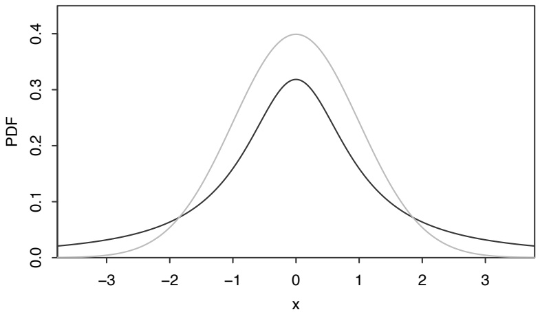
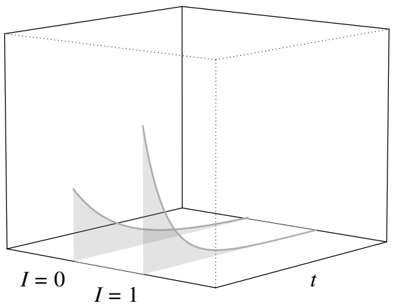
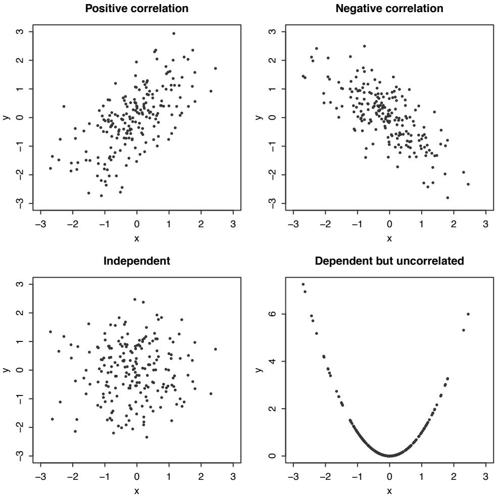
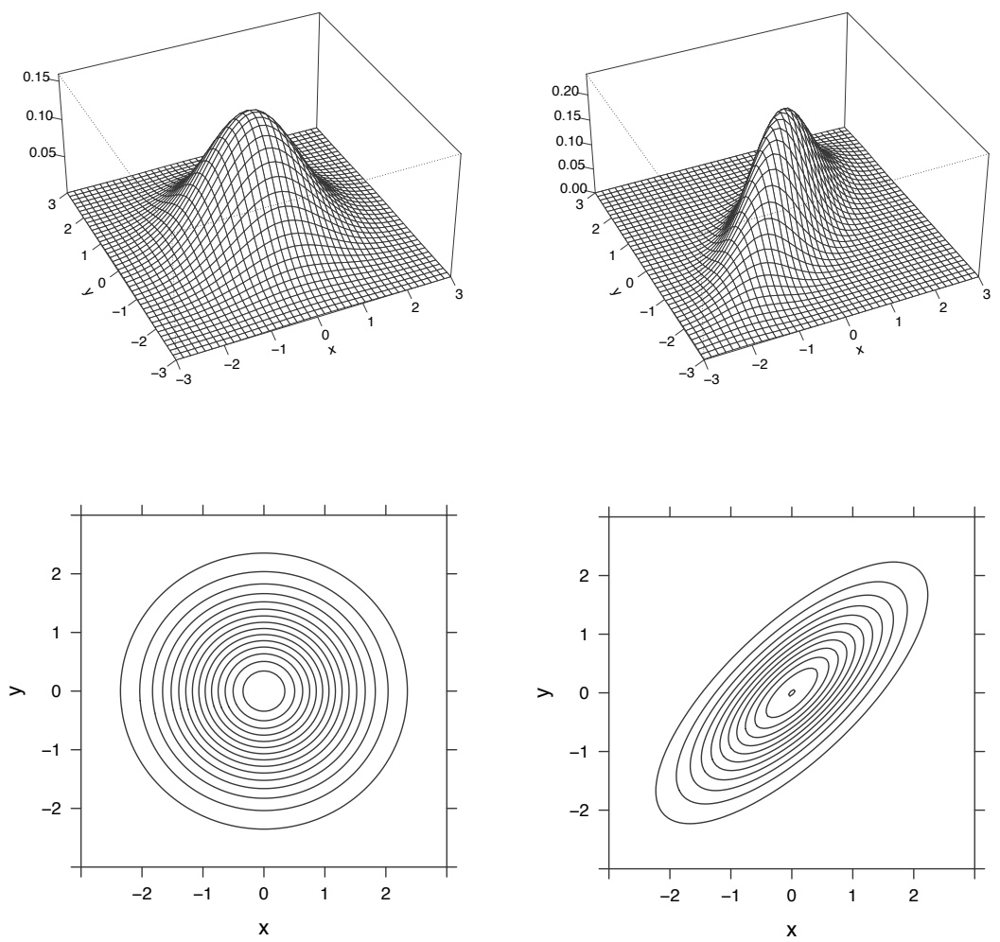
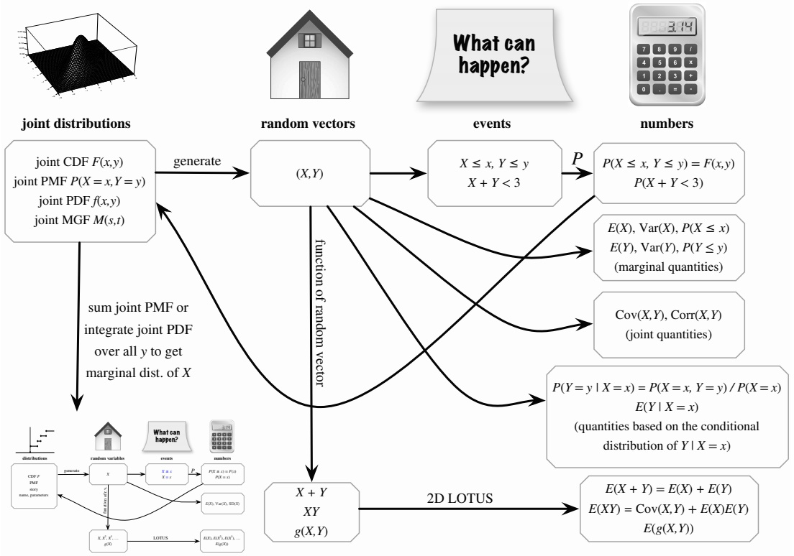
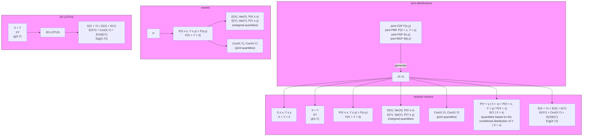
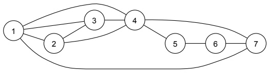
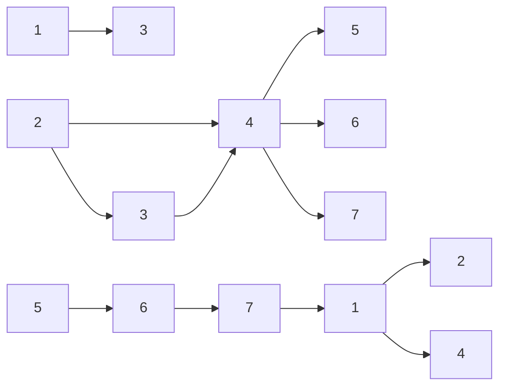

# 7: Joint distributions

原始 PDF 第 320–383 页。

## Joint distributions

When we first introduced random variables and their distributions in Chapter 3, we noted that the individual distributions of two r.v.s do not tell us anything about whether the r.v.s are independent or dependent. For example, two Bern(1/2) r.v.s X and Y could be independent if they indicate Heads on two different coin flips, or dependent if they indicate Heads and Tails, respectively, on the same coin flip. Thus, although the PMF of X is a complete blueprint for X and the PMF of Y is a complete blueprint for Y , these individual PMFs are missing important information about how the two r.v.s are related.

Of course, in real life, we usually care about the relationship between multiple r.v.s in the same experiment. To give just a few examples:

• Medicine: To evaluate the effectiveness of a treatment, we may take multiple measurements per patient; an ensemble of blood pressure, heart rate, and cholesterol readings can be more informative than any of these measurements considered separately.
• Genetics: To study the relationships between various genetic markers and a particular disease, if we only looked separately at distributions for each genetic marker, we could fail to learn about whether an interaction between markers is related to the disease.
• Time series: To study how something evolves over time, we can often make a series of measurements over time, and then study the series jointly. There are many applications of such series, such as global temperatures, stock prices, or national unemployment rates. The series of measurements considered jointly can help us deduce trends for the purpose of forecasting future measurements.

This chapter considers joint distributions, also called multivariate distributions, which capture the previously missing information about how multiple r.v.s interact. We introduce multivariate analogs of the CDF, PMF, and PDF in order to provide a complete specification of the relationship between multiple r.v.s. After this groundwork is in place, we’ll study a couple of famous named multivariate distributions, generalizing the Binomial and Normal distributions to higher dimensions.

303

---

304

Introduction to Probability

## 7.1 Joint, marginal, and conditional

The three key concepts for this section are joint, marginal, and conditional distributions. Recall that the distribution of a single r.v. X provides complete information about the probability of X falling into any subset of the real line. Analogously, the joint distribution of two r.v.s X and Y provides complete information about the probability of the vector (X, Y ) falling into any subset of the plane. The marginal distribution of X is the individual distribution of X, ignoring the value of Y , and the conditional distribution of X given $Y   =   y$ is the updated distribution for X after observing $Y = y$ . We’ll look at these concepts in the discrete case first, then extend them to the continuous case.

## 7.1.1 Discrete

The most general description of the joint distribution of two r.v.s is the joint CDF, which applies to discrete and continuous r.v.s alike.

Definition 7.1.1 (Joint CDF). The joint CDF of r.v.s X and Y is the function $F _ { X , Y }$ given by

$$
F _ {X, Y} (x, y) = P (X \leq x, Y \leq y).
$$

The joint CDF of n r.v.s is defined analogously.

Unfortunately, the joint CDF of discrete r.v.s is not a well-behaved function; as in the univariate case, it consists of jumps and flat regions. For this reason, with discrete r.v.s we usually work with the joint PMF, which also determines the joint distribution and is much easier to visualize.

Definition 7.1.2 (Joint PMF). The joint PMF of discrete r.v.s X and Y is the function $p _ { X , Y }$ given by

$$
p _ {X, Y} (x, y) = P (X = x, Y = y).
$$

The joint PMF of n discrete r.v.s is defined analogously.

Just as univariate PMFs must be nonnegative and sum to 1, we require valid joint PMFs to be nonnegative and sum to 1, where the sum is taken over all possible values of X and Y :

$$
\sum_ {x} \sum_ {y} P (X = x, Y = y) = 1.
$$

The joint PMF determines the distribution because we can use it to find the probability of the event $( X , Y ) \in A$ for any set A of points in the support of $( X , Y )$ . All we have to do is sum the joint PMF over A:

$$
P ((X, Y) \in A) = \sum_ {(x, y) \in A} P (X = x, Y = y).
$$

---

Joint distributions

305

Figure 7.1 shows a sketch of what the joint PMF of two discrete r.v.s could look like. The height of a vertical bar at $( x , y )$ represents the probability $P ( X = x , Y = y )$ For the joint PMF to be valid, the total height of the vertical bars must be 1.


<details>
<summary>scatter</summary>

| Category | X (range) | Y (range) |
| --- | --- | --- |
| Data Points | 0~100 | 0~100 |
</details>

## FIGURE 7.1

Joint PMF of discrete r.v.s X and Y .

From the joint distribution of X and $Y ,$ we can get the distribution of X alone by summing over the possible values of Y . This gives us the familiar PMF of X that we have seen in previous chapters. In the context of joint distributions, we will call it the marginal or unconditional distribution of $X$ , to make it clear that we are referring to the distribution of X alone, without regard for the value of $Y$

Definition 7.1.3 (Marginal PMF). For discrete r.v.s X and $Y .$ the marginal PMF of X is

$$
P (X = x) = \sum_ {y} P (X = x, Y = y).
$$

The marginal PMF of X is the PMF of $X ,$ viewing X individually rather than jointly with Y . The above equation follows from the axioms of probability (we are summing over disjoint cases). The operation of summing over the possible values of $Y$ in order to convert the joint PMF into the marginal PMF of X is known as marginalizing out $Y$

The process of obtaining the marginal PMF from the joint PMF is illustrated in Figure 7.2. Here we take a bird’s-eye view of the joint PMF for a clearer perspective; each column of the joint PMF corresponds to a fixed x and each row corresponds to a fixed $y .$ For any x, the probability $P ( X = x )$ is the total height of the bars in the corresponding column of the joint PMF: we can imagine taking all the bars in that column and stacking them on top of each other to get the marginal probability. Repeating this for all $x ,$ we arrive at the marginal PMF, depicted in bold.

---

306

Introduction to Probability


<details>
<summary>text_image</summary>

P(X = x)
y
x
</details>

## FIGURE 7.2

Bird’s-eye view of the joint PMF from Figure 7.1. The marginal PMF $P ( X = x )$ is obtained by summing over the joint PMF in the y-direction.

Similarly, the marginal PMF of Y is obtained by summing over all possible values of X. So given the joint PMF, we can marginalize out Y to get the PMF of $X .$ , or marginalize out X to get the PMF of Y . But if we only know the marginal PMFs of X and Y , there is no way to recover the joint PMF without further assumptions. It is clear how to stack the bars in Figure 7.2, but very unclear how to unstack the bars after they have been stacked!

Another way to go from joint to marginal distributions is via the joint CDF. In that case, we take a limit rather than a sum: the marginal CDF of X is

$$
F _ {X} (x) = P (X \leq x) = \lim _ {y \to \infty} P (X \leq x, Y \leq y) = \lim _ {y \to \infty} F _ {X, Y} (x, y).
$$

However, as mentioned above it is usually easier to work with joint PMFs.

Now suppose that we observe the value of X and want to update our distribution of $Y$ to reflect this information. Instead of using the marginal PMF $P ( Y   =   y )$ which does not take into account any information about $X$ , we should use a PMF that conditions on the event $X = x$ , where x is the value we observed for X. This naturally leads us to consider conditional PMFs.

Definition 7.1.4 (Conditional PMF). For discrete r.v.s X and $Y$ , the conditional PMF of $Y$ given $X = x$ is

$$
P (Y = y | X = x) = \frac {P (X = x , Y = y)}{P (X = x)}.
$$

This is viewed as a function of $y$ for fixed $x .$

---

Joint distributions

307

Note that the conditional PMF (for fixed x) is a valid PMF. So we can define the conditional expectation of Y given $X = x ,$ denoted by $E ( Y | X = x )$ , in the same way that we defined $E ( Y )$ except that we replace the PMF of Y with the conditional PMF of $Y$ . Chapter 9 is devoted to conditional expectation.

Figure 7.3 illustrates the definition of conditional PMF. To condition on the event $X = x$ , we first take the joint PMF and focus in on the vertical bars where X takes on the value $x ;$ in the figure, these are shown in bold. All of the other vertical bars are irrelevant because they are inconsistent with the knowledge that $X = x$ occurred. Since the total height of the bold bars is the marginal probability $P ( X \; = \; x )$ we then renormalize the conditional PMF by dividing by $P ( X = x )$ ; this ensures that the conditional PMF will sum to 1. Therefore conditional PMFs are PMFs, just as conditional probabilities are probabilities. Notice that there is a different conditional PMF of Y for every possible value of X; Figure 7.3 highlights just one of these conditional PMFs.


<details>
<summary>text_image</summary>

X = x
renormalize
</details>

## FIGURE 7.3

Conditional PMF of $Y$ given $X   =   x$ . The conditional PMF $P ( Y   =   y | X   =   x )$ is obtained by renormalizing the column of the joint PMF that is compatible with the event $X = x$

We can also relate the conditional distribution of $Y$ given $X = x$ to that of X given $Y = y$ , using Bayes’ rule:

$$
P (Y = y | X = x) = \frac {P (X = x | Y = y) P (Y = y)}{P (X = x)}.
$$

And using LOTP, we have another way of getting the marginal PMF: the marginal PMF of $X$ is a weighted average of the conditional PMFs $P ( X = x | Y = y )$ , where the weights are the probabilities $P ( Y = y )$

$$
P (X = x) = \sum_ {y} P (X = x | Y = y) P (Y = y).
$$

---

308

Introduction to Probability

Let’s work through a numerical example to complement the graphs we’ve been looking at.

Example 7.1.5 (2 × 2 table). The simplest example of a discrete joint distribution is when X and Y are both Bernoulli r.v.s. In this case, the joint PMF is fully specified by the four values $P(X = 1,Y = 1),   P(X = 0,Y = 1),   P(X = 1,Y = 0)$ and $P ( X = 0 , Y = 0 )$ , so we can represent the joint PMF of X and Y using a $2 \times 2$ table.

This very simple scenario actually has an important place in statistics, as these socalled contingency tables are often used to study whether a treatment is associated with a particular outcome. In such scenarios, X may be the indicator of receiving the treatment, and Y may be the indicator of the outcome of interest.

For example, suppose we randomly sample an adult male from the United States population. Let X be the indicator of the sampled individual being a current smoker, and let Y be the indicator of his developing lung cancer at some point in his life. Suppose the joint PMF is as follows (these numbers are for illustrative purposes; they are not estimated from real data).

|  | $Y = 1$ | $Y = 0$ |
| --- | --- | --- |
| $X = 1$ | $\frac{5}{100}$ | $\frac{20}{100}$ |
| $X = 0$ | $\frac{3}{100}$ | $\frac{72}{100}$ |

To get the marginal probability $P ( Y = 1 )$ , we add the probabilities in the two cells of the table where $Y = 1$ . We do the same for $P(Y = 0),   P(X = 1)$ , and $P ( X = 0 )$ and write these probabilities in the margins of the table (making “marginal” an appropriate name!).

|  | $Y = 1$ | $Y = 0$ | Total |
| --- | --- | --- | --- |
| $X = 1$ | $\frac{5}{100}$ | $\frac{20}{100}$ | $\frac{25}{100}$ |
| $X = 0$ | $\frac{3}{100}$ | $\frac{72}{100}$ | $\frac{75}{100}$ |
| Total | $\frac{8}{100}$ | $\frac{92}{100}$ | $\frac{100}{100}$ |

This shows that the marginal distribution of X is Bern(0.25) and the marginal distribution of Y is $\mathrm { B e r n } ( 0 . 0 8 )$ . In words, the unconditional probability that the individual is a current smoker is 0.25, and the unconditional probability of his developing lung cancer is 0.08.

Now suppose we observe X = 1, i.e., the individual is a current smoker. We can then update our beliefs about his risk for lung cancer.

$$
P (Y = 1 | X = 1) = \frac {P (X = 1 , Y = 1)}{P (X = 1)} = \frac {5 / 1 0 0}{2 5 / 1 0 0} = 0. 2,
$$

---

Joint distributions

309

so the conditional distribution of Y given X = 1 is Bern(0.2). By a similar calculation, the conditional distribution of Y given X = 0 is Bern(0.04). This tells us that the probability of developing lung cancer is 0.2 for current smokers but only 0.04 for non-smokers. 

h 7.1.6. The word “marginal” has opposite meanings in economics and statistics. In economics it refers to a derivative, e.g., marginal revenue is the derivative of revenue with respect to quantity sold. In statistics it refers to an integral or sum, which can be thought of intuitively by writing totals in the margins of a table, as in the above example.

Armed with an understanding of joint, marginal, and conditional distributions, we can revisit the definition of independence that we introduced in Chapter 3.

Definition 7.1.7 (Independence of discrete r.v.s). Random variables X and Y are independent if for all x and $y ,$

$$
F _ {X, Y} (x, y) = F _ {X} (x) F _ {Y} (y).
$$

If X and Y are discrete, this is equivalent to the condition

$$
P (X = x, Y = y) = P (X = x) P (Y = y)
$$

for all $x , y ,$ , and it is also equivalent to the condition

$$
P (Y = y | X = x) = P (Y = y)
$$

for all x, y such that $P(X = x) > 0$

Using the terminology from this chapter, the definition says that for independent r.v.s, the joint CDF factors into the product of the marginal CDFs, or that the joint PMF factors into the product of the marginal PMFs. Remember that in general, the marginal distributions do not determine the joint distribution: this is the reason why we wanted to study joint distributions in the first place! But in the special case of independence, the marginal distributions are all we need in order to specify the joint distribution; we can get the joint PMF by multiplying the marginal PMFs.

Another way of looking at independence is that all the conditional PMFs are the same as the marginal PMF. That is, starting with the marginal PMF of Y , no updating is necessary when we condition on $X = x$ , regardless of what x is.

Example 7.1.8 (Independence in the $2 \times 2$ table). Returning to the table from the previous example, we can use these two views of independence to see why X and Y are not independent.

|  | Y = 1 | Y = 0 | Total |
| --- | --- | --- | --- |
| X = 1 | $\frac{5}{100}$ | $\frac{20}{100}$ | $\frac{25}{100}$ |
| X = 0 | $\frac{3}{100}$ | $\frac{72}{100}$ | $\frac{75}{100}$ |
| Total | $\frac{8}{100}$ | $\frac{92}{100}$ | $\frac{100}{100}$ |

---

310

Introduction to Probability

First, the joint PMF is not the product of the marginal PMFs. For example,

$$
P (X = 1, Y = 1) \neq P (X = 1) P (Y = 1).
$$

Finding even one pair of values x and $y$ such that

$$
P (X = x, Y = y) \neq P (X = x) P (Y = y)
$$

is enough to rule out independence.

Second, we found that the marginal distribution of Y is Bern(0.08), whereas the conditional distribution of Y given $X = 1$ is Bern(0.2) and the conditional distribution of $Y$ given $X = 0$ is Bern(0.04). Since conditioning on the value of X alters the distribution of Y , X and $Y$ are not independent: learning whether or not the sampled individual is a current smoker gives us information about the probability that he will develop lung cancer.

Although we have found that X and $Y$ are dependent, we cannot make conclusions about whether smoking causes lung cancer based on this association alone. As we learned from Simpson’s paradox, misleading associations can arise when we fail to account for confounding variables. 

We’ll do one more example of a discrete joint distribution to round out this section. We’ve named it the chicken-egg story; in it, we use wishful thinking to find a joint PMF, and our efforts land us a surprising independence result.

Story 7.1.9 (Chicken-egg). Suppose a chicken lays a random number of eggs, $N ,$ where $N \sim  Pois (\lambda)$ . Each egg independently hatches with probability $p$ and fails to hatch with probability $q = 1 - p$ . Let X be the number of eggs that hatch and $Y$ the number that do not hatch, so $X + Y = N$ . What is the joint PMF of $X$ and $Y ?$

Solution:

We seek the joint PMF $P ( X   =   i , Y   =   j )$ for nonnegative integers $i$ and $j .$ Conditional on the total number of eggs N, the eggs are independent Bernoulli trials with probability of success $p ,$ so by the story of the Binomial, the conditional distributions of $X$ and $Y$ are $X | N = n \sim \mathrm { B i n } ( n , p )$ and $Y | N = n \sim \mathrm { B i n } ( n , q )$ . Since our lives would be easier if only we knew the total number of eggs, let’s use wishful thinking: condition on $N$ and apply the law of total probability. This gives

$$
P (X = i, Y = j) = \sum_ {n = 0} ^ {\infty} P (X = i, Y = j | N = n) P (N = n).
$$

The sum is over all possible values of $n ,$ holding $i$ and $j$ fixed. But unless $n = i + j$ it is impossible for $X$ to equal $i$ and Y to equal $j .$ For example, the only way there can be 5 hatched eggs and $6$ unhatched eggs is if there are 11 eggs in total. So

$$
P (X = i, Y = j | N = n) = 0
$$

---

Joint distributions

311

unless $n = i + j$ , which means all other terms in the sum can be dropped:

$$
P (X = i, Y = j) = P (X = i, Y = j | N = i + j) P (N = i + j).
$$

Conditional on $N = i + j$ , the events $X = i$ and $Y = j$ are exactly the same event, so keeping both is redundant. We’ll keep $X   =   i ;$ the rest is a matter of plugging in the Binomial PMF to get $P ( X   =   i | N   =   i   +   j )$ and the Poisson PMF to get $P ( N = i + j )$ . Thus,

$$
\begin{array}{l} P (X = i, Y = j) = P (X = i | N = i + j) P (N = i + j) \\ = \binom{i + j}{i} p ^ {i} q ^ {j} \cdot \frac {e ^ {- \lambda} \lambda^ {i + j}}{(i + j) !} \\ = \frac {e ^ {- \lambda p} (\lambda p) ^ {i}}{i !} \cdot \frac {e ^ {- \lambda q} (\lambda q) ^ {j}}{j !}. \\ \end{array}
$$

The joint PMF factors into the product of the $\operatorname { P o i s } ( \lambda p )$ PMF (as a function of i) and the $\operatorname { P o i s } ( \lambda q )$ PMF (as a function of j). This tells us two elegant facts: (1) X and $Y$ are independent, since their joint PMF is the product of their marginal PMFs, and (2) $X \sim  Pois (\lambda p)$ and $Y \sim  Pois (\lambda q)$

At first it may seem deeply counterintuitive that X is independent of Y . Doesn’t knowing that a lot of eggs hatched mean that there are probably not so many that didn’t hatch? For a fixed number of eggs, this independence would be impossible: knowing the number of hatched eggs would perfectly determine the number of unhatched eggs. But in this example, the number of eggs is random, following a Poisson distribution, and this happens to be the right kind of randomness to make X and Y unconditionally independent. This is a very special property of the Poisson. 

The chicken-egg story supplements the following result from Chapter 4:

Theorem 7.1.10. If $X \sim  Pois (\lambda p),   Y \sim  Pois (\lambda q)$ , and X and Y are independent, then $N = X + Y \sim  Pois (\lambda)$ and $X | N = n \sim \mathrm { B i n } ( n , p )$

By the chicken-egg story, we now have the converse to this theorem.

Theorem 7.1.11. If $N \sim  Pois (\lambda)$ and $X | N = n \sim \mathrm { B i n } ( n , p )$ , then $X \sim  Pois (\lambda p)$ $Y = N - X \sim \mathrm{Poisson}(\lambda q)$ , and X and Y are independent.

h 7.1.12. In the chicken-egg story, it is not valid to say $^ { \backsim } P ( X   =   x | N   =   n )   =$ $P ( X   =   x | X   +   Y   =   n )   =   P ( X   =   x | Y   =   n   -   x )$ , since in $P ( X   =   x | N   =   n )$ we are not conditioning on $X = x$ . Indeed, $P ( X   =   x | N   =   n )$ is the $\operatorname { B i n } ( n , p )$ PMF, whereas $P ( X = x | Y = n - x ) = P ( X = x )$ is the $\operatorname { P o i s } ( \lambda p )$ PMF. This blunder of plugging in x for X on the right side of the conditioning bar illustrates how crucial it is to carefully distinguish between X and $x ,$ and between the left side and the right side of the conditioning bar.

---

312

Introduction to Probability

## 7.1.2 Continuous

Once we have a handle on discrete joint distributions, it isn’t much harder to consider continuous joint distributions. We simply make the now-familiar substitutions of integrals for sums and PDFs for PMFs, remembering that the probability of any individual point is now 0.

Formally, in order for X and Y to have a continuous joint distribution, we require that the joint CDF

$$
F _ {X, Y} (x, y) = P (X \leq x, Y \leq y)
$$

be differentiable with respect to x and y. The partial derivative with respect to x and $y$ is called the joint PDF. The joint PDF determines the joint distribution, as does the joint CDF.

Definition 7.1.13 (Joint PDF). If X and Y are continuous with joint CDF $F _ { X , Y }$ their joint PDF is the derivative of the joint CDF with respect to x and $y ;$

$$
f _ {X, Y} (x, y) = \frac {\partial^ {2}}{\partial x \partial y} F _ {X, Y} (x, y).
$$

We require valid joint PDFs to be nonnegative and integrate to 1:

$$
f _ {X, Y} (x, y) \geq 0, \text {and} \int_ {- \infty} ^ {\infty} \int_ {- \infty} ^ {\infty} f _ {X, Y} (x, y) d x d y = 1.
$$

In the univariate case, the PDF was the function we integrated to get the probability of an interval. Similarly, the joint PDF of two r.v.s is the function we integrate to get the probability of a two-dimensional region. For example,

$$
P (X <   3, 1 <   Y <   4) = \int_ {1} ^ {4} \int_ {- \infty} ^ {3} f _ {X, Y} (x, y) d x d y.
$$

For a general region $A \subseteq \mathbb { R } ^ { 2 }$

$$
P ((X, Y) \in A) = \iint_ {A} f _ {X, Y} (x, y) d x d y.
$$

Figure 7.4 shows a sketch of what a joint PDF of two r.v.s could look like. As usual with continuous r.v.s, we need to keep in mind that the height of the surface $f _ { X , Y } ( x , y )$ at a single point does not represent a probability. The probability of any specific point in the plane is 0. Now that we’ve gone up a dimension, the probability of any line or curve in the plane is also 0. The only way we can get nonzero probability is by integrating over a region of positive area in the xy-plane.

When we integrate the joint PDF over a region A, we are calculating the volume under the surface of the joint PDF and above A. Thus, probability is represented by volume under the joint PDF. The total volume under a valid joint PDF is 1.

---

Joint distributions

313


<details>
<summary>text_image</summary>

f_{X,Y}(x,y)
y
x
</details>

## FIGURE 7.4

Joint PDF of continuous r.v.s X and Y .

In the discrete case, we get the marginal PMF of X by summing over all possible values of Y in the joint PMF. In the continuous case, we get the marginal PDF of X by integrating over all possible values of Y in the joint PDF.

Definition 7.1.14 (Marginal PDF). For continuous r.v.s X and Y with joint PDF $f _ { X , Y }$ , the marginal PDF of X is

$$
f _ {X} (x) = \int_ {- \infty} ^ {\infty} f _ {X, Y} (x, y) d y.
$$

This is the PDF of X, viewing X individually rather than jointly with Y .

To simplify notation, we have mainly been looking at the joint distribution of two r.v.s rather than n r.v.s, but marginalization works analogously with any number of variables. For example, if we have the joint PDF of X, Y, Z, W but want the joint PDF of X, W, we just have to integrate over all possible values of Y and Z:

$$
f _ {X, W} (x, w) = \int_ {- \infty} ^ {\infty} \int_ {- \infty} ^ {\infty} f _ {X, Y, Z, W} (x, y, z, w) d y d z.
$$

Conceptually this is easy—just integrate over the unwanted variables to get the joint PDF of the wanted variables—but computing it may or may not be easy.

Returning to the case of the joint distribution of two r.v.s X and Y , let’s consider how to update our distribution for Y after observing the value of X, using the conditional PDF.

Definition 7.1.15 (Conditional PDF). For continuous r.v.s X and Y with joint PDF $f _ { X , Y }$ , the conditional PDF of Y given $X = x$ is

$$
f _ {Y \mid X} (y \mid x) = \frac {f _ {X , Y} (x , y)}{f _ {X} (x)},
$$

for all x with $f _ { X } ( x )   >   0$ . This is considered as a function of y for fixed x. As a convention, in order to make $f _ { Y | X } ( y | x )$ well-defined for all real $x ,$ let $f _ { Y | X } ( y | x ) = 0$ for all x with $f _ { X } ( x ) = 0$

---

314

Introduction to Probability

Notation 7.1.16. The subscripts that we place on all the $f ^ { \prime } \mathrm { s }$ are just to remind us that we have three different functions on our plate. We could just as well write $g ( y | x ) = f ( x , y ) / h ( x )$ , where f is the joint PDF, h is the marginal PDF of X, and g is the conditional PDF of Y given $X   =   x$ , but that makes it more difficult to remember which letter stands for which function.

Figure 7.5 illustrates the definition of conditional PDF. We take a vertical slice of the joint PDF corresponding to the observed value of X. Since the total area under this slice is $f _ { X } ( x )$ , we then divide by $f _ { X } ( x )$ to ensure that the conditional PDF will have an area of 1. So the conditional PDF of $Y$ given $X = x$ satisfies the properties of a valid PDF, for any x in the support of X.


<details>
<summary>text_image</summary>

X = x
renormalize
</details>

## FIGURE 7.5

Conditional PDF of Y given $X = x$ . The conditional PDF $f _ { Y | X } ( y | x )$ is obtained by renormalizing the slice of the joint PDF at the fixed value x.

h 7.1.17. How can we speak of conditioning on $X = x$ for X a continuous $\mathbf { r } . \mathbf { V } .$ considering that this event has probability 0? Rigorously speaking, we are actually conditioning on the event that X falls within a small interval containing x, say $X \in ( x - \epsilon , x + \epsilon )$ , and then taking a limit as  approaches 0 from the right. We will not fuss over this technicality; fortunately, many important results such as Bayes rule work in the continuous case exactly as one would hope.

Note that we can recover the joint PDF $f _ { X , Y }$ if we have the conditional PDF $f _ { Y | X }$ and the corresponding marginal $f _ { X }$ :

$$
f _ {X, Y} (x, y) = f _ {Y | X} (y | x) f _ {X} (x).
$$

Similarly, we can recover the joint PDF if we have $f _ { X | Y }$ and $f _ { Y }$ :

$$
f _ {X, Y} (x, y) = f _ {X | Y} (x | y) f _ {Y} (y).
$$

This allows us to develop continuous versions of Bayes’ rule and LOTP. The continuous versions are analogous to the discrete versions, with probability density functions in place of probabilities and integrals in place of sums.

---

Joint distributions

315

Theorem 7.1.18 (Continuous form of Bayes’ rule and LOTP). For continuous r.v.s X and $Y .$ we have the following continuous form of Bayes’ rule:

$$
f _ {Y \mid X} (y \mid x) = \frac {f _ {X \mid Y} (x \mid y) f _ {Y} (y)}{f _ {X} (x)}, \text {for} f _ {X} (x) > 0.
$$

And we have the following continuous form of the law of total probability:

$$
f _ {X} (x) = \int_ {- \infty} ^ {\infty} f _ {X | Y} (x | y) f _ {Y} (y) d y.
$$

Proof. By definition of conditional PDFs, we have

$$
f _ {Y \mid X} (y \mid x) f _ {X} (x) = f _ {X, Y} (x, y) = f _ {X \mid Y} (x \mid y) f _ {Y} (y).
$$

The continuous version of Bayes’ rule follows immediately from dividing by $f _ { X } ( x )$ The continuous version of LOTP follows immediately from integrating with respect to $y ;$

$$
f _ {X} (x) = \int_ {- \infty} ^ {\infty} f _ {X, Y} (x, y) d y = \int_ {- \infty} ^ {\infty} f _ {X | Y} (x | y) f _ {Y} (y) d y.
$$

Out of curiosity, let’s see what would have happened if we had plugged in the other expression for $f _ { X , Y } ( x , y )$ instead in the proof of LOTP:

$$
f _ {X} (x) = \int_ {- \infty} ^ {\infty} f _ {X, Y} (x, y) d y = \int_ {- \infty} ^ {\infty} f _ {Y | X} (y | x) f _ {X} (x) d y = f _ {X} (x) \int_ {- \infty} ^ {\infty} f _ {Y | X} (y | x) d y.
$$

This just says that, for any x with $f _ { X } ( x ) > 0$

$$
\int_ {- \infty} ^ {\infty} f _ {Y | X} (y | x) d y = 1,
$$

confirming the fact that conditional PDFs must integrate to 1.

We now have versions of Bayes’ rule and LOTP for two discrete r.v.s and for two continuous r.v.s. Better yet, there are also versions when we have one discrete r.v. and one continuous r.v. After understanding the discrete versions, it is easy to remember and use the other versions since they are analogous, replacing probabilities by PDFs when appropriate. For example, for X discrete and $Y$ continuous, we have the following version of LOTP:

$$
P (X = x) = \int_ {- \infty} ^ {\infty} P (X = x | Y = y) f _ {Y} (y) d y.
$$

Taking $X$ to be the indicator r.v. of an event $A$ and $x = 1$ , we have an expression for a general probability $P ( A )$ based on conditioning on a continuous r.v. $Y ;$

$$
P (A) = \int_ {- \infty} ^ {\infty} P (A | Y = y) f _ {Y} (y) d y.
$$

---

316

Introduction to Probability

Here are the four versions of Bayes’ rule, summarized in a table.

|  | Y discrete | Y continuous |
| --- | --- | --- |
| X discrete | $P(Y = y\|X = x) = \frac{P(X=x\|Y=y)P(Y=y)}{P(X=x)}$ | $f_{Y}(y\|X = x) = \frac{P(X=x\|Y=y)f_{Y}(y)}{P(X=x)}$ |
| X continuous | $P(Y = y\|X = x) = \frac{f_{X}(x\|Y=y)P(Y=y)}{f_{X}(x)}$ | $f_{Y\|X}(y\|x) = \frac{f_{X\|Y}(x\|y)f_{Y}(y)}{f_{X}(x)}$ |

And here are the four versions of LOTP, summarized in a table. The top row gives expressions for $P ( X = x )$ , while the bottom row gives expressions for $f _ { X } ( x )$

|  | Y discrete | Y continuous |
| --- | --- | --- |
| X discrete | $\sum_{y} P(X = x \| Y = y)P(Y = y)$ | $\int_{-\infty}^{\infty} P(X = x \| Y = y)f_Y(y)dy$ |
| X continuous | $\sum_{y} f_X(x \| Y = y)P(Y = y)$ | $\int_{-\infty}^{\infty} f_{X\|Y}(x \| y)f_Y(y)dy$ |

Finally, let’s discuss the definition of independence for continuous r.v.s; then we’ll turn to concrete examples. As in the discrete case, we can view independence of continuous r.v.s in two ways. One is that the joint CDF factors into the product of the marginal CDFs, or the joint PDF factors into the product of the marginal PDFs. The other is that the conditional PDF of Y given $X = x$ is the same as the marginal PDF of Y , so conditioning on X provides no information about Y .

Definition 7.1.19 (Independence of continuous r.v.s). Random variables X and Y are independent if for all x and $y ,$

$$
F _ {X, Y} (x, y) = F _ {X} (x) F _ {Y} (y).
$$

If X and Y are continuous with joint PDF $f _ { X , Y }$ , this is equivalent to the condition

$$
f _ {X, Y} (x, y) = f _ {X} (x) f _ {Y} (y)
$$

for all $x , y ,$ and it is also equivalent to the condition

$$
f _ {Y \mid X} (y \mid x) = f _ {Y} (y)
$$

for all x, y such that $f _ { X } ( x ) > 0$

h 7.1.20. The marginal PDF of $Y ,   f _ { Y } ( y )$ , is a function of $y$ only; it cannot depend on x in any way. The conditional PDF $f _ { Y | X } ( y | x )$ can depend on x in general. Only in the special case of independence is $f _ { Y | X } ( y | x )$ free of x.

Sometimes we have a joint PDF for X and Y that factors as a function of x times a function of $y ,$ without knowing in advance whether these functions are the marginal PDFs, or even whether they are valid PDFs. The next result addresses this situation.

---

Joint distributions

317

Proposition 7.1.21. Suppose that the joint PDF $f _ { X , Y }$ of X and Y factors as

$$
f _ {X, Y} (x, y) = g (x) h (y)
$$

for all x and $y ,$ where g and h are nonnegative functions. Then $X$ and $Y$ are independent. Also, if either $g$ or h is a valid PDF, then the other one is a valid PDF too and $g$ and $h$ are the marginal PDFs of X and $Y$ , respectively. (The analogous result in the discrete case also holds.)

Proof. Let $\begin{array} { r } { c = \int _ { - \infty } ^ { \infty } h ( y ) d y } \end{array}$ . Multiplying and dividing by $c _ { \gamma }$ we can write

$$
f _ {X, Y} (x, y) = c g (x) \cdot \frac {h (y)}{c}.
$$

(The point of this is that $h ( y ) / c$ is a valid PDF.) Then the marginal PDF of $X$ is

$$
f _ {X} (x) = \int_ {- \infty} ^ {\infty} f _ {X, Y} (x, y) d y = c g (x) \int_ {- \infty} ^ {\infty} \frac {h (y)}{c} d y = c g (x).
$$

It follows that $\begin{array} { r } { \int _ { - \infty } ^ { \infty } c g ( x ) d x = 1 } \end{array}$ since a marginal PDF is a valid PDF (knowing the integral of h gave us the integral of $g$ for free!). Then the marginal PDF of $Y$ is

$$
f _ {Y} (y) = \int_ {- \infty} ^ {\infty} f _ {X, Y} (x, y) d x = \frac {h (y)}{c} \int_ {- \infty} ^ {\infty} c g (x) d x = \frac {h (y)}{c}.
$$

Thus, X and Y are independent with PDFs $c g ( x )$ and $h ( y ) / c ,$ respectively. If $g$ or h is already a valid PDF, then $c = 1$ , so the other one is also a valid PDF. 

h 7.1.22. In the above proposition, we need the joint PDF to factor as a function of x times a function of $y$ for all $( x , y )$ in the plane $\mathbb { R } ^ { 2 }$ , not just for $( x , y )$ with $f _ { X , Y } ( x , y ) > 0$ . The reason for this is illustrated in the next example.

A simple case of a continuous joint distribution is when the joint PDF is constant over some region in the plane. In the following example, we’ll compare a joint PDF that is constant on a square to a joint PDF that is constant on a disk.

Example 7.1.23 (Uniform on a region in the plane). Let $( X , Y )$ be a completely random point in the square $\{ ( x , y ) : x , y \in [ 0 , 1 ] \}$ , in the sense that the joint PDF of $X$ and $Y$ is constant over the square and 0 outside of it:

$$
f _ {X, Y} (x, y) = \left\{ \begin{array}{l l} 1 & \text {if} x, y \in [ 0, 1 ], \\ 0 & \text {otherwise}. \end{array} \right.
$$

The constant 1 is chosen so that the joint PDF will integrate to 1. This distribution is called the Uniform distribution on the square.

Intuitively, it makes sense that X and $Y$ should be $\mathrm { U n i f } ( 0 , 1 )$ marginally. We can check this by computing

$$
f _ {X} (x) = \int_ {0} ^ {1} f _ {X, Y} (x, y) d y = \int_ {0} ^ {1} 1 d y = 1,
$$

---

318

Introduction to Probability

and similarly for $f _ { Y }$ . Furthermore, X and Y are independent, since the joint PDF factors into the product of the marginal PDFs (this just reduces to $1 = 1 \cdot 1$ , but it’s important to note that the value of X does not constrain the possible values of Y ). So the conditional distribution of Y given $X = x$ is $\mathrm { U n i f } ( 0 , 1 )$ , regardless of $x .$

Now let $( X , Y )$ be a completely random point in the unit disk $\{ ( x , y ) : x ^ { 2 }   +   y ^ { 2 } \leq 1 \}$ with joint PDF

$$
f _ {X, Y} (x, y) = \left\{ \begin{array}{l l} \frac {1}{\pi} & \text {if} x ^ {2} + y ^ {2} \leq 1, \\ 0 & \text {otherwise.} \end{array} \right.
$$

Again, the constant $1 / \pi$ is chosen to make the joint PDF integrate to 1; the value follows from the fact that the integral of 1 over some region in the plane is the area of that region.

Note that X and Y are not independent, since in general, knowing the value of X constrains the possible values of $Y ;$ larger values of $\left| X \right|$ restrict Y to be in a smaller range. It would fall into h 7.1.22 disastrously to conclude independence from the fact that $f _ { X , Y } ( x , y )   =   g ( x ) h ( y )$ for all $( x , y )$ in the disk, where $g ( x )   =   1 / \pi$ and $h ( y ) = 1$ are constant functions. To see from the definition that X and Y are not independent, note that, for example, $f _ { X , Y } ( 0 . 9 , 0 . 9 ) = 0$ since $( 0 . 9 , 0 . 9 )$ is not in the unit disk, but $f _ { X } ( 0 . 9 ) f _ { Y } ( 0 . 9 ) \neq 0$ since 0.9 is in the supports of both X and $Y$

The marginal distribution of X is now

$$
f _ {X} (x) = \int_ {- \sqrt {1 - x ^ {2}}} ^ {\sqrt {1 - x ^ {2}}} \frac {1}{\pi} d y = \frac {2}{\pi} \sqrt {1 - x ^ {2}}, \quad - 1 \leq x \leq 1.
$$

By symmetry, $\begin{array} { r } { f _ { Y } ( y )   =   \frac { 2 } { \pi } \sqrt { 1 - y ^ { 2 } } } \end{array}$ . Note that the marginal distributions of $X$ and $Y$ are not Uniform on $[ - 1 , 1 ]$ ; rather, X and $Y$ are more likely to fall near 0 than near $\pm 1$


<details>
<summary>text_image</summary>

(x,\u221a1-x²)
(x,-\u221a1-x²)
</details>

## FIGURE 7.6

Bird’s-eye view of the Uniform joi<u>nt PD</u>F o<u>n the</u> unit disk. Conditional on $X = x$ $Y$ is restricted to the interval $[ - \sqrt { 1 - x ^ { 2 } } , \sqrt { 1 - x ^ { 2 } } ]$

Suppose we observe $X   =   x$ . As illustrated in Figure 7.6, this constrains $Y$ to lie

---

Joint distributions

319

in the interval $[ - \sqrt { 1 - x ^ { 2 } } , \sqrt { 1 - x ^ { 2 } } ]$ . Specifically, the conditional distribution of $Y$ given $X = x$ is

$$
f _ {Y | X} (y | x) = \frac {f _ {X , Y} (x , y)}{f _ {X} (x)} = \frac {\frac {1}{\pi}}{\frac {2}{\pi} \sqrt {1 - x ^ {2}}} = \frac {1}{2 \sqrt {1 - x ^ {2}}}
$$

for $- { \sqrt { 1 - x ^ { 2 } } }   \leq   y   \leq   { \sqrt { 1 - x ^ { 2 } } }$ , and 0 otherwise. This conditional PDF is constant as a function of $y$ , <u>which</u> tell<u>s us th</u>at the conditional distribution of Y is Uniform on the interval $[ - \sqrt { 1 - x ^ { 2 } } , \sqrt { 1 - x ^ { 2 } } ]$ The fact that the conditional PDF is not free of x confirms the fact that X and $Y$ are not independent.

In general, for a region R in the plane, the Uniform distribution on R is defined to have joint PDF that is constant inside R and 0 outside R. The constant is the reciprocal of the area of R. If R is the rectangle $\{ ( x , y ) : a \leq x \leq b , c \leq y \leq d \}$ , then X and Y will be independent; unlike for a disk, the vertical slices of a rectangle all look the same. But for any region where the value of $X$ constrains the possible values of $Y$ or vice versa, X and $Y$ will not be independent. 

As another example of working with joint PDFs, let’s consider a question that comes up often when dealing with Exponentials of different rates.

Example 7.1.24 (Comparing Exponentials of different rates). Let $T _ { 1 } \sim \mathrm { E x p o } ( \lambda _ { 1 } )$ and $T _ { 2 }   \sim   \mathrm { E x p o } ( \lambda _ { 2 } )$ be independent. Find $P ( T _ { 1 }   <   T _ { 2 } )$ . For example, $T _ { 1 }$ could be the lifetime of a refrigerator and $T _ { 2 }$ could be the lifetime of a stove (if we are willing to assume Exponential distributions for these), and then $P ( T _ { 1 } < T _ { 2 } )$ is the probability that the refrigerator fails before the stove. We know from Chapter 5 that min $\underline { { { { } } } } ( T _ { 1 } , T _ { 2 } ) \sim \operatorname { E x p o } ( \lambda _ { 1 } + \lambda _ { 2 } )$ , which tells us about when the first appliance failure will occur, but we may also want to know about which appliance will fail first.

## Solution:

We just need to integrate the joint PDF of $T _ { 1 }$ and $T _ { 2 }$ over the appropriate region, which is all $( t _ { 1 } , t _ { 2 } )$ with $t _ { 1 } > 0 , t _ { 2 } > 0$ , and $t _ { 1 } < t _ { 2 }$ . This yields

$$
\begin{array}{l} P (T _ {1} <   T _ {2}) = \int_ {0} ^ {\infty} \int_ {0} ^ {t _ {2}} \lambda_ {1} e ^ {- \lambda_ {1} t _ {1}} \lambda_ {2} e ^ {- \lambda_ {2} t _ {2}} d t _ {1} d t _ {2} \\ = \int_ {0} ^ {\infty} \left(\int_ {0} ^ {t _ {2}} \lambda_ {1} e ^ {- \lambda_ {1} t _ {1}} d t _ {1}\right) \lambda_ {2} e ^ {- \lambda_ {2} t _ {2}} d t _ {2} \\ = \int_ {0} ^ {\infty} (1 - e ^ {- \lambda_ {1} t _ {2}}) \lambda_ {2} e ^ {- \lambda_ {2} t _ {2}} d t _ {2} \\ = 1 - \int_ {0} ^ {\infty} \lambda_ {2} e ^ {- (\lambda_ {1} + \lambda_ {2}) t _ {2}} d t _ {2} \\ = 1 - \frac {\lambda_ {2}}{\lambda_ {1} + \lambda_ {2}} \\ = \frac {\lambda_ {1}}{\lambda_ {1} + \lambda_ {2}}. \\ \end{array}
$$

This result makes sense intuitively if we interpret $\lambda _ { 1 }$ and $\lambda _ { 2 }$ as rates. For example,

---

320

Introduction to Probability

if refrigerators have twice the failure rate of stoves, then it says that the odds are 2 to 1 in favor of the refrigerator failing first. As a simple check, note that the answer reduces to $1 / 2$ when $\lambda _ { 1 } = \lambda _ { 2 }$ , which must be true by symmetry.

An alternative method of getting the same result is to use LOTP to condition on $T _ { 1 }$ (or condition on $T _ { 2 } )$ . A third approach, using a story about Poisson processes, is in Chapter 13. 

Our last example in this section demonstrates how we can use the joint distribution of X and Y to derive the distribution of a function of X and $Y$

Example 7.1.25 (Cauchy PDF). Let X and Y be i.i.d. $\mathcal { N } ( 0 , 1 )$ , and let $T = X / Y$ (We can define $T$ arbitrarily in the case $Y = 0 ;$ ; the choice of how to define $T$ in that case has no effect on the distribution of $T ,$ since $P ( Y = 0 ) = 0 . )$ The distribution of $T$ is a famous named distribution called the Cauchy distribution, and we will encounter it again in later chapters. Meanwhile, find the PDF of $T$

## Solution:

We’ll find an expression for the CDF of T first, and then differentiate to get the PDF. We can write

$$
F _ {T} (t) = P (T \leq t) = P \left(\frac {X}{Y} \leq t\right) = P \left(\frac {X}{| Y |} \leq t\right),
$$

since the ${ \mathrm { ~ r . v . s ~ } } { \frac { X } { Y } }$ and $\frac { X } { | | Y | | }$ are identically distributed by the symmetry of the standard Normal distribution. Now $\left| Y \right|$ is nonnegative, so we can multiply by it on both sides without reversing the direction of the inequality. Thus, we are interested in finding

$$
F _ {T} (t) = P (X \leq t | Y |).
$$

We calculate this probability by integrating the joint PDF of X and $Y$ over the region where $X \leq t | Y |$ holds. The joint PDF of X and Y is just the product of the marginal PDFs, by independence. So

$$
\begin{array}{l} F _ {T} (t) = P (X \leq t | Y |) \\ = \int_ {- \infty} ^ {\infty} \int_ {- \infty} ^ {t | y |} \frac {1}{\sqrt {2 \pi}} e ^ {- x ^ {2} / 2} \frac {1}{\sqrt {2 \pi}} e ^ {- y ^ {2} / 2} d x d y. \\ \end{array}
$$

Note that the inner limits of integration (the limits for x) depend on $y ,$ whereas the outer limits of integration (the limits for $y )$ can’t depend on $x$ (see the math appendix for more about limits of integration with multiple integrals). With some manipulations, we can get the double integral down to a single integral:

$$
\begin{array}{l} F _ {T} (t) = \int_ {- \infty} ^ {\infty} \frac {1}{\sqrt {2 \pi}} e ^ {- y ^ {2} / 2} \left(\int_ {- \infty} ^ {t | y |} \frac {1}{\sqrt {2 \pi}} e ^ {- x ^ {2} / 2} d x\right) d y \\ = \int_ {- \infty} ^ {\infty} \frac {1}{\sqrt {2 \pi}} e ^ {- y ^ {2} / 2} \Phi (t | y |) d y \\ = \sqrt {\frac {2}{\pi}} \int_ {0} ^ {\infty} e ^ {- y ^ {2} / 2} \Phi (t y) d y. \\ \end{array}
$$

---

Joint distributions

321

Alternatively, we can get the same result without doing a double integral by using one of the versions of LOTP. Letting I be the indicator r.v. for the event $X \leq t | Y |$ we again have

$$
\begin{array}{l} P (I = 1) = \int_ {- \infty} ^ {\infty} P (I = 1 | Y = y) f _ {Y} (y) d y \\ = \int_ {- \infty} ^ {\infty} \frac {1}{\sqrt {2 \pi}} e ^ {- y ^ {2} / 2} \Phi (t | y |) d y. \\ \end{array}
$$

At this point we seem to be stuck with an integral we don’t know how to do. Fortunately, we were asked to find the PDF, not the CDF, so instead of evaluating the integral, we can just differentiate it with respect to t (not with respect to $y ,$ which is a dummy variable). We are permitted to interchange the order of integration and differentiation under mild technical conditions, which are met here. (This technique is known as differentiation under the integral sign, or DUThIS for short.) Then

$$
\begin{array}{l} f _ {T} (t) = F _ {T} ^ {\prime} (t) = \sqrt {\frac {2}{\pi}} \int_ {0} ^ {\infty} \frac {\partial}{\partial t} \left(e ^ {- y ^ {2} / 2} \Phi (t y)\right) d y \\ = \sqrt {\frac {2}{\pi}} \int_ {0} ^ {\infty} y e ^ {- y ^ {2} / 2} \varphi (t y) d y \\ = \frac {1}{\pi} \int_ {0} ^ {\infty} y e ^ {- \frac {(1 + t ^ {2}) y ^ {2}}{2}} d y \\ = \frac {1}{\pi (1 + t ^ {2})}, \\ \end{array}
$$

using the substitution $u = ( 1 + t ^ { 2 } ) y ^ { 2 } / 2 ,   d u = ( 1 + t ^ { 2 } ) y d y$ for the final step. So the PDF of $T$ is

$$
f _ {T} (t) = \frac {1}{\pi (1 + t ^ {2})}, \quad t \in \mathbb {R}.
$$

Since

$$
\int_ {- \infty} ^ {\infty} \frac {1}{1 + t ^ {2}} d t = \arctan (\infty) - \arctan (- \infty) = \pi ,
$$

we have obtained a valid PDF. If we want to obtain the CDF too, we can integrate the PDF over the appropriate interval:

$$
F _ {T} (t) = \int_ {- \infty} ^ {t} \frac {1}{\pi (1 + u ^ {2})} d u = \frac {1}{\pi} \arctan (t) + \frac {1}{2}.
$$

As we mentioned, the distribution of T is called the Cauchy distribution. The Cauchy PDF is similar in shape to the Normal bell curve, but with tails that decay less quickly to 0. Figure 7.7 superimposes the Cauchy and standard Normal PDFs; the heavier tails of the Cauchy PDF are evident.

An interesting fact about the Cauchy distribution is that although the PDF is symmetric about 0, its expected value does not exist, since the integral $\textstyle \int _ { - \infty } ^ { \infty } { \frac { t } { \pi \left( 1 + t ^ { 2 } \right) } } d t$ diverges: note that for large $\begin{array} { r } { t , \; \frac { t } { 1 + t ^ { 2 } } \approx \frac { 1 } { t } } \end{array}$ , and $\begin{array} { r } { \int _ { 1 } ^ { \infty } \frac { 1 } { t } d t = \infty } \end{array}$ . It would be a blunder to write $\text{" }E(\frac{X}{Y})=E(X)E(\frac{1}{Y})=\overset{\text{" }}{0}\cdot E(\frac{1}{Y})=0 \text{" }$ , since $E ( \frac { 1 } { Y } )$ also does not exist. 

---

322

Introduction to Probability



<details>
<summary>violin</summary>

| X | PDF (Black) | PDF (Gray) |
| --- | --- | --- |
| -3 | ~0.02 | ~0.00 |
| -2 | ~0.06 | ~0.05 |
| -1 | ~0.18 | ~0.25 |
| 0 | ~0.32 | ~0.40 |
| 1 | ~0.18 | ~0.25 |
| 2 | ~0.06 | ~0.05 |
| 3 | ~0.02 | ~0.00 |
</details>

## FIGURE 7.7

Cauchy PDF (dark) and $\mathcal { N } ( 0 , 1 )$ PDF (light). The Cauchy distribution has much heavier tails than the Normal distribution.

## 7.1.3 Hybrid

It is also possible that we could be interested in the joint distribution of a discrete r.v. and a continuous r.v. This case was mentioned when discussing the four forms of Bayes’ rule and LOTP. Conceptually it is analogous to the other cases, but since the notation can be tricky, we’ll work through an example that sheds light on it.

Example 7.1.26 (Which company made the lightbulb?). A lightbulb was manufactured by one of two companies. Bulbs that are made by Company 0 last an Expo(λ<sub>0</sub>) amount of time, and bulbs made by Company 1 last an $\mathrm{Exp}(\lambda_1)$ amount of time, with $\lambda _ { 0 }   <   \lambda _ { 1 }$ . The bulb of interest here was made by Company 0 with probability $p _ { 0 }$ and by Company 1 with probability $p _ { 1 } = 1 - p _ { 0 }$ , but from inspecting the bulb we don’t know which company made it.

Let T be how long the bulb lasts, and I be the indicator of it having been made by Company 1.

(a) Find the CDF and PDF of $T .$
(b) Does T have the memoryless property?
(c) Find the conditional distribution of I given T = t. What happens to this as $t \rightarrow \infty ?$

## Solution:

Since T is a continuous r.v. and I is discrete, the joint distribution of $T$ and I is a hybrid, as illustrated in Figure 7.8. In a joint PDF of two continuous r.v.s, there are infinitely many vertical slices of the joint PDF that we can take, each corresponding to a different conditional PDF. Here there are only two conditional PDFs of $T ,$ one

---

Joint distributions

323

for $I = 0$ and one for $I = 1$ . As stated in the problem, the conditional distribution of $T$ given $I = 0$ is Expo(λ<sub>0</sub>) and given I = 1 is $\mathrm{Exp}(\lambda_1)$ . The marginal distribution of I is $\mathrm { B e r n } ( p _ { 1 } )$



<details>
<summary>text_image</summary>

I = 0
I = 1
t
</details>

## FIGURE 7.8

Hybrid joint distribution of T and I.

Thus, we are given the joint distribution of T and I in terms of (1) the marginal distribution of I and (2) the conditional distribution of $T$ given I. The problem then asks us to flip it around and find (1) the marginal distribution of $T$ and (2) the conditional distribution of I given $T .$ Phrased in this way, it becomes clear that LOTP and Bayes’ rule will be our friends.

(a) In this part we are asked to derive the marginal distribution of T. For the CDF, we use the law of total probability, conditioning on I:

$$
\begin{array}{l} F _ {T} (t) = P (T \leq t) = P (T \leq t | I = 0) p _ {0} + P (T \leq t | I = 1) p _ {1} \\ = (1 - e ^ {- \lambda_ {0} t}) p _ {0} + (1 - e ^ {- \lambda_ {1} t}) p _ {1} \\ = 1 - p _ {0} e ^ {- \lambda_ {0} t} - p _ {1} e ^ {- \lambda_ {1} t} \\ \end{array}
$$

for $t > 0$ . The marginal PDF is the derivative of the CDF:

$$
f _ {T} (t) = p _ {0} \lambda_ {0} e ^ {- \lambda_ {0} t} + p _ {1} \lambda_ {1} e ^ {- \lambda_ {1} t}, \text {for} t > 0.
$$

We could also have gotten this directly from the $^ { \circ } X$ continuous, Y discrete” version of LOTP, but we did not write out a proof of that version of LOTP, and working through this example helps show why that version of LOTP works.

(b) Since $\lambda _ { 0 } \neq \lambda _ { 1 }$ , the above expression for the PDF does not reduce to the form $\dot { \lambda } e ^ { - \lambda t }$ . So the distribution of $T$ is not Exponential, which implies that it does not have the memoryless property. (The distribution of T is called a mixture of two Exponentials.)

---

324

Introduction to Probability

(c) Using a hybrid form of Bayes’ rule, which is the $^ { \circ } X$ continuous, Y discrete” version in the table of versions of Bayes’ rule, we have

$$
P (I = 1 | T = t) = \frac {f _ {T} (t | I = 1) P (I = 1)}{f _ {T} (t)},
$$

where $f _ { T } ( t | I = 1 )$ is the conditional PDF of T given $I = 1$ , evaluated at t. Using the fact that $T | I = 1 \sim \mathrm { E x p o } ( \lambda _ { 1 } )$ and the marginal PDF derived in (a),

$$
P (I = 1 | T = t) = \frac {p _ {1} \lambda_ {1} e ^ {- \lambda_ {1} t}}{p _ {0} \lambda_ {0} e ^ {- \lambda_ {0} t} + p _ {1} \lambda_ {1} e ^ {- \lambda_ {1} t}} = \frac {p _ {1} \lambda_ {1}}{p _ {0} \lambda_ {0} e ^ {(\lambda_ {1} - \lambda_ {0}) t} + p _ {1} \lambda_ {1}}.
$$

Thus the conditional distribution of I given $T = t$ is Bernoulli with this probability of success. This probability goes to 0 as $t \rightarrow \infty$ , which makes sense intuitively: the longer the bulb lasts, the more confident we will be that it was made by Company 0, as their bulbs have a lower failure rate λ and a higher life expectancy $\frac { 1 } { \lambda } .$ 

## 7.2 2D LOTUS

The two-dimensional version of LOTUS lets us calculate the expectation of a random variable that is a function of two random variables X and Y , using the joint distribution of X and Y .

Theorem 7.2.1 (2D LOTUS). Let g be a function from $\mathbb { R } ^ { 2 }$ to $\mathbb { R } .$ If X and $Y$ are discrete, then

$$
E (g (X, Y)) = \sum_ {x} \sum_ {y} g (x, y) P (X = x, Y = y).
$$

If X and Y are continuous with joint PDF $f _ { X , Y }$ , then

$$
E (g (X, Y)) = \int_ {- \infty} ^ {\infty} \int_ {- \infty} ^ {\infty} g (x, y) f _ {X, Y} (x, y) d x d y.
$$

Like its 1D counterpart, 2D LOTUS saves us from having to find the distribution of $g ( X , Y )$ in order to calculate its expectation. Instead, having the joint PMF or joint PDF of X and $Y$ is enough.

One use of 2D LOTUS is to find the expected distance between two r.v.s.

Example 7.2.2 (Expected distance between two Uniforms). Let X and $Y$ be i.i.d. Unif(0, 1) r.v.s. Find $E ( | X - Y | )$

---

Joint distributions

325

Solution:

Since the joint PDF is 1 on the unit square $\{ ( x , y ) : x , y \in [ 0 , 1 ] \}$ , 2D LOTUS gives

$$
\begin{array}{l} E (| X - Y |) = \int_ {0} ^ {1} \int_ {0} ^ {1} | x - y | d x d y \\ = \int_ {0} ^ {1} \int_ {y} ^ {1} (x - y) d x d y + \int_ {0} ^ {1} \int_ {0} ^ {y} (y - x) d x d y \\ = 2 \int_ {0} ^ {1} \int_ {y} ^ {1} (x - y) d x d y = 1 / 3. \\ \end{array}
$$

First we broke up the integral into two parts so we could eliminate the absolute value; then we used symmetry.

Incidentally, by solving this problem, we have also figured out the expected value of $M = \operatorname* { m a x } ( X , Y )$ and $L = \operatorname* { m i n } ( X , Y )$ . Since $M + L$ is the same r.v. as $X + Y$ and $M - L$ is the same r.v. as $| X - Y |$

$$
\begin{array}{l} E (M + L) = E (X + Y) = 1, \\ E (M - L) = E (| X - Y |) = 1 / 3. \\ \end{array}
$$

This is a system of two equations and two unknowns, which we can solve to get $E ( M ) = 2 / 3$ and $E ( L ) = 1 / 3$ . As a check, $E ( M )$ exceeds $E ( L )$ , as it should, and $E ( M )$ and $E ( L )$ are equidistant from $1 / 2$ , as should be the case by symmetry. 

Example 7.2.3 (Expected distance between two Normals). For $X , Y \stackrel { \mathrm { i . i . d . } } { \sim } \mathcal { N } ( 0 , 1 )$ find $E ( | X - Y | )$

Solution:

We could again use 2D LOTUS, giving

$$
E (| X - Y |) = \int_ {- \infty} ^ {\infty} \int_ {- \infty} ^ {\infty} | x - y | \frac {1}{\sqrt {2 \pi}} e ^ {- x ^ {2} / 2} \frac {1}{\sqrt {2 \pi}} e ^ {- y ^ {2} / 2} d x d y,
$$

but an easier solution uses the fact that the sum or difference of independent $\mathrm { N o r - }$ mals is Normal, as we proved using MGFs in Chapter 6. Then $X - Y \sim \mathcal { N } ( 0 , 2 )$ , so we can write $X - Y = \sqrt{2}Z$ where $Z \sim \mathcal { N } ( 0 , 1 )$ , and $E(|X - Y|) = \sqrt{2}E|Z|$ . Thus, we have reduced a 2D LOTUS to a 1D LOTUS! It was shown in Example 5.4.7 that

$$
E | Z | = \sqrt {\frac {2}{\pi}},
$$

so

$$
E (| X - Y |) = \frac {2}{\sqrt {\pi}}.
$$

We can also use 2D LOTUS to give another proof of linearity of expectation.

---

326

Introduction to Probability

Example 7.2.4 (Linearity via 2D LOTUS). Let X and Y be continuous r.v.s (the analogous method also works in the discrete case). By 2D LOTUS,

$$
\begin{array}{l} E (X + Y) = \int_ {- \infty} ^ {\infty} \int_ {- \infty} ^ {\infty} (x + y) f _ {X, Y} (x, y) d x d y \\ = \int_ {- \infty} ^ {\infty} \int_ {- \infty} ^ {\infty} x f _ {X, Y} (x, y) d x d y + \int_ {- \infty} ^ {\infty} \int_ {- \infty} ^ {\infty} y f _ {X, Y} (x, y) d x d y \\ = E (X) + E (Y). \\ \end{array}
$$

This is a short proof of linearity of expectation. For the last step, we used 2D LOTUS and the fact that X is a function of X and $Y$ (that happens to be degenerate in the sense that it doesn’t involve $Y )$ , and similarly for Y . Another way to get the last step is to write

$$
\int_ {- \infty} ^ {\infty} \int_ {- \infty} ^ {\infty} y f _ {X, Y} (x, y) d x d y = \int_ {- \infty} ^ {\infty} y \int_ {- \infty} ^ {\infty} f _ {X, Y} (x, y) d x d y = \int_ {- \infty} ^ {\infty} y f _ {Y} (y) d y = E (Y),
$$

where we took y out from the inner integral (since y is held constant when integrating with respect to $x )$ and then recognized the marginal PDF of Y . For the $E ( X )$ term we can first swap the order of integration, from dxdy to dydx, and then the same argument that we used for the $E ( Y )$ term can be applied. 

## 7.3 Covariance and correlation

Just as the mean and variance provided single-number summaries of the distribution of a single $\mathbf { r } . \mathbf { v } . ,$ covariance is a single-number summary of the joint distribution of two r.v.s. Roughly speaking, covariance measures a tendency of two r.v.s to go up or down together, relative to their means: positive covariance between X and Y indicates that when X goes up, $Y$ also tends to go up, and negative covariance indicates that when X goes up, $Y$ tends to go down. Here is the precise definition.

Definition 7.3.1 (Covariance). The covariance between r.v.s X and Y is

$$
\mathrm{Cov} (X, Y) = E ((X - E X) (Y - E Y)).
$$

Multiplying this out and using linearity, we have an equivalent expression:

$$
\operatorname{Cov} (X, Y) = E (X Y) - E (X) E (Y).
$$

Let’s think about the definition intuitively. If X and Y tend to move in the same direction, then $X - E X$ and $Y - E Y$ will tend to be either both positive or both negative, so $( X - E X ) ( Y - E Y )$ will be positive on average, giving a positive covariance. If X and Y tend to move in opposite directions, then $X - E X$ and $Y - E Y$ will tend to have opposite signs, giving a negative covariance.

---

Joint distributions

327

If X and Y are independent, then their covariance is zero. We say that r.v.s with zero covariance are uncorrelated.

Theorem 7.3.2. If X and Y are independent, then they are uncorrelated.

Proof. We’ll show this in the case where X and $Y$ are continuous, with PDFs $f _ { X }$ and $f _ { Y }$ . Since X and Y are independent, their joint PDF is the product of the marginal PDFs. By 2D LOTUS,

$$
\begin{array}{l} E (X Y) = \int_ {- \infty} ^ {\infty} \int_ {- \infty} ^ {\infty} x y f _ {X} (x) f _ {Y} (y) d x d y \\ = \int_ {- \infty} ^ {\infty} y f _ {Y} (y) \left(\int_ {- \infty} ^ {\infty} x f _ {X} (x) d x\right) d y \\ = \int_ {- \infty} ^ {\infty} x f _ {X} (x) d x \int_ {- \infty} ^ {\infty} y f _ {Y} (y) d y \\ = E (X) E (Y). \\ \end{array}
$$

The proof in the discrete case is the same, with PMFs instead of PDFs.

The converse of this theorem is false: just because X and Y are uncorrelated does not mean they are independent. For example, let $X \sim \mathcal { N } ( 0 , 1 )$ , and let $Y = X ^ { 2 }$ Then $E ( X Y )   =   E ( X ^ { 3 } )   =   0$ because the odd moments of the standard Normal distribution are equal to 0 by symmetry. Thus X and Y are uncorrelated,

$$
\operatorname{Cov} (X, Y) = E (X Y) - E (X) E (Y) = 0 - 0 = 0,
$$

but they are certainly not independent: Y is a function of X, so knowing X gives us perfect information about $Y$ . Covariance is a measure of linear association, so r.v.s can be dependent in nonlinear ways and still have zero covariance, as this example demonstrates. The bottom right plot of Figure 7.9 shows draws from the joint distribution of X and Y in this example. The other three plots illustrate positive correlation, negative correlation, and independence.

Covariance has the following key properties.

1. $\mathrm{Cov}(X, X) = \mathrm{Var}(X)$
2. $\mathrm{Cov}(X,Y)=\mathrm{Cov}(Y,X)$
3. $\mathrm { C o v } ( X , c ) = 0$ for any constant c.
4. $\mathrm{Cov}(aX,Y)=a\mathrm{Cov}(X,Y)$ for any constant a.
5. $\mathrm{Cov}(X + Y,Z) = \mathrm{Cov}(X,Z) + \mathrm{Cov}(Y,Z)$
6. $\operatorname { C o v } ( X + Y , Z + W ) = \operatorname { C o v } ( X , Z ) + \operatorname { C o v } ( X , W ) + \operatorname { C o v } ( Y , Z ) + \operatorname { C o v } ( Y , W ) .$
7. $\mathrm{Var}(X + Y) = \mathrm{Var}(X) + \mathrm{Var}(Y) + 2\mathrm{Cov}(X,Y)$ . For n r.v.s $X _ { 1 } , \ldots , X _ { n } ,$ ,

$$
\mathrm{Var} (X _ {1} + \dots + X _ {n}) = \mathrm{Var} (X _ {1}) + \dots + \mathrm{Var} (X _ {n}) + 2 \sum_ {i <   j} \mathrm{Cov} (X _ {i}, X _ {j}).
$$

---

328

Introduction to Probability



FIGURE 7.9

Draws from the joint distribution of $( X , Y )$ under various dependence structures. Top left: X and $Y$ are positively correlated. Top right: X and $Y$ are negatively correlated. Bottom left: X and $Y$ are independent, hence uncorrelated. Bottom right: $Y$ is a deterministic function of $X$ , but $X$ and $Y$ are uncorrelated.

---

Joint distributions

329

The first five properties follow readily from the definition and basic properties of expectation. Property 6 follows from Property 2 and Property 5, by expanding

$$
\begin{array}{l} \operatorname{Cov} (X + Y, Z + W) = \operatorname{Cov} (X, Z + W) + \operatorname{Cov} (Y, Z + W) \\ = \operatorname{Cov} (Z + W, X) + \operatorname{Cov} (Z + W, Y) \\ = \operatorname{Cov} (Z, X) + \operatorname{Cov} (W, X) + \operatorname{Cov} (Z, Y) + \operatorname{Cov} (W, Y) \\ = \operatorname{Cov} (X, Z) + \operatorname{Cov} (X, W) + \operatorname{Cov} (Y, Z) + \operatorname{Cov} (Y, W). \\ \end{array}
$$

Property 7 follows from writing the variance of an r.v. as its covariance with itself (by Property 1) and then using Property 6 repeatedly.

We have now fulfilled our promise from Chapter 4 that for independent r.v.s, the variance of the sum is the sum of the variances:

$$
\mathrm{Var} \left(\sum_ {j = 1} ^ {n} X _ {j}\right) = \sum_ {j = 1} ^ {n} \mathrm{Var} (X _ {j}) \text {if} X _ {1}, \dots , X _ {n} \text {are independent}.
$$

By Theorem 7.3.2, independent r.v.s are uncorrelated, so in that case all the covariance terms drop out of the expression in Property 7.

h 7.3.3. If X and Y are independent, then the properties of covariance give

$$
\operatorname{Var} (X - Y) = \operatorname{Var} (X) + \operatorname{Var} (- Y) = \operatorname{Var} (X) + \operatorname{Var} (Y).
$$

It is a common mistake to claim $``  Var (X - Y) =  Var (X) -  Var (Y)$ ; this is a category error since $\operatorname { V a r } ( X ) - \operatorname { V a r } ( Y )$ could be negative. For general X and Y , we have

$$
\operatorname{Var} (X - Y) = \operatorname{Var} (X) + \operatorname{Var} (Y) - 2 \operatorname{Cov} (X, Y).
$$

Since covariance depends on the units in which X and Y are measured—if we decide to measure X in centimeters rather than meters, the covariance is multiplied by 100—it is easier to interpret a unitless version of covariance called correlation.

Definition 7.3.4 (Correlation). The correlation between r.v.s X and Y is

$$
\mathrm{Corr} (X, Y) = \frac {\mathrm{Cov} (X , Y)}{\sqrt {\mathrm{Var} (X) \mathrm{Var} (Y)}}.
$$

(This is undefined in the degenerate cases $\operatorname { V a r } ( X ) = 0 { \mathrm { ~ o r ~ } } \operatorname { V a r } ( Y ) = 0 . )$

Notice that shifting and scaling X and Y has no effect on their correlation. Shifting does not affect Cov(X, Y ), Var(X), or $\operatorname { V a r } ( Y )$ , so the correlation is unchanged. As for scaling, the fact that we divide by the standard deviations of X and Y ensures that the scale factor cancels out:

$$
\operatorname{Corr} (c X, Y) = \frac {\operatorname{Cov} (c X , Y)}{\sqrt {\operatorname{Var} (c X) \operatorname{Var} (Y)}} = \frac {c \operatorname{Cov} (X , Y)}{\sqrt {c ^ {2} \operatorname{Var} (X) \operatorname{Var} (Y)}} = \operatorname{Corr} (X, Y).
$$

Correlation is convenient to interpret because it does not depend on the units of measurement and is always between −1 and 1.

---

330

Introduction to Probability

Theorem 7.3.5 (Correlation bounds). For any r.v.s X and Y ,

$$
- 1 \leq \operatorname{Corr} (X, Y) \leq 1.
$$

Proof. Without loss of generality we can assume X and Y have variance 1, since scaling does not change the correlation. Let $\rho   =   \mathrm { C o r r } ( X , Y )   =   \mathrm { C o v } ( X , Y )$ . Using the fact that variance is nonnegative, along with Property 7 of covariance, we have

$$
\operatorname{Var} (X + Y) = \operatorname{Var} (X) + \operatorname{Var} (Y) + 2 \operatorname{Cov} (X, Y) = 2 + 2 \rho \geq 0,
$$

$$
\mathrm{Var} (X - Y) = \mathrm{Var} (X) + \mathrm{Var} (Y) - 2 \mathrm{Cov} (X, Y) = 2 - 2 \rho \geq 0.
$$

Thus, $- 1 \leq \rho \leq 1$

Here is an example of how to calculate covariance and correlation.

Example 7.3.6 (Exponential max and min). Let X and Y be i.i.d. Expo(1) r.v.s. Find the correlation between max $( X , Y )$ and min(X, Y ).

Solution:

Let $M = \operatorname* { m a x } ( X , Y )$ and $L = \operatorname* { m i n } ( X , Y )$ . By the memoryless property and results from Chapter 5, we know that $L   \sim   \mathrm { E x p o } ( 2 ) , \; M   -   L   \sim   \mathrm { E x p o } ( 1 )$ , and $M - L$ is independent of L (see Example 5.6.5). Therefore,

$$
\mathrm{Cov} (M, L) = \mathrm{Cov} (M - L + L, L) = \mathrm{Cov} (M - L, L) + \mathrm{Cov} (L, L) = 0 + \mathrm{Var} (L) = \frac {1}{4},
$$

$$
\operatorname{Var} (M) = \operatorname{Var} (M - L + L) = \operatorname{Var} (M - L) + \operatorname{Var} (L) = 1 + \frac {1}{4} = \frac {5}{4},
$$

and

$$
\mathrm{Corr} (M, L) = \frac {\mathrm{Cov} (M , L)}{\sqrt {\mathrm{Var} (M) \mathrm{Var} (L)}} = \frac {\frac {1}{4}}{\sqrt {\frac {5}{4} \cdot \frac {1}{4}}} = \frac {1}{\sqrt {5}}.
$$

h 7.3.7. In the above example, it makes sense that the correlation is positive because M is constrained to be at least as large as L. The following argument would be a blunder: $``Either $M = X , \thinspace L = Y$ or $M = Y , \thinspace L = X$$ , so either $\mathrm{Cov}(M, L) =$ $\mathrm{Cov}(X,Y)$ or $\mathrm{Cov}(M, L) = \mathrm{Cov}(Y, X)$ . But Cov $( Y , X ) = \operatorname { C o v } ( X , Y )$ so we always have $\mathrm{Cov}(M,L)=\mathrm{Cov}(X,Y)=0.$ It is true that either $M = X ,   L = Y$ will occur or $M   =   Y ,   L   =   X$ will occur, but these are events, not deterministic cases. The argument would fall apart if if were written carefully using conditional probability.

Covariance properties can also be a helpful tool for finding variances, especially when the r.v. of interest is a sum of dependent random variables. The next example uses properties of covariance to derive the variance of the Hypergeometric distribution. If you did Exercise 48 from Chapter 4, you can compare the two derivations.

---

Joint distributions

331

Example 7.3.8 (Hypergeometric variance). Find $\operatorname { V a r } ( X )$ for $X \sim \operatorname { H G e o m } ( w , b , n )$

Solution:

Interpret X as the number of white balls in a sample of size n from an urn with w white and b black balls. We can represent $X$ as a sum of indicator random variables, $X   =   I _ { 1 } + \cdots + I _ { n }$ , where $I _ { j }$ is the indicator of the jth ball in the sample being white. Each $I _ { j }$ has mean $p = w / ( w + b )$ and variance $p ( 1 - p )$ , but because the $I _ { j }$ are dependent, we cannot simply add their variances. Instead, we apply properties of covariance:

$$
\begin{array}{l} \operatorname{Var} (X) = \operatorname{Var} \left(\sum_ {j = 1} ^ {n} I _ {j}\right) \\ = \operatorname{Var} (I _ {1}) + \dots + \operatorname{Var} (I _ {n}) + 2 \sum_ {i <   j} \operatorname{Cov} (I _ {i}, I _ {j}) \\ = n p (1 - p) + 2 \binom {n} {2} \mathrm{Cov} (I _ {1}, I _ {2}), \\ \end{array}
$$

since all $\textstyle { \binom { n } { 2 } }$ pairs of indicators have the same covariance by symmetry. Now we just need to find $\mathrm{Cov}(I_{1},I_{2})$ . By the fundamental bridge,

$$
\begin{array}{l} \mathrm{Cov} (I _ {1}, I _ {2}) = E (I _ {1} I _ {2}) - E (I _ {1}) E (I _ {2}) \\ = P (1 \text {st and 2nd balls both white}) - P (1 \text {st ball white}) P (2 \text {nd ball white}) \\ = \frac {w}{w + b} \cdot \frac {w - 1}{w + b - 1} - p ^ {2}. \\ \end{array}
$$

Plugging this into the above formula and simplifying, we eventually obtain

$$
\mathrm{Var} (X) = \frac {N - n}{N - 1} n p (1 - p),
$$

where $N = w + b .$ This differs from the Binomial variance of $n p ( 1 - p )$ by a factor of $\frac { N   -   n } { N   -   1 }$ , which is known as the finite population correction. The discrepancy arises from the fact that in the Binomial story, we sample with replacement, so the same ball can be drawn multiple times; in the Hypergeometric story, we sample without replacement, so each ball appears in the sample at most once.

If we consider N to be the “population size” of the urn, then as N grows very large relative to the sample size $n ,$ it becomes extremely unlikely that in sampling with replacement, we would draw the same ball more than once. Thus sampling with replacement and sampling without replacement become equivalent in the limit as $N \to \infty$ with n fixed, and the finite population correction approaches 1.

The other case where sampling with and without replacement are equivalent is the simple case where we only draw one ball from the urn, and indeed, the finite population correction also equals 1 when $n = 1$ 

---

332

Introduction to Probability

The last two sections in this chapter introduce the Multinomial and Multivariate Normal distributions. The Multinomial is the most famous discrete multivariate distribution, and the Multivariate Normal is the most famous continuous multivariate distribution.

## 7.4 Multinomial

The Multinomial distribution is a generalization of the Binomial. Whereas the Binomial distribution counts the successes in a fixed number of trials that can only be categorized as success or failure, the Multinomial distribution keeps track of trials whose outcomes can fall into multiple categories, such as excellent, adequate, poor; or red, yellow, green, blue.

Story 7.4.1 (Multinomial distribution). Each of n objects is independently placed into one of $k$ categories. An object is placed into category $j$ with probability $p _ { j }$ where the $p _ { j }$ are nonnegative and $\textstyle \sum _ { j = 1 } ^ { k } p _ { j } = 1$ . Let $X _ { 1 }$ be the number of objects in category 1, $X _ { 2 }$ the number of objects in category 2, etc., so that $X _ { 1 }   +   \cdots   +   X _ { k } = n$ Then $\mathbf { X } = ( X _ { 1 } , \ldots , X _ { k } )$ is said to have the Multinomial distribution with parameters n and $\mathbf { p } = ( p _ { 1 } , \ldots , p _ { k } )$ . We write this as $\mathbf { X } \sim \operatorname { M u l t } _ { k } ( n , \mathbf { p } )$ 

We call X a random vector because it is a vector of random variables. The joint PMF of X can be derived from the story.

Theorem 7.4.2 (Multinomial joint PMF). I $\operatorname { f } \mathbf { X } \sim \operatorname { M u l t } _ { k } ( n , \mathbf { p } )$ , then the joint PMF of X is

$$
P (X _ {1} = n _ {1}, \dots , X _ {k} = n _ {k}) = \frac {n !}{n _ {1} ! n _ {2} ! \dots n _ {k} !} \cdot p _ {1} ^ {n _ {1}} p _ {2} ^ {n _ {2}} \dots p _ {k} ^ {n _ {k}},
$$

for $n _ { 1 } , \ldots , n _ { k }$ satisfying $n _ { 1 } + \cdots + n _ { k } = n$

Proof. If $n _ { 1 } , \ldots , n _ { k }$ don’t add up to $n ,$ then the event $\{ X _ { 1 } = n _ { 1 } , \ldots , X _ { k } = n _ { k } \}$ is impossible: every object has to go somewhere, and new objects can’t appear out of nowhere. If $n _ { 1 } , \ldots , n _ { k }$ do add up to $n ,$ then any particular way of putting $n _ { 1 }$ objects into category 1, $n _ { 2 }$ objects into category 2, etc., has probability $p _ { 1 } ^ { n _ { 1 } } p _ { 2 } ^ { n _ { 2 } } \ldots p _ { k } ^ { n _ { k } }$ , and there are

$$
\frac {n !}{n _ {1} ! n _ {2} ! \ldots n _ {k} !}
$$

ways to do this, as discussed in Example 1.4.18 in the context of rearranging the letters in STATISTICS. So the joint PMF is as claimed. 

Since we’ve specified the joint distribution of $\mathbf { X } ,$ we have enough information to determine the marginal and conditional distributions, as well as the covariance between any two components of $\mathbf { X }$

Let’s take these one by one, starting with the marginal distribution of $X _ { j }$ , which is

---

Joint distributions

333

the jth component of X. Were we to blindly apply the definition, we would have to sum the joint PMF over all components of X other than $X _ { j }$ . The prospect of $k - 1$ summations is an unpleasant one, to say the least. Fortunately, we can avoid tedious calculations if we instead use the story of the Multinomial distribution: $X _ { j }$ is the number of objects in category $j ,$ where each of the $n$ objects independently belongs to category $j$ with probability $p _ { j }$ . Define success as landing in category $j .$ Then we just have n independent Bernoulli trials, so the marginal distribution of $X _ { j }$ is $\mathrm { B i n } ( n , p _ { j } )$

Theorem 7.4.3 (Multinomial marginals). The marginals of a Multinomial are Binomial. Specifically, if $\mathbf { X } \sim \operatorname { M u l t } _ { k } ( n , \mathbf { p } )$ , then $X _ { j } \sim \operatorname { B i n } ( n , p _ { j } )$

More generally, whenever we merge multiple categories together in a Multinomial random vector, we get another Multinomial random vector. For example, suppose we randomly sample n people in a country with 5 political parties. (If the sampling is done without replacement, the $n$ trials are not independent, but independence is a good approximation as long as the population is large relative to the sample, as we discussed in Theorem 3.9.3 and Example 7.3.8.) Let

$$
\mathbf {X} = (X _ {1}, \dots , X _ {5}) \sim \mathrm{Mult} _ {5} (n, (p _ {1}, \dots , p _ {5}))
$$

represent the political party affiliations of the sample, i.e., $X _ { j }$ is the number of people in the sample who support party $j$ .

Suppose that parties 1 and 2 are the dominant parties, while parties 3 through 5 are minor third parties. If we decide that instead of keeping track of all 5 parties, we only want to count the number of people in party 1, party 2, or “other”, then we can define a new random vector that lumps all the third parties into one category:

$$
\mathbf {Y} = (X _ {1}, X _ {2}, X _ {3} + X _ {4} + X _ {5}).
$$

By the story of the Multinomial,

$$
\mathbf {Y} \sim \mathrm{Mult} _ {3} (n, (p _ {1}, p _ {2}, p _ {3} + p _ {4} + p _ {5})).
$$

Of course, this idea applies to merging categories in any Multinomial, not just in the context of political parties.

Theorem 7.4.4 (Multinomial lumping). If $\mathbf { X } \sim \operatorname { M u l t } _ { k } ( n , \mathbf { p } )$ , then for any distinct $i$ and $j , \; X _ { i } + X _ { j } \; \sim \; \mathrm { B i n } ( n , p _ { i } + p _ { j } )$ . The random vector of counts obtained from merging categories i and $j$ is still Multinomial. For example, merging categories 1 and 2 gives

$$
(X _ {1} + X _ {2}, X _ {3}, \dots , X _ {k}) \sim \mathrm{Mult} _ {k - 1} (n, (p _ {1} + p _ {2}, p _ {3}, \dots , p _ {k})).
$$

Now for the conditional distributions. Suppose we get to observe $X _ { 1 }$ , the number of

---

334

Introduction to Probability

objects in category 1, and we wish to update our distribution for the other categories $( X _ { 2 } , \ldots , X _ { k } )$ . One way to do this is with the definition of conditional PMF:

$$
P (X _ {2} = n _ {2}, \dots , X _ {k} = n _ {k} | X _ {1} = n _ {1}) = \frac {P (X _ {1} = n _ {1} , X _ {2} = n _ {2} , \dots , X _ {k} = n _ {k})}{P (X _ {1} = n _ {1})}.
$$

The numerator is the joint PMF of the Multinomial, and the denominator is the marginal PMF of $X _ { 1 }$ , both of which we have already derived. However, we prefer to use the Multinomial story to deduce the conditional distribution of $( X _ { 2 } , \ldots , X _ { k } )$ without algebra. Given that there are $n _ { 1 }$ objects in category 1, the remaining $n   -   n _ { 1 }$ objects fall into categories 2 through k, independently of one another. By Bayes’ rule, the conditional probability of falling into category $j$ is

$$
P (\text {in category} j \mid \text {not in category 1}) = \frac {P (\text {in category} j)}{P (\text {not in category 1})} = \frac {p _ {j}}{p _ {2} + \cdots + p _ {k}},
$$

for $j \; = \; 2 , \ldots , k$ . This makes intuitive sense: the updated probabilities are proportional to the original probabilities $( p _ { 2 } , \ldots , p _ { k } )$ , but these must be renormalized to yield a valid probability vector. Putting it all together, we have the following result.

Theorem 7.4.5 (Multinomial conditioning). If $\mathbf { X } \sim \operatorname { M u l t } _ { k } ( n , \mathbf { p } )$ , then

$$
(X _ {2}, \dots , X _ {k}) \big | X _ {1} = n _ {1} \sim \mathrm{Mult} _ {k - 1} (n - n _ {1}, (p _ {2} ^ {\prime}, \dots , p _ {k} ^ {\prime})),
$$

where $p _ { j } ^ { \prime } = p _ { j } / ( p _ { 2 } + \cdots + p _ { k } )$

Finally, we know that components within a Multinomial random vector are dependent since they are constrained by $X _ { 1 } + \cdots + X _ { k } = n$ . To find the covariance between $X _ { i }$ and $X _ { j }$ , we can use the marginal and lumping properties we have just discussed.

Theorem 7.4.6 (Covariance in a Multinomial). Let $( X _ { 1 } , \ldots , X _ { k } ) { \sim } { \operatorname { M u l t } } _ { k } ( n , \mathbf { p } )$ where $\mathbf { p } = ( p _ { 1 } , \ldots , p _ { k } )$ . For $i \neq j, \mathrm{Cov}(X_i, X_j) = -np_i p_j$

Proof. For concreteness, let $i \; = \; 1$ and $j \; = \; 2$ . Using the lumping property and the marginal distributions of a Multinomial, we know $X _ { 1 } + X _ { 2 } \sim \operatorname { B i n } ( n , p _ { 1 } + p _ { 2 } )$ $X _ { 1 } \sim \operatorname { B i n } ( n , p _ { 1 } )$ , and $X _ { 2 } \sim \operatorname { B i n } ( n , p _ { 2 } )$ . Therefore

$$
\mathrm{Var} (X _ {1} + X _ {2}) = \mathrm{Var} (X _ {1}) + \mathrm{Var} (X _ {2}) + 2 \mathrm{Cov} (X _ {1}, X _ {2})
$$

becomes

$$
n (p _ {1} + p _ {2}) (1 - (p _ {1} + p _ {2})) = n p _ {1} (1 - p _ {1}) + n p _ {2} (1 - p _ {2}) + 2 \mathrm{Cov} (X _ {1}, X _ {2}).
$$

Solving for $\mathrm{Cov}(X_{1},X_{2})$ gives $\mathrm{Cov}(X_{1},X_{2}) = -np_{1}p_{2}$ . By the same logic, for $i \neq j$ we have $\mathrm{Cov}(X_{i},X_{j}) = -np_{i}p_{j}$

The components are negatively correlated, as we would expect: if we know there are a lot of objects in category i, then there aren’t as many objects left over that could possibly be in category $j .$ Exercise 65 asks for a different proof of this result, using indicators. 

---

Joint distributions

335

h 7.4.7 (Independent trials but dependent components). The k components of a Multinomial are dependent, but the n objects in the story of the Multinomial are independently categorized. In the extreme case $k = 2 ,$ a $\mathrm { M u l t } _ { k } ( n , \mathbf { p } )$ random vector looks like $( X , n - X )$ with $X \sim \operatorname { B i n } ( n , p _ { 1 } )$ , which we can think of as (number of successes, number of failures), where “success” is defined as getting category 1. The number of successes is perfectly negatively correlated with the number of failures, even though the trials are independent.

We conclude this section with a heroic example that ties together many of the most important concepts for the Multinomial.

Example 7.4.8 (Statwoman). The superhero Statwoman uses probability and statistics to fight crime. She has battled with countless foes, sometimes even fighting several at the same time. For simplicity though, assume that each of her battles is with exactly one of the following adversaries: the Confounder, the Extrapolator, and the Overfitter.

Suppose that Statwoman will have n battles next year (with n a positive integer), and that each battle is with the Confounder with probability $p _ { 1 }$ , the Extrapolator with probability $p _ { 2 }$ , and the Overfitter with probability $p _ { 3 }$ , independently. Here $p _ { 1 } , p _ { 2 } , p _ { 3 }$ are nonnegative and sum to 1. Let $X _ { 1 } , X _ { 2 } , X _ { 3 }$ be the numbers of battles Statwoman will have with the Confounder, the Extrapolator, and the Overfitter next year, respectively.

(a) Find the joint distribution of $X _ { 1 } , X _ { 2 } , X _ { 3 }$
(b) Find the correlation between $X _ { 1 }$ and $X _ { 2 }$
(c) Suppose for this part only that it turns out that the Extrapolator and the Overfitter have been devising evil plots together, so it is of interest to study their combined number of skirmishes with Statwoman. Let $X _ { 2 3 } = X _ { 2 }   +   X _ { 3 }$ . Find the joint distribution of $X _ { 1 } , X _ { 2 3 }$
(d) Suppose for this part only that the parameters $p _ { 1 } , p _ { 2 } , p _ { 3 }$ are unknown, $n = 3 6 0$ and it is observed that exactly 36 of Statwoman’s battles are with the Overfitter. A natural way to estimate $p _ { 3 }$ would be to use $3 6 / 3 6 0 = 0 . 1$ . The maximum likelihood estimate (MLE) of $p _ { 3 }$ is the value of $p _ { 3 }$ that makes the observed data, $X _ { 3 } = 3 6$ , as likely as possible. That is, the MLE is the value of $p _ { 3 }$ that maximizes $P ( X _ { 3 } = 3 6 )$ Show that the MLE is the natural estimate, 0.1.
(e) Assume for this part only that the Overfitter has been captured, through heroic efforts! So assume that all of Statwoman’s battles next year will be with one of her other two adversaries. Find the joint PMF of $X _ { 1 } , X _ { 2 }$ , given that $X _ { 3 } = 0$
(f) Now suppose that, instead of the number of battles being a constant $n ,$ the number of battles is $N \sim  Pois (\lambda)$ . Find the joint distribution of $X _ { 1 } , X _ { 2 } , X _ { 3 }$

## Solution:

(a) By the story of the Multinomial, $( X _ { 1 } , X _ { 2 } , X _ { 3 } ) \sim \operatorname { M u l t } _ { 3 } ( n , ( p _ { 1 } , p _ { 2 } , p _ { 3 } ) )$

---

336

Introduction to Probability

(b) We have $X_{1} \sim \mathrm{Bin}(n, p_{1}), X_{2} \sim \mathrm{Bin}(n, p_{2}), \text { and } \mathrm{Cov}(X_{1}, X_{2}) = -np_{1}p_{2},$ so

$$
\mathrm{Corr} (X _ {1}, X _ {2}) = \frac {\mathrm{Cov} (X _ {1} , X _ {2})}{\mathrm{SD} (X _ {1}) \mathrm{SD} (X _ {2})} = \frac {- n p _ {1} p _ {2}}{\sqrt {n p _ {1} (1 - p _ {1}) n p _ {2} (1 - p _ {2})}} = - \sqrt {\frac {p _ {1} p _ {2}}{(1 - p _ {1}) (1 - p _ {2})}}.
$$

(c) By the lumping property of the Multinomial,

$$
(X _ {1}, X _ {2 3}) \sim \mathrm{Mult} _ {2} (n, (p _ {1}, p _ {2} + p _ {3})).
$$

(d) In general for $X \sim \operatorname { B i n } ( n , p )$ , if $X = x$ is observed then the MLE of $p$ is the value of $p$ that maximizes the function

$$
L (p) = \binom {n} {x} p ^ {x} (1 - p) ^ {n - x}.
$$

(The function $L$ is called the likelihood function in statistics. It is the probability of the data, regarded as a function of the parameter with the data treated as fixed.)

$\mathrm { A s }$ if often the case when dealing with a product of positive numbers, it is helpful to take the log. It is equivalent to find the value $\hat { p }$ that maximizes

$$
\log L (p) = \log \binom{n}{x} + x \log p + (n - x) \log (1 - p),
$$

since log is a continuous, strictly increasing function. Setting the derivative of log $L ( p )$ (with respect to $p ,$ holding x constant) equal to 0, we have

$$
\frac {x}{\hat {p}} - \frac {n - x}{1 - \hat {p}} = 0,
$$

which rearranges to $\hat { p } = x / n$ . We have found a maximum since the second derivative of log $L ( p )$ is

$$
- \frac {x}{p ^ {2}} - \frac {n - x}{(1 - p) ^ {2}} <   0.
$$

So the MLE of $p _ { 3 }$ is $\hat { p } _ { 3 } = 3 6 / 3 6 0 = 0 . 1$

(e) By the result on Multinomial conditioning,

$$
(X _ {1}, X _ {2}) | (X _ {3} = 0) \sim \mathrm{Mult} _ {2} \left(n, \left(\frac {p _ {1}}{p _ {1} + p _ {2}}, \frac {p _ {2}}{p _ {1} + p _ {2}}\right)\right).
$$

(f) Reasoning as in the chicken-egg story,

$$
P (X _ {1} = x _ {1}, X _ {2} = x _ {2}, X _ {3} = x _ {3}) = \sum_ {n = 0} ^ {\infty} P (X _ {1} = x _ {1}, X _ {2} = x _ {2}, X _ {3} = x _ {3} | N = n) P (N = n),
$$

---

Joint distributions

337

where all terms of the sum are 0 except the term with $n = x _ { 1 } + x _ { 2 } + x _ { 3 }$ . For this value of $n ,$

$$
\begin{array}{l} P (X _ {1} = x _ {1}, X _ {2} = x _ {2}, X _ {3} = x _ {3}) = P (X _ {1} = x _ {1}, X _ {2} = x _ {2}, X _ {3} = x _ {3} | N = n) P (N = n) \\ = \frac {n !}{x _ {1} ! x _ {2} ! x _ {3} !} p _ {1} ^ {x _ {1}} p _ {2} ^ {x _ {2}} p _ {3} ^ {x _ {3}} \cdot e ^ {- \lambda} \frac {\lambda^ {n}}{n !} \\ = \frac {e ^ {- \lambda p _ {1}} (\lambda p _ {1}) ^ {x _ {1}}}{x _ {1} !} \cdot \frac {e ^ {- \lambda p _ {2}} (\lambda p _ {2}) ^ {x _ {2}}}{x _ {2} !} \cdot \frac {e ^ {- \lambda p _ {3}} (\lambda p _ {3}) ^ {x _ {3}}}{x _ {3} !}, \\ \end{array}
$$

for all nonnegative integers $x _ { 1 } , x _ { 2 } , x _ { 3 }$ . Therefore, $X _ { 1 } , X _ { 2 } , X _ { 3 }$ are independent, with $X_{j} \sim  Pois (\lambda p_{j})$ . This result is a Multinomial extension of the chicken-egg story. 

## 7.5 Multivariate Normal

The Multivariate Normal is a continuous multivariate distribution that generalizes the Normal distribution into higher dimensions. We will not work with the rather unwieldy joint PDF of the Multivariate Normal. Instead we define the Multivariate Normal by its relationship to the ordinary Normal.

Definition 7.5.1 (Multivariate Normal distribution). A k-dimensional random vector $\mathbf { X } = ( X _ { 1 } , \ldots , X _ { k } )$ is said to have a Multivariate Normal (MVN) distribution if every linear combination of the $X _ { j }$ has a Normal distribution. That is, we require

$$
t _ {1} X _ {1} + \dots + t _ {k} X _ {k}
$$

to have a Normal distribution for any constants $t _ { 1 } , \ldots , t _ { k } . \mathrm { ~ I f ~ } t _ { 1 } X _ { 1 } + \cdots + t _ { k } X _ { k }$ is a constant (such as when all $t _ { i } = 0 )$ , we consider it to have a Normal distribution, albeit a degenerate Normal with variance 0. An important special case is $k   =   2$ this distribution is called the Bivariate Normal (BVN).

If $( X _ { 1 } , \ldots , X _ { k } )$ is MVN, then the marginal distribution of $X _ { 1 }$ is Normal, since we can take $t _ { 1 }$ to be 1 and all other $t _ { j }$ to be 0. Similarly, the marginal distribution of each $X _ { j }$ is Normal. However, the converse is false: it is possible to have Normally distributed r.v.s $X _ { 1 } , \ldots , X _ { k }$ such that $( X _ { 1 } , \ldots , X _ { k } )$ is not Multivariate Normal.

Example 7.5.2 (Non-example of MVN). Here is an example of two r.v.s whose marginal distributions are Normal but whose joint distribution is not Bivariate Normal. Let $X \sim \mathcal { N } ( 0 , 1 )$ , and let

$$
S = \left\{ \begin{array}{l l} 1 & \text {with probability 1 / 2} \\ - 1 & \text {with probability 1 / 2} \end{array} \right.
$$

be a random sign independent of X. Then $Y = S X$ is a standard Normal $\mathbf { r } . \mathbf { v } . ,$ due to the symmetry of the Normal distribution (see Exercise 30 from Chapter 5). However,

---

338

Introduction to Probability

$( X , Y )$ is not Bivariate Normal because $P(X+Y=0)=P(S=-1)=1/2$ , which implies that $X + Y$ can’t be Normal (or, for that matter, have any continuous distribution). Since $X + Y$ is a linear combination of X and Y that is not Normally distributed, $( X , Y )$ is not Bivariate Normal. 

Example 7.5.3 (Actual MVN). For $Z , W \stackrel { \mathrm { i . i . d . } } { \sim } \mathcal { N } ( 0 , 1 ) ,   ( Z , W )$ is Bivariate Normal because the sum of independent Normals is Normal. Also, $( Z + 2 W , 3 Z + 5 W )$ is Bivariate Normal, since an arbitrary linear combination

$$
t _ {1} (Z + 2 W) + t _ {2} (3 Z + 5 W)
$$

can also be written as a linear combination of Z and W,

$$
(t _ {1} + 3 t _ {2}) Z + (2 t _ {1} + 5 t _ {2}) W,
$$

which is Normal.

The above example showed that if we start with a Multivariate Normal and take linear combinations of the components, we form a new Multivariate Normal. The next two theorems state that we can also produce new MVNs from old MVNs with the operations of subsetting and concatenation.

Theorem 7.5.4. If $( X _ { 1 } , X _ { 2 } , X _ { 3 } )$ is Multivariate Normal, then so is the subvector $( X _ { 1 } , X _ { 2 } )$

Proof. Any linear combination $t _ { 1 } X _ { 1 } { + } t _ { 2 } X _ { 2 }$ can be thought of as a linear combination of $X _ { 1 } , X _ { 2 } , X _ { 3 }$ where the coefficient of $X _ { 3 }$ is 0. So $t _ { 1 } X _ { 1 } + t _ { 2 } X _ { 2 }$ is Normal for all $t _ { 1 } , t _ { 2 }$ which shows that $( X _ { 1 } , X _ { 2 } )$ is MVN. 

Theorem 7.5.5. If $\mathbf { X } \; = \; ( X _ { 1 } , \ldots , X _ { n } )$ and $\mathbf { Y } \; = \; ( Y _ { 1 } , \ldots , Y _ { m } )$ are Multivariate Normal random vectors with X independent of Y, then the concatenated random vector $\mathbf { W } = ( X _ { 1 } , \ldots , X _ { n } , Y _ { 1 } , \ldots , Y _ { m } )$ is Multivariate Normal.

Proof. Any linear combination $s _ { 1 } X _ { 1 } { + } \dots { + } s _ { n } X _ { n } { + } t _ { 1 } Y _ { 1 } { + } \dots { + } t _ { m } Y _ { m }$ is Normal since $s _ { 1 } X _ { 1 } + \cdots + s _ { n } X _ { n }$ and $t _ { 1 } Y _ { 1 } + \cdots + t _ { m } Y _ { m }$ are Normal (by definition of MVN) and are independent, so their sum is Normal (as shown in Chapter 6 using MGFs). 

A Multivariate Normal distribution is fully specified by knowing the mean of each component, the variance of each component, and the covariance or correlation between any two components. Another way to say this is that the parameters of an MVN random vector $( X _ { 1 } , \ldots , X _ { k } )$ are as follows:

• the mean vector $( \mu _ { 1 } , \ldots , \mu _ { k } )$ , where $E ( X _ { j } ) = \mu _ { j } ;$
• the covariance matrix, which is the $k \times k$ matrix of covariances between components, arranged so that the row i, column j entry is $\mathrm{Cov}(X_{i},X_{j})$

For example, in order to fully specify a Bivariate Normal distribution for $( X , Y )$ we need to know five parameters:

---

Joint distributions

339

• the means $E(X),   E(Y)$ ;
• the variances $\operatorname { V a r } ( X ) ,   \operatorname { V a r } ( Y )$ ;
• the correlation $\mathrm{Corr}(X,Y)$

We will show in Example 8.1.10 that the joint PDF of a Bivariate Normal $( X , Y )$ with $\mathcal { N } ( 0 , 1 )$ marginal distributions and correlation $\rho \in ( - 1 , 1 )$ is

$$
f _ {X, Y} (x, y) = \frac {1}{2 \pi \tau} \exp \left(- \frac {1}{2 \tau^ {2}} (x ^ {2} + y ^ {2} - 2 \rho x y)\right),
$$

with $\tau   =   \sqrt { 1 - \rho ^ { 2 } }$ . Figure 7.10 plots the joint PDFs for two different Bivariate Normal distributions with $\mathcal { N } ( 0 , 1 )$ marginals, along with the corresponding contour plots. On the left, X and Y are uncorrelated, so the level curves of the joint PDF are circles. On the right, X and Y have a correlation of 0.75, so the level curves are ellipsoidal, reflecting the fact that Y tends to be large when X is large.

Just as the distribution of an r.v. is determined by its CDF, PMF/PDF, or MGF, the joint distribution of a random vector is determined by its joint CDF, joint PMF/PDF, or joint MGF, which we now define.

Definition 7.5.6 (Joint MGF). The joint moment generating function (joint MGF) of a random vector $\mathbf { X } = ( X _ { 1 } , \ldots , X _ { k } )$ is the function M defined by

$$
M (\mathbf {t}) = E (e ^ {\mathbf {t} ^ {\prime} \mathbf {X}}) = E \left(e ^ {t _ {1} X _ {1} + \dots + t _ {k} X _ {k}}\right),
$$

for $\mathbf { t } = ( t _ { 1 } , \ldots , t _ { k } ) \in \mathbb { R } ^ { k }$ . We require this expectation to be finite in a box containing the origin in $\mathbb { R } ^ { k } ;$ otherwise we say the joint MGF does not exist.

For a Multivariate Normal random vector, the joint MGF is particularly nice because the term in the exponent, $t _ { 1 } X _ { 1 } + \cdots + t _ { k } X _ { k }$ , is a Normal r.v. by definition. This means we can use what we know about the univariate Normal MGF to find the Multivariate Normal joint MGF! Recall that for any Normal r.v. W,

$$
E (e ^ {W}) = e ^ {E (W) + \frac {1}{2} \mathrm{Var} (W)}.
$$

Therefore the joint MGF of a Multivariate Normal $( X _ { 1 } , \ldots , X _ { k } )$ is

$$
E (e ^ {t _ {1} X _ {1} + \dots + t _ {k} X _ {k}}) = \exp \left(t _ {1} E (X _ {1}) + \dots + t _ {k} E (X _ {k}) + \frac {1}{2} \mathrm{Var} (t _ {1} X _ {1} + \dots + t _ {k} X _ {k})\right).
$$

The variance term can be expanded using properties of covariance.

We know that in general, independence is a stronger condition than zero correlation; r.v.s can be uncorrelated but not independent. A special property of the Multivariate Normal distribution is that for r.v.s whose joint distribution is MVN, independence and zero correlation are equivalent conditions.

Theorem 7.5.7. Within an MVN random vector, uncorrelated implies independent. That is, if $\mathbf { X } \sim \mathrm { M V N }$ can be written as $\mathbf { X } = \left( \mathbf { X } _ { 1 } , \mathbf { X } _ { 2 } \right)$ , where $\mathbf { X } _ { 1 }$ and $\mathbf { X } _ { 2 }$ are

---

340

Introduction to Probability



FIGURE 7.10

Joint PDFs of two Bivariate Normal distributions, and the corresponding contour plots. On the left, X and $Y$ are marginally $\mathcal { N } ( 0 , 1 )$ and have zero correlation. On the right, X and $Y$ are marginally $\mathcal { N } ( 0 , 1 )$ and have correlation 0.75.

---

Joint distributions

341

subvectors, and every component of $\mathbf { X } _ { 1 }$ is uncorrelated with every component of $\mathbf { X } _ { 2 }$ , then $\mathbf { X } _ { 1 }$ and $\mathbf { X } _ { 2 }$ are independent.<sup>1</sup>

In particular, if $( X , Y )$ is Bivariate Normal and $\mathrm { C o r r } ( X , Y ) = 0$ , then $X$ and $Y$ are independent.

Proof. We will prove this theorem in the case of a Bivariate Normal; the proof in higher dimensions is analogous. Let $( X , Y )$ be Bivariate Normal with $E ( X ) = \mu _ { 1 }$ $E ( Y ) = \mu _ { 2 } ,   \mathrm { V a r } ( X ) = \sigma _ { 1 } ^ { 2 } ,   \mathrm { V a r } ( Y ) = \dot { \sigma _ { 2 } ^ { 2 } } .$ , and $\operatorname { C o r r } ( X , Y ) = \rho .$ The joint MGF is

$$
\begin{array}{l} M _ {X, Y} (s, t) = E \left(e ^ {s X + t Y}\right) = \exp \left(s \mu_ {1} + t \mu_ {2} + \frac {1}{2} \operatorname{Var} (s X + t Y)\right) \\ = \exp \left(s \mu_ {1} + t \mu_ {2} + \frac {1}{2} (s ^ {2} \sigma_ {1} ^ {2} + t ^ {2} \sigma_ {2} ^ {2} + 2 s t \sigma_ {1} \sigma_ {2} \rho)\right). \\ \end{array}
$$

If $\rho = 0$ , the joint MGF reduces to

$$
M _ {X, Y} (s, t) = \exp \left(s \mu_ {1} + t \mu_ {2} + \frac {1}{2} (s ^ {2} \sigma_ {1} ^ {2} + t ^ {2} \sigma_ {2} ^ {2})\right).
$$

But this is also the joint MGF of $( Z , W )$ where $Z \sim \mathcal { N } ( \mu _ { 1 } , \sigma _ { 1 } ^ { 2 } )$ and $W \sim \mathcal { N } ( \mu _ { 2 } , \sigma _ { 2 } ^ { 2 } )$ and Z is independent of W. Since the joint MGF determines the joint distribution, it must be that $( X , Y )$ has the same joint distribution as $( Z , W )$ . Therefore X and $Y$ are independent. 

This theorem does not apply to Example 7.5.2. In that example, as you can verify, X and Y are uncorrelated and not independent, but this does not contradict the theorem because $( X , Y )$ is not BVN. The next two examples show situations where the theorem does apply.

Example 7.5.8 (Independence of sum and difference). Let $X , Y \stackrel { \mathrm { i . i . d . } } { \sim } \mathcal { N } ( 0 , 1 )$ . Find the joint distribution of $\left( X + Y , X - Y \right)$

Solution:

Since $( X + Y , X - Y )$ is Bivariate Normal and

$$
\operatorname{Cov} (X + Y, X - Y) = \operatorname{Var} (X) - \operatorname{Cov} (X, Y) + \operatorname{Cov} (Y, X) - \operatorname{Var} (Y) = 0,
$$

$X + Y$ is independent of $X - Y$ . Furthermore, they are i.i.d. $\mathcal { N } ( 0 , 2 )$ . By the same method, we have that if $X \sim \mathcal { N } ( \mu _ { 1 } , \sigma ^ { 2 } )$ and $Y \sim \mathcal { N } ( \mu _ { 2 } , \sigma ^ { 2 } )$ are independent (with the same variance), then $X + Y$ is independent of $X - Y$

It can be shown that the independence of the sum and difference is a unique characteristic of the Normal! That is, if X and $Y$ are i.i.d. and $X + Y$ is independent of $X - Y$ , then X and $Y$ must have Normal distributions.

<small><span class="docvortex-page-footnote" data-block-type="page_footnote" style="color:#6b7280"><sup>1</sup>Independence of random vectors is defined analogously to independence of random variables. In particular, if X<sub>i</sub> has joint PDF f<sub>Xi</sub> , then it says that f<sub>X</sub>(x<sub>1</sub>, x2) = f<sub>X1</sub> (x<sub>1</sub>)f<sub>X2</sub> (x2) for all x1, x2.</span></small>

---

342

Introduction to Probability

In Exercise $7 2$ , you’ll extend this example to the case where X and Y are Bivariate Normal with general correlation $\rho .$ 

Example 7.5.9 (Independence of sample mean and sample variance). Let $X _ { 1 } , \ldots , X _ { n }$ be i.i.d. $\left[ \mathcal { N } ( \mu , \sigma ^ { 2 } ) \right.$ , with $n \geq 2$ . Define

$$
\begin{array}{l} \bar {X} _ {n} = \frac {1}{n} (X _ {1} + \dots + X _ {n}), \\ S _ {n} ^ {2} = \frac {1}{n - 1} \sum_ {j = 1} ^ {n} (X _ {j} - \bar {X} _ {n}) ^ {2}. \\ \end{array}
$$

As shown in Chapter 6, the sample mean ${ \bar { X } } _ { n }$ has expectation $\mu$ (the true mean) and the sample variance $S _ { n } ^ { 2 }$ has expectation $\sigma ^ { 2 }$ (the true variance). Show that ${ \bar { X } } _ { n }$ and $S _ { n } ^ { 2 }$ are independent by applying MVN ideas to $( \bar { X } _ { n } , X _ { 1 } - \bar { X } _ { n } , \ldots , X _ { n } - \bar { X } _ { n } )$

Solution:

The vector $( \bar { X } _ { n } , X _ { 1 } - \bar { X } _ { n } , \ldots , X _ { n } - \bar { X } _ { n } )$ is MVN since any linear combination of its components can be written as a linear combination of $X _ { 1 } , \ldots , X _ { n }$ . Furthermore, $E ( X _ { j } - { \bar { X } } _ { n } ) = 0$ by linearity. Now we compute the covariance of $X _ { n }$ with $X _ { j } - \bar { X } _ { n }$

$$
\mathrm{Cov} (\bar {X} _ {n}, X _ {j} - \bar {X} _ {n}) = \mathrm{Cov} (\bar {X} _ {n}, X _ {j}) - \mathrm{Cov} (\bar {X} _ {n}, \bar {X} _ {n}).
$$

For $\mathrm{Cov}(\bar{X}_{n},X_{j})$ , we can expand out ${ \bar { X } } _ { n }$ , and most of the terms cancel due to independence:

$$
\operatorname{Cov} \left(\bar {X} _ {n}, X _ {j}\right) = \operatorname{Cov} \left(\frac {1}{n} X _ {1} + \dots + \frac {1}{n} X _ {n}, X _ {j}\right) = \operatorname{Cov} \left(\frac {1}{n} X _ {j}, X _ {j}\right) = \frac {1}{n} \operatorname{Var} \left(X _ {j}\right) = \frac {\sigma^ {2}}{n}.
$$

For $\operatorname { C o v } ( \bar { X } _ { n } , \bar { X } _ { n } )$ , we use properties of variance:

$$
\mathrm{Cov} (\bar {X} _ {n}, \bar {X} _ {n}) = \mathrm{Var} (\bar {X} _ {n}) = \frac {1}{n ^ {2}} \left(\mathrm{Var} (X _ {1}) + \dots + \mathrm{Var} (X _ {n})\right) = \frac {\sigma^ {2}}{n}.
$$

Therefore $\mathrm{Cov}(\bar{X}_{n},X_{j}-\bar{X}_{n})=0$ , which means ${ \bar { X } } _ { n }$ is uncorrelated with every component of $( X _ { 1 } { - } \bar { X } _ { n } , \dot { \ldots } , X _ { n } { - } \bar { X } _ { n } )$ . Since uncorrelated implies independent within an MVN vector, we have that ${ \bar { X } } _ { n }$ is independent of the vector $( X _ { 1 }   -   \bar { X } _ { n } , \ldots , X _ { n }   -   \bar { X } _ { n } )$ But $S _ { n } ^ { 2 }$ is a function of $( X _ { 1 } - \bar { X } _ { n } , \ldots , X _ { n } - \bar { X } _ { n } )$ , so ${ \bar { X } } _ { n }$ is also independent of $S _ { n } ^ { 2 }$

It can be shown that the independence of the sample mean and variance is another unique characteristic of the Normal! If the $X _ { j }$ followed any other distribution, then ${ \bar { X } } _ { n }$ and $S _ { n } ^ { 2 }$ would be dependent. 

Example 7.5.10 (Bivariate Normal generation). Suppose that we have access to i.i.d. random variables $X , Y \sim \mathcal { N } ( 0 , 1 )$ , but want to generate a Bivariate Normal random vector $( Z , W )$ with $\operatorname { C o r r } ( Z , W ) = \rho$ and $Z , W$ marginally $\mathcal { N } ( 0 , 1 )$ , for the purpose of running a simulation. How can we construct $Z$ and W from linear combinations of X and $Y ?$

---

Joint distributions

343

Solution:

By definition of Multivariate Normal, any (Z, W) of the form

$$
Z = a X + b Y
$$

$$
W = c X + d Y
$$

will be Bivariate Normal. So let’s try to find suitable $a , b , c , d .$ The means are already 0. Setting the variances equal to 1 gives

$$
a ^ {2} + b ^ {2} = 1, c ^ {2} + d ^ {2} = 1.
$$

Setting the covariance of Z and W equal to ρ gives

$$
a c + b d = \rho .
$$

There are more unknowns than equations here, and we just need one solution. To simplify, let’s look for a solution with $b = 0$ . Then $a ^ { 2 } = 1$ , so let’s take $a = 1$ . Now $a c + b d = \rho$ reduces to $c = \rho ,$ and then we can use $c ^ { 2 } + d ^ { 2 } = 1$ to find a suitable d. Putting everything together, we can generate $( Z , W )$ as

$$
Z = X
$$

$$
W = \rho X + \sqrt {1 - \rho^ {2}} Y.
$$

Note that in the extreme case $\rho = 1$ (known as perfect positive correlation) this says to let $W   =   Z   \sim   \mathcal { N } ( 0 , 1 )$ , in the extreme case $\rho = - 1$ (known as perfect negative correlation) it says to let $W = - Z$ with $Z \sim \mathcal { N } ( 0 , 1 )$ , and in the simple case $\rho = 0$ it says to just let $( Z , W ) = ( X , Y )$ 

## 7.6 Recap

Joint distributions allow us to describe the behavior of multiple random variables that arise from the same experiment. Important functions associated with a joint distribution are the joint CDF, joint PMF/PDF, marginal PMF/PDF, and conditional PMF/PDF. The table on the next page summarizes these definitions for two discrete r.v.s and two continuous r.v.s. Joint distributions can also be a hybrid of discrete and continuous, in which case we mix and match PMFs and PDFs.

---

344

Introduction to Probability

|  | Two discrete r.v.s | Two continuous r.v.s |
| --- | --- | --- |
| Joint CDF | $F_{X,Y}(x,y) = P(X \leq x, Y \leq y)$ | $F_{X,Y}(x,y) = P(X \leq x, Y \leq y)$ |
| Joint PMF/PDF | $P(X = x, Y = y)$Joint PMF is nonnegative.Joint PMF sums to 1.$P((X,Y) \in A) = \sum_{(x,y) \in A} P(X = x, Y = y)$. | $f_{X,Y}(x,y) = \frac{\partial^2}{\partial x \partial y} F_{X,Y}(x,y)$Joint PDF is nonnegative.Joint PDF integrates to 1.$P((X,Y) \in A) = \iint_A f_{X,Y}(x,y) dxdy$. |
| Marginal PMF/PDF | $P(X = x) = \sum_{y} P(X = x, Y = y)$$= \sum_{y} P(X = x \| Y = y) P(Y = y)$ | $f_X(x) = \int_{-\infty}^{\infty} f_{X,Y}(x,y) dy$$= \int_{-\infty}^{\infty} f_{X\|Y}(x\|y) f_Y(y) dy$ |
| Conditional PMF/PDF | $P(Y = y \| X = x) = \frac{P(X = x, Y = y)}{P(X = x)}$$= \frac{P(X = x \| Y = y) P(Y = y)}{P(X = x)}$ | $f_{Y\|X}(y\|x) = \frac{f_{X,Y}(x,y)}{f_X(x)}$$= \frac{f_{X\|Y}(x\|y) f_Y(y)}{f_X(x)}$ |
| Independence | $P(X \leq x, Y \leq y) = P(X \leq x) P(Y \leq y)$$P(X = x, Y = y) = P(X = x) P(Y = y)$for all $x$ and $y$. | $P(X \leq x, Y \leq y) = P(X \leq x) P(Y \leq y)$$f_{X,Y}(x,y) = f_X(x) f_Y(y)$for all $x$ and $y$. |
| LOTUS | $E(g(X,Y)) = \sum_{y} \sum_{x} g(x,y) P(X = x, Y = y)$ | $E(g(X,Y)) = \int_{-\infty}^{\infty} \int_{-\infty}^{\infty} g(x,y) f_{X,Y}(x,y) dxdy$ |

---

Joint distributions

345

Covariance is a single-number summary of the tendency of two r.v.s to move in the same direction. If two r.v.s are independent, then they are uncorrelated, but the converse does not hold. Correlation is a unitless, standardized version of covariance that is always between −1 and 1.

Two important named multivariate distributions are the Multinomial and Multi-variate Normal. The Multinomial distribution is a generalization of the Binomial; a $\mathrm { M u l t } _ { k } ( n , \mathbf { p } )$ random vector counts the number of objects, out of n, that fall into each of k categories, where p is the vector of probabilities for the k categories.

The Multivariate Normal distribution is a generalization of the Normal; a random vector is defined to be MVN if any linear combination of its components has a Normal distribution. A key property of the MVN distribution is that within an MVN random vector, uncorrelated implies independent.



<details>
<summary>flowchart</summary>


</details>

FIGURE 7.11

Fundamental objects of probability for multivariate distributions. A joint distribution is determined by a joint CDF, joint PMF/PDF, or joint MGF. A random vector (X, Y ) gives rise to many useful joint, marginal, and conditional quantities. Using 2D LOTUS, we can find the expected value of a function of X and Y . Summing the joint PMF or integrating the joint PDF over all y gives the marginal distribution of X, bringing us back to the case of a one-dimensional distribution.

Figure 7.11 extends our diagram of the fundamental objects of probability to the

---

346

Introduction to Probability

multivariate setting (taken as bivariate to simplify notation). A joint distribution can be used to generate random vectors (X, Y ). Various joint, marginal, and conditional quantities can then be studied. Summing the joint PMF or integrating the joint PDF over all y gives the marginal distribution of X, bringing us back to the one-dimensional realm.

## 7.7 R

## Multinomial

The functions for the Multinomial distribution are dmultinom (which is the joint PMF of the Multinomial distribution) and rmultinom (which generates realizations of Multinomial random vectors). The joint CDF of the Multinomial is a pain to work with, so it is not built into R.

To use dmultinom, we have to input the value at which to evaluate the joint PMF, as well as the parameters of the distribution. For example,

```r
x <- c(2,0,3)
n <- 5
p <- c(1/3,1/3,1/3)
dmultinom(x,n,p)
```

returns the probability $P(X_{1}=2,X_{2}=0,X_{3}=3)$ , where

$$
\mathbf {X} = (X _ {1}, X _ {2}, X _ {3}) \sim \mathrm{Mult} _ {3} (5, (1 / 3, 1 / 3, 1 / 3)).
$$

Of course, n has to equal sum(x); if we attempted to do dmultinom(x,7,p), R would report an error.

For rmultinom, the first input is the number of Multinomial random vectors to generate, and the other inputs are the same. When we typed rmultinom(10,n,p) with n and p as above, R gave us the following matrix:

| 0 | 2 | 1 | 3 | 2 | 3 | 1 | 2 | 3 | 4 |
| --- | --- | --- | --- | --- | --- | --- | --- | --- | --- |
| 2 | 2 | 2 | 2 | 3 | 0 | 1 | 2 | 0 | 0 |
| 3 | 1 | 2 | 0 | 0 | 2 | 3 | 1 | 2 | 1 |

Each column of the matrix corresponds to a draw from the Mult<sub>3</sub>(5, (1/3, 1/3, 1/3)) distribution. In particular, the sum of each column is 5.

## Multivariate Normal

Functions for the Multivariate Normal distribution are located in the package mvtnorm. Online resources can teach you how to install packages in R for your sys-

---

Joint distributions

347

tem, but for many systems an easy way is to use the install.packages command, e.g., by typing install.packages("mvtnorm") to install the mvtnorm package. After installing it, load the package with library(mvtnorm). Then dmvnorm can be used for calculating the joint PDF, and rmvnorm can be used for generating random vectors. For example, suppose that we want to generate 1000 independent Bivariate Normal pairs (Z, W), with correlation ρ = 0.7 and N (0, 1) marginals. To do this, we can enter the following:

```r
meanvector <- c(0,0)
rho <- 0.7
covmatrix <- matrix(c(1,rho,rho,1), nrow = 2, ncol = 2)
r <- rmvnorm(n = 10^3, mean = meanvector, sigma = covmatrix)
```

The covariance matrix here is

$$
\left( \begin{array}{c c} 1 & \rho \\ \rho & 1 \end{array} \right)
$$

because

• Cov(Z, Z) = Var(Z) = 1 (this is the upper left entry),
• Cov(W, W) = Var(W) = 1 (this is the lower right entry),
• Cov(Z, W) = Corr(Z, W)SD(Z)SD(W) = ρ (this is the other two entries).

Now r is a 1000 × 2 matrix, with each row a BVN random vector. To see these as points in the plane, we can use plot(r) to make a scatter plot, from which the strong positive correlation should be clear. To estimate the covariance of Z and W, we can use cov(r), which the true covariance matrix.

Example 7.5.10 gives another approach to the BVN generation problem:

```r
rho <- 0.7
tau <- sqrt(1-rho^2)
x <- rnorm(10^3)
y <- rnorm(10^3)
z <- x
w <- rho*x + tau*y
```

This gives the Z-coordinates in a vector z and the W-coordinates in a vector w. If we want to put them into one 1000 × 2 matrix as we had above, we can type cbind(z,w) to bind the vectors together as columns.

## Cauchy

We can work with the Cauchy distribution introduced in Example 7.1.25 using the three functions dcauchy, pcauchy, and rcauchy. Only one input is needed; for example, dcauchy(0) is the Cauchy PDF evaluated at 0.

---

348

Introduction to Probability

For an amusing demonstration of the very heavy tails of the Cauchy distribution, try creating a histogram of 1000 simulated values of the Cauchy distribution:

hist(rcauchy(1000))

Due to extreme values in the tails of the distribution, this histogram looks nothing like the PDF of the distribution from which it was generated.

## 7.8 Exercises

Exercises marked with s have detailed solutions at [http://stat110.net](http://stat110.net).

## Joint, marginal, and conditional distributions

1. Alice and Bob arrange to meet for lunch on a certain day at noon. However, neither is known for punctuality. They both arrive independently at uniformly distributed times between noon and 1 pm on that day. Each is willing to wait up to 15 minutes for the other to show up. What is the probability they will meet for lunch that day?

2. Alice, Bob, and Carl arrange to meet for lunch on a certain day. They arrive independently at uniformly distributed times between 1 pm and 1:30 pm on that day.

(a) What is the probability that Carl arrives first?
For the rest of this problem, assume that Carl arrives first at 1:10 pm, and condition on this fact.
(b) What is the probability that Carl will be waiting alone for more than 10 minutes?
(c) What is the probability that Carl will have to wait more than 10 minutes until his party is complete?
(d) What is the probability that the person who arrives second will have to wait more than 5 minutes for the third person to show up?

3. One of two doctors, Dr. Hibbert and Dr. Nick, is called upon to perform a series of n surgeries. Let H be the indicator r.v. for Dr. Hibbert performing the surgeries, and suppose that $E ( H ) = p .$ Given that Dr. Hibbert is performing the surgeries, each surgery is successful with probability a, independently. Given that Dr. Nick is performing the surgeries, each surgery is successful with probability b, independently. Let X be the number of successful surgeries.

(a) Find the joint PMF of H and X.
(b) Find the marginal PMF of X.
(c) Find the conditional PMF of H given X = k.

4. A fair coin is flipped twice. Let X be the number of Heads in the two tosses, and Y be the indicator r.v for the tosses landing the same way.

(a) Find the joint PMF of X and Y .
(b) Find the marginal PMFs of X and Y .

---

Joint distributions

349

(c) Are X and Y independent?
(d) Find the conditional PMFs of Y given X = x and of X given $Y = y$

5. A fair die is rolled, and then a coin with probability p of Heads is flipped as many times as the die roll says, e.g., if the result of the die roll is a 3, then the coin is flipped 3 times. Let X be the result of the die roll and Y be the number of times the coin lands Heads.

(a) Find the joint PMF of X and Y . Are they independent?
(b) Find the marginal PMFs of X and Y .
(c) Find the conditional PMFs of Y given X = x and of Y given $X = x .$

6. A committee of size k is chosen from a group of n women and m men. All possible committees of size k are equally likely. Let X and Y be the numbers of women and men on the committee, respectively.

(a) Find the joint PMF of X and Y . Be sure to specify the support.
(b) Find the marginal PMF of X in two different ways: by doing a computation using the joint PMF, and using a story.
(c) Find the conditional PMF of Y given that X = x.

7. A stick of length L (a positive constant) is broken at a uniformly random point X. Given that $X = x ,$ another breakpoint Y is chosen uniformly on the interval [0, x].

(a) Find the joint PDF of X and Y . Be sure to specify the support.
(b) We already know that the marginal distribution of X is Unif(0, L). Check that marginalizing out Y from the joint PDF agrees that this is the marginal distribution of X .
(c) We already know that the conditional distribution of Y given X = x is $\operatorname { U n i f } ( 0 , x )$ Check that using the definition of conditional PDFs (in terms of joint and marginal PDFs) agrees that this is the conditional distribution of Y given X = x.

(d) Find the marginal PDF of Y .
(e) Find the conditional PDF of X given $Y = y$

8. (a) Five cards are randomly chosen from a standard deck, one at a time with replacement. Let X, Y, Z be the numbers of chosen queens, kings, and other cards. Find the joint PMF of X, Y, Z.

(b) Find the joint PMF of X and Y .

Hint: In summing the joint PMF of X, Y, Z over the possible values of Z, note that most terms are 0 because of the constraint that the number of chosen cards is five.

(c) Now assume instead that the sampling is without replacement (all 5-card hands are equally likely). Find the joint PMF of X, Y, Z.

Hint: Use the naive definition of probability.

9. Let X and Y be i.i.d. Geom(p), and $N = X + Y$

(a) Find the joint PMF of X, Y, N.
(b) Find the joint PMF of X and N.
(c) Find the conditional PMF of X given $N = n$ , and give a simple description in words of what the result says.

---

350

Introduction to Probability

10. Let X and Y be i.i.d. Expo(λ), and $T = X + Y$

(a) Find the conditional CDF of T given $X = x$ . Be sure to specify where it is zero.
(b) Find the conditional PDF $f _ { T | X } ( t | x )$ , and verify that it is a valid PDF.
(c) Find the conditional PDF $f _ { X | T } ( x | t )$ , and verify that it is a valid PDF.

Hint: This can be done using $\mathrm { B a y e s } ^ { \mathrm { { ' } } }$ rule without having to know the marginal PDF of $T ,$ by recognizing what the conditional PDF is up to a normalizing constant—then the normalizing constant must be whatever is needed to make the conditional PDF valid.

(d) In Example 8.2.4, we will show that the marginal PDF of T is $f _ { T } ( t ) = \lambda ^ { 2 } t e ^ { - \lambda t }$ , for $t > 0$ . Give a short alternative proof of this fact, based on the previous parts and Bayes’ rule.

11. Let $X , Y , Z$ be r.v.s such that $X   \sim   \mathcal { N } ( 0 , 1 )$ and conditional on $X = x ,   Y$ and Z are i.i.d. $\mathcal { N } ( x , 1 )$

(a) Find the joint PDF of X, Y, Z.
(b) By definition, Y and Z are conditionally independent given X. Discuss intuitively whether or not Y and $Z$ are also unconditionally independent.
(c) Find the joint PDF of Y and Z. You can leave your answer as an integral, though the integral can be done with some algebra (such as completing the square) and facts about the Normal distribution.

12. Let $X \sim \operatorname{Expo}(\lambda)$ , and let c be a positive constant.

(a) If you remember the memoryless property, you already know that the conditional distribution of X given $X > c$ is the same as the distribution of $c   +   X$ (think of waiting c minutes for a “success” and then having a fresh Expo(λ) additional waiting time). Derive this in another way, by finding the conditional CDF of X given $X > c$ and the conditional PDF of X given $X > c .$
(b) Find the conditional CDF of X given $X < c$ and the conditional PDF of X given $X < c .$

13. Let X and Y be i.i.d. Expo(λ). Find the conditional distribution of X given $X < Y$ in two different ways:

(a) by using calculus to find the conditional PDF.
(b) without using calculus, by arguing that the conditional distribution of X given $X < Y$ is the same distribution as the unconditional distribution of min(X, Y ), and then applying an earlier result about the minimum of independent Exponentials.

14. s (a) A stick is broken into three pieces by picking two points independently and uniformly along the stick, and breaking the stick at those two points. What is the probability that the three pieces can be assembled into a triangle?

Hint: A triangle can be formed from 3 line segments of lengths $a , b , c$ if and only if $a , b , c   \in   ( 0 , 1 / 2 )$ . The probability can be interpreted geometrically as proportional to an area in the plane, avoiding all calculus, but make sure for that approach that the distribution of the random point in the plane is Uniform over some region.
(b) Three legs are positioned uniformly and independently on the perimeter of a round table. What is the probability that the table will stand?

15. Let X and Y be continuous r.v.s., with joint CDF $F ( x , y )$ . Show that the probability that $( X , Y )$ falls into the rectangle $[ a _ { 1 } , a _ { 2 } ] \times [ b _ { 1 } , b _ { 2 } ]$ is

$$
F (a _ {2}, b _ {2}) - F (a _ {1}, b _ {2}) + F (a _ {1}, b _ {1}) - F (a _ {2}, b _ {1}).
$$

---

Joint distributions

351

16. Let X and Y have joint PDF

$$
f _ {X, Y} (x, y) = x + y, \text {for} 0 <   x <   1 \text {and} 0 <   y <   1.
$$

(a) Check that this is a valid joint PDF.
(b) Are X and Y independent?
(c) Find the marginal PDFs of X and Y .
(d) Find the conditional PDF of Y given $X = x .$

17. Let X and Y have joint PDF

$$
f _ {X, Y} (x, y) = c x y, \text {for} 0 <   x <   y <   1.
$$

(a) Find c to make this a valid joint PDF.
(b) Are X and Y independent?
(c) Find the marginal PDFs of X and Y .
(d) Find the conditional PDF of Y given $X = x .$

18. s Let (X, Y ) be a uniformly random point in the triangle in the plane with vertices (0, 0), (0, 1), (1, 0). Find the joint PDF of X and Y , the marginal PDF of X, and the conditional PDF of X given Y .

19. s A random point $( X , Y , Z )$ is chosen uniformly in the ball

$$
B = \{(x, y, z): x ^ {2} + y ^ {2} + z ^ {2} \leq 1 \}.
$$

(a) Find the joint PDF of $X , Y , Z .$
(b) Find the joint PDF of X, Y .
(c) Find an expression for the marginal PDF of X, as an integral.

20. s Let $U _ { 1 } , U _ { 2 } , U _ { 3 }$ be i.i.d. Unif(0, 1), and let $L = \operatorname* { m i n } ( U _ { 1 } , U _ { 2 } , U _ { 3 } ) , M = \operatorname* { m a x } ( U _ { 1 } , U _ { 2 } , U _ { 3 } )$

(a) Find the marginal CDF and marginal PDF of M, and the joint CDF and joint PDF of $L , M .$

Hint: For the latter, start by considering $P ( L \geq l , M \leq m )$

(b) Find the conditional PDF of M given L.

21. Find the probability that the quadratic polynomial $A x ^ { 2 }   +   B x   +   1$ , where the coefficients A and B are determined by drawing i.i.d. Unif(0, 1) random variables, has at least one real root.

Hint: By the quadratic formula, the polynomial $a x ^ { 2 } + b x + c$ has a real root if and only if $b ^ { 2 } - { \dot { 4 } } a c \geq 0$

22. Let X and $Y$ each have support $( 0 , \infty )$ marginally, and suppose that the joint PDF $f _ { X , Y }$ of X and Y is positive for $0 < x < y$ and 0 otherwise.

(a) What is the support of the conditional PDF of Y given $X = x ?$
(b) Show that X and Y can’t be independent.

---

352

Introduction to Probability

23. The volume of a region in n-dimensional Euclidean space $\mathbb { R } ^ { n }$ is the integral of 1 over that region. The unit ball in $\mathbb { R } ^ { n }$ is $\{ ( x _ { 1 } , \dots , x _ { n } ) : x _ { 1 } ^ { 2 } + \dots + x _ { n } ^ { 2 } \leq 1 \}$ , the ball of radius 1 centered at 0. As mentioned in Section A.7 of the math appendix, the volume of the unit ball in n dimensions is

$$
v _ {n} = \frac {\pi^ {n / 2}}{\Gamma (n / 2 + 1)},
$$

where Γ is the gamma function, a very famous function which is defined by

$$
\Gamma (a) = \int_ {0} ^ {\infty} x ^ {a} e ^ {- x} \frac {d x}{x}
$$

for all $a > 0 ,$ and which will play an important role in the next chapter. A few useful facts about the gamma function (which you can assume) are that $\Gamma ( a + 1 )   =   a \Gamma ( a )$ for any $a   >   0 .$ and that $\Gamma ( 1 )   =   1$ and $\Gamma ( { \textstyle { \frac { 1 } { 2 } } } )   =   { \sqrt { \pi } }$ . Using these facts, it follows that $\Gamma ( n )   =   ( n - 1 ) !$ for n a positive integer, and we can also find $\Gamma ( n + { \textstyle { \frac { 1 } { 2 } } } )$ when $n$ is a nonnegative integer. For practice, verify that $v _ { 2 }   =   \pi$ (the area of the unit disk in 2 dimensions) and $\textstyle v _ { 3 } = { \frac { 4 } { 3 } } \pi$ (the volume of the unit ball in 3 dimensions).

Let $U _ { 1 } , U _ { 2 } , \ldots , U _ { n } \sim \operatorname { U n i f } ( - 1 , 1 ) \mathrel { \operatorname { b e } \vdots }$ i.i.d.

(a) Find the probability that $( U _ { 1 } , U _ { 2 } , \ldots , U _ { n } )$ is in the unit ball in $\mathbb { R } ^ { n }$

(b) Evaluate the result from (a) numerically for $n   =   1 , 2 , \ldots , 1 0 ,$ and plot the results (using a computer unless you are extremely good at making hand-drawn graphs). The facts above about the gamma function are sufficient so that you can do this without doing any integrals, but you can also use the command gamma in R to compute the gamma function.

(c) Let c be a constant with $0 < c < 1$ , and let $X _ { n }$ count how many of the $U _ { j }$ satisfy $| U _ { j } | > c .$ What is the distribution of $X _ { n } ?$

(d) For $c = 1 / { \sqrt { 2 } } ,$ use the result of Part (c) to give a simple, short derivation of what happens to the probability from (a) as $n \to \infty$

24. s Two students, A and $B ,$ are working independently on homework assignments. Student $A$ takes $Y _ { 1 } ~ \sim ~ \operatorname { E x p o } ( \lambda _ { 1 } )$ hours to finish their homework, while B takes $Y _ { 2 } \sim \operatorname { E x p o } ( \lambda _ { 2 } )$ hours.

(a) Find the CDF and PDF of $Y _ { 1 } / Y _ { 2 }$ , the ratio of their problem-solving times.

(b) Find the probability that A finishes their homework before B does.

25. Two companies, Company 1 and Company 2, have just been founded. Stock market crashes occur according to a Poisson process with rate $\lambda _ { 0 }$ . Such a crash would put both companies out of business. For $j \in \{ 1 , 2 \}$ , there may be an adverse event of type j, which puts Company $j$ out of business (if it is not already out of business) but does not affect the other company; such events occur according to a Poisson process with rate $\lambda _ { j }$ . If there has not been a stock market crash or an adverse event of type $j ,$ then Company $j$ remains in business. The three Poisson processes are independent of each other. Let $X _ { 1 }$ and $X _ { 2 }$ be how long Company 1 and Company 2 stay in business, respectively.

(a) Find the marginal distributions of $X _ { 1 }$ and $X _ { 2 }$
(b) Find $P ( X _ { 1 } > x _ { 1 } , X _ { 2 } > x _ { 2 } )$ , and use this to find the joint CDF of $X _ { 1 }$ and $X _ { 2 }$

26. s The bus company from Blissville decides to start service in Blotchville, sensing a promising business opportunity. Meanwhile, Fred has moved back to Blotchville. Now when Fred arrives at the bus stop, either of two independent bus lines may come by (both of which take him home). The Blissville company’s bus arrival times are exactly 10 minutes apart, whereas the time from one Blotchville company bus to the next is $\scriptstyle \mathrm { E x p o } ( { \frac { 1 } { 1 0 } } )$ . Fred arrives at a uniformly random time on a certain day.

---

Joint distributions

353

(a) What is the probability that the Blotchville company bus arrives first?

Hint: One good way is to use the continuous law of total probability.

(b) What is the CDF of Fred’s waiting time for a bus?

27. A longevity study is being conducted on n married hobbit couples. Let $p$ be the probability that an individual hobbit lives at least until their eleventy-first birthday, and assume that the lifespans of different hobbits are independent. Let $N _ { 0 } , N _ { 1 } , N _ { 2 }$ be the number of couples in which neither hobbit reaches age eleventy-one, one hobbit does but not the other, and both hobbits reach eleventy-one, respectively.

(a) Find the joint PMF of $N _ { 0 } , N _ { 1 } , N _ { 2 }$

For the rest of this problem, suppose that it is observed that exactly h of the cohort of hobbits reach their eleventy-first birthdays.

(b) Using (a) and the definition of conditional probability, find the conditional PMF of $N _ { 2 }$ given this information, up to a normalizing constant (that is, you do not need to find the normalizing constant in this part, but just to give a simplified expression that is proportional to the conditional PMF). For simplicity, you can and should ignore multiplicative constants in this part; this includes multiplicative factors that are functions of $h ,$ since h is now being treated as a known constant.

(c) Now obtain the conditional PMF of $N _ { 2 }$ using a direct counting argument, now including any normalizing constants needed in order to have a valid conditional PMF.

(d) Discuss intuitively whether or not p should appear in the answer to $( \mathrm { c } )$

(e) What is the conditional expectation of $N _ { 2 }$ , given the above information (simplify fully)? This can be done without doing any messy sums.

28. There are n stores in a shopping center, labeled from 1 to $n .$ Let $X _ { i }$ be the number of customers who visit store i in a particular month, and suppose that $X _ { 1 } , X _ { 2 } , \ldots , X _ { n }$ are i.i.d. with PMF $p ( x )   =   P ( X _ { i }   =   x )$ . Let $I   \sim   \mathrm { D U n i f } ( 1 , 2 , \ldots , n )$ be the label of a randomly chosen store, so $X _ { I }$ is the number of customers at a randomly chosen store.

(a) For $i \neq j$ , find $P ( X _ { i } = X _ { j } )$ in terms of a sum involving the ${ \mathrm { P M F } } p ( x )$

(b) Find the joint PMF of I and $X _ { I }$ . Are they independent?

(c) Does $X _ { I } ,$ the number of customers for a random store, have the same marginal distribution as $X _ { 1 }$ , the number of customers for store 1?

(d) Let $J \sim \operatorname { D U n i f } ( 1 , 2 , \ldots , n )$ also be the label of a randomly chosen store, with I and J independent. Find $P ( X _ { I } = X _ { J } )$ in terms of a sum involving the ${ \mathrm { P M F } } p ( x )$ . How does $P ( X _ { I } = X _ { J } )$ compare to $P ( X _ { i } = X _ { j } )$ for fixed $i , j$ with $i \neq j ?$

29. Let X and Y be i.i.d. Geom(p), $L = \operatorname* { m i n } ( X , Y )$ , and $M = \operatorname* { m a x } ( X , Y )$

(a) Find the joint PMF of L and M. Are they independent?

(b) Find the marginal distribution of L in two ways: using the joint PMF, and using a story.

(c) Find EM.

Hint: A quick way is to use (b) and the fact that $L + M = X + Y$

(d) Find the joint PMF of L and $M - L$ . Are they independent?

---

354

Introduction to Probability

30. Let X, Y have the joint CDF

$$
F (x, y) = 1 - e ^ {- x} - e ^ {- y} + e ^ {- (x + y + \theta x y)},
$$

for $x>0,y>0$ (and $F ( x , y ) = 0$ otherwise), where the parameter θ is in [0, 1].

(a) Find the joint PDF of X, Y . For which values of θ (if any) are they independent?
(b) Explain why we require θ to be in [0, 1].
(c) Find the marginal PDFs of X and Y by working directly from the joint PDF from (a). When integrating, do not use integration by parts or computer assistance; rather, pattern-match to facts we know about moments of famous distributions.
(d) Find the marginal CDFs of X and Y by working directly from the joint CDF.

## 2D LOTUS

31. s Let X and Y be i.i.d. Unif(0, 1). Find the standard deviation of the distance between X and Y .
32. s Let X, Y be i.i.d. Expo(λ). Find $E [ X   -   Y ]$ in two different ways: (a) using 2D LOTUS and (b) using the memoryless property without any calculus.
33. Alice walks into a post office with 2 clerks. Both clerks are in the midst of serving customers, but Alice is next in line. The clerk on the left takes an $\mathrm{Exp}(\lambda_1)$ time to serve a customer, and the clerk on the right takes an $\mathrm{Exp}(\lambda_{2})$ time to serve a customer. Let T be the amount of time Alice has to wait until it is her turn.

(a) Write down expressions for the mean and variance of $T ,$ in terms of double integrals (which you do not need to evaluate).
(b) Find the distribution, mean, and variance of T, without using calculus.

34. Let (X, Y ) be a uniformly random point in the triangle in the plane with vertices $( 0 , 0 ) , ( 0 , 1 ) , ( 1 , 0 )$ . Find $\mathrm{Cov}(X,Y)$ . (Exercise 18 is about joint, marginal, and conditional PDFs in this setting.)
35. A random point is chosen uniformly in the unit disk $\{ ( x , y ) : x ^ { 2 } + y ^ { 2 } \leq 1 \}$ . Let R be its distance from the origin.

(a) Find E(R) using 2D LOTUS.
Hint: To do the integral, convert to polar coordinates (see the math appendix).
(b) Find the CDFs of $R ^ { 2 }$ and of R without using calculus, using the fact that for a Uniform distribution on a region, probability within that region is proportional to area. Then get the PDFs of $R ^ { 2 }$ and of R, and find $E ( R )$ in two more ways: using the definition of expectation, and using a 1D LOTUS by thinking of R as a function of $R ^ { 2 }$

36. Let X and Y be discrete r.v.s.

(a) Use 2D LOTUS (without assuming linearity) to show that $E ( X { + } Y ) = E ( X ) { + } E ( Y )$
(b) Now suppose that X and Y are independent. Use 2D LOTUS to show that they are uncorrelated, $i.e.,   E(XY) = E(X)E(Y)$

37. Let X and $Y$ be i.i.d. continuous random variables with PDF $f ,$ mean $\mu ,$ and variance $\sigma ^ { 2 }$ . We know that the expected squared distance of X from its mean is $\sigma ^ { 2 }$ , and likewise for $Y ;$ this problem is about the expected squared distance of X from $Y$

(a) Use 2D LOTUS to express $E(X - Y)^{2}$ as a double integral.

---

Joint distributions

355

(b) By expanding $( x - y ) ^ { 2 } = x ^ { 2 } - 2 x y + y ^ { 2 }$ and evaluating the double integral from (a), show that

$$
E (X - Y) ^ {2} = 2 \sigma^ {2}.
$$

(c) Give an alternative proof of the result from (b), based on the trick of adding and subtracting $\mu ;$

$$
(X - Y) ^ {2} = (X - \mu + \mu - Y) ^ {2} = (X - \mu) ^ {2} - 2 (X - \mu) (Y - \mu) + (Y - \mu) ^ {2}.
$$

## Covariance

38. s Let X and Y be r.v.s. Is it correct to say $`` \mathrm{max}(X,Y)+\mathrm{min}(X,Y)=X+Y ''$ Is it correct to say $\operatorname{Cov}(\max(X, Y), \min(X, Y)) = \operatorname{Cov}(X, Y)$ since either the max is X and the min is $Y$ or vice versa, and covariance is symmetric”? Explain.

39. s Two fair, six-sided dice are rolled (one green and one orange), with outcomes X and Y for the green die and the orange die, respectively.

(a) Compute the covariance of $X + Y$ and $X - Y$

(b) Are $X + Y$ and $X - Y$ independent?

40. Let X and Y be i.i.d. Unif(0, 1).

(a) Compute the covariance of $X + Y$ and $X - Y$

(b) Are $X + Y$ and $X - Y$ independent?

41. s Let X and Y be standardized r.v.s (i.e., marginally they each have mean 0 and variance 1) with correlation $\rho \in ( - 1 , 1 )$ . Find $a , b , c , d$ (in terms of ρ) such that $Z =$ $a X + b Y$ and $W = c X + d Y$ are uncorrelated but still standardized.

42. s Let X be the number of distinct birthdays in a group of 110 people (i.e., the number of days in a year such that at least one person in the group has that birthday). Under the usual assumptions (no February 29, all the other 365 days of the year are equally likely, and the day when one person is born is independent of the days when the other people are born), find the mean and variance of X.

43. (a) Let X and Y be Bernoulli r.v.s, possibly with different parameters. Show that if X and $Y$ are uncorrelated, then they are independent.

(b) Give an example of three Bernoulli r.v.s such that each pair of them is uncorrelated, yet the three r.v.s are dependent.

44. Find the variance of the number of toys needed until you have a complete set in Example 4.3.12 (the coupon collector problem), as a sum.

45. A random triangle is formed in some way, such that all pairs of angles have the same joint distribution. What is the correlation between two of the angles (assuming that the variance of the angles is nonzero)?

46. Each of $n \geq 2$ people puts their name on a slip of paper (no two have the same name). The slips of paper are shuffled in a hat, and then each person draws one (uniformly at random at each stage, without replacement). Find the standard deviation of the number of people who draw their own names.

47. As in Example 4.4.7, an urn contains w white balls and b black balls. The balls are randomly drawn one by one without replacement until r white balls have been drawn. Let X ∼ NHGeom $( w , b , r )$ be the number of black balls drawn before drawing the rth white ball. In this exercise, you will derive $\operatorname { V a r } ( X )$

As explained in Example 4.4.7, we can assume that we continue drawing balls until the

---

356

Introduction to Probability

urn has been emptied out. Label the black balls as $1 , 2 , \ldots , b ,$ and write $\begin{array} { r } { X = \sum _ { j = 1 } ^ { b } I _ { j } } \end{array}$ where $I _ { j }$ is the indicator of black ball $j$ being drawn before the rth white ball is drawn.

(a) Show that

$$
E (I _ {j}) = \frac {r}{w + 1}.
$$

(b) Give an intuitive explanation of whether $I _ { i }$ and $I _ { j }$ are positively correlated, uncorrelated, or negatively correlated, for $i \neq j$

(c) Show that for $i \neq j$

$$
E (I _ {i} I _ {j}) = \frac {\binom {r + 1} {2}}{\binom {w + 2} {2}} = \frac {(r + 1) r}{(w + 2) (w + 1)}.
$$

Hint: Imagine $w + 2$ slots, into which black balls i and $j$ and the w white balls will be placed. All orderings for these $w + 2$ balls are equally likely.

(d) Find an expression for $\operatorname { V a r } ( X )$ . With some algebra (which you don’t have to do), your expression should simplify to

$$
\operatorname{Var} (X) = \frac {r b (w + b + 1) (w - r + 1)}{(w + 1) ^ {2} (w + 2)}.
$$

48. s Athletes compete one at a time at the high jump. Let $X _ { j }$ be how high the jth jumper jumped, with $X _ { 1 } , X _ { 2 } , \ldots { \mathrm { ~ i . i . d } }$ . with a continuous distribution. We say that the jth jumper sets a record if $X _ { j }$ is greater than all of $X _ { j - 1 } , \ldots , X _ { 1 }$

Find the variance of the number of records among the first n jumpers (as a sum). What happens to the variance as $n \to \infty ?$

49. s A chicken lays a $\operatorname { P o i s } ( \lambda )$ number N of eggs. Each egg hatches a chick with probability $p ,$ independently. Let X be the number which hatch, so $X | N = n \sim \mathrm { B i n } ( n , p )$

Find the correlation between N (the number of eggs) and X (the number of eggs which hatch). Simplify; your final answer should work out to a simple function of $p$ (the λ should cancel out).

50. Let $X _ { 1 } , \ldots , X _ { n }$ be random variables such that $\mathrm{Corr}(X_{i},X_{j}) = \rho$ for all $i \neq j$ . Show that $\begin{array} { r } { \rho \geq - \frac { 1 } { n - 1 } } \end{array}$ . This is a bound on how negatively correlated a collection of r.v.s can all be with each other.

Hint: Assume $\operatorname { V a r } ( X _ { i } ) = 1$ for all $i ;$ this can be done without loss of generality, since rescaling two r.v.s does not affect the correlation between them. Then use the fact that $\operatorname { V a r } ( X _ { 1 } + \cdots + X _ { n } ) \geq 0$

51. Let X and $Y$ be independent r.v.s. Show that

$$
\mathrm{Var} (X Y) = \mathrm{Var} (X) \mathrm{Var} (Y) + (E X) ^ {2} \mathrm{Var} (Y) + (E Y) ^ {2} \mathrm{Var} (X).
$$

Hint: It is often useful when working with a second moment $E ( T ^ { 2 } )$ to express it as $\mathrm { V a r } ( T ) + ( E T ) ^ { 2 }$

52. Stat 110 shirts come in 3 sizes: small, medium, and large. There are n shirts of each size (where $n \geq 2 )$ . There are 3n students. For each size, n of the students have that size as the best fit. This seems ideal. But suppose that instead of giving each student the right size shirt, each student is given a shirt completely randomly (all allocations of the shirts to the students, with one shirt per student, are equally likely). Let X be the number of students who get their right size shirt.

(a) Find $E ( X )$

(b) Give each student an ID number from 1 to $3 n ,$ such that the right size shirt is small for students 1 through $n ,$ medium for students $n + 1$ through $2 n$ and large for students

---

Joint distributions

357

$2 n + 1$ through 3n. Let $A _ { j }$ be the event that student $j$ gets their right size shirt. Find $P ( A _ { 1 } , A _ { 2 } )$ and $P ( A _ { 1 } , A _ { n + 1 } )$

(c) Find $\operatorname { V a r } ( X )$

53. s A drunken man wanders around randomly in a large space. At each step, he moves one unit of distance North, South, East, or West, with equal probabilities. Choose coordinates such that his initial position is (0, 0) and if he is at $( x , y )$ at some time, then one step later he is at (x, y + 1), (x, y − 1), (x + 1, y), or $( x - 1 , y )$ . Let $( X _ { n } , Y _ { n } )$ and $R _ { n }$ be his position and distance from the origin after n steps, respectively.

General hint: Note that $X _ { n }$ is a sum of r.v.s with possible values $- 1 , 0 , 1$ , and likewise for $Y _ { n }$ , but be careful throughout the problem about independence.

(a) Determine whether or not $X _ { n }$ is independent of $Y _ { n }$
(b) Find $\operatorname { C o v } ( X _ { n } , Y _ { n } )$
(c) Find $E ( R _ { n } ^ { 2 } )$

54. s A scientist makes two measurements, considered to be independent standard Normal r.v.s. Find the correlation between the larger and smaller of the values.

Hint: Note that $\operatorname* { m a x } ( x , y ) + \operatorname* { m i n } ( x , y ) = x + y { \mathrm { ~ a n d ~ } } \operatorname* { m a x } ( x , y ) - \operatorname* { m i n } ( x , y ) = | x - y | .$

55. Let $U \sim \mathrm { U n i f } ( - 1 , 1 )$ and $V = 2 | U | - 1$

(a) Find the distribution of V (give the PDF and, if it is a named distribution we have studied, its name and parameters).

Hint: Find the support of V , and then find the CDF of V by reducing $P ( V   \leq   v )$ to probability calculations about U.

(b) Show that U and V are uncorrelated, but not independent. This is also another example illustrating the fact that knowing the marginal distributions of two r.v.s does not determine the joint distribution.

56. s Consider the following method for creating a bivariate Poisson (a joint distribution for two r.v.s such that both marginals are Poissons). Let $X = V + { \dot { W } } , { \dot { Y } } = V + Z$ where $V , W , Z$ are i.i.d. Pois(λ) (the idea is to have something borrowed and something new but not something old or something blue).

(a) Find Cov(X, Y ).
(b) Are X and Y independent? Are they conditionally independent given V ?
(c) Find the joint PMF of X, Y (as a sum).

57. You are playing an exciting game of Battleship. Your opponent secretly positions ships on a 10 by 10 grid and you try to guess where the ships are. Each of your guesses is a hit if there is a ship there and a miss otherwise.

The game has just started and your opponent has 3 ships: a battleship (length 4), a submarine (length 3), and a destroyer (length 2). (Usually there are 5 ships to start, but to simplify the calculations we are considering 3 here.) You are playing a variation in which you unleash a salvo, making 5 simultaneous guesses. Assume that your 5 guesses are a simple random sample drawn from the 100 grid positions, i.e., all sets of 5 grid positions are equally likely.

Find the mean and variance of the number of distinct ships you will hit in your salvo. (Give exact answers in terms of binomial coefficients or factorials, and also numerical values computed using a computer.)

Hint: First work in terms of the number of ships missed, expressing this as a sum of indicator r.v.s. Then use the fundamental bridge and naive definition of probability.

---

358

Introduction to Probability

58. This problem explores a visual interpretation of covariance. Data are collected for n individuals, where for each individual two variables are measured (e.g., height and weight). Assume independence across individuals (e.g., person 1’s variables gives no information about the other people), but not within individuals (e.g., a person’s height and weight may be correlated).

Let $( x _ { 1 } , y _ { 1 } ) , \ldots , ( x _ { n } , y _ { n } )$ be the n data points, with $n \geq 2 .$ The data are considered here as fixed, known numbers—they are the observed values after performing an experiment. Imagine plotting all the points $( x _ { i } , y _ { i } )$ in the plane, and drawing the rectangle determined by each pair of points. For example, the points (1, 3) and $( 4 , 6 )$ determine the rectangle with vertices $( 1 , 3 ) , ( 1 , 6 ) , ( 4 , 6 ) , ( 4 , 3 )$

The signed area contributed by $( x _ { i } , y _ { i } )$ and $( x _ { j } , y _ { j } )$ is the area of the rectangle they determine if the slope of the line between them is positive, and is the negative of the area of the rectangle they determine if the slope of the line between them is negative. (Define the signed area to be 0 if $x _ { i }   =   x _ { j }$ or $y _ { i } \; = \; y _ { j }$ , since then the rectangle is degenerate.) So the signed area is positive if a higher x value goes with a higher y value for the pair of points, and negative otherwise. Assume that the $x _ { i }$ are all distinct and the $y _ { i }$ are all distinct.

(a) The sample covariance of the data is defined to be

$$
r = \frac {1}{n} \sum_ {i = 1} ^ {n} (x _ {i} - \bar {x}) (y _ {i} - \bar {y}),
$$

where

$$
\bar {x} = \frac {1}{n} \sum_ {i = 1} ^ {n} x _ {i} \text {and} \bar {y} = \frac {1}{n} \sum_ {i = 1} ^ {n} y _ {i}
$$

are the sample means. (There are differing conventions about whether to divide by $n   -   1$ or n in the definition of sample covariance, but that need not concern us here.)

Let $( X , Y )$ be one of the $( x _ { i } , y _ { i } )$ pairs, chosen uniformly at random. Determine precisely how $\mathrm{Cov}(X,Y)$ is related to the sample covariance.

(b) Let $( X , Y )$ be as in (a), and $( \tilde { X } , \tilde { Y } )$ be an independent draw from the same distribution. That is, (X, Y ) and $\left[ ( \tilde { X } , \tilde { Y } \right)$ are randomly chosen from the n points, independently (so it is possible for the same point to be chosen twice).

Express the total signed area of the rectangles as a constant times $E ( ( X - { \tilde { X } } ) ( Y - { \tilde { Y } } ) )$ Then show that the sample covariance of the data is a constant times the total signed area of the rectangles.

Hint: Consider $E ( ( X { - } \tilde { X } ) ( Y { - } \tilde { Y } ) )$ in two ways: as the average signed area of the random rectangle formed by $( X , Y )$ and $\left[ ( \tilde { X } , \tilde { Y } ) \right.$ , and using properties of expectation to relate it to $\mathrm{Cov}(X,Y)$ . For the former, consider the $n ^ { 2 }$ possibilities for which point $( X , Y )$ is and which point $( \tilde { X } , \tilde { Y } ) ;$ note that n such choices result in degenerate rectangles.

(c) Based on the interpretation from (b), give intuitive explanations of why for any r.v.s $W _ { 1 } , W _ { 2 } , W _ { 3 }$ and constants $a _ { 1 } , a _ { 2 }$ , covariance has the following properties:

(i) Cov $( W _ { 1 } , W _ { 2 } ) = \operatorname { C o v } ( W _ { 2 } , W _ { 1 } ) ;$
(ii) Cov $\begin{aligned} { \epsilon ( a _ { 1 } W _ { 1 } , a _ { 2 } W _ { 2 } ) = a _ { 1 } a _ { 2 } { \operatorname { C o v } } ( W _ { 1 } , W _ { 2 } ) ; } \\ \end{aligned}$
(iii) $\operatorname { C o v } ( W _ { 1 } + a _ { 1 } , W _ { 2 } + a _ { 2 } ) = \operatorname { C o v } ( W _ { 1 } , W _ { 2 } ) ;$
(iv) $\operatorname { C o v } ( W _ { 1 } , W _ { 2 } + W _ { 3 } ) = \operatorname { C o v } ( W _ { 1 } , W _ { 2 } ) + \operatorname { C o v } ( W _ { 1 } , W _ { 3 } ) .$

59. A statistician is trying to estimate an unknown parameter θ based on some data. She has available two independent estimators $\hat { \theta } _ { 1 }$ and $\hat { \theta } _ { 2 }$ (an estimator is a function of the data, used to estimate a parameter). For example, $\hat { \theta } _ { 1 }$ could be the sample mean of a subset of the data and $\hat { \theta } _ { 2 }$ could be the sample mean of another subset of the data, disjoint from the subset used to calculate $\hat { \theta } _ { 1 }$ . Assume that both of these estimators are unbiased, i.e., $E ( \hat { \theta } _ { j } ) = \theta$

---

Joint distributions

359

Rather than having a bunch of separate estimators, the statistician wants one combined estimator. It may not make sense to give equal weights to $\hat { \theta } _ { 1 }$ and $\hat { \theta } _ { 2 }$ since one could be much more reliable than the other, so she decides to consider combined estimators of the form

$$
\hat {\theta} = w _ {1} \hat {\theta} _ {1} + w _ {2} \hat {\theta} _ {2},
$$

a weighted combination of the two estimators. The weights $w _ { 1 }$ and $w _ { 2 }$ are nonnegative and satisfy $w _ { 1 } + w _ { 2 } = 1$

(a) Check that $\hat { \theta }$ is also unbiased, i.e., $E ( { \hat { \theta } } ) = \theta$

(b) Determine the optimal weights $w _ { 1 } , w _ { 2 }$ , in the sense of minimizing the mean squared error $E ( \hat { \theta }   -   \theta ) ^ { 2 }$ . Express your answer in terms of the variances of $\hat { \theta } _ { 1 }$ and $\hat { \theta } _ { 2 }$ . The optimal weights are known as Fisher weights.

Hint: As discussed in Exercise 53 from Chapter 5, mean squared error is variance plus squared bias, so in this case the mean squared error of $\hat { \theta }$ is $\operatorname { V a r } ( { \hat { \theta } } )$ . Note that there is no need for multivariable calculus here, since $w _ { 2 } = 1 - w _ { 1 }$

(c) Give a simple description of what the estimator found in (b) amounts to if the data are i.i.d. random variables $X _ { 1 } , \ldots , X _ { n } , Y _ { 1 } , \ldots , Y _ { m } , \thinspace \hat { \theta } _ { 1 }$ is the sample mean of $X _ { 1 } , \ldots , X _ { n }$ , and $\hat { \theta } _ { 2 }$ is the sample mean of $Y _ { 1 } , \ldots , Y _ { m }$

## Chicken-egg

60. s A Pois(λ) number of people vote in a certain election. Each voter votes for candidate A with probability p and for candidate B with probability $q = 1 - p ,$ independently of all the other voters. Let V be the difference in votes, defined as the number of votes for A minus the number for B.

(a) Find $E ( V )$
(b) Find $\operatorname { V a r } ( V )$

61. A traveler gets lost $N \sim  Pois (\lambda)$ times on a long journey. When lost, the traveler asks someone for directions with probability p. Let X be the number of times that the traveler is lost and asks for directions, and Y be the number of times that the traveler is lost and does not ask for directions.

(a) Find the joint PMF of N, X, Y . Are they independent?
(b) Find the joint PMF of N, X. Are they independent?
(c) Find the joint PMF of X, Y . Are they independent?

62. The number of people who visit the Leftorium store in a day is Pois(100). Suppose that 10% of customers are sinister (left-handed), and 90% are dexterous (right-handed). Half of the sinister customers make purchases, but only a third of the dexterous customers make purchases. The characteristics and behavior of people are independent, with probabilities as described in the previous two sentences. On a certain day, there are 42 people who arrive at the store but leave without making a purchase. Given this information, what is the conditional PMF of the number of customers on that day who make a purchase?

63. A chicken lays n eggs. Each egg independently does or doesn’t hatch, with probability p of hatching. For each egg that hatches, the chick does or doesn’t survive (independently of the other eggs), with probability s of survival. Let $N \sim \operatorname { B i n } ( n , p )$ be the number of eggs which hatch, X be the number of chicks which survive, and Y be the number of chicks which hatch but don’t survive (so ${ \bar { X } } + Y = N )$ . Find the marginal PMF of X, and the joint PMF of X and Y . Are X and Y independent?

---

360

Introduction to Probability

64. There will be $X \sim  Pois (\lambda)$ courses offered at a certain school next year.

(a) Find the expected number of choices of 4 courses (in terms of λ, fully simplified), assuming that simultaneous enrollment is allowed if there are time conflicts.
(b) Now suppose that simultaneous enrollment is not allowed. Suppose that most faculty only want to teach on Tuesdays and Thursdays, and most students only want to take courses that start at 10 am or later, and as a result there are only four possible time slots: 10 am, 11:30 am, 1 pm, 2:30 pm (each course meets Tuesday-Thursday for an hour and a half, starting at one of these times). Rather than trying to avoid major conflicts, the school schedules the courses completely randomly: after the list of courses for next year is determined, they randomly get assigned to time slots, independently and with probability 1/4 for each time slot.

Let $X _ { \mathrm { a m } }$ and $X _ { \mathrm { p m } }$ be the number of morning and afternoon courses for next year, respectively (where “morning” means starting before noon). Find the joint PMF of $X _ { \mathrm { a m } }$ and $X _ { \mathrm { p m } } ,   \mathrm { i . e . }$ , find $P(X_{ am } = a, X_{ pm } = b)$ for all $a , b .$

(c) Continuing as in (b), let $X _ { 1 } , X _ { 2 } , X _ { 3 } , X _ { 4 }$ be the number of 10 am, 11:30 am, 1 pm, 2:30 pm courses for next year, respectively. What is the joint distribution of $X _ { 1 } , X _ { 2 } , X _ { 3 } , X _ { 4 } ?$ (The result is completely analogous to that of $X _ { \mathrm { a m } } , X _ { \mathrm { p m } } ;$ you can derive it by thinking conditionally, but for this part you are also allowed to just use the fact that the result is analogous to that of (b).) Use this to find the expected number of choices of 4 non-conflicting courses (in terms of λ, fully simplified). What is the ratio of the expected value from (a) to this expected value?

## Multinomial

65. s Let $( X _ { 1 } , \ldots , X _ { k } )$ be Multinomial with parameters n and $( p _ { 1 } , \ldots , p _ { k } )$ . Use indicator r.v.s to show that Cov $( X _ { i } , X _ { j } ) = - n p _ { i } p _ { j }$ for $i \neq j$
66. s Consider the birthdays of 100 people. Assume people’s birthdays are independent, and the 365 days of the year (exclude the possibility of February 29) are equally likely. Find the covariance and correlation between how many of the people were born on January 1 and how many were born on January 2.
67. A certain course has a freshmen, b sophomores, c juniors, and d seniors. Let X be the number of freshmen and sophomores (total), Y be the number of juniors, and Z be the number of seniors in a random sample of size n, where for Part (a) the sampling is with replacement and for Part (b) the sampling is without replacement (for both parts, at each stage the allowed choices have equal probabilities).

(a) Find the joint PMF of $X , Y , Z ,$ for sampling with replacement.
(b) Find the joint PMF of $X , Y , Z$ , for sampling without replacement.

68. s A group of $n \geq 2$ people decide to play an exciting game of Rock-Paper-Scissors. As you may recall, Rock smashes Scissors, Scissors cuts Paper, and Paper covers Rock (despite Bart Simpson once saying “Good old rock, nothing beats that!”).

Usually this game is played with 2 players, but it can be extended to more players as follows. If exactly 2 of the 3 choices appear when everyone reveals their choice, say a, b ∈ {Rock, Paper, Scissors} where a beats b, the game is decisive: the players who chose a win, and the players who chose b lose. Otherwise, the game is indecisive and the players play again.

For example, with 5 players, if one player picks Rock, two pick Scissors, and two pick Paper, the round is indecisive and they play again. But if 3 pick Rock and 2 pick Scissors, then the Rock players win and the Scissors players lose the game.

Assume that the n players independently and randomly choose between Rock, Scissors,

---

Joint distributions

361

and Paper, with equal probabilities. Let X, Y, Z be the number of players who pick Rock, Scissors, Paper, respectively in one game.

(a) Find the joint PMF of X, Y, Z.
(b) Find the probability that the game is decisive. Simplify your answer.
(c) What is the probability that the game is decisive for $n = 5 ?$ What is the limiting probability that a game is decisive as $n \to \infty ?$ Explain briefly why your answer makes sense.

69. s Emails arrive in an inbox according to a Poisson process with rate λ (so the number of emails in a time interval of length t is distributed as Pois(λt), and the numbers of emails arriving in disjoint time intervals are independent). Let X, Y, Z be the numbers of emails that arrive from 9 am to noon, noon to 6 pm, and 6 pm to midnight (respectively) on a certain day.

(a) Find the joint PMF of X, Y, Z.
(b) Find the conditional joint PMF of X, Y, Z given that $X + Y + Z = 3 6$
(c) Find the conditional PMF of $X + Y$ given that $X + Y + Z = 36.$

(d) Find $E(X + Y|X + Y + Z = 36)$ and $\mathrm { V a r } ( X + Y | X + Y + Z = 3 6 )$ . (Conditional expectation and conditional variance given an event are defined in the same way as expectation and variance, using the conditional distribution given the event in place of the unconditional distribution; these concepts are explored more in Chapter 9.)

70. Let X be the number of statistics majors in a certain college in the Class of 2030, viewed as an r.v. Each statistics major chooses between two tracks: a general track in statistical principles and methods, and a track in quantitative finance. Suppose that each statistics major chooses randomly which of these two tracks to follow, independently, with probability p of choosing the general track. Let Y be the number of statistics majors who choose the general track, and Z be the number of statistics majors who choose the quantitative finance track.

(a) Suppose that X ∼ Pois(λ). (This isn’t the exact distribution in reality since a Poisson is unbounded, but it may be a very good approximation.) Find the correlation between X and Y .
(b) Let n be the size of the Class of 2030, where n is a known constant. For this part and the next, instead of assuming that X is Poisson, assume that each of the n students chooses to be a statistics major with probability r, independently. Find the joint distribution of Y , Z, and the number of non-statistics majors, and their marginal distributions.
(c) Continuing as in (b), find the correlation between X and Y .

71. In humans (and many other organisms), genes come in pairs. Consider a gene of interest, which comes in two types (alleles): type a and type A. The genotype of a person for that gene is the types of the two genes in the pair: AA, Aa, or aa (aA is equivalent to Aa). According to the Hardy-Weinberg law, for a population in equilibrium, the frequencies of AA, Aa, aa will be $p ^ { 2 } , 2 p ( 1 - p ) , ( 1 - p ) ^ { 2 }$ , respectively, for some p with $0 < p < 1$ Suppose that the Hardy-Weinberg law holds, and that n people are drawn randomly from the population, independently. Let $X _ { 1 } , X _ { 2 } , X _ { 3 }$ be the number of people in the sample with genotypes AA, Aa, aa, respectively.

(a) What is the joint PMF of $X _ { 1 } , X _ { 2 } , X _ { 3 } ?$
(b) What is the distribution of the number of people in the sample who have an A?
(c) What is the distribution of how many of the 2n genes among the people are A’s?

---

362

Introduction to Probability

(d) Now suppose that $p$ is unknown, and must be estimated using the observed data $X _ { 1 } , X _ { 2 } , X _ { 3 }$ . The maximum likelihood estimator (MLE) of $p$ is the value of $p$ for which the observed data are as likely as possible. Find the MLE of $p .$

(e) Now suppose that $p$ is unknown, and that our observations can’t distinguish between AA and $A a$ . So for each person in the sample, we just know whether or not that person is an aa (in genetics terms, AA and Aa have the same phenotype, and we only $\mathrm { { \bf g } e t }$ to observe the phenotypes, not the genotypes). Find the MLE of $p .$

## Multivariate Normal

72. s Let $( X , Y )$ be Bivariate Normal, with X and Y marginally $\mathcal { N } ( 0 , 1 )$ and with correlation $\rho$ between X and Y .

(a) Show that $\left( X + Y , X - Y \right)$ is also Bivariate Normal.

(b) Find the joint PDF of $X + Y$ and $X - Y$ (without using calculus), assuming that $- 1 < \rho < 1$

73. Let the joint PDF of X and Y be

$$
f _ {X, Y} (x, y) = c \exp \left(- \frac {x ^ {2}}{2} - \frac {y ^ {2}}{2}\right) \text { for   all } x \text { and } y,
$$

where c is a constant.

(a) Find c to make this a valid joint PDF.

(b) What are the marginal distributions of X and Y ? Are X and Y independent?

(c) Is (X, Y ) Bivariate Normal?

74. Let the joint PDF of X and $Y$ be

$$
f _ {X, Y} (x, y) = c \exp \left(- \frac {x ^ {2}}{2} - \frac {y ^ {2}}{2}\right) \text {for} x y > 0,
$$

where c is a constant (the joint PDF is 0 for $x y \leq 0 )$

(a) Find c to make this a valid joint PDF.
(b) What are the marginal distributions of X and Y ? Are X and Y independent?
(c) Is (X, Y ) Bivariate Normal?

75. Let $X , Y , Z$ be i.i.d. N (0, 1). Find the joint MGF of $( X + 2 Y , 3 X + 4 Z , 5 Y + 6 Z )$

76. Let X and Y be i.i.d. $\mathcal { N } ( 0 , 1 )$ , and let S be a random sign $( 1 ~ \mathrm { o r } ~ \mathrm { - 1 }$ , with equal probabilities) independent of (X, Y ).

(a) Determine whether or not $( X , Y , X + Y )$ is Multivariate Normal.
(b) Determine whether or not $( X , Y , S X + S Y )$ is Multivariate Normal.
(c) Determine whether or not (SX, SY ) is Multivariate Normal.

77. Let (X, Y ) be Bivariate Normal with $X \sim \mathcal { N } ( 0 , \sigma _ { 1 } ^ { 2 } )$ and $Y \sim \mathcal { N } ( 0 , \sigma _ { 2 } ^ { 2 } )$ marginally and with $\operatorname { C o r r } ( X , Y ) = \rho .$ Find a constant c such that $Y - c X$ is independent of $X$

Hint: First find c (in terms of $\rho , \sigma _ { 1 } , \sigma _ { 2 } )$ such that $Y - c X$ and X are uncorrelated.

78. A mother and a father have 6 children. The 8 heights in the family (in inches) are $\mathcal { N } ( \mu , \sigma ^ { 2 } )$ r.v.s (with the same distribution, but not necessarily independent).

(a) Assume for this part that the heights are all independent. On average, how many of the children are taller than both parents?
(b) Let $X _ { 1 }$ be the height of the mother, $X _ { 2 }$ be the height of the father, and $Y _ { 1 } , \ldots , Y _ { 6 }$ be the heights of the children. Suppose that $( X _ { 1 } , X _ { 2 } , Y _ { 1 } , \ldots , Y _ { 6 } )$ is Multivariate Normal, with $\mathcal { N } ( \mu , \sigma ^ { 2 } )$ marginals and $\mathrm { C o r r } ( X _ { 1 } , Y _ { j } ) = \rho$ for $1 \leq j \leq 6 ,$ with $\rho < 1$ . On average, how many of the children are more than 1 inch taller than their mother?

---

Joint distributions

363

## Mixed practice

79. Cars pass by a certain point on a road according to a Poisson process with rate λ cars/minute. Let $N _ { t } \sim \mathrm { P o i s } ( \lambda t )$ be the number of cars that pass by that point in the time interval [0, t], with t measured in minutes.

(a) A certain device is able to count cars as they pass by, but it does not record the arrival times. At time 0, the counter on the device is reset to 0. At time 3 minutes, the device is observed and it is found that exactly 1 car had passed by. Given this information, find the conditional CDF of when that car arrived. Also describe in words what the result says.
(b) In the late afternoon, you are counting blue cars. Each car that passes by is blue with probability b, independently of all other cars. Find the joint PMF and marginal PMFs of the number of blue cars and number of non-blue cars that pass by the point in 10 minutes.

80. In a U.S. election, there will be $V \sim  Pois (\lambda)$ registered voters. Suppose each registered voter is a registered Democrat with probability p and a registered Republican with probability $1 - p ,$ independent of other voters. Also, each registered voter shows up to the polls with probability s and stays home with probability $1 - s ,$ independent of other voters and independent of their own party affiliation. In this problem, we are interested in X, the number of registered Democrats who actually vote.

(a) What is the distribution of X, before we know anything about the number of registered voters?
(b) Suppose we learn that $V   =   v ;$ that is, v people registered to vote. What is the conditional distribution of X given this information?
(c) Suppose we learn there were d registered Democrats and r registered Republicans (where $d + r = v )$ . What is the conditional distribution of X given this information?
(d) Finally, we learn in addition to all of the above information that n people showed up at the polls on election day. What is the conditional distribution of X given this information?

81. A certain college has m freshmen, m sophomores, m juniors, and m seniors. A certain class at the college consists of a simple random sample of size n students, i.e., all sets of n of the 4m students are equally likely. Let $X _ { 1 } , \ldots , X _ { 4 }$ be the numbers of freshmen,. . . , seniors in the class.

(a) Find the joint PMF of $X _ { 1 } , X _ { 2 } , X _ { 3 } , X _ { 4 }$
(b) Give both an intuitive explanation and a mathematical justification for whether or not the distribution from (a) is Multinomial.
(c) Find $\mathrm{Cov}(X_{1},X_{3})$ , fully simplified.

Hint: Take the variance of both sides of $X _ { 1 } + X _ { 2 } + X _ { 3 } + X _ { 4 } = n$

82. Let $X \sim \operatorname { E x p o } ( \lambda )$ and let Y be a nonnegative random variable, discrete or continuous, whose MGF M is finite everywhere. Show that $P ( Y < X ) = M ( c )$ for a certain value of c (which you should specify).

83. A publishing company employs two proofreaders, Prue and Frida. When Prue is proofreading a book, for each typo she has probability p of catching it and $q = 1   -   p$ of missing it, independently. When Frida is proofreading a book, for each typo she has probability f of catching it and $g = 1 - f$ of missing it, independently.

(a) A certain book draft has n typos. The company randomly assigns it to one of the

---

364

Introduction to Probability

two proofreaders, with equal probabilities. Find the distribution of the number of typos that get detected.

(b) Another book is being written. When a draft of the book is complete, it will have a Pois(λ) number of typos, and will be assigned to Prue to proofread. Find the probability that Prue catches exactly k typos, given that she misses exactly m typos.

84. Two authors, Bob and Martha, are about to begin writing an epic co-authored book, The Adventures of Aaron the Aardwolf. It will take them A years to write. When they finish this book, they will immediately begin work on new, individually authored books. Bob will spend X years writing The Bilinear Bonanza of Bonnie the Butterfly, and Martha will spend Y years writing Memoirs of Maude the Magnificent Mangabey, independently. Suppose that A, X, Y are i.i.d. Expo(λ). On a timeline where time 0 is defined as the time when they begin their collaboration, consider the following quantities.

A: time at which The Adventures of Aaron the Aardwolf is completed;

B: time at which The Bilinear Bonanza of Bonnie the Butterfly is completed;

M: time at which Memoirs of Maude the Magnificent Mangabey is completed;

T: time at which the last to be completed of these three books is completed.

(a) Find the distribution of B (which is also the distribution of M).
(b) Find Cov(A, B).
(c) Find E(T).

85. A DNA sequence can be represented as a sequence of letters, where the alphabet has 4 letters: A,C,G,T. Suppose that a random DNA sequence of length $n \geq 4$ is formed by independently generating letters one at a time, with $p _ { A } , p _ { C } , p _ { G } , p _ { T }$ the probabilities of $\mathrm { A , } \mathrm { C , } \mathrm { G , } \mathrm { T , }$ respectively, where $p _ { A } + p _ { C } + p _ { G } + p _ { T } = 1$

(a) Find the covariance between the number of A’s and the number of C’s in the sequence.
(b) It is observed that the sequence contains exactly a $\mathrm { A ^ { \prime } s , } c \mathrm { \nabla } \mathrm { C ^ { \prime } s , } g \mathrm { \nabla } \mathrm { G ^ { \prime } s , }$ and $t \mathrm { T } \mathrm { s } ,$ where $a + c + g + t = n { \mathrm { ~ a n d ~ } } a \geq 2 .$ Given this information, find the probability that the first A in the sequence is followed immediately by another A.

Hint: How does this part relate to Exercise 74 in Chapter 2?

(c) Given the information from (b) about how many times each letter occurs, find the expected number of occurrences of the expression CAT in the sequence.

86. To test for a certain disease, the level of a certain substance in the blood is measured. Let T be this measurement, considered as a continuous r.v. The patient tests positive (i.e., is declared to have the disease) if $T > t _ { 0 }$ and tests negative if $T \leq t _ { 0 }$ , where $t _ { 0 }$ is a threshold decided upon in advance. Let D be the indicator of having the disease. As discussed in Example 2.3.9, the sensitivity of the test is the probability of testing positive given that the patient has the disease, and the specificity of the test is the probability of testing negative given that the patient does not have the disease.

(a) The ROC (receiver operator characteristic) curve of the test is the plot of sensitivity vs. 1 minus specificity, where sensitivity (the vertical axis) and 1 minus specificity (the horizontal axis) are viewed as functions of the threshold t<sub>0</sub>. ROC curves are widely used in medicine and engineering as a way to study the performance of procedures for classifying individuals into two groups (in this case, the two groups are “diseased people” and “non-diseased people”).

Given that $D = 1$ , T has CDF G and PDF g; given that $D = 0 ,   T$ has CDF H and PDF h. Here g and h are positive on an interval [a, b] and 0 outside this interval. Show

---

Joint distributions

365

that the area under the ROC curve is the probability that a randomly selected diseased person has a higher $T$ value than a randomly selected non-diseased person.

(b) Explain why the result of $( \mathrm { a } )$ makes sense in two extreme cases: when $g = h$ , and when there is a threshold $t _ { 0 }$ such that $P ( T > t _ { 0 } | D = 1 )$ and $P ( T \leq t _ { 0 } | D = 0 )$ are very close to 1.

87. Let J be Discrete Uniform on $\{ 1 , 2 , \ldots , n \}$

(a) Find $E ( J )$ and $\operatorname { V a r } ( J )$ , fully simplified, using results from Section A.8 of the math appendix.

(b) Discuss intuitively whether the results in (a) should be approximately the same as the mean and variance (respectively) of a Uniform distribution on a certain interval.

(c) Let $X _ { 1 } , \ldots , X _ { n }$ be i.i.d. $\mathcal { N } ( 0 , 1 )$ r.v.s, and let $R _ { 1 } , \ldots , R _ { n }$ be their ranks (the smallest $X _ { i }$ has rank 1, the next has rank $2 , \ldots$ , and the largest has rank n). Explain why

$$
R _ {n} = 1 + \sum_ {j = 1} ^ {n - 1} I _ {j},
$$

where $I _ { j } \; = \; I ( X _ { n } \; > \; X _ { j } )$ . Then use this to find $E ( R _ { n } )$ and $\operatorname { V a r } ( R _ { n } )$ directly using symmetry, linearity, the fundamental bridge, and properties of covariance.

(d) Explain how the results of (a) and (c) relate. Then prove the identities

$$
\sum_ {j = 1} ^ {n} j = \frac {n (n + 1)}{2} \text {and} \sum_ {j = 1} ^ {n} j ^ {2} = \frac {n (n + 1) (2 n + 1)}{6},
$$

by giving them probabilistic interpretations.

88. s A network consists of n nodes, each pair of which may or may not have an edge joining them. For example, a social network can be modeled as a group of n nodes (representing people), where an edge between i and $j$ means they know each other. Assume the network is undirected and does not have edges from a node to itself (for a social network, this says that if i knows j, then $j$ knows i and that, contrary to Socrates’ advice, a person does not know himself or herself). A clique of size k is a set of k nodes where every node has an edge to every other node $( \mathbf { i . e . }$ , within the clique, everyone knows everyone). An anticlique of size k is a set of k nodes where there are no edges between them (i.e., within the anticlique, no one knows anyone else). For example, the picture below shows a network with nodes labeled 1, $, 2 , \ldots , 7 ,$ where {1, 2, 3, 4} is a clique of size 4, and {3, 5, 7} is an anticlique of size 3.



<details>
<summary>flowchart</summary>


</details>

(a) Form a random network with n nodes by independently flipping fair coins to decide for each pair $\{ x , y \}$ whether there is an edge joining them. Find the expected number of cliques of size k (in terms of n and k).

(b) A triangle is a clique of size 3. For a random network as in (a), find the variance of the number of triangles (in terms of n).

Hint: Find the covariances of the indicator random variables for each possible clique. There are ${ \binom { n } { 3 } }$ such indicator r.v.s, some pairs of which are dependent.

---

366

Introduction to Probability

$^ * ( \mathrm { c } )$ Suppose that ${ \binom { n } { k } } < 2 ^ { { \binom { k } { 2 } } - 1 }$ . Show that there is a network with n nodes containing no cliques of size k or anticliques of size $k .$

Hint: Explain why it is enough to show that for a random network with n nodes, the probability of the desired property is positive; then consider the complement.

89. s Shakespeare wrote a total of 884647 words in his known works. Of course, many words are used more than once, and the number of distinct words in Shakespeare’s known writings is 31534 (according to one computation). This puts a lower bound on the size of Shakespeare’s vocabulary, but it is likely that Shakespeare knew words which he did not use in these known writings.

More specifically, suppose that a new poem of Shakespeare were uncovered, and consider the following (seemingly impossible) problem: give a good prediction of the number of words in the new poem that do not appear anywhere in Shakespeare’s previously known works.

Ronald Thisted and Bradley Efron studied this problem in the papers [8] and [9], developing theory and methods and then applying the methods to try to determine whether Shakespeare was the author of a poem discovered by a Shakespearean scholar in 1985. A simplified version of their method is developed in the problem below. The method was originally invented by Alan Turing (the founder of computer science) and I.J. Good as part of the effort to break the German Enigma code during World War II.

Let N be the number of distinct words that Shakespeare knew, and assume these words are numbered from 1 to N. Suppose for simplicity that Shakespeare wrote only two plays, A and B. The plays are reasonably long and they are of the same length. Let $X _ { j }$ be the number of times that word $j$ appears in play A, and $Y _ { j }$ be the number of times it appears in play $B ,$ for $1 \leq j \leq N$

(a) Explain why it is reasonable to model $X _ { j }$ as being Poisson, and $Y _ { j }$ as being Poisson with the same parameter as $X _ { j }$
(b) Let the numbers of occurrences of the word “eyeball” (which was coined by Shakespeare) in the two plays be independent Pois(λ) r.v.s. Show that the probability that “eyeball” is used in play B but not in play A is

$$
e ^ {- \lambda} (\lambda - \lambda^ {2} / 2! + \lambda^ {3} / 3! - \lambda^ {4} / 4! + \dots).
$$

(c) Now assume that λ from (b) is unknown and is itself taken to be a random variable to reflect this uncertainty. So let λ have a PDF $f _ { 0 }$ . Let X be the number of times the word “eyeball” appears in play A and Y be the corresponding value for play B. Assume that the conditional distribution of X, Y given $\lambda$ is that they are independent Pois(λ) r.v.s. Show that the probability that “eyeball” is used in play B but not in play A is the alternating series

$$
P (X = 1) - P (X = 2) + P (X = 3) - P (X = 4) + \dots
$$

Hint: Condition on λ and use Part (b).

(d) Assume that every word’s numbers of occurrences in A and B are distributed as in Part (c), where λ may be different for different words but $f _ { 0 }$ is fixed. Let $W _ { j }$ be the number of words that appear exactly $j$ times in play A. Show that the expected number of distinct words appearing in play B but not in play A is

$$
E (W _ {1}) - E (W _ {2}) + E (W _ {3}) - E (W _ {4}) + \dots
$$

(This shows that $W _ { 1 } - W _ { 2 } + W _ { 3 } - W _ { 4 } + \ldots$ is an unbiased predictor of the number of distinct words appearing in play B but not in play A: on average it is correct. Moreover, it can be computed just from having seen play A, without needing to know $f _ { 0 }$ or any of the $\lambda _ { j }$ . This method can be extended in various ways to give predictions for unobserved plays based on observed plays.)
