# 8: Transformations

原始 PDF 第 384–431 页。

8

## Transformations

The topic for this chapter is transformations of random variables and random vectors. After applying a function to a random variable X or random vector X, the goal is to find the distribution of the transformed random variable or joint distribution of the transformed random vector.

Transformations of random variables appear all over the place in statistics. Here are a few examples, to preview the kinds of transformations we’ll be looking at in this chapter.

• Unit conversion: In one dimension, we’ve already seen how standardization and location-scale transformations can be useful tools for learning about an entire family of distributions. A location-scale change is linear, converting an r.v. X to the r.v. $Y = a X + b$ where a and b are constants (with $a > 0 )$

There are also many situations in which we may be interested in nonlinear transformations, e.g., converting from the dollar-yen exchange rate to the yen-dollar exchange rate, or converting information like “Janet’s waking hours yesterday consisted of 8 hours of work, 4 hours visiting friends, and 4 hours surfing the web” to the format “Janet was awake for 16 hours yesterday; she spent $\frac { 1 } { 2 }$ of that time working, $\frac { 1 } { 4 }$ of that time visiting friends, and $\frac { 1 } { 4 }$ of that time surfing the web”. The change of variables formula, which is the first result in this chapter, shows what happens to the distribution when a random vector is transformed.

• Sums and averages as summaries: It is common in statistics to summarize n observations by their sum or sample average. Turning $X _ { 1 } , \ldots , X _ { n }$ into the sum $T = X _ { 1 } + \cdots + X _ { n }$ or sample mean $\bar { X } _ { n } = T / n$ is a transformation from $\mathbb { R } ^ { n }$ to R.

The term for a sum of independent random variables is convolution. We have already encountered stories and MGFs as two techniques for dealing with convolutions. In this chapter, convolution sums and integrals, which are based on the law of total probability, will give us another way of obtaining the distribution of a sum of r.v.s.

• Extreme values: In many contexts, we may be interested in the distribution of the most extreme observations. For disaster preparedness, government agencies may be concerned about the most extreme flood or earthquake in a 100-year period; in finance, a portfolio manager with an eye toward risk management will want to know the worst 1% or 5% of portfolio returns. In these applications, we are concerned with the maximum or minimum of a set of observations. The

367

---

368

Introduction to Probability

transformation that sorts observations, turning $X _ { 1 } , \ldots , X _ { n }$ into the order statistics min $( X _ { 1 } , \ldots , X _ { n } ) , \ldots , \operatorname* { m a x } ( X _ { 1 } , \ldots , X _ { n } )$ , is a transformation from $\mathbb { R } ^ { n }$ to $\mathbb { R } ^ { n }$ that is not invertible. Order statistics are addressed in the last section in this chapter.

Furthermore, it is especially important to us to understand transformations because of the approach we’ve taken to learning about the named distributions. Starting from a few basic distributions, we have defined other distributions as transformations of these elementary building blocks, in order to understand how the named distributions are related to one another. We’ll continue in that spirit here as we introduce two new distributions, the Beta and Gamma, which generalize the Uniform and Exponential.

We already have quite a few tools in our toolbox for dealing with transformations, so let’s review those briefly. First, if we are only looking for the expectation of $g ( X )$ , LOTUS shows us the way: it tells us that the PMF or PDF of $X$ is enough for calculating $E ( g ( X ) )$ . LOTUS also applies to functions of several r.v.s, as we learned in the previous chapter.

If we need the full distribution of $g ( X )$ , not just its expectation, our approach depends on whether X is discrete or continuous.

• In the discrete case, we get the PMF of $g ( X )$ by translating the event $g ( X ) = y$ into an equivalent event involving X. To do so, we look for all values x such that $g ( x ) = y ;$ as long as $X$ equals any of these $x ^ { \prime } \mathbf { S } .$ the event $g ( X ) = y$ will occur. This gives the formula

$$
P (g (X) = y) = \sum_ {x: g (x) = y} P (X = x).
$$

For a one-to-one $g ,$ the situation is particularly simple, because there is only one value of x such that $g ( x ) = y$ , namely $g ^ { - 1 } ( y )$ . Then we can use

$$
P (g (X) = y) = P (X = g ^ {- 1} (y))
$$

to convert between the PMFs of X and $g ( X )$ , as also discussed in Section 3.7. For example, it is extremely easy to convert between the Geometric and First Success distributions.

• In the continuous case, a universal approach is to start from the CDF of $g ( X )$ , and translate the event $g ( X ) \leq y$ into an equivalent event involving X. For general $g ,$ we may have to think carefully about how to express $g ( X ) \leq y$ in terms of $X$ , and there is no easy formula we can plug into. But when $g$ is continuous and strictly increasing, the translation is easy: $g ( X ) \leq y$ is the same as $X \leq g ^ { - 1 } ( y )$ , so

$$
F _ {g (X)} (y) = P (g (X) \leq y) = P (X \leq g ^ {- 1} (y)) = F _ {X} (g ^ {- 1} (y)).
$$

We can then differentiate with respect to $y$ to get the PDF of $g ( X )$ . This gives a one-dimensional version of the change of variables formula, which generalizes to invertible transformations in multiple dimensions.

---

Transformations

369

## 8.1 Change of variables

Theorem 8.1.1 (Change of variables in one dimension). Let X be a continuous r.v. with PDF $f _ { X }$ , and let $Y = g ( X )$ , where $g$ is differentiable and strictly increasing (or strictly decreasing). Then the PDF of $Y$ is given by

$$
f _ {Y} (y) = f _ {X} (x) \left| \frac {d x}{d y} \right|,
$$

where $x = g ^ { - 1 } ( y )$ . The support of Y is all $g ( x )$ with x in the support of X.

Proof. Let $g$ be strictly increasing. The CDF of Y is

$$
F _ {Y} (y) = P (Y \leq y) = P (g (X) \leq y) = P (X \leq g ^ {- 1} (y)) = F _ {X} (g ^ {- 1} (y)) = F _ {X} (x),
$$

so by the chain rule, the PDF of $Y$ is

$$
f _ {Y} (y) = f _ {X} (x) \frac {d x}{d y}.
$$

The proof for $g$ strictly decreasing is analogous. In that case the PDF ends up as $\begin{array} { r } { - f _ { X } ( x ) \frac { d x } { d y } } \end{array}$ , which is nonnegative since $\begin{array} { r } { \dot { \frac { d x } { d y } } < 0 } \end{array}$ if g is strictly decreasing. Using $\big | \frac { d x } { d y } \big | .$ as in the statement of the theorem, covers both cases.

When applying the change of variables formula, we can choose whether to compute $\frac { d x } { d y }$ , or compute $\frac { d y } { d x }$ and take the reciprocal. By the chain rule, these give the same result, so we can do whichever is easier.

h 8.1.2. When finding the distribution of $Y$ , be sure to:

• Check the assumptions of the change of variables theorem carefully if you wish to apply it (if it doesn’t apply, a good strategy is to start with the CDF of Y ).
• Express your final answer for the PDF of Y as a function of $y .$
• Specify the support of $Y$ .

The change of variables formula (in the strictly increasing g case) is easy to remember when written in the form

$$
f _ {Y} (y) d y = f _ {X} (x) d x,
$$

which has an aesthetically pleasing symmetry to it. This formula also makes sense if we think about units. For example, let X be a measurement in inches and $Y = 2 . 5 4 X$ be the conversion into centimeters (cm). Then the units of $f _ { X } ( x )$ are inches<sup>−1</sup> and the units of $f _ { Y } ( y )$ are $\mathrm { c m } ^ { - 1 }$ , so it would be absurd to say something like $\text{" }f_{Y}(y)=f_{X}(x) \text{" }$ . But dx is measured in inches and dy is measured in cm, so $f _ { Y } ( y ) d y$ and $f _ { X } ( x ) d x$ are unitless quantities, and it makes sense to equate them. Better yet,

---

370

Introduction to Probability

$f _ { X } ( x ) d x$ and $f _ { Y } ( y ) d y$ have probability interpretations (recall from Chapter 5 that $f _ { X } ( x ) d x$ is essentially the probability that X is in a tiny interval of length dx, centered at $x )$ , which makes it easier to think intuitively about what the change of variables formula is saying.

The next two examples derive the PDFs of two r.v.s that are defined as transformations of a standard Normal r.v. In the first example the change of variables formula applies; in the second example it does not.

Example 8.1.3 (Log-Normal PDF). Let $X   \sim   \mathcal { N } ( 0 , 1 ) , \; Y   =   e ^ { X }$ . In Chapter 6 we named the distribution of $Y$ the Log-Normal, and we found all of its moments using the MGF of the Normal distribution. Now we can use the change of variables formula to find the PDF of $Y .$ since $g ( x ) = e ^ { x }$ is strictly increasing. Let $y = e ^ { x }$ , so $x = \log y$ and $d y / d x = e ^ { x }$ . Then

$$
f _ {Y} (y) = f _ {X} (x) \bigg | \frac {d x}{d y} \bigg | = \varphi (x) \frac {1}{e ^ {x}} = \varphi (\log y) \frac {1}{y}, \quad y > 0.
$$

Note that after applying the change of variables formula, we write everything on the right-hand side in terms of $y ,$ and we specify the support of the distribution. To determine the support, we just observe that as x ranges from $- \infty$ to ∞, $e ^ { x }$ ranges from 0 to $\infty$

We can get the same result by working from the definition of the CDF, translating the event $Y \leq y$ into an equivalent event involving X. For $y > 0$

$$
F _ {Y} (y) = P (Y \leq y) = P (e ^ {X} \leq y) = P (X \leq \log y) = \Phi (\log y),
$$

so the PDF is again

$$
f _ {Y} (y) = \frac {d}{d y} \Phi (\log y) = \varphi (\log y) \frac {1}{y}, \quad y > 0.
$$

Example 8.1.4 (Chi-Square PDF). Let $X \sim \mathcal { N } ( 0 , 1 ) ,   Y   =   X ^ { 2 }$ . The distribution of $Y$ is an example of a Chi-Square distribution, which is formally introduced in Chapter 10. To find the PDF of $Y$ , we can no longer apply the change of variables formula because $g ( x ) = x ^ { 2 }$ is not one-to-one; instead we start from the CDF.

By drawing the graph of $y = x ^ { 2 }$ , we can see that the event $X ^ { 2 } \leq y$ is equivalent to the event $- { \sqrt { y } } \leq X \leq { \sqrt { y } }$ . Then

$$
F _ {Y} (y) = P (X ^ {2} \leq y) = P (- \sqrt {y} \leq X \leq \sqrt {y}) = \Phi (\sqrt {y}) - \Phi (- \sqrt {y}) = 2 \Phi (\sqrt {y}) - 1,
$$

so

$$
f _ {Y} (y) = 2 \varphi (\sqrt {y}) \cdot \frac {1}{2} y ^ {- 1 / 2} = \varphi (\sqrt {y}) y ^ {- 1 / 2}, \quad y > 0.
$$

The following example sheds light on an unexpected appearance of a decidedly non-Normal distribution.

---

Transformations

371

Example 8.1.5 (Lighthouse). A lighthouse on a shore is shining light toward the ocean at a random angle U (measured in radians), where

$$
U \sim \mathrm{Unif} \left(\frac {- \pi}{2}, \frac {\pi}{2}\right).
$$

Consider a line which is parallel to the shore and 1 mile away from the shore, as illustrated in Figure 8.1. An angle of 0 would mean the ray of light is perpendicular to the shore, while an angle of $\pi / 2$ would mean the ray is along the shore, shining to the right from the perspective of the figure.

Let X be the point that the light hits on the line, where the line’s origin is the point on the line that is closest to the lighthouse. Find the distribution of $X$

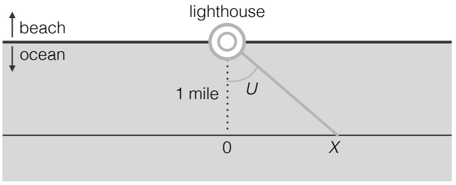

<details>
<summary>text_image</summary>

beach
lighthouse
ocean
1 mile
U
0
X
</details>

## FIGURE 8.1

A lighthouse shining light at a random angle U, viewed from above.

Solution: Looking at the right triangle in Figure 8.1, the length of the opposite side of U divided by the length of the adjacent side of $U$ is $X / 1 = X$ , so

$$
X = \tan (U).
$$

(The figure illustrates a case where $U > 0$ and, correspondingly, $X > 0$ , but the same relationship holds when $U \leq 0 . )$ Let x be a possible value of X and u be the corresponding possible value of $U$ , so

$$
x = \tan (u) \text {and} u = \arctan (x).
$$

By the change of variables formula, which applies since tan is a differentiable, strictly increasing function on $( - \pi / 2 , \pi / 2 )$ ,

$$
f _ {X} (x) = f _ {U} (u) \frac {d u}{d x} = \frac {1}{\pi} \cdot \frac {1}{1 + x ^ {2}},
$$

which shows that X is Cauchy. In particular, this implies that $E [ X ]$ is infinite (since the expected value of a Cauchy does not exist), so on average X is infinitely far from the origin of the line!

---

372

Introduction to Probability

The fact that X is Cauchy also makes sense in light of universality of the Uniform. As shown in Example 7.1.25, the Cauchy CDF is

$$
F (x) = \frac {1}{\pi} \arctan (x) + 0. 5.
$$

The inverse is $F ^ { - 1 } ( v ) = \tan \left( \pi \left( v - 0 . 5 \right) \right)$ , so for $V \sim \mathrm { U n i f } ( 0 , 1 )$ we have

$$
F ^ {- 1} (V) = \tan \left(\pi \left(V - 0. 5\right)\right) \sim \text {Cauchy}.
$$

This agrees with our earlier result since $\pi \left( V - 0 . 5 \right) \sim \mathrm { U n i f } ( - \pi / 2 , \pi / 2 ) .$

We can also use the change of variables formula to find the PDF of a location-scale transformation.

Example 8.1.6 (PDF of a location-scale transformation). Let X have PDF $f _ { X }$ and let $Y = a + b X$ , with $b \neq 0$ . Let $y = a + b x$ , to mirror the relationship between $Y$ and X. Then $\begin{array} { r } { \frac { d y } { d x } = b , } \end{array}$ so the PDF of $Y$ is

$$
f _ {Y} (y) = f _ {X} (x) \bigg | \frac {d x}{d y} \bigg | = f _ {X} \left(\frac {y - a}{b}\right) \frac {1}{| b |}.
$$

The change of variables formula generalizes to n dimensions, where it tells us how to use the joint PDF of a random vector $\mathbf { X }$ to get the joint PDF of the transformed random vector $\mathbf { Y } = g ( \mathbf { X } )$ . The formula is analogous to the one-dimensional version, but it involves a multivariate generalization of the derivative called a Jacobian matrix ; see sections A.6 and A.7 of the math appendix for more about Jacobians.

Theorem 8.1.7 (Change of variables). Let $\mathbf { X }   =   ( X _ { 1 } , \ldots , X _ { n } )$ be a continuous random vector with joint PDF $f _ { \mathbf { X } }$ . Let $g   :   A _ { 0 }   \rightarrow   B _ { 0 }$ be an invertible function, where $A _ { 0 }$ and $B _ { 0 }$ are $\mathrm { o p e n ^ { 1 } }$ subsets of $\mathbb { R } ^ { n } ,   A _ { 0 }$ contains the support of $\mathbf { X } ,$ and $B _ { 0 }$ is the range of $g .$

Let $\mathbf { Y } = g ( \mathbf { X } )$ , and mirror this by letting $\mathbf { y } = g ( \mathbf { x } )$ . Since $g$ is invertible, we also have $\mathbf { X } = g ^ { - 1 } ( \mathbf { Y } )$ and $\mathbf { x } = g ^ { - 1 } ( \mathbf { y } )$

Suppose that all the partial derivatives $\frac { \partial x _ { i } } { \partial y _ { j } }$ exist and are continuous, so we can form the Jacobian matrix

$$
\frac {\partial \mathbf {x}}{\partial \mathbf {y}} = \left( \begin{array}{c c c c} \frac {\partial x _ {1}}{\partial y _ {1}} & \frac {\partial x _ {1}}{\partial y _ {2}} & \dots & \frac {\partial x _ {1}}{\partial y _ {n}} \\ \vdots & & & \vdots \\ \frac {\partial x _ {n}}{\partial y _ {1}} & \frac {\partial x _ {n}}{\partial y _ {2}} & \dots & \frac {\partial x _ {n}}{\partial y _ {n}} \end{array} \right).
$$

Also assume that the determinant of this Jacobian matrix is never 0. Then the joint PDF of $\mathbf { Y }$ is

$$
f _ {\mathbf {Y}} (\mathbf {y}) = f _ {\mathbf {X}} \left(\mathbf {g} ^ {- 1} (\mathbf {y})\right) \cdot \left| \frac {\partial \mathbf {x}}{\partial \mathbf {y}} \right| \quad \text {for} \mathbf {y} \in B _ {0},
$$

<small><span class="docvortex-page-footnote" data-block-type="page_footnote" style="color:#6b7280">1<sub>A</sub> set C ⊂ R<sup>n</sup>is open if for each x ∈ C, there exists  > 0 such that all points with distance less than  from x are contained in C. Sometimes we take A<sub>0</sub> = B<sub>0</sub> = R<sup>n</sup>, but often we would like more flexibility for the domain and range of g. For example, if n = 2, and X<sub>1</sub> and X<sub>2</sub> have support (0, ∞), we may want to work with the open set A<sub>0</sub> = (0, ∞) × (0, ∞) rather than all of R<sup>2</sup>.</span></small>

---

Transformations

373

and 0 otherwise. (The inner bars around the Jacobian say to take the determinant and the outer bars say to take the absolute value.)

That is, to convert $f _ { \mathbf { X } } ( \mathbf { x } )$ to $f _ { \mathbf { Y } } ( \mathbf { y } )$ we express the x in $f _ { \mathbf { X } } ( \mathbf { x } )$ in terms of y and then multiply by the absolute value of the determinant of the Jacobian $\partial \mathbf { x } / \partial \mathbf { y }$

As in the 1D case,

$$
\left| \frac {\partial \mathbf {x}}{\partial \mathbf {y}} \right| = \left| \frac {\partial \mathbf {y}}{\partial \mathbf {x}} \right| ^ {- 1},
$$

so we can compute whichever of the two Jacobians is easier, and then at the end express the joint PDF of Y as a function of $\mathbf { y }$

We will not prove the change of variables formula here, but the idea is to apply the change of variables formula from multivariable calculus and the fact that if A is a region in $A _ { 0 }$ and $B = \{ g ( \mathbf { x } ) : \mathbf { x } \in A \}$ is the corresponding region in $B _ { 0 }$ , then $\mathbf { X } \in A$ is equivalent to $\mathbf { Y } \in B { \mathrm {  —  { t h e y } } }$ are the same event. So $P ( \mathbf { X } \in A ) = P ( \mathbf { Y } \in B )$ , which shows that

$$
\int_ {A} f _ {\mathbf {X}} (\mathbf {x}) d \mathbf {x} = \int_ {B} f _ {\mathbf {Y}} (\mathbf {y}) d \mathbf {y}.
$$

The change of variables formula from multivariable calculus (which is reviewed in the math appendix) can then be applied to the integral on the left-hand side, with the substitution $\mathbf { x } = g ^ { - 1 } ( \mathbf { y } )$

h 8.1.8. A crucial conceptual difference between transformations of discrete r.v.s and transformations of continuous r.v.s is that with discrete r.v.s we don’t need a Jacobian, while with continuous r.v.s we do need a Jacobian. For example, let X be a positive r.v. and $Y = X ^ { 3 }$ . If X is discrete, then

$$
P (Y = y) = P (X = y ^ {1 / 3})
$$

converts between the PMFs. But if X is continuous, we need a Jacobian (which in one dimension is just a derivative) to convert between the PDFs:

$$
f _ {Y} (y) = f _ {X} (x) \frac {d x}{d y} = f _ {X} (y ^ {1 / 3}) \frac {1}{3 y ^ {2 / 3}}.
$$

Exercise 23 is a cautionary tale about someone who failed to use a Jacobian when it was needed.

The next two examples apply the 2D change of variables formula.

Example 8.1.9 (Box-Muller). Let $U \sim \mathrm { U n i f } ( 0 , 2 \pi )$ , and let $T \sim \mathrm { E x p o ( 1 ) }$ be independent of U. Define

$$
X = \sqrt {2 T} \cos U \text {and} Y = \sqrt {2 T} \sin U.
$$

Find the joint PDF of $( X , Y )$ . Are they independent? What are their marginal distributions?

---

374

Introduction to Probability

Solution:

The joint PDF of U and $T$ is

$$
f _ {U, T} (u, t) = \frac {1}{2 \pi} e ^ {- t},
$$

for $u \in ( 0 , 2 \pi )$ and $t > 0$ . Viewing $( X , Y )$ as a point in the plane,

$$
X ^ {2} + Y ^ {2} = 2 T (\cos^ {2} U + \sin^ {2} U) = 2 T
$$

is the squared distance from the origin and $U$ is the angle; that is, $( { \sqrt { 2 T } } , U )$ expresses $( X , Y )$ in polar coordinates.

Since we can recover $( U , T )$ from $( X , Y )$ , the transformation is invertible. The Jacobian matrix

$$
\frac {\partial (x , y)}{\partial (u , t)} = \left( \begin{array}{l l} - \sqrt {2 t} \sin u & \frac {1}{\sqrt {2 t}} \cos u \\ \sqrt {2 t} \cos u & \frac {1}{\sqrt {2 t}} \sin u \end{array} \right)
$$

exists, has continuous entries, and has absolute determinant

$$
\mid - \sin^ {2} u - \cos^ {2} u \mid = 1
$$

(which is never 0). Then letting $x = { \sqrt { 2 t } }$ cos u, $y = { \sqrt { 2 t } }$ sin u to mirror the transformation from $( U , T )$ to $( X , Y )$ , we have

$$
\begin{array}{l} f _ {X, Y} (x, y) = f _ {U, T} (u, t) \cdot | \left| \frac {\partial (u , t)}{\partial (x , y)} \right| | \\ = \frac {1}{2 \pi} e ^ {- t} \cdot 1 \\ = \frac {1}{2 \pi} e ^ {- \frac {1}{2} (x ^ {2} + y ^ {2})} \\ = \frac {1}{\sqrt {2 \pi}} e ^ {- x ^ {2} / 2} \cdot \frac {1}{\sqrt {2 \pi}} e ^ {- y ^ {2} / 2}, \\ \end{array}
$$

for all real x and $y .$

The joint PDF $f _ { X , Y }$ factors into a function of x times a function of $y ,$ so $X$ and $Y$ are independent. Furthermore, we recognize the joint PDF as the product of two standard Normal PDFs, so X and Y are i.i.d. $\mathcal { N } ( 0 , 1 )$ r.v.s! This result is called the Box-Muller method for generating Normal r.v.s. 

Example 8.1.10 (Bivariate Normal joint PDF). In Chapter $7 ,$ we saw some properties of the Bivariate Normal distribution and found its joint MGF. Now let’s find its joint PDF.

Let $( Z , W )$ be BVN with $\mathcal { N } ( 0 , 1 )$ marginals and $\operatorname { C o r r } ( Z , W ) = \rho .$ (If we want the joint PDF when the marginals are not standard Normal, we can standardize both components separately and use the result below.) Assume that $- 1 < \rho < 1$ since otherwise the distribution is degenerate (with $Z$ and W perfectly correlated).

---

Transformations

375

As shown in Example 7.5.10, we can construct (Z, W) as

$$
Z = X
$$

$$
W = \rho X + \tau Y,
$$

with $\tau = \sqrt { 1 - \rho ^ { 2 } }$ and X, Y i.i.d. $\mathcal { N } ( 0 , 1 )$ . We also need the inverse transformation. Solving $Z = X$ for X, we have $X = Z .$ Plugging this into $W = \rho X   +   \tau Y$ and solving for $Y ,$ we have

$$
X = Z
$$

$$
Y = - \frac {\rho}{\tau} Z + \frac {1}{\tau} W.
$$

The Jacobian is

$$
\frac {\partial (x , y)}{\partial (z , w)} = \left( \begin{array}{c c} 1 & 0 \\ - \frac {\rho}{\tau} & \frac {1}{\tau} \end{array} \right),
$$

which has absolute determinant $1 / \tau$ . So by the change of variables formula,

$$
\begin{array}{l} f _ {Z, W} (z, w) = f _ {X, Y} (x, y) \cdot | \left| \frac {\partial (x , y)}{\partial (z , w)} \right| | \\ = \frac {1}{2 \pi \tau} \exp \left(- \frac {1}{2} (x ^ {2} + y ^ {2})\right) \\ = \frac {1}{2 \pi \tau} \exp \left(- \frac {1}{2} (z ^ {2} + (- \frac {\rho}{\tau} z + \frac {1}{\tau} w) ^ {2})\right) \\ = \frac {1}{2 \pi \tau} \exp \left(- \frac {1}{2 \tau^ {2}} (z ^ {2} + w ^ {2} - 2 \rho z w)\right), \text {for all real} z, w. \\ \end{array}
$$

In the last step we multiplied things out and used the fact that $\rho ^ { 2 } + \tau ^ { 2 } = 1$

## 8.2 Convolutions

A convolution is a sum of independent random variables. As we mentioned earlier, we often add independent r.v.s because the sum is a useful summary of an experiment (in n Bernoulli trials, we may only care about the total number of successes), and because sums lead to averages, which are also useful (in n Bernoulli trials, the proportion of successes).

The main task in this section is to determine the distribution of $T   =   X + Y$ where X and Y are independent r.v.s whose distributions are known. In previous chapters, we’ve already seen how stories and MGFs can help us accomplish this

---

376

Introduction to Probability

task. For example, we used stories to show that the sum of independent Binomials with the same success probability is Binomial, and that the sum of i.i.d. Geometrics is Negative Binomial. We used MGFs to show that a sum of independent Normals is Normal.

A third method for obtaining the distribution of $T$ is by using a convolution sum $o r$ integral. The formulas are given in the following theorem. As we’ll see, a convolution sum is nothing more than the law of total probability, conditioning on the value of either $X$ or $Y ;$ a convolution integral is analogous.

Theorem 8.2.1 (Convolution sums and integrals). Let X and $Y$ be independent r.v.s and $T = X + Y$ be their sum. If X and $Y$ are discrete, then the PMF of $T$ is

$$
\begin{array}{l} P (T = t) = \sum_ {x} P (Y = t - x) P (X = x) \\ = \sum_ {y} P (X = t - y) P (Y = y). \\ \end{array}
$$

If X and $Y$ are continuous, then the PDF of $T$ is

$$
\begin{array}{l} f _ {T} (t) = \int_ {- \infty} ^ {\infty} f _ {Y} (t - x) f _ {X} (x) d x \\ = \int_ {- \infty} ^ {\infty} f _ {X} (t - y) f _ {Y} (y) d y. \\ \end{array}
$$

Proof. For the discrete case, we use LOTP, conditioning on $X$ :

$$
\begin{array}{l} P (T = t) = \sum_ {x} P (X + Y = t | X = x) P (X = x) \\ = \sum_ {x} P (Y = t - x | X = x) P (X = x) \\ = \sum_ {x} P (Y = t - x) P (X = x). \\ \end{array}
$$

Conditioning on $Y$ instead, we obtain the second formula for the PMF of $T .$

h 8.2.2. We use the assumption that X and $Y$ are independent in order to get from $P ( Y = t - x | X = x )$ to $P ( Y = t - x )$ in the last step. We are only justified in dropping the condition $X = x$ if the conditional distribution of $Y$ given $X = x$ is the same as the marginal distribution of $Y$ , i.e., X and $Y$ are independent. A common mistake is to assume that after plugging in x for $X$ , we’ve “already used the information” that $X = x$ , when in fact we need an independence assumption to drop the condition. Otherwise we destroy information without justification.

In the continuous case, since the value of a PDF at a point is not a probability, we

---

Transformations

377

first find the CDF, and then differentiate to get the PDF. By LOTP,

$$
\begin{array}{l} F _ {T} (t) = P (X + Y \leq t) = \int_ {- \infty} ^ {\infty} P (X + Y \leq t | X = x) f _ {X} (x) d x \\ = \int_ {- \infty} ^ {\infty} P (Y \leq t - x) f _ {X} (x) d x \\ = \int_ {- \infty} ^ {\infty} F _ {Y} (t - x) f _ {X} (x) d x. \\ \end{array}
$$

Again, we need independence to drop the condition $X = x$ . To get the PDF, we then differentiate with respect to $t ,$ interchanging the order of integration and differentiation. This gives

$$
f _ {T} (t) = \int_ {- \infty} ^ {\infty} f _ {Y} (t - x) f _ {X} (x) d x.
$$

Conditioning on $Y$ instead, we get the second formula for $f _ { T }$

An alternative derivation uses the change of variables formula in two dimensions. The only snag is that the change of variables formula requires an invertible transformation from $\mathbb { R } ^ { 2 }$ to $\mathbb { R } ^ { 2 }$ , but $( X , Y ) \mapsto X + Y$ maps $\mathbb { R } ^ { 2 }$ to R and is not invertible. We can get around this by adding a redundant component to the transformation, in order to make it invertible. Accordingly, we consider the invertible transformation $( X , Y ) \mapsto ( X + Y , X )$ (using $( X , Y ) \mapsto ( X + Y , Y )$ would be equally valid). Once we have the joint PDF of $X + Y$ and $X$ , we integrate out $X$ to get the marginal PDF of $X + Y$

Let $T   =   X + Y ,   W   =   X$ , and let $t   =   x   +   y ,   w   =   x$ . It may seem redundant to give X the new name ${ } ^ { \backprime } W ^ { \flat }$ , but doing this makes it easier to distinguish between pre-transformation variables and post-transformation variables: we are transforming $( X , Y ) \mapsto ( T , W )$ . Then

$$
\frac {\partial (t , w)}{\partial (x , y)} = \left( \begin{array}{c c} 1 & 1 \\ 1 & 0 \end{array} \right)
$$

has absolute determinant equal to 1, so $\mid \left[ \frac { \partial ( x ,   y ) } { \partial ( t ,   w ) } \right] \mid$ is also 1. Thus, the joint PDF of $T$ and $W$ is

$$
f _ {T, W} (t, w) = f _ {X, Y} (x, y) = f _ {X} (x) f _ {Y} (y) = f _ {X} (w) f _ {Y} (t - w),
$$

and the marginal PDF of $T$ is

$$
f _ {T} (t) = \int_ {- \infty} ^ {\infty} f _ {T, W} (t, w) d w = \int_ {- \infty} ^ {\infty} f _ {X} (x) f _ {Y} (t - x) d x,
$$

in agreement with our result above.

h 8.2.3. It is not hard to remember the convolution integral formula by reasoning by analogy from

$$
P (T = t) = \sum_ {x} P (Y = t - x) P (X = x)
$$

---

378

Introduction to Probability

to

$$
f _ {T} (t) = \int_ {- \infty} ^ {\infty} f _ {Y} (t - x) f _ {X} (x) d x.
$$

But care is still needed. For example, Exercise 23 shows that an analogous-looking formula for the PDF of the product of two independent continuous r.v.s is wrong: a Jacobian is needed (for convolutions, the absolute Jacobian determinant is 1 so it isn’t noticeable in the convolution integral formula).

Since convolution sums are just the law of total probability, we have already used them in previous chapters without mentioning the word convolution; see, for example, the first and most tedious proof of Theorem 3.8.9 (sum of independent Binomials), as well as the proof of Theorem 4.8.1 (sum of independent Poissons). In the following examples, we find the distribution of a sum of Exponentials and a sum of Uniforms using a convolution integral.

Example 8.2.4 (Exponential convolution). Let $X , Y \stackrel { \mathrm { i . i . d . } } { \sim } \operatorname { E x p o } ( \lambda )$ . Find the distribution of $T = X + Y$

Solution:

For $t > 0$ , the convolution formula gives

$$
f _ {T} (t) = \int_ {- \infty} ^ {\infty} f _ {Y} (t - x) f _ {X} (x) d x = \int_ {0} ^ {t} \lambda e ^ {- \lambda (t - x)} \lambda e ^ {- \lambda x} d x,
$$

where we restricted the integral to be from 0 to t since we need $t - x > 0$ and $x > 0$ for the PDFs inside the integral to be nonzero. Simplifying, we have

$$
f _ {T} (t) = \lambda^ {2} \int_ {0} ^ {t} e ^ {- \lambda t} d x = \lambda^ {2} t e ^ {- \lambda t}, \text {for} t > 0.
$$

This is known as the Gamma(2, λ) distribution. We will introduce the Gamma distribution in detail in Section 8.4. 

Example 8.2.5 (Uniform convolution). Let $X , Y { \overset { \mathrm { ~ i . i . d . ~ } } { \sim } } \mathrm { U n i f } ( 0 , 1 )$ . Find the distribution of $T = X + Y$

Solution:

The PDF of X (and of Y ) is

$$
g (x) = \left\{ \begin{array}{l l} 1, & x \in (0, 1), \\ 0, & \text {otherwise}. \end{array} \right.
$$

The convolution formula gives

$$
f _ {T} (t) = \int_ {- \infty} ^ {\infty} f _ {Y} (t - x) f _ {X} (x) d x = \int_ {- \infty} ^ {\infty} g (t - x) g (x) d x.
$$

The integrand is 1 if and only if $0 < t   -   x < 1$ and $0 < x < 1$ ; this is a parallelogramshaped constraint. Equivalently, the constraint is max $( 0 , t - 1 ) < x < \operatorname* { m i n } ( t , 1 )$

---

Transformations

379

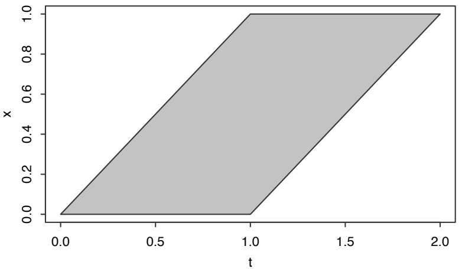

<details>
<summary>area</summary>

| t | x (Lower Bound) | x (Upper Bound) |
| --- | --- | --- |
| 0.0 | 0.0 | 0.0 |
| 1.0 | 0.0 | 1.0 |
| 2.0 | 1.0 | 1.0 |
</details>

## FIGURE 8.2

Region in the (t, x)-plane where $g(t - x)g(x)$ is 1.

From Figure 8.2, we see that for $0 < t \leq 1$ , x is constrained to be in $( 0 , t )$ , and for $1 < t < 2 ,$ x is constrained to be in $( t   -   1 , 1 )$ . Therefore, the PDF of T is a piecewise linear function:

$$
f _ {T} (t) = \left\{ \begin{array}{l l} \int_ {0} ^ {t} d x = t & \text {for} 0 <   t \leq 1, \\ \int_ {t - 1} ^ {1} d x = 2 - t & \text {for} 1 <   t <   2. \end{array} \right.
$$

Figure 8.3 plots the PDF of T. It is shaped like a triangle with vertices at 0, 1, and 2, so it is called the Triangle(0, 1, 2) distribution.

Heuristically, it makes sense that T is more likely to take on values near the middle than near the extremes: a value near 1 can be obtained if both X and Y are moderate, if X is large but Y is small, or if Y is large but X is small. In contrast, a value near 2 is only possible if both X and Y are large. Thinking back to Example 3.2.5, the PMF of the sum of two die rolls was also shaped like a triangle. A single die roll has a Discrete Uniform distribution on the integers 1 through 6, so in that problem we were looking at a convolution of two Discrete Uniforms. It makes sense that the PDF we obtained here is similar in shape. 

## 8.3 Beta

In this section and the next, we will introduce two continuous distributions, the Beta and Gamma, which are related to several named distributions we have already

---

380

Introduction to Probability

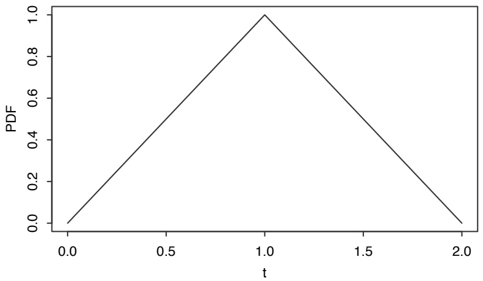

<details>
<summary>line</summary>

| t | PDF |
| --- | --- |
| 0.0 | 0.0 |
| 1.0 | 1.0 |
| 2.0 | 0.0 |
</details>

## FIGURE 8.3

PDF of $T = X + Y$ , where X and Y are i.i.d. Unif(0, 1).

studied and are also related to each other via a shared story. This is an interlude from the subject of transformations, but we’ll eventually need to use a change of variables to tie the Beta and Gamma distributions together.

The Beta distribution is a continuous distribution on the interval $( 0 , 1 )$ . It is a generalization of the $\mathrm { U n i f } ( 0 , 1 )$ distribution, allowing the PDF to be non-constant on (0, 1).

Definition 8.3.1 (Beta distribution). An r.v. X is said to have the Beta distribution with parameters a and b, where $a > 0$ and $b > 0$ , if its PDF is

$$
f (x) = \frac {1}{\beta (a , b)} x ^ {a - 1} (1 - x) ^ {b - 1}, \quad 0 <   x <   1,
$$

where the constant $\beta ( a , b )$ is chosen to make the PDF integrate to 1. We write this as $X \sim \mathrm { B e t a } ( a , b )$

Taking $a = b = 1$ , the $\mathrm { B e t a } ( 1 , 1 )$ PDF is constant on $( 0 , 1 )$ , so the Beta(1, 1) and $\mathrm { U n i f } ( 0 , 1 )$ distributions are the same. By varying the values of $a$ and $b ,$ we get PDFs with a variety of shapes; Figure 8.4 shows four examples. Here are a couple of general patterns:

• If $a < 1$ and $b < 1$ , the PDF is U-shaped and opens upward. If $a > 1$ and $b > 1$ the PDF opens down.
• If $a = b .$ the PDF is symmetric about $1 / 2$ . If $a > b ,$ the PDF favors values larger than $1 / 2 ; { \mathrm { ~ i f ~ } } a < b$ , the PDF favors values smaller than $1 / 2$

By definition, the constant $\beta ( a , b )$ satisfies

$$
\beta (a, b) = \int_ {0} ^ {1} x ^ {a - 1} (1 - x) ^ {b - 1} d x.
$$

---

Transformations

381

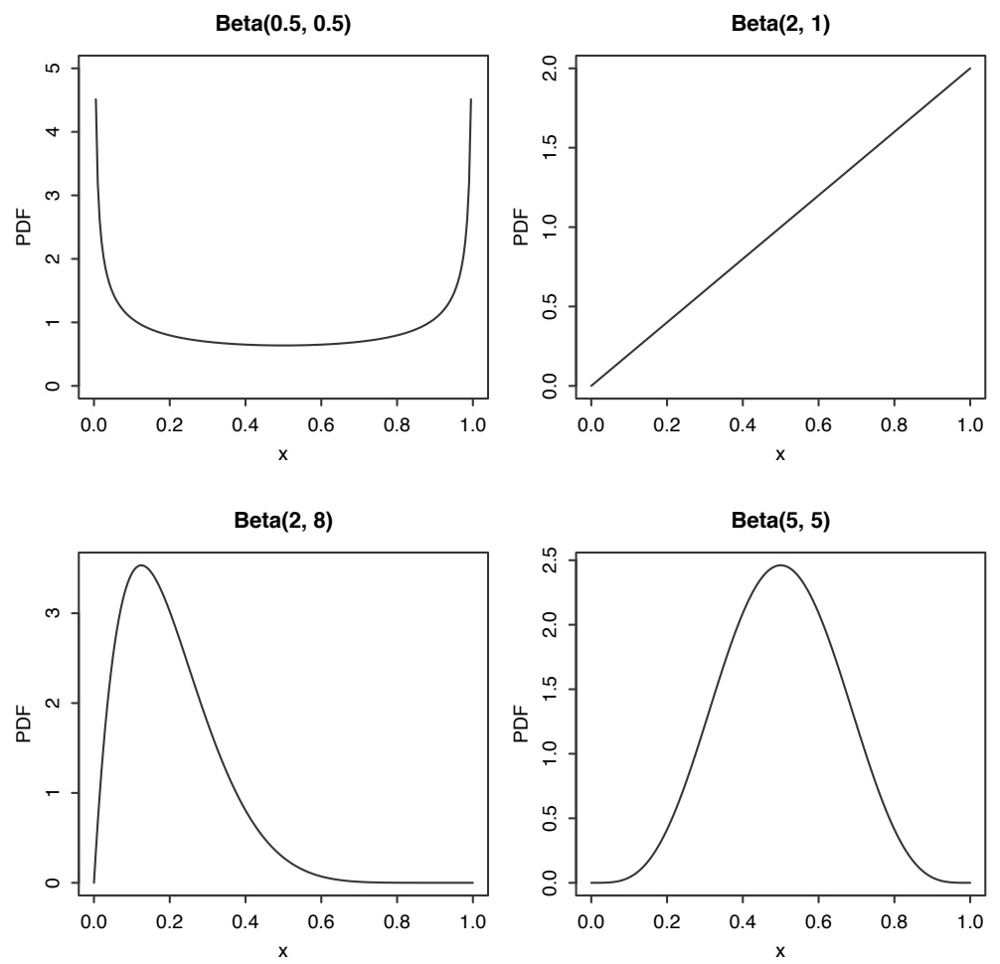

FIGURE 8.4

Beta PDFs for various values of a and b. Clockwise from top left: Beta(0.5, 0.5), Beta(2, 1), Beta(5, 5), Beta(2, 8).

---

382

Introduction to Probability

An integral of this form is called a beta integral, and we will need to do some calculus to derive a general formula for $\beta ( a , b )$ . But in the special case where a and b are positive integers, Thomas Bayes figured out how to do the integral using a story proof rather than calculus!

Story 8.3.2 (Bayes’ billiards). Show without using calculus that for any integers k and n with $0 \leq k \leq n$

$$
\int_ {0} ^ {1} \binom {n} {k} x ^ {k} (1 - x) ^ {n - k} d x = \frac {1}{n + 1}.
$$

## Solution:

By telling two stories, we will show that the left-hand and right-hand sides are both equal to $P ( X = k )$ , where X is an r.v. that we will construct.

Story 1 : Start with $n { + } 1$ balls, n white and 1 gray. Randomly throw each ball onto the unit interval [0, 1], such that the positions of the balls are i.i.d. $\mathrm { U n i f } ( 0 , 1 )$ . Let X be the number of white balls to the left of the gray ball; X is a discrete r.v. with possible values $0 , 1 , \ldots , n$ . Figure 8.5 illustrates the setup of our experiment.

To get the probability of the event $X = k$ , we use LOTP, conditioning on the position of the gray ball, which we’ll call B. Conditional on $B = p ,$ the number of white balls landing to the left of $p$ has a $\operatorname { B i n } ( n , p )$ distribution, since we can consider each of the white balls to be an independent Bernoulli trial, where success is defined as landing to the left of $p .$ Let $f$ be the PDF of $B ;   f ( p ) = 1$ since $B \sim \mathrm { U n i f } ( 0 , 1 )$ . So

$$
P (X = k) = \int_ {0} ^ {1} P (X = k | B = p) f (p) d p = \int_ {0} ^ {1} \binom{n}{k} p ^ {k} (1 - p) ^ {n - k} d p.
$$

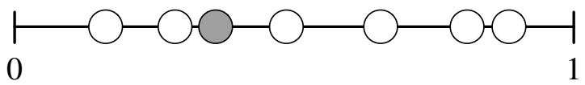

<details>
<summary>text_image</summary>

0
1
</details>

## FIGURE 8.5

Bayes’ billiards. Here we throw $n = 6$ white balls and one gray ball onto the unit interval, and we observe $X = 2$ balls to the left of the gray ball.

Story 2 : Start with $n + 1$ balls, all white. Randomly throw each ball onto the unit interval; then choose one ball at random and paint it gray. Again, let X be the number of white balls to the left of the gray ball. By symmetry, any one of the $n + 1$ balls is equally likely to be painted gray, so

$$
P (X = k) = \frac {1}{n + 1}
$$

for $k = 0 , 1 , \ldots , n .$

---

Transformations

383

Here’s the crux: X has the same distribution in the two stories! It does not matter whether we paint the gray ball first and then throw, or whether we throw first and then paint the gray ball. So $P ( X = k )$ is the same in Story 1 and Story 2, and

$$
\int_ {0} ^ {1} \binom {n} {k} p ^ {k} (1 - p) ^ {n - k} d p = \frac {1}{n + 1}
$$

for $k = 0 , 1 , \ldots , n$ . Despite the $k ^ { \prime } \mathrm { s }$ in the integrand, the value of the integral doesn’t depend on k. Substituting $a   -   1$ for k and $b   -   1$ for $n - k$ , this shows that for positive integer values of a and $b ,$

$$
\beta (a, b) = \frac {1}{(a + b - 1) \binom {a + b - 2} {a - 1}} = \frac {(a - 1) ! (b - 1) !}{(a + b - 1) !}.
$$

Later in this chapter, we’ll learn what $\beta ( a , b )$ is for general $a$ and $b .$


The Beta is a flexible family of distributions on (0, 1), and has many stories. One of these stories is that a Beta r.v. is often used to represent an unknown probability. That is, we can use the Beta to put probabilities on unknown probabilities!

Story 8.3.3 (Beta-Binomial conjugacy). We have a coin that lands Heads with probability $p ,$ but we don’t know what $p$ is. Our goal is to $i n f e r$ the value of $p$ after observing the outcomes of $n$ tosses of the coin. The larger that $n$ is, the more accurately we should be able to estimate $p .$

There are several ways to go about doing this. One major approach is Bayesian inference, which treats all unknown quantities as random variables. In the Bayesian approach, we would treat the unknown probability $p$ as a random variable and give $p$ a distribution. This is called a prior distribution, and it reflects our uncertainty about the true value of $p$ before observing the coin tosses. After the experiment is performed and the data are gathered, the prior distribution is updated using Bayes rule; this yields the posterior distribution, which reflects our new beliefs about $p .$

Let’s see what happens if the prior distribution on $p$ is a Beta distribution. Let $p \sim \mathrm { B e t a } ( a , b )$ for known constants $a$ and $b ,$ and let X be the number of Heads in n tosses of the coin. Conditional on knowing the true value of $p ,$ the tosses would just be independent Bernoulli trials with probability $p$ of success, so

$$
X | p \sim \operatorname{Bin} (n, p).
$$

Note that X is not marginally Binomial; it is conditionally Binomial, given $p .$ The marginal distribution of X is called the Beta-Binomial distribution. To get the posterior distribution of $p ,$ we use Bayes’ rule (in a hybrid form, since X is discrete and $p$ is continuous). Letting $f ( p )$ be the prior distribution and $f ( p | X = k )$ be the

---

384

Introduction to Probability

posterior distribution after observing k Heads,

$$
\begin{array}{l} f (p | X = k) = \frac {P (X = k | p) f (p)}{P (X = k)} \\ = \frac {\binom {n} {k} p ^ {k} (1 - p) ^ {n - k} \cdot \frac {1}{\beta (a , b)} p ^ {a - 1} (1 - p) ^ {b - 1}}{P (X = k)}. \\ \end{array}
$$

The denominator, which is the marginal PMF of $X$ , is given by

$$
P (X = k) = \int_ {0} ^ {1} P (X = k | p) f (p) d p = \int_ {0} ^ {1} \binom{n}{k} p ^ {k} (1 - p) ^ {n - k} f (p) d p.
$$

For $a = b = 1$ (which gives a Unif(0, 1) prior on $p )$ , we showed in the Bayes’ billiards story that $P(X = k) = 1 / (n + 1)$ , i.e., X is Discrete Uniform on $\{ 0 , 1 , \ldots , n \}$ . For $a$ and $b$ any positive integers, we can again use $\mathrm { B a y e s } ^ { \prime }$ billiards to find $P ( X = k )$ interestingly, $X$ then turns out to have a Negative Hypergeometric distribution (the story and PMF of which we saw in Example 4.4.7).

But it does not seem easy to find $P ( X = k )$ in general for real $a , b .$ Relatedly, we still have not evaluated $\beta ( a , b )$ in general. Are we stuck?

Actually, the calculation is much easier than it appears at first. The conditional PDF $f ( p | X = k )$ is a function of $p ,$ which means everything that doesn’t depend on $p$ is just a constant. We can drop all these constants and find the PDF up to a multiplicative constant (and then the normalizing constant is whatever it needs to be to make the PDF integrate to 1). This gives

$$
f (p | X = k) \propto p ^ {a + k - 1} (1 - p) ^ {b + n - k - 1},
$$

which is the Beta $( a + k , b + n - k )$ PDF, up to a multiplicative constant. Therefore, the posterior distribution of $p$ is

$$
p | X = k \sim \mathrm{Beta} (a + k, b + n - k).
$$

The posterior distribution of $p$ after observing $X = k$ is still a Beta distribution! This is a special relationship between the Beta and Binomial distributions called conjugacy: if we have a Beta prior distribution on $p$ and data that are conditionally Binomial given $p ,$ then when going from prior to posterior, we don’t leave the family of Beta distributions. We say that the Beta is the conjugate prior of the Binomial.

Furthermore, notice the very simple formula for updating the distribution of $p .$ We just add the number of observed successes, $k ,$ to the first parameter of the Beta distribution, and the number of observed failures, $n - k .$ to the second parameter. So $a$ and $b$ have a concrete interpretation in this context, at least when $a$ and $b$ are positive integers: think of $a - 1$ as the number of prior successes and $b - 1$ as the number of prior failures in earlier experiments (these prior experiments could be real or imagined). Adding on $k$ successes and $n - k$ failures from the current

---

Transformations

385

experiment, we have $a   +   k   -   1$ successes and $b   +   n   -   k   -   1$ failures, and the $\mathrm { B e t a } ( a , b )$ prior gets updated to a Beta $( a + k , b + n - k )$ posterior.

As in Section 2.6, we can sequentially update our beliefs as we get more and more evidence: we start with a prior distribution and update it to get a posterior distribution, which becomes the new prior distribution, which we update to get a new posterior distribution, etc. The beauty here is that all of this can be done within the Beta family of distributions, with easy updates to the parameters based on tallying the observed successes and failures.

For concreteness, Figure 8.6 shows the case where the prior is $\mathrm { B e t a } ( 1 , 1 )$ (which is equivalent to $\mathrm { U n i f } ( 0 , 1 )$ , as noted earlier), and we observe $n = 5$ coin tosses, all of which happen to land Heads. Then the posterior is Beta(6, 1), which is plotted on the right half of Figure 8.6. Notice how the posterior distribution incorporates the evidence from the coin tosses: larger values of $p$ have higher density, consistent with the fact that we observed all Heads.

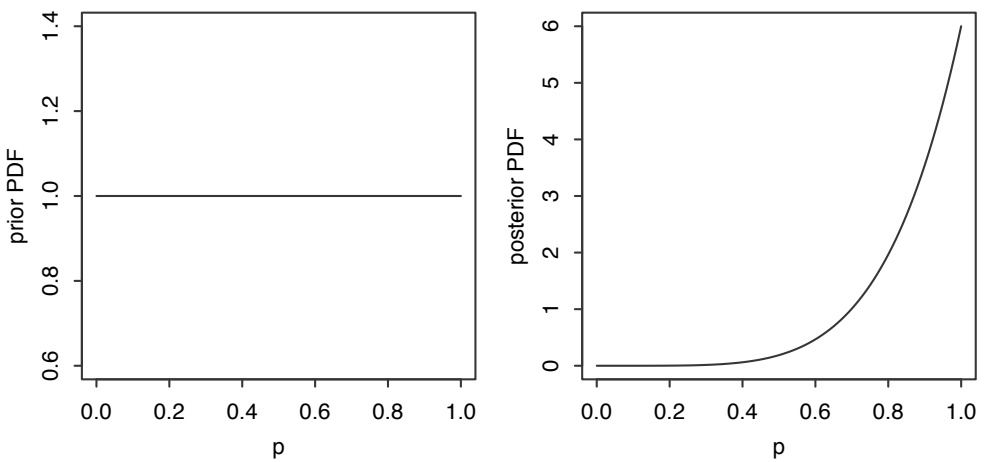

## FIGURE 8.6

Beta is conjugate prior of Binomial. Left: prior is Unif(0, 1). Right: after observing 5 Heads in 5 tosses, posterior is Beta(6, 1).

This model is a continuous analog of Example 2.3.7, our very first example of $\mathrm { B a y e s } ^ { \prime }$ rule. In that example, we also had a coin whose probability of Heads $p$ was unknown, but our prior information led us to believe that $p$ could only take on one of two possible values, $1 / 2$ or $3 / 4$ . For this reason, our prior distribution on $p -$ though we didn’t call it that at the time!—was discrete. In particular, our prior PMF was

$$
P (p = 1 / 2) = 1 / 2,
$$

$$
P (p = 3 / 4) = 1 / 2.
$$

After observing three Heads in a row, we updated this PMF to obtain the posterior PMF, which assigned a probability of 0.23 to $p   =   1 / 2$ and a probability of 0.77

---

386

Introduction to Probability

to $p = 3 / 4$ . The same logic applies to the example in this chapter, except that we now give $p$ a continuous prior distribution, which is appropriate if we believe that $p$ could possibly take on any value between 0 and 1. 

To conclude the section, here are two examples that illustrate how Beta-Binomial conjugacy and Bayes’ billiards can make some seemingly complicated problems much easier.

Example 8.3.4 (Bayes’ serum). A new treatment, Bayes’ serum, has just been developed for the disease conditionitis. A clinical trial is about to be conducted, to study how effective the treatment is. Bayes’ serum will be applied to n patients who have conditionitis. Given $p ,$ the patients’ outcomes are independent, with each patient having probability $p$ of being cured by the treatment. But $p$ is unknown. To quantify our uncertainty about $p ,$ we model $p$ as a random variable, with prior distribution $p \sim \mathrm { U n i f } ( 0 , 1 )$

(a) Find the probability that exactly k out of the n patients will be cured by the treatment (unconditionally, not given p).

(b) Now suppose that the treatment is extremely effective in the clinical trial: all n patients are cured! Given this information, find the probability that $p$ exceeds $1 / 2$ Your answer should be fully simplified, and expressed only in terms of $n .$

## Solution:

(a) By LOTP followed by Bayes’ billiards or pattern-matching to a Beta PDF, the probability is

$$
\int_ {0} ^ {1} \binom{n}{k} p ^ {k} (1 - p) ^ {n - k} d p = \frac {1}{n + 1}.
$$

(b) $\mathrm { B y }$ Beta-Binomial conjugacy, the posterior distribution of $p$ given the data is Beta $\l _ { \cdot } ( 1 + n , 1 )$ , which has PDF $( n + 1 ) p ^ { n }$ for $0 < p < 1$ . Thus,

$$
P \left(p > \frac {1}{2}\right) = \int_ {1 / 2} ^ {1} (n + 1) p ^ {n} d p = p ^ {n + 1} \Big | _ {1 / 2} ^ {1} = 1 - \frac {1}{2 ^ {n + 1}}.
$$

Example 8.3.5. A basketball player will shoot $N \; \sim \; \mathrm { P o i s } ( \lambda )$ free throws in a game tomorrow. Let $X _ { j }$ be the indicator of her making their jth free throw, and $X = X _ { 1 } + \cdots + X _ { N }$ be the total number of free throws she makes in the game (so $\overline { { X } } = 0 \; \mathrm { i f } \; N = 0 )$ To model our uncertainty about how good a free throw shooter she is, let $p \sim \mathrm { B e t a } ( a , b )$ . Given $p ,$ the player has probability $p$ of making a free throw and probability $q = 1 - p$ of missing it. Assume that $X _ { 1 } , X _ { 2 } , \ldots$ are conditionally independent given $p ,$ and that N is independent of $p , X _ { 1 } , X _ { 2 } , \ldots .$

(a) Find the conditional distribution of X given $N , p .$
(b) Find the conditional distribution of X given $p .$
(c) Find the conditional distribution of X given N, for the case $a = b = 1$
(d) Find the conditional distribution of p given X, N.

---

Transformations

387

Solution:

(a) By the story of the Binomial, $X | ( N , p ) \sim \mathrm { B i n } ( N , p )$
(b) By the chicken-egg story, $X | p \sim \mathrm { P o i s } ( \lambda p )$
(c) For $k = 0 , 1 , \ldots , n$ , by LOTP and Bayes’ billiards we have

$$
P (X = k | N = n) = \int_ {0} ^ {1} \binom {n} {k} p ^ {k} (1 - p) ^ {n - k} d p = \frac {1}{n + 1}.
$$

So the conditional distribution of X given N is Discrete Uniform on $\{ 0 , 1 , \ldots , N \}$

(d) By Beta-Binomial conjugacy, $p | ( X , N ) \sim \mathrm { B e t a } ( a + X , b + N - X )$

## 8.4 Gamma

The Gamma distribution is a continuous distribution on the positive real line; it is a generalization of the Exponential distribution. While an Exponential r.v. represents the waiting time for the first success under conditions of memorylessness, we shall see that a Gamma r.v. represents the total waiting time for multiple successes.

Before writing down the PDF, we first introduce the gamma function, a very famous function in mathematics that extends the factorial function beyond the realm of nonnegative integers.

Definition 8.4.1 (Gamma function). The gamma function Γ is defined by

$$
\Gamma (a) = \int_ {0} ^ {\infty} x ^ {a} e ^ {- x} \frac {d x}{x},
$$

for real numbers $a > 0$

We could also cancel an x and write the integrand as $x ^ { a - 1 } e ^ { - x }$ , but it turns out to be convenient having the $\frac { d x } { x }$ since it is common to make a transformation of the form $u = c x$ , and then we have the handy fact that $\begin{array} { r } { \frac { d u } { u }   =   \frac { d x } { x } } \end{array}$ . Here are two important properties of the gamma function.

$\Gamma ( a + 1 ) = a \Gamma ( a )$ for all $a > 0$ . This follows from integration by parts:

$$
\Gamma (a + 1) = \int_ {0} ^ {\infty} x ^ {a} e ^ {- x} d x = - x ^ {a} e ^ {- x} \bigg | _ {0} ^ {\infty} + a \int_ {0} ^ {\infty} x ^ {a - 1} e ^ {- x} d x = 0 + a \Gamma (a).
$$

$\Gamma ( n ) = ( n - 1 ) ! { \mathrm { ~ i f ~ } } n$ is a positive integer. This can be proved by induction, starting with $n = 1$ and using the recursive relation $\Gamma ( a   +   1 ) = a \Gamma ( a )$ . Thus, if we evaluate the gamma function at positive integer values, we recover the factorial function (albeit shifted by 1).

---

388

Introduction to Probability

Now let’s suppose that on a whim, we decide to divide both sides of the above definition by $\Gamma ( a )$ . We have

$$
1 = \int_ {0} ^ {\infty} \frac {1}{\Gamma (a)} x ^ {a} e ^ {- x} \frac {d x}{x},
$$

so the function under the integral is a valid PDF supported on $( 0 , \infty )$ . This is the definition of the PDF of the Gamma distribution. Specifically, we say that X has the Gamma distribution with parameters a and 1, denoted $X \sim \mathrm { G a m m a } ( a , 1 )$ , if its PDF is

$$
f _ {X} (x) = \frac {1}{\Gamma (a)} x ^ {a} e ^ {- x} \frac {1}{x}, \quad x > 0.
$$

From the $\mathrm { G a m m a } ( a , 1 )$ distribution, we obtain the general Gamma distribution by a scale transformation: if $X \sim \mathrm { G a m m a } ( a , 1 )$ and $\lambda > 0$ , then the distribution of $Y = X / \lambda$ is called the Gamma $( a , \lambda )$ distribution. By the change of variables formula with $x = \lambda y$ and $d x / d y = \lambda$ , the PDF of Y is

$$
f _ {Y} (y) = f _ {X} (x) \left| \frac {d x}{d y} \right| = \frac {1}{\Gamma (a)} (\lambda y) ^ {a} e ^ {- \lambda y} \frac {1}{\lambda y} \lambda = \frac {1}{\Gamma (a)} (\lambda y) ^ {a} e ^ {- \lambda y} \frac {1}{y}, \quad y > 0.
$$

This is summarized in the following definition.

Definition 8.4.2 (Gamma distribution). An r.v. Y is said to have the Gamma distribution with parameters a and λ, where $a > 0$ and $\lambda > 0$ , if its PDF is

$$
f (y) = \frac {1}{\Gamma (a)} (\lambda y) ^ {a} e ^ {- \lambda y} \frac {1}{y}, \quad y > 0.
$$

We write $Y \sim  Gamma (a, \lambda)$

Taking $a = 1$ , the Gamma(1, λ) PDF is $f(y) = \lambda e^{-\lambda y}$ for $y > 0$ , so the Gamma $( 1 , \lambda )$ and $\operatorname { E x p o } ( \lambda )$ distributions are the same. The extra parameter a allows Gamma PDFs to have a greater variety of shapes. Figure 8.7 shows four Gamma PDFs. For small values of $a ,$ the PDF is skewed, but as a increases, the PDF starts to look more symmetrical and bell-shaped; we will learn the reason for this in Chapter 10. Increasing λ compresses the PDF toward smaller values, as we can see by comparing the Gamma(3, 1) and Gamma(3, 0.5) PDFs.

Let’s find the mean, variance, and other moments of the Gamma distribution, starting with $X \sim \mathrm { G a m m a } ( a , 1 )$ . We’ll use properties of the gamma function as well as the technique of doing integrals by pattern recognition. For the mean, we write down the definition of $E ( X )$

$$
E (X) = \int_ {0} ^ {\infty} \frac {1}{\Gamma (a)} x ^ {a + 1} e ^ {- x} \frac {d x}{x},
$$

but instead of attempting a gruesome integration by parts, we recognize that after taking out $1 / \Gamma ( a )$ , what’s left is precisely the gamma function evaluated at $a + 1$ Therefore

$$
E (X) = \frac {\Gamma (a + 1)}{\Gamma (a)} = \frac {a \Gamma (a)}{\Gamma (a)} = a.
$$

---

Transformations

389

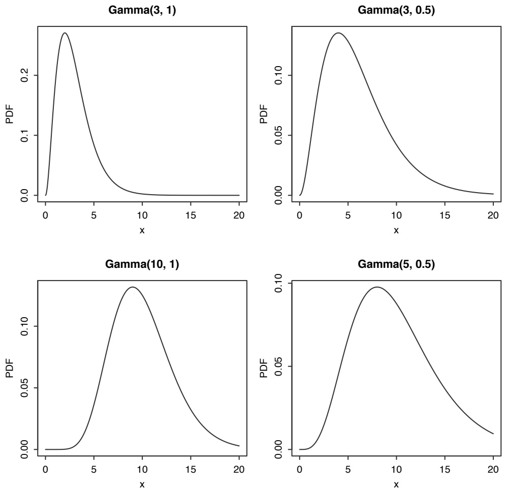

FIGURE 8.7

Gamma PDFs for various values of a and λ. Clockwise from top left: Gamma(3, 1), Gamma(3, 0.5), Gamma(5, 0.5), Gamma(10, 1).

---

390

Introduction to Probability

Similarly, for the variance, LOTUS gives us an integral expression for the second moment,

$$
E (X ^ {2}) = \int_ {0} ^ {\infty} \frac {1}{\Gamma (a)} x ^ {a + 2} e ^ {- x} \frac {d x}{x},
$$

and we recognize the gamma function evaluated at $a + 2$ . Therefore

$$
E (X ^ {2}) = \frac {\Gamma (a + 2)}{\Gamma (a)} = \frac {(a + 1) a \Gamma (a)}{\Gamma (a)} = (a + 1) a
$$

and

$$
\mathrm{Var} (X) = (a + 1) a - a ^ {2} = a.
$$

So for $X \sim \operatorname { G a m m a } ( a , 1 ) ,   E ( X ) = \operatorname { V a r } ( X ) = a .$

The cth moment is no harder than the second moment; we just use LOTUS and recognize the definition of $\Gamma ( a + c )$ . This gives

$$
E (X ^ {c}) = \int_ {0} ^ {\infty} \frac {1}{\Gamma (a)} x ^ {a + c} e ^ {- x} \frac {d x}{x} = \frac {\Gamma (a + c)}{\Gamma (a)}
$$

for all real c such that the integral converges, i.e., for $c > - a$

We can now transform to $Y = X / \lambda \sim  Gamma (a, \lambda)$ to get

$$
E (Y) = \frac {1}{\lambda} E (X) = \frac {a}{\lambda},
$$

$$
\mathrm{Var} (Y) = \frac {1}{\lambda^ {2}} \mathrm{Var} (X) = \frac {a}{\lambda^ {2}},
$$

$$
E (Y ^ {c}) = \frac {1}{\lambda^ {c}} E (X ^ {c}) = \frac {1}{\lambda^ {c}} \cdot \frac {\Gamma (a + c)}{\Gamma (a)}, \quad c > - a.
$$

Looking back at the Gamma PDF plots, they are consistent with our finding that the mean and variance are increasing in a and decreasing in λ.

So far, we’ve been learning about the Gamma distribution using the PDF, which allowed us to discern general patterns from PDF plots and to derive the mean and variance. But the PDF doesn’t provide much insight about why we’d ever use the Gamma distribution, and it doesn’t give us much of an interpretation for the parameters a and λ. For this, we need to connect the Gamma to other named distributions through stories. The rest of this section is devoted to stories for the Gamma distribution.

In the special case where a is an integer, we can represent a Gamma $( a , \lambda )$ r.v. as a sum (convolution) of i.i.d. Expo(λ) r.v.s.

Theorem 8.4.3. Let $X _ { 1 } , \ldots , X _ { n }$ be i.i.d. Expo(λ). Then

$$
X _ {1} + \dots + X _ {n} \sim \operatorname{Gamma} (n, \lambda).
$$

---

Transformations

391

Proof. The Expo(λ) MGF is $\frac { \lambda } { \lambda - t }$ for $t < \lambda$ , so the MGF of $X _ { 1 } + \dots + X _ { n }$ is

$$
M _ {n} (t) = \left(\frac {\lambda}{\lambda - t}\right) ^ {n}
$$

for $t < \lambda$ . Let $Y \sim  Gamma (n,\lambda)$ ; we’ll show that the MGF of $Y$ is the same as that of $X _ { 1 } + \dots + X _ { n }$ . By LOTUS,

$$
E (e ^ {t Y}) = \int_ {0} ^ {\infty} e ^ {t y} \frac {1}{\Gamma (n)} (\lambda y) ^ {n} e ^ {- \lambda y} \frac {d y}{y}.
$$

Again, we’ll use pattern recognition to do the integral. We just need to do algebraic manipulations until what’s left inside the integral is a recognizable Gamma PDF:

$$
\begin{array}{l} E (e ^ {t Y}) = \int_ {0} ^ {\infty} e ^ {t y} \frac {1}{\Gamma (n)} (\lambda y) ^ {n} e ^ {- \lambda y} \frac {d y}{y} \\ = \frac {\lambda^ {n}}{(\lambda - t) ^ {n}} \int_ {0} ^ {\infty} \frac {1}{\Gamma (n)} e ^ {- (\lambda - t) y} ((\lambda - t) y) ^ {n} \frac {d y}{y}. \\ \end{array}
$$

We pulled $\lambda ^ { n }$ out of the integral, then multiplied by $( \lambda   -   t ) ^ { n }$ on the inside while dividing by it on the outside. Now the expression inside the integral is the $Gamma (n,\lambda {-} t)$ PDF, assuming $t < \lambda$ . Since PDFs integrate to 1, we have

$$
E (e ^ {t Y}) = \left(\frac {\lambda}{\lambda - t}\right) ^ {n}
$$

for $t < \lambda;   if   t \geq \lambda$ the integral fails to converge.

We have shown that $X _ { 1 } + \dots + X _ { n }$ and $Y \sim  Gamma (n, \lambda)$ have the same MGF. Since the MGF determines the distribution, $X _ { 1 } + \cdots + X _ { n } \sim \operatorname { G a m m a } ( n , \lambda )$

Alternatively, we can compute the convolution integral inductively. It suffices to consider the case $\lambda = 1$ , since after having done that case we can rescale the r.v.s to prove the result for general λ. Let $T _ { n } = X _ { 1 } + \cdots + X _ { n }$ . We will show by induction that $T _ { n } \sim \mathrm { G a m m a } ( n , 1 )$ for all $n \geq 1$ . For $n = 1$ , this is true since the Gamma $( 1 , 1 )$ PDF is $e ^ { - x }$ (for $x \; > \; 0 )$ , which is the same as the Expo(1) PDF. Now assume that $T _ { n }   \sim   \mathrm { G a m m a } ( n , 1 )$ , and show that $T _ { n + 1 } \sim$ Gamma $( n + 1 , 1 )$ . The PDF of $T _ { n + 1 } = T _ { n } + X _ { n + 1 }$ is given by the convolution integral

$$
\int_ {0} ^ {\infty} f _ {T _ {n}} (x) f _ {X _ {n + 1}} (t - x) d x = \frac {1}{\Gamma (n)} \int_ {0} ^ {t} x ^ {n - 1} e ^ {- x} e ^ {- (t - x)} d x = \frac {e ^ {- t}}{\Gamma (n)} \int_ {0} ^ {t} x ^ {n - 1} d x = \frac {t ^ {n} e ^ {- t}}{\Gamma (n + 1)}
$$

for $t > 0$ , which completes the induction.

Thus, if $Y   \sim    Gamma (a, \lambda)$ with a an integer, we can represent $Y$ as a sum of i.i.d. $\operatorname { E x p o } ( \lambda ) { \mathrm { ~ r . v . s . , ~ } } X _ { 1 } + \cdots + X _ { a }$ , and get the mean and variance right away:

$$
\begin{array}{l} E (Y) = E (X _ {1} + \dots + X _ {a}) = a E (X _ {1}) = \frac {a}{\lambda}, \\ \mathrm{Var} (Y) = \mathrm{Var} (X _ {1} + \dots + X _ {a}) = a \mathrm{Var} (X _ {1}) = \frac {a}{\lambda^ {2}}, \\ \end{array}
$$

---

392

Introduction to Probability

in agreement with the results we derived earlier for general a.

Theorem 8.4.3 also allows us to connect the Gamma distribution to the story of the Poisson process. We showed in Chapter 5 that in a Poisson process of rate λ, the interarrival times are i.i.d. Expo(λ) r.v.s. But the total waiting time $T _ { n }$ for the nth arrival is the sum of the first n interarrival times; for instance, Figure 8.8 illustrates how $T _ { 3 }$ is the sum of the 3 interarrival times $X _ { 1 } , X _ { 2 } , X _ { 3 }$ . Therefore, by the theorem, $T _ { n }   \sim   \mathrm { G a m m a } ( n , \lambda )$ . The interarrival times in a Poisson process are Exponential r.v.s, while the raw arrival times are Gamma r.v.s.

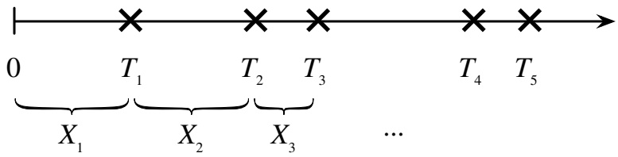

<details>
<summary>text_image</summary>

0
X₁ T₁ T₂ T₃ ... T₄ T₅
</details>

## FIGURE 8.8

Poisson process. The interarrival times $X _ { j }$ are i.i.d. Expo(λ), while the raw arrival times $T _ { j }$ are Gamma(j, λ).

h 8.4.4. Unlike the $X _ { j }$ , the $T _ { j }$ are not independent, since they are constrained to be increasing; nor are they identically distributed.

At last, we have an interpretation for the parameters of the Gamma $( a , \lambda )$ distribution. In the Poisson process story, a is the number of successes we are waiting for, and λ is the rate at which successes arrive; $Y \sim  Gamma (a, \lambda)$ is the total waiting time for the ath arrival in a Poisson process of rate λ.

A consequence of this story is that a convolution of Gammas with the same λ is still Gamma. Exercise 29 explores this fact from several perspectives.

When we introduced the Exponential distribution, we viewed it as the continuous analog of the Geometric distribution: the Geometric waits for the first success in discrete time, and the Exponential waits for the first success in continuous time. Likewise, we can now say that the Gamma distribution is the continuous analog of the Negative Binomial distribution: the Negative Binomial is a sum of Geometric waiting times, and the Gamma is a sum of Exponential waiting times. In Exercise 54 you will use MGFs to show that the Gamma distribution can be obtained as a continuous limit of the Negative Binomial distribution.

A final story about the Gamma is that it shares the same special relationship with the Poisson that the Beta shares with the Binomial: the Gamma is the conjugate prior of the Poisson. Earlier we saw that the Beta distribution can represent an unknown probability of success because its support is (0, 1). The Gamma distribution, on the other hand, can represent an unknown rate in a Poisson process because its support is (0, ∞).

---

Transformations

393

To investigate, we’ll return to Blotchville, where buses arrive in a Poisson process of rate λ. Previously it was assumed that $\lambda = 1 / 1 0$ , so that the times between buses were i.i.d. Exponentials with mean 10 minutes, but now we’ll assume Fred doesn’t know the rate λ at which buses arrive and needs to figure it out. Fred will follow the Bayesian approach and treat the unknown rate as a random variable.

Story 8.4.5 (Gamma-Poisson conjugacy). In Blotchville, buses arrive at a certain bus stop according to a Poisson process with rate λ buses per hour, where λ is unknown. Based on his very memorable adventures in Blotchville, Fred quantifies his uncertainty about λ using the prior $\lambda   \sim   \mathrm { G a m m a } ( r _ { 0 } , b _ { 0 } )$ , where $r _ { 0 }$ and $b _ { 0 }$ are known, positive constants with $r _ { 0 }$ an integer.

To better understand the bus system, Fred wants to learn more about λ. He is a very patient person, and decides that he will sit at the bus stop for t hours and count how many buses arrive in this time interval. Let Y be the number of buses in this time interval, and suppose Fred observes that $Y = y$

(a) Find Fred’s hybrid joint distribution for Y and λ.
(b) Find Fred’s marginal distribution for $Y .$
(c) Find Fred’s posterior distribution for λ, i.e., his conditional distribution of λ given the data y.
(d) Find Fred’s posterior mean $E ( \lambda | Y = y )$ and posterior variance $\operatorname { V a r } ( \lambda | Y = y )$

Solution: Notice the similarities between the structure of this problem and that of the hybrid joint distribution from Example 7.1.26. We know that $\lambda \sim \mathrm { G a m m a } ( r _ { 0 } , b _ { 0 } )$ marginally, and by definition of Poisson process, conditional on knowing the true rate $\lambda ,$ the number of buses in an interval of length t is distributed Pois(λt). In other words, what we’re given is

$$
\begin{array}{l} \lambda \sim \mathrm{Gamma} (r _ {0}, b _ {0}) \\ Y | \lambda \sim \mathrm{Pois} (\lambda t). \\ \end{array}
$$

Then we are asked to flip it around: find the marginal distribution of Y and the conditional distribution of λ given $Y = y$ , which is the posterior distribution. This is characteristic of Bayesian inference: we have a prior distribution for the unknown parameters (in this case, a Gamma distribution for λ) and a model for the data conditional on the unknown parameters (in this case, a Poisson distribution for Y given λ), and we use Bayes’ rule to get the distribution of the unknowns conditional on the observed data. So let’s get started.

(a) Let $f _ { 0 }$ be the prior PDF of λ. The hybrid joint distribution of $Y$ and λ is

$$
f (y, \lambda) = P (Y = y | \lambda) f _ {0} (\lambda) = \frac {e ^ {- \lambda t} (\lambda t) ^ {y}}{y !} \frac {(b _ {0} \lambda) ^ {r _ {0}} e ^ {- b _ {0} \lambda}}{\lambda \Gamma (r _ {0})},
$$

for $y = 0 , 1 , 2 , \ldots$ . and $\lambda > 0$ . The hybrid joint distribution is plotted in Figure 8.9;

---

394

Introduction to Probability

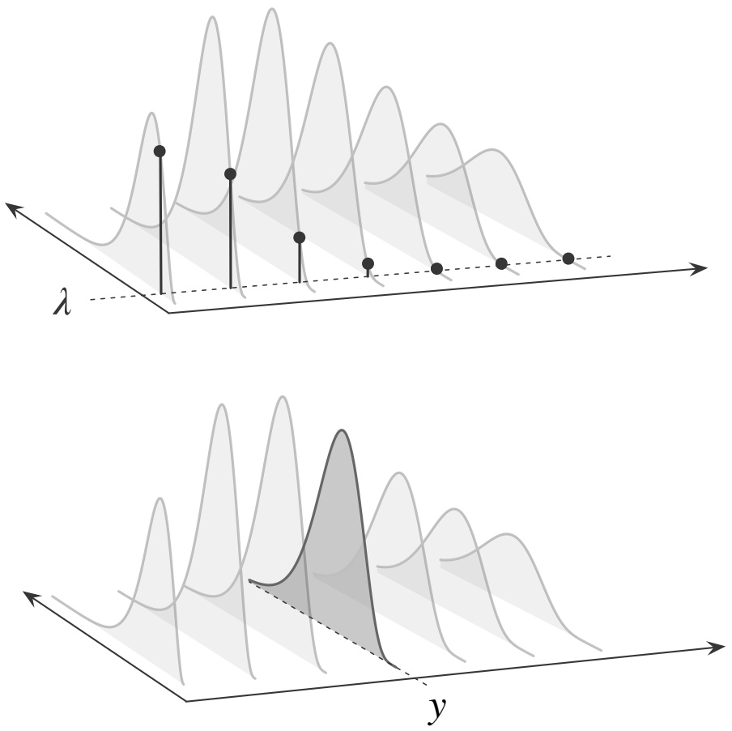

## FIGURE 8.9

Hybrid joint distribution of Y and λ. (a) Conditioning on a particular value of $\lambda ,$ the relative heights form a Poisson PMF. (b) In the other direction, conditioning on $Y = y$ gives the posterior distribution of λ.

there is a conditional PMF of Y for every value of λ and a conditional PDF of λ for every value of $Y$

(b) To get the marginal PMF of $Y .$ , we integrate out λ from the hybrid joint distribution; this is also a form of LOTP. This gives

$$
\begin{array}{l} P (Y = y) = \int_ {0} ^ {\infty} P (Y = y | \lambda) f _ {0} (\lambda) d \lambda \\ = \int_ {0} ^ {\infty} \frac {e ^ {- \lambda t} (\lambda t) ^ {y}}{y !} \frac {(b _ {0} \lambda) ^ {r _ {0}} e ^ {- b _ {0} \lambda}}{\Gamma (r _ {0})} \frac {d \lambda}{\lambda}. \\ \end{array}
$$

Let’s do the integral by pattern recognition, focusing in on the terms involving λ. We spot $\lambda ^ { r _ { 0 } + y }$ and $e ^ { - ( b _ { 0 } + t ) \lambda }$ lurking in the integrand, which suggests patternmatching to a Gamma $( r _ { 0 }   +   y , b _ { 0 }   +   t )$ PDF. Pull out all the terms that don’t depend on λ, then multiply by whatever it takes to get the desired PDF inside the integral,

---

Transformations

395

remembering to multiply by the reciprocal on the outside:

$$
\begin{array}{l} P (Y = y) = \frac {t ^ {y} b _ {0} ^ {r _ {0}}}{y ! \Gamma (r _ {0})} \int_ {0} ^ {\infty} e ^ {- (b _ {0} + t) \lambda} \lambda^ {r _ {0} + y} \frac {d \lambda}{\lambda} \\ = \frac {\Gamma (r _ {0} + y)}{y ! \Gamma (r _ {0})} \frac {t ^ {y} b _ {0} ^ {r _ {0}}}{(b _ {0} + t) ^ {r _ {0} + y}} \int_ {0} ^ {\infty} \frac {1}{\Gamma (r _ {0} + y)} e ^ {- (b _ {0} + t) \lambda} ((b _ {0} + t) \lambda) ^ {r _ {0} + y} \frac {d \lambda}{\lambda} \\ = \frac {(r _ {0} + y - 1) !}{(r _ {0} - 1) ! y !} \left(\frac {t}{b _ {0} + t}\right) ^ {y} \left(\frac {b _ {0}}{b _ {0} + t}\right) ^ {r _ {0}}. \\ \end{array}
$$

In the last step, we used the property $\Gamma ( n ) = ( n - 1 ) !$ , which is applicable because $r _ { 0 }$ is an integer. This is the NBin $( r _ { 0 } , b _ { 0 } / ( b _ { 0 } + t ) )$ PMF, so the marginal distribution of $Y$ is Negative Binomial with parameters $r _ { 0 }$ and $b _ { 0 } / ( b _ { 0 } + t )$

(c) By Bayes’ rule, the posterior PDF of λ is given by

$$
f _ {1} (\lambda | y) = \frac {P (Y = y | \lambda) f _ {0} (\lambda)}{P (Y = y)}.
$$

We found $P ( Y = y )$ in the previous part, but since it does not depend on $\lambda ,$ we can just treat it as part of the normalizing constant. Absorbing this and other multiplicative factors that don’t depend on λ into the normalizing constant,

$$
f _ {1} (\lambda | y) \propto e ^ {- \lambda t} \lambda^ {y} \lambda^ {r _ {0}} e ^ {- b _ {0} \lambda} \frac {1}{\lambda} = e ^ {- (b _ {0} + t) \lambda} \lambda^ {r _ {0} + y} \frac {1}{\lambda},
$$

which shows that the posterior distribution of $\lambda$ is $\operatorname { G a m m a } ( r _ { 0 } + y , b _ { 0 } + t )$

When going from prior to posterior, the distribution of $\lambda$ stays in the Gamma family, so the Gamma is indeed the conjugate prior for the Poisson.

Now that we have the posterior PDF of $\lambda ,$ we have a more elegant approach to solving (b). Rearranging Bayes’ rule, the marginal PMF of $Y$ is

$$
P (Y = y) = \frac {P (Y = y | \lambda) f _ {0} (\lambda)}{f _ {1} (\lambda | y)},
$$

where we know the numerator from the statement of the problem and the denominator from the calculation we just did. Plugging in these ingredients and simplifying again yields

$$
Y \sim \mathrm{NBin} (r _ {0}, b _ {0} / (b _ {0} + t)).
$$

(d) Since conditional PDFs are PDFs, it is perfectly fine to calculate the expectation and variance of $\lambda$ with respect to the posterior distribution. The mean and variance of the Gamma $. ( r _ { 0 } + y , b _ { 0 } + t )$ distribution give us

$$
E (\lambda | Y = y) = \frac {r _ {0} + y}{b _ {0} + t} \quad \text {and} \quad \operatorname{Var} (\lambda | Y = y) = \frac {r _ {0} + y}{(b _ {0} + t) ^ {2}}.
$$

This example gives another interpretation for the parameters in a Gamma when

---

396

Introduction to Probability

it is being used as a conjugate prior. Fred’s $\operatorname { G a m m a } ( r _ { 0 } , b _ { 0 } )$ prior got updated to a Gamma $( r _ { 0 }   +   y , b _ { 0 }   +   t )$ posterior after observing y arrivals in t hours. We can imagine that in the past, Fred observed $r _ { 0 }$ buses arrive in $b _ { 0 }$ hours; then after the new data, he has observed $r _ { 0 } + y$ buses in $b _ { 0 } + t$ hours. So we can interpret $r _ { 0 }$ as the number of prior arrivals and $b _ { 0 }$ as the total time required for those prior arrivals. 

## 8.5 Beta-Gamma connections

In this section, we will unite the Beta and Gamma distributions with a common story. As an added bonus, the story will give us an expression for the normalizing constant of the Beta $( a , b )$ PDF in terms of gamma functions, and it will allow us to easily find the expectation of the Beta $( a , b )$ distribution.

Story 8.5.1 (Bank–post office). While running errands, you need to go to the bank, then to the post office. Let $X \sim  Gamma (a, \lambda)$ be your waiting time in line at the bank, and let $Y   \sim    Gamma (b, \lambda)$ be your waiting time in line at the post office (with the same λ for both). Assume X and $Y$ are independent. What is the joint distribution of $T = X + Y$ (your total wait at the bank and post office) and $\begin{array} { r } { W = \frac { X } { X + Y } } \end{array}$ (the fraction of your waiting time spent at the bank)?

Solution:

We’ll do a change of variables in two dimensions to get the joint PDF of $T$ and $W$ Let $\begin{array} { r } { t = x + y ,   w = \frac { x } { x + y } } \end{array}$ . Then $x = t w , y = t ( 1 - w )$ , and

$$
\frac {\partial (x , y)}{\partial (t , w)} = \left( \begin{array}{c c} w & t \\ 1 - w & - t \end{array} \right),
$$

which has an absolute determinant of t. Therefore

$$
\begin{array}{l} f _ {T, W} (t, w) = f _ {X, Y} (x, y) \cdot | \left| \frac {\partial (x , y)}{\partial (t , w)} \right| | \\ = f _ {X} (x) f _ {Y} (y) \cdot t \\ = \frac {1}{\Gamma (a)} (\lambda x) ^ {a} e ^ {- \lambda x} \frac {1}{x} \cdot \frac {1}{\Gamma (b)} (\lambda y) ^ {b} e ^ {- \lambda y} \frac {1}{y} \cdot t \\ = \frac {1}{\Gamma (a)} (\lambda t w) ^ {a} e ^ {- \lambda t w} \frac {1}{t w} \cdot \frac {1}{\Gamma (b)} (\lambda t (1 - w)) ^ {b} e ^ {- \lambda t (1 - w)} \frac {1}{t (1 - w)} \cdot t. \\ \end{array}
$$

Let’s group all the terms involving w together, and all the terms involving t together:

$$
\begin{array}{l} f _ {T, W} (t, w) = \frac {1}{\Gamma (a) \Gamma (b)} w ^ {a - 1} (1 - w) ^ {b - 1} (\lambda t) ^ {a + b} e ^ {- \lambda t} \frac {1}{t} \\ = \left(\frac {\Gamma (a + b)}{\Gamma (a) \Gamma (b)} w ^ {a - 1} (1 - w) ^ {b - 1}\right) \left(\frac {1}{\Gamma (a + b)} (\lambda t) ^ {a + b} e ^ {- \lambda t} \frac {1}{t}\right), \\ \end{array}
$$

---

Transformations

397

for $0   <   w   <   1$ and $t \; > \; 0$ . The form of the joint PDF, together with Proposition 7.1.21, tells us several things:

1. Since the joint PDF factors into a function of t times a function of $w ,$ we have that T and W are independent: the total waiting time is independent of the fraction of time spent at the bank.
2. We recognize the marginal PDF of T and deduce that $T \sim  Gamma (a + b, \lambda)$
3. The PDF of W is

$$
f _ {W} (w) = \frac {\Gamma (a + b)}{\Gamma (a) \Gamma (b)} w ^ {a - 1} (1 - w) ^ {b - 1}, \quad 0 <   w <   1,
$$

by Proposition 7.1.21 or just by integrating out $T$ from the joint PDF of $T$ and $W$ . This PDF is proportional to the $\mathrm { B e t a } ( a , b )$ PDF, so it is the $\mathrm { B e t a } ( a , b )$ PDF! Note that as a byproduct of the calculation we have just done, we have found the normalizing constant of the Beta distribution:

$$
\frac {1}{\beta (a , b)} = \frac {\Gamma (a + b)}{\Gamma (a) \Gamma (b)}
$$

is the constant that goes in front of the Beta(a, b) PDF.

To summarize, the bank–post office story tells us that when we add independent Gamma r.v.s X and Y with the same rate λ, the total $X   +   Y$ has a Gamma distribution, the fraction $X / ( X + Y )$ has a Beta distribution, and the total is independent of the fraction.

We can use this result to find the mean of $W   \sim   \mathrm { B e t a } ( a , b )$ without the slightest trace of calculus.

Example 8.5.2 (Beta expectation). With notation as above, note that since $T$ and $W$ are independent, they are uncorrelated: $E ( T W ) = E ( T ) E ( W )$ . Writing this in terms of X and Y , we have

$$
\begin{array}{l} E \left((X + Y) \cdot \frac {X}{X + Y}\right) = E (X + Y) E \left(\frac {X}{X + Y}\right), \\ E (X) = E (X + Y) E \left(\frac {X}{X + Y}\right), \\ \frac {E (X)}{E (X + Y)} = E \left(\frac {X}{X + Y}\right). \\ \end{array}
$$

Ordinarily, the last equality would be a horrendous blunder: faced with an expectation like $E ( X / ( X + Y ) )$ , we are not generally permitted to move the E into the numerator and denominator as we please. In this case, however, the bank–post office story justifies the move, so finding the expectation of $W$ happily reduces to finding the expectations of $X$ and $X + Y$

$$
E (W) = E \left(\frac {X}{X + Y}\right) = \frac {E (X)}{E (X + Y)} = \frac {a / \lambda}{a / \lambda + b / \lambda} = \frac {a}{a + b}.
$$

---

398

Introduction to Probability

Another approach is to proceed from the definition of expectation:

$$
E (W) = \int_ {0} ^ {1} \frac {\Gamma (a + b)}{\Gamma (a) \Gamma (b)} w ^ {a} (1 - w) ^ {b - 1} d w.
$$

By pattern recognition, the integrand is a $\mathrm { B e t a } ( a + 1 , b )$ PDF, up to a normalizing constant. After obtaining an exact match for the PDF, we apply properties of the gamma function:

$$
\begin{array}{l} E (W) = \frac {\Gamma (a + b)}{\Gamma (a)} \frac {\Gamma (a + 1)}{\Gamma (a + b + 1)} \int_ {0} ^ {1} \frac {\Gamma (a + b + 1)}{\Gamma (a + 1) \Gamma (b)} w ^ {a} (1 - w) ^ {b - 1} d w \\ = \frac {\Gamma (a + b)}{\Gamma (a)} \frac {a \Gamma (a)}{(a + b) \Gamma (a + b)} \\ = \frac {a}{a + b}. \\ \end{array}
$$

In Exercise 30, you will use this approach to find the variance and the other moments of the Beta distribution. 

Now that we know the Beta normalizing constant, we can also quickly obtain the PMF of the Beta-Binomial distribution.

Example 8.5.3 (Beta-Binomial PMF). Let $X | p \sim \operatorname { B i n } ( n , p )$ , with $p \sim \mathrm { B e t a } ( a , b )$ As mentioned in Story 8.3.3, X has a Beta-Binomial distribution. Find the marginal distribution of X.

Solution: Let $f ( p )$ be the Beta $( a , b )$ PDF. Then

$$
\begin{array}{l} P (X = k) = \int_ {0} ^ {1} P (X = k | p) f (p) d p \\ = \frac {1}{\beta (a , b)} \int_ {0} ^ {1} \binom{n}{k} p ^ {k} (1 - p) ^ {n - k} p ^ {a - 1} (1 - p) ^ {b - 1} d p \\ = \frac {\binom {n} {k}}{\beta (a , b)} \int_ {0} ^ {1} p ^ {a + k - 1} (1 - p) ^ {b + n - k - 1} d p \\ = \binom {n} {k} \frac {\beta (a + k , b + n - k)}{\beta (a , b)}, \\ \end{array}
$$

for $k = 0 , 1 , \ldots , n .$

## 8.6 Order statistics

The final transformation we will consider in this chapter is the transformation that takes n random variables $X _ { 1 } , \ldots , X _ { n }$ and sorts them in order, producing the

---

Transformations

399

transformed r.v.s min $( X _ { 1 } , \ldots , X _ { n } ) , \ldots , \operatorname* { m a x } ( X _ { 1 } , \ldots , X _ { n } )$ . The transformed r.v.s are called the order statistics,<sup>2</sup> and they are often useful when we are concerned with the distribution of extreme values, as we alluded to earlier.

Furthermore, like the sample mean ${ \bar { X } } _ { n } ,$ the order statistics serve as useful summaries of an experiment, since we can use them to determine the cutoffs for the worst 5% of observations, the worst 25%, the best 25%, and so forth (such cutoffs are called the quantiles of the sample).

Definition 8.6.1 (Order statistics). For r.v.s $X _ { 1 } , X _ { 2 } , \ldots , X _ { n }$ , the order statistics are the random variables $X _ { ( 1 ) } , X _ { ( 2 ) } , \ldots , X _ { ( n ) }$ , where

$$
\begin{array}{l} X _ {(1)} = \min (X _ {1}, \dots , X _ {n}), \\ X _ {(2)} \text {is the second - smallest of} X _ {1}, \dots , X _ {n}, \\ \begin{array}{c}\bullet \\ \bullet \\ \bullet \end{array} \\ X _ {(n - 1)} \text {   is   the   second - largest   of   } X _ {1}, \dots , X _ {n}, \\ X _ {(n)} = \max (X _ {1}, \dots , X _ {n}). \\ \end{array}
$$

Note that $X _ { ( 1 ) } \; \leq \; X _ { ( 2 ) } \; \leq \; \ldots \; \leq \; X _ { ( n ) }$ by definition. We call $X _ { ( j ) }$ the $j t h$ order statistic. If n is odd, $X _ { ( ( n + 1 ) / 2 ) }$ is called the sample median of $X _ { 1 } , \ldots , X _ { n }$

h 8.6.2. The order statistics $X _ { ( 1 ) } , \ldots , X _ { ( n ) }$ are r.v.s, and each $X _ { ( j ) }$ is a function of $X _ { 1 } , \ldots , X _ { n }$ . Even if the original r.v.s are independent, the order statistics are dependent: if we know that $X _ { ( 1 ) } = 1 0 0$ , then $X _ { ( n ) }$ is forced to be at least 100.

We will focus our attention on the case where $X _ { 1 } , \ldots , X _ { n }$ are i.i.d. continuous r.v.s. The reason is that with discrete r.v.s, there is a positive probability of tied values; with continuous r.v.s, the probability of a tie is exactly 0, which makes matters much easier. Thus, for the rest of this section, assume $X _ { 1 } , \ldots , X _ { n }$ are i.i.d. and continuous, with CDF $F$ and PDF f. We will derive the marginal CDF and PDF of each individual order statistic $X _ { ( j ) }$ , as well as the joint PDF of $( X _ { ( 1 ) } , \ldots , X _ { ( n ) } )$

A complication we run into right away is that the transformation to order statistics is not invertible: starting with min $( X , Y )   =   3$ and max $( X , Y )   =   5$ , we can’t tell whether the original values of X and Y were 3 and 5, respectively, or 5 and 3. Therefore the change of variables formula from $\mathbb { R } ^ { n }$ to $\mathbb { R } ^ { n }$ does not apply. Instead we will take a direct approach, using pictures to guide us when necessary.

Let’s start with the CDF of $X _ { ( n ) } { = } \operatorname* { m a x } ( X _ { 1 } , \ldots X _ { n } )$ . Since $X _ { ( n ) }$ is less than x if

<small><span class="docvortex-page-footnote" data-block-type="page_footnote" style="color:#6b7280"><sup>2</sup>This term sometimes causes confusion. In statistics (the field of study), any function of the data is called a statistic. If X<sub>1</sub>, . . . , X<sub>n</sub> are the data, then min(X<sub>1</sub>, . . . , X<sub>n</sub>) is a statistic, and so is max(X<sub>1</sub>, . . . , X<sub>n</sub>). They are called order statistics because we get them by sorting the data in order (from smallest to largest).</span></small>

---

400

Introduction to Probability

and only if all of the $X _ { j }$ are less than x, the CDF of $X _ { ( n ) }$ is

$$
\begin{array}{l} F _ {X _ {(n)}} (x) = P (\max (X _ {1}, \dots , X _ {n}) \leq x) \\ = P (X _ {1} \leq x, \dots , X _ {n} \leq x) \\ = P (X _ {1} \leq x) \dots P (X _ {n} \leq x) \\ = (F (x)) ^ {n}, \\ \end{array}
$$

where F is the CDF of the individual $X _ { i }$ . Similarly, $X _ { ( 1 ) } = \operatorname* { m i n } ( X _ { 1 } , \ldots , X _ { n } )$ exceeds x if and only if all of the $X _ { j }$ exceed x, so the CDF of $X _ { ( 1 ) }$ is

$$
\begin{array}{l} F _ {X _ {(1)}} (x) = 1 - P (\min (X _ {1}, \dots , X _ {n}) > x) \\ = 1 - P (X _ {1} > x, \dots , X _ {n} > x) \\ = 1 - (1 - F (x)) ^ {n}. \\ \end{array}
$$

The same logic lets us find the CDF of $X _ { ( j ) }$ . For the event $X _ { ( j ) } \; \leq \; x$ to occur, we need at least $j$ of the $X _ { i }$ to fall to the left of x. This is illustrated in Figure 8.10.

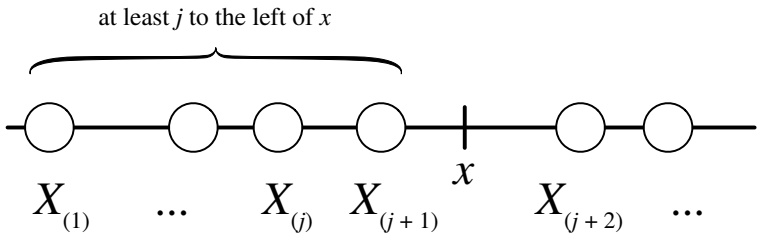

<details>
<summary>text_image</summary>

at least j to the left of x
X(1) ... X(j) X(j+1) x X(j+2) ...
</details>

## FIGURE 8.10

The event $X _ { ( j ) } \leq x$ is equivalent to the event $\mathrm { { ` a t } }$ least j $X _ { i } { } ^ { \flat } \mathrm { s }$ fall to the left of $x ^ { \flat }$

Since it appears that the number of $X _ { i }$ to the left of x will be important to us, let’s define a new random variable, N, to keep track of just that: define N to be the number of $X _ { i }$ that land to the left of x. Each $X _ { i }$ lands to the left of x with probability $F ( x )$ , independently. If we define success as landing to the left of $x ,$ we have n independent Bernoulli trials with probability $F ( x )$ of success, so $N \sim \mathrm { B i n } ( n , F ( x ) )$ . Then, by the Binomial PMF,

$$
\begin{array}{l} P (X _ {(j)} \leq x) = P (\text {at least} j \text {of the} X _ {i} \text {are to the left of} x) \\ = P (N \geq j) \\ = \sum_ {k = j} ^ {n} \binom {n} {k} F (x) ^ {k} (1 - F (x)) ^ {n - k}. \\ \end{array}
$$

We thus have the following result for the CDF of $X _ { ( j ) }$

Theorem 8.6.3 (CDF of order statistic). Let $X _ { 1 } , \ldots , X _ { n }$ be i.i.d. continuous r.v.s with CDF F. Then the CDF of the jth order statistic $X _ { ( j ) }$ is

$$
P (X _ {(j)} \leq x) = \sum_ {k = j} ^ {n} \binom{n}{k} F (x) ^ {k} (1 - F (x)) ^ {n - k}.
$$

---

Transformations

401

To get the PDF of $X _ { ( j ) }$ , we can differentiate the CDF with respect to $x ,$ but the resulting expression is ugly (though it can be simplified). Instead we will take a more direct approach. Consider $f_{X_{(j)}}(x)dx$ , the probability that the jth order statistic falls into an infinitesimal interval of length dx around x. The only way this can happen is illustrated in Figure 8.11. We need one of the $X _ { i }$ to fall into the infinitesimal interval around x, and we need exactly $j - 1$ of the $X _ { i }$ to fall to the left of x, leaving the remaining $n - j$ to fall to the right of x.

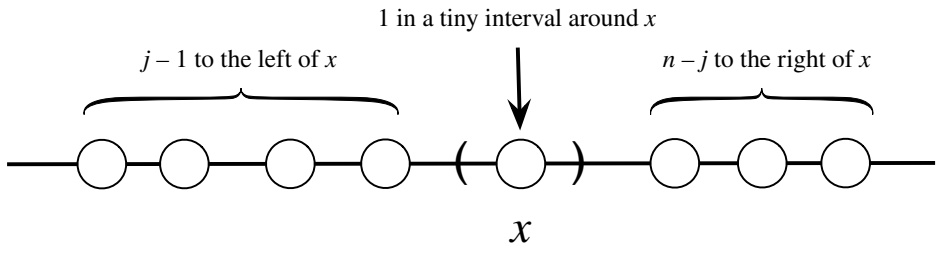

<details>
<summary>text_image</summary>

j - 1 to the left of x
1 in a tiny interval around x
n - j to the right of x
x
</details>

## FIGURE 8.11

In order for $X _ { ( j ) }$ to fall within a small interval of $x ,$ we require that one of the $X _ { i }$ fall within the small interval and that exactly $j - 1$ fall to the left of $x .$

What is the probability of this extremely specific event? Let’s break up the experiment into stages.

• First, we choose which one of the $X _ { i }$ will fall into the infinitesimal interval around x. There are n such choices, each of which occurs with probability $f ( x ) d x$ , where $f$ is the PDF of the $X _ { i }$
• Next, we choose exactly $j - 1$ out of the remaining $n - 1$ to fall to the left of x. There are ${ \binom { n - 1 } { j - 1 } }$ such choices, each with probability $F ( x ) ^ { j - 1 } ( 1 - F ( x ) ) ^ { n - j }$ by the Bin $( n , F ( x ) \tilde { ) } \; \mathrm { \vec { P } M F }$

We multiply the probabilities of the two stages to get

$$
f _ {X _ {(j)}} (x) d x = n f (x) d x \binom {n - 1} {j - 1} F (x) ^ {j - 1} (1 - F (x)) ^ {n - j}.
$$

Dropping the $d x ^ { \flat } \mathrm { s }$ from both sides gives us the PDF we desire.

Theorem 8.6.4 (PDF of order statistic). Let $X _ { 1 } , \ldots , X _ { n }$ be i.i.d. continuous r.v.s with CDF F and PDF f. Then the marginal PDF of the jth order statistic $X _ { ( j ) }$ is

$$
f _ {X _ {(j)}} (x) = n \binom {n - 1} {j - 1} f (x) F (x) ^ {j - 1} (1 - F (x)) ^ {n - j}.
$$

In general, the order statistics of $X _ { 1 } , \ldots , X _ { n }$ will not follow a named distribution, but the order statistics of the standard Uniform distribution are an exception.

---

402

Introduction to Probability

Example 8.6.5 (Order statistics of Uniforms). Let $U _ { 1 } , \ldots , U _ { n }$ be i.i.d. Unif(0, 1). Then for $0 \leq x \leq 1,   f(x) = 1$ and $F ( x ) = x ,$ so the PDF of $U _ { ( j ) }$ is

$$
f _ {U _ {(j)}} (x) = n \binom {n - 1} {j - 1} x ^ {j - 1} (1 - x) ^ {n - j}.
$$

This is the Beta $( j , n - j + 1 )$ PDF! So $U _ { ( j ) } \sim \mathrm { B e t a } ( j , n - j + 1 )$ , and $\begin{array} { r } { E ( U _ { ( j ) } ) = \frac { j } { n + 1 } } \end{array}$

The simple case $n = 2$ is consistent with Example 7.2.2, where we used 2D LOTUS to show that for i.i.d. $U _ { 1 } , U _ { 2 } \sim \mathrm { U n i f } ( 0 , 1 )$ ,

$$
E (\max (U _ {1}, U _ {2})) = 2 / 3, E (\min (U _ {1}, U _ {2})) = 1 / 3.
$$

Now that we know max $( U _ { 1 } , U _ { 2 } )$ and min $\left( U _ { 1 } , U _ { 2 } \right)$ follow Beta distributions, the expectation of the Beta distribution confirms our earlier findings. 

## 8.7 Recap

In this chapter we discussed three broad classes of transformations:

• invertible transformations $\mathbf { Y } = g ( \mathbf { X } )$ of continuous random vectors, which can be handled with the change of variables formula (under some technical assumptions, most notably that the partial derivatives $\partial x _ { i } / \partial y _ { j }$ exist and are continuous);
• convolutions, for which we can determine the distribution using (in decreasing order of preference) stories, MGFs, or convolution sums/integrals;
• the transformation of i.i.d. continuous r.v.s to their order statistics.

Figure 8.12 illustrates connections between the original random vector $( X , Y )$ and the transformed random vector $( Z , W )   =   g ( X , Y )$ , where $g$ is an invertible transformation satisfying certain technical assumptions. The change of variables formula uses Jacobians to take us back and forth between the joint PDF of $( X , Y )$ and the joint PDF of $( Z , W )$

Let A be a region in the support of $( X , Y )$ , and $B = \{ g ( x , y ) : ( x , y ) \in A \}$ be the corresponding region in the support of $( Z , W )$ . Then $( X , Y ) \in A$ is the same event as $( Z , W ) \in B$ , so

$$
P ((X, Y) \in A) = P ((Z, W) \in B).
$$

To find this probability, we can either integrate the joint PDF of $( X , Y )$ over $A$ or integrate the joint PDF of $( Z , W )$ over B.

---

Transformations

403

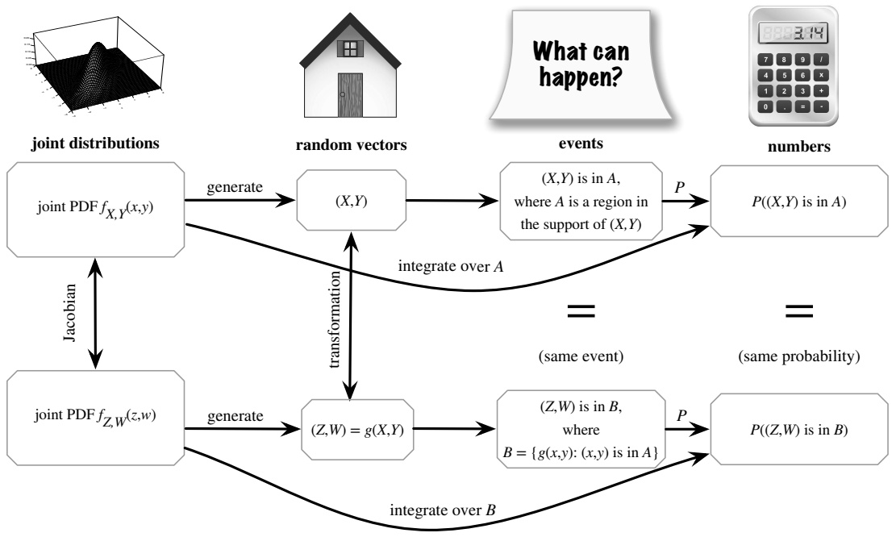

<details>
<summary>flowchart</summary>

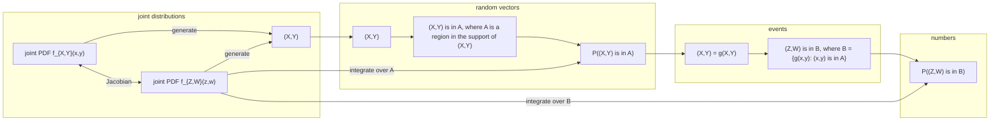
</details>

FIGURE 8.12

Let $( Z , W )   =   g ( X , Y )$ , where g is an invertible transformation satisfying certain technical assumptions. The change of variables formula lets us go back and forth between the joint PDFs of $( X , Y )$ and (Z, W).

In this chapter, as in many others, we made extensive use of Bayes’ rule and LOTP, especially in continuous or hybrid forms. And we often used the strategy of integration by pattern recognition. Since any valid PDF must integrate to 1, and by now we know lots of valid PDFs, we can often use probability to help us do calculus in addition to using calculus to help us do probability!

The two new distributions we introduced are the Beta and Gamma, which are laden with stories and connections to other distributions. The Beta is a generalization of the Unif(0, 1) distribution, and it has the following stories.

• Order statistics of the Uniform: The jth order statistic of n i.i.d. $\mathrm { U n i f } ( 0 , 1 )$ r.v.s is distributed $Beta (j,n - j + 1)$ .
• Unknown probability, conjugate prior of the Binomial: If $p \sim \mathrm { B e t a } ( a , b )$ and $X | p \sim$ $\operatorname { B i n } ( n , p )$ , then $p | X   =   k   \sim   \mathrm { B e t a } ( a   +   k , b   +   n   -   k )$ . The posterior distribution of p stays within the Beta family of distributions after updating based on Binomial data, a property known as conjugacy. The parameters a and b can be interpreted as the prior number of successes and failures, respectively.

The Gamma is a generalization of the Exponential distribution, and it has the following stories.

• Poisson process: In a Poisson process of rate λ, the total waiting time for n arrivals

---

404

Introduction to Probability

is distributed $Gamma (n,\lambda)$ . Thus the Gamma is the continuous analog of the Negative Binomial distribution.

• Unknown rate, conjugate prior of the Poisson: If $\lambda \sim  Gamma (r_0, b_0)$ and $Y | \lambda \sim$ Pois(λt), then $\lambda | Y = y \sim \operatorname { G a m m a } ( r _ { 0 } + y , b _ { 0 } + t )$ . The posterior distribution of $\lambda$ stays within the Gamma family of distributions after updating based on Poisson data. The parameters $r _ { 0 }$ and $b _ { 0 }$ can be interpreted as the prior number of observed successes and the total waiting time for those successes, respectively.

The Beta and Gamma distributions are related by the bank–post office story, which says that if $X \sim  Gamma (a, \lambda),   Y \sim  Gamma (b, \lambda)$ are independent, then $X + Y \sim$ Gamma $\begin{array} { r } { ( a + b , \lambda ) ,   \frac { X } { X + Y } \sim \mathrm { B e t a } ( a , b ) } \end{array}$ , with $X + Y$ and $\frac { X } { X + Y }$ independent.

The diagram of connections, which we last saw in Chapter $^ { 5 , }$ is hereby updated to include the Beta and Gamma distributions. Distributions listed in parentheses are special cases of the ones not in parentheses.

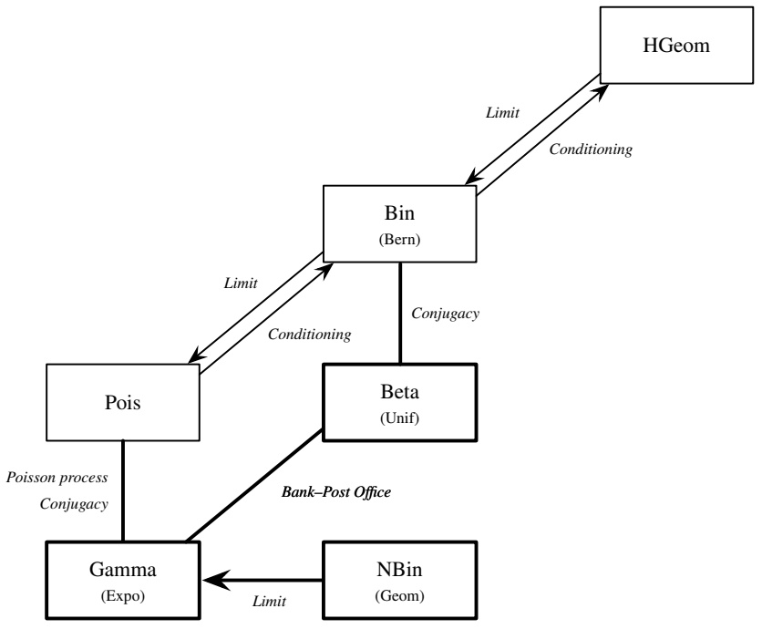

<details>
<summary>flowchart</summary>

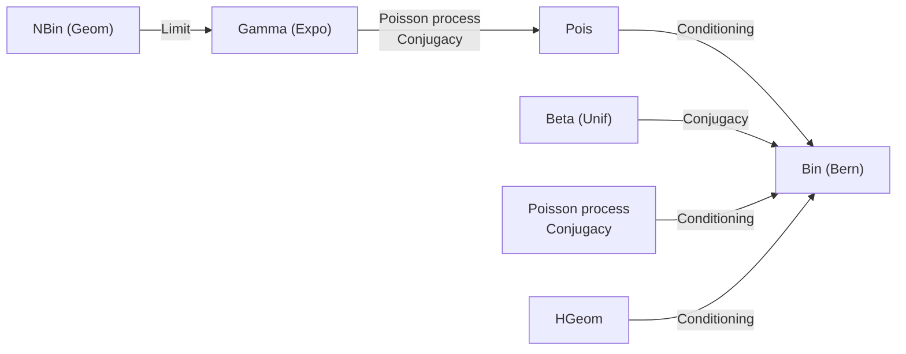
</details>

## 8.8 R

## Beta and Gamma distributions

The Beta and Gamma distributions are programmed into R.

• dbeta, pbeta, rbeta: To evaluate the Beta $( a , b )$ PDF or CDF at $x ,$ we use

---

Transformations

405

dbeta $( \mathbf { x } , \mathbf { a } , \mathbf { b } )$ and pbeta $( \mathbf { x } , \mathbf { a } , \mathbf { b } )$ . To generate n realizations from the Beta(a, b) distribution, we use rbeta(n,a,b).

• dgamma, pgamma, rgamma: To evaluate the Gamma(a, λ) PDF or CDF at $x ,$ we use dgamma(x,a,lambda) or pgamma(x,a,lambda). To generate n realizations from the Gamma(a, λ) distribution, we use rgamma(n,a,lambda).

For example, we can check that the Gamma(3, 2) distribution has mean $3 / 2$ and variance $3 / 4$ . To do this, we generate a large number of Gamma(3, 2) random variables using rgamma, then compute their mean and var:

```r
y <- rgamma(10^5,3,2)
mean(y)
var(y)
```

Did you get values that were close to 1.5 and 0.75, respectively?

## Convolution of Uniforms

Using R, we can quickly verify that for $X , Y { \overset { \mathrm { ~ i . i . d . ~ } } { \sim } } \operatorname { U n i f } ( 0 , 1 )$ , the distribution of $T = X + Y$ is triangular in shape:

```r
x <- runif(10^5)
y <- runif(10^5)
hist(x+y)
```

The histogram looks like an ascending and then descending staircase, a discrete approximation to a triangle.

## Bayes’ billiards

In the Bayes’ billiards story, we have n white balls and 1 gray ball, throw them onto the unit interval completely at random, and count the number of white balls to the left of the gray ball. Letting p be the position of the gray ball and X be the number of white balls to the left of the gray ball, we have

$$
\begin{array}{l} p \sim \mathrm{Unif} (0, 1) \\ X | p \sim \mathrm{Bin} (n, p). \\ \end{array}
$$

By performing this experiment a large number of times, we can verify the results we derived in this chapter about the marginal PMF of X and the posterior PDF of p given X = x. We’ll let the number of simulations be called nsim, to avoid a name conflict with the number of white balls, n, which we set equal to 10:

```txt
nsim <- 10^5
n <- 10
```

---

406

Introduction to Probability

We simulate $1 0 ^ { 5 }$ values of $p ,$ then simulate $1 0 ^ { 5 }$ 105 values from the conditional distribution of X given $p ;$

```r
p <- runif(nsim)
x <- rbinom(nsim,n,p)
```

Notice that we feed the entire vector p into rbinom. This means that the first element of x is generated using the first element of p, the second element of x is generated using the second element of p, and so forth. Thus, conditional on a particular element of p, the corresponding element of x is Binomial, but the elements of p are themselves Uniform, exactly as the model specifies.

According to the Bayes’ billiards argument, the marginal distribution of X should be Discrete Uniform on the integers 0 through n. Is this in fact the case? We can make a histogram of x to check! Because the distribution of X is discrete, we tell R to make the histogram breaks at −0.5, 0.5, 1.5, . . . so that each bar is centered at an integer value:

```txt
hist(x,breaks=seq(-0.5,n+0.5,1))
```

Indeed, all the histogram bars are approximately equal in height, consistent with a Discrete Uniform distribution.

Now for the posterior distribution of p given X = x. Conditioning is very simple in R. To consider only the simulated values of p where the value of X was 3, we use square brackets, like this: p[x==3]. In particular, we can create a histogram of these values to see what the posterior distribution of p given X = 3 looks like; try hist(p[x==3]).

According to the Beta-Binomial conjugacy result, the true posterior distribution is $p | X   =   3   \sim   \mathrm { B e t a } ( 4 , 8 )$ . We can plot the histogram of p[x==3] next to a histogram of simulated values from the Beta(4, 8) distribution to confirm that they look similar:

```txt
par(mfrow=c(1,2))
hist(p[x==3])
hist(rbeta(10^4,4,8))
```

The first line tells R we want two side-by-side plots, and the second and third lines create the histograms.

## Simulating order statistics

Simulating order statistics in R is easy: we simply simulate i.i.d. r.v.s and use sort to sort them in increasing order. For example,

```txt
sort(rnorm(10))
```

produces one realization of $X _ { ( 1 ) } , \ldots , X _ { ( 1 0 ) }$ , where $X _ { 1 } , \ldots , X _ { 1 0 }$ are i.i.d. $\mathcal { N } ( 0 , 1 )$

---

Transformations

407

If we want to plot a histogram of realizations of, say, $X _ { ( 9 ) }$ , we’ll need to use replicate:

order\_stats <- replicate(10^4, sort(rnorm(10)))

This creates a matrix, order\_stats, with 10 rows. The ith row of the matrix contains $1 0 ^ { 4 }$ realizations of $X _ { ( i ) }$ . Now we can create a histogram of $X _ { ( 9 ) }$ , simply by selecting row 9 of the matrix:

x9 <- order\_stats[9,]

hist(x9)

We can also compute summaries like mean(x9) and $\mathtt { v a r } ( \mathtt { x } 9 )$

## 8.9 Exercises

Exercises marked with s have detailed solutions at [http://stat110.net](http://stat110.net).

## Change of variables

1. Find the PDF of $e ^ { - X }$ for $X \sim \mathrm { E x p o ( 1 ) }$

2. Find the PDF of $X ^ { 7 }$ for $X \sim \operatorname{Expo}(\lambda)$

3. Find the PDF of $Z ^ { 3 }$ for $Z \sim \mathcal { N } ( 0 , 1 )$

4. s Find the PDF of $Z ^ { 4 }$ for $Z \sim \mathcal { N } ( 0 , 1 )$

5. Find the PDF of $| Z |$ for $Z \sim \mathcal { N } ( 0 , 1 )$

6. s Let $U \sim \mathrm { U n i f } ( 0 , 1 )$ . Find the PDFs of $U ^ { 2 }$ and $\sqrt { U }$

7. Let $\begin{array} { r } { U \sim \mathrm { U n i f } ( 0 , \frac { \pi } { 2 } ) } \end{array}$ . Find the PDF of sin(U).

8. (a) Find the distribution of $X ^ { 2 }$ for $X \sim \operatorname { D U n i f } ( 0 , 1 , \ldots , n )$

(b) Find the distribution of $X ^ { 2 }$ for $X \sim \operatorname { D U n i f } ( - n , - n + 1 , \ldots , 0 , 1 , \ldots , n )$

9. Let $X \sim \operatorname { B e r n } ( p )$ and let a and b be constants with $a < b .$ Find a simple transformation of X that yields an r.v. that equals a with probability $1   -   p$ and equals b with probability $p .$

10. Let $X \sim  Pois (\lambda)$ and Y be the indicator of X being odd. Find the PMF of $Y .$

Hint: Find $P ( Y = 0 ) - P ( Y = 1 )$ by writing $P ( Y = 0 )$ and $P ( Y = 1 )$ as series and then using the fact that $( - 1 ) ^ { k }$ is 1 if k is even and −1 if k is odd.

11. Let T be a continuous r.v. and $V = 1 / T$ . Show that their CDFs are related as follows:

$$
F _ {V} (v) = \left\{ \begin{array}{l} F _ {T} (0) + 1 - F _ {T} (\frac {1}{v}) \text {for} v > 0, \\ F _ {T} (0) \text {for} v = 0, \\ F _ {T} (0) - F _ {T} (\frac {1}{v}) \text {for} v <   0. \end{array} \right.
$$

---

408

Introduction to Probability

12. Let $T$ be the ratio $X / Y$ of two i.i.d. $\mathcal { N } ( 0 , 1 ) \; \mathrm { r . v . s . } \; X , Y$ . This is the Cauchy distribution and, as shown in Example 7.1.25, it has PDF

$$
f _ {T} (t) = \frac {1}{\pi (1 + t ^ {2})}.
$$

(a) Use the result of the previous problem to find the CDF of $1 / T$ Then use calculus to find the PDF of $1 / T .$ (Note that the one-dimensional change of variables formula does not apply directly, since the function $g ( t )   =   1 / t$ , even though it has $g ^ { \prime } ( t )   <   0$ for all $t \neq 0 ,$ is undefined at $t = 0$ and is not a strictly decreasing function on its domain.)

(b) Show that $1 / T$ has the same distribution as T without using calculus, in 140 characters or fewer.

13. Let X and Y be i.i.d. $\operatorname { E x p o } ( \lambda )$ , and $T = \log ( X / Y )$ . Find the CDF and PDF of $T .$

14. Let X and Y have joint PDF $f _ { X , Y } ( x , y )$ , and transform $( X , Y ) \mapsto ( T , W )$ linearly by letting

$$
T = a X + b Y \text { and } W = c X + d Y,
$$

where $a , b , c , d$ are constants such that ad $- b c \neq 0 .$

(a) Find the joint PDF $f _ { T , W } ( t , w )$ (in terms of $f _ { X , Y }$ , though your answer should be written as a function of t and w).

(b) For the case where $T = X + Y, W = X - Y$ , show that

$$
f _ {T, W} (t, w) = \frac {1}{2} f _ {X, Y} \left(\frac {t + w}{2}, \frac {t - w}{2}\right).
$$

15. s Let $X , Y$ be continuous r.v.s with a spherically symmetric joint distribution, which means that the joint PDF is of the form $f(x,y) = g(x^2 + y^2)$ for some function $g .$ Let $( R , \theta )$ be the polar coordinates of $( X , Y )$ , so $R ^ { 2 } = X ^ { 2 }   +   Y ^ { 2 }$ is the squared distance from the origin and θ is the angle (in $[ 0 , 2 \pi ) )$ , with $X = R$ cos $\theta , Y = R \sin \theta .$

(a) Explain intuitively why R and θ are independent. Then prove this by finding the joint PDF of $( R , \theta )$

(b) What is the joint PDF of $( R , \theta )$ when $( X , Y )$ is Uniform in the unit disk $\{ ( x , y ) :$ $\stackrel{\frown}{x^{2}} + y^{2} \leq 1 \}?$

(c) What is the joint PDF of $( R , \theta )$ when X and Y are i.i.d. $\mathcal { N } ( 0 , 1 ) ?$

16. Let X and Y be i.i.d. $\mathcal { N } ( 0 , 1 )$ r.v.s, $T   =   X + Y$ , and $W   =   X - Y$ . We know from Example 7.5.8 that T and W are independent $\mathcal { N } ( 0 , 2 )$ r.v.s (note that (T, W) is Multi-variate Normal with $\mathrm { C o v } ( T , W ) = 0 )$ . Give another proof of this fact, using the change of variables theorem.

17. Let X and Y be i.i.d. $\mathcal { N } ( 0 , 1 ) \mathrm { r . v . s . }$ and $( R , \theta )$ be the polar coordinates for the point $( X , Y )$ , so $X = R \cos \theta$ and $Y = R \sin \theta$ with $R \geq 0$ and $\theta \in [ 0 , 2 \pi )$ . Find the joint PDF of $R ^ { 2 }$ and θ. Also find the marginal distributions of $R ^ { 2 }$ and $\theta ,$ giving their names (and parameters) if they are distributions we have studied before.

18. Let X and Y be independent positive r.v.s, with PDFs $f _ { X }$ and $f _ { Y }$ , respectively. Let $T$ be the ratio $X / Y$

(a) Find the joint PDF of T and X, using a Jacobian.
(b) Find the marginal PDF of T, as a single integral.

19. Let X and Y be i.i.d. Expo(λ), and transform them to $T = X + Y , W = X / Y$

(a) Find the joint PDF of T and W. Are they independent?
(b) Find the marginal PDFs of $T$ and W.

---

Transformations

409

## Convolutions

20. Let $U \sim \mathrm { U n i f } ( 0 , 1 )$ and $X \sim \mathrm { E x p o ( 1 ) }$ , independently. Find the PDF of $U + X$

21. Let X and Y be i.i.d. Expo(1). Use a convolution integral to show that the PDF of $L = X - Y$ is $\begin{array} { r } { f ( t ) = \frac { 1 } { 2 } e ^ { - | t | } } \end{array}$ for all real $t ;$ this is known as the Laplace distribution.

22. Use a convolution integral to show that if $X \: \sim \: \mathcal { N } ( \mu _ { 1 } , \sigma ^ { 2 } )$ and $Y \: \sim \: \mathcal { N } ( \mu _ { 2 } , \sigma ^ { 2 } )$ are independent, then $T = X + Y \sim \mathcal { N } ( \mu _ { 1 } + \mu _ { 2 } , 2 \sigma ^ { 2 } )$ (to simplify the calculation, we are assuming that the variances are equal). You can use a standardization (location-scale) idea to reduce to the standard Normal case before setting up the integral.

Hint: Complete the square.

23. s Let X and Y be independent positive r.v.s, with PDFs $f _ { X }$ and $f _ { Y }$ , respectively, and consider the product $T = X Y$ . When asked to find the PDF of $T ,$ Jacobno argues that: $\mathrm { { } ^ { \mathrm { { } ^ { \mathrm { { c } } } } } I t   ^ { \mathrm { { } ^ { \mathrm { { , } } } } } s }$ like a convolution, with a product instead of a sum. To have $T = t$ we need $X = x$ and $Y   =   t / x$ for some x; that has probability $f _ { X } ( x ) f _ { Y } ( t / x )$ , so summing up these possibilities we get that the PDF of $T$ is $\begin{array} { l } { \int _ { 0 } ^ { \infty } f _ { X } ( x ) f _ { Y } ( t / x ) d x . } \\ \end{array}$

Evaluate Jacobno’s argument, while getting the PDF of T (as an integral) in 2 ways:

(a) using the continuous version of the law of total probability to get the CDF, and then taking the derivative (you can assume that swapping the derivative and integral is valid);

(b) by taking the log of both sides of $T   =   X Y$ and doing a convolution (and then converting back to get the PDF of T).

24. Let X and Y be i.i.d. Discrete Uniform r.v.s on $\{ 0 , 1 , \ldots , n \}$ , where n is a positive integer. Find the PMF of $T = X + Y$

Hint: In finding $P ( T = k )$ , it helps to consider the cases $0 \leq k \leq n$ and $n + 1 \leq k \leq 2 n$ separately. Be careful about the range of summation in the convolution sum.

25. Let X and Y be i.i.d. Unif(0, 1), and let $W = X - Y$

(a) Find the mean and variance of W, without yet deriving the PDF.
(b) Show that the distribution of W is symmetric about 0, without yet deriving the PDF.

(c) Find the PDF of W.

(d) Use the PDF of W to verify your results from (a) and (b).

(e) How does the distribution of W relate to the distribution of $X + Y$ , the Triangle distribution derived in Example 8.2.5? Give a precise description, e.g., using the concepts of location and scale.

26. Let X and Y be i.i.d. Unif(0, 1), and $T   =   X + Y$ . We derived the distribution of T (a Triangle distribution) in Example 8.2.5, using a convolution integral. Since $( X , Y )$ is Uniform in the unit square $\{ ( x , y )   :   0   <   x   <   1 , 0   <   y   <   1 \}$ , we can also interpret $P ( ( X , Y ) \in A )$ as the area of A, for any region A within the unit square. Use this idea to find the CDF of T, by interpreting the CDF (evaluated at some point) as an area.

27. Let X, Y, Z be i.i.d. $\mathrm { U n i f } ( 0 , 1 )$ , and $W = X + Y + Z .$ Find the $\mathrm { P D F }$ of W .

Hint: We already know the PDF of $X + Y$ . Be careful about limits of integration in the convolution integral; there are 3 cases that should be considered separately.

---

410

Introduction to Probability

## Beta and Gamma

28. s Let $B \sim \mathrm { B e t a } ( a , b )$ . Find the distribution of $1 - B$ in two ways: (a) using a change of variables and (b) using a story proof. Also explain why the result makes sense in terms of Beta being the conjugate prior for the Binomial.
29. s Let $X \sim  Gamma (a, \lambda)$ and $Y \sim  Gamma (b, \lambda)$ be independent, with a and b integers. Show that $X + Y \sim \mathrm { G a m m a } ( a + b , \lambda )$ in three ways: (a) with a convolution integral; (b) with MGFs; (c) with a story proof.
30. Let $B \sim \mathrm { B e t a } ( a , b )$ . Use integration by pattern recognition to find $E ( B ^ { k } )$ for positive integers k. In particular, show that

$$
\operatorname{Var} (B) = \frac {a b}{(a + b) ^ {2} (a + b + 1)}.
$$

31. s Fred waits $X   \sim   \operatorname { G a m m a } ( a , \lambda )$ minutes for the bus to work, and then waits $Y \sim$ $Gamma (b,\lambda)$ for the bus going home, with X and $Y$ independent. Is the ratio $X / Y$ independent of the total wait time $X + Y ?$

32. s The F-test is a very widely used statistical test based on the $F ( m , n )$ distribution, which is the distribution of $\frac { X / m } { Y / n }$ with $\begin{array} { r } { X \sim \mathrm { G a m m a } ( \frac { m } { 2 } , \frac { 1 } { 2 } ) , Y \sim \mathrm { G a m m a } ( \frac { n } { 2 } , \frac { 1 } { 2 } ) } \end{array}$ . Find the distribution of m $V / ( n + m V )$ for $V \sim F ( m , n )$

33. s Customers arrive at the Leftorium store according to a Poisson process with rate λ customers per hour. The true value of λ is unknown, so we treat it as a random variable. Suppose that our prior beliefs about λ can be expressed as $\lambda \sim \mathrm{Exp}(3)$ . Let X be the number of customers who arrive at the Leftorium between 1 pm and 3 pm tomorrow. Given that $X = 2$ is observed, find the posterior PDF of λ.

34. s Let X and Y be independent, positive r.v.s. with finite expected values.

(a) Give an example where $\textstyle E ( \frac { X } { X + Y } ) \neq \frac { E ( X ) } { E ( X + Y ) }$ , computing both sides exactly.

Hint: Start by thinking about the simplest examples you can think of!

(b) If X and Y are i.i.d., then is it necessarily true that $\begin{array} { l } { E ( \frac { X } { X + Y } ) = \frac { E ( X ) } { E ( X + Y ) } ? } \\ \end{array}$

(c) Now let $X \sim  Gamma (a, \lambda)$ and $Y \sim  Gamma (b, \lambda)$ . Show without using calculus that

$$
E \left(\frac {X ^ {c}}{(X + Y) ^ {c}}\right) = \frac {E (X ^ {c})}{E ((X + Y) ^ {c})}
$$

for every real $c > 0$

35. Let $T = X ^ { 1 / \gamma }$ , with $X \sim \operatorname { E x p o } ( \lambda )$ and $\lambda , \gamma > 0$ . So T has a Weibull distribution, as discussed in Example 6.5.5. Using LOTUS and the definition of the gamma function, we showed in this chapter that for $Y \sim  Gamma (a, \lambda)$

$$
E (Y ^ {c}) = \frac {1}{\lambda^ {c}} \cdot \frac {\Gamma (a + c)}{\Gamma (a)},
$$

for all real $c > - a$ . Use this result to show that

$$
E (T) = \frac {\Gamma \left(1 + 1 / \gamma\right)}{\lambda^ {1 / \gamma}} \text {and} \operatorname{Var} (T) = \frac {\Gamma \left(1 + 2 / \gamma\right) - \left(\Gamma \left(1 + 2 / \gamma\right)\right) ^ {2}}{\lambda^ {2 / \gamma}}.
$$

36. Alice walks into a post office with 2 clerks. Both clerks are in the midst of serving customers, but Alice is next in line. The clerk on the left takes an $\mathrm{Exp}(\lambda_1)$ time to serve a customer, and the clerk on the right takes an $\mathrm{Exp}(\lambda_{2})$ time to serve a customer. Let $T _ { 1 }$ be the time until the clerk on the left is done serving their current customer, and define $T _ { 2 }$ likewise for the clerk on the right.

---

Transformations

411

(a) If $\lambda _ { 1 } = \lambda _ { 2 } .$ is $T _ { 1 } / T _ { 2 }$ independent of $T _ { 1 } + T _ { 2 } ?$

Hint: Note that $T _ { 1 } / T _ { 2 } = ( T _ { 1 } / ( T _ { 1 } + T _ { 2 } ) ) / ( T _ { 2 } / ( T _ { 1 } + T _ { 2 } ) ) .$

(b) Find $P ( T _ { 1 }   <   T _ { 2 } )$ (do not assume $\lambda _ { 1 } = \lambda _ { 2 }$ here or in the next part, but do check that your answers make sense in that special case).

(c) Find the expected total amount of time that Alice spends in the post office (assuming that she leaves immediately after she is done being served).

37. Let $X \sim \operatorname { P o i s } ( \lambda t )$ and $Y \sim  Gamma (j, \lambda)$ , where j is a positive integer. Show using a story about a Poisson process that

$$
P (X \geq j) = P (Y \leq t).
$$

38. Visitors arrive at a certain scenic park according to a Poisson process with rate λ visitors per hour. Fred has just arrived (independent of anyone else), and will stay for an $\mathrm{Exp}(\lambda_{2})$ number of hours. Find the distribution of the number of other visitors who arrive at the park while Fred is there.

39. (a) Let $p   \sim   \mathrm { B e t a } ( a , b )$ , where a and b are positive real numbers. Find $E ( p ^ { 2 } ( 1 - p ) ^ { 2 } )$ fully simplified (Γ should not appear in your final answer).

Two teams, A and B, have an upcoming match. They will play five games and the winner will be declared to be the team that wins the majority of games. Given $p ,$ the outcomes of games are independent, with probability $p$ of team A winning and $1 - p$ of team B winning. But you don’t know $p ,$ so you decide to model it as an r.v., with $p \sim \mathrm { U n i f } ( 0 , 1 )$ a priori (before you have observed any data).

To learn more about $p ,$ you look through the historical records of previous games between these two teams, and find that the previous outcomes were, in chronological order, AAABBAABAB. (Assume that the true value of p has not been changing over time and will be the same for the match, though your beliefs about p may change over time.)

(b) Does your posterior distribution for $p ,$ given the historical record of games between A and B, depend on the specific order of outcomes or only on the fact that A won exactly 6 of the 10 games on record? Explain.

(c) Find the posterior distribution for p, given the historical data.

The posterior distribution for $p$ from (c) becomes your new prior distribution, and the match is about to begin!

(d) Conditional on $p ,$ is the indicator of A winning the first game of the match positively correlated with, uncorrelated with, or negatively correlated with the indicator of A winning the second game? What about if we only condition on the historical data?

(e) Given the historical data, what is the expected value for the probability that the match is not yet decided when going into the fifth game (viewing this probability as an r.v. rather than a number, to reflect our uncertainty about it)?

40. An engineer is studying the reliability of a product by performing a sequence of n trials. Reliability is defined as the probability of success. In each trial, the product succeeds with probability $p$ and fails with probability $1 - p .$ The trials are conditionally independent given $p .$ Here $p$ is unknown (else the study would be unnecessary!). The engineer takes a Bayesian approach, with $p \sim \mathrm { U n i f } ( 0 , 1 )$ as prior.

Let r be a desired reliability level and c be the corresponding confidence level, in the sense that, given the data, the probability is c that the true reliability $p$ is at least r. For example, if $r = 0 . 9 , c = 0 . 9 5$ , we can be 95% sure, given the data, that the product is at least 90% reliable. Suppose that it is observed that the product succeeds all n times. Find a simple equation for c as a function of $r .$

---

412

Introduction to Probability

## Order statistics

41. s Let $X \sim \operatorname { B i n } ( n , p )$ and $B \sim \mathrm { B e t a } ( j , n - j + 1 )$ , where n is a positive integer and $j$ is a positive integer with $j \leq n$ . Show using a story about order statistics that

$$
P (X \geq j) = P (B \leq p).
$$

This shows that the CDF of the continuous r.v. B is closely related to the CDF of the discrete $\operatorname { r . v . } X$ , and is another connection between the Beta and Binomial.

42. Show that for i.i.d. continuous r.v.s $X , Y , Z ,$

$$
P (X <   \min (Y, Z)) + P (Y <   \min (X, Z)) + P (Z <   \min (X, Y)) = 1.
$$

43. Show that

$$
\int_ {0} ^ {x} \frac {n !}{(j - 1) ! (n - j) !} t ^ {j - 1} (1 - t) ^ {n - j} d t = \sum_ {k = j} ^ {n} \binom{n}{k} x ^ {k} (1 - x) ^ {n - k},
$$

without using calculus, for all $x \in [ 0 , 1 ]$ and $j , n$ positive integers with $j \leq n$

44. Let $X _ { 1 } , \ldots , X _ { n }$ be i.i.d. continuous r.v.s with PDF f and a strictly increasing CDF F. Suppose that we know that the jth order statistic of n i.i.d. Unif(0, 1) r.v.s is a $\mathrm { B e t a } ( j , n - j + 1 )$ , but we have forgotten the formula and derivation for the distribution of the jth order statistic of $X _ { 1 } , \ldots , X _ { n }$ . Show how we can recover the PDF of $X _ { ( j ) }$ quickly using a change of variables.

45. s Let X and Y be independent Expo(λ) r.v.s and $M = \operatorname* { m a x } ( X , Y )$ . Show that M has the same distribution as $X   +   { \textstyle \frac { 1 } { 2 } } Y$ , in two ways: (a) using calculus and (b) by remembering the memoryless property and other properties of the Exponential.

46. s (a) If X and Y are i.i.d. continuous r.v.s with CDF $F ( x )$ and PDF $f ( x )$ , then $M   =   \operatorname* { m a x } ( X , Y )$ has PDF $2 F ( x ) f ( x )$ . Now let X and Y be discrete and i.i.d., with CDF $F ( x )$ and PMF $f ( x )$ . Explain in words why the PMF of M is not $2 F ( x ) f ( x )$

(b) Let X and Y be i.i.d. Bern(1/2) r.v.s, $M = \operatorname* { m a x } ( X , Y )$ and $L = \operatorname* { m i n } ( X , Y )$ . Find the joint PMF of M and L, i.e., $P ( M = a , L = b )$ , and the marginal PMFs of M and L.

47. Let $X _ { 1 } , X _ { 2 } , \ldots$ be i.i.d. r.v.s with CDF F, and let $M _ { n } { = } \operatorname* { m a x } ( X _ { 1 } , X _ { 2 } , \ldots , X _ { n } )$ . Find the joint distribution of $M _ { n }$ and $M _ { n + 1 }$ , for each $n \geq 1$

48. s Let $X _ { 1 } , X _ { 2 } , \ldots , X _ { n }$ be i.i.d. r.v.s with CDF F and PDF f. Find the joint PDF of the order statistics $X _ { ( i ) }$ and $X _ { ( j ) }$ for $1 \leq i < j \leq n$ , by drawing and thinking about a picture.

49. s Two women are pregnant, both with the same due date. On a timeline, define time 0 to be the instant when the due date begins. Suppose that the time when the woman gives birth has a Normal distribution, centered at 0 and with standard deviation 8 days. The two birth times are i.i.d. Let T be the time of the first of the two births (in days).

(a) Show that

$$
E (T) = \frac {- 8}{\sqrt {\pi}}.
$$

Hint: For any two random variables X and Y , we have max $\operatorname { \mathsf { t } } ( X , Y )   +   \operatorname* { m i n } ( X , Y ) = X   +   Y$ and max $( X , Y ) - \operatorname* { m i n } ( X , Y ) { = } | X - Y |$ . Example 7.2.3 derives the expected distance between two i.i.d. $\mathcal { N } ( 0 , 1 )$ r.v.s.

(b) Find $\operatorname { V a r } ( T )$ , in terms of integrals. You can leave your answers unsimplified for this part, but it can be shown that the answer works out to

$$
\mathrm{Var} (T) = 6 4 \left(1 - \frac {1}{\pi}\right).
$$

---

Transformations

413

50. We are about to observe random variables $Y _ { 1 } , Y _ { 2 } , \ldots , Y _ { n }$ , i.i.d. from a continuous distribution. We will need to predict an independent future observation $Y _ { \mathrm { n e w } }$ , which will also have the same distribution. The distribution is unknown, so we will construct our prediction using $Y _ { 1 } , Y _ { 2 } , \ldots , Y _ { n }$ rather than the distribution of $Y _ { \mathrm { n e w } }$ . In forming a prediction, we do not want to report only a single number; rather, we want to give a predictive interval with “high confidence” of containing $Y _ { \mathrm { n e w } }$ . One approach to this is via order statistics.

(a) For fixed $j$ and k with $1 \leq j < k \leq n$ , find $P ( Y _ { \operatorname { n e w } } \in [ Y _ { ( j ) } , Y _ { ( k ) } ] )$

Hint: By symmetry, all orderings of $Y _ { 1 } , \ldots , Y _ { n } , Y _ { \operatorname { n e w } }$ are equally likely.

(b) Let $n = 9 9$ . Construct a predictive interval, as a function of $Y _ { 1 } , \ldots , Y _ { n }$ , such that the probability of the interval containing $Y _ { \mathrm { n e w } }$ is 0.95.

51. Let $X _ { 1 } , \ldots , X _ { n }$ be i.i.d. continuous r.v.s with n odd. Show that the median of the distribution of the sample median of the $X _ { i } { } ^ { \prime } \mathbf { s }$ is the median of the distribution of the $X _ { i } { } ^ { \flat } \mathbf { s } .$

Hint: Start by reading the problem carefully; it is crucial to distinguish between the median of a distribution (as defined in Chapter 6) and the sample median of a collection of r.v.s (as defined in this chapter). Of course they are closely related: the sample median of i.i.d. r.v.s is a very natural way to estimate the true median of the distribution that the r.v.s are drawn from. Two approaches to evaluating a sum that might come up are (i) use the first story proof example and first story proof exercise from Chapter 1, or (ii) use the fact that, by the story of the Binomial, $Y \sim \mathrm { B i n } ( n , 1 / 2 )$ implies $n   -   Y \sim \mathrm { B i n } ( n , 1 / 2 )$

## Mixed practice

52. Let $U _ { 1 } , U _ { 2 } , \ldots , U _ { n }$ be i.i.d. $\mathrm { U n i f } ( 0 , 1 )$ , and let $X _ { j } = - \log ( U _ { j } )$ for all $j .$

(a) Find the distribution of $X _ { j }$ . What is its name?
(b) Find the distribution of the product $U _ { 1 } U _ { 2 } \ldots U _ { n }$

Hint: First take the log.

53. s A DNA sequence can be represented as a sequence of letters, where the alphabet has 4 letters: A,C,T,G. Suppose such a sequence is generated randomly, where the letters are independent and the probabilities of $\scriptstyle \mathrm { A , } \mathrm { C , } \mathrm { T , } \mathrm { G }$ are $p _ { 1 } , p _ { 2 } , p _ { 3 } , p _ { 4 }$ , respectively.

(a) In a DNA sequence of length 115, what is the expected number of occurrences of the expression $\text{" } CATCAT  \text{" }$ (in terms of the $p _ { j } ) ?$ (Note that, for example, the expression $``CATCATCAT''$ counts as 2 occurrences.)
(b) What is the probability that the first A appears earlier than the first C appears, as letters are generated one by one (in terms of the $| p _ { j } \rangle _ { } ^ { 2 }$
(c) For this part, assume that the $p _ { j }$ are unknown. Suppose we treat $p _ { 2 }$ as a $\mathrm { U n i f } ( 0 , 1 )$ r.v. before observing any data, and that then the first 3 letters observed are $\text{° C A T " }$ Given this information, what is the probability that the next letter is C?

54. s Consider independent Bernoulli trials with probability $p$ of success for each. Let X be the number of failures incurred before getting a total of r successes.

(a) Determine what happens to the distribution of ${ \frac { p } { 1   -   p } } X$ as $p \to 0$ , using MGFs; what is the PDF of the limiting distribution, and its name and parameters if it is one we have studied?

Hint: Start by finding the Geom(p) MGF. Then find the MGF of ${ \frac { p } { 1 { - } p } } X$ , and use the fact that if the MGFs of $Y _ { n }$ converges to the MGF of $Y$ , then the $\mathrm { C D \vec { F } }$ of $Y _ { n }$ converges to the CDF of $Y$

(b) Explain intuitively why the result of (a) makes sense.

---


## Taylor & Francis

Taylor & Francis Group

http://taylorandfrancis.com
