# 9: Conditional expectation

原始 PDF 第 432–473 页。

# Conditional expectation

Given that you’ve read the earlier chapters, you already know what conditional expectation is: expectation, but using conditional probabilities. This is an essential concept, for reasons analogous to why we need conditional probability:

• Conditional expectation is a powerful tool for calculating expectations. Using strategies such as conditioning on what we wish we knew and first-step analysis, we can often decompose complicated expectation problems into simpler pieces.
• Conditional expectation is a relevant quantity in its own right, allowing us to predict or estimate unknowns based on whatever evidence is currently available. For example, in statistics we often want to predict a response variable (such as test scores or earnings) based on explanatory variables (such as number of practice problems solved or enrollment in a job training program).

There are two different but closely linked notions of conditional expectation:

• Conditional expectation $E ( Y | A )$ given an event: let Y be an r.v., and A be an event. If we learn that A occurred, our updated expectation for Y is denoted by $E ( Y | A )$ and is computed analogously to $E ( Y )$ , except using conditional probabilities given A.
• Conditional expectation $E ( Y | X )$ given a random variable: a more subtle question is how to define $E ( Y | X )$ , where X and Y are both r.v.s. Intuitively, $E ( Y | X )$ is the r.v. that best predicts Y using only the information available from X.

In this chapter, we explore the definitions, properties, intuitions, and applications of both forms of conditional expectation.

## 9.1 Conditional expectation given an event

Recall that the expectation $E ( Y )$ of a discrete r.v. Y is a weighted average of its possible values, where the weights are the PMF values $P ( Y = y )$ . After learning that an event A occurred, we want to use weights that have been updated to reflect this new information. The definition of $E ( Y | A )$ simply replaces the probability $P ( Y = y )$ with the conditional probability $P ( Y = y | A )$

415

---

416

Introduction to Probability

Similarly, if $Y$ is continuous, $E ( Y )$ is still a weighted average of the possible values of $Y$ , with an integral in place of a sum and the PDF value $f ( y )$ in place of a PMF value. If we learn that $A$ occurred, we update the expectation for $Y$ by replacing $f ( y )$ with the conditional PDF $f ( y | A )$

Definition 9.1.1 (Conditional expectation given an event). Let $A$ be an event with positive probability. If $Y$ is a discrete r.v., then the conditional expectation of $Y$ given A is

$$
E (Y | A) = \sum_ {y} y P (Y = y | A),
$$

where the sum is over the support of Y . If $Y$ is a continuous r.v. with PDF $f ,$ then

$$
E (Y | A) = \int_ {- \infty} ^ {\infty} y f (y | A) d y,
$$

where the conditional PDF $f ( y | A )$ is defined as the derivative of the conditional CDF $F ( y | A )   =   P ( Y   \leq   y | A )$ , and can also be computed by a hybrid version of Bayes’ rule:

$$
f (y | A) = \frac {P (A | Y = y) f (y)}{P (A)}.
$$

Intuition 9.1.2. To gain intuition for $E ( Y | A )$ , let’s consider approximating it via simulation (or via the frequentist perspective, based on repeating the same experiment many times). Imagine generating a large number n of replications of the experiment for which $Y$ is a numerical summary. We then have Y -values $y _ { 1 } , \ldots , y _ { n }$ and we can approximate

$$
E (Y) \approx \frac {1}{n} \sum_ {j = 1} ^ {n} y _ {j}.
$$

To approximate $E ( Y | A )$ , we restrict to the replications where A occurred, and average only those Y -values. This can be written as

$$
E (Y | A) \approx \frac {\sum_ {j = 1} ^ {n} y _ {j} I _ {j}}{\sum_ {j = 1} ^ {n} I _ {j}},
$$

where $I _ { j }$ is the indicator of A occurring in the jth replication. This is undefined if A never occurred in the simulation, which makes sense since then there is no simulation data about what the $^ { \circ } A$ occurred” scenario is like. We would like to have n large enough so that there are many occurrences of $A$ (if A is a rare event, more sophisticated techniques for approximating $E ( Y | A )$ may be needed).

The principle is simple though: $E ( Y | A )$ is approximately the average of $Y$ in a large number of simulation runs in which A occurred. 

h 9.1.3. Confusing conditional expectation and unconditional expectation is a dangerous mistake. More generally, not keeping careful track of what you should be conditioning on and what you are conditioning on is a recipe for disaster.

---

Conditional expectation

417

For a life-or-death example of the previous biohazard, consider life expectancy.

Example 9.1.4 (Life expectancy). Fred is 30 years old, and he hears that the average life expectancy in his country is 80 years. Should he conclude that, on average, he has 50 years of life left? No, there is a crucial piece of information that he must condition on: the fact that he has lived to age 30 already. Letting T be Fred’s lifespan, we have the cheerful news that

$$
E (T) <   E (T | T \geq 3 0).
$$

The left-hand side is Fred’s life expectancy at birth (it implicitly conditions on the fact that he is born), and the right-hand side is Fred’s life expectancy given that he reaches age 30.

A harder question is how to decide on an appropriate estimate to use for $E ( T )$ . Is it just 80, the overall average for his country? In almost every country, women have a longer average life expectancy than men, so it makes sense to condition on Fred being a man. But should we also condition on what city he was born in? Should we condition on racial and financial information about his parents, or the time of day when he was born? Intuitively, we would like estimates that are both accurate and relevant for Fred, but there is a tradeoff since if we condition on more characteristics of Fred, then there are fewer people who match those characteristics to use as data for estimating the life expectancy.

Now consider some specific numbers for the United States. A Social Security Administration study estimated that between 1900 and 2000, the average life expectancy at birth in the U.S. for men increased from 46 to 74, and for women increased from 49 to 79. Tremendous gains! But much of the gain is due to decreases in child mortality. For a 30-year-old person in 1900, the average number of years remaining was 35 for a man and 36 for a woman; in 2000, the corresponding numbers were 46 for a man and 50 for a woman.

There are some subtle statistical issues in obtaining these estimates. For example, how were estimates for life expectancy for someone born in 2000 obtained without waiting at least until the year 2100? Estimating survival distributions is a very important topic in biostatistics and actuarial science. 

The law of total probability allows us to get unconditional probabilities by slicing up the sample space and computing conditional probabilities in each slice. The same idea works for computing unconditional expectations.

Theorem 9.1.5 (Law of total expectation). Let $A _ { 1 } , \ldots , A _ { n }$ be a partition of a sample space, with $P ( A _ { i } )   >   0$ for all i, and let Y be a random variable on this sample space. Then

$$
E (Y) = \sum_ {i = 1} ^ {n} E (Y | A _ {i}) P (A _ {i}).
$$

In fact, since all probabilities are expectations by the fundamental bridge, the law

---

418

Introduction to Probability

of total probability is a special case of the law of total expectation. To see this, let $Y = I _ { B }$ for an event $B ;$ then the above theorem says

$$
P (B) = E (I _ {B}) = \sum_ {i = 1} ^ {n} E (I _ {B} | A _ {i}) P (A _ {i}) = \sum_ {i = 1} ^ {n} P (B | A _ {i}) P (A _ {i}),
$$

which is exactly LOTP. The law of total expectation is, in turn, a special case of a major result called Adam’s law (Theorem 9.3.7), so we will not prove it yet.

There are many interesting examples of using wishful thinking to break up an unconditional expectation into conditional expectations. We begin with two cautionary tales about the importance of conditioning carefully and not destroying information without justification.

Example 9.1.6 (Two-envelope paradox). A stranger presents you with two identical-looking, sealed envelopes, each of which contains a check for some positive amount of money. You are informed that one of the envelopes contains exactly twice as much money as the other. You can choose either envelope. Which do you prefer: the one on the left or the one on the right? (Assume that the expected amount of money in each envelope is finite—certainly a good assumption in the real world!)

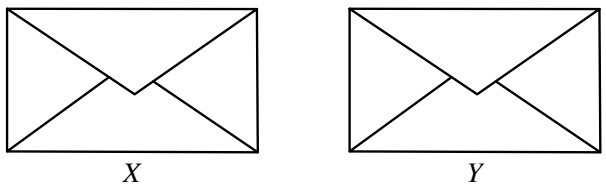

## FIGURE 9.1

Two envelopes, where one contains twice as much money as the other. Either $Y =$ 2X or $Y = X / 2$ , with equal probabilities. Which would you prefer?

## Solution:

Let X and Y be the amounts in the left and right envelopes, respectively. By symmetry, there is no reason to prefer one envelope over the other (we are assuming there is no prior information that the stranger is left-handed and left-handed people prefer putting more money on the left). Concluding by symmetry that $E(X)   =$ $E ( Y )$ , it seems that you should not care which envelope you get.

But as you daydream about what’s inside the envelopes, another argument occurs to you: suppose that the left envelope has \$100. Then the right envelope either has \$50 or \$200. The average of \$50 and \$200 is \$125, so it seems then that the right envelope is better. But there was nothing special about \$100 here; for any value x for the left envelope, the average of 2x and $x / 2$ is greater than $x ,$ suggesting that the right envelope is better. This is bizarre though, since not only does it contradict the symmetry argument, but also the same reasoning could be applied starting with the right envelope, leading to switching back and forth forever!

---

Conditional expectation

419

Let us try to formalize this argument to see what’s going on. We have $Y = 2 X$ or $Y = X / 2 ,$ , with equal probabilities. By Theorem 9.1.5,

$$
E (Y) = E (Y | Y = 2 X) \cdot \frac {1}{2} + E \bigl (Y | Y = X / 2 \bigr) \cdot \frac {1}{2}.
$$

One might then think that this is

$$
E (2 X) \cdot \frac {1}{2} + E (X / 2) \cdot \frac {1}{2} = \frac {5}{4} E (X),
$$

suggesting a 25% gain from switching from the left to the right envelope. But there is a blunder in that calculation: $E ( Y | Y = 2 X ) = E ( 2 X | Y = 2 X )$ , but there is no justification for dropping the $Y = 2 X$ condition after plugging in 2X for $Y .$

To put it another way, let I be the indicator of the event $Y = 2 X$ , so that $E ( Y | Y =$ $2 X ) = E ( 2 X | I = 1 )$ . If we know that X is independent of I, then we can drop the condition $I = 1$ . But in fact we have just proven that X and I can’t be independent: if they were, we’d have a paradox! Surprisingly, observing X gives information about whether X is the bigger value or the smaller value. If we learn that X is very large, we might guess that X is larger than $Y$ , but what is considered very large? Is $1 0 ^ { 1 2 }$ very large, even though it is tiny compared with $1 0 ^ { 1 0 0 } ?$ The two-envelope paradox says that no matter what the distribution of X is, there are reasonable ways to define “very large” relative to that distribution.

In Exercise 8 you will look at a related problem, in which the amounts of money in the two envelopes are i.i.d. random variables. You’ll show that if you are allowed to look inside one of the envelopes and then decide whether to switch, there is a strategy that allows you to get the better envelope more than 50% of the time! 

The next example vividly illustrates the importance of conditioning on all the information. The phenomenon revealed here arises in many real-life decisions about what to buy and what investments to make.

Example 9.1.7 (Mystery prize). You are approached by another stranger, who gives you an opportunity to bid on a mystery box containing a mystery prize! The value of the prize is completely unknown, except that it is worth at least nothing, and at most a million dollars. So the true value $V$ of the prize is considered to be Uniform on [0,1] (measured in millions of dollars).

You can choose to bid any amount b (in millions of dollars). You have the chance to get the prize for considerably less than it is worth, but you could also lose money if you bid too much. Specifically, if $b < 2 V / 3$ , then the bid is rejected and nothing is gained or lost. If $b \geq 2 V / 3$ , then the bid is accepted and your net payoff is $V - b$ (since you pay b to get a prize worth V ). What is your optimal bid $b ,$ to maximize the expected payoff?

## Solution:

Your bid $b   \geq   0$ must be a predetermined constant (not based on $V ,$ since $V$ is

---

420

Introduction to Probability

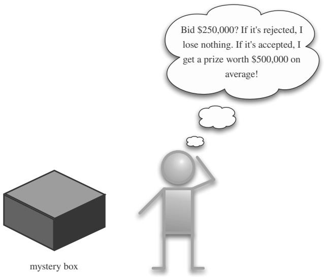

<details>
<summary>text_image</summary>

Bid $250,000? If it's rejected, I lose nothing. If it's accepted, I get a prize worth $500,000 on average!
mystery box
</details>

## FIGURE 9.2

When bidding on an unknown asset, beware the winner’s curse, and condition on the relevant information.

unknown!). To find the expected payoff W, condition on whether the bid is accepted. The payoff is $V - b$ if the bid is accepted and 0 if the bid is rejected. So

$$
\begin{array}{l} E (W) = E (W | b \geq 2 V / 3) P (b \geq 2 V / 3) + E (W | b <   2 V / 3) P (b <   2 V / 3) \\ = E (V - b | b \geq 2 V / 3) P (b \geq 2 V / 3) + 0 \\ = (E (V | V \leq 3 b / 2) - b) P (V \leq 3 b / 2). \\ \end{array}
$$

For $b \geq 2 / 3 ,$ , the event $V \leq 3 b / 2$ has probability 1, so the right-hand side is $1 / 2 - b ,$ which is negative. Now assume $b < 2 / 3$ . Then $V \leq 3 b / 2$ has probability $3 b / 2$ . Given that $V \leq 3 b / 2$ , the conditional distribution of V is Uniform on $[ 0 , 3 b / 2 ]$ . Therefore,

$$
E (W) = \left(E (V | V \leq 3 b / 2) - b\right) P (V \leq 3 b / 2) = (3 b / 4 - b) (3 b / 2) = - 3 b ^ {2} / 8.
$$

The above expression is negative except at $b   =   0 .$ so the optimal bid is 0: you shouldn’t play this game!

Alternatively, condition on which of the following events occurs: $A = \{ V < b / 2 \}$ $B = \{ b / 2 \leq V \leq 3 b / 2 \} ,   C = \{ V > 3 b / 2 \}$ . We have

$$
E (W | A) = E (V - b | A) <   E (b / 2 - b | A) = - b / 2 \leq 0,
$$

$$
E (W | B) = E \left(\frac {b / 2 + 3 b / 2}{2} - b | B\right) = 0,
$$

$$
E (W | C) = 0,
$$

so we should just set $b = 0$ and walk away.

---

Conditional expectation

421

The moral of this story is to condition on all the information. It is crucial in the above calculation to use $E ( V | V \leq 3 b / 2 )$ rather than $E ( V ) = 1 / 2 ;$ knowing that the bid was accepted gives information about how much the mystery prize is worth, so we shouldn’t destroy that information. This problem is related to the so-called win-$n e r   ^ { \prime } s$ curse, which says that the winner in an auction with incomplete information tends to profit less than they expect (unless they understand probability!). This is because in many settings, the expected value of the item that they bid on given that they won the bid is less than the unconditional expected value they originally had in mind. For $b \geq 2 / 3$ , conditioning on $V \leq 3 b / 2$ does nothing since we know in advance that $V \leq 1$ , but such a bid is ludicrously high. For any $b < 2 / 3$ , finding out that your bid is accepted lowers your expectation:

$$
E (V | V \leq 3 b / 2) <   E (V).
$$

The remaining examples use first-step analysis to calculate unconditional expectations. First, as promised in Chapter 4, we derive the expectation of the Geometric distribution using first-step analysis.

Example 9.1.8 (Geometric expectation redux). Let $X \sim \operatorname { G e o m } ( p )$ . Interpret X as the number of Tails before the first Heads in a sequence of coin flips with probability $p$ of Heads. To get $E ( X )$ , we condition on the outcome of the first toss: if it lands Heads, then X is 0 and we’re done; if it lands Tails, then we’ve wasted one toss and are back to where we started, by memorylessness. Therefore,

$$
\begin{array}{l} E (X) = E (X | \text {first toss} H) \cdot p + E (X | \text {first toss} T) \cdot q \\ = 0 \cdot p + (1 + E (X)) \cdot q, \\ \end{array}
$$

which gives $E ( X ) = q / p .$

The next example derives expected waiting times for some more complicated patterns, using two steps of conditioning.

Example 9.1.9 (Time until HH vs. HT). You toss a fair coin repeatedly. What is the expected number of tosses until the pattern HT appears for the first time? What about the expected number of tosses until HH appears for the first time?

## Solution:

Let $W _ { H T }$ be the number of tosses until HT appears. As we can see from Figure $9 . 3 , ~ W _ { H T }$ is the waiting time for the first Heads, which we’ll call $W _ { 1 }$ , plus the additional waiting time for the first Tails after the first Heads, which we’ll call $W _ { 2 }$ By the story of the First Success distribution, $W _ { 1 }$ and $W _ { 2 }$ are i.i.d. $\mathrm { F S } ( 1 / 2 )$ , so $E ( W _ { 1 } ) = E ( W _ { 2 } ) = 2 { \mathrm { ~ a n d ~ } } E ( W _ { H T } ) = 4$

Finding the expected waiting time for HH, $E ( W _ { H H } )$ , is more complicated. We can’t apply the same logic as for $E ( W _ { H T } )$ : as shown in Figure 9.4, if the first Heads is immediately followed by Tails, our progress is destroyed and we must start from scratch. But this is progress for us in solving the problem, since the fact that the

---

422

Introduction to Probability

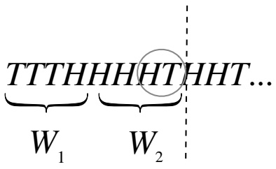

<details>
<summary>text_image</summary>

TTTHHHHTHHT...
W₁ W₂
</details>

## FIGURE 9.3

Waiting time for HT is the waiting time for the first Heads, $W _ { 1 }$ , plus the additional waiting time for the next Tails, $W _ { 2 }$ . Durable partial progress is possible!

system can get reset suggests the strategy of first-step analysis. Let’s condition on the outcome of the first toss:

$$
E (W _ {H H}) = E (W _ {H H} | \text {first toss} H) \frac {1}{2} + E (W _ {H H} | \text {first toss} T) \frac {1}{2}.
$$

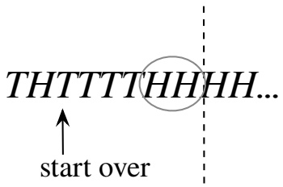

<details>
<summary>text_image</summary>

THTTTTHHHH...
↑
start over
</details>

## FIGURE 9.4

When waiting for HH, partial progress can easily be destroyed.

For the second term, $E ( W _ { H H } |$ first toss $\mathrm { T ) } = 1 + E ( W _ { H H } )$ by memorylessness. For the first term, we compute $E ( W _ { H H } |$ 1st toss H) by further conditioning on the outcome of the second toss. If the second toss is Heads, we have obtained HH in two tosses. If the second toss is Tails, $\mathrm { w e } ^ { \mathfrak { z } } \mathrm { v e }$ wasted two tosses and have to start all over! This gives

$$
E (W _ {H H} | \text {first toss} H) = 2 \cdot \frac {1}{2} + (2 + E (W _ {H H})) \cdot \frac {1}{2}.
$$

Therefore,

$$
E (W _ {H H}) = \left(2 \cdot \frac {1}{2} + (2 + E (W _ {H H})) \cdot \frac {1}{2}\right) \frac {1}{2} + (1 + E (W _ {H H})) \frac {1}{2}.
$$

Solving for $E ( W _ { H H } )$ , we get $E ( W _ { H H } ) = 6$

It might seem surprising at first that the expected waiting time for HH is greater than the expected waiting time for HT. How do we reconcile this with the fact that in two tosses of the coin, HH and HT both have a $1 / 4$ chance of appearing? Why aren’t the average waiting times the same by symmetry?

---

Conditional expectation

423

As we solved this problem, we in fact noticed an important asymmetry. When waiting for HT, once we get the first Heads, we’ve achieved partial progress that cannot be destroyed: if the Heads is followed by another Heads, we’re in the same position as before, and if the Heads is followed by a Tails, we’re done. By contrast, when waiting for HH, even after getting the first Heads, we could be sent back to square one if the Heads is followed by a Tails. This suggests the average waiting time for HH should be longer. Symmetry implies that the average waiting time for HH is the same as that for TT, and that for HT is the same as that for TH, but it does not imply that the average waiting times for HH and HT are the same.

More intuition into what’s going on can be obtained by considering a long string of coin flips, as in Figure 9.5. We notice right away that appearances of HH can overlap, while appearances of HT must be disjoint. For example, HHHHHH has 5 occurrences of HH, but HTHTHT has only 3 occurrences of HT. Since there are the same average number of HH s and HTs, but HH s sometimes clump together, the average waiting time for HH must be larger than that of HT to compensate.

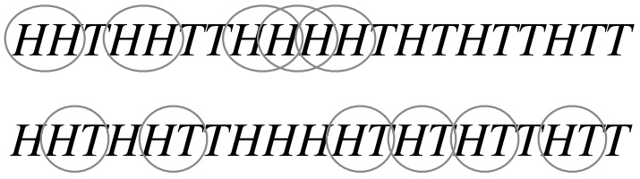

<details>
<summary>chemical</summary>

Sequence of HHTHHTTHHHHHTHTHTTHTT with overlapping circles, likely representing a DNA or protein sequence
</details>

## FIGURE 9.5

Clumping. (a) Appearances of HH can overlap. (b) Appearances of HT must be disjoint.

Related problems occur in information theory when compressing a message, and in genetics when looking for recurring patterns (called motifs) in DNA sequences. 

Our final example in this section uses wishful thinking for both probabilities and expectations to study a question about a random walk.

Example 9.1.10 (Random walk on the integers). An immortal drunk man wanders around randomly on the integers. He starts at the origin, and at each step he moves 1 unit to the right or 1 unit to the left, with equal probabilities, independently of all his previous steps. Let b be a googolplex (this is 10<sup>g</sup>, where $g = 1 0 ^ { 1 0 0 }$ is a googol).

(a) Find a simple expression for the probability that the immortal drunk visits b before returning to the origin for the first time.
(b) Find the expected number of times that the immortal drunk visits b before returning to the origin for the first time.

## Solution:

(a) Let B be the event that the drunk man visits b before returning to the origin for the first time and let L be the event that his first move is to the left. Then

---

424

Introduction to Probability

$P ( B | L ) = 0$ since any path from −1 to b must pass through 0. For $P ( B | L ^ { c } )$ , we are exactly in the setting of the gambler’s ruin problem, where player A starts with \$1, player B starts with $\S ( b - 1 )$ , and the rounds are fair. Applying that result, we have

$$
P (B) = P (B | L) P (L) + P (B | L ^ {c}) P (L ^ {c}) = \frac {1}{b} \cdot \frac {1}{2} = \frac {1}{2 b}.
$$

(b) Let N be the number of visits to b before returning to the origin for the first time, and let $p = 1 / ( 2 b )$ be the probability found in (a). Then

$$
E (N) = E (N | N = 0) P (N = 0) + E (N | N \geq 1) P (N \geq 1) = p E (N | N \geq 1).
$$

The conditional distribution of N given $N \geq 1$ is $\operatorname { F S } ( p )$ : given that the man reaches b, by symmetry there is probability p of returning to the origin before visiting b again (call this “success”) and probability $1 - p$ of returning to b again before returning to the origin (call this “failure”). Note that the trials are independent since the situation is the same each time he is at $b ,$ independent of the past history. Thus $E ( N | N \geq 1 ) = 1 / p ,$ and

$$
E (N) = p E (N | N \geq 1) = p \cdot \frac {1}{p} = 1.
$$

Surprisingly, the result doesn’t depend on the value of $b ,$ and our proof didn’t require knowing the value of $p .$ 

## 9.2 Conditional expectation given an r.v.

In this section we introduce conditional expectation given a random variable. That is, we want to understand what it means to write $E ( Y | X )$ for an r.v. X. We will see that $E ( Y | X )$ is a random variable that is, in a certain sense, our best prediction of $Y$ , assuming we get to know X.

The key to understanding $E ( Y | X )$ is first to understand $E ( Y | X = x )$ . Since $X = x$ is an event, $E ( Y | X = x )$ is just the conditional expectation of Y given this event, and it can be computed using the conditional distribution of $Y$ given $X = x$

If $Y$ is discrete, we use the conditional PMF $P ( Y   =   y | X   =   x )$ in place of the unconditional PMF $P ( Y = y )$

$$
E (Y | X = x) = \sum_ {y} y P (Y = y | X = x).
$$

Analogously, if Y is continuous, we use the conditional PDF $f _ { Y | X } ( y | x )$ in place of the unconditional PDF:

$$
E (Y | X = x) = \int_ {- \infty} ^ {\infty} y f _ {Y | X} (y | x) d y.
$$

---

Conditional expectation

425

Notice that because we sum or integrate over y, $E ( Y | X   =   x )$ is a function of x only. We can give this function a name, like $g ;$ let $g ( x ) = E ( Y | X = x )$ . We define $E ( Y | X )$ as the random variable obtained by finding the form of the function $g ( x )$ then $p l u g g i n g$ in $X \; f o r \; x$

Definition 9.2.1 (Conditional expectation given an $\mathrm { r . v . ) }$ . Let $g ( x ) = E ( Y | X = x )$ Then the conditional expectation of Y given $X$ , denoted $E ( Y | X )$ , is defined to be the random variable $g ( X )$ . In other words, if after doing the experiment X crystallizes into x, then $E ( Y | X )$ crystallizes into $g ( x )$

h 9.2.2. The notation in this definition sometimes causes confusion. It does not say $^ { \backprime \backprime } g ( x )   =   E ( Y | X   =   x )$ , so $g ( X )   =   E ( Y | X   =   X )$ , which equals $E ( Y )$ because $X = X$ is always true”. Rather, we should first compute the function $g ( x )$ , then plug in X for x. For example, if $g ( x ) = x ^ { 2 }$ , then $g ( X ) = X ^ { 2 }$ . A similar biohazard is h 5.3.2, about the meaning of $F ( X )$ in the universality of the Uniform.

h 9.2.3. By definition, $E ( Y | X )$ is a function of X, so it is a random variable. (This does not mean there are no examples where $E ( Y | X )$ is a constant. A constant is a degenerate $\mathbf { r } . \mathbf { V } .$ , and a constant function of X. For example, if X and Y are independent then $E ( Y | X ) \; = \; E ( Y )$ , which is a constant.) Thus it makes sense to compute quantities like $E ( E ( Y | X ) )$ and $\operatorname { V a r } ( E ( Y | X ) )$ , the mean and variance of the $r.v.   E(Y|X)$ . It is easy to be ensnared by category errors when working with conditional expectation, so it is important to keep in mind that conditional expectations of the form $E ( Y | A )$ are numbers, while those of the form $E ( Y | X )$ are random variables.

Here are some quick examples of how to calculate conditional expectation. In both examples, we don’t need to do a sum or integral to get $E ( Y | X = x )$ because a more direct approach is available.

Example 9.2.4. A stick of length 1 is broken at a point X chosen uniformly at random. Given that $X = x$ , we then choose another breakpoint $Y$ uniformly on the interval $[ 0 , x ]$ . Find $E ( Y | X )$ , and its mean and variance.

Solution:

From the description of the experiment, $X \sim \mathrm { U n i f } ( 0 , 1 )$ and $Y | X = x \sim \operatorname { U n i f } ( 0 , x )$ Then $E ( Y | X = x ) = x / 2$ , so by plugging in X for x, we have

$$
E (Y | X) = X / 2.
$$

The expected value of $E ( Y | X )$ is

$$
E (E (Y | X)) = E (X / 2) = 1 / 4.
$$

(We will show in the next section that a general property of conditional expectation is that $E ( E ( Y | X ) ) = E ( Y )$ , so it also follows that $E ( Y ) = 1 / 4 . )$ The variance of $E ( Y | X )$ is

$$
\mathrm{Var} (E (Y | X)) = \mathrm{Var} (X / 2) = 1 / 4 8.
$$



---

426

Introduction to Probability

Example 9.2.5. For $X , Y \stackrel { \mathrm { i . i . d . } } { \sim } \mathrm { E x p o } ( \lambda )$ , find $E ( \operatorname* { m a x } ( X , Y ) | \operatorname* { m i n } ( X , Y ) )$

Solution:

Let $M = \operatorname* { m a x } ( X , Y )$ and $L = \operatorname* { m i n } ( X , Y )$ . By the memoryless property, $M - L$ is independent of $L ,$ and $M - L \sim \mathrm{Exp}(\lambda)$ (see Example 7.3.6). Therefore

$$
E (M | L = l) = E (L | L = l) + E (M - L | L = l) = l + E (M - L) = l + \frac {1}{\lambda},
$$

and $\begin{array} { r } { E ( M | L ) = L + \frac { 1 } { \lambda } } \end{array}$

## 9.3 Properties of conditional expectation

Conditional expectation has some very useful properties.

• Dropping what’s independent: If X and $Y$ are independent, then $E ( Y | X ) = E ( Y )$
• Taking out what’s known: For any function h, $E ( h ( X ) Y | X ) = h ( X ) E ( Y | X )$
• Linearity: $E ( Y _ { 1 } + Y _ { 2 } | X ) = E ( Y _ { 1 } | X ) + E ( Y _ { 2 } | X )$ , and $E ( c Y | X ) = c E ( Y | X )$ for c a constant (the latter is a special case of taking out what’s known).

• Adam’s law: $E ( E ( Y | X ) ) = E ( Y )$

• Projection interpretation: The $r.v.   Y - E(Y|X)$ , which is called the residual from using $X$ to predict $Y .$ , is uncorrelated with $h ( X )$ for any function $h .$

Let’s discuss each property individually.

Theorem 9.3.1 (Dropping what’s independent). If X and $Y$ are independent, then $E ( Y | X ) = E ( Y )$

This is true because independence implies $E ( Y | X   =   x )   =   E ( Y )$ for all $x ,$ hence $E(Y|X)=E(Y)$ . Intuitively, if X provides no information about $Y$ , then our best guess for $Y$ , even if we get to know $X$ , is still the unconditional mean $E ( Y )$ . However, the converse is false: a counterexample is given in Example 9.3.3 below.

Theorem 9.3.2 (Taking out what’s known). For any function $h .$

$$
E (h (X) Y | X) = h (X) E (Y | X).
$$

Intuitively, when we take expectations given $X$ , we are treating $X$ as if it has crystallized into a known constant. Then any function of $X$ , say $h ( X )$ , also acts like a known constant while we are conditioning on $X$ . Taking out what’s known is the conditional version of the unconditional fact that $E ( c Y ) = c E ( Y )$ . The difference is that $E ( c Y ) = c E ( Y )$ asserts that two numbers are equal, while taking out what’s known asserts that two random variables are equal.

---

Conditional expectation

427

Example 9.3.3. Let $Z \sim \mathcal { N } ( 0 , 1 )$ and $Y = Z ^ { 2 }$ . Find $E ( Y | Z )$ and $E ( Z | Y )$

Solution: Since Y is a function of $Z ,   E ( Y | Z ) = E ( Z ^ { 2 } | Z ) = Z ^ { 2 }$ by taking out what’s known. To get $E ( Z | Y )$ , notice that conditional on $Y = y ,   Z$ equals ${ \sqrt { y } } { \mathrm { ~ o r ~ } } { - { \sqrt { y } } }$ with equal probabilities by the symmetry of the standard Normal, so $\dot { E } ( Z | Y = y ) = 0$ and $E ( Z | Y ) = 0$

In this case, although Y provides a lot of information about $Z ,$ narrowing down the possible values of $Z \mathrm { ~ t o ~ }$ just two values, Y only tells us about the magnitude of $Z$ and not its sign. For this reason, $E ( Z | Y ) = E ( Z )$ despite the dependence between $Z$ and $Y$ . This example illustrates that the converse of Theorem 9.3.1 is false. 

Theorem 9.3.4 (Linearity). $E ( Y _ { 1 } + Y _ { 2 } | X ) = E ( Y _ { 1 } | X ) + E ( Y _ { 2 } | X )$

This result is the conditional version of the unconditional fact that $E(Y_{1} + Y_{2}) =$ $E ( Y _ { 1 } ) + E ( Y _ { 2 } )$ , and is true since conditional probabilities are probabilities.

h 9.3.5. It is incorrect to write $`` E ( Y | X _ { 1 } + X _ { 2 } ) = E ( Y | X _ { 1 } ) + E ( Y | X _ { 2 } )$ ; linearity applies on the left side of the conditioning bar, not on the right side!

Example 9.3.6. Let $X _ { 1 } , \ldots , X _ { n }$ be i.i.d., and $S _ { n } = X _ { 1 }   + \cdots + X _ { n }$ . Find $E ( X _ { 1 } | S _ { n } )$

Solution:

By symmetry,

$$
E (X _ {1} | S _ {n}) = E (X _ {2} | S _ {n}) = \dots = E (X _ {n} | S _ {n}),
$$

and by linearity,

$$
E (X _ {1} | S _ {n}) + \dots + E (X _ {n} | S _ {n}) = E (S _ {n} | S _ {n}) = S _ {n}.
$$

Therefore,

$$
E (X _ {1} | S _ {n}) = S _ {n} / n = \bar {X} _ {n},
$$

the sample mean of the $X _ { j } { } ^ { \prime } \mathrm { s } .$ This is an intuitive result: if we have 2 i.i.d. r.v.s $X _ { 1 } , X _ { 2 }$ and learn that $X _ { 1 } + X _ { 2 } = 1 0$ , it makes sense to guess that $X _ { 1 }$ is 5 (accounting for half of the total). Similarly, if we have n i.i.d. r.v.s and get to know their sum, our best guess for any one of them is the sample mean. 

The next theorem connects conditional expectation to unconditional expectation. It goes by many names, including the law of total expectation, the law of iterated expectation (which has a terrible acronym for something glowing with truth), and the tower property. We call it Adam’s law because it is used so frequently that it deserves a pithy name, and since it is often used in conjunction with another law we’ll encounter soon, which has a complementary name.

Theorem 9.3.7 (Adam’s law). For any r.v.s X and $Y .$

$$
E (E (Y | X)) = E (Y).
$$

Proof. We present the proof in the case where X and $Y$ are both discrete (the proofs for other cases are analogous). Let $E ( Y | X ) = g ( X )$ . We proceed by applying

---

428

Introduction to Probability

LOTUS, expanding the definition of $g ( x )$ to get a double sum, and then swapping the order of summation:

$$
\begin{array}{l} E (g (X)) = \sum_ {x} g (x) P (X = x) \\ = \sum_ {x} \left(\sum_ {y} y P (Y = y | X = x)\right) P (X = x) \\ = \sum_ {x} \sum_ {y} y P (X = x) P (Y = y | X = x) \\ = \sum_ {y} y \sum_ {x} P (X = x, Y = y) \\ = \sum_ {y} y P (Y = y) = E (Y). \\ \end{array}
$$

Adam’s law is a more compact, more general version of the law of total expectation (Theorem 9.1.5). For X discrete, the statements

$$
E (Y) = \sum_ {x} E (Y | X = x) P (X = x)
$$

and

$$
E (Y) = E (E (Y | X))
$$

mean the same thing, since if we let $E ( Y | X = x ) = g ( x )$ , then

$$
E (E (Y | X)) = E (g (X)) = \sum_ {x} g (x) P (X = x) = \sum_ {x} E (Y | X = x) P (X = x).
$$

Armed with Adam’s law, we have a powerful strategy for finding an expectation $E ( Y )$ , by conditioning on an r.v. X that we wish we knew. First obtain $E ( Y | X )$ by treating X as known, and then take the expectation of $E ( Y | X )$ . We will see various examples of this later in the chapter.

Just as there are forms of Bayes’ rule and LOTP with extra conditioning, as discussed in Chapter 2, there is a version of Adam’s law with extra conditioning.

Theorem 9.3.8 (Adam’s law with extra conditioning). For any r.v.s $X , Y , Z ,$

$$
E (E (Y | X, Z) | Z) = E (Y | Z).
$$

The above equation is Adam’s law, except with extra conditioning on $Z$ inserted everywhere. It is true because conditional probabilities are probabilities. So we are free to use Adam’s law to help us find both unconditional expectations and conditional expectations.

Using Adam’s law, we can also prove the last item on our list of properties of conditional expectation.

---

Conditional expectation

429

Theorem 9.3.9 (Projection interpretation). For any function $h ,$ the random variable $Y - E ( Y | X )$ is uncorrelated with $h ( X )$ . Equivalently,

$$
E ((Y - E (Y | X)) h (X)) = 0.
$$

(This is equivalent since $E ( Y - E ( Y | X ) ) = 0$ , by linearity and Adam’s law.)

Proof. We have

$$
\begin{array}{l} E ((Y - E (Y | X)) h (X)) = E (h (X) Y) - E (h (X) E (Y | X)) \\ = E (h (X) Y) - E (E (h (X) Y | X)) \\ \end{array}
$$

by Theorem 9.3.2 (here we’re “putting back what’s known” in the inner expectation). By Adam’s law, the second term is equal to $E ( h ( X ) Y )$ 

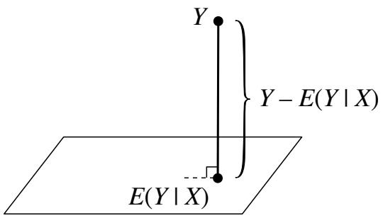

<details>
<summary>text_image</summary>

Y
}Y - E(Y | X)
E(Y | X)
</details>

## FIGURE 9.6

The conditional expectation $E ( Y | X )$ is the projection of $Y$ onto the space of all functions of $X$ , shown here as a plane. The residual $Y - E ( Y | X )$ is orthogonal to the plane: it’s perpendicular to (uncorrelated with) any function of $X$

From a geometric perspective, we can visualize Theorem 9.3.9 as in Figure 9.6. In a certain sense (described below), $E ( Y | X )$ is the function of $X$ that is closest to $Y ;$ we say that $E ( Y | X )$ is the projection of $Y$ into the space of all functions of $X$ The “line” from $Y$ to $E ( Y | X )$ in the figure is orthogonal (perpendicular) to the $``  plane$ since any other route from $Y$ to $E ( Y | X )$ would be longer. This orthogonality turns out to be the geometric interpretation of Theorem 9.3.9.

The details of this perspective are given in the next section, which is starred since it requires knowledge of linear algebra. But even without delving into the linear algebra, the projection picture gives some useful intuition. As mentioned earlier, we can think of $E ( Y | X )$ as a prediction for Y based on $X$ . This is an extremely common problem in statistics: predict or estimate the future observations or unknown parameters based on data. The projection interpretation of conditional expectation implies that $E ( Y | X )$ is the best predictor of $Y$ based on $X$ , in the sense that it is the function of X with the lowest mean squared error (expected squared difference between $Y$ and the prediction of $Y )$

---

430

Introduction to Probability

Example 9.3.10 (Linear regression). An extremely widely used method for data analysis in statistics is linear regression. In its most basic form, the linear regression model uses a single explanatory variable X to predict a response variable $Y .$ and it assumes that the conditional expectation of $Y$ is linear in $X$

$$
E (Y | X) = a + b X.
$$

(a) Show that an equivalent way to express this is to write

$$
Y = a + b X + \epsilon ,
$$

where  is an r.v. (called the error ) with $E ( \epsilon | X ) = 0$

(b) Solve for the constants a and b in terms of $E(X),E(Y),\mathrm{Cov}(X,Y)$ , and $\operatorname { V a r } ( X )$

Solution:

(a) Let $Y = a + b X + \epsilon$ , with $E ( \epsilon | X ) = 0$ . Then by linearity,

$$
E (Y | X) = E (a | X) + E (b X | X) + E (\epsilon | X) = a + b X.
$$

Conversely, suppose that $E ( Y | X ) = a + b X$ , and define

$$
\epsilon = Y - (a + b X).
$$

Then $Y = a + b X + \epsilon$ , with

$$
E (\epsilon | X) = E (Y | X) - E (a + b X | X) = E (Y | X) - (a + b X) = 0.
$$

(b) First, by Adam’s law, taking the expectation of both sides gives

$$
E (Y) = a + b E (X).
$$

Note that  has mean 0 and X and  are uncorrelated, since

$$
E (\epsilon) = E (E (\epsilon | X)) = E (0) = 0
$$

and

$$
E (\epsilon X) = E (E (\epsilon X | X)) = E (X E (\epsilon | X)) = E (0) = 0.
$$

Taking the covariance with X of both sides in $Y = a + b X + \epsilon ,$ we have

$$
\operatorname{Cov} (X, Y) = \operatorname{Cov} (X, a) + b \operatorname{Cov} (X, X) + \operatorname{Cov} (X, \epsilon) = b \operatorname{Var} (X).
$$

Thus,

$$
b = \frac {\operatorname{Cov} (X , Y)}{\operatorname{Var} (X)},
$$

$$
a = E (Y) - b   E (X) = E (Y) - \frac {\operatorname{Cov} (X , Y)}{\operatorname{Var} (X)} \cdot E (X).
$$



---

Conditional expectation

431

## 9.4 \*Geometric interpretation of conditional expectation

This section explains in more detail the geometric perspective shown in Figure 9.6, using some concepts from linear algebra. Consider the vector space consisting of all random variables on a certain probability space, such that the random variables all have finite variance. Each vector or point in the space is a random variable (here we are using “vector” in the linear algebra sense, not in the sense of a random vector from Chapter $7 )$ . Define the inner product of two r.v.s U and $V$ to be

$$
\langle U, V \rangle = E (U V).
$$

(For this definition to satisfy the axioms for an inner product, we need the convention that two r.v.s are considered the same if they are equal with probability 1.)

The squared length of an r.v. X is

$$
| | X | | ^ {2} = \langle X, X \rangle = E X ^ {2},
$$

and the squared distance between two r.v.s $U$ and $V$ is

$$
| | U - V | | ^ {2} = E (U - V) ^ {2}.
$$

The interpretations become especially nice if $E ( U ) = E ( V ) = 0$ , since then:

$| | U | | ^ { 2 } = \operatorname { V a r } ( U )$ , and $| | U | | = \operatorname { S D } ( U )$
$\langle U , V \rangle = \mathrm { C o v } ( U , V )$ , and the cosine of the “angle” between U and V is $\operatorname { C o r r } ( U , V )$
• $U$ and V are orthogonal $( \mathrm { i . e . , } ~ \langle U , V \rangle = 0 )$ if and only if they are uncorrelated.

To interpret $E ( Y | X )$ geometrically, consider the space of all random variables (with finite variance) that can be expressed as functions of $X$ . This is a subspace of the vector space. In Figure $9 . 6 ,$ the subspace of random variables of the form $h ( X )$ is represented by a plane. To get $E ( Y | X )$ , we project $Y$ onto the plane. Then the residual $Y - E ( Y | X )$ is orthogonal to $h ( X )$ for all functions $h ,$ and $E ( Y | X )$ is the function of X that best predicts $Y .$ where $`` \mathrm{best''}$ here means that the mean squared error $E ( Y - g ( X ) ) ^ { 2 }$ is minimized by choosing $g ( X ) = E ( Y | X )$

The projection interpretation is a helpful way to think about many of the properties of conditional expectation. For example, if $Y = h ( X )$ is a function of $X$ , then $Y$ itself is already in the plane, so it is its own projection; this explains why

$$
E (h (X) | X) = h (X).
$$

We can think of unconditional expectation as a projection too: $E ( Y )$ can be thought of as $E ( Y | 0 )$ , the projection of $Y$ onto the space of all constants (and indeed, $E ( Y )$ is the constant c that minimizes $E ( Y - c ) ^ { 2 }$ , as we proved in Theorem 6.1.4).

---

432

Introduction to Probability

We can now also give a geometric interpretation for Adam’s law: $E ( Y )$ says to project Y in one step onto the space of all constants; $E ( E ( Y | X ) )$ says to do it in two steps, by first projecting onto the plane and then projecting $E ( Y | X )$ onto the space of all constants, which is a line within that plane. Adam’s law says that the one-step and two-step methods yield the same result.

In the next section we will introduce Eve’s law, which serves the same purpose for variance as Adam’s law does for expectation. As a preview and to further explore the geometric interpretation of conditional expectation, let’s look at $\operatorname { V a r } ( Y )$ from the perspective of this section. Assume that $E(Y)=0 (  if  E(Y) \neq 0,$ we can center $Y$ by subtracting $E ( Y )$ ; doing so has no effect on the variance of Y ).

We can decompose $Y$ into two orthogonal terms, the residual $Y - E ( Y | X )$ and the conditional expectation $E ( Y | X )$ :

$$
Y = (Y - E (Y | X)) + E (Y | X).
$$

The two terms are orthogonal since $Y - E ( Y | X )$ is uncorrelated with any function of $X$ , and $E ( Y | X )$ is a function of X. So by the Pythagorean theorem,

$$
| | Y | | ^ {2} = | | Y - E (Y | X) | | ^ {2} + | | E (Y | X) | | ^ {2}.
$$

That is,

$$
\operatorname{Var} (Y) = \operatorname{Var} (Y - E (Y | X)) + \operatorname{Var} (E (Y | X)).
$$

As we will see in the next section, this identity is a form of Eve’s law. So it turns out that Eve’s law, which may look cryptic at first glance, can be interpreted as just being the Pythagorean theorem for a “triangle” whose sides are the vectors $Y - E ( Y | X ) , E ( Y | X )$ , and $Y$

## 9.5 Conditional variance

Once we’ve defined conditional expectation given an r.v., we have a natural way to define conditional variance given a random variable: replace all instances of $E ( \cdot )$ in the definition of unconditional variance with $E ( \cdot | X )$

Definition 9.5.1 (Conditional variance). The conditional variance of Y given X is

$$
\mathrm{Var} (Y | X) = E ((Y - E (Y | X)) ^ {2} | X).
$$

This is equivalent to

$$
\mathrm{Var} (Y | X) = E (Y ^ {2} | X) - (E (Y | X)) ^ {2}.
$$

h 9.5.2. Like $E(Y|X), \operatorname{Var}(Y|X)$ is a random variable, and it is a function of $X$

---

Conditional expectation

433

Since conditional variance is defined in terms of conditional expectations, we can use results about conditional expectation to help us calculate conditional variance. Here’s an example.

Example 9.5.3. Let $Z \sim \mathcal { N } ( 0 , 1 )$ and $Y = Z ^ { 2 }$ . Find $\operatorname { V a r } ( Y | Z )$ and $\operatorname { V a r } ( Z | Y )$

Solution:

Without any calculations we can see that $\mathrm { V a r } ( Y | Z )   =   0 ;$ conditional on $Z , \; Y$ is a known constant, and the variance of a constant is 0. By the same reasoning, $\mathrm { V a r } ( h ( Z ) | Z ) = 0$ for any function $h .$

To get $\operatorname { V a r } ( Z | Y )$ , apply the definition:

$$
\mathrm{Var} (Z | Z ^ {2}) = E (Z ^ {2} | Z ^ {2}) - (E (Z | Z ^ {2})) ^ {2}.
$$

The first term equals $Z ^ { 2 }$ . The second term equals 0 by symmetry, as we found in Example 9.3.3. Thus $\mathrm { V a r } ( Z | Z ^ { 2 } ) = Z ^ { 2 }$ , which we can write as $\operatorname { V a r } ( Z | Y ) = Y$ 

In the next example, we will practice working with conditional expectation and conditional variance in the context of the Bivariate Normal.

Example 9.5.4 (Conditional expectation and conditional variance in a BVN). Let $( Z , W )$ be Bivariate Normal, with Corr $( Z , W ) = \rho$ and $Z , W$ marginally $\mathcal { N } ( 0 , 1 )$ Find $E ( W | Z )$ and $\operatorname { V a r } ( W | Z )$

Solution: We can assume that $( Z , W )$ has been constructed as in Example 7.5.10, since $E ( W | Z )$ and $\operatorname { V a r } ( W | Z )$ depend only on the joint distribution of $( Z , W )$ , not on the specific method that was used to create $( Z , W )$ . So let

$$
\begin{array}{l} Z = X \\ W = \rho X + \sqrt {1 - \rho^ {2}} Y, \\ \end{array}
$$

with $X , Y   i.i.d.  \mathcal{N}(0,1)$ . We can then solve the problem very neatly, without having to resort to messy integrals based on the Bivariate Normal joint PDF. The conditional expectation is

$$
E (W | Z) = E (W | X) = \rho X + \sqrt {1 - \rho^ {2}} E (Y | X) = \rho X + \sqrt {1 - \rho^ {2}} E (Y) = \rho Z,
$$

since X and Y are independent. And the conditional variance is

$$
\operatorname{Var} (W | Z) = \operatorname{Var} (W | X) = \operatorname{Var} (\sqrt {1 - \rho^ {2}} Y | X) = (1 - \rho^ {2}) \operatorname{Var} (Y) = 1 - \rho^ {2},
$$

since $\rho X$ acts as a constant if we are given $X$ , and Y is independent of $X$ .

Interestingly, the same argument with the roles of $Z$ and $W$ reversed shows that

$$
E (Z | W) = \rho W, \text {and} \operatorname{Var} (Z | W) = 1 - \rho^ {2}.
$$

One might have guessed that if we should multiply by $\rho$ to go from an observed value of $Z$ to a predicted value of W, then we should divide by $\rho$ to go from an observed

---

434

Introduction to Probability

value of $W$ to a predicted value of $Z .$ But the above results say to multiply by the same $\rho ,$ regardless of whether using $Z$ to predict $W$ or vice versa! This is closely related to the fact that correlation is symmetric $( \operatorname { C o r r } ( Z , W )   =   \rho   =   \operatorname { C o r r } ( W , Z ) )$ and to an important concept in statistics known as regression toward the mean. 

We learned in the previous section that Adam’s law relates conditional expectation to unconditional expectation. A companion result for Adam’s law is $E v e   ^ { \prime } s$ law, which relates conditional variance to unconditional variance.

Theorem 9.5.5 (Eve’s law). For any r.v.s X and $Y$ ,

$$
\mathrm{Var} (Y) = E (\mathrm{Var} (Y | X)) + \mathrm{Var} (E (Y | X)).
$$

The ordering of $E ^ { \flat } \mathrm { s }$ and $\mathrm { V a r ^ { \prime } s }$ on the right-hand side spells EVVE, whence the name Eve’s law. Eve’s law is also known as the law of total variance or the variance decomposition formula.

Proof. Let $g ( X ) = E ( Y | X )$ . By Adam’s law, $E(g(X)) = E(Y)$ . Then

$$
E (\operatorname{Var} (Y | X)) = E (E (Y ^ {2} | X) - g (X) ^ {2}) = E (Y ^ {2}) - E (g (X) ^ {2}),
$$

$$
\mathrm{Var} (E (Y | X)) = E (g (X) ^ {2}) - (E g (X)) ^ {2} = E (g (X) ^ {2}) - (E Y) ^ {2}.
$$

Adding these equations, we have Eve’s law.

To visualize Eve’s law, imagine a population where each person has a value of $X$ and a value of $Y$ . We can divide this population into subpopulations, one for each possible value of $X .$ . For example, if $X$ represents age and $Y$ represents height, we can group people based on age. Then there are two sources contributing to the variation in people’s heights in the overall population. First, within each age group, people have different heights. The average amount of variation in height within each age group is the within-group variation, $E ( \operatorname { V a r } ( Y | X ) )$ . Second, across age groups, the average heights are different. The variance of average heights across age groups is the between-group variation, $\operatorname { V a r } ( E ( Y | X ) )$ . Eve’s law says that to get the total variance of $Y ,$ we simply add these two sources of variation.

Figure 9.7 illustrates Eve’s law in the simple case where we have three age groups. The average amount of scatter within each of the groups $X   =   1 , \; X   =   2$ , and $X \; = \; 3$ is the within-group variation, $E ( \operatorname { V a r } ( Y | X ) )$ . The variance of the group means $E(Y|X=1),   E(Y|X=2)$ , and $E ( Y | X = 3 )$ is the between-group variation, $\operatorname { V a r } ( E ( Y | X ) )$

Another way to think about Eve’s law is in terms of prediction. If we wanted to predict someone’s height based on their age alone, the ideal scenario would be if everyone within an age group had exactly the same height, while different age groups had different heights. Then, given someone’s age, we would be able to predict their height perfectly. In other words, the ideal scenario for prediction is $n o$ within-group

---

Conditional expectation

435

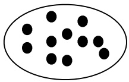

<details>
<summary>natural_image</summary>

Simple diagram of black dots arranged inside an oval outline (no text or symbols)
</details>

X = 1

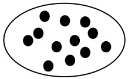

<details>
<summary>natural_image</summary>

Simple diagram of black dots arranged inside an oval boundary (no text or symbols)
</details>

X = 2

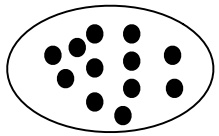

<details>
<summary>natural_image</summary>

Simple diagram of black dots arranged inside an oval outline (no text or symbols)
</details>

X = 3

## FIGURE 9.7

Eve’s law says that total variance is the sum of within-group and between-group variation.

variation in height, since the within-group variation cannot be explained by age differences. For this reason, within-group variation is also called unexplained variation, and between-group variation is also called explained variation. Eve’s law says that the overall variance of Y is the sum of unexplained and explained variation.

We can also write Eve’s law in the form

$$
\mathrm{Var} (Y) = \mathrm{Var} (Y - E (Y | X)) + \mathrm{Var} (E (Y | X)),
$$

since, letting W be the residual $Y - E ( Y | X )$

$$
\mathrm{Var} (Y - E (Y | X)) = E (W ^ {2}) = E (E (W ^ {2} | X)) = E (\mathrm{Var} (Y | X)).
$$

Again this says that we can decompose variance into within-group variation plus between-group variation.

h 9.5.6. Let Y be an r.v. and A be an event. It is wrong to say $\operatorname { { } ^ { \operatorname { { \mathcal { C } } } } V a r } ( Y ) \; = \;$ $\mathrm { V a r } ( Y | A ) P ( A ) + \mathrm { V a r } ( Y | A ^ { c } ) P ( A ^ { c } )$ , even though this looks analogous to the law of total expectation. (For a simple counterexample, let $Y \sim \mathrm { B e r n } ( 1 / 2 )$ and A be the event $Y = 0$ . Then $\operatorname { V a r } ( Y | A )$ and $\operatorname { V a r } ( Y | A ^ { c } )$ are both 0, but $\operatorname { V a r } ( Y ) = 1 / 4 . )$

Instead, we should use Eve’s law if we want to condition on whether or not A occurred: letting I be the indicator of A,

$$
\mathrm{Var} (Y) = E (\mathrm{Var} (Y | I)) + \mathrm{Var} (E (Y | I)).
$$

To see how this expression relates to the “wrong expression”, let

$$
p = P (A), q = P (A ^ {c}), a = E (Y | A), b = E (Y | A ^ {c}), v = \operatorname{Var} (Y | A), w = \operatorname{Var} (Y | A ^ {c}).
$$

Then $E ( Y | I )$ is a with probability p and b with probability q, and $\operatorname { V a r } ( Y | I )$ is v with probability p and w with probability q. So

$$
E (\operatorname{Var} (Y | I)) = v p + w q = \operatorname{Var} (Y | A) P (A) + \operatorname{Var} (Y | A ^ {c}) P (A ^ {c}),
$$

which is exactly the “wrong expression”, and Var(Y ) consists of this plus the term

$$
\mathrm{Var} (E (Y | I)) = a ^ {2} p + b ^ {2} q - (a p + b q) ^ {2}.
$$

It is crucial to account for both within-group and between-group variation.

---

436

Introduction to Probability

## 9.6 Adam and Eve examples

We conclude this chapter with several examples showing how Adam’s law and Eve’s law allow us to find the mean and variance of complicated r.v.s, especially in situations that involve multiple levels of randomness.

In our first example, the r.v. of interest is a random sum: the sum of a random number of random variables. There are thus two levels of randomness: first, each term in the sum is a random variable; second, the number of terms in the sum is also a random variable.

Example 9.6.1 (Random sum). A store receives N customers in a day, where N is an r.v. with finite mean and variance. Let $X _ { j }$ be the amount spent by the jth customer at the store. Assume that each $X _ { j }$ has mean $\mu$ and variance $\sigma ^ { 2 }$ , and that N and all the $X _ { j }$ are independent of one another. Find the mean and variance of the random sum $\begin{array} { r } { \tilde { X } = \sum _ { j = 1 } ^ { N } X _ { j } } \end{array}$ , which is the store’s total revenue in a day, in terms of $\mu ,   \sigma ^ { 2 } ,   E ( N )$ , and Var(N).

## Solution:

Since X is a sum, our first impulse might be to claim ${ } ^ { \propto } E ( X ) = N \mu$ by linearity”. Alas, this would be a category error, since $E ( X )$ is a number and $N \mu$ is a random variable. The key is that X is not merely a sum, but a random sum; the number of terms we are adding up is itself random, whereas linearity applies to sums with a fixed number of terms.

Yet this category error actually suggests the correct strategy: if only we were allowed to treat N as a constant, then linearity would apply. So let’s condition on N. By linearity of conditional expectation,

$$
E (X | N) = E \left(\sum_ {j = 1} ^ {N} X _ {j} | N\right) = \sum_ {j = 1} ^ {N} E (X _ {j} | N) = \sum_ {j = 1} ^ {N} E (X _ {j}) = N \mu .
$$

We used the independence of the $X _ { j }$ and N to assert $E ( X _ { j } | N )   =   E ( X _ { j } )$ for all $j .$ . Note that the statement ${ } ^ { \backprime \backprime } E ( X | N ) = N \mu$ is not a category error because both sides of the equality are r.v.s that are functions of N. Finally, by Adam’s law,

$$
E (X) = E (E (X | N)) = E (N \mu) = \mu E (N).
$$

This is a pleasing result: the average total revenue is the average amount spent per customer, multiplied by the average number of customers.

For $\operatorname { V a r } ( X )$ , we again condition on N to get $\operatorname { V a r } ( X | N )$

$$
\operatorname{Var} (X | N) = \operatorname{Var} \left(\sum_ {j = 1} ^ {N} X _ {j} | N\right) = \sum_ {j = 1} ^ {N} \operatorname{Var} (X _ {j} | N) = \sum_ {j = 1} ^ {N} \operatorname{Var} (X _ {j}) = N \sigma^ {2}.
$$

---

Conditional expectation

437

Eve’s law then tells us how to obtain the unconditional variance of $X$ :

$$
\begin{array}{l} \mathrm{Var} (X) = E (\mathrm{Var} (X | N)) + \mathrm{Var} (E (X | N)) \\ = E (N \sigma^ {2}) + \mathrm{Var} (N \mu) \\ = \sigma^ {2} E (N) + \mu^ {2} \mathrm{Var} (N). \\ \end{array}
$$

In the next example, two levels of randomness arise because our experiment takes place in two stages. We sample a city from a group of cities, then sample citizens within the city. This is an example of a multilevel model.

Example 9.6.2 (Random sample from a random city). To study the prevalence of a disease in several cities of interest within a certain county, we pick a city at random, then pick a random sample of n people from that city. This is a form of a widely used survey technique known as cluster sampling.

Let $Q$ be the proportion of diseased people in the chosen city, and let X be the number of diseased people in the sample. As illustrated in Figure 9.8 (where white dots represent healthy individuals and black dots represent diseased individuals), different cities may have very different prevalences. Since each city has its own disease prevalence, $Q$ is a random variable. Suppose that $Q \; \sim \; \mathrm { U n i f } ( 0 , 1 )$ . Also assume that conditional on $Q ,$ each individual in the sample independently has probability $Q$ of having the disease; this is true if we sample with replacement from the chosen city, and is approximately true if we sample without replacement but the population size is large. Find $E ( X )$ and Var(X).

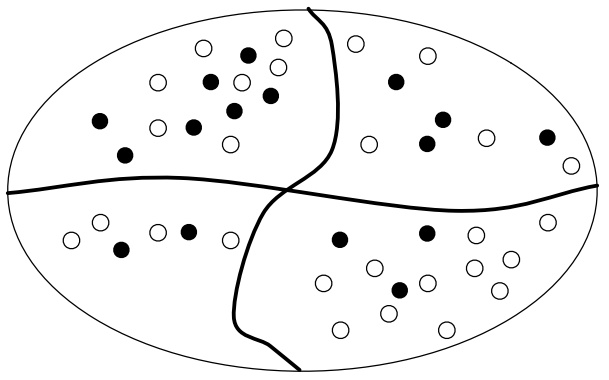

<details>
<summary>natural_image</summary>

Diagram showing four quadrants with shaded regions containing black and white dots, no text or symbols present
</details>

## FIGURE 9.8

A certain oval-shaped county has 4 cities. Each city has healthy people (represented as white dots) and diseased people (represented as black dots). A random city is chosen, and then a random sample of n people is chosen from within that city. There are two components to the variability in the number of diseased people in the sample: variation due to different cities having different disease prevalence, and variation due to the randomness of the sample within the chosen city.

## Solution:

With our assumptions, $X | Q   \sim   \mathrm { B i n } ( n , Q )$ ; this notation says that conditional on

---

438

Introduction to Probability

knowing the disease prevalence in the chosen city, we can treat Q as a constant, and each sampled individual is an independent Bernoulli trial with probability Q of success. Using the mean and variance of the Binomial distribution, $E ( X | Q ) = n Q$ and $\mathrm { V a r } ( X | Q ) \; = \; n Q ( 1   -   Q )$ . Furthermore, using the moments of the standard Uniform distribution, $E(Q)=1/2,   E(Q^2)=1/3$ , and $\operatorname { V a r } ( Q ) = 1 / 1 2$ . Now we can apply Adam’s law and Eve’s law to get the unconditional mean and variance of $X$

$$
E (X) = E (E (X | Q)) = E (n Q) = \frac {n}{2},
$$

$$
\begin{array}{l} \operatorname{Var} (X) = E (\operatorname{Var} (X | Q)) + \operatorname{Var} (E (X | Q)) \\ = E (n Q (1 - Q)) + \operatorname{Var} (n Q) \\ = n E (Q) - n E (Q ^ {2}) + n ^ {2} \mathrm{Var} (Q) \\ = \frac {n}{6} + \frac {n ^ {2}}{1 2}. \\ \end{array}
$$

Note that the structure of this problem is identical to that in the story of Bayes billiards. Therefore, we actually know the distribution of $X$ , not just its mean and variance: X is Discrete Uniform on $\{ 0 , 1 , 2 , \ldots , n \}$ . But the Adam-and-Eve approach can be applied when $Q$ has a more complicated distribution, or with more levels in the multilevel model, whether or not it is feasible to work out the distribution of X. For example, we could have people within cities within counties within states within countries. 

Last but not least, we revisit Story 8.4.5, the Gamma-Poisson problem from the previous chapter.

Example 9.6.3 (Gamma-Poisson revisited). Recall that Fred decided to find out about the rate of Blotchville’s Poisson process of buses by waiting at the bus stop for t hours and counting the number of buses $Y$ . He then used the data to update his prior distribution $\lambda \sim \mathrm { G a m m a } ( r _ { 0 } , b _ { 0 } )$ . Thus, Fred was using the two-level model

$$
\lambda \sim \operatorname{Gamma} (r _ {0}, b _ {0})
$$

$$
Y | \lambda \sim \operatorname{Pois} (\lambda t).
$$

We found that under Fred’s model, the marginal distribution of Y is Negative Binomial with parameters $r = r _ { 0 }$ and $p = b _ { 0 } / ( b _ { 0 } + t )$ . In particular,

$$
E (Y) = \frac {r q}{p} = \frac {r _ {0} t}{b _ {0}},
$$

$$
\mathrm{Var} (Y) = \frac {r q}{p ^ {2}} = \frac {r _ {0} t (b _ {0} + t)}{b _ {0} ^ {2}}.
$$

Let’s independently verify this with Adam’s law and Eve’s law. Using results about the Poisson distribution, the conditional mean and variance of $Y$ given λ are $E ( Y | \lambda )   =   \mathrm { V a r } ( Y | \lambda )   =   \lambda t$ . Using results about the Gamma distribution, the

---

Conditional expectation

439

marginal mean and variance of λ are $E ( \lambda ) = r _ { 0 } / b _ { 0 }$ and $\mathrm { V a r } ( \lambda ) = r _ { 0 } / b _ { 0 } ^ { 2 }$ . For Adam and Eve, this is all that is required:

$$
\begin{array}{l} E (Y) = E (E (Y | \lambda)) = E (\lambda t) = \frac {r _ {0} t}{b _ {0}}, \\ \operatorname{Var} (Y) = E (\operatorname{Var} (Y | \lambda)) + \operatorname{Var} (E (Y | \lambda)) \\ = E (\lambda t) + \operatorname{Var} (\lambda t) \\ = \frac {r _ {0} t}{b _ {0}} + \frac {r _ {0} t ^ {2}}{b _ {0} ^ {2}} = \frac {r _ {0} t (b _ {0} + t)}{b _ {0} ^ {2}}, \\ \end{array}
$$

which is consistent with our earlier answers. The difference is that when using Adam and Eve, we don’t need to know that Y is Negative Binomial! If we had been too lazy to derive the marginal distribution of Y , or if we weren’t so lucky as to have a named distribution for Y , Adam and Eve would still deliver the mean and variance of $Y$ (though not the PMF).

Lastly, let’s compare the mean and variance of Y under the two-level model to the mean and variance we would get if Fred were absolutely sure of the true value of λ. In other words, suppose we replaced λ by its mean, $E ( \lambda )   =   r _ { 0 } / b _ { 0 }$ , making λ a constant instead of an r.v. Then the marginal distribution of the number of buses (which we’ll call $\tilde { Y }$ under the new assumptions) would just be Poisson with parameter $r _ { 0 } t / b _ { 0 }$ . Then we would have

$$
E (\tilde {Y}) = \frac {r _ {0} t}{b _ {0}},
$$

$$
\mathrm{Var} (\tilde {Y}) = \frac {r _ {0} t}{b _ {0}}.
$$

Notice that $E ( \tilde { Y } ) = E ( Y )$ , but $\mathrm { V a r } ( \tilde { Y } ) < \mathrm { V a r } ( Y )$ : the extra term $r _ { 0 } t ^ { 2 } / b _ { 0 } ^ { 2 }$ <sup>from</sup> Eve’s law is missing. Intuitively, when we fix λ at its mean, we are eliminating a level of uncertainty in the model, and this causes a reduction in the unconditional variance.

Figure 9.9 overlays the plots of two PMFs, that of $Y \sim \mathrm { N B i n } ( r _ { 0 } , b _ { 0 } / ( b _ { 0 }   +   t ) )$ in gray and that of $\tilde { Y } \sim \operatorname { P o i s } ( r _ { 0 } t / b _ { 0 } )$ in black. The values of the parameters are arbitrarily chosen to be $r _ { 0 } = 5 ,   b _ { 0 } = 1 ,   t = 2$ . These two PMFs have the same center of mass, but the PMF of Y is noticeably more dispersed. 

## 9.7 Recap

To calculate an unconditional expectation, we can divide up the sample space and use the law of total expectation

$$
E (Y) = \sum_ {i = 1} ^ {n} E (Y | A _ {i}) P (A _ {i}),
$$

---

440

Introduction to Probability

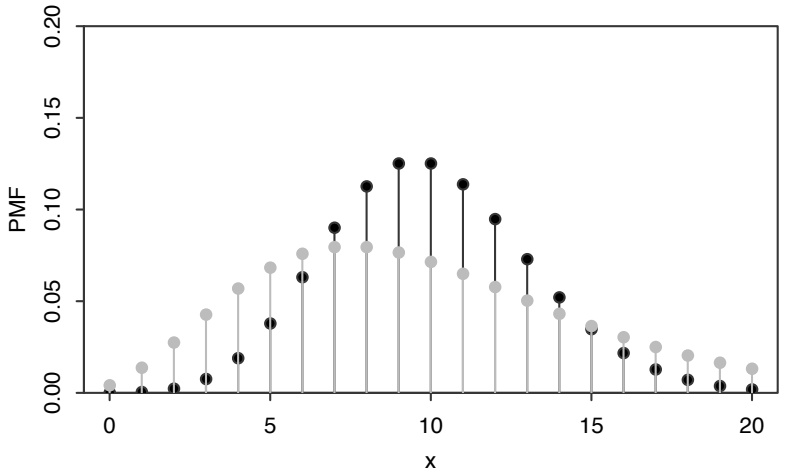

<details>
<summary>scatter</summary>

| x | Black Series (PMF) | Grey Series (PMF) |
|---|---|---|
| 0 | ~0.005 | ~0.005 |
| 1 | ~0.002 | ~0.015 |
| 2 | ~0.003 | ~0.028 |
| 3 | ~0.008 | ~0.042 |
| 4 | ~0.018 | ~0.056 |
| 5 | ~0.038 | ~0.068 |
| 6 | ~0.062 | ~0.075 |
| 7 | ~0.090 | ~0.078 |
| 8 | ~0.112 | ~0.078 |
| 9 | ~0.125 | ~0.075 |
| 10 | ~0.125 | ~0.072 |
| 11 | ~0.112 | ~0.065 |
| 12 | ~0.095 | ~0.058 |
| 13 | ~0.072 | ~0.050 |
| 14 | ~0.052 | ~0.042 |
| 15 | ~0.035 | ~0.035 |
| 16 | ~0.022 | ~0.030 |
| 17 | ~0.012 | ~0.025 |
| 18 | ~0.008 | ~0.020 |
| 19 | ~0.005 | ~0.015 |
| 20 | ~0.003 | ~0.012 |
</details>

## FIGURE 9.9

PMF of $Y   \sim   \mathrm { N B i n } ( r _ { 0 } , b _ { 0 } / ( b _ { 0 } + t ) )$ in gray and $\tilde { Y }   \sim   \mathrm { P o i s } ( r _ { 0 } t / b _ { 0 } )$ in black, where $r _ { 0 } = 5 ,   b _ { 0 } = 1 ,   t = 2$

but we must be careful not to destroy information in subsequent steps (such as by forgetting in the midst of a long calculation to condition on something that needs to be conditioned on). In problems with a recursive structure, we can also use first-step analysis for expectations.

The conditional expectation $E ( Y | X )$ and conditional variance $\operatorname { V a r } ( Y | X )$ are random variables that are functions of $X ;$ they are obtained by treating X as if it were a known constant. If X and $Y$ are independent, then $E ( Y | X )   =   E ( Y )$ and $\operatorname { V a r } ( Y | X ) = \operatorname { V a r } ( Y )$ . Conditional expectation has the properties

$$
E (h (X) Y | X) = h (X) E (Y | X)
$$

$$
E (Y _ {1} + Y _ {2} | X) = E (Y _ {1} | X) + E (Y _ {2} | X),
$$

analogous to the properties $E ( c Y ) = c E ( Y )$ and $E(Y_{1} + Y_{2}) = E(Y_{1}) + E(Y_{2})$ for unconditional expectation. The conditional expectation $E ( Y | X )$ is also the random variable that makes the residual $Y - E ( Y | X )$ uncorrelated with any function of $X$ which means we can interpret it geometrically as a projection.

Finally, Adam’s law and Eve’s law,

$$
E (Y) = E (E (Y | X))
$$

$$
\operatorname{Var} (Y) = E (\operatorname{Var} (Y | X)) + \operatorname{Var} (E (Y | X)),
$$

often help us calculate $E ( Y )$ and $\operatorname { V a r } ( Y )$ in problems that feature multiple forms or levels of randomness.

Figure 9.10 illustrates how the number $E ( Y | X = x )$ connects with the r.v. $E ( Y | X )$ whose expectation is $E ( Y )$ by Adam’s law. Additionally, it shows how the ingredients in Eve’s law are formed and come together to give a useful decomposition of $\operatorname { V a r } ( Y )$ in terms of quantities that condition on $X$

---

Conditional expectation

441

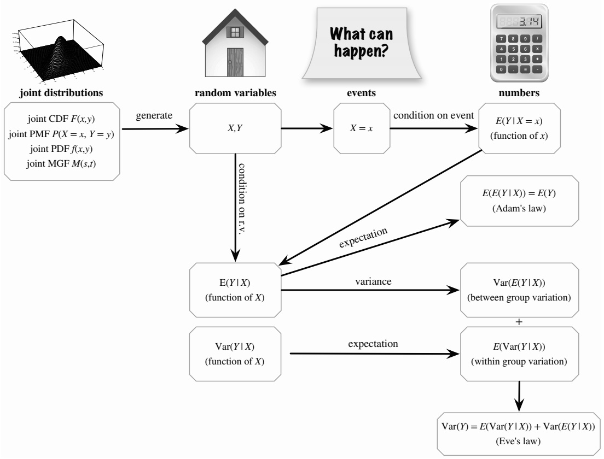

<details>
<summary>flowchart</summary>

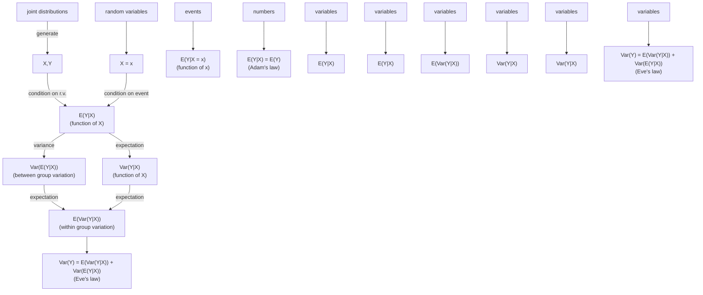
</details>

FIGURE 9.10

We often observe an r.v. X and want to predict another r.v. Y based on the information about X. If we observe that $X = x ,$ then we can condition on that event and use $E ( Y | X = x )$ as our prediction. The conditional expectation $E ( Y | X )$ is the r.v. that takes the value $E ( Y | X = x )$ when $X = x$ . Adam’s law lets us compute the unconditional expectation $E ( Y )$ by starting with the conditional expectation $E ( Y | X )$ . Similarly, Eve’s law lets us compute $\operatorname { V a r } ( Y )$ in terms of quantities that condition on $X$

## 9.8 R

## Mystery prize simulation

We can use simulation to show that in Example 9.1.7, the example of bidding on a mystery prize with unknown value, any bid will lead to a negative payout on average. First choose a bid b (we chose 0.6); then simulate a large number of hypothetical mystery prizes and store them in v:

$$
b <   - 0. 6
$$

---

442

Introduction to Probability

```txt
nsim <- 10^5
v <- runif(nsim)
```

The bid is accepted if b > (2/3)\*v. To get the average profit conditional on an accepted bid, we use square brackets to keep only those values of v satisfying the condition:

```txt
mean(v[b > (2/3)*v]) - b
```

This value is negative regardless of b, as you can check by experimenting with different values of b.

## Time until HH vs. HT

To verify the results of Example 9.1.9, we can start by generating a long sequence of fair coin tosses. This is done with the sample command. We use paste with the collapse="" argument to turn these tosses into a single string of H’s and T’s:

```txt
paste(sample(c("H","T"),100,replace=TRUE),collapse="")
```

A sequence of length 100 is enough to virtually guarantee that both HH and HT will have appeared at least once.

To determine how many tosses are required on average to see HH and HT, we need to generate many sequences of coin tosses. For this, we use our familiar friend replicate:

```txt
r <- replicate(10^3,paste(sample(c("H","T"),100,replace=T),
            collapse=""))
```

Now r contains a thousand sequences of coin tosses, each of length 100. To find the first appearance of HH in each of these sequences, you can use the str\_locate command from the stringr package. After you’ve installed and loaded the package,

```r
t <- str_locate(r,"HH")
```

creates a two-column table t, whose columns contain the starting and ending positions of the first appearance of HH in each sequence of coin tosses. (Use head(t) to display the first few rows of the table and get an idea of what your results look like.) What we want are the ending positions, given by the second column. In particular, we want the average value of the second column, which is an approximation of the average waiting time for HH :

```txt
mean(t[,2])
```

Is your answer around 6? Trying again with "HT" instead of "HH", is your answer around 4?

---

Conditional expectation

443

## Linear regression

In Example 9.3.10, we derived formulas for the slope and intercept of a linear regression model, which can be used to predict a response variable using an explanatory variable. Let’s try to apply these formulas to a simulated dataset:

```txt
x <- rnorm(100)
y <- 3 + 5*x + rnorm(100)
```

The vector x contains 100 realizations of the random variable $X \sim \mathcal { N } ( 0 , 1 )$ , and the vector y contains 100 realizations of the random variable $Y = a + b X + \epsilon$ where $\epsilon \sim \mathcal { N } ( 0 , 1 )$ . As we can see, the true values of a and b for this dataset are 3 and 5, respectively. We can visualize the data as a scatterplot with plot(x,y).

Now let’s see if we can get good estimates of the true a and b, using the formulas in Example 9.3.10:

```r
b <- cov(x,y) / var(x)
a <- mean(y) - b*mean(x)
```

Here cov(x,y), var(x), and mean(x) provide the sample covariance, sample variance, and sample mean, estimating the quantities Cov(X, Y ), Var(X), and E(X), respectively. (We have discussed sample mean and sample variance in detail in earlier chapters. Sample covariance is defined analogously, and is a natural way to estimate the true covariance.)

You should find that b is close to 5 and a is close to 3. These estimated values define the line of best fit. The abline command lets us plot the line of best fit on top of our scatterplot:

```txt
plot(x,y)
abline(a=a,b=b)
```

The first argument to abline is the intercept of the line, and the second argument is the slope.

## 9.9 Exercises

Exercises marked with s have detailed solutions at [http://stat110.net](http://stat110.net).

## Conditional expectation given an event

1. Fred wants to travel from Blotchville to Blissville, and is deciding between 3 options (involving different routes or different forms of transportation). The jth option would take an average of $\mu _ { j }$ hours, with a standard deviation of $\sigma _ { j }$ hours. Fred randomly

---

444

Introduction to Probability

chooses between the 3 options, with equal probabilities. Let T be how long it takes for him to get from Blotchville to Blissville.

(a) Find $E ( T )$ . Is it simply $( \mu _ { 1 } + \mu _ { 2 } + \mu _ { 3 } ) / 3$ , the average of the expectations?
(b) Find $\operatorname { V a r } ( T )$ . Is it simply $( \sigma _ { 1 } ^ { 2 } + \sigma _ { 2 } ^ { 2 } + \sigma _ { 3 } ^ { 2 } ) / 3$ the average of the variances?

2. While Fred is sleeping one night, X legitimate emails and Y spam emails are sent to him. Suppose that X and Y are independent, with $X   \sim   \mathrm { P o i s ( 1 0 ) }$ and $Y   \sim   \mathrm { P o i s ( 4 0 ) }$ When he wakes up, he observes that he has 30 new emails in his inbox. Given this information, what is the expected value of how many new legitimate emails he has?

3. A group of 21 women and 14 men are enrolled in a medical study. Each of them has a certain disease with probability p, independently. It is then found (through extremely reliable testing) that exactly 5 of the people have the disease. Given this information, what is the expected number of women who have the disease?

4. A researcher studying crime is interested in how often people have gotten arrested. Let $X \sim  Pois (\lambda)$ be the number of times that a random person got arrested in the last 10 years. However, data from police records are being used for the researcher’s study, and people who were never arrested in the last 10 years do not appear in the records. In other words, the police records have a selection bias: they only contain information on people who have been arrested in the last 10 years.

So averaging the numbers of arrests for people in the police records does not directly estimate $E ( X )$ ; it makes more sense to think of the police records as giving us information about the conditional distribution of how many times a person was arrest, given that the person was arrested at least once in the last 10 years. The conditional distribution of X, given that $X \geq 1$ , is called a truncated Poisson distribution (see Exercise 14 from Chapter 3 for another example of this distribution).

(a) Find $E ( X | X \geq 1 )$
(b) Find $\operatorname { V a r } ( X | X \geq 1 )$

5. A fair 20-sided die is rolled repeatedly, until a gambler decides to stop. The gambler pays \$1 per roll, and receives the amount shown on the die when the gambler stops (e.g., if the die is rolled 7 times and the gambler decides to stop then, with an 18 as the value of the last roll, then the net payoff is $\S 18-\S 7=\S 11)$ . Suppose the gambler uses the following strategy: keep rolling until a value of m or greater is obtained, and then stop (where m is a fixed integer between 1 and 20).

(a) What is the expected net payoff?

Hint: The average of consecutive integers $a , a + 1 , \ldots , a + n$ is the same as the average of the first and last of these. See the math appendix for more information about series.

(b) Use R or other software to find the optimal value of m.

6. Let $X \sim \operatorname{Expo}(\lambda)$ . Find $E ( X | X < 1 )$ in two different ways:

(a) by calculus, working with the conditional PDF of X given $X < 1$
(b) without calculus, by expanding E(X) using the law of total expectation.

7. You are given an opportunity to bid on a mystery box containing a mystery prize! The value of the prize is completely unknown, except that it is worth at least nothing, and at most a million dollars. So the true value V of the prize is considered to be Uniform on [0,1] (measured in millions of dollars).

You can choose to bid any nonnegative amount b (in millions of dollars). If $\begin{array} { r } { b < \frac { 1 } { 4 } V } \end{array}$ , then your bid is rejected and nothing is gained or lost. If $\begin{array} { r } { b \geq \frac { 1 } { 4 } V } \end{array}$ , then your bid is accepted and your net payoff is $V - b$ (since you pay b to get a prize worth V ).

---

Conditional expectation

445

Find your expected payoff as a function of b (be sure to specify it for all $b \geq 0 )$ . Then find the optimal bid $b ,$ to maximize your expected payoff.

8. s You get to choose between two envelopes, each of which contains a check for some positive amount of money. Unlike in the two-envelope paradox, it is not given that one envelope contains twice as much money as the other envelope. Instead, assume that the two values were generated independently from some distribution on the positive real numbers, with no information given about what that distribution is.

After picking an envelope, you can open it and see how much money is inside (call this value x), and then you have the option of switching. As no information has been given about the distribution, it may seem impossible to have better than a 50% chance of picking the better envelope. Intuitively, we may want to switch if x is “small” and not switch if x is “large”, but how do we define “small” and “large” in the grand scheme of all possible distributions? [The last sentence was a rhetorical question.]

Consider the following strategy for deciding whether to switch. Generate a threshold T ∼ Expo(1), and switch envelopes if and only if the observed value x is less than the value of T. Show that this strategy succeeds in picking the envelope with more money with probability strictly greater than $1 / 2 .$

Hint: Let t be the value of $T$ (generated by a random draw from the Expo(1) distribution). First explain why the strategy works very well if t happens to be in between the two envelope values, and does no harm in any case $( \mathrm { i . e . }$ , there is no case in which the strategy succeeds with probability strictly less than $1 / 2 )$

9. There are two envelopes, each of which has a check for a Unif(0, 1) amount of money, measured in thousands of dollars. The amounts in the two envelopes are independent. You get to choose an envelope and open it, and then you can either keep that amount or switch to the other envelope and get whatever amount is in that envelope.

Suppose that you use the following strategy: choose an envelope and open it. If you observe $U ,$ then stick with that envelope with probability $U ,$ and switch to the other envelope with probability $1 - U$

(a) Find the probability that you get the larger of the two amounts.
(b) Find the expected value of what you will receive.

10. Suppose n people are bidding on a mystery prize that is up for auction. The bids are to be submitted in secret, and the individual who submits the highest bid wins the prize. The ith bidder receives a signal $X _ { i } ,$ with $X _ { 1 } , \ldots , X _ { n }$ i.i.d. The value of the prize, $V ,$ is defined to be the sum of the individual bidders’ signals:

$$
V = X _ {1} + \dots + X _ {n}.
$$

This is known in economics as the wallet game: we can imagine that the n people are bidding on the total amount of money in their wallets, and each person’s signal is the amount of money in their own wallet. Of course, the wallet is a metaphor; the game can also be used to model company takeovers, where each of two companies bids to take over the other, and a company knows its own value but not the value of the other company.

For this problem, assume the $X _ { i }$ are i.i.d. Unif(0, 1).

(a) Before receiving her signal, what is bidder 1’s unconditional expectation for $V ?$
(b) Conditional on receiving the signal $X _ { 1 } = x _ { 1 }$ , what is bidder 1’s expectation for V ?
(c) Suppose each bidder submits a bid equal to their conditional expectation for V , i.e., bidder i bids $E ( V | X _ { i } = x _ { i } )$ . Conditional on receiving the signal $X _ { 1 } = x _ { 1 }$ and winning the auction, what is bidder 1’s expectation for V ? Explain intuitively why this quantity is always less than the quantity calculated in (b).

---

446

Introduction to Probability

11. s A coin with probability p of Heads is flipped repeatedly. For (a) and (b), suppose that p is a known constant, with $0 < p < 1$

(a) What is the expected number of flips until the pattern HT is observed?

(b) What is the expected number of flips until the pattern HH is observed?

(c) Now suppose that p is unknown, and that we use a $\mathrm { B e t a } ( a , b )$ prior to reflect our uncertainty about $p$ (where a and b are known constants and are greater than 2). In terms of a and b, find the corresponding answers to (a) and (b) in this setting.

12. A coin with probability p of Heads is flipped repeatedly, where $0   <   p   <   1$ . The sequence of outcomes can be divided into runs (blocks of $H ^ { \flat } \mathrm { s }$ or blocks of $T ^ { \mathrm { { , } } } \mathrm { { s ) , e . g . } }$ HHHT T T T HT T T HH becomes $\boxed { H H H } \boxed { T T T T } \boxed { H } \boxed { T T T } \boxed { H H } .$ which has 5 runs, with lengths 3, 4, 1, 3, 2, respectively. Assume that the coin is flipped at least until the start of the third run.

(a) Find the expected length of the first run.

(b) Find the expected length of the second run.

13. A fair 6-sided die is rolled once. Find the expected number of additional rolls needed to obtain a value at least as large as that of the first roll.

14. A fair 6-sided die is rolled repeatedly.

(a) Find the expected number of rolls needed to get a 1 followed right away by a 2.

Hint: Start by conditioning on whether or not the first roll is a 1.

(b) Find the expected number of rolls needed to get two consecutive 1’s.

(c) Let $a _ { n }$ be the expected number of rolls needed to get the same value n times in a row $( \mathrm { i . e . } ,$ to obtain a streak of n consecutive $j ^ { \prime } \mathrm { s }$ for some not-specified-in-advance value of $j )$ . Find a recursive formula for $a _ { n + 1 }$ in terms of $a _ { n }$

Hint: Divide the time until there are $n + 1$ consecutive appearances of the same value into two pieces: the time until there are n consecutive appearances, and the rest.

(d) Find a simple, explicit formula for $a _ { n }$ for all $n \geq 1$ . What is $a _ { 7 }$ (numerically)?

## Conditional expectation given a random variable

15. s Let $X _ { 1 } , X _ { 2 }$ be i.i.d., and let $\bar { X } = \textstyle { \frac { 1 } { 2 } } ( X _ { 1 } + X _ { 2 } )$ be the sample mean. In many statistics problems, it is useful or important to obtain a conditional expectation given $\bar { X }$ . As an example of this, find $E ( w _ { 1 } X _ { 1 } + w _ { 2 } X _ { 2 } | \bar { X } )$ , where $w _ { 1 } , w _ { 2 }$ are constants with $w _ { 1 }   +   w _ { 2 } = 1$

16. Let $X _ { 1 } , X _ { 2 } , \ldots$ be i.i.d. r.v.s with mean 0, and let $S _ { n } = X _ { 1 } + \cdots + X _ { n }$ . As shown in Example 9.3.6, the expected value of the first term given the sum of the first n terms is

$$
E (X _ {1} | S _ {n}) = \frac {S _ {n}}{n}.
$$

Generalize this result by finding $E ( S _ { k } | S _ { n } )$ for all positive integers k and $n .$

17. s Consider a group of n roommate pairs at a college (so there are $2 n$ students). Each of these 2n students independently decides randomly whether to take a certain course, with probability p of success (where “success” is defined as taking the course).

Let N be the number of students among these 2n who take the course, and let X be the number of roommate pairs where both roommates in the pair take the course. Find $E ( X )$ and $E ( X | N )$ .

---

Conditional expectation

447

18. s Show that $E ( ( Y - E ( Y | X ) ) ^ { 2 } | X ) = E ( Y ^ { 2 } | X ) - ( E ( Y | X ) ) ^ { 2 }$ , so these two expressions for $\operatorname { V a r } ( Y | X )$ agree.

Hint for the variance: Adding a constant (or something acting as a constant) does not affect variance.

19. Let X be the height of a randomly chosen adult man, and Y be his father’s height, where X and Y have been standardized to have mean 0 and standard deviation 1. Suppose that $( X , Y )$ is Bivariate Normal, with $X , Y \sim \mathcal { N } ( 0 , 1 )$ and $\operatorname { C o r r } ( X , Y ) = \rho .$

(a) Let $y   =   a x + b$ be the equation of the best line for predicting Y from X (in the sense of minimizing the mean squared error), e.g., if we were to observe $X = 1 . 3$ then we would predict that Y is $1 . 3 a + b .$ Now suppose that we want to use Y to predict X, rather than using X to predict Y . Give and explain an intuitive guess for what the slope is of the best line for predicting X from Y .

(b) Find a constant c (in terms of $\rho )$ and an r.v. V such that $Y = c X + V$ , with V independent of X.

Hint: Start by finding c such that $\mathrm{Cov}(X,Y-cX)=0.$

(c) Find a constant d (in terms of $\rho )$ and an r.v. W such that $X = d Y + W$ , with W independent of Y .

(d) Find $E ( Y | X )$ and $E ( X | Y )$

(e) Reconcile (a) and (d), if your intuitive guess in (a) differed from what the results of (d) implied. Give a clear and correct intuitive explanation of the relationship between the slope of the best line for predicting Y from X and the slope of the best line for predicting X from Y .

20. Let $\mathbf { X } \sim \operatorname { M u l t } _ { 5 } ( n , \mathbf { p } )$

(a) Find $E ( X _ { 1 } | X _ { 2 } )$ and $\operatorname { V a r } ( X _ { 1 } | X _ { 2 } )$

(b) Find $E ( X _ { 1 } | X _ { 2 } + X _ { 3 } )$

21. Let Y be a discrete r.v., A be an event with $0   <   P(A)   <   1$ , and $I _ { A }$ be the indicator r.v. for A.

(a) Explain precisely how the r.v. $E ( Y | I _ { A } )$ relates to the numbers $E ( Y | A )$ and $E ( Y | A ^ { c } )$

(b) Show that $E(Y|A)=E(YI_{A})/P(A)$ , directly from the definitions of expectation and conditional expectation.

Hint: Let $X = Y I _ { A }$ , and then find an expression for the PMF of X.

(c) Use (b) to give a short proof of the fact that $E ( Y ) = E ( Y | A ) P ( A ) + E ( Y | A ^ { c } ) P ( A ^ { c } )$

22. Show that the following version of LOTP, which we encountered in Section 7.1, is also a consequence of Adam’s law: for any event A and continuous r.v. X with PDF $f _ { X }$

$$
P (A) = \int_ {- \infty} ^ {\infty} P (A | X = x) f _ {X} (x) d x.
$$

Hint: Consider $E ( I ( A ) | X = x )$

23. s Let X and Y be random variables with finite variances, and let $W = Y - E ( Y | X )$ This is a residual: the difference between the true value of Y and the predicted value of Y based on X.

(a) Compute E(W) and $E ( W | X )$

(b) Compute $\operatorname { V a r } ( W )$ , for the case that $W | X \sim \mathcal { N } ( 0 , X ^ { 2 } )$ with $X \sim \mathcal { N } ( 0 , 1 )$

---

448

Introduction to Probability

24. $\textcircled{s}$ One of two identical-looking coins is picked from a hat randomly, where one coin has probability $p _ { 1 }$ of Heads and the other has probability $p _ { 2 }$ of Heads. Let X be the number of Heads after flipping the chosen coin n times. Find the mean and variance of $X$

25. Kelly makes a series of n bets, each of which she has probability $p$ of winning, independently. Initially, she has $x _ { 0 }$ dollars. Let $X _ { j }$ be the amount she has immediately after her jth bet is settled. Let $f$ be a constant in $( 0 , 1 )$ , called the betting fraction. On each bet, Kelly wagers a fraction $f$ of her wealth, and then she either wins or loses that amount. For example, if her current wealth is \$100 and $f = 0 . 2 5$ , then she bets \$25 and either gains or loses that amount. (A famous choice when $p   >   1 / 2$ is $f   =   2 p - 1$ , which is known as the Kelly criterion.) Find $E ( X _ { n } )$ (in terms of $n , p , f , x _ { 0 } )$

Hint: First find $E ( X _ { j + 1 } | X _ { j } )$

26. Let $N   \sim   \mathrm { P o i s } ( \lambda _ { \mathrm { 1 } } )$ be the number of movies that will be released next year. Suppose that for each movie the number of tickets sold is $\mathrm { P o i s } ( \lambda _ { 2 } )$ , independent of other movies and of N. Find the mean and variance of the number of movie tickets that will be sold next year.

27. A party is being held from 8:00 pm to midnight on a certain night, and $N \sim  Pois (\lambda)$ people are going to show up. They will all arrive at uniformly random times while the party is going on, independently of each other and of $N .$

(a) Find the expected time at which the first person arrives, given that at least one person shows up. Give both an exact answer in terms of $\lambda ,$ measured in minutes after 8:00 pm, and an answer rounded to the nearest minute for $\lambda = 2 0$ , expressed in time notation (e.g., 8:20 pm).

(b) Find the expected time at which the last person arrives, given that at least one person shows up. As in (a), give both an exact answer and an answer rounded to the nearest minute for $\lambda = 2 0$

28. $\textcircled{8}$ We wish to estimate an unknown parameter θ, based on an r.v. X we will get to observe. As in the Bayesian perspective, assume that X and θ have a joint distribution. Let $\hat { \theta }$ be the estimator (which is a function of X). Then $\hat { \theta }$ is said to be unbiased if $E ( { \hat { \theta } } | \theta ) = \theta$ , and $\hat { \theta }$ is said to be the Bayes procedure if $E ( \theta | X ) = { \hat { \theta } }$

(a) Let $\hat { \theta }$ be unbiased. Find $E ( \hat { \theta } \mathrm { ~ - ~ } \theta ) ^ { 2 }$ (the average squared difference between the estimator and the true value of $\theta )$ , in terms of marginal moments of $\hat { \theta }$ and $\theta .$

Hint: Condition on $\theta .$

(b) Repeat (a), except in this part suppose that $\hat { \theta }$ is the Bayes procedure rather than assuming that it is unbiased.

Hint: Condition on $X .$

(c) Show that it is impossible for $\hat { \theta }$ to be both the Bayes procedure and unbiased, except in silly problems where we get to know θ perfectly by observing X.

Hint: $\operatorname { I f } Y$ is a nonnegative r.v. with mean $0 ,$ then $P ( Y = 0 ) = 1$

29. Show that if $E ( Y | X ) = c$ is a constant, then X and $Y$ are uncorrelated.

Hint: Use Adam’s law to find $E ( Y )$ and $E ( X Y )$

30. Show by example that it is possible to have uncorrelated X and $Y$ such that $E ( Y | X )$ is not a constant.

Hint: Consider a standard Normal and its square.

31. s Emails arrive one at a time in an inbox. Let $T _ { n }$ be the time at which the nth email arrives (measured on a continuous scale from some starting point in time). Suppose that the waiting times between emails are i.i.d. $\operatorname { E x p o } ( \lambda )$ , i.e., $T _ { 1 } , T _ { 2 }   -   T _ { 1 } , T _ { 3 }   -   T _ { 2 } , \ldots$ . are i.i.d. Expo(λ).

---

Conditional expectation

449

Each email is non-spam with probability $p ,$ and spam with probability $q = 1 - p$ (independently of the other emails and of the waiting times). Let X be the time at which the first non-spam email arrives (so X is a continuous $\mathbf { r } . \mathbf { v } . ,$ with $X = T _ { 1 }$ if the 1st email is non-spam, $X = T _ { 2 }$ if the 1st email is spam but the 2nd one isn’t, etc.).

(a) Find the mean and variance of X.
(b) Find the MGF of X. What famous distribution does this imply that X has (be sure to state its parameter values)?

Hint for both parts: Let N be the number of emails until the first non-spam (including that one), and write X as a sum of N terms; then condition on N.

32. Customers arrive at a store according to a Poisson process of rate λ customers per hour. Each makes a purchase with probability $p ,$ independently. Given that a customer makes a purchase, the amount spent has mean $\mu$ (in dollars) and variance $\sigma ^ { 2 }$

(a) Find the mean and variance of how much a random customer spends (note that the customer may spend nothing).
(b) Find the mean and variance of the revenue the store obtains in an 8-hour time interval, using (a) and results from this chapter.
(c) Find the mean and variance of the revenue the store obtains in an 8-hour time interval, using the chicken-egg story and results from this chapter.

33. Fred’s beloved computer will last an Expo(λ) amount of time until it has a malfunction. When that happens, Fred will try to get it fixed. With probability $p ,$ he will be able to get it fixed. If he is able to get it fixed, the computer is good as new again and will last an additional, independent Expo(λ) amount of time until the next malfunction (when again he is able to get it fixed with probability $p ,$ and so on). If after any malfunction Fred is unable to get it fixed, he will buy a new computer. Find the expected amount of time until Fred buys a new computer. (Assume that the time spent on computer diagnosis, repair, and shopping is negligible.)

34. A green die is rolled until it lands 1 for the first time. An orange die is rolled until it lands 6 for the first time. The dice are fair, six-sided dice. Let $T _ { 1 }$ be the sum of the values of the rolls of the green die (including the 1 at the end) and $T _ { 6 }$ be the sum of the values of the rolls of the orange die (including the 6 at the end). Two students are debating whether $E(T_{1}) = E(T_{6})$ or $E ( T _ { 1 } ) < E ( T _ { 6 } )$ . They kindly gave permission to quote their arguments here.

Student A: We have $E ( T _ { 1 } ) = E ( T _ { 6 } )$ . By Adam’s law, the expected sum of the rolls of a die is the expected number of rolls times the expected value of one roll, and each of these factors is the same for the two dice. In more detail, let $N _ { 1 }$ be the number of rolls of the green die and $N _ { 6 }$ be the number of rolls of the orange die. By Adam’s law and linearity,

$$
E (T _ {1}) = E (E (T _ {1} | N _ {1})) = E (3. 5 N _ {1}) = 3. 5 E (N _ {1}),
$$

and the same method applied to the orange die gives $3 . 5 E ( N _ { 6 } )$ , which equals $3 . 5 E ( N _ { 1 } )$

Student B: Actually, $E ( T _ { 1 } ) < E ( T _ { 6 } )$ . I agree that the expected number of rolls is the same for the two dice, but the key difference is that we know the last roll is a 1 for the green die and a 6 for the orange die. The expected totals are the same for the two dice excluding the last roll of each, and then including the last roll makes $E ( T _ { 1 } ) < E ( T _ { 6 } )$

(a) Discuss in words the extent to which Student A’s argument is convincing and correct.
(b) Discuss in words the extent to which Student B’s argument is convincing and correct.
(c) Give careful derivations of $E ( T _ { 1 } )$ and $E ( T _ { 6 } )$

---

450

Introduction to Probability

35. s Judit plays in a total of $N \sim \operatorname { G e o m } ( s )$ chess tournaments in her career. Suppose that in each tournament she has probability $p$ of winning the tournament, independently. Let $T$ be the number of tournaments she wins in her career.

(a) Find the mean and variance of $T .$
(b) Find the MGF of T. What is the name of this distribution (with its parameters)?

36. In Story 8.4.5, we showed (among other things) that if $\lambda \sim$ Gamma $. ( r _ { 0 } , b _ { 0 } )$ and $Y | \lambda \sim$ Pois(λ), then the marginal distribution of $Y$ is NBin $\imath ( r _ { 0 } , b _ { 0 } / ( b _ { 0 } + 1 ) )$ . Derive this result using Adam’s law and MGFs.

Hint: Consider the conditional MGF of $Y | \lambda$

37. Let $X _ { 1 } , \ldots , X _ { n }$ be i.i.d. r.v.s with mean $\mu$ and variance $\sigma ^ { 2 }$ , and $n \geq 2$ A bootstrap sample of $X _ { 1 } , \ldots , X _ { n }$ is a sample of n r.v.s $X _ { 1 } ^ { * } , \ldots , X _ { n } ^ { * }$ formed from the $X _ { j }$ by sampling with replacement with equal probabilities. Let $\bar{X}^*$ denote the sample mean of the bootstrap sample:

$$
\bar {X} ^ {*} = \frac {1}{n} \left(X _ {1} ^ {*} + \dots + X _ {n} ^ {*}\right).
$$

(a) Calculate $E ( X _ { j } ^ { * } )$ and $\operatorname { V a r } ( X _ { j } ^ { * } )$ for each $j .$
(b) Calculate $E ( \bar { X } ^ { * } | X _ { 1 } , \ldots , X _ { n } )$ and $\operatorname { V a r } ( \bar { X } ^ { * } | X _ { 1 } , \ldots , X _ { n } )$

Hint: Conditional on $X _ { 1 } , \ldots , X _ { n } ,$ the $X _ { j } ^ { * }$ Xi are independent, with a $\mathrm { P M F }$ that puts probability $1 / n$ at each of the points $X _ { 1 } , \ldots , X _ { n }$ . As a check, your answers should be random variables that are functions of $X _ { 1 } , \ldots , X _ { n }$

(c) Calculate $E ( \bar { X } ^ { * } )$ and $\operatorname { V a r } ( { \bar { X } } ^ { * } )$
(d) Explain intuitively why $\operatorname { V a r } ( { \bar { X } } ) < \operatorname { V a r } ( { \bar { X } } ^ { * } )$

38. An insurance company covers disasters in two neighboring regions, $R _ { 1 }$ and $R _ { 2 }$ . Let $I _ { 1 }$ and $I _ { 2 }$ be the indicator r.v.s for whether $R _ { 1 }$ and $R _ { 2 }$ are hit by the insured disaster, respectively. The indicators $I _ { 1 }$ and $I _ { 2 }$ may be dependent. Let $p _ { j } = E ( I _ { j } )$ for $j = 1 , 2$ and $p _ { 1 2 } = E ( I _ { 1 } I _ { 2 } )$

The company reimburses a total cost of

$$
C = I _ {1} \cdot T _ {1} + I _ {2} \cdot T _ {2}
$$

to these regions, where $T _ { j }$ has mean $\mu _ { j }$ and variance $\sigma _ { j } ^ { 2 }$ . Assume that $T _ { 1 }$ and $T _ { 2 }$ are independent of each other and that $( T _ { 1 } , T _ { 2 } )$ is independent of $( I _ { 1 } , I _ { 2 } )$

(a) Find $E ( C )$
(b) Find $\operatorname { V a r } ( C )$

39. s A certain stock has low volatility on some days and high volatility on other days. Suppose that the probability of a low volatility day is $p$ and of a high volatility day is $q = 1 - p ,$ and that on low volatility days the percent change in the stock price is $\mathcal { N } ( 0 , \sigma _ { 1 } ^ { 2 } )$ , while on high volatility days the percent change is $\mathcal { N } ( 0 , \sigma _ { 2 } ^ { 2 } )$ , with $\sigma _ { 1 } < \sigma _ { 2 }$

Let X be the percent change of the stock on a certain day. The distribution is said to be a mixture of two Normal distributions, and a convenient way to represent $X$ is as $X = I _ { 1 } X _ { 1 }   +   I _ { 2 } X _ { 2 }$ where $I _ { 1 }$ is the indicator r.v. of having a low volatility day, $I _ { 2 } = 1   -   I _ { 1 }$ , $X _ { j } \sim \mathcal { N } ( 0 , \sigma _ { j } ^ { 2 } )$ , and $I _ { 1 } , X _ { 1 } , X _ { 2 }$ are independent.

(a) Find $\operatorname { V a r } ( X )$ in two ways: using Eve’s law, and by using properties of covariance to calculate Cov $\left( I _ { 1 } X _ { 1 } + I _ { 2 } X _ { 2 } , I _ { 1 } X _ { 1 } + I _ { 2 } X _ { 2 } \right)$
(b) Recall from Chapter 6 that the kurtosis of an r.v. Y with mean $\mu$ and standard deviation $\sigma$ is defined by

$$
\operatorname{Kurt} (Y) = \frac {E (Y - \mu) ^ {4}}{\sigma^ {4}} - 3.
$$

---

Conditional expectation

451

Find the kurtosis of X (in terms of $p , q , \sigma _ { 1 } ^ { 2 } , \sigma _ { 2 } ^ { 2 }$ , fully simplified). The result will show that even though the kurtosis of any Normal distribution is 0, the kurtosis of X is positive and in fact can be very large depending on the parameter values.

40. Let $X _ { 1 } , X _ { 2 }$ , and Y be random variables, such that Y has finite variance. Let

$$
A = E (Y | X _ {1}) \text {   and   } B = E (Y | X _ {1}, X _ {2}).
$$

Show that

$$
\operatorname{Var} (A) \leq \operatorname{Var} (B).
$$

Also, check that this make sense in the extreme cases where Y is independent of $X _ { 1 }$ and where $Y = h ( X _ { 2 } )$ for some function h.

Hint: Use Eve’s law on B.

41. Show that for any r.v.s X and Y ,

$$
E (Y | E (Y | X)) = E (Y | X).
$$

This has a nice intuitive interpretation if we think of $E ( Y | X )$ as the prediction we would make for $Y$ based on X: given the prediction we would use for predicting Y from X, we no longer need to know X to predict Y —we can just use the prediction we have! For example, letting $E ( Y | X ) = g ( X )$ , if we observe $g ( X )   =   7 ,$ then we may or may not know what X is (since g may not be one-to-one). But even without knowing X, we know that the prediction for Y based on X is 7.

Hint: Use Adam’s law with extra conditioning.

42. A researcher wishes to know whether a new treatment for the disease conditionitis is more effective than the standard treatment. It is unfortunately not feasible to do a randomized experiment, but the researcher does have the medical records of patients who received the new treatment and those who received the standard treatment. She is worried, though, that doctors tend to give the new treatment to younger, healthier patients. If this is the case, then naively comparing the outcomes of patients in the two groups would be like comparing apples and oranges.

Suppose each patient has background variables X, which might be age, height and weight, and measurements relating to previous health status. Let Z be the indicator of receiving the new treatment. The researcher fears that $Z$ is dependent on X, i.e., that the distribution of X given $Z = 1$ is different from the distribution of X given $Z = 0$

In order to compare apples to apples, the researcher wants to match every patient who received the new treatment to a patient with similar background variables who received the standard treatment. But X could be a high-dimensional random vector, which often makes it very difficult to find a match with a similar value of X.

The propensity score reduces the possibly high-dimensional vector of background variables down to a single number (then it is much easier to match someone to a person with a similar propensity score than to match someone to a person with a similar value of X). The propensity score of a person with background characteristics X is defined as

$$
S = E (Z | \mathbf {X}).
$$

By the fundamental bridge, a person’s propensity score is their probability of receiving the treatment, given their background characteristics. Show that conditional on S, the treatment indicator Z is independent of the background variables X.

Hint: This problem relates to the previous one. Show that $P ( Z = 1 | S , \mathbf { X } ) = P ( Z = 1 | S )$ which is equivalent to showing $E ( Z | S , \mathbf { X } ) = E ( Z | S )$

43. This exercise develops a useful identity for covariance, similar in spirit to Adam’s law for expectation and Eve’s law for variance. First define conditional covariance in a manner analogous to how we defined conditional variance:

$$
\mathrm{Cov} (X, Y | Z) = E \big ((X - E (X | Z)) (Y - E (Y | Z)) | Z \big).
$$

---

452

Introduction to Probability

(a) Show that

$$
\operatorname{Cov} (X, Y | Z) = E (X Y | Z) - E (X | Z) E (Y | Z).
$$

This should be true since it is the conditional version of the fact that

$$
\operatorname{Cov} (X, Y) = E (X Y) - E (X) E (Y)
$$

and conditional probabilities are probabilities, but for this problem you should prove it directly using properties of expectation and conditional expectation.

(b) ECCE, or the law of total covariance, says that

$$
\mathrm{Cov} (X, Y) = E (\mathrm{Cov} (X, Y | Z)) + \mathrm{Cov} (E (X | Z), E (Y | Z)).
$$

That is, the covariance of X and Y is the expected value of their conditional covariance plus the covariance of their conditional expectations, where all these conditional quantities are conditional on Z. Prove this identity.

Hint: We can assume without loss of generality that $E ( X ) = E ( Y ) = 0$ since adding a constant to an r.v. has no effect on its covariance with any r.v. Then expand out the covariances on the right-hand side of the identity and apply Adam’s law.

## Mixed practice

44. A group of n friends often go out for dinner together. At their dinners, they play “credit card roulette” to decide who pays the bill. This means that at each dinner, one person is chosen uniformly at random to pay the entire bill (independently of what happens at the other dinners).

(a) Find the probability that in k dinners, no one will have to pay the bill more than once (do not simplify for the case $k \leq n ,$ but do simplify fully for the case $k > n )$
(b) Find the expected number of dinners it takes in order for everyone to have paid at least once (you can leave your answer as a finite sum of simple-looking terms).
(c) Alice and Bob are two of the friends. Find the covariance between how many times Alice pays and how many times Bob pays in k dinners.

45. As in the previous problem, a group of n friends play “credit card roulette” at their dinners. In this problem, let the number of dinners be a Pois(λ) r.v.

(a) Alice is one of the friends. Find the correlation between how many dinners Alice pays for and how many free dinners Alice gets.
(b) The costs of the dinners are i.i.d. Gamma(a, b) r.v.s, independent of the number of dinners. Find the mean and variance of the total cost.

46. Joe will read $N \sim  Pois (\lambda)$ books next year. Each book has a Pois(µ) number of pages, with book lengths independent of each other and independent of N.

(a) Find the expected number of book pages that Joe will read next year.
(b) Find the variance of the number of book pages Joe will read next year.
(c) For each of the N books, Joe likes it with probability p and dislikes it with probability $1 - p ,$ independently. Find the conditional distribution of how many of the N books Joe likes, given that he dislikes exactly d of the books.

47. Buses arrive at a certain bus stop according to a Poisson process of rate λ. Each bus has n seats and, at the instant when it arrives at the stop, has a $\operatorname { B i n } ( n , p )$ number of passengers. Assume that the numbers of passengers on different buses are independent of each other, and independent of the arrival times of the buses.

---

Conditional expectation

453

Let $N _ { t }$ be the number of buses that arrive in the time interval $[ 0 , t ] ,$ and $X _ { t }$ be the total number of passengers on the buses that arrive in the time interval [0, t].

(a) Find the mean and variance of $N _ { t }$
(b) Find the mean and variance of $X _ { t }$
(c) A bus is full if it has exactly n passengers when it arrives at the stop. Find the probability that exactly $a + b$ buses arrive in $[ 0 , t ]$ , of which a are full and b are not full.

48. Paul and n other runners compete in a marathon. Their times are independent continuous r.v.s with CDF F.

(a) For $j = 1 , 2 , \ldots , n ,$ let $A _ { j }$ be the event that anonymous runner j completes the race faster than Paul. Explain whether the events $A _ { j }$ are independent, and whether they are conditionally independent given Paul’s time to finish the race.
(b) For the rest of this problem, let N be the number of runners who finish faster than Paul. Find $E ( N )$ . (Your answer should depend only on n, since Paul’s time is an r.v.)
(c) Find the conditional distribution of N, given that Paul’s time to finish the marathon is t.
(d) Find $\operatorname { V a r } ( N )$ . (Your answer should depend only on n, since Paul’s time is an r.v.)

Hint: Let T be Paul’s time, and use Eve’s law to condition on T. Alternatively, use indicator r.v.s.

49. Emails arrive in an inbox according to a Poisson process of rate λ emails per hour.

(a) Find the name and parameters of the conditional distribution of the number of emails that arrive in the first 2 hours of an 8-hour time period, given that exactly n emails arrive in that time period.
(b) Each email is legitimate with probability p and spam with probability $q = 1 - p ,$ independently. Find the name and parameters of the conditional distribution of the number of legitimate emails that arrive in an 8-hour time period, given that exactly s spams arrived in that time period.
(c) Reading an email takes a random amount of time, with mean $\mu$ hours and standard deviation $\sigma$ hours. These reading times are i.i.d. and independent of the email arrival process. Find the (unconditional) mean and variance of the total time it takes to read all the emails that arrive in an 8-hour time period.

50. An actuary wishes to estimate various quantities related to the number of insurance claims and the dollar amounts of those claims for someone named Fred. Suppose that Fred will make N claims next year, where $N | \lambda \sim \mathrm{Poisson}(\lambda)$ . But λ is unknown, so the actuary, taking a Bayesian approach, gives λ a prior distribution based on past experience. Specifically, the prior is $\lambda \sim \mathrm{Exp}(1)$ . The dollar amount of a claim is Log-Normal with parameters $\mu$ and $\sigma ^ { 2 }$ (here $\mu$ and $\sigma ^ { 2 }$ are the mean and variance of the underlying Normal), with $\mu$ and $\sigma ^ { 2 }$ known. The dollar amounts of the claims are i.i.d. and independent of $N$

(a) Find $E ( N )$ and $\operatorname { V a r } ( N )$ using properties of conditional expectation (your answers should not depend on $\lambda ,$ since $\lambda$ is unknown and being treated as an r.v.!).
(b) Find the mean and variance of the total dollar amount of all the claims.
(c) Find the distribution of N. If it is a named distribution we have studied, give its name and parameters.
(d) Find the posterior distribution of λ, given that it is observed that Fred makes $N = n$ claims next year. If it is a named distribution we have studied, give its name and parameters.

---

454

Introduction to Probability

51. s Let $X _ { 1 } , X _ { 2 } , X _ { 3 }$ be independent with $X _ { i } \sim \operatorname { E x p o } ( \lambda _ { i } )$ (so with possibly different rates). Recall from Chapter 7 that

$$
P (X _ {1} <   X _ {2}) = \frac {\lambda_ {1}}{\lambda_ {1} + \lambda_ {2}}.
$$

(a) Find $E ( X _ { 1 } + X _ { 2 } + X _ { 3 } | X _ { 1 } > 1 , X _ { 2 } > 2 , X _ { 3 } > 3 )$ in terms of $\lambda _ { 1 } , \lambda _ { 2 } , \lambda _ { 3 }$
(b) Find $P \left( X _ { 1 } = \operatorname* { m i n } ( X _ { 1 } , X _ { 2 } , X _ { 3 } ) \right)$ , the probability that the first of the three Exponentials is the smallest.

Hint: Restate this in terms of $X _ { 1 }$ and $\operatorname* { m i n } ( X _ { 2 } , X _ { 3 } )$

(c) For the case $\lambda_{1} = \lambda_{2} = \lambda_{3} = 1$ , find the PDF of max $( X _ { 1 } , X _ { 2 } , X _ { 3 } )$ . Is this one of the important distributions we have studied?

52. s A task is randomly assigned to one of two people (with probability $1 / 2$ for each person). If assigned to the first person, the task takes an Expo(λ<sub>1</sub>) length of time to complete (measured in hours), while if assigned to the second person it takes an $\mathrm{Exp}(\lambda_{2})$ length of time to complete (independent of how long the first person would have taken). Let $T$ be the time taken to complete the task.

(a) Find the mean and variance of $T .$
(b) Suppose instead that the task is assigned to both people, and let X be the time taken to complete it (by whoever completes it first, with the two people working independently). It is observed that after 24 hours, the task has not yet been completed. Conditional on this information, what is the expected value of $X ?$

53. Suppose for this problem that “true $\mathrm { I Q ^ { \prime \prime } }$ is a meaningful concept rather than a reified social construct. Suppose that in the U.S. population, the distribution of true IQs is Normal with mean 100 and SD 15. A person is chosen at random from this population to take an IQ test. The test is a noisy measure of true ability: it’s correct on average but has a Normal measurement error with SD 5.

Let $\mu$ be the person’s true $\operatorname { I Q } ,$ viewed as a random variable, and let $Y$ be her score on the IQ test. Then we have

$$
\begin{array}{l} Y | \mu \sim \mathcal {N} (\mu , 5 ^ {2}) \\ \mu \sim \mathcal {N} (1 0 0, 1 5 ^ {2}). \\ \end{array}
$$

(a) Find the unconditional mean and variance of $Y .$
(b) Find the marginal distribution of Y . One way is via the MGF.
(c) Find $\mathrm { C o v } ( \mu , Y )$

54. s A certain genetic characteristic is of interest. It can be measured numerically. Let $X _ { 1 }$ and $X _ { 2 }$ be the values of the genetic characteristic for two twin boys. Given that they are identical twins, $X _ { 1 } = X _ { 2 }$ and $X _ { 1 }$ has mean 0 and variance $\sigma ^ { 2 }$ ; given that they are fraternal twins, $X _ { 1 }$ and $X _ { 2 }$ have mean $0 ,$ variance $\sigma ^ { 2 }$ , and correlation $\rho .$ The probability that the twins are identical is $1 / 2$ . Find $\mathrm{Cov}(X_{1},X_{2})$ in terms of $\rho , \sigma ^ { 2 }$
55. s The Mass Cash lottery randomly chooses 5 of the numbers from $1 , 2 , \ldots , 3 5$ each day (without repetitions within the choice of 5 numbers). Suppose that we want to know how long it will take until all numbers have been chosen. Let $a _ { j }$ be the average number of additional days needed if we are missing $j$ numbers (so $a _ { 0 } = 0$ and $a _ { 3 5 }$ is the average number of days needed to collect all 35 numbers). Find a recursive formula for the $a _ { j }$
56. Two chess players, Vishy and Magnus, play a series of games. Given $p ,$ the game results are i.i.d. with probability p of Vishy winning, and probability $q   =   1 - p$ of Magnus winning (assume that each game ends in a win for one of the two players). But $p$ is

---

Conditional expectation

455

unknown, so we will treat it as an r.v. To reflect our uncertainty about $p ,$ we use the prior $p \sim \mathrm { B e t a } ( a , b )$ , where a and b are known positive integers and $a \geq 2$

(a) Find the expected number of games needed in order for Vishy to win a game (including the win). Simplify fully; your final answer should not use factorials or Γ.

(b) Explain in terms of independence vs. conditional independence the direction of the inequality between the answer to $( \mathrm { a } )$ and $1 + E ( G )$ for $\begin{array} { r } { G \sim \operatorname { G e o m } ( \frac { a } { a + b } ) } \end{array}$

(c) Find the conditional distribution of $p$ given that Vishy wins exactly 7 out of the first 10 games.

57. Laplace’s law of succession says that if $X _ { 1 } , X _ { 2 } , \ldots , X _ { n + 1 }$ are conditionally independent Bern(p) r.v.s given $p ,$ but $p$ is given a Unif(0, 1) prior to reflect ignorance about its value, then

$$
P (X _ {n + 1} = 1 | X _ {1} + \dots + X _ {n} = k) = \frac {k + 1}{n + 2}.
$$

As an example, Laplace discussed the problem of predicting whether the sun will rise tomorrow, given that the sun did rise every time for all n days of recorded history; the above formula then gives $( n + 1 ) / ( n + 2 )$ as the probability of the sun rising tomorrow (of course, assuming independent trials with $p$ unchanging over time may be a very unreasonable model for the sunrise problem).

(a) Find the posterior distribution of $p$ given $X _ { 1 } = x _ { 1 } , X _ { 2 } = x _ { 2 } , \ldots , X _ { n } = x _ { n }$ , and show that it only depends on the sum of the $x _ { j }$ (so we only need the one-dimensional quantity $x _ { 1 } + x _ { 2 } + \cdots + x _ { n }$ to obtain the posterior distribution, rather than needing all n data points).

(b) Prove Laplace’s law of succession, using a form of the law of total probability to find $P ( X _ { n + 1 } = 1 | X _ { 1 } + \cdots + X _ { n } = k )$ by conditioning on $p .$ (The next exercise, which is closely related, involves an equivalent Adam’s law proof.)

58. Two basketball teams, A and B, play an n game match. Let $X _ { j }$ be the indicator of team A winning the jth game. Given $p ,$ the r.v.s $X _ { 1 } , \ldots , X _ { n }$ are i.i.d. with $X _ { j } | p \sim \operatorname { B e r n } ( p )$ But $p$ is unknown, so we will treat it as an r.v. Let the prior distribution be $p \sim \mathrm { U n i f } ( 0 , 1 )$ and let X be the number of wins for team A.

(a) Find $E ( X )$ and $\operatorname { V a r } ( X )$

(b) Use Adam’s law to find the probability that team A will win game $j + 1$ given that they win exactly a of the first $j$ games. (The previous exercise, which is closely related, involves an equivalent LOTP proof.)

Hint: Letting $C$ be the event that team A wins exactly a of the first $j$ games,

$$
P (X _ {j + 1} = 1 | C) = E (X _ {j + 1} | C) = E (E (X _ {j + 1} | C, p) | C) = E (p | C).
$$

(c) Find the PMF of X. (There are various ways to do this, including a very fast way to see it based on results from earlier chapters.)

(d) The Putnam exam from 2002 posed the following problem:

Shanille O’Keal shoots free throws on a basketball court. She hits the first and misses the second, and thereafter the [conditional] probability that she hits the next shot is equal to the proportion of shots she has hit so far. What is the probability she hits exactly 50 of her first 100 shots?

Solve this Putnam problem by applying the result of Part (c). Be sure to explain why it is valid to apply that result, despite the fact that the Putnam problem does not seem to be using the same model, e.g., it does not mention a prior distribution, let alone mention a $\mathrm { U n i f } ( 0 , 1 )$ prior.

---

456

Introduction to Probability

59. Let $X | p   \sim   \mathrm { B i n } ( n , p )$ , with $p   \sim   \mathrm { B e t a } ( a , b )$ . So X has a Beta-Binomial distribution, as mentioned in Story 8.3.3 and Example 8.5.3. Find $E ( X )$ and $\operatorname { V a r } ( X )$

60. An election is being held. There are two candidates, A and B, and there are n voters. The probability of voting for Candidate A varies by city. There are m cities, labeled $1 , 2 , \ldots , m$ . The jth city has $n _ { j }$ voters, so $n _ { 1 }   +   n _ { 2 }   +   \cdots   +   n _ { m } = n$ . Let $X _ { j }$ be the number of people in the jth city who vote for Candidate $\mathrm { A } ,$ with $X _ { j } | p _ { j } \sim \operatorname { B i n } ( n _ { j } , p _ { j } )$ . To reflect our uncertainty about the probability of voting in each city, we treat $p _ { 1 } , \ldots , p _ { m }$ as r.v.s, with prior distribution asserting that they are i.i.d. Unif(0, 1). Assume that $X _ { 1 } , \ldots , X _ { m }$ are independent, both unconditionally and conditional on $p _ { 1 } , \ldots , p _ { m }$ . Let X be the total number of votes for Candidate A.

(a) Find the marginal distribution of $X _ { 1 }$ and the posterior distribution of $p _ { 1 } | ( X _ { 1 } = k _ { 1 } )$
(b) Find $E ( X )$ and $\operatorname { V a r } ( X )$ in terms of n and $s _ { \gamma }$ where $s = n _ { 1 } ^ { 2 } + n _ { 2 } ^ { 2 } + \cdots + n _ { m } ^ { 2 }$
