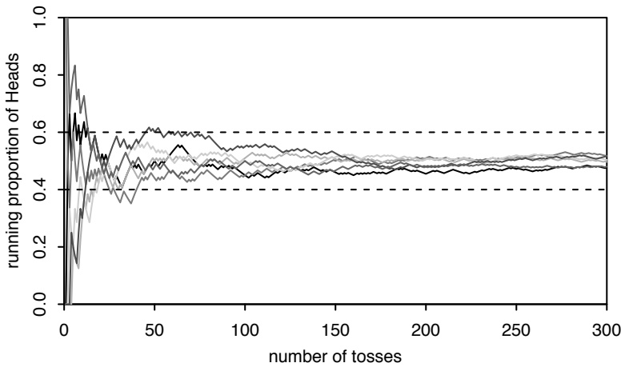
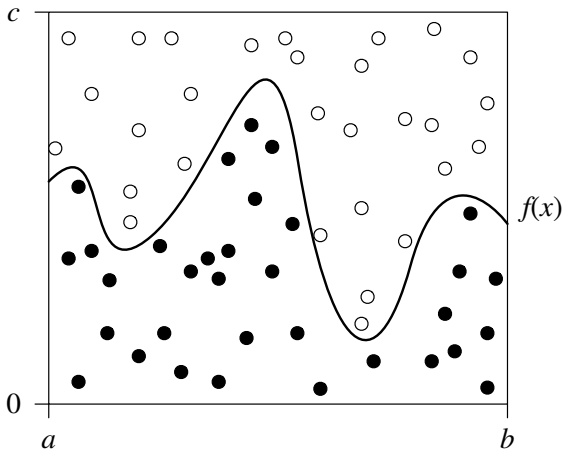
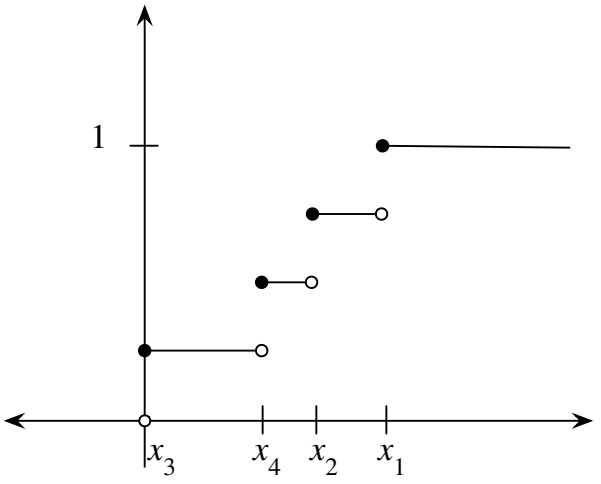
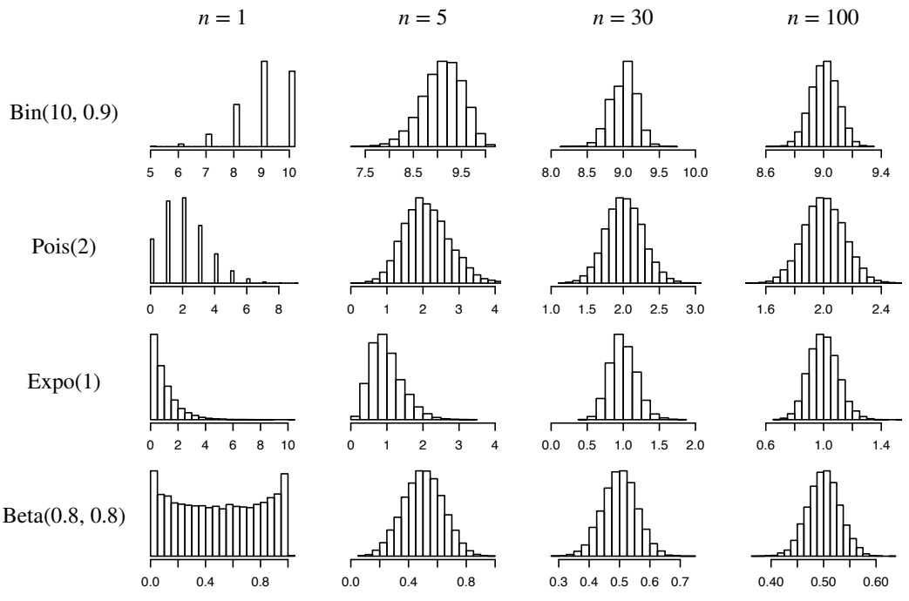
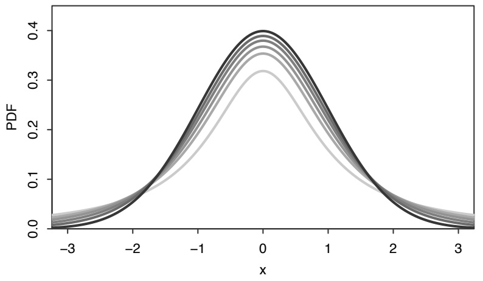
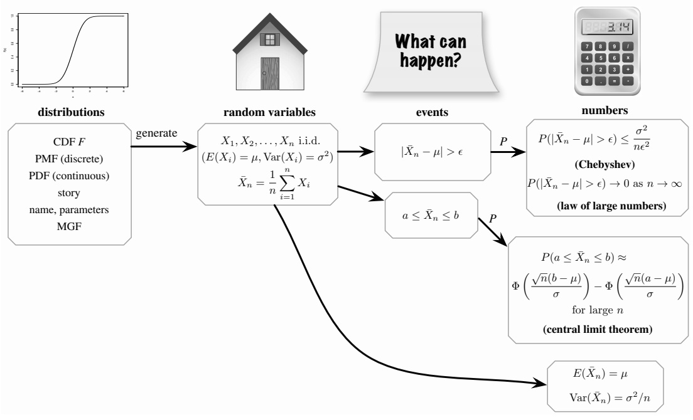
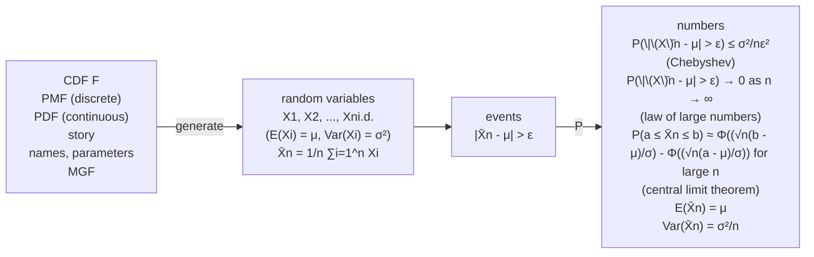
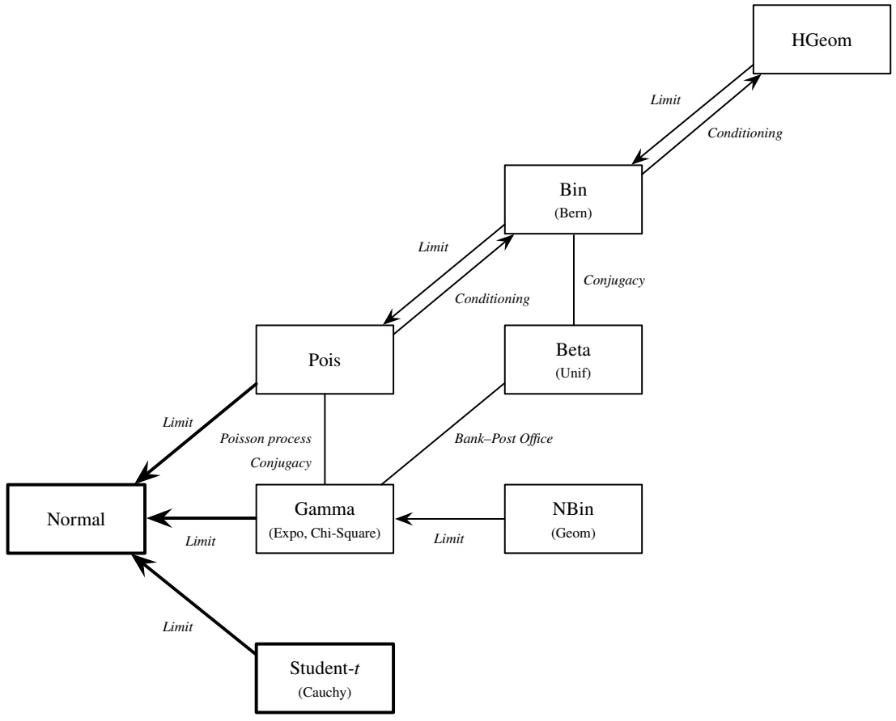
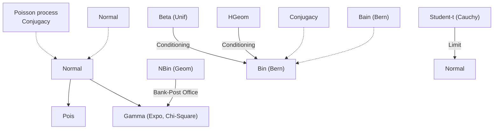
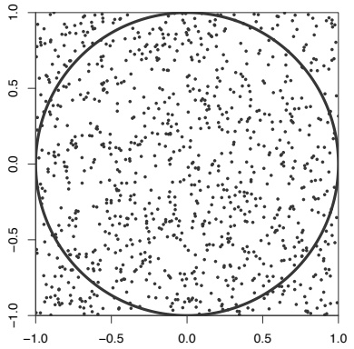

# 10: Inequalities and limit theorems

原始 PDF 第 474–513 页。

# Inequalities and limit theorems

“What should I do if I can’t calculate a probability or expectation exactly?” Almost everyone who uses probability has to deal with this sometimes. Don’t panic. There are powerful strategies available: simulate it, bound it, or approximate it.

• Simulations using Monte Carlo: We have already seen many examples of simulations in this book; the R sections give numerous examples where a few lines of code and a few seconds on a computer suffice to get good approximate answers. “Monte Carlo” just means that the simulations use random numbers (the term originated from the Monte Carlo Casino in Monaco).

Monte Carlo simulation is an extremely powerful technique, and there are many problems where it is the only reasonable approach currently available. So why not always just do a simulation? Here are a few reasons:

1. The simulation may need to run for an extremely long time, even on a fast computer. A major extension known as Markov chain Monte Carlo, introduced in Chapter 12, greatly increases the range of problems for which Monte Carlo simulation is feasible. But even then, the simulation may need to run for a vast, unknown amount of time to get decent answers to the problem.
2. We may hope to get a good answer for all values of the parameters of the problem. For example, in the coupon collector problem (Example 4.3.12) we saw that with n toy types, it takes about n log n toys on average to get a complete set. This is a simple, memorable answer. It would be easy to simulate this for any specific n, e.g., we could run a coupon collector process for n = 20 and get an answer of around 60. But this would not make it easy to see the general n log n result.
3. A simulation result is easy to criticize: how do you know you ran it long enough? How do you know your result is close to the truth? How close is “close”? We may want provable guarantees instead.

• Bounds using inequalities: A bound on a probability gives a provable guarantee that the probability is in a certain range. In the first part of this chapter, we’ll introduce several important inequalities in probability. These inequalities will often allow us to narrow down the range of possible values for the exact answer, that is, to determine an upper bound and/or lower bound. A bound may not provide a

457

---

458

Introduction to Probability

good approximation—if we have bounds of [0.2, 0.6] for a probability we’re trying to find, the exact answer could be anywhere within that range—but at least we know the exact answer is guaranteed to be inside the bounds.

• Approximations using limit theorems: Later in the chapter, we will discuss the two most famous theorems in probability: the law of large numbers and the central limit theorem. Both tell us what happens to the sample mean as we obtain more and more data. Limit theorems let us make approximations which are likely to work well when we have a large number of data points. We conclude the chapter by using limit theorems to study a couple of important named distributions in statistics.

## 10.1 Inequalities

## 10.1.1 Cauchy-Schwarz: a marginal bound on a joint expectation

The Cauchy-Schwarz inequality is one of the most famous inequalities in all of mathematics. In probability, it takes the following form.

Theorem 10.1.1 (Cauchy-Schwarz). For any r.v.s X and Y with finite variances,

$$
| E (X Y) | \leq \sqrt {E (X ^ {2}) E (Y ^ {2})}.
$$

Proof. For any $t ,$

$$
0 \leq E (Y - t X) ^ {2} = E (Y ^ {2}) - 2 t E (X Y) + t ^ {2} E (X ^ {2}).
$$

Where did t come from? The idea is to introduce t so that we have infinitely many inequalities, one for each value of t, and then we can use calculus to find the value of t that gives us the best inequality. Differentiating the right-hand side with respect to t and setting it equal to $0 ,$ we get that $t = E ( X Y ) / E ( X ^ { 2 } )$ minimizes the righthand side, resulting in the tightest bound. Plugging in this value of $t ,$ we have the Cauchy-Schwarz inequality. 

If X and $Y$ are uncorrelated, then $E(XY) = E(X)E(Y)$ , which depends only on the marginal expectations $E ( X )$ and $E ( Y )$ . But in general, calculating $E ( X Y )$ exactly requires knowing the joint distribution of $X$ and $Y$ (and being able to work with it). The Cauchy-Schwarz inequality lets us bound $E ( X Y )$ in terms of the marginal second moments $E ( X ^ { 2 } )$ and $E ( Y ^ { 2 } )$

If X and $Y$ have mean $0 ,$ then Cauchy-Schwarz already has a very familiar statistical interpretation: it says that their correlation is between −1 and 1.

Example 10.1.2. Let $E(X) = E(Y) = 0$ . Then

$$
E (X Y) = \operatorname{Cov} (X, Y), E (X ^ {2}) = \operatorname{Var} (X), E (Y ^ {2}) = \operatorname{Var} (Y),
$$

---

Inequalities and limit theorems

459

so Cauchy-Schwarz reduces to the statement $\left| \operatorname { C o r r } ( X , Y ) \right| \leq 1$ . Of course, we already knew this from Theorem 7.3.5. Now let’s see what happens if we drop the assumption that the means are 0. Applying Cauchy-Schwarz to the centered r.v.s $X - E ( X )$ and $Y - E(Y)$ , we again have that $\left| \operatorname { C o r r } ( X , Y ) \right| \leq 1$ 

Cauchy-Schwarz can often be applied in creative way<u>s. For exam</u>ple, if we write $X = X \cdot 1$ , then Cauchy-Schwarz gives $| E ( X \cdot 1 ) | \leq \sqrt { E ( X ^ { 2 } ) E ( 1 ^ { 2 } ) }$ , which reduces to $E ( X ^ { 2 } ) \geq ( E X ) ^ { 2 }$ . This gives a quick new proof that variances are nonnegative. As another example, we will obtain an upper bound on the probability of a nonnegative r.v. equaling 0.

Example 10.1.3 (Second moment method). Let X be a nonnegative r.v., and suppose that we want an upper bound on $P ( X   =   0 )$ . For example, X could be the number of questions that Fred gets wrong on an exam (then $P ( X = 0 )$ is the probability of Fred getting a perfect score), or X could be the number of pairs of people at a party with the same birthday (then $P ( X = 0 )$ is the probability of no birthday matches). Note that

$$
X = X I (X > 0),
$$

where $I ( X > 0 )$ is the indicator of $X > 0$ . This is true since if $X = 0$ then both sides are 0, while if $X > 0$ then both sides are X. By Cauchy-Schwarz,

$$
E (X) = E (X I (X > 0)) \leq \sqrt {E (X ^ {2}) E (I (X > 0))}.
$$

Rearranging this and using the fundamental bridge, we have

$$
P (X > 0) \geq \frac {(E X) ^ {2}}{E (X ^ {2})},
$$

or equivalently,

$$
P (X = 0) \leq \frac {\operatorname{Var} (X)}{E (X ^ {2})}.
$$

Applying this bound is sometimes called the second moment method. For example, let’s apply the bound in the case that

$$
X = I _ {1} + \dots + I _ {n},
$$

where the $I _ { j }$ are uncorrelated indicator r.v.s. Let $p _ { j } = E ( I _ { j } )$ . Then

$$
\mathrm{Var} (X) = \sum_ {j = 1} ^ {n} \mathrm{Var} (I _ {j}) = \sum_ {j = 1} ^ {n} (p _ {j} - p _ {j} ^ {2}) = \sum_ {j = 1} ^ {n} p _ {j} - \sum_ {j = 1} ^ {n} p _ {j} ^ {2} = \mu - c,
$$

where $$\mu = E ( X ) , c = \sum _ { j = 1 } ^ { n } p _ { j } ^ { 2 } .$ Also, $E ( X ^ { 2 } ) = \operatorname { V a r } ( X ) + ( E X ) ^ { 2 } = \mu ^ { 2 } + \mu - c .$ So$

$$
P (X = 0) \leq \frac {\operatorname{Var} (X)}{E (X ^ {2})} = \frac {\mu - c}{\mu^ {2} + \mu - c} \leq \frac {1}{\mu + 1},
$$

where the last inequality is easily checked by cross-multiplying. In general, it is

---

460

Introduction to Probability

wrong to say “if X has a high mean, then it has a small chance of being $0 ^ { \circ }$ , since it could be that X is usually 0 but has a small chance of being extremely large. But in our current setting, we have a simple, quantitative way to say that X having a high mean does mean that X is unlikely to be 0.

For example, suppose there are 14 people in a room. How likely is it that there are two people with the same birthday or birthdays one day apart? This is much harder to solve exactly than the birthday problem, so in Example 4.7.6 we used a Poisson approximation. But we may want a guarantee from a bound rather than worrying about whether the Poisson approximation is good enough. Let X be the number of “near birthday” pairs. Using indicator r.v.s, we have $\widetilde{E(X)} = \binom{14}{2} \frac{3}{365}$ . So

$$
P (X = 0) \leq \frac {1}{E (X) + 1} <   0. 5 7 3.
$$

The true answer for $P ( X = 0 )$ turns out to be 0.46 (to two decimal places), which is consistent with the bound. 

Cauchy-Schwarz also allows us to deduce the existence of a joint MGF from the existence of marginal MGFs; this is another example of the benefit of being able to bound a joint distribution quantity by marginal distribution quantities.

Example 10.1.4 (Existence of joint MGF). Let $X _ { 1 }$ and $X _ { 2 }$ be jointly distributed r.v.s, not necessarily independent or identically distributed. Show that if $X _ { 1 }$ and $X _ { 2 }$ both have MGFs marginally, then the random vector $( X _ { 1 } , X _ { 2 } )$ has a joint MGF.

## Solution:

Recall from Chapter 7 that the joint MGF is defined as $M ( s , t ) = E ( e ^ { s X _ { 1 } + t X _ { 2 } } )$ , and exists if the expectation is finite in a box around the origin. The marginal MGFs are $E ( e ^ { s X _ { 1 } } )$ and $E ( e ^ { t X _ { 2 } } )$ ; each is required to be finite in an interval around the origin.

Suppose the MGFs of $X _ { 1 }$ and $X _ { 2 }$ are finite on $( - a , a )$ . Fix s and t in $( - a / 2 , a / 2 )$ By Cauchy-Schwarz,

$$
E (e ^ {s X _ {1} + t X _ {2}}) \leq \sqrt {E (e ^ {2 s X _ {1}}) E (e ^ {2 t X _ {2}})}.
$$

The right-hand side is finite by assumption, so $E ( e ^ { s X _ { 1 } + t X _ { 2 } } )$ is finite in the box $\{ ( s , t ) : s , t \in ( - a / 2 , a / 2 ) \}$ . Hence the joint MGF of $( X _ { 1 } , X _ { 2 } )$ exists. 

## 10.1.2 Jensen: an inequality for convexity

In h 4.3.13, we discussed that for nonlinear functions g, $E ( g ( X ) )$ may be very different from $g ( E ( X ) )$ . If $g$ is either a convex function or a concave function, Jensen’s inequality tells us exactly which of $E ( g ( X ) )$ and $g ( E ( X ) )$ is greater. See the math appendix for information about convex and concave functions. Often we can take the second derivative to test for convexity or concavity: assuming that $g ^ { \prime \prime }$ exists, $g$ being convex is equivalent to $g ^ { \prime \prime } ( x ) \geq 0$ everywhere in the domain, and g being concave is equivalent to $g ^ { \prime \prime } ( x ) \leq 0$ everywhere in the domain.

---

Inequalities and limit theorems

461

Theorem 10.1.5 (Jensen). Let X be a random variable. If g is a convex function, then $E ( g ( X ) ) \geq g ( E ( X ) )$ . If g is a concave function, then $E ( g ( X ) ) \leq g ( E ( X ) )$ . In both cases, the only way that equality can hold is if there are constants a and b such that $g ( X ) = a + b X$ with probability 1.

Proof. If g is convex, then all lines that are tangent to g lie below $g$ (see Figure 10.1). In particular, let $\mu = E ( X )$ , and consider the tangent line at the point $( \mu , g ( \mu ) )$ (If $g$ is differentiable at $\mu$ then the tangent line is unique; otherwise, choose any tangent line at $\mu . )$ Denoting this tangent line by $a + b x$ , we have $g ( x ) \geq a + b x$ for all x by convexity, so $g ( X ) \geq a + b X$ . Taking the expectation of both sides,

$$
E (g (X)) \geq E (a + b X) = a + b E (X) = a + b \mu = g (\mu) = g (E (X)),
$$

as desired. If g is concave, then $h = - g$ is convex, so we can apply what we just proved to h to see that the inequality for $g$ is reversed from the convex case.

Lastly, assume that equality holds in the convex case. Let $Y   =   g ( X )   -   a   -   b X$ Then Y is a nonnegative r.v. with $E ( Y ) = 0$ , so $P ( Y = 0 ) = 1$ (even a tiny nonzero chance of $Y > 0$ occurring would make $E ( Y ) > 0 )$ . So equality holds if and only if $P(g(X)=a+bX)=1$ . For the concave case, we can use the same argument with $Y = a + bX - g(X)$ 


<details>
<summary>text_image</summary>

y = g(x)
(μ,g(μ))
y = a + bx
</details>

## FIGURE 10.1

Since g is convex, the tangent lines lie below the curve. In particular, the tangent line at the point $( \mu , g ( \mu ) )$ lies below the curve.

Let’s check Jensen’s inequality in a couple of simple known cases.

• Since $g ( x )   =   x ^ { 2 }$ is convex (its second derivative is 2), Jensen’s inequality says $E ( X ^ { 2 } ) \geq ( E X ) ^ { 2 }$ , which we already knew to be true since variances are nonnegative (or by Cauchy-Schwarz).
• In the St. Petersburg paradox from Chapter 4, we found that $E ( 2 ^ { N } )   >   2 ^ { E N }$ where $N \sim \mathrm { F S } ( 1 / 2 )$ . Jensen’s inequality concurs since $g ( x ) = 2 ^ { x }$ is convex (to find $g ^ { \prime \prime } ( x )$ , write $2 ^ { x } = e ^ { x \log 2 } )$ . Moreover, it tells us that the direction of the inequality

---

462

Introduction to Probability

would be the same no matter what distribution N has! The inequality will be strict unless N is constant (with probability 1).

If we ever forget the direction of Jensen’s inequality, these simple cases make it easy to recover the correct direction. Here are a few more quick examples of Jensen’s inequality:

$E | X | \geq | E X |$ ,
$E ( 1 / X ) \geq 1 / ( E X )$ , for positive r.v.s $X$
$E ( \operatorname { l o g } ( X ) ) \leq \operatorname { l o g } ( E X )$ , for positive r.v.s $X$

As another example, we can use Jensen’s inequality to see the direction of the bias if we estimate an unknown standard deviation using the sample standard deviation of a data set.

Example 10.1.6 (Bias of sample standard deviation). Let $X _ { 1 } , \ldots , X _ { n }$ be i.i.d. random variables with variance $\sigma ^ { 2 }$ . Recall from Theorem 6.3.4 that the sample variance $S _ { n } ^ { 2 }$ is unbiased for estimating $\sigma ^ { 2 }$ . That is, $E ( S _ { n } ^ { 2 } ) = \sigma ^ { 2 }$ . However, we are often more interested in estimating the standard deviation σ. A natural estimator for $\sigma$ is the sample standard deviation, $S _ { n }$

Jensen’s inequality shows us that $S _ { n }$ is biased for estimating σ. Moreover, it tells us which way the inequality goes:

$$
E (S _ {n}) = E (\sqrt {S _ {n} ^ {2}}) \leq \sqrt {E (S _ {n} ^ {2})} = \sigma ,
$$

so the sample standard deviation tends to underestimate the true standard deviation. How biased it is depends on the distribution (so there is no universal way to fix the bias, in contrast to the fact that defining sample variance with $n - 1$ in the denominator makes it unbiased for all distributions). Fortunately, the bias is typically minor if the sample size is reasonably large. 

One area in which Jensen’s inequality is important is in information theory, the study of how to quantify information. The principles of information theory have become essential for communication and compression (e.g., for MP3s and cell phones). Here are a few examples of applications of Jensen’s inequality.

Example 10.1.7 (Entropy). The surprise of learning that an event with probability p happened is defined as $\log _ { 2 } ( 1 / p )$ , measured in a unit called bits. Low-probability events have high surprise, while an event with probability 1 has zero surprise. The log is there so that if we observe two independent events A and B, the total surprise is the same as the surprise from observing $A \cap B$ . The log is base 2 so that if we learn that an event with probability $1 / 2$ happened, the surprise is 1, which corresponds to having received 1 bit of information.

Let X be a discrete r.v. whose distinct possible values are $a _ { 1 } , a _ { 2 } , \ldots , a _ { n }$ , with probabilities $p _ { 1 } , p _ { 2 } \ldots , p _ { n }$ respectively (so $\left| p _ { 1 } + p _ { 2 } + \cdots + p _ { n } = 1 \right)$ . The entropy of X is

---

Inequalities and limit theorems

463

defined to be the average surprise of learning the value of X:

$$
H (X) = \sum_ {j = 1} ^ {n} p _ {j} \log_ {2} (1 / p _ {j}).
$$

Note that the entropy of X depends only on the probabilities $p _ { j }$ , not on the values $a _ { j }$ So for example, $H ( X ^ { 3 } ) = H ( X )$ , since $X ^ { 3 }$ has distinct possible values $a _ { 1 } ^ { 3 } , a _ { 2 } ^ { 3 } , \ldots , a _ { n } ^ { \mathring { 3 } }$ with probabilities $p _ { 1 } , p _ { 2 } , \ldots , p _ { n }$ —the same list of ${ p _ { j } } ^ { \prime } \mathbf { s }$ as for $X$

Using Jensen’s inequality, show that the maximum possible entropy for X is when its distribution is uniform over $a _ { 1 } , a _ { 2 } , \ldots , a _ { n } , \: \mathrm { i . e . , } \: p _ { j }   =   1 / n$ for all $j .$ This makes sense intuitively, since learning the value of X conveys the most information on average when X is equally likely to take any of its values, and the least possible information if X is a constant.

Solution:

Let $X \sim \operatorname { D U n i f } ( a _ { 1 } , \ldots , a _ { n } )$ , so that

$$
H (X) = \sum_ {j = 1} ^ {n} \frac {1}{n} \log_ {2} (n) = \log_ {2} (n).
$$

Let Y be an r.v. that takes on values $1 / p _ { 1 } , \ldots , 1 / p _ { n }$ with probabilities $p _ { 1 } , \ldots , p _ { n }$ respectively (with the natural modification if the $1 / p _ { j }$ have some repeated values, $\mathbf { e . g . } ,$ if $1 / p _ { 1 } = 1 / p _ { 2 }$ but none of the others are this value, then it gets $p _ { 1 } + p _ { 2 } = 2 p _ { 1 }$ as its probability). Then $H ( Y )   =   E ( \log _ { 2 } ( Y ) )$ by LOTUS, and $E ( Y )   =   n$ . So by Jensen’s inequality,

$$
H (Y) = E (\log_ {2} (Y)) \leq \log_ {2} (E (Y)) = \log_ {2} (n) = H (X).
$$

Since the entropy of an r.v. depends only on the probabilities $p _ { j }$ and not on the specific values that the r.v. takes on, the entropy of Y is unchanged if we alter the support from $1 / p _ { 1 } , \ldots , 1 / p _ { n }$ to $a _ { 1 } , \ldots , a _ { n }$ . Therefore X, which is uniform on $a _ { 1 } , \ldots , a _ { n }$ , has entropy at least as large as that of any other r.v. with support $a _ { 1 } , \ldots , a _ { n }$ 

Example 10.1.8 (Kullback-Leibler divergence). Let $\mathbf { p } \; = \; ( p _ { 1 } , \ldots , p _ { n } )$ and $\textbf { r } =$ $( r _ { 1 } , \ldots , r _ { n } )$ be probability vectors (so each is nonnegative and sums to 1). Think of each as a possible PMF for a random variable whose support consists of n distinct values. The Kullback-Leibler divergence between p and r is defined as

$$
D (\mathbf {p}, \mathbf {r}) = \sum_ {j = 1} ^ {n} p _ {j} \log_ {2} (1 / r _ {j}) - \sum_ {j = 1} ^ {n} p _ {j} \log_ {2} (1 / p _ {j}).
$$

This is the difference between the average surprise we will experience when the actual probabilities are p but we are instead working with r (for example, if p is unknown and r is our current guess for p), and our average surprise when we work with p. Show that the Kullback-Leibler divergence is nonnegative.

---

464

Introduction to Probability

Solution:

Using properties of logs, we have

$$
D (\mathbf {p}, \mathbf {r}) = - \sum_ {j = 1} ^ {n} p _ {j} \log_ {2} \left(\frac {r _ {j}}{p _ {j}}\right).
$$

Let Y be a random variable that takes on values $r _ { j } / p _ { j }$ with probabilities $p _ { j }$ , so that $D ( \mathbf { p } , \mathbf { r } ) = - E ( \log _ { 2 } ( Y ) )$ by LOTUS. Then by Jensen’s inequality,

$$
D (\mathbf {p}, \mathbf {r}) = - E (\log_ {2} (Y)) \geq - \log_ {2} (E (Y)) = - \log_ {2} (1) = 0,
$$

with equality if and only if $\mathbf { p } = \mathbf { r }$ . This result tells us that we’re more surprised on average when we work with the wrong probabilities than when we work with the correct probabilities. 

Example 10.1.9 (Log probability scoring). Imagine that on a multiple-choice exam, instead of circling just one of the answer choices, you are asked to assign a probability of correctness to each choice. Your score on a particular question is the log of the probability that you assign to the correct answer. The maximum score for a particular question is 0, and the minimum score is $- \infty$ , attained if you assign zero probability to the correct answer.<sup>1</sup>

Suppose your personal probabilities of correctness for each of the n answer choices are $p _ { 1 } , \ldots , p _ { n }$ , where the $p _ { j }$ are positive and sum to 1. Show that your expected score on a question is maximized if you report your true probabilities $p _ { j }$ , not any other probabilities. In other words, under log probability scoring, you have no incentive to lie about your beliefs and pretend to be more or less confident than you really are (assuming that your goal is to maximize your expected score).

Solution:

This example is isomorphic to the previous one! Your expected score on a question is $\textstyle \sum _ { j = 1 } ^ { n } p _ { j }$ log $p _ { j }$ if you report your true probabilities p, and $\textstyle \sum _ { j = 1 } ^ { n } p _ { j }$ log $r _ { j }$ if you report false probabilities r. The difference between these two is precisely the Kullback-Leibler divergence between p and r. This is always nonnegative, as we proved in the previous example. Therefore your expected score is maximized when you report your true probabilities. 

## 10.1.3 Markov, Chebyshev, Chernoff: bounds on tail probabilities

The inequalities in this section provide bounds on the probability of an r.v. taking on an “extreme” value in the right or left tail of a distribution.

<small><span class="docvortex-page-footnote" data-block-type="page_footnote" style="color:#6b7280"><sup>1</sup>Joe’s philosophy professor as an undergraduate at Caltech, Alan Hájek, used precisely this system. He warned the class never to put a probability of zero, since a score of −∞ would not only give a −∞ on that exam, but also it would spill through and result in a −∞ for the whole semester, since a weighted average with even a tiny positive weight on a −∞ yields −∞. Despite this warning, some students did put probability zero on the correct answers.</span></small>

---

Inequalities and limit theorems

465

Theorem 10.1.10 (Markov). For any r.v. X and constant $a > 0$

$$
P (| X | \geq a) \leq \frac {E | X |}{a}.
$$

Proof. Let $\begin{array} { r } { Y = { \frac { | X | } { a } } } \end{array}$ . We need to show that $P(Y \geq 1) \leq E(Y)$ . Note that

$$
I (Y \geq 1) \leq Y,
$$

since if $I ( Y \geq 1 ) = 0$ then the inequality reduces to $Y \geq 0$ , and if $I ( Y \geq 1 ) = 1$ then $Y \geq 1$ (because the indicator says so). Taking the expectation of both sides, we have Markov’s inequality. 

For an intuitive interpretation, let X be the income of a randomly selected individual from a population. Taking $a \; = \; 2 E ( X )$ , Markov’s inequality says that $P ( X \: \geq \: 2 E ( X ) ) \: \leq \: 1 / 2 ,$ i.e., it is impossible for more than half the population to make at least twice the average income. This is clearly true, since if over half the population were earning at least twice the average income, the average income would be higher! Similarly, $P ( X \geq 3 E ( X ) ) \leq 1 / 3 ;$ you can’t have more than $1 / 3$ of the population making at least three times the average income, since those people would already drive the average above what it is.

Markov’s inequality is a very crude bound because it requires absolutely no assumptions about $X$ . The right-hand side of the inequality could be greater than 1, or even infinite; this is not very helpful when trying to bound a number that we already know to be between 0 and 1. Surprisingly, the following two inequalities, which can be derived from Markov’s inequality with almost no additional work, can often give us bounds that are much better than Markov’s.

Theorem 10.1.11 (Chebyshev). Let X have mean $\mu$ and variance $\sigma ^ { 2 }$ . Then for any $a > 0$ ,

$$
P (| X - \mu | \geq a) \leq \frac {\sigma^ {2}}{a ^ {2}}.
$$

Proof. By Markov’s inequality,

$$
P (| X - \mu | \geq a) = P ((X - \mu) ^ {2} \geq a ^ {2}) \leq \frac {E (X - \mu) ^ {2}}{a ^ {2}} = \frac {\sigma^ {2}}{a ^ {2}}.
$$

Substituting cσ for a, for $c > 0$ , we have the following equivalent form of Chebyshev’s inequality:

$$
P (| X - \mu | \geq c \sigma) \leq \frac {1}{c ^ {2}}.
$$

This gives us an upper bound on the probability of an r.v. being more than c standard deviations away from its mean, e.g., there can’t be more than a 25% chance of being 2 or more standard deviations from the mean.

The idea for proving Chebyshev from Markov was to square $| X - \mu |$ and then

---

466

Introduction to Probability

apply Markov. Similarly, it is often fruitful to perform other transformations before applying Markov. Chernoff ’s bound, which is widely used in engineering, uses this idea with an exponential function.

Theorem 10.1.12 (Chernoff). For any r.v. X and constants $a > 0$ and $t > 0$ ,

$$
P (X \geq a) \leq \frac {E (e ^ {t X})}{e ^ {t a}}.
$$

Proof. The transformation g with $g ( x )   =   e ^ { t x }$ is invertible and strictly increasing. So by Markov’s inequality, we have

$$
P (X \geq a) = P (e ^ {t X} \geq e ^ {t a}) \leq \frac {E (e ^ {t X})}{e ^ {t a}}.
$$

At first it may not be clear what Chernoff’s bound has to offer that Markov’s inequality doesn’t, but it has two very nice features:

1. The right-hand side can be optimized over t to give the tightest upper bound, as in the proof of Cauchy-Schwarz.
2. If the MGF of X exists, then the numerator in the bound is the MGF, and some of the useful properties of MGFs can come into play.

Let’s now compare the three bounds just discussed by applying them to a simple example where the true probability is known.

Example 10.1.13 (Bounds on a Normal tail probability). Let $Z \sim \mathcal { N } ( 0 , 1 )$ . By the 68-95-99.7% rule, we know that $P ( | Z | > 3 )$ is approximately 0.003; the exact value is $2 \cdot \Phi ( - 3 )$ . Let’s see what upper bounds are obtained from Markov’s, Chebyshev’s, and Chernoff’s inequalities.

• Markov: In Chapter 5, we found that $E | Z | = { \sqrt { 2 / \pi } }$ . Then

$$
P (| Z | > 3) \leq \frac {E | Z |}{3} = \frac {1}{3} \cdot \sqrt {\frac {2}{\pi}} \approx 0. 2 7.
$$

• Chebyshev:

$$
P (| Z | > 3) \leq \frac {1}{9} \approx 0. 1 1.
$$

• Chernoff (after using symmetry of the Normal):

$$
P (| Z | > 3) = 2 P (Z > 3) \leq 2 e ^ {- 3 t} E (e ^ {t Z}) = 2 e ^ {- 3 t} \cdot e ^ {t ^ {2} / 2},
$$

using the MGF of the standard Normal distribution.

The right-hand side is minimized at $t = 3$ , as found by setting the derivative equal to 0, possibly after taking the log first (which is a good idea since it doesn’t affect

---

Inequalities and limit theorems

467

where the minimum occurs and it means we just have to minimize a quadratic polynomial). Plugging in $t = 3$ , we have

$$
P (| Z | > 3) \leq 2 e ^ {- 9 / 2} \approx 0. 0 2 2.
$$

All of these upper bounds are correct, but Chernoff’s bound is the best by far. This example also illustrates the distinction between a bound and an approximation, as we explained in the introduction to this chapter. Markov’s inequality tells us that the tail probability $P ( | Z | > 3 )$ is at most 0.27, but it would be a blunder to say that $P ( | Z | > 3 )$ is approximately $0.27  \text{— }  we  \text{°d }$ be off by a factor of about 100. 

## 10.2 Law of large numbers

We turn next to two theorems, the law of large numbers and the central limit theorem, which describe the behavior of the sample mean of i.i.d. r.v.s as the sample size grows. Throughout this section and the next, assume we have i.i.d. $X _ { 1 } , X _ { 2 } , X _ { 3 } , \ldots$ with finite mean $\mu$ and finite variance $\sigma ^ { 2 }$ . For all positive integers n, let

$$
\bar {X} _ {n} = \frac {X _ {1} + \cdots + X _ {n}}{n}
$$

be the sample mean of $X _ { 1 }$ through $X _ { n }$ . The sample mean is itself an $\mathbf { r } . \mathbf { V } .$ , with mean $\mu$ and variance $\sigma ^ { 2 } / n { \mathrm { : } }$

$$
E (\bar {X} _ {n}) = \frac {1}{n} E (X _ {1} + \dots + X _ {n}) = \frac {1}{n} (E (X _ {1}) + \dots + E (X _ {n})) = \mu ,
$$

$$
\mathrm{Var} (\bar {X} _ {n}) = \frac {1}{n ^ {2}} \mathrm{Var} (X _ {1} + \dots + X _ {n}) = \frac {1}{n ^ {2}} (\mathrm{Var} (X _ {1}) + \dots + \mathrm{Var} (X _ {n})) = \frac {\sigma^ {2}}{n}.
$$

The law of large numbers (LLN) says that as n grows, the sample mean ${ \bar { X } } _ { n }$ converges to the true mean $\mu$ (in a sense that is explained below). The LLN comes in two versions, “strong” (SLLN) and “weak” (WLLN), which use slightly different definitions of what it means for a sequence of r.v.s to converge to a number. We will state both versions, and prove the second using Chebyshev’s inequality.

Theorem 10.2.1 (Strong law of large numbers). The sample mean ${ \bar { X } } _ { n }$ converges to the true mean $\mu$ pointwise, with probability 1. Recalling that r.v.s are functions from the sample space S to R, this form of convergence says that $\bar { X } _ { n } ( s ) \to \mu$ for each point $s \in S$ , except that the convergence is allowed to fail on some set $B _ { 0 }$ of exceptions, as long as $P ( B _ { 0 } ) = 0$ . In short, $P ( \bar { X } _ { n } \rightarrow \mu ) = 1$

Theorem 10.2.2 (Weak law of large numbers). For all $\epsilon > 0 ,   P ( | \bar { X } _ { n } - \mu | > \epsilon ) \rightarrow 0$ as $n \to \infty$ . (This form of convergence is called convergence in probability.)

---

468

Introduction to Probability

Proof. Fix $\epsilon > 0$ . By Chebyshev’s inequality,

$$
P (| \bar {X} _ {n} - \mu | > \epsilon) \leq \frac {\sigma^ {2}}{n \epsilon^ {2}}.
$$

As $n \to \infty$ , the right-hand side goes to 0, and so must the left-hand side.

The law of large numbers is essential for simulations, statistics, and science. Consider generating “data” from a large number of independent replications of an experiment, performed either by computer simulation or in the real world. Every time we use the average value in the replications of some quantity to approximate its theoretical average, we are implicitly appealing to the LLN.

Example 10.2.3 (Running proportion of Heads). Let $X _ { 1 } , X _ { 2 } , \ldots$ be i.i.d. Bern(1/2). Interpreting the $X _ { j }$ as indicators of Heads in a string of fair coin tosses, ${ \bar { X } } _ { n }$ is the proportion of Heads after n tosses. The SLLN says that with probability 1, when the sequence of r.v.s $\bar { X } _ { 1 } , \bar { X } _ { 2 } , \bar { X } _ { 3 } , \ldots$ . crystallizes into a sequence of numbers, the sequence of numbers will converge to 1/2. Mathematically, there are bizarre outcomes such as HHHHHH . . . and HHTHHTHHTHHT. . . , but collectively they have zero probability of occurring. The WLLN says that for any $\epsilon > 0$ , the probability of ${ \bar { X } } _ { n }$ being more than  away from $1 / 2$ can be made as small as we like by letting n grow.

As an illustration, we simulated six sequences of fair coin tosses and, for each sequence, computed ${ \bar { X } } _ { n }$ as a function of n. Of course, in real life we cannot simulate infinitely many coin tosses, so we stopped after 300 tosses. Figure 10.2 plots ${ \bar { X } } _ { n }$ as a function of n for each sequence.



<details>
<summary>line</summary>

| number of tosses | Running proportion of Heads (Series 1) | Running proportion of Heads (Series 2) | Running proportion of Heads (Series 3) | Running proportion of Heads (Series 4) | Running proportion of Heads (Series 5) | Running proportion of Heads (Series 6) | Running proportion of Heads (Series 7) | Running proportion of Heads (Series 8) |
| --- | --- | --- | --- | --- | --- | --- | --- | --- |
| 0 | ~0.0 | ~0.0 | ~0.0 | ~0.0 | ~0.0 | ~0.0 | ~0.0 | ~0.0 |
| 50 | ~0.55 | ~0.52 | ~0.48 | ~0.45 | ~0.42 | ~0.40 | ~0.38 | ~0.35 |
| 100 | ~0.52 | ~0.50 | ~0.48 | ~0.46 | ~0.44 | ~0.42 | ~0.40 | ~0.38 |
| 150 | ~0.51 | ~0.49 | ~0.47 | ~0.45 | ~0.43 | ~0.41 | ~0.40 | ~0.38 |
| 200 | ~0.51 | ~0.49 | ~0.47 | ~0.45 | ~0.43 | ~0.41 | ~0.40 | ~0.38 |
| 250 | ~0.51 | ~0.49 | ~0.47 | ~0.45 | ~0.43 | ~0.41 | ~0.40 | ~0.38 |
| 300 | ~0.51 | ~0.49 | ~0.47 | ~0.45 | ~0.43 | ~0.41 | ~0.40 | ~0.38 |
</details>

FIGURE 10.2

Running proportion of Heads in 6 sequences of fair coin tosses. Dashed lines at 0.6 and 0.4 are plotted for reference. As the number of tosses increases, the proportion of Heads approaches $1 / 2 .$

At the beginning, we can see that there is quite a bit of fluctuation in the running

---

Inequalities and limit theorems

469

proportion of Heads. As the number of coin tosses increases, however, $\operatorname { V a r } ( { \bar { X } } _ { n } )$ gets smaller and smaller, and ${ \bar { X } } _ { n }$ approaches $1 / 2$ 

h 10.2.4 (LLN does not contradict the fact that a coin is memoryless). In the above example, the law of large numbers states that the proportion of Heads converges to $1 / 2$ , but this does not imply that after a long string of Heads, the coin is “due” for a Tails to balance things out. Rather, the convergence takes place through swamping: past tosses are swamped by the infinitely many tosses that are yet to come.

A sequence of i.i.d. Bernoullis is the simplest possible example of the LLN, but this simple case forms the basis for extremely useful methods in statistics, as the following examples illustrate.

Example 10.2.5 (Monte Carlo integration). Let f be a complicated function whose integral $\begin{array} { r } { \int _ { a } ^ { b } f ( x ) d x } \end{array}$ we want to approximate. Assume that $0 \leq f ( x ) \leq c { \mathrm { ~ s o ~ } }$ that we know the integral is finite. On the surface, this problem doesn’t involve probability, as $\textstyle \int _ { a } ^ { b } f ( x ) d x$ is just a number. But where there is no randomness, we can create our own! The technique of Monte Carlo integration uses random samples to obtain approximations of definite integrals when exact integration methods are unavailable.

Let A be the rectangle in the $( x , y )$ -plane given by $a \leq x \leq b$ and $0 \leq y \leq c$ Let B be the region under the curve $y = f(x)$ (and above the x-axis) for $a \leq x \leq b$ so the desired integral is the area of region B. Our strategy will be to take random samples from A, then calculate the proportion of the samples that also fall into the area B. This is depicted in Figure 10.3: points in B are in black, and points not in B are in white.



<details>
<summary>scatter</summary>

| Series | X (range) | Y (range) |
| --- | --- | --- |
| Open Circles | a~b | ~0.2 ~1.0 |
| Filled Circles | a~b | ~0.05 ~0.8 |
</details>

FIGURE 10.3

Monte Carlo integration. To approximate the area under $f ( x )$ from $x = a$ to $x = b .$ generate random points in the rectangle $[ a , b ] \times [ 0 , c ]$ , and approximate the area under $f ( x )$ by the proportion of points falling underneath the curve, multiplied by the total area of the rectangle.

---

470

Introduction to Probability

To see why this works, suppose we pick i.i.d. points $( X _ { 1 } , Y _ { 1 } ) , ( X _ { 2 } , Y _ { 2 } ) , \ldots , ( X _ { n } , Y _ { n } )$ uniformly in the rectangle $A$ . Define indicator r.v.s $I _ { 1 } , \ldots , I _ { n }$ by letting $I _ { j }   =   1$ if $( X _ { j } , Y _ { j } )$ is in $B$ and $I _ { j } = 0$ otherwise. Then the $I _ { j }$ are Bernoulli r.v.s whose success probability is precisely the ratio of the area of $B$ to the area of A. Letting $p = E ( I _ { j } )$ ,

$$
p = E (I _ {j}) = P (I _ {j} = 1) = \frac {\int_ {a} ^ {b} f (x) d x}{c (b - a)}.
$$

We can estimate $p$ using ${ \textstyle { \frac { 1 } { n } } \sum _ { j = 1 } ^ { n } I _ { j } }$ , and then estimate the desired integral by

$$
\int_ {a} ^ {b} f (x) d x \approx c (b - a) \frac {1}{n} \sum_ {j = 1} ^ {n} I _ {j}.
$$

Since the $I _ { j }$ are i.i.d. with mean $p ,$ it follows from the law of large numbers that with probability 1, the estimate converges to the true value of the integral as the number of points approaches infinity. 

Example 10.2.6 (Convergence of empirical CDF). Let $X _ { 1 } , \ldots , X _ { n }$ be i.i.d. random variables with CDF $F .$ For every number $x ,$ let $R _ { n } ( x )$ count how many of $X _ { 1 } , \ldots , X _ { n }$ are less than or equal to $x ;$ that is,

$$
R _ {n} (x) = \sum_ {j = 1} ^ {n} I (X _ {j} \leq x).
$$

Since the indicators $I ( X _ { j } \leq x )$ are i.i.d. with probability of success $F ( x )$ , we know $R _ { n } ( x )$ is Binomial with parameters n and $F ( x )$

The empirical CDF of $X _ { 1 } , \ldots , X _ { n }$ is defined as

$$
\hat {F} _ {n} (x) = \frac {R _ {n} (x)}{n},
$$

considered as a function of $x .$ Before we observe $X _ { 1 } , \ldots , X _ { n } , \; \hat { F } _ { n } ( x )$ is a random variable for each $x .$ . After we observe $X _ { 1 } , \ldots , X _ { n } , \thinspace \hat { F } _ { n } ( x )$ crystallizes into a particular value at each $x ,$ so $\hat { F } _ { n }$ crystallizes into a particular CDF, which can be used to estimate the true CDF F if the latter is unknown.

For example, suppose $n = 4$ and we observe $X _ { 1 } = x _ { 1 } , X _ { 2 } = x _ { 2 } , X _ { 3 } = x _ { 3 } , X _ { 4 } = x _ { 4 }$ Then the graph of $\frac { R _ { 4 } ( x ) } { 4 }$ starts at 0 and then jumps by $1 / 4$ every time one of the $x _ { j } { } ^ { \prime } \mathrm { s }$ is reached. In other words, $\frac { R _ { 4 } ( x ) } { 4 }$ is the CDF of a discrete random variable taking on values $x _ { 1 } , \ldots , x _ { 4 }$ , each with probability $1 / 4$ . This is illustrated in Figure 10.4.

Now we can ask, what happens to $\hat { F } _ { n }$ as $n \rightarrow \infty ?$ This is a natural question if we are using $\hat { F } _ { n }$ as an estimate of the true $F ;$ does the approximation fare well in the limit? The law of large numbers provides the answer: for every $x ,   R _ { n } ( x )$ is the sum of n i.i.d. Bern(p) r.v.s, where $p   =   F ( x )$ . So by the SLLN, ${ \hat { F } } _ { n } ( x )   \to   F ( x )$ with probability 1 as $n \to \infty$

---

Inequalities and limit theorems

471



<details>
<summary>scatter</summary>

| X | Value |
| --- | --- |
| 0 | 0 |
| 0 | 1 |
| 1 | 1 |
| 1 | 2 |
| 2 | 2 |
| 3 | 3 |
| 4 | 4 |
</details>

## FIGURE 10.4

Empirical CDF after observing $X _ { 1 } { = } x _ { 1 } , X _ { 2 } { = } x _ { 2 } , X _ { 3 } { = } x _ { 3 } , X _ { 4 } { = } x _ { 4 }$ . The graph jumps by $1 / 4$ every time one of the $x _ { j } { } ^ { \prime } \mathrm { s }$ is reached.

The empirical CDF is commonly used in nonparametric statistics, a branch of statistics that tries to understand a random sample without making strong assumptions about the family of distributions from which it originated. For example, instead of assuming $X _ { 1 } , \ldots , X _ { n } \sim \mathcal { N } ( \mu , \sigma ^ { 2 } )$ , a nonparametric method would allow $X _ { 1 } , \ldots , X _ { n } \sim F$ for an arbitrary CDF $F .$ , then use the empirical CDF as an approximation for $F$ . The law of large numbers is what assures us that this approximation is valid in the limit as we collect more and more samples: at every value of $x ,$ the empirical CDF converges to the true CDF. 

## 10.3 Central limit theorem

As in the previous section, let $X _ { 1 } , X _ { 2 } , X _ { 3 } , \ldots$ be i.i.d. with mean $\mu$ and variance $\sigma ^ { 2 }$ . The law of large numbers says that as $n \to \infty ,   \bar { X } _ { n }$ converges to the constant $\mu$ (with probability 1). But what is its distribution along the way to becoming a constant? This is addressed by the central limit theorem (CLT), which, as its name suggests, is a limit theorem of central importance in statistics.

The CLT states that for large $n ,$ the distribution of $X _ { n }$ after standardization approaches a standard Normal distribution. By standardization, we mean that we subtract $\mu ,$ the mean of ${ \bar { X } } _ { n }$ , and divide by $\sigma / \sqrt { n }$ , the standard deviation of ${ \bar { X } } _ { n }$

Theorem 10.3.1 (Central limit theorem). As $n \to \infty$

$$
\sqrt {n} \left(\frac {\bar {X} _ {n} - \mu}{\sigma}\right) \to \mathcal {N} (0, 1) \text {in distribution.}
$$

---

472

Introduction to Probability

In words, this means that the CDF of the left-hand side converges to $\Phi ,$ the CDF of the standard Normal distribution.

Proof. We will prove the CLT assuming that the MGF of the $X _ { j }$ exists, though the theorem holds much more generally. Let $M ( t ) = E ( e ^ { t X _ { j } } )$ , and without loss of generality let $\mu = 0 ,   \sigma ^ { 2 } = 1$ (since we end up standardizing ${ \bar { X } } _ { n }$ for the theorem, we might as well standardize the $X _ { j }$ in the first place). Then $M(0) = 1,   M'(0) = \mu = 0$ and $M ^ { \prime \prime } ( 0 ) = \sigma ^ { 2 } = 1$

We wish to show that the MGF of $\sqrt { n } \bar { X } _ { n } = ( X _ { 1 } + \cdots + X _ { n } ) / \sqrt { n }$ converges to the MGF of the $\mathcal { N } ( 0 , 1 )$ distribution, which is $e ^ { t ^ { 2 } / 2 }$ . This is a valid strategy because of a theorem that says that if $Z _ { 1 } , Z _ { 2 } , \ldots$ . are r.v.s whose MGFs converge to the MGF of a continuous r.v. $Z ,$ then the CDF of $Z _ { n }$ converges to the CDF of $Z .$ (We omit the proof of this result since it requires some difficult analysis. But it should at least seem plausible, in view of the fact that the MGF of an r.v. determines its distribution.)

By properties of MGFs,

$$
\begin{array}{l} E (e ^ {t (X _ {1} + \dots + X _ {n}) / \sqrt {n}}) = E (e ^ {t X _ {1} / \sqrt {n}}) E (e ^ {t X _ {2} / \sqrt {n}}) \dots E (e ^ {t X _ {n} / \sqrt {n}}) \\ = \left(M \left(\frac {t}{\sqrt {n}}\right)\right) ^ {n}. \\ \end{array}
$$

Letting $n \to \infty$ , we get the indeterminate form $1 ^ { \infty }$ , so instead we should take the limit of the logarithm, n log $\textstyle M ( { \frac { t } { \sqrt { n } } } )$ , and then exponentiate at the end. This gives

$$
\begin{array}{l} \lim _ {n \to \infty} n \log M \left(\frac {t}{\sqrt {n}}\right) = \lim _ {y \to 0} \frac {\log M (y t)}{y ^ {2}} \quad \text {where} y = 1 / \sqrt {n} \\ = \lim _ {y \rightarrow 0} \frac {t M ^ {\prime} (y t)}{2 y M (y t)} \quad \text {by L'Hôpital's rule} \\ = \frac {t}{2} \lim _ {y \to 0} \frac {M ^ {\prime} (y t)}{y} \quad \text {since} M (y t) \to 1 \\ = \frac {t ^ {2}}{2} \lim _ {y \rightarrow 0} M ^ {\prime \prime} (y t) \quad \text {by L'Hôpital's rule} \\ = \frac {t ^ {2}}{2}. \\ \end{array}
$$

Therefore $\textstyle { \left( M ( { \frac { t } { \sqrt { n } } } ) \right) ^ { n } }$ , the MGF of ${ \sqrt { n } } { \bar { X } } _ { n }$ , approaches $e ^ { t ^ { 2 } / 2 }$ , the $\mathcal { N } ( 0 , 1 )$ MGF.

The CLT is an asymptotic result, telling us about the limiting distribution of ${ \bar { X } } _ { n }$ as $n \to \infty$ , but it also suggests an approximation for the distribution of ${ \bar { X } } _ { n }$ when n is large but finite.

Approximation 10.3.2 (Central limit theorem, approximation form). For large $n ,$ the distribution of ${ \bar { X } } _ { n }$ is approximately $\mathcal { N } ( \mu , \sigma ^ { 2 } / n )$

---

Inequalities and limit theorems

473

Proof. Change the arrow in the CLT to $\dot { \sim } ,$ an approximate distribution sign:

$$
\sqrt {n} \left(\frac {\bar {X} _ {n} - \mu}{\sigma}\right) \dot {\sim} \mathcal {N} (0, 1).
$$

Then by a location-scale transformation,

$$
\bar {X} _ {n} \dot {\sim} \mathcal {N} (\mu , \sigma^ {2} / n).
$$

Of course, we already knew from properties of expectation and variance that ${ \bar { X } } _ { n }$ has mean $\mu$ and variance $\sigma ^ { 2 } / n ;$ the central limit theorem gives us the additional information that ${ \bar { X } } _ { n }$ is approximately Normal with said mean and variance.

Let’s take a moment to admire the generality of this result. The distribution of the individual $X _ { j }$ can be anything in the world, as long as the mean and variance are finite. We could have a discrete distribution like the Binomial, a bounded distribution like the Beta, a skewed distribution like the Log-Normal, or a distribution with multiple peaks and valleys. No matter what, the act of averaging will cause Normality to emerge. In Figure 10.5 we show histograms of the distribution of ${ \bar { X } } _ { n }$ for 4 different starting distributions and for $n = 1 , 5 , 3 0 , 1 0 0$ . As n increases, the distribution of ${ \bar { X } } _ { n }$ starts to look Normal, regardless of the distribution of the $X _ { j }$

This does not mean that the distribution of the $X _ { j }$ is irrelevant, however. If the $X _ { j }$ have a highly skewed or multimodal distribution, we may need $n$ to be very large before the Normal approximation becomes accurate; at the other extreme, if the $X _ { j }$ are already i.i.d. Normals, the distribution of ${ \bar { X } } _ { n }$ is exactly $\mathcal { N } ( \mu , \sigma ^ { 2 } / n )$ for all n. Since there are no infinite datasets in the real world, the quality of the Normal approximation for finite n is an important consideration.

Example 10.3.3 (Running proportion of Heads, revisited). As in Example 10.2.3, let $X _ { 1 } , X _ { 2 } , \ldots$ . be i.i.d. $\mathrm { B e r n } ( 1 / 2 )$ . Before, we used the law of large numbers to conclude that $\bar { X } _ { n } \rightarrow 1 / 2$ as $n \to \infty$ . Now, using the central limit theorem, we can say more: $E ( \bar { X } _ { n } ) = 1 / 2$ and $\operatorname { V a r } ( { \bar { X } } _ { n } ) = 1 / ( 4 n )$ , so for large $n ,$

$$
\bar {X} _ {n} \dot {\sim} \mathcal {N} \left(\frac {1}{2}, \frac {1}{4 n}\right).
$$

This additional information allows us to quantify what kind of deviation from the mean is typical for a given n. For example, when $n = 1 0 0 ,   \mathrm { S D } ( \bar { X } _ { n } ) = 1 / 2 0 = 0 . 0 5$ so if the Normal approximation is valid, then by the 68-95-99.7% rule there’s a 95% chance that ${ \bar { X } } _ { n }$ will be in the interval [0.40, 0.60]. 

The CLT says that the sample mean ${ \bar { X } } _ { n }$ is approximately Normal, but since the sum $W _ { n } = X _ { 1 }   +   \cdots   +   X _ { n } = n \bar { X } _ { n }$ is just a scaled version of ${ \bar { X } } _ { n }$ , the CLT also implies $W _ { n }$ is approximately Normal. If the $X _ { j }$ have mean $\mu$ and variance $\sigma ^ { 2 } ,   W _ { n }$ has mean $n \mu$ and variance $n \sigma ^ { 2 }$ . The CLT then states that for large $n .$

$$
W _ {n} \dot {\sim} \mathcal {N} (n \mu , n \sigma^ {2}).
$$

---

474

Introduction to Probability



<details>
<summary>histogram</summary>

| Method | n | Bin(10, 0.9) Range | n=1 Frequency | n=5 Frequency | n=30 Frequency | n=100 Frequency |
| --- | --- | --- | --- | --- | --- | --- |
| Bin(10, 0.9) | 1 | ~5.0 ~10.0 | N/A | N/A | N/A | N/A |
| Pois(2) | 2 | ~0.0 ~8.5 | N/A | N/A | N/A | N/A |
| Expo(1) | 1 | ~0.0 ~10.0 | N/A | N/A | N/A | N/A |
| Beta(0.8, 0.8) | 0.8 | ~0.0 ~9.5 | N/A | N/A | N/A | N/A |
</details>

FIGURE 10.5

Central limit theorem. Histograms of the distribution of ${ \bar { X } } _ { n }$ for different starting distributions of the $X _ { j }$ (indicated by the rows) and increasing values of $n$ (indicated by the columns). Each histogram is based on 10,000 simulated values of ${ \bar { X } } _ { n }$ . Regardless of the starting distribution of the $X _ { j }$ , the distribution of ${ \bar { X } } _ { n }$ approaches a Normal distribution as n grows.

---

Inequalities and limit theorems

475

This is completely equivalent to the approximation for ${ \bar { X } } _ { n }$ , but it can be useful to write it in this form because many of the named distributions we have studied can be considered as a sum of i.i.d. r.v.s. Here are three quick examples.

Example 10.3.4 (Poisson convergence to Normal). Let $Y \sim \mathrm { P o i s } ( n )$ . By Theorem 4.8.1, we can consider Y to be a sum of n i.i.d. Pois(1) r.v.s. Therefore, for large n,

$$
Y \dot {\sim} \mathcal {N} (n, n).
$$

Example 10.3.5 (Gamma convergence to Normal). Let $Y   \sim   \mathrm { G a m m a } ( n , \lambda )$ . By Theorem 8.4.3, we can consider Y to be a sum of n i.i.d. Expo(λ) r.v.s. Therefore, for large n,

$$
Y \dot {\sim} \mathcal {N} \left(\frac {n}{\lambda}, \frac {n}{\lambda^ {2}}\right).
$$

Example 10.3.6 (Binomial convergence to Normal). Let $Y \sim \mathrm { B i n } ( n , p )$ . By Theorem 3.8.8, we can consider $Y$ to be a sum of n i.i.d. Bern(p) r.v.s. Therefore, for large $n ,$

$$
Y \dot {\sim} \mathcal {N} (n p, n p (1 - p)).
$$

This is probably the most widely used Normal approximation in statistics. To account for the discreteness of $Y$ , we write the probability $P ( Y = k )$ (which would be exactly 0 under the Normal approximation) as $P(k - 1/2 < Y < k + 1/2)$ (so that it becomes an interval of non-zero width) and apply the Normal approximation to the latter. This is known as the continuity correction, and it yields the following approximation for the PMF of $Y ;$

$$
P (Y = k) = P (k - 1 / 2 <   Y <   k + 1 / 2) \approx \Phi \left(\frac {k + 1 / 2 - n p}{\sqrt {n p (1 - p)}}\right) - \Phi \left(\frac {k - 1 / 2 - n p}{\sqrt {n p (1 - p)}}\right).
$$

The Normal approximation to the Binomial distribution is complementary to the Poisson approximation discussed in Chapter 4. The Poisson approximation works best when $p$ is small, while the Normal approximation works best when $n$ is large and $p$ is around $1 / 2 ,$ , so that the distribution of $Y$ is symmetric or nearly so.

We’ll conclude with an example that uses both the LLN and the CLT.

Example 10.3.7 (Volatile stock). Each day, a very volatile stock rises $7 0 \%$ or drops 50% in price, with equal probabilities and with different days independent. Let $Y _ { n }$ be the stock price after n days, starting from an initial value of $Y _ { 0 } = 1 0 0$

(a) Explain why log $Y _ { n }$ is approximately Normal for n large, and state its parameters.
(b) What happens to $E ( Y _ { n } )$ as $n \rightarrow \infty ?$
(c) Use the law of large numbers to find out what happens to $Y _ { n }$ as $n \to \infty$

Solution:

(a) We can write $Y _ { n } = Y _ { 0 } ( 0 . 5 ) ^ { n - U _ { n } } ( 1 . 7 ) ^ { U _ { n } }$ where $U _ { n } \sim \operatorname { B i n } ( n , { \textstyle { \frac { 1 } { 2 } } } )$ is the number of times the stock rises in the first n days. This gives

$$
\log Y _ {n} = \log Y _ {0} - n \log 2 + U _ {n} \log 3. 4,
$$

---

476

Introduction to Probability

which is a location-scale transformation of $U _ { n }$ . By the CLT, $U _ { n }$ is approximately $\mathcal { N } ( \textstyle { \frac { n } { 2 } } , \textstyle { \frac { n } { 4 } } )$ for large n, so log $Y _ { n }$ is approximately Normal with mean

$$
E (\log Y _ {n}) = \log 1 0 0 - n \log 2 + (\log 3. 4) \cdot E (U _ {n}) \approx \log 1 0 0 - 0. 0 8 1 n
$$

and variance

$$
\mathrm{Var} (\log Y _ {n}) = (\log 3. 4) ^ {2} \cdot \mathrm{Var} (U _ {n}) \approx 0. 3 7 4 n.
$$

(b) We have $E(Y_{1}) = (170 + 50)/2 = 110$ . Similarly,

$$
E (Y _ {n + 1} | Y _ {n}) = \frac {1}{2} (1. 7 Y _ {n}) + \frac {1}{2} (0. 5 Y _ {n}) = 1. 1 Y _ {n},
$$

so

$$
E (Y _ {n + 1}) = E (E (Y _ {n + 1} | Y _ {n})) = 1. 1 E (Y _ {n}).
$$

Thus $E(Y_{n}) = 1.1^{n}E(Y_{0}) = 100 \cdot 1.1^{n}$ , which goes to $\infty$ as $n \to \infty$

(c) As in (a), let $U _ { n } \sim \operatorname { B i n } ( n , { \textstyle { \frac { 1 } { 2 } } } )$ be the number of times the stock rises in the first n days. Note that even though $E ( Y _ { n } ) \to \infty$ , if the stock goes up 70% one day and then drops 50% the next day, then overall it has dropped 15% since $1 . 7 \cdot 0 . 5 = 0 . 8 5$ So after many days, $Y _ { n }$ will be very small if about half the time the stock rose 70% and about half the time the stock dropped 50%—and the law of large numbers ensures that this will be the case! Writing $Y _ { n }$ in terms of $U _ { n } / n$ in order to apply the LLN, we have

$$
Y _ {n} = Y _ {0} (0. 5) ^ {n - U _ {n}} (1. 7) ^ {U _ {n}} = Y _ {0} \left(\frac {(3 . 4) ^ {U _ {n} / n}}{2}\right) ^ {n}.
$$

Since $U _ { n } / n \to 0 . 5$ with probability 1, $( 3 . 4 ) ^ { U _ { n } / n } \rightarrow \sqrt { 3 . 4 } < 2$ with probability 1, so $Y _ { n } \to 0$ with probability 1.

Paradoxically, $E ( Y _ { n } ) \to \infty$ but $Y _ { n } \to 0$ with probability 1. To gain some intuition for this result, consider the extreme example where a gambler starts with \$100 and each day either quadruples their money or loses their entire fortune, with equal probabilities. Then on average the gambler’s wealth doubles each day, which sounds good until one notices that eventually there will be a day when the gambler goes broke. The gambler’s actual fortune goes to 0 with probability 1, whereas the expected value goes to infinity due to tiny probabilities of getting extremely large amounts of money, as in the St. Petersburg paradox. 

h 10.3.8 (The evil Cauchy). The central limit theorem requires that the mean and variance of the $X _ { j }$ be finite, and our proof of the WLLN relied on the same conditions. The Cauchy distribution introduced in Example 7.1.25 has no mean or variance, so the Cauchy distribution obeys neither the law of large numbers nor the central limit theorem. It can be shown that the sample mean of $n$ Cauchys is still Cauchy, no matter how large n gets. So the sample mean never approaches a Normal distribution, contrary to the behavior seen in the CLT. There is also no true mean for ${ \bar { X } } _ { n }$ to converge to, so the LLN does not apply either.

---

Inequalities and limit theorems

477

## 10.4 Chi-Square and Student-t

We’ll round out the chapter by introducing the last two continuous distributions in this book, both of which are closely related to the Normal distribution.

Definition 10.4.1 (Chi-Square distribution). Let $V = Z _ { 1 } ^ { 2 }   +   \cdots   +   Z _ { n } ^ { 2 }$ where $Z _ { 1 } , Z _ { 2 } , \ldots , Z _ { n }$ are i.i.d. $\mathcal { N } ( 0 , 1 )$ . Then V is said to have the Chi-Square distribution with n degrees of freedom. We write this as $V \sim \chi _ { n } ^ { 2 }$

$\mathrm { A s }$ it turns out, the $\chi _ { n } ^ { 2 }$ distribution is a special case of the Gamma.

Theorem 10.4.2. The $\chi _ { n } ^ { 2 }$ distribution is the Gamma $( \frac { n } { 2 } , \frac { 1 } { 2 } )$ distribution.

Proof. First, we verify that the PDF of $Z _ { 1 } ^ { 2 } \sim \chi _ { 1 } ^ { 2 }$ equals the PDF of the Gamma $( \frac { 1 } { 2 } , \frac { 1 } { 2 } )$ : for $x > 0$ ,

$$
F (x) = P (Z _ {1} ^ {2} \leq x) = P (- \sqrt {x} \leq Z _ {1} \leq \sqrt {x}) = \Phi (\sqrt {x}) - \Phi (- \sqrt {x}) = 2 \Phi (\sqrt {x}) - 1,
$$

so

$$
f (x) = \frac {d}{d x} F (x) = 2 \varphi (\sqrt {x}) \frac {1}{2} x ^ {- 1 / 2} = \frac {1}{\sqrt {2 \pi x}} e ^ {- x / 2},
$$

which is indeed the Gamma $( \frac { 1 } { 2 } , \frac { 1 } { 2 } )$ PDF. Then, because $V = Z _ { 1 } ^ { 2 } + \cdots + Z _ { n } ^ { 2 } \sim \chi _ { n } ^ { 2 }$ is the sum of n independent $$\mathrm { \overset { \cdot } { G a m m a } } ( \frac { 1 } { 2 } , \frac { 1 } { 2 } )$ r.v.s$ , we have $\textstyle V \sim \operatorname { G a m m a } ( { \frac { n } { 2 } } , { \frac { 1 } { 2 } } )$ 

From our knowledge of the mean and variance of a Gamma distribution, we have $E ( V ) = n$ and $\operatorname { V a r } ( V ) = 2 n$ . We can also obtain the mean and variance using the fact that V is the sum of i.i.d. squared Normals, along with the Normal moments derived in Chapter 6:

$$
E (V) = n E (Z _ {1} ^ {2}) = n,
$$

$$
\mathrm{Var} (V) = n \mathrm{Var} (Z _ {1} ^ {2}) = n \left(E (Z _ {1} ^ {4}) - (E Z _ {1} ^ {2}) ^ {2}\right) = n (3 - 1) = 2 n.
$$

To get the MGF of the Chi-Square distribution, just plug $n / 2$ and $1 / 2$ into the more general Gamma $( a , \lambda )$ MGF, which we found in Theorem 8.4.3 to be $\left( { \frac { \lambda } { \lambda { - } t } } \right) ^ { a }$ for $t < \lambda$ . This gives

$$
M _ {V} (t) = \left(\frac {1}{1 - 2 t}\right) ^ {n / 2}, \quad t <   1 / 2.
$$

The Chi-Square distribution is important in statistics because it is related to the distribution of the sample variance, which can be used to estimate the true variance of a distribution. When our random variables are i.i.d. Normals, the distribution of the sample variance after appropriate scaling is Chi-Square.

---

478

Introduction to Probability

Example 10.4.3 (Distribution of sample variance). For i.i.d. $X _ { 1 } , \ldots , X _ { n } \sim$ $\mathcal { N } ( \mu , \sigma ^ { 2 } )$ , the sample variance is the r.v.

$$
S _ {n} ^ {2} = \frac {1}{n - 1} \sum_ {j = 1} ^ {n} (X _ {j} - \bar {X} _ {n}) ^ {2}.
$$

Show that

$$
\frac {(n - 1) S _ {n} ^ {2}}{\sigma^ {2}} \sim \chi_ {n - 1} ^ {2}.
$$

Solution:

First let’s show that $\begin{array} { r } { \sum _ { j = 1 } ^ { n } ( Z _ { j } - \bar { Z } _ { n } ) ^ { 2 } \sim \chi _ { n - 1 } ^ { 2 } } \end{array}$ for standard Normal r.v.s $Z _ { 1 } , \ldots , Z _ { n }$ this is consistent with the more general result we are asked to prove and also serves as a useful stepping stone. Let’s start with the following useful identity, which is a special case of the identity from the proof of Theorem 6.3.4:

$$
\sum_ {j = 1} ^ {n} Z _ {j} ^ {2} = \sum_ {j = 1} ^ {n} (Z _ {j} - \bar {Z} _ {n}) ^ {2} + n \bar {Z} _ {n} ^ {2}.
$$

Now take the MGF of both sides. By Example 7.5.9, $\begin{array} { r } { \sum _ { j = 1 } ^ { n } ( Z _ { j } - \bar { Z } _ { n } ) ^ { 2 } } \end{array}$ and $n \bar { Z } _ { n } ^ { 2 }$ are independent, so the MGF of their sum is the product of the individual MGFs. Also,

$$
\sum_ {j = 1} ^ {n} Z _ {j} ^ {2} \sim \chi_ {n} ^ {2} \mathrm{and} n \bar {Z} _ {n} ^ {2} \sim \chi_ {1} ^ {2},
$$

so

$$
\left(\frac {1}{1 - 2 t}\right) ^ {n / 2} = \left(\text {MGF of} \sum_ {j = 1} ^ {n} (Z _ {j} - \bar {Z} _ {n}) ^ {2}\right) \cdot \left(\frac {1}{1 - 2 t}\right) ^ {1 / 2}.
$$

This implies

$$
\left(\text {MGF of} \sum_ {j = 1} ^ {n} (Z _ {j} - \bar {Z} _ {n}) ^ {2}\right) = \left(\frac {1}{1 - 2 t}\right) ^ {(n - 1) / 2},
$$

which is the $\chi _ { n - 1 } ^ { 2 }$ MGF. Since the MGF determines the distribution, we have

$$
\sum_ {j = 1} ^ {n} (Z _ {j} - \bar {Z} _ {n}) ^ {2} \sim \chi_ {n - 1} ^ {2}.
$$

For general $X _ { 1 } , \ldots , X _ { n }$ , use a location-scale transformation to write $X _ { j } = \mu + \sigma Z _ { j }$ and $\bar { X } _ { n }   =   \mu + \sigma \bar { Z } _ { n }$ . When we express $\textstyle \sum _ { j = 1 } ^ { n } ( X _ { j } - { \bar { X } } _ { n } ) ^ { 2 }$ in terms of the $Z _ { j }$ , the $\mu$ cancels and the $\sigma$ comes out squared:

$$
\sum_ {j = 1} ^ {n} (X _ {j} - \bar {X} _ {n}) ^ {2} = \sum_ {j = 1} ^ {n} (\mu + \sigma Z _ {j} - (\mu + \sigma \bar {Z} _ {n})) ^ {2} = \sigma^ {2} \sum_ {j = 1} ^ {n} (Z _ {j} - \bar {Z} _ {n}) ^ {2}.
$$

---

Inequalities and limit theorems

479

All in all,

$$
\frac {(n - 1) S _ {n} ^ {2}}{\sigma^ {2}} = \frac {1}{\sigma^ {2}} \sum_ {j = 1} ^ {n} (X _ {j} - \bar {X} _ {n}) ^ {2} = \frac {1}{\sigma^ {2}} \cdot \sigma^ {2} \sum_ {j = 1} ^ {n} (Z _ {j} - \bar {Z} _ {n}) ^ {2} \sim \chi_ {n - 1} ^ {2},
$$

which is what we wanted. This also implies that $E ( S _ { n } ^ { 2 } )   =   \sigma ^ { 2 }$ , which agrees with what we showed in Theorem 6.3.4: the sample variance is unbiased for estimating the true variance. 

The Student-t distribution is defined by representing it in terms of a standard Normal r.v. and a $\chi _ { n } ^ { 2 } \mathrm {  ~ r . v . }$

Definition 10.4.4 (Student-t distribution). Let

$$
T = \frac {Z}{\sqrt {V / n}},
$$

where $Z \sim \mathcal { N } ( 0 , 1 ) ,   V \sim \chi _ { n } ^ { 2 }$ , and Z is independent of V . Then T is said to have the Student-t distribution with n degrees of freedom. We write this as $T \sim t _ { n }$ . Often “Student-t distribution” is abbreviated to “t distribution”.

The Student-t distribution was introduced in 1908 by William Gosset, a Master Brewer at Guinness, while working on quality control for beer. He was required by the company to publish his work under a pseudonym, and he chose the name Student. The t distribution forms the basis for hypothesis testing procedures known as t-tests, which are extremely widely used in practice (we do not introduce the details of t-tests here since they are better left for a course on statistical inference).

The PDF of the Student-t distribution with n degrees of freedom looks similar to that of a standard Normal, except with heavier tails (much heavier if n is small, and not much heavier if n is large). The formula for the PDF is

$$
f _ {T} (t) = \frac {\Gamma ((n + 1) / 2)}{\sqrt {n \pi} \Gamma (n / 2)} (1 + t ^ {2} / n) ^ {- (n + 1) / 2},
$$

though we will not prove this since the derivation is messy and anyway many of the most important properties of the Student-t distribution are easier to understand by thinking about how we defined it in terms of a Normal and a $\chi _ { n } ^ { 2 } \mathrm {  ~ r . v . }$ , rather than by doing tedious calculations with the PDF. Here are some of these properties.

Theorem 10.4.5 (Student-t properties). The Student-t distribution $t _ { n }$ has the following properties.

1. Symmetry: If $T \sim t _ { n }$ , then $- T \sim t _ { n }$ as well.
2. Cauchy as special case: The $t _ { 1 }$ distribution is the same as the Cauchy distribution, introduced in Example 7.1.25.
3. Convergence to Normal: As $n \to \infty$ , the $t _ { n }$ distribution approaches the standard Normal distribution.

---

480

Introduction to Probability

Proof. In the proof of each property, we appeal to Definition 10.4.4.

1. Express

$$
T = \frac {Z}{\sqrt {V / n}},
$$

where $Z \sim \mathcal { N } ( 0 , 1 ) ,   V \sim \chi _ { n } ^ { 2 }$ , and $Z$ is independent of V . Then

$$
- T = \frac {- Z}{\sqrt {V / n}},
$$

where $- Z \sim \mathcal { N } ( 0 , 1 )$ , so $- T \sim t _ { n }$

2. Recall that the Cauchy distribution is defined as the distribution of $X / Y$ where X and Y are i.i.d. $\mathcal { N } ( 0 , 1 )$ . By definition, $T \sim t _ { 1 }$ can be expressed as $T = Z / { \sqrt { V } }$ where $\sqrt { V }   =   \sqrt { Z _ { 1 } ^ { 2 } }   =   | Z _ { 1 } ^ { ' } |$ with $Z _ { 1 }$ independent of $Z .$ But by symmetry, $Z / | Z _ { 1 } |$ has the same distribution as $Z / Z _ { 1 }$ , and $Z / Z _ { 1 }$ is Cauchy. Thus the $t _ { 1 }$ and Cauchy distributions are the same.

3. This follows from the SLLN. Consider a sequence of i.i.d. standard Normal r.v.s $Z _ { 1 } , Z _ { 2 } , \ldots ,$ and let

$$
V _ {n} = Z _ {1} ^ {2} + \dots + Z _ {n} ^ {2}.
$$

By the SLLN, $V _ { n } / n   \to   E ( Z _ { 1 } ^ { 2 } )   =   1$ with probability 1. Now let $Z   \sim   \mathcal { N } ( 0 , 1 )$ b e independent of all the $Z _ { j }$ , and let

$$
T _ {n} = \frac {Z}{\sqrt {V _ {n} / n}}
$$

for all $n .$ Then $T _ { n } \sim t _ { n }$ by definition, and since the denominator converges to 1, we have $T _ { n }   \to   Z   \sim   \mathcal { N } ( 0 , 1 )$ . Therefore, the distribution of the $T _ { n }$ approaches the distribution of $Z$ 

Figure 10.6 plots the Student-t PDF for various values of $n ,$ demonstrating all three properties of the above theorem: the PDFs are all symmetric around 0, the PDF for $n = 1$ looks like that of the Cauchy distribution, and as $n \to \infty$ the heavy tails become lighter, and the PDF approaches the standard Normal PDF.

## 10.5 Recap

Inequalities and limit theorems are two different ways to handle expectations and probabilities that we don’t wish to calculate exactly. Inequalities allow us to obtain lower and/or upper bounds on the unknown value: Cauchy-Schwarz and Jensen give us bounds on expectations, while Markov, Chebyshev, and Chernoff give us bounds on tail probabilities.

---

Inequalities and limit theorems

481



<details>
<summary>violin</summary>

| X | PDF (Series 1) | PDF (Series 2) | PDF (Series 3) | PDF (Series 4) | PDF (Series 5) | PDF (Series 6) | PDF (Series 7) | PDF (Series 8) |
|---|---|---|---|---|---|---|---|---|
| -3 | ~0.02 | ~0.02 | ~0.02 | ~0.02 | ~0.02 | ~0.02 | ~0.02 | ~0.02 |
| -2 | ~0.08 | ~0.08 | ~0.08 | ~0.08 | ~0.08 | ~0.08 | ~0.08 | ~0.08 |
| -1 | ~0.25 | ~0.24 | ~0.23 | ~0.22 | ~0.21 | ~0.20 | ~0.19 | ~0.18 |
| 0 | 0.40 | 0.39 | 0.38 | 0.37 | 0.36 | 0.35 | 0.34 | 0.32 |
| 1 | ~0.25 | ~0.24 | ~0.23 | ~0.22 | ~0.21 | ~0.20 | ~0.19 | ~0.18 |
| 2 | ~0.08 | ~0.08 | ~0.08 | ~0.08 | ~0.08 | ~0.08 | ~0.08 | ~0.08 |
| 3 | ~0.02 | ~0.02 | ~0.02 | ~0.02 | ~0.02 | ~0.02 | ~0.02 | ~0.02 |
</details>

## FIGURE 10.6

PDFs of Student-t distribution with (light to dark) n = 1, 2, 3, 5, 10 degrees of freedom, as well as the standard Normal PDF (black). As $n \to \infty$ , the Student-t PDFs approach the standard Normal PDF.

Two limit theorems, the law of large numbers and the central limit theorem, describe the behavior of the sample mean ${ \bar { X } } _ { n }$ of i.i.d. $X _ { 1 } , X _ { 2 } , \ldots$ with mean $\mu$ and variance $\sigma ^ { 2 }$ . The SLLN says that as $n \to \infty$ , the sample mean ${ \bar { X } } _ { n }$ converges to the true mean $\mu$ with probability 1. The CLT says that the distribution of ${ \bar { X } } _ { n } .$ after standardization, converges to the standard Normal distribution:

$$
\sqrt {n} \left(\frac {\bar {X} _ {n} - \mu}{\sigma}\right) \to \mathcal {N} (0, 1).
$$

This can be translated into an approximation for the distribution of ${ \bar { X } } _ { n }$ :

$$
\bar {X} _ {n} \dot {\sim} \mathcal {N} (\mu , \sigma^ {2} / n).
$$

Equivalently, we can say that the distribution of the sum $S _ { n } = X _ { 1 } + \cdots + X _ { n } = n \bar { X } _ { n }$ after standardization, converges to the standard Normal distribution:

$$
\frac {S _ {n} - n \mu}{\sigma \sqrt {n}} \to \mathcal {N} (0, 1).
$$

Figure 10.7 illustrates the progression from a distribution to i.i.d. r.v.s with that distribution, from which a sample mean can be formed and studied as an r.v. in its own right. Chebyshev’s inequality, the LLN, and the CLT all give important information about the behavior of the sample mean.

The Chi-Square and Student-t distributions are two important named distributions in statistics. The Chi-Square is a special case of the Gamma. The Student-t has a bell-shaped PDF with heavier tails than the Normal, and converges to the standard Normal as the degrees of freedom increase.

---

482

Introduction to Probability



<details>
<summary>flowchart</summary>


</details>

FIGURE 10.7

The sample mean ${ \bar { X } } _ { n }$ of i.i.d. random variables $X _ { 1 } , \ldots , X _ { n }$ is an important quantity in many problems. Chebyshev’s inequality bounds the probability of the sample mean being far from the true mean. The weak law of large numbers, which follows from Chebyshev’s inequality, says that for n large, the probability is very high that the sample mean will be very close to the true mean. The central limit theorem says that for n large the distribution of the sample mean will be approximately Normal.

---

Inequalities and limit theorems

483

Here, one last time, is the diagram of relationships between the named distributions, updated to include the Chi-Square distribution (as a special case of the Gamma) and Student-t distribution (with the Cauchy as a special case). We have also added arrows to show the convergence of the Poisson, Gamma, and Student-t distributions to Normality; the first two are a consequence of the central limit theorem, and the third is a consequence of the law of large numbers.



<details>
<summary>flowchart</summary>


</details>

Now we see that all the named distributions are connected to one another!

## 10.6 R

## Jensen’s inequality

R makes it easy to compare the expectations of X and $g ( X )$ for a given choice of $g ,$ and this allows us to verify some special cases of Jensen’s inequality. For example, suppose we simulate $1 0 ^ { 4 }$ times from the Expo(1) distribution:

---

484

Introduction to Probability

$$
\mathrm{x} <   - \operatorname{rexp} (1 0 ^ {\wedge} 4)
$$

According to Jensen’s inequality, $E ( \log X ) \leq \log E X$ . The former can be approximated by mean(log(x)) and the latter can be approximated by log(mean(x)), so compute both:

mean(log(x))

log(mean(x))

For the Expo(1) distribution, we find that mean(log(x)) is approximately −0.6 (the true value is around −0.577), while log(mean(x)) is approximately 0 (the true value is 0). This indeed suggests E(log X) ≤ log EX. We could also compare mean $( x ^ { - 3 } )$ to mean $( x ) \sim 3$ , or mean(sqrt(x)) to sqrt(mean(x))—the possibilities are endless.

## Visualization of the law of large numbers

To plot the running proportion of Heads in a sequence of independent fair coin tosses, we first generate the coin tosses themselves:

nsim <- 300

Then we compute ${ \bar { X } } _ { n }$ for each value of n and store the results in xbar:

xbar <- cumsum(x)/(1:nsim)

The above line of code performs elementwise division of the two vectors cumsum(x) and 1:nsim. Finally, we plot xbar against the number of coin tosses:

plot(1:nsim,xbar,type="l",ylim=c(0,1))

You should see that the values of xbar approach p, by the LLN.

## Monte Carlo estimate of $\pi$

A famous example of Monte Carlo integration is the Monte Carlo estimate of $\pi .$ The unit disk $\{ ( x , y ) : x ^ { 2 }   +   y ^ { 2 } \leq 1 \}$ is inscribed in the square $[ - 1 , 1 ] \times [ - 1 , 1 ]$ , which has area 4. If we generate a large number of points that are Uniform on the square, the proportion of points falling inside the disk is approximately equal to the ratio of the disk’s area to the square’s area, which is $\pi / 4$ . Thus, to estimate $\pi$ we can take the proportion of points inside the circle and multiply by 4.

In R, to generate Uniform points on the 2D square, we can independently generate the x-coordinate and the y-coordinate as Unif(−1, 1) r.v.s, using the results of Example 7.1.23:

nsim $< - 1 0 ^ { \cdot } 6$

---

Inequalities and limit theorems

485



<details>
<summary>scatter</summary>

| Series | X (range) | Y (range) |
| --- | --- | --- |
| Points | -1.0~1.0 | -1.0~1.0 |
</details>

## FIGURE 10.8

Monte Carlo estimate of $\pi ;$ Generate points that are Uniform on the 2D square $[ - 1 , 1 ] \times [ - 1 , 1 ]$ , which has area 4. The proportion of points falling in the unit disk is approximately $\pi / 4$

```r
x <- runif(nsim,-1,1)
y <- runif(nsim,-1,1)
```

To count the number of points in the disk, we type sum $( x ^ { - 2 } + y ^ { - 2 } < 1 )$ . The vector $x ^ { 2 } + y ^ { 2 } = 1$ is an indicator vector whose ith element is 1 if the ith point falls inside the disk and 0 otherwise, so the sum of the elements is the number of points in the disk. To get our estimate of $\pi ,$ we convert the sum into a proportion and multiply by 4:

```txt
4*sum(x^2+y^2<1)/nsim
```

How close was your estimate to the actual value of $\pi ?$

## Visualizations of the central limit theorem

One way to visualize the central limit theorem for a distribution of interest is to plot the distribution of ${ \bar { X } } _ { n }$ for various values of $n ,$ as in Figure 10.5. To do this, we first have to generate i.i.d. $X _ { 1 } , \ldots , X _ { n }$ a bunch of times from our distribution of interest. For example, suppose that our distribution of interest is $\mathrm { U n i f } ( 0 , 1 )$ , and we are interested in the distribution of $\bar { X } _ { \mathrm { 1 2 } } ,   \mathrm { i . e . }$ , we set $n   =   1 2$ . In the following code, we create a matrix of i.i.d. standard Uniforms. The matrix has 12 columns, corresponding to $X _ { 1 }$ through $X _ { 1 2 }$ . Each row of the matrix is a different realization of $X _ { 1 }$ through $X _ { 1 2 }$

```r
nsim <- 10^4
n <- 12
x <- matrix(runif(n*nsim), nrow=nsim, ncol=n)
```

---

486

Introduction to Probability

Now, to obtain realizations of $\bar { X } _ { 1 2 }$ , we simply take the average of each row of the matrix x; we can do this with the rowMeans function:

xbar <- rowMeans(x)

Finally, we create a histogram:

hist(xbar)

You should see a histogram that looks approximately Normal. Since the Unif(0, 1) distribution is symmetric, the CLT kicks in quickly and the Normal approximation for ${ \bar { X } } _ { n }$ works well, even for $n \: = \: 1 2$ . Changing runif to rexp, we see that for $X _ { j }   \sim   \mathrm { E x p o ( 1 ) }$ , the distribution of ${ \bar { X } } _ { n }$ remains skewed when $n   =   1 2$ , so a larger value of n is required before the Normal approximation is decent.

Another neat visualization of the CLT can be found in the animation package. This package has a built-in animation of a quincunx or bean machine, invented by the statistician and geneticist Francis Galton to illustrate the Normal distribution. After installing the package, try:

library(animation) quincunx()

Can you use the central limit theorem to explain why the histogram produced by a quincunx should look approximately Normal?

## Chi-Square and Student-t distributions

Although the Chi-Square is just a special case of the Gamma, it still has its own functions dchisq, pchisq, and rchisq in R: dchisq(x,n) and pchisq(x,n) return the values of the $\overline { { \chi _ { n } ^ { 2 } } }$ PDF and CDF at x, and rchisq(nsim,n) generates nsim i.i.d. $\chi _ { n } ^ { 2 } \mathrm { { \bf ~ r . v . s . } }$

The Student-t distribution has functions dt, pt, and rt. To evaluate the PDF or CDF of the $t _ { n }$ distribution at x, we use dt(x,n) or $\mathbf { p t } ( \mathbf { x } , \mathbf { n } )$ . To generate nsim i.i.d. r.v.s from the $t _ { n }$ distribution, we use rt(nsim,n). Of course, dt(x,1) is the same as dcauchy(x).

## 10.7 Exercises

Exercises marked with s have detailed solutions at [http://stat110.net](http://stat110.net).

---

Inequalities and limit theorems

487

## Inequalities

1. s In a national survey, a random sample of people are chosen and asked whether they support a certain policy. Assume that everyone in the population is equally likely to be surveyed at each step, and that the sampling is with replacement (sampling without replacement is typically more realistic, but with replacement will be a good approximation if the sample size is small compared to the population size). Let n be the sample size, and let $\hat { p }$ and $p$ be the proportion of people who support the policy in the sample and in the entire population, respectively. Show that for every $c > 0$

$$
P (| \hat {p} - p | > c) \leq \frac {1}{4 n c ^ {2}}.
$$

2. s For i.i.d. r.v.s $X _ { 1 } , \ldots , X _ { n }$ with mean $\mu$ and variance $\sigma ^ { 2 }$ , give a value of n (as a specific number) that will ensure that there is at least a 99% chance that the sample mean will be within 2 standard deviations of the true mean $\mu .$

3. s Show that for any two positive r.v.s X and Y with neither a constant multiple of the other,

$$
E (X / Y) E (Y / X) > 1.
$$

4. s The famous arithmetic mean-geometric mean inequality says that for any positive numbers $a _ { 1 } , a _ { 2 } , \ldots , a _ { n }$ ,

$$
\frac {a _ {1} + a _ {2} + \cdots + a _ {n}}{n} \geq (a _ {1} a _ {2} \dots a _ {n}) ^ {1 / n}.
$$

Show that this inequality follows from Jensen’s inequality, by considering $E \log ( X )$ for an r.v. X whose possible values are $a _ { 1 } , \ldots , a _ { n }$ (you should specify the PMF of X; if you want, you can assume that the $a _ { j }$ are distinct (no repetitions), but be sure to say so if you assume this).

5. s Let X be a discrete r.v. whose distinct possible values are $x _ { 0 } , x _ { 1 } , \ldots ,$ and let $p _ { k } =$ $P ( X = x _ { k } )$ . The entropy of X is $\textstyle H ( X ) = \sum _ { k = 0 } ^ { \infty } p _ { k } \operatorname { l o g } _ { 2 } ( 1 / p _ { k } )$

(a) Find H(X) for $X \sim \operatorname { G e o m } ( p )$

Hint: Use properties of logs, and interpret part of the sum as an expected value.

(b) Let X and Y be i.i.d. discrete r.v.s. Show that $P ( X = Y ) \geq 2 ^ { - H ( X ) }$

Hint: Consider $E ( \log _ { 2 } ( W ) )$ , where $W$ is an r.v. taking value $p _ { k }$ with probability $p _ { k }$ .

6. Let X be a random variable with mean $\mu$ and variance $\sigma ^ { 2 }$ . Show that

$$
E (X - \mu) ^ {4} \geq \sigma^ {4},
$$

and use this to show that the kurtosis of X is at least −2.

## Fill-in-the-blank inequalities

7. s Let X and Y be i.i.d. positive r.v.s, and let $c > 0$ . For each part below, fill in the appropriate equality or inequality symbol: write = if the two sides are always equal, $\leq \mathrm { i f }$ the left-hand side is less than or equal to the right-hand side (but they are not necessarily equal), and similarly for $\geq$ If no relation holds in general, write ?.

(a) $E ( \operatorname { l o g } ( X ) ) \_ \_ \_ \_ \operatorname { l o g } ( E ( X ) )$
(b) $E ( X ) \; \underline { { \quad } } \; \sqrt { E ( X ^ { 2 } ) }$
(c) $E ( \operatorname { s i n } ^ { 2 } ( X ) ) + E ( \operatorname { c o s } ^ { 2 } ( X ) ) \mathrel { \underline { { \quad } } } 1$

---

488

Introduction to Probability

(d) $E ( | X | ) \; \underline { { \quad } } \; \sqrt { E ( X ^ { 2 } ) }$
(e) $P ( X > c ) \; \_ \_ \_ \; \frac { _ { E ( X ^ { 3 } ) } } { c ^ { 3 } }$
(f) $P ( X \leq Y ) \; \underline { { \quad } } \; P ( X \geq Y )$
(g) $E ( X Y ) \; \underline { { \quad } } \; \sqrt { E ( X ^ { 2 } ) E ( Y ^ { 2 } ) }$
(h) $P ( X + Y > 1 0 ) \; \underline { { \quad } } \; P ( X > 5 { ~ \mathrm { o r } ~ } Y > 5 )$
(i) $E ( \operatorname* { m i n } ( X , Y ) ) \xlongequal { \quad } \operatorname* { m i n } ( E X , E Y )$
(j) $E(X/Y) \xlongequal{\quad } \frac{EX}{EY}$
(k) $E ( X ^ { 2 } ( X ^ { 2 } + 1 ) ) \xlongequal { \quad } E ( X ^ { 2 } ( Y ^ { 2 } + 1 ) )$
(l) $\begin{array} { l } { E \left( \frac { X ^ { 3 } } { X ^ { 3 } + Y ^ { 3 } } \right) \_ \ \ E ( \frac { Y ^ { 3 } } { X ^ { 3 } + Y ^ { 3 } } ) } \\ \end{array}$

8. s Write the most appropriate of $\leq , \geq , = , { \mathrm { ~ o r ~ ? ~ } }$ in the blank for each part (where “?” means that no relation holds in general).

In (c) through (f), X and Y are i.i.d. (independent identically distributed) positive random variables. Assume that the various expected values exist.

(a) (probability that a roll of 2 fair dice totals 9) (probability that a roll of 2 fair dice totals 10)
(b) (probability that at least 65% of 20 fair coin flips land Heads) (probability that at least 65% of 2000 fair coin flips land Heads)

(c) $E ( \sqrt { X } ) \; \underline { { \quad } } \; \sqrt { E ( X ) } .$

(d) $E(\sin X) \xlongequal{\quad } \sin(EX)$

(e) $P ( X + Y > 4 ) \mathrel { \underline { { \quad } } } \quad P ( X > 2 ) P ( Y > 2 )$

(f) $E \left( ( X + Y ) ^ { 2 } \right) \xlongequal { \quad } 2 E ( X ^ { 2 } ) + 2 ( E X ) ^ { 2 }$

9. Let X and Y be i.i.d. continuous r.v.s. Assume that the various expressions below exist. Write the most appropriate of $\leq , \geq , = , { \mathrm { o r ~ ? ~ } }$ in the blank for each part (where “?” means that no relation holds in general).

(a) $e ^ { - E ( X ) } \xlongequal { \quad } E ( e ^ { - X } )$
(b) $P ( X > Y + 3 ) \xlongequal { \quad } P ( Y > X + 3 )$
(c) $P ( X > Y + 3 ) \xlongequal { \quad } P ( X > Y - 3 )$
(d) $E ( X ^ { 4 } ) \; \underline { { \quad } } \; ( E ( X Y ) ) ^ { 2 }$
(e) $\operatorname { V a r } ( Y ) \; \_ \_ \_ \; E ( \operatorname { V a r } ( Y | X ) )$
(f) $P ( | X + Y | > 3 ) \; \_ \_ \_ \; E | X |$

10. s Let X and Y be positive random variables, not necessarily independent. Assume that the various expected values below exist. Write the most appropriate of $\leq , \geq , = , { \mathrm { o r ~ ? ~ } }$ in the blank for each part (where “?” means that no relation holds in general).

(a) $( E ( X Y ) ) ^ { 2 } \xlongequal { \quad } E ( X ^ { 2 } ) E ( Y ^ { 2 } )$
(b) $P ( | X + Y | > 2 ) \xlongequal { \quad } { \textstyle \frac { 1 } { 1 0 } } E ( ( X + Y ) ^ { 4 } )$
(c) $E ( \operatorname { l o g } ( X + 3 ) ) \xlongequal { \quad } \operatorname { l o g } ( E ( X + 3 ) )$
(d) $E ( X ^ { 2 } e ^ { X } ) \xlongequal { \quad } E ( X ^ { 2 } ) E ( e ^ { X } )$
(e) $P(X+Y=2)\xlongequal{\quad}P(X=1)P(Y=1)$
(f) $P ( X + Y = 2 ) \xlongequal { \quad } P \left( \{ X \geq 1 \} \cup \{ Y \geq 1 \} \right)$

---

Inequalities and limit theorems

489

11. s Let X and Y be positive random variables, not necessarily independent. Assume that the various expected values below exist. Write the most appropriate of $\leq , \geq , = ,$ or ? in the blank for each part (where “?” means that no relation holds in general).

(a) $E ( X ^ { 3 } ) \xlongequal { \quad } \sqrt { E ( X ^ { 2 } ) E ( X ^ { 4 } ) }$
(b) $P ( | X + Y | > 2 ) \xlongequal { \quad } { \textstyle \frac { 1 } { 1 6 } } E ( ( X + Y ) ^ { 4 } )$
(c) $E ( \sqrt { X + 3 } ) \; \underline { { \quad } } \; \sqrt { E ( X + 3 ) }$
(d) $E ( \operatorname { s i n } ^ { 2 } ( X ) ) + E ( \operatorname { c o s } ^ { 2 } ( X ) ) \mathrel { \underline { { \quad } } } 1$
(e) $E ( Y | X + 3 ) \xlongequal { \quad } E ( Y | X )$
(f) $E ( E ( Y ^ { 2 } | X ) ) \mathrel { \underline { { \quad } } } ( E Y ) ^ { 2 }$

12. s Let X and Y be positive random variables, not necessarily independent. Assume that the various expressions below exist. Write the most appropriate of $\leq , \geq , = , { \mathrm { o r ~ ? ~ } }$ in the blank for each part (where “?” means that no relation holds in general).

(a) $P ( X + Y > 2 ) \xrightarrow { \quad } \frac { E X + E Y } { 2 }$
(b) $P ( X + Y > 3 ) \; \underline { { \quad } } \; P ( X > 3 )$
(c) $E ( \operatorname { c o s } ( X ) ) \mathrel { \underline { { \phantom { \operatorname { c o s } ( X ) } } } } \operatorname { c o s } ( E X )$
(d) $E ( X ^ { 1 / 3 } ) \mathrel { \underline { { \quad } } } ( E X ) ^ { 1 / 3 }$
(e) $E ( X ^ { Y } ) \mathrel { \underline { { \quad } } } ( E X ) ^ { E Y }$
(f) $E \left( E ( X | Y ) + E ( Y | X ) \right) \xlongequal { \quad } E X + E Y$

13. s Let X and Y be i.i.d. positive random variables. Assume that the various expressions below exist. Write the most appropriate of $\leq , \geq , = , \mathrm { o r } \; ?$ in the blank for each part (where “?” means that no relation holds in general).

(a) $E ( e ^ { X + Y } ) \; \_ \_ \_ \; e ^ { 2 E ( X ) }$
(b) $E ( X ^ { 2 } e ^ { X } ) \xlongequal { \quad } \sqrt { E ( X ^ { 4 } ) E ( e ^ { 2 X } ) } .$
(c) $E ( X | 3 X ) \xlongequal { \quad } E ( X | 2 X )$
(d) $E ( X ^ { 7 } Y ) \xlongequal { \quad } E ( X ^ { 7 } E ( Y | X ) )$
(e) $$E ( \frac { X } { Y } + \frac { Y } { X } ) \_ \_ \_$ 2$
(f) $P ( | X - Y | > 2 ) \mathrel { \underline { { \quad } } } \mathrel { \underline { { \quad } } } \textstyle \frac { \operatorname { V a r } ( X ) } { 2 }$

14. s Let X and Y be i.i.d. Gamma( 1,1), and let $Z \sim \mathcal { N } ( 0 , 1 )$ (note that X and Z may be dependent, and Y and Z may be dependent). For $(a),(b),(c)$ , write the most appropriate of $< , > , = ,$ or ? in each blank; for $(d),(e),(f)$ , write the most appropriate of $\leq , \geq , =$ or ? in each blank.

(a) $P ( X < Y ) \_ \_ 1 / 2$
(b) $P ( X = Z ^ { 2 } ) \_ \_ 1$
(c) $P ( Z \geq \textstyle \frac { 1 } { X ^ { 4 } + Y ^ { 4 } + 7 } ) \mathrel { \underline { { \quad } } } 1$
(d) $\begin{array} { l } { E ( \frac { X } { X + Y } ) E ( ( X + Y ) ^ { 2 } ) \xlongequal { \quad } E ( X ^ { 2 } ) + ( E ( X ) ) ^ { 2 } } \\ \end{array}$
(e) $E ( X ^ { 2 } Z ^ { 2 } ) \xlongequal { \quad } \sqrt { E ( X ^ { 4 } ) E ( X ^ { 2 } ) } .$
(f) $E ( ( X + 2 Y ) ^ { 4 } ) \xlongequal { \quad } 3 ^ { 4 }$

---

490

Introduction to Probability

15. Let X, Y, Z be i.i.d. N (0, 1) r.v.s. Write the most appropriate of $\leq , \geq , = , { \mathrm { ~ o r ~ ? ~ } }$ in each blank $(where $ ``? '' $$ means that no relation holds in general).

(a) $P ( X ^ { 2 } + Y ^ { 2 } + Z ^ { 2 } > 6 ) \mathrel { \underline { { \quad } } } 1 / 2$
(b) $P ( X ^ { 2 } < 1 ) \; \_ \_ \; 2 / 3$
(c) $\begin{array} { l } { E \left( \frac { X ^ { 2 } } { X ^ { 2 } + Y ^ { 2 } + Z ^ { 2 } } \right) \_ } \\ \end{array}   { 1 / 4 }$
(d) $\operatorname { V a r } ( \Phi ( X ) + \Phi ( Y ) + \Phi ( Z ) ) \mathrel { \underline { { \quad } } } 1 / 4$
(e) $E ( e ^ { - X } ) \xlongequal { \quad } E ( e ^ { X } )$
(f) $E ( | X | e ^ { X } ) \; \underline { { \quad } } \; \sqrt { E ( e ^ { 2 X } ) }$

16. Let $X , Y , Z , W$ be i.i.d. positive r.v.s with CDF F and $E ( X ) \; = \; 1$ . Write the most appropriate of $\leq , \geq , = , { \mathrm { ~ o r ~ ? ~ } }$ in each blank (where “?” means that no relation holds in general).

(a) $F(3) \xlongequal{\quad} 2/3$
(b) $( F ( 3 ) ) ^ { 3 } \xlongequal { \quad } P ( X + Y + Z \leq 9 )$
(c) $\begin{array} { l } { E \left( \frac { X ^ { 2 } } { X ^ { 2 } + Y ^ { 2 } + Z ^ { 2 } + W ^ { 2 } } \right) \xlongequal { \quad } 1 / 4 } \\ \end{array}$
(d) $E ( X Y Z W ) \xlongequal { \quad } E ( X ^ { 4 } )$
(e) $\operatorname { V a r } ( E ( Y | X ) ) \; \_ \_ \_ \; \operatorname { V a r } ( Y )$
(f) $\mathrm{Cov}(X + Y, X - Y) \xlongequal{\quad} 0$

17. Let X, Y, Z be i.i.d. (independent, identically distributed) r.v.s with a continuous distribution. Write the most appropriate of $\leq , \geq , = , { \mathrm { o r ~ ? ~ } }$ in each blank (where “?” means that no relation holds in general).

(a) $P ( X < Y < Z ) \mathrel { \underline { { \quad } } } 1 / 6$
(b) $P ( X > 1 ) \; \_ \_ \_ \; E ( X )$
(c) $P \left( \sum _ { k = 0 } ^ { 2 0 1 5 } \left( \frac { X ^ { 2 } + 1 } { X ^ { 2 } + 2 } \right) ^ { k } > 3 \right) \xlongequal { \quad } P ( X ^ { 2 } > 1 ) .$
(d) $E\left( \sqrt{X^{2} + Y^{2}} \right) \xlongequal{\quad } \sqrt{E(X^{2}) + E(Y^{2})}$
(e) $\operatorname { V a r } ( Y ^ { 2 } | Z ) \; \underline { { \quad } } \; \operatorname { V a r } ( X ^ { 2 } | X )$
(f) $\operatorname { V a r } ( X - 2 Y + 3 Z ) \xlongequal { \quad } 1 4 \operatorname { V a r } ( X )$

18. Let $X , Y , Z   \sim   \mathrm { B i n } ( n , p )$ be i.i.d. (independent and identically distributed). Write the most appropriate of $\leq , \; \geq , \; = , \; \mathrm { o r } \; ?$ in each blank (where “?” means that no relation holds in general).

(a) $P ( X < Y < Z ) \mathrel { \underline { { \quad } } } 1 / 6$
(b) $P(X+Y+Z>n) \xlongequal{\quad} 3p$
(c) $P \left( \sum _ { n = 0 } ^ { 2 0 1 6 } \frac { ( X ^ { 2 } + 1 ) ^ { n } } { n ! } > e ^ { 5 } \right) \xlongequal { \quad } P ( X > 2 ) .$
(d) $E\left(e^{X}\right) \xlongequal{\quad } (pe + 1 - p)^{n}$
(e) $\mathrm{Var}(X + Y) \xlongequal{\quad} n/2$
(f) $E(X \left|   X + Y = n) \right. \xlongequal{\quad} n/2$

---

Inequalities and limit theorems

491

19. Let $X , Y , Z , W \sim \mathcal { N } ( c , c ^ { 2 } )$ be i.i.d., where $c > 0$ . Write the most appropriate of $\leq , \geq$ $= , \mathrm { ~ o r ~ ? ~ }$ in each blank (where $\overset { \langle \langle \mathbf { c } \rangle \rangle } { \underset { \bullet } { } }$ means that no relation holds in general).

(a) $P ( X + Y \leq Z - W ) \mathrel { \underline { { \quad } } } \Phi ( - 1 )$
(b) $P ( X ^ { 4 } - Y ^ { 8 } \leq Z ^ { 4 } - W ^ { 8 } ) \mathrel { \underline { { \quad } } } \Phi ( - 1 )$
(c) $E(X - c)^{2} \xlongequal{\quad} c$
(d) $E(X - c)^{3} \xlongequal{\quad} c$
(e) $E\left(\frac{1}{4}X^{2}+X\right)\xlongequal{\quad\quad}\frac{1}{2}c^{2}+c$
(f) $\operatorname { l o g } \left( E ( e ^ { X } ) \right) \_ \qquad { \scriptstyle { \frac { 1 } { 2 } } } c ^ { 2 } + c$

20. Let $X , Y \sim \operatorname { P o i s } ( \lambda )$ be i.i.d., where $\lambda > 1$ . Write the most appropriate of $\leq ,   \geq ,   = ,   \mathrm { o r }$? in each blank (where $\overset { \langle \langle \mathbf { c } \rangle \rangle } { \underset { \bullet } { } }$ means that no relation holds in general).

(a) $P ( X \leq Y ) \; \underline { { \quad } } \; 1 / 2$
(b) $P ( X + Y \leq 1 ) \; \underline { { \quad } } \; 3 e ^ { - 2 \lambda }$
(c) $E\left(e^{X+Y}\right)\xlongequal{\quad}e^{2\lambda}$
(d) $E(X \mid X + Y = 4) \xlongequal{\quad } 2$
(e) $\operatorname { V a r } ( X   |   X + Y = 4 ) \mathrel { \underline { { \quad } } } 1$
(f) $E(X^{2}-Y) \xlongequal{\quad} \lambda^{2}$

## LLN and CLT

21. s Let $X _ { 1 } , X _ { 2 } , \ldots$ . be i.i.d. positive random variables with mean 2. Let $Y _ { 1 } , Y _ { 2 } , \ldots$ . be i.i.d. positive random variables with mean 3. Show that

$$
\frac {X _ {1} + X _ {2} + \cdots + X _ {n}}{Y _ {1} + Y _ {2} + \cdots + Y _ {n}} \rightarrow \frac {2}{3}
$$

with probability 1. Does it matter whether the $X _ { i }$ are independent of the $Y _ { j } ?$

22. s Let $U _ { 1 } , U _ { 2 } , \ldots , U _ { 6 0 }$ be i.i.d. $\mathrm { U n i f ( 0 , } 1 \mathrm { ) }$ and $X = U _ { 1 } + U _ { 2 } + \cdots + U _ { 6 0 }$

(a) Which important distribution is the distribution of X very close to? Specify what the parameters are, and state which theorem justifies your choice.
(b) Give a simple but accurate approximation for $P ( X > 1 7 )$ . Justify briefly.

23. s Let $V _ { n } \sim \chi _ { n } ^ { 2 }$ and $T _ { n } \sim t _ { n }$ for all positive integers n.

(a) Find numbers $a _ { n }$ and $b _ { n }$ such that $a _ { n } ( V _ { n } - b _ { n } )$ converges in distribution to $\mathcal { N } ( 0 , 1 )$
(b) Show that $T _ { n } ^ { 2 } / ( n + T _ { n } ^ { 2 } )$ has a Beta distribution (without using calculus).

24. s Let $T _ { 1 } , T _ { 2 } , \ldots$ . be i.i.d. Student-t r.v.s with $m \geq 3$ degrees of freedom. Find constants $a _ { n }$ and $b _ { n }$ (in terms of m and n) such that $a _ { n } ( T _ { 1 } + T _ { 2 } + \cdots + T _ { n } - b _ { n } )$ converges to $\mathcal { N } ( 0 , 1 )$ in distribution as $n \to \infty$

25. s (a) Let $Y = e ^ { X }$ , with $X \sim \mathrm { E x p o ( 3 ) }$ . Find the mean and variance of $Y$ .

(b) For $Y _ { 1 } , \ldots , Y _ { n }$ i.i.d. with the same distribution as Y from (a), what is the approximate distribution of the sample mean $\begin{array} { r } { \bar { Y } _ { n } = \frac { 1 } { n } \sum _ { j = 1 } ^ { n } Y _ { j } } \end{array}$ when n is large?

---

492

Introduction to Probability

26. s (a) Explain why the $\operatorname { P o i s } ( n )$ distribution is approximately Normal if $n$ is a large positive integer (specifying what the parameters of the Normal are).

(b) Stirling’s formula is an amazingly accurate approximation for factorials:

$$
n! \approx \sqrt {2 \pi n} \left(\frac {n}{e}\right) ^ {n},
$$

where in fact the ratio of the two sides goes to 1 as $n \to \infty$ . Use (a) to give a quick heuristic derivation of Stirling’s formula by using a Normal approximation to the probability that a Pois(n) r.v. is $n ,$ with the continuity correction: first write $\begin{array} { r } { P ( N = n ) = P \left( n - \frac { 1 } { 2 } < N < n + \frac { 1 } { 2 } \right) } \end{array}$ , where $N \sim \mathrm { P o i s } ( n )$

27. s (a) Consider i.i.d. Pois(λ) r.v.s $X _ { 1 } , X _ { 2 } , \ldots .$ The MGF of $X _ { j }$ is $M ( t ) = e ^ { \lambda ( e ^ { t } - 1 ) }$ . Find the MGF $M _ { n } ( t )$ of the sample mean $\begin{array} { r } { \bar { X } _ { n } = \frac { 1 } { n } \sum _ { j = 1 } ^ { n } X _ { j } } \end{array}$

(b) Find the limit of $M _ { n } ( t )$ as $n \to \infty$ . (You can do this with almost no calculation using a relevant theorem; or you can use (a) and the fact that $e ^ { x } \approx 1 + x { \mathrm { ~ i f ~ } } x$ is very small.)

28. Let $X _ { n } \sim \operatorname { P o i s } ( n )$ for all positive integers n. Use MGFs to show that the distribution of the standardized version of $X _ { n }$ converges to a Normal distribution as $n \to \infty$ , without invoking the CLT.

29. An important concept in frequentist statistics is that of a confidence interval (CI). Suppose we observe data X from a distribution with parameter θ. Unlike in Bayesian statistics, θ is treated as a fixed but unknown constant; it is not given a prior distribution. A 95% confidence interval consists of a lower bound $L ( X )$ and upper bound $U ( X )$ such that

$$
P (L (X) <   \theta <   U (X)) = 0. 9 5
$$

for all possible values of θ. Note that in the above statement, $L ( X )$ and $U ( X )$ are random variables, as they are functions of the r.v. X, whereas θ is a constant. The definition says that the random interval $( L ( X ) , U ( X ) )$ has a 95% chance of containing the true value of $\theta .$

Imagine an army of frequentists all over the world, independently generating 95% CIs. The jth frequentist observes data $X _ { j }$ and makes a confidence interval for the parameter $\theta _ { j }$ . Show that if there are n of these frequentists, then the fraction of their intervals which contain the corresponding parameter approaches 0.95 as $n \to \infty$

Hint: Consider the indicator r.v. $I _ { j } = I ( L ( X _ { j } ) < \theta _ { j } < U ( X _ { j } ) )$

30. This problem extends Example 10.3.7 to a more general setting. Again, suppose a very volatile stock rises 70% or drops 50% in price each day, with equal probabilities and with different days independent.

(a) Suppose a hedge fund manager always invests half of her current fortune into the stock each day. Let $Y _ { n }$ be her fortune after n days, starting from an initial fortune of $Y _ { 0 } = 1 0 0$ . What happens to $Y _ { n }$ as $n \to \infty ?$

(b) More generally, suppose the hedge fund manager always invests a fraction α of her current fortune into the stock each day (in Part (a), we took $\alpha = 1 / 2 )$ . With $Y _ { 0 }$ and $Y _ { n }$ defined as in Part (a), find the function $g ( \alpha )$ such that

$$
\frac {\log Y _ {n}}{n} \to g (\alpha)
$$

with probability 1 as $n \to \infty$ , and prove that $g ( \alpha )$ is maximized when $\alpha = 2 / 7$

---

Inequalities and limit theorems

493

## Mixed practice

31. As in Exercise 36 from Chapter 3, there are n voters in an upcoming election in a certain country, where n is a large, even number. There are two candidates, A and B. Each voter chooses randomly whom to vote for, independently and with equal probabilities.

(a) Use a Normal approximation (with continuity correction) to get an approximation for the probability of a tie, in terms of Φ.
(b) Use a first-order Taylor expansion (linear approximation) to the approximation from Part (a) to show that the probability of a tie is approximately $1 / { \sqrt { c n } }$ , where c is a constant (which you should specify).

32. Cassie enters a casino with $X _ { 0 } = 1$ dollar and repeatedly plays the following game: with probability $1 / 3 ,$ the amount of money she has increases by a factor of 3; with probability $2 / 3$ , the amount of money she has decreases by a factor of 3. Let $X _ { n }$ be the amount of money she has after playing this game n times. For example, $X _ { 1 }$ is 3 with probability $1 / 3$ and is $3 ^ { - 1 }$ with probability $2 / 3$

(a) Compute $E(X_{1}),   E(X_{2})$ and, in general, $E ( X _ { n } )$
(b) What happens to $E ( X _ { n } )$ as $n \to \infty ?$
(c) Let $Y _ { n }$ be the number of times out of the first n games that Cassie triples her money. What happens to $Y _ { n } / n$ as $n \to \infty ?$
(d) What happens to $X _ { n }$ as $n \to \infty ?$

33. A handy rule of thumb in statistics and life is as follows:

Conditioning often makes things better.

This problem explores how the above rule of thumb applies to estimating unknown parameters. Let $\theta$ be an unknown parameter that we wish to estimate based on data $X _ { 1 } , X _ { 2 } , \ldots , X _ { n }$ (these are r.v.s before being observed, and then after the experiment they “crystallize” into data). In this problem, θ is viewed as an unknown constant, and is not treated as an r.v. as in the Bayesian approach. Let $T _ { 1 }$ be an estimator for θ (this means that $T _ { 1 }$ is a function of $X _ { 1 } , \ldots , X _ { n }$ which is being used to estimate θ).

A strategy for improving $T _ { 1 }$ (in some problems) is as follows. Suppose that we have an r.v. R such that $T _ { 2 } = E ( T _ { 1 } | R )$ is a function of $X _ { 1 } , \ldots , X _ { n }$ (in general, $E ( T _ { 1 } | R )$ might involve unknowns such as $\theta$ but then it couldn’t be used as an estimator). Also suppose that $P ( T _ { 1 } = T _ { 2 } ) < 1$ , and that $E ( T _ { 1 } ^ { 2 } )$ is finite.

(a) Use Jensen’s inequality to show that $T _ { 2 }$ is better than $T _ { 1 }$ in the sense that the mean squared error is less, i.e.,

$$
E (T _ {2} - \theta) ^ {2} <   E (T _ {1} - \theta) ^ {2}.
$$

Hint: Use Adam’s law on the right-hand side.

(b) The bias of an estimator $T$ for θ is defined to be $b ( T ) = E ( T ) - \theta$ An important identity in statistics, a form of the bias-variance tradeoff, is that mean squared error is variance plus squared bias:

$$
E (T - \theta) ^ {2} = \mathrm{Var} (T) + (b (T)) ^ {2}.
$$

Use this identity and Eve’s law to give an alternative proof of the result from $( \mathrm { a } )$

(c) Now suppose that $X _ { 1 } , X _ { 2 } , \ldots$ are i.i.d. with mean $\theta ,$ and consider the special case $\begin{array} { r } { \widehat { T _ { 1 } } = X _ { 1 } ,   R = \sum _ { j = 1 } ^ { n } X _ { j } } \end{array}$ . Find $T _ { 2 }$ in simplified form, and check that it has lower mean squared error than $T _ { 1 }$ for $n \geq 2$ . Also, say what happens to $T _ { 1 }$ and $T _ { 2 }$ as $n \to \infty$

---

494

Introduction to Probability

34. Each page of an n-page book has a $\operatorname { P o i s } ( \lambda )$ number of typos, where λ is unknown (but is not treated as an $\mathbf { r } . \mathbf { v } . )$ . Typos on different pages are independent. Thus we have i.i.d. $X _ { 1 } , \ldots , X _ { n } \sim \operatorname { P o i s } ( \lambda )$ , where $X _ { j }$ is the number of typos on page j. Suppose we are interested in estimating the probability $\theta$ that a page has no typos:

$$
\theta = P (X _ {j} = 0) = e ^ {- \lambda}.
$$

(a) Let $\bar { X } _ { n } { = } \textstyle \frac { 1 } { n } ( X _ { 1 } + \cdots + X _ { n } )$ . Show that the estimator $T _ { n }   =   e ^ { - \bar { X } _ { n } }$ is biased for θ. (That is, show $E ( T _ { n } ) \neq \theta .$ Estimators and bias are defined in the previous problem.)
(b) Show that as $n \to \infty ,   T_n \to \theta$ with probability 1.
(c) Show that $W = \frac { 1 } { n } ( I ( X _ { 1 } = 0 ) + \cdots + I ( X _ { n } = 0 ) )$ is unbiased for θ. Using the fact that $X _ { 1 } | ( X _ { 1 } + \cdots + \overset { n } { X _ { n } } = s ) \sim \operatorname { B i n } ( s , 1 / n )$ , find $E ( W | X _ { 1 } + \cdots + X _ { n } )$ . Is the estimator $\tilde { W } = E ( W | X _ { 1 } + \cdots + X _ { n } )$ also unbiased for $\theta ?$
(d) Using Eve’s law or otherwise, show that $\tilde { W }$ has lower variance than $W ,$ and relate this to the previous question.

35. A binary sequence is being generated through some process (random or deterministic). You need to sequentially predict each new number, i.e., you predict whether the next number will be 0 or 1, then observe it, then predict the next number, etc. Each of your predictions can be based on the entire past history of the sequence.

(a) Suppose for this part that the binary sequence consists of i.i.d. Bern(p) r.v.s, with $p$ known. What is your optimal strategy (for each prediction, your goal is to maximize the probability of being correct)? What is the probability that you will guess the nth value correctly with this strategy?
(b) Now suppose that the binary sequence consists of i.i.d. Bern(p) r.v.s, with p unknown. Consider the following strategy: say 1 as your first prediction; after that, say $`` 1 ''$ if the proportion of 1’s so far is at least $1 / 2$ , and say $\text{" }0 \text{" }$ otherwise. Find the limit as $n \to \infty$ of the probability of guessing the nth value correctly (in terms of $p )$
(c) Now suppose that you follow the strategy from (b), but that the binary sequence is generated by a nefarious entity who knows your strategy. What can the entity do to make your guesses be wrong as often as possible?

36. s Let X and Y be independent standard Normal r.v.s and let $R ^ { 2 } = X ^ { 2 } + Y ^ { 2 }$ (where $R > 0$ is the distance from $( X , Y )$ to the origin).

(a) The distribution of $R ^ { 2 }$ is an example of three of the important distributions we have seen. State which three of these distributions $R ^ { 2 }$ is an instance $\mathrm { o f } ,$ specifying the parameter values.
(b) Find the PDF of R.

Hint: Start with the PDF $f _ { W } ( w )$ of $W = R ^ { 2 }$

(c) Find $P(X > 2Y + 3)$ in terms of the standard Normal CDF Φ.
(d) Compute $\mathrm{Cov}(R^{2},X)$ . Are $R ^ { 2 }$ and X independent?

37. s Let $Z _ { 1 } , \ldots , Z _ { n } \sim \mathcal { N } ( 0 , 1 )$ be i.i.d.

(a) As a function of $Z _ { 1 }$ , create an Expo(1) r.v. X (your answer can also involve the standard Normal CDF Φ).
(b) Let $Y = e ^ { - R }$ , where $R   =   \sqrt { Z _ { 1 } ^ { 2 } + \cdots + Z _ { n } ^ { 2 } }$ . Write down (but do not evaluate) an integral for $E ( Y )$
(c) Let $X_{1} = 3Z_{1} - 2Z_{2}$ and $X_{2} = 4Z_{1} + 6Z_{2}$ . Determine whether $X _ { 1 }$ and $X _ { 2 }$ are independent (be sure to mention which results you’re using).

---

Inequalities and limit theorems

495

38. s Let $X _ { 1 } , X _ { 2 } , \ldots$ . be i.i.d. positive r.v.s. with mean $\mu ,$ and let $\begin{array} { r } { W _ { n } = \frac { X _ { 1 } } { X _ { 1 } + \cdots + X _ { n } } } \end{array}$

(a) Find $E ( W _ { n } )$

Hint: Consider $\textstyle \frac { X _ { 1 } } { X _ { 1 } + \cdots + X _ { n } } + \frac { X _ { 2 } } { X _ { 1 } + \cdots + X _ { n } } + \cdots + \frac { X _ { n } } { X _ { 1 } + \cdots + X _ { n } }$

(b) What random variable does $n W _ { n }$ converge to (with probability 1) as $n \to \infty ?$

(c) For the case that $X _ { j }   \sim   \mathrm { E x p o } ( \lambda )$ , find the distribution of $W _ { n }$ , preferably without using calculus. (If it is one of the named distributions we have studied, state its name and specify the parameters; otherwise, give the PDF.)

39. Let $X _ { 1 } , X _ { 2 } , \ldots$ be i.i.d. Expo(1).

(a) Let $N   =   \operatorname* { m i n } \{ n   :   X _ { n }   \geq   1 \}$ be the index of the first $X _ { j }$ to exceed 1. Find the distribution of $$N - 1$ (give$ the name and parameters), and hence find $E ( N )$

(b) Let $M = \operatorname* { m i n } \{ n : X _ { 1 } + X _ { 2 } + \dots + X _ { n } \geq 1 0 \}$ be the number of $X _ { j } { } ^ { \prime } \mathbf { s }$ we observe until their sum exceeds 10 for the first time. Find the distribution of $M - 1$ (give the name and parameters), and hence find $E ( M )$

Hint: Consider a Poisson process.

(c) Let $\bar { X } _ { n } = ( X _ { 1 } + \cdots + X _ { n } ) / n$ . Find the exact distribution of $\bar{X}_{n}$ (give the name and parameters), as well as the approximate distribution of ${ \bar { X } } _ { n }$ for n large (give the name and parameters).

---


## Taylor & Francis

Taylor & Francis Group

http://taylorandfrancis.com
