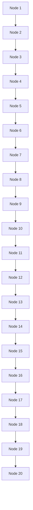

# 12: Markov chain Monte Carlo

原始 PDF 第 552–575 页。

## Markov chain Monte Carlo

We have seen throughout this book that simulation is a powerful technique in probability. If you can’t convince your friend that it is a good idea to switch doors in the Monty Hall problem, in one second you can simulate playing the game a few thousand times and your friend will just see that switching succeeds about 2/3 of the time. If you’re unsure how to calculate the mean and variance of an r.v. X but you know how to generate i.i.d. draws $X _ { 1 } , X _ { 2 } , \ldots , X _ { n }$ from that distribution, you can approximate the true mean and true variance using the sample mean and sample variance of the simulated draws:

$$
E (X) \approx \frac {1}{n} (X _ {1} + \dots + X _ {n}) = \bar {X} _ {n},
$$

$$
\mathrm{Var} (X) \approx \frac {1}{n - 1} \sum_ {j = 1} ^ {n} (X _ {j} - \bar {X} _ {n}) ^ {2}.
$$

The law of large numbers tells us that these approximations will be good if n is large. We can get better and better approximations by increasing n, just by running the computer for a longer time (rather than having to struggle with a possibly intractable sum or integral). As discussed in Chapter 10, this simulation approach, where we generate random values to approximate a quantity, is called a Monte Carlo method.

A major limitation of the Monte Carlo idea above is that we need to know how to generate $X _ { 1 } , X _ { 2 } , \ldots , X _ { n }$ (hopefully efficiently, since we want to be able to make n large). For example, suppose that we want to simulate random draws from the continuous distribution with PDF f given by

$$
f (x) \propto x ^ {3. 1} (1 - x) ^ {4. 2}
$$

for $0 < x < 1$ (and 0 otherwise). Staring at a density function does not immediately suggest how to get a random variable with that density. In this case we recognize the PDF of the Beta(4.1, 5.2) distribution, so assuming we had access to a Unif(0, 1) r.v., we could theoretically use universality of the Uniform. Unfortunately, finding the CDF of a Beta distribution is difficult, let alone the inverse of the CDF. See Example 12.1.4 for more about the Beta simulation problem.

Of course, the distributions that arise in real-world applications are often much more complicated than the Beta. For the Beta distribution, we know an expression for the normalizing constant in terms of the gamma function. But for many other

535

---

536

Introduction to Probability

distributions that are of scientific interest, the normalizing constant in the PDF or PMF is unknown, and beyond the reach of the fastest available computers and the fanciest available mathematical techniques.

This chapter introduces Markov chain Monte Carlo (MCMC), a powerful collec tion of algorithms that enable us to simulate from complicated distributions using Markov chains. The development of MCMC has revolutionized statistics and scientific computation by vastly expanding the range of possible distributions that we can simulate from, including joint distributions in high dimensions. The basic idea is to build your own Markov chain so that the distribution of interest is the stationary distribution of the chain.

In the previous chapter, we looked at Markov chains whose transition matrix Q was specified, and we tried to find the stationary distribution s of the chain. In this chapter we do the reverse: starting with a distribution s that we want to simulate, we will engineer a Markov chain whose stationary distribution is s. If we then run this engineered Markov chain for a very long time, the distribution of the chain will approach our desired s.

But is it possible to create a transition matrix Q with the stationary distribution we desire? Even if it is possible, is solving this problem any easier than the original problem of how to simulate random draws from that distribution? In amazing generality, MCMC shows that it is possible to create a Markov chain with the desired stationary distribution in an easy-to-describe way, without having to know the normalizing constant for the distribution!

MCMC is now being applied to a large number of problems in the biological, natural, and physical sciences, and many different MCMC algorithms have been developed. Here we will introduce two of the most important and most widely used MCMC algorithms: the Metropolis-Hastings algorithm and Gibbs sampling. MCMC is an enormous and growing area of statistical computing; see Brooks, Gelman, Jones, and Meng [2] for much more about its theory, methods, and applications.

## 12.1 Metropolis-Hastings

The Metropolis-Hastings algorithm is a general recipe that lets us start with any irreducible Markov chain on the state space of interest and then modify it into a new Markov chain that has the desired stationary distribution. This modification consists of introducing some selectiveness in the original chain: moves are proposed according to the original chain, but the proposal may or may not be accepted. For example, suppose the original chain is at a state called “Boston” and is about to transition to “San Francisco”. Then for the new chain, we either accept the proposal and go to San Francisco, or we turn down the proposal and remain in Boston as

---

Markov chain Monte Carlo

537

the next step. With a careful choice of the probability of accepting the proposal, this simple modification guarantees that the new chain has the desired stationary distribution.

Algorithm 12.1.1 (Metropolis-Hastings). Let $\mathbf { s } = ( s _ { 1 } , \ldots , s _ { M } )$ be a desired stationary distribution on state space $\{ 1 , \ldots , M \}$ . Assume that $s _ { i } > 0$ for all i (if not, just delete any states $i$ with $s _ { i } = 0$ from the state space). Suppose that $P = ( p _ { i j } )$ is the transition matrix for a Markov chain on state space $\{ 1 , \ldots , M \}$ . Intuitively, $P$ is a Markov chain that we know how to run but that doesn’t have the desired stationary distribution.

Our goal is to modify $P$ to construct a Markov chain $X _ { 0 } , X _ { 1 } , \ldots$ . with stationary distribution s. We will give a Metropolis-Hastings algorithm for this. Start at any state $X _ { 0 }$ (chosen randomly or deterministically), and suppose that the new chain is currently at $X _ { n }$ . To make one move of the new chain, do the following.

1. If $X _ { n } = i$ , propose a new state $j$ using the transition probabilities in the ith row of the original transition matrix $P$

2. Compute the acceptance probability

$$
a _ {i j} = \min \left(\frac {s _ {j} p _ {j i}}{s _ {i} p _ {i j}}, 1\right).
$$

3. Flip a coin that lands Heads with probability $a _ { i j }$

4. If the coin lands Heads, accept the proposal (i.e., go to $j )$ , setting $X _ { n + 1 } = j$ . Otherwise, reject the proposal (i.e., stay at i), setting $X _ { n + 1 } = i$

That is, the Metropolis-Hastings chain uses the original transition probabilities $p _ { i j }$ to propose where to go next, then accepts the proposal with probability $a _ { i j }$ , staying in its current state in the event of a rejection. An especially nice aspect of this algorithm is that the normalizing constant for s does not need to be known, since it cancels out in $s _ { j } / s _ { i }$ anyway. For example, in some problems we may want the stationary distribution to be uniform over all states $( \mathrm { i . e . , ~ } \mathbf { s } = ( 1 / M , 1 / M , \ldots , 1 / M ) )$ but the number of states M is large and unknown, and it would be a very hard counting problem to find M. Fortunately, $s _ { j } / s _ { i } = 1$ regardless of $M$ , so we can simply say $\mathbf { s } \propto ( 1 , 1 , \ldots , 1 )$ , and we can calculate $a _ { i j }$ without having to know M.

The $p _ { i j }$ in the denominator in $a _ { i j }$ will never be 0 when the algorithm is run, since if $p _ { i j } = 0$ then the original chain will never propose going from $i$ to $j$ . Also, if $p _ { i i } > 0$ it is possible that the proposal $j$ will equal the current state $i ;$ in that case, the chain stays at $i$ regardless of whether the proposal is accepted. (Rejecting the proposal of staying at i but staying there anyway is like a child who just got grounded saying “yes, I will stay in my room, but not because you told me $\mathrm { t o l } _ { \cdot } ^ { \mathrm { p } } )$

We will now show that the Metropolis-Hastings chain is reversible with stationary distribution s.

---

538

Introduction to Probability

Proof. Let $Q$ be the transition matrix of the Metropolis-Hastings chain. We just need to check the reversibility condition $s _ { i } q _ { i j } = s _ { j } q _ { j i }$ for all i and $j .$ This is clear for $i = j ,$ so assume $i \neq j$ . If $q _ { i j } > 0$ , then $p _ { i j } > 0$ (the chain can’t get from $i$ to $j$ if it can’t even propose going from i to $j )$ and $p _ { j i } > 0$ (otherwise the acceptance probability would be $0 )$ . Conversely, if $p _ { i j } > 0$ and $p _ { j i } > 0$ , then $q _ { j i } > 0$ . So $q _ { i j }$ and $q _ { j i }$ are either both zero or both nonzero. We can assume they are both nonzero. Then

$$
q _ {i j} = p _ {i j} a _ {i j}
$$

since, starting at $i ,$ the only way to get to $j$ is first to propose doing so and then to accept the proposal. First consider the case $s _ { j } p _ { j i } \leq s _ { i } p _ { i j }$ . We have

$$
a _ {i j} = \frac {s _ {j} p _ {j i}}{s _ {i} p _ {i j}}, a _ {j i} = 1,
$$

so

$$
s _ {i} q _ {i j} = s _ {i} p _ {i j} a _ {i j} = s _ {i} p _ {i j} \frac {s _ {j} p _ {j i}}{s _ {i} p _ {i j}} = s _ {j} p _ {j i} = s _ {j} p _ {j i} a _ {j i} = s _ {j} q _ {j i}.
$$

Symmetrically, if $s _ { j } p _ { j i } > s _ { i } p _ { i j }$ , we again have $s _ { i } q _ { i j } = s _ { j } q _ { j i }$ , by switching the roles of $i$ and $j$ in the preceding calculation. Since the reversibility condition holds, s is the stationary distribution of the chain with transition matrix $Q .$ 

h 12.1.2. The Metropolis-Hastings algorithm is an extremely general way to construct a Markov chain with a desired stationary distribution. In the above formulation, both s and $P$ were very general, and nothing was stipulated about their being related (aside from being on the same state space). In practice, however, the choice of the proposal distribution is extremely important since it can make an enormous difference in how quickly the chain converges to its stationary distribution.

How to choose a good proposal distribution is a complicated topic and will not be discussed in detail here. Intuitively, a proposal distribution with a very low acceptance rate will be slow to converge (since the chain will rarely move anywhere). But a high acceptance rate may not be ideal either, since it may indicate that the chain tends to make small, timid proposals. In a large state space, such a chain will take a very long time to explore the entire space.

Here are a couple examples of how the Metropolis-Hastings algorithm can be used to simulate from distributions.

Example 12.1.3 (Zipf distribution simulation). Let $M   \geq   2$ be an integer. An r.v. X has the $Z i p f$ distribution with parameter $a > 0$ if its PMF is

$$
P (X = k) = \frac {1 / k ^ {a}}{\sum_ {j = 1} ^ {M} (1 / j ^ {a})},
$$

for $k = 1 , 2 , \ldots , M$ (and 0 otherwise). This distribution is widely used in linguistics for studying frequencies of words.

Create a Markov chain $X _ { 0 } , X _ { 1 } , \ldots$ . whose stationary distribution is the Zipf distribution, and such that $\left| X _ { n + 1 } - X _ { n } \right|   \leq   1$ for all $n$ . Your answer should provide a

---

Markov chain Monte Carlo

539

simple, precise description of how each move of the chain is obtained, i.e., how to transition from $X _ { n }$ to $X _ { n + 1 }$ for each n.

## Solution:

We can use the Metropolis-Hastings algorithm, after coming up with a proposal distribution. There are many possible proposal distributions, but one simple choice is the following random walk on $\{ 1 , 2 , \ldots , M \}$ . From state i with $i   \neq   1 , i   \neq   M$ , move to state $i - 1 { \mathrm { ~ o r ~ } } i + 1$ , with probability $1 / 2$ each. From state 1, stay there or move to state 2, with probability $1 / 2$ each. From state $M ,$ stay there or move to state $M - 1$ , with probability $1 / 2$ each. This chain is shown below.


<details>
<summary>flowchart</summary>

```mermaid
graph LR
  A[""] --> B["1"]
  B --> C["2"]
  C --> D["3"]
  D --> E["..."]
  E --> F["M-1"]
  F --> G["M"]
  G --> H[""]
```
</details>

## FIGURE 12.1

Proposal chain for Zipf distribution simulation.

Let P be the transition matrix of this chain. The stationary distribution for P is uniform because P is a symmetric matrix, so Proposition 11.4.3 applies. Metropolis-Hastings lets us transmogrify P into a chain whose stationary distribution is $\mathrm { Z i p f ^ { \circ } s }$ distribution.

Let $X _ { 0 }$ be any starting state, and generate a chain $X _ { 0 } , X _ { 1 } , \ldots$ as follows. If the chain is currently at state i, then:

1. Generate a proposal state j according to the proposal chain P.
2. Accept the proposal with probability min $( i ^ { a } / j ^ { a } , 1 )$ . If the proposal is accepted, go to $j ;$ otherwise, stay at i.

This chain is easy to implement and a move requires very little computation; note that the normalizing constant $\textstyle \sum _ { j = 1 } ^ { M } ( 1 / j ^ { a } )$ is not needed to run the chain. 

Example 12.1.4 (Beta simulation). Let us now return to the Beta simulation problem introduced at the beginning of the chapter. Suppose that we want to generate $W \sim \mathrm { B e t a } ( a , b )$ , but we don’t know about the rbeta command in R. Instead, what we have available are i.i.d. Unif(0, 1) r.v.s.

(a) How can we generate W exactly if a and b are positive integers, using a story and universality of the Uniform?
(b) How can we generate W which is approximately $\mathrm { B e t a } ( a , b )$ if a and b are any positive real numbers, with the help of a Markov chain on the state space $( 0 , 1 ) ?$

## Solution:

(a) Applying universality of the Uniform directly for the Beta is hard, so let’s first use the bank–post office story: if $X   \sim   \mathrm { G a m m a } ( a , 1 )$ and $Y   \sim   \mathrm { G a m m a } ( b , 1 )$ are

---

540

Introduction to Probability

independent, then $X / ( X + Y ) \; \sim$ Beta $, ( a , b )$ . So if we can simulate the Gamma distribution, then we can simulate the Beta distribution!

To simulate $X \sim \mathrm { G a m m a } ( a , 1 )$ , we can use $X _ { 1 } + X _ { 2 } + \cdots + X _ { a }$ with the $X _ { j }$ i.i.d. Expo(1); similarly, we can simulate $Y \sim \mathrm { G a m m a } ( b , 1 )$ as the sum of $b$ i.i.d. Expo(1) r.v.s. Lastly, by taking the inverse of the Expo(1) CDF and applying universality of the Uniform, $- \log ( 1 - U ) \sim \mathrm { E x p o } ( 1 )$ for $U \sim \mathrm { U n i f } ( 0 , 1 )$ , so we can easily construct as many Expo(1) r.v.s as we want.

(b) Let’s use the Metropolis-Hastings algorithm. We have only introduced Metropolis-Hastings for finite state spaces, but the ideas are analogous for an infinite state space. A simple proposal chain we have available consists of independent Unif(0, 1) r.v.s. That is, the proposed state on the interval (0, 1) is always a fresh Unif(0, 1), independent of the current state. The resulting Metropolis-Hastings chain is called an independence sampler.

Let $W _ { 0 }$ be any starting state, and generate a chain $W _ { 0 } , W _ { 1 } , \ldots$ as follows. If the chain is currently at state w, then:

1. Generate a proposal u by drawing a $\mathrm { U n i f } ( 0 , 1 ) ~ \mathrm { r . v }$
2. Accept the proposal with probability min $\left( \begin{matrix} { \frac { u ^ { a - 1 } ( 1 - u ) ^ { b - 1 } } { w ^ { a - 1 } ( 1 - w ) ^ { b - 1 } } , 1 } \\ \end{matrix} \right)$ . If the proposal is accepted, go to u; otherwise, stay at w.

Again, the normalizing constant was not needed in order to run the chain. In obtaining the acceptance probability, the $\mathrm { B e t a } ( a , b )$ PDF plays the role of s since it’s the desired stationary distribution, and the Unif(0, 1) PDF plays the role of $p _ { i j }$ (and $\left| p _ { j i } \right\rangle$ since the proposals are Unif(0, 1) r.v.s, independent of the current state.

Running the Markov chain, we have that $W _ { n } , W _ { n + 1 } , W _ { n + 2 } , \ldots$ are approximately Beta $( a , b )$ for n large. Note that these are correlated r.v.s., not i.i.d. draws. 

h 12.1.5 (MCMC produces correlated samples). A major question in running a Markov chain $X _ { 0 } , X _ { 1 } , \ldots$ for a Monte Carlo computation is how long to run it. In part, this is because it is usually hard to know how close the chain’s distribution at time n will be to the stationary distribution. Another issue is that $X _ { 0 } , X _ { 1 } , \ldots$ are correlated in general. Some chains tend to get stuck in certain regions of the state space, rather than exploring the whole space. If a chain can get stuck easily, then $X _ { n }$ may be highly positively correlated with $X _ { n + 1 }$ . The autocorrelation at lag k is the correlation between $X _ { n }$ and the value k steps later, $X _ { n + k }$ , in the limit as n grows. It is desirable for the autocorrelation at lag k to approach 0 rapidly as k increases. High autocorrelation tends to mean high variances for Monte Carlo approximations.

Analysis of how long to run a chain and finding diagnostics for whether the chain has been run long enough are active research areas. Some general advice is to run your chains for a very large number of steps and to try chains from diverse starting points to see how stable the results are.

---

Markov chain Monte Carlo

541

Metropolis-Hastings is often useful even for immense state spaces. It can even be useful for problems that may not sound at first like they have anything to do with simulating a distribution, such as code-breaking.

Example 12.1.6 (Code-breaking). Markov chains have recently been applied to code-breaking; this example will introduce one way in which this can be done. (For further information about such applications, see Diaconis [6] and Chen and Rosenthal [3].) A substitution cipher is a permutation g of the letters from a to $z ,$ where a message is enciphered by replacing each letter α by $g ( \alpha )$ . For example, if $g$ is the permutation given by

abcdefghijklmnopqrstuvwxyz zyxwvutsrqponmlkjihgfedcba

where the second row lists the values $g ( a ) , g ( b ) , \ldots , g ( z )$ , then we would encipher the word “statistics” as “hgzgrhgrxh”. (We could also include capital letters, spaces, and punctuation marks if desired.) The state space is all $2 6 ! \approx 4 \cdot 1 0 ^ { 2 6 }$ permutations of the letters a through z. This is an extremely large space: if we had to try decoding a text using each of these permutations, and could handle one permutation per nanosecond, it would still take over 12 billion years to work through all the permutations. So a brute-force investigation that goes through each permutation one by one is infeasible; instead, we will look at random permutations.

(a) Consider the Markov chain that picks two different random coordinates between 1 and 26 and swaps those entries of the 2nd row, e.g., if we pick 7 and 20, then

abcdefghijklmnopqrstuvwxyz zyxwvutsrqponmlkjihgfedcba

becomes

abcdefghijklmnopqrstuvwxyz zyxwvugsrqponmlkjihtfedcba

Find the probability of going from a permutation g to a permutation h in one step (for all $g , h )$ , and find the stationary distribution of this chain.

(b) Suppose we have a system that assigns a positive “score” $s ( g )$ to each permutation g. Intuitively, this could be a measure of how likely it would be to get the observed enciphered text, given that g was the cipher used. Use the Metropolis-Hastings algorithm to construct a Markov chain whose stationary distribution is proportional to the list of all scores $s ( g )$

## Solution:

(a) The probability of going from g to h in one step is 0 unless h can be obtained from g by swapping 2 entries of the second row. Assuming that h can be obtained in this way, the probability is $\frac{1}{\binom{26}{2}}$ , since there are $\textstyle { \binom { 2 6 } { 2 } }$ such swaps, all equally likely.

This Markov chain is irreducible, since by performing enough swaps we can get from any permutation to any other permutation. (Imagine rearranging a deck of

---

542

Introduction to Probability

cards by swapping cards two at a time; it is possible to reorder the cards in any desired configuration by doing this enough times.) Note that $p ( g , h ) = p ( h , g )$ , where $p ( g , h )$ is the transition probability of going from $g$ to $h .$ Since the transition matrix is symmetric, the stationary distribution is uniform over all 26! permutations of the letters a through $z .$

(b) For our proposal chain, we’ll use the chain from $( \mathrm { a } )$ . Starting from any state $g ,$ generate a proposal h using the chain from $( \mathrm { a } )$ . Flip a coin with probability min $( s ( h ) / s ( g ) , 1 )$ of Heads. If Heads, go to $h ;$ if Tails, stay at $g .$

To prove this has the desired stationary distribution, we can appeal to our general proof of Algorithm 12.1.1 or check the reversibility condition directly. For practice, we’ll do the latter: we need $s ( g ) q ( g , h ) = s ( h ) q ( h , g )$ for all $g$ and $h .$ where $q ( g , h )$ is the transition probability from $g$ to $h$ in the modified chain. If $g = h$ or $q ( g , h ) = 0$ , then the equation clearly holds, so assume $g \neq h$ and $q ( g , h ) \neq 0$ . Let $p ( g , h )$ be the transition probability from (a) (which is the probability of proposing h when at $g )$ First consider the case that $s ( g ) \leq s ( h )$ . Then $q ( g , h ) = p ( g , h )$ and

$$
q (h, g) = p (h, g) \frac {s (g)}{s (h)} = p (g, h) \frac {s (g)}{s (h)} = q (g, h) \frac {s (g)}{s (h)},
$$

so $s ( g ) q ( g , h ) = s ( h ) q ( h , g )$ . Now consider the case that $s ( h ) < s ( g )$ . By a symmetric argument (reversing the roles of $g$ and $h )$ , we again have $s ( g ) q ( g , h ) = s ( h ) q ( h , g )$ Thus, the stationary probability of $g$ is proportional to its score $s ( g )$

In other words, using the Metropolis-Hastings algorithm, we started with a Markov chain that was equally likely to visit all of the ciphers in the long run and created a Markov chain whose stationary distribution sorts the ciphers according to their scores, visiting the most promising ciphers the most often in the long run. 

Here is another MCMC example with an immense state space and which at first sight might not seem to have much connection with simulating a distribution. This example points to the fact that MCMC can be used not only for sampling but also for optimization.

Example 12.1.7 (Knapsack problem). Bilbo the Burglar finds m treasures in Smaug’s Lair. Bilbo is deciding which treasures to steal (or justly reclaim, depending on one’s point of view); he can’t take everything all at once, since the maximum weight he can carry is $w$ pounds. Label the treasures from 1 to $m ,$ and suppose that the $j \mathrm { t h }$ treasure is worth $g _ { j }$ gold pieces and weighs $w _ { j }$ pounds. So Bilbo must choose a vector $x = ( x _ { 1 } , \ldots , x _ { m } )$ , where $x _ { j }$ is 1 if he steals the jth treasure and 0 otherwise, such that the total weight of the treasures $j$ with $x _ { j } = 1$ is at most w. Let $C$ be the space of all such vectors, so $C$ consists of all binary vectors $( x _ { 1 } , \ldots , x _ { m } )$ with $\textstyle \sum _ { j = 1 } ^ { m } x _ { j } w _ { j } \leq w$

Bilbo wishes to maximize the total worth of the treasure he takes. Finding an optimal solution is an extremely difficult problem, known as the knapsack problem, which has a long history in computer science. A brute force solution would be

---

Markov chain Monte Carlo

543

completely infeasible in general. Bilbo decides instead to explore the space $C$ using MCMC—luckily, he has a laptop running R with him.

(a) Consider the following Markov chain. Start at $( 0 , 0 , \ldots , 0 )$ . One move of the chain is as follows. Suppose the current state is $x = ( x _ { 1 } , \ldots , x _ { m } )$ . Choose a uniformly random $J$ in $\{ 1 , 2 , \ldots , m \}$ , and obtain $y$ from x by replacing $x _ { J }$ with $$1 - x _ { J }$ (i.e.$ toggle whether that treasure will be taken). If $y$ is not in $C ,$ stay at $x ;$ if $y$ is in $C ,$ move to $y .$ Show that the uniform distribution over $C$ is stationary for this chain.

(b) Show that the chain from $( \mathrm { a } )$ is irreducible, and that it may or may not be aperiodic (depending on $w , w _ { 1 } , \ldots , w _ { m } )$

(c) The chain from (a) is a useful way to get approximately uniform solutions, but Bilbo is more interested in finding solutions where the value (in gold pieces) is high. In this part, the goal is to construct a Markov chain with a stationary distribution that puts much higher probability on any particular high-value solution than on any particular low-value solution. Specifically, suppose that we want to simulate from the distribution

$$
s (x) \propto e ^ {\beta V (x)},
$$

where $\begin{array} { r } { V ( x ) = \sum _ { j = 1 } ^ { m } x _ { j } g _ { j } } \end{array}$ is the value of $x$ in gold pieces and $\beta$ is a positive constant. The idea behind this distribution is to give exponentially more probability to each high-value solution than to each low-value solution. Create a Markov chain whose stationary distribution is as desired.

## Solution:

(a) The transition matrix is symmetric since for $x \neq y ,$ the transition probabilities from $x$ to $y$ and from $y$ to x are either both 0 or both $1 / m$ . So the stationary distribution is uniform over $C .$

(b) We can go from any $x \in C$ to $( 0 , 0 , \ldots , 0 )$ by dropping treasures one at a time. We can go from $( 0 , 0 , \ldots , 0 )$ to any $y \in C$ by picking up treasures one at a time. Combining these, we can go from anywhere to anywhere, so the chain is irreducible.

To study periodicity, let’s look at some simple cases. First consider the simple case where $w _ { 1 } + \cdots + w _ { m } < w$ , i.e., Bilbo can carry all the treasure at the same time. Then all binary vectors of length m are allowed. So the period of $( 0 , 0 , \ldots , 0 )$ is $2$ since, starting at that state, Bilbo needs to pick up and then put down a treasure in order to get back to that state. In fact, if Bilbo starts at $( 0 , 0 , \ldots , 0 )$ , after any odd number of moves he will be carrying an odd number of treasures.

Now consider the case where $w _ { 1 } > w$ , i.e., the first treasure is too heavy for Bilbo. From any $x \in C$ , there is a $1 / m$ chance that the chain will try to pick up the first treasure, and if that happens, the chain will stay at x. So the period of each state is 1.

(c) We can apply Metropolis-Hastings using the chain from $( \mathrm { a } )$ to make proposals. Start at $( 0 , 0 , \ldots , 0 )$ . Suppose the current state is $x = ( x _ { 1 } , \ldots , x _ { m } )$ . Then:

---

544

Introduction to Probability

1. Choose a uniformly random J in $\{ 1 , 2 , \ldots , m \}$ , and obtain $y$ from x by replacing $x _ { J }$ with $1 - x _ { J }$

2. If $y$ is not in $C ,$ stay at $x .$ If y is in $C ,$ flip a coin that lands Heads with probability min $\tilde { \left( 1 , e ^ { \beta ( V ( y ) - \tilde { V ( x ) } ) } \right) }$ . If the coin lands Heads, $\mathbf { g } \mathbf { o }$ to $y ;$ otherwise, stay at $x .$

This chain will converge to the desired stationary distribution. But how should $\beta$ be chosen? If $\beta$ is very large, then the best solutions are given very high probability, but the chain may be very slow to converge to the stationary distribution since it can easily get stuck in local modes: the chain may find itself in a state which, while not globally optimal, is still better than the other states that can be reached in one step, and then the probability of rejecting proposals to go elsewhere may be very high. On the other hand, if $\beta$ is close to 0, then it’s easy for the chain to explore the space, but there isn’t as much incentive for the chain to uncover good solutions.

An optimization technique called simulated annealing avoids having to choose one value of $\beta .$ Instead, one specifies a sequence of $\beta$ values, such that $\beta$ gradually increases over time. At first, $\beta$ is small and the space $C$ can be explored broadly. As $\beta$ gets larger and larger, the stationary distribution becomes more and more concentrated on the best solution or solutions. The name “simulated annealing” comes from an analogy with the annealing of metals, a process in which a metal is heated to a high temperature and then gradually cooled until it reaches a very strong, stable state; $\beta$ corresponds to the reciprocal of temperature. 

As mentioned in Example 12.1.4, the Metropolis-Hastings algorithm can also be applied in a continuous state space, using PDFs instead of PMFs. This is extremely useful in Bayesian inference, where we often want to study the posterior distribution of an unknown parameter. This posterior distribution may be very complicated to work with analytically, and may have an unknown normalizing constant.

The MCMC approach is to obtain a large number of draws from a Markov chain whose stationary distribution is the posterior distribution. We can then use these draws to approximate the true posterior distribution. For example, we can estimate the posterior mean using the sample mean of these draws, and the posterior median using the sample median of the draws.

Gelman et al. [10] and McElreath [18] provide extensive introductions to Bayesian thinking and Bayesian data analysis, with wide ranges of applications and emphasis on statistical modeling and simulation. Various supplementary materials for these two books can be found at [http://www.stat.columbia.edu/\~gelman/book](http://www.stat.columbia.edu) and [https://xcelab.net/rm/statistical-rethinking](https://xcelab.net) respectively.

Example 12.1.8 (Normal-Normal conjugacy). Let $Y | \theta   \sim   \mathcal { N } ( \theta , \sigma ^ { 2 } )$ , where $\sigma ^ { 2 }$ is known but $\theta$ is unknown. Using the Bayesian framework, we treat θ as a random variable, with prior given by $\theta \sim \mathcal { N } ( \mu , \tau ^ { 2 } )$ for some known constants $\mu$ and $\tau ^ { 2 }$ . That

---

Markov chain Monte Carlo

545

is, we have the two-level model

$$
\theta \sim \mathcal {N} (\mu , \tau^ {2})
$$

$$
Y | \theta \sim \mathcal {N} (\theta , \sigma^ {2}).
$$

Describe how to use the Metropolis-Hastings algorithm to find the posterior mean and variance of θ after observing the value of $Y$

Solution:

After observing $Y = y$ , we can update our prior uncertainty for θ using Bayes’ rule. Because we are interested in the posterior distribution of $\theta ,$ any terms not depending on $\theta$ can be treated as part of the normalizing constant. Thus,

$$
f _ {\theta | Y} (\theta | y) \propto f _ {Y | \theta} (y | \theta) f _ {\theta} (\theta) \propto e ^ {- \frac {1}{2 \sigma^ {2}} (y - \theta) ^ {2}} e ^ {- \frac {1}{2 \tau^ {2}} (\theta - \mu) ^ {2}}.
$$

Since we have a quadratic function of θ in the exponent, we recognize the posterior PDF of $\theta$ as a Normal PDF. The posterior distribution stays in the Normal family, which tells us that the Normal is the conjugate prior of the Normal. In fact, by completing the square (a rather tedious calculation which we shall omit), we can obtain an explicit formula for the posterior distribution of $\theta ;$

$$
\theta | Y = y \sim \mathcal {N} \left(\frac {\frac {1}{\sigma^ {2}}}{\frac {1}{\sigma^ {2}} + \frac {1}{\tau^ {2}}} y + \frac {\frac {1}{\tau^ {2}}}{\frac {1}{\sigma^ {2}} + \frac {1}{\tau^ {2}}} \mu , \frac {1}{\frac {1}{\sigma^ {2}} + \frac {1}{\tau^ {2}}}\right).
$$

Let’s try to make sense of this formula.

• It says that the posterior mean of θ, $E ( \theta | Y = y )$ , is a weighted average of the prior mean $\mu$ and the observed data y. The weights are determined by how certain we are about $\theta$ before getting the data and how precisely the data are measured. If we are already very sure about $\theta$ even before getting the data, then $\tau ^ { 2 }$ will be small and $1 / \tau ^ { 2 }$ will be large, which will give a lot of weight to the prior mean $\mu .$ On the other hand, if the data are very precise, then $\sigma ^ { 2 }$ will be small and $1 / \sigma ^ { 2 }$ will be large, which will give a lot of weight to the data $y$ .
• For the posterior variance, if we define precision to be the reciprocal of variance, then the result simply says that the posterior precision of $\theta$ is the sum of the prior precision $1 / \tau ^ { 2 }$ and the data precision $1 / \sigma ^ { 2 }$

This is all well and good, but let’s suppose we didn’t know how to complete the square, or that we wanted to check our calculations for specific values of $y ,   \sigma ^ { 2 } ,   \mu ,$ and $\tau ^ { 2 }$ . We can do this by simulating from the posterior distribution of $\theta ,$ using the Metropolis-Hastings algorithm to construct a Markov chain whose stationary distribution is $f _ { \theta | Y } ( \theta | y )$ . The same method can also be applied to a wide variety of distributions that are far more complicated than the Normal to work with analytically. A Metropolis-Hastings algorithm for generating $\theta _ { 0 } , \theta _ { 1 } , \ldots$ is as follows.

---

546

Introduction to Probability

1. If $\theta _ { n } = x$ , propose a new state $x ^ { \prime }$ according to some transition rule. One way to do this in a continuous state space is to generate a Normal r.v. $\epsilon _ { n }$ with mean 0 and add it onto the current state to get the proposed state: in other words, we generate $\epsilon _ { n } \sim \mathcal { N } ( 0 , d ^ { 2 } )$ for some constant $d ,$ and then set $x ^ { \prime } = x + \epsilon _ { n }$ . This is the analog of a transition matrix for a continuous state space. The only additional detail is deciding $d ;$ in practice, we try to choose a moderate value that is neither too large nor too small.

2. The acceptance probability is

$$
a (x, x ^ {\prime}) = \min \left(\frac {s (x ^ {\prime}) p (x ^ {\prime} , x)}{s (x) p (x , x ^ {\prime})}, 1\right),
$$

where $s$ is the desired stationary PDF (this was a PMF in the discrete case) and $p ( x , x ^ { \prime } )$ is the probability density of proposing $x ^ { \prime }$ from $x$ (this was $p _ { i j }$ in the discrete case).

In this problem, we want the stationary PDF to be $f _ { \theta | Y }$ , so we’ll use that for s. As for $p ( x , x ^ { \prime } )$ , proposing $x ^ { \prime }$ from x is the same as having $\epsilon _ { n } = x ^ { \prime }   -   x$ so we evaluate the PDF of $\epsilon _ { n }$ at $x ^ { \prime } - x$ to get

$$
p (x, x ^ {\prime}) = \frac {1}{\sqrt {2 \pi} d} e ^ {- \frac {1}{2 d ^ {2}} (x ^ {\prime} - x) ^ {2}}.
$$

However, since $p ( x ^ { \prime } , x ) = p ( x , x ^ { \prime } )$ , these terms cancel from the acceptance probability, leaving us with

$$
a (x, x ^ {\prime}) = \min \left(\frac {f _ {\theta | Y} (x ^ {\prime} | y)}{f _ {\theta | Y} (x | y)}, 1\right).
$$

Once again, the normalizing constant cancels in the numerator and denominator of the acceptance probability.

3. Flip a coin that lands Heads with probability $a ( x , x ^ { \prime } )$ , independently of the Markov chain.

4. If the coin lands Heads, accept the proposal and set $\theta _ { n + 1 } = x ^ { \prime }$ . Otherwise, stay in place and set $\theta _ { n + 1 } = x$

We ran the algorithm for $1 0 ^ { 4 }$ iterations with the settings $Y   =   3 ,   \mu   =   0 ,   \sigma ^ { 2 }   =   1$ $\tau ^ { 2 } = 4$ , and $d = 1$ . Figure 12.2 shows a histogram of the resulting draws from the posterior distribution of $\theta .$ The posterior distribution indeed looks like a Normal curve. We can estimate the posterior mean and variance using the sample mean and sample variance. For the draws we obtained, the sample mean is 2.4 and the sample variance is 0.8. These are in close agreement with the theoretical values:

$$
E (\theta | Y = 3) = \frac {\frac {1}{\sigma^ {2}}}{\frac {1}{\sigma^ {2}} + \frac {1}{\tau^ {2}}} y + \frac {\frac {1}{\tau^ {2}}}{\frac {1}{\sigma^ {2}} + \frac {1}{\tau^ {2}}} \mu = \frac {1}{1 + \frac {1}{4}} \cdot 3 + \frac {\frac {1}{4}}{1 + \frac {1}{4}} \cdot 0 = 2. 8,
$$

$$
\mathrm{Var} (\theta | Y = 3) = \frac {1}{\frac {1}{\sigma^ {2}} + \frac {1}{\tau^ {2}}} = \frac {1}{1 + \frac {1}{4}} = 0. 8.
$$

---

Markov chain Monte Carlo

547

The posterior mean is closer to the observed data than to the prior mean, which makes sense because $\tau ^ { 2 }$ is larger than $\sigma ^ { 2 }$ , corresponding to a relatively high level of prior uncertainty. Using the code provided in the R section of this chapter, you can see how the posterior distribution changes for different values of $y ,   \mu ,   \sigma ^ { 2 }$ , and $\tau ^ { 2 }$


<details>
<summary>histogram</summary>

| Bin (theta) | Frequency |
| --- | --- |
| -0.5~0 | ~30 |
| 0~0.5 | ~180 |
| 0.5~1 | ~450 |
| 1~1.5 | ~970 |
| 1.5~2 | ~1780 |
| 2~2.5 | ~2200 |
| 2.5~3 | ~1950 |
| 3~3.5 | ~1380 |
| 3.5~4 | ~780 |
| 4~4.5 | ~290 |
| 4.5~5 | ~120 |
| 5~5.5 | ~10 |
</details>

FIGURE 12.2

Histogram of $1 0 ^ { 4 }$ draws from the posterior distribution of θ given $Y = 3$ , obtained using Metropolis-Hastings with $\mu = 0 ,   \sigma ^ { 2 } = 1$ , and $\tau ^ { 2 } = 4$ . The sample mean is 2.4 and the sample variance is 0.8, in agreement with the theoretical values.


FIGURE 12.3

Trace plots of $\theta _ { n }$ as a function of the iteration number n, for $d = 1 0 0 , 1 , 0 . 0 1$

To help diagnose whether our Markov chain is adequately exploring the state space, we can make a trace plot, which is a plot of the samples $\theta _ { n }$ as a function of n. Figure 12.3 shows three trace plots corresponding to three different choices for the standard deviation d of the proposals, namely $d = 1 0 0 ,   d = 1$ , and $d = 0 . 0 1$ . The trace plot for $d = 1 0 0$ has numerous flat regions where the chain is staying in place. This indicates that d is too large, so the proposals are often rejected. On the other hand, $d = 0 . 0 1$ is too small; we can see from the trace plot that the chain takes tiny

---

548

Introduction to Probability

steps and is unable to venture very far from its starting point. The trace plot for $d = 1$ is just right, exhibiting neither the low acceptance rate of the $d = 1 0 0$ chain, nor the restricted mobility of the $d = 0 . 0 1$ chain.

In this example, the posterior distribution of θ is available analytically, so we used MCMC for illustrative purposes, to show that the results obtained by MCMC agree with their theoretical counterparts. But the same technique also applies in problems where the prior isn’t conjugate and the posterior isn’t a named distribution. 

## 12.2 Gibbs sampling

Gibbs sampling is an MCMC algorithm for obtaining approximate draws from a joint distribution, based on sampling from conditional distributions one at a time: at each stage, one variable is updated (keeping all the other variables fixed) by drawing from the conditional distribution of that variable given all the other variables. This approach is especially useful in problems where these conditional distributions are pleasant to work with.

First we will run through how the Gibbs sampler works in the bivariate case, where the desired stationary distribution is the joint PMF of discrete r.v.s X and Y . There are several forms of Gibbs samplers, depending on the order in which updates are done. We will introduce two major kinds of Gibbs sampler: systematic scan, in which the updates sweep through the components in a deterministic order, and random scan, in which a randomly chosen component is updated at each stage.

Algorithm 12.2.1 (Systematic scan Gibbs sampler). Let X and Y be discrete r.v.s with joint PMF $p _ { X , Y } ( x , y ) \; = \; P ( X \; = \; x , Y \; = \; y )$ . We wish to construct a two-dimensional Markov chain $( X _ { n } , Y _ { n } )$ whose stationary distribution is $p _ { X , Y }$ . The systematic scan Gibbs sampler proceeds by updating the X-component and the Y -component in alternation. If the current state is $( X _ { n } , Y _ { n } )   =   ( x _ { n } , y _ { n } )$ , then we update the X-component while holding the Y -component fixed, and then update the Y -component while holding the X-component fixed:

1. Draw $x _ { n + 1 }$ from the conditional distribution of X given $Y = y _ { n }$ , and set $X _ { n + 1 } = x _ { n + 1 }$
2. Draw $y _ { n + 1 }$ from the conditional distribution of Y given $X = x _ { n + 1 }$ , and set $Y _ { n + 1 } = y _ { n + 1 }$

Repeating steps 1 and 2 over and over, the stationary distribution of the chain $( X _ { 0 } , Y _ { 0 } ) , ( X _ { 1 } , Y _ { 1 } ) , ( X _ { 2 } , Y _ { 2 } ) , \ldots { \operatorname { ~ i s ~ } } p _ { X , Y }$

Algorithm 12.2.2 (Random scan Gibbs sampler). As above, let X and Y be discrete r.v.s with joint PMF $p _ { X , Y } ( x , y )$ . We wish to construct a two-dimensional

---

Markov chain Monte Carlo

549

Markov chain $( X _ { n } , Y _ { n } )$ whose stationary distribution is $p _ { X , Y }$ . Each move of the random scan Gibbs sampler picks a uniformly random component and updates it, according to the conditional distribution given the other component:

1. Choose which component to update, with equal probabilities.

2. If the X-component was chosen, draw a value $x _ { n + 1 }$ from the conditional distribution of X given $Y = y _ { n }$ , and set $X _ { n + 1 } = x _ { n + 1 } , Y _ { n + 1 } = y _ { n } .$ Similarly, if the Y -component was chosen, draw a value $y _ { n + 1 }$ from the conditional distribution of Y given $X = x _ { n }$ , and set $X _ { n + 1 } = x _ { n } , Y _ { n + 1 } = y _ { n + 1 }$

Repeating steps 1 and 2 over and over, the stationary distribution of the chain $( X _ { 0 } , Y _ { 0 } ) , ( X _ { 1 } , Y _ { 1 } ) , ( X _ { 2 } , Y _ { 2 } ) , \ldots$ is $p _ { X , Y }$

Gibbs sampling generalizes naturally to higher dimensions. If we want to sample from a d-dimensional joint distribution, the Markov chain we construct will be a sequence of d-dimensional random vectors. At each stage, we choose one component of the vector to update, and we draw from the conditional distribution of that component given the most recent values of the other components. We can either cycle through the components of the vector in a systematic order, or choose a random component to update each time.

The Gibbs sampler is less flexible than the Metropolis-Hastings algorithm in the sense that we don’t get to choose a proposal distribution; this also makes it simpler in the sense that we don’t have to choose a proposal distribution. The flavors of Gibbs and Metropolis-Hastings are rather different, in that Gibbs emphasizes conditional distributions while Metropolis-Hastings emphasizes acceptance probabilities. But the algorithms are closely connected, as we show below.

Theorem 12.2.3 (Random scan Gibbs as Metropolis-Hastings). The random scan Gibbs sampler is a special case of the Metropolis-Hastings algorithm, in which the proposal is always accepted. In particular, it follows that the stationary distribution of the random scan Gibbs sampler is as desired.

Proof. We will show this in two dimensions, but the proof is similar in any dimension. Let X and Y be discrete r.v.s whose joint PMF is the desired stationary distribution. Let’s work out what the Metropolis-Hastings algorithm says to do, using the following proposal distribution: from $( x , y )$ , randomly update one coordinate by running one move of the random scan Gibbs sampler.

To simplify notation, write

$$
P (X = x, Y = y) = p (x, y), P (Y = y | X = x) = p (y | x), P (X = x | Y = y) = p (x | y).
$$

More formally, we should write $p _ { Y | X } ( y | x )$ instead of $p ( y | x )$ , to avoid issues like wondering what $p ( 5 | 3 )$ means. But writing $p ( y | x )$ is more compact and does not create ambiguity in this proof.

Let’s compute the Metropolis-Hastings acceptance probability for going from $( x , y )$

---

550

Introduction to Probability

to $( x ^ { \prime } , y ^ { \prime } )$ . The states $( x , y )$ and $( x ^ { \prime } , y ^ { \prime } )$ must be equal in at least one component, since the proposal says to update only one component. Suppose that $x = x ^ { \prime }$ (the case $y = y ^ { \prime }$ can be handled symmetrically). Then the acceptance probability is

$$
\frac {p (x , y ^ {\prime}) p (y | x) \frac {1}{2}}{p (x , y) p (y ^ {\prime} | x) \frac {1}{2}} = \frac {p (x) p (y ^ {\prime} | x) p (y | x)}{p (x) p (y | x) p (y ^ {\prime} | x)} = 1.
$$

Thus, this Metropolis-Hastings algorithm always accepts the proposal! So it’s just running the random scan Gibbs sampler without modifying it. 

Let’s study some concrete examples of Gibbs samplers.

Example 12.2.4 (Graph coloring). Let G be a network (also called a graph): there are n nodes, and for each pair of distinct nodes, there either is or isn’t an edge joining them. We have a set of k colors, e.g., if $k = 7 .$ the color set may be {red, orange, yellow, green, blue, indigo, violet}. A k-coloring of the network is an assignment of a color to each node, such that two nodes joined by an edge can’t be the same color. For example, a 3-coloring of a network is illustrated below. Graph coloring is an important topic in computer science, with wide-ranging applications such as task scheduling and the game of Sudoku.


<details>
<summary>flowchart</summary>


</details>

FIGURE 12.4

A 3-coloring of a network.

Suppose that it is possible to k-color G. Form a Markov chain on the space of all k-colorings of G, with transitions as follows: starting with a k-coloring of $G ,$ pick a uniformly random node, figure out what the legal colors are for that node, and then repaint that node with a uniformly random legal color (note that this random color may be the same as the current color). Show that this Markov chain is reversible, and find its stationary distribution.

## Solution:

Let C be the set of all k-colorings of G, and let $q _ { i j }$ be the transition probability of going from i to $j$ for any k-colorings i and $j$ in $C .$ We will show that $q _ { i j } = q _ { j i }$ which implies that the stationary distribution is uniform on $C .$

---

Markov chain Monte Carlo

551

For any k-coloring i and node v, let $L ( i , v )$ be the number of legal colorings for node $v ,$ keeping the colors of all other nodes the same as they are in i. If k-colorings i and $j$ differ at more than one node, then $q _ { i j } = 0 = q _ { j i } . \mathrm { ~ I f ~ } i = j$ , then obviously $q _ { i j } = q _ { j i }$ If i and $j$ differ at exactly one node v, then $L ( i , v ) = L ( j , v )$ , so

$$
q _ {i j} = \frac {1}{n} \frac {1}{L (i , v)} = \frac {1}{n} \frac {1}{L (j , v)} = q _ {j i}.
$$

So the transition matrix is symmetric, which shows that the stationary distribution is uniform over the state space.

How is this an example of Gibbs sampling? Think of each node in the graph as a discrete r.v. that can take on k possible values. These nodes have a joint distribution, and the constraint that connected nodes cannot have the same color imposes a complicated dependence structure between nodes.

We would like to sample a random k-coloring of the entire graph; that is, we want to draw from the joint distribution of all the nodes. Since this is difficult, we instead condition on all but one node. If the joint distribution is to be uniform over all legal graphs, then the conditional distribution of one node given all the others is uniform over its legal colors. Thus, at each stage of the algorithm, we are drawing from the conditional distribution of one node given all the others: we’re running a random scan Gibbs sampler! 

Example 12.2.5 (Darwin’s finches). When Charles Darwin visited the Galápagos Islands, he kept a record of the finch species he observed on each island. Table 12.1 summarizes Darwin’s data, with each row corresponding to a species and each column to an island. The presence of a 1 in entry $( i , j )$ of the table indicates that species i was observed on island $j .$

<table><tr><td rowspan="2">Species</td><td colspan="18">Island</td></tr><tr><td>1</td><td>2</td><td>3</td><td>4</td><td>5</td><td>6</td><td>7</td><td>8</td><td>9</td><td>10</td><td>11</td><td>12</td><td>13</td><td>14</td><td>15</td><td>16</td><td>17</td><td>Total</td></tr><tr><td>1</td><td>0</td><td>0</td><td>1</td><td>1</td><td>1</td><td>1</td><td>1</td><td>1</td><td>1</td><td>1</td><td>0</td><td>1</td><td>1</td><td>1</td><td>1</td><td>1</td><td>1</td><td>14</td></tr><tr><td>2</td><td>1</td><td>1</td><td>1</td><td>1</td><td>1</td><td>1</td><td>1</td><td>1</td><td>1</td><td>1</td><td>0</td><td>1</td><td>0</td><td>1</td><td>1</td><td>0</td><td>0</td><td>13</td></tr><tr><td>3</td><td>1</td><td>1</td><td>1</td><td>1</td><td>1</td><td>1</td><td>1</td><td>1</td><td>1</td><td>1</td><td>1</td><td>1</td><td>0</td><td>1</td><td>1</td><td>0</td><td>0</td><td>14</td></tr><tr><td>4</td><td>0</td><td>0</td><td>1</td><td>1</td><td>1</td><td>0</td><td>0</td><td>1</td><td>0</td><td>1</td><td>0</td><td>1</td><td>1</td><td>0</td><td>1</td><td>1</td><td>1</td><td>10</td></tr><tr><td>5</td><td>1</td><td>1</td><td>1</td><td>0</td><td>1</td><td>1</td><td>1</td><td>1</td><td>1</td><td>1</td><td>0</td><td>1</td><td>0</td><td>1</td><td>1</td><td>0</td><td>0</td><td>12</td></tr><tr><td>6</td><td>0</td><td>0</td><td>0</td><td>0</td><td>0</td><td>0</td><td>0</td><td>0</td><td>0</td><td>0</td><td>1</td><td>0</td><td>1</td><td>0</td><td>0</td><td>0</td><td>0</td><td>2</td></tr><tr><td>7</td><td>0</td><td>0</td><td>1</td><td>1</td><td>1</td><td>1</td><td>1</td><td>1</td><td>1</td><td>0</td><td>0</td><td>1</td><td>0</td><td>1</td><td>1</td><td>0</td><td>0</td><td>10</td></tr><tr><td>8</td><td>0</td><td>0</td><td>0</td><td>0</td><td>0</td><td>0</td><td>0</td><td>0</td><td>0</td><td>0</td><td>0</td><td>1</td><td>0</td><td>0</td><td>0</td><td>0</td><td>0</td><td>1</td></tr><tr><td>9</td><td>0</td><td>0</td><td>1</td><td>1</td><td>1</td><td>1</td><td>1</td><td>1</td><td>1</td><td>1</td><td>0</td><td>1</td><td>0</td><td>0</td><td>1</td><td>0</td><td>0</td><td>10</td></tr><tr><td>10</td><td>0</td><td>0</td><td>1</td><td>1</td><td>1</td><td>1</td><td>1</td><td>1</td><td>1</td><td>1</td><td>0</td><td>1</td><td>0</td><td>1</td><td>1</td><td>0</td><td>0</td><td>11</td></tr><tr><td>11</td><td>0</td><td>0</td><td>1</td><td>1</td><td>1</td><td>0</td><td>1</td><td>1</td><td>0</td><td>1</td><td>0</td><td>0</td><td>0</td><td>0</td><td>0</td><td>0</td><td>0</td><td>6</td></tr><tr><td>12</td><td>0</td><td>0</td><td>1</td><td>1</td><td>0</td><td>0</td><td>0</td><td>0</td><td>0</td><td>0</td><td>0</td><td>0</td><td>0</td><td>0</td><td>0</td><td>0</td><td>0</td><td>2</td></tr><tr><td>13</td><td>1</td><td>1</td><td>1</td><td>1</td><td>1</td><td>1</td><td>1</td><td>1</td><td>1</td><td>1</td><td>1</td><td>1</td><td>1</td><td>1</td><td>1</td><td>1</td><td>1</td><td>17</td></tr><tr><td>Total</td><td>4</td><td>4</td><td>11</td><td>10</td><td>10</td><td>8</td><td>9</td><td>10</td><td>8</td><td>9</td><td>3</td><td>10</td><td>4</td><td>7</td><td>9</td><td>3</td><td>3</td><td>122</td></tr></table>

TABLE 12.1 Presence of 13 finch species (rows) on 17 islands (columns). A value of 1 in entry $( i , j )$ indicates that species i was observed on island j. Data are from Sanderson [22].

---

552

Introduction to Probability

Given these data, we might be interested in knowing whether the pattern of 0’s and 1’s observed in the table is anomalous in some way. For example, does there appear to be dependence between the rows and columns? Do some pairs of species frequently occur together on the same islands, more often than one would expect by chance? These patterns may shed light on the dynamics of inter-species cooperation or competition. One way to test for such patterns is by looking at a lot of random tables with the same row and column sums as the observed table, to see how the observed table compares to the random ones. This is a common technique in statistics known as a goodness-of-fit test.

But how do we generate random tables with the same row and column sums as Table 12.1? The number of tables satisfying these constraints is impossible to enumerate. MCMC comes to the rescue: we’ll create a Markov chain on the space of all tables with these row and column sums, whose stationary distribution is uniform over all such tables.

To construct the Markov chain, we need a way to transition from one table to another without changing the row or column sums. Starting from the observed table, randomly select two rows and two columns. If the four entries at their intersection have one of the following two patterns:

$$
\begin{array}{c c} 0 & 1 \\ 1 & 0 \end{array} \quad \text {or} \quad \begin{array}{c c} 1 & 0 \\ 0 & 1 \end{array}
$$

then switch to the opposite pattern with probability $1 / 2 ;$ otherwise stay in place. For example, if we selected rows 1 and 3 and columns 1 and 17, we would switch the four entries at their intersection from $^ { \mathrm { ~ 0 ~ 1 ~ } } _ { \mathrm { ~ 1 ~ 0 ~ } }$ to $^ { 1 0 } _ { 0 1 }$ with probability $1 / 2 .$ This is a symmetric transition rule (for all tables t and $t ^ { \prime } ,$ the transition probability from t to $t ^ { \prime }$ equals the transition probability from $t ^ { \prime }$ to $t )$ , the transitions never alter the row or column sums, and it can be shown that the Markov chain defined in this way is irreducible. Therefore the stationary distribution is uniform over all tables with the given row and column sums, as desired.

To interpret this procedure as a Gibbs sampler, consider conditioning on all entries in the table besides the four entries at the intersection of rows 1 and 3 and columns 1 and 17. If the stationary distribution is to be uniform over all tables with the given row and column sums, then the conditional distribution of these four entries must be uniform over all configurations that don’t change the row and column sums, namely $^ { \mathrm { ~ 0 ~ 1 ~ } } _ { \mathrm { ~ 1 ~ 0 ~ } }$ and $^ { 1 0 } _ { 0 1 }$ . Thus, at each stage, we are drawing from the conditional distribution of four entries given all the rest. 

As with Metropolis-Hastings, Gibbs sampling also applies to continuous distributions, replacing conditional PMFs with conditional PDFs.

Example 12.2.6 (Chicken-egg with unknown parameters). A chicken lays $N$ eggs, where $N \sim  Pois (\lambda)$ . Each egg hatches with probability $p ,$ where $p$ is unknown; we let $p \sim \mathrm { B e t a } ( a , b )$ . The constants $\lambda , a , b$ are known.

Here’s the catch: we don’t get to observe N. Instead, we only observe the number

---

Markov chain Monte Carlo

553

of eggs that hatch, X. Describe how to use Gibbs sampling to find $E ( p | X = x )$ , the posterior mean of $p$ after observing x hatched eggs.

## Solution:

By the chicken-egg story, the distribution of X given $p$ is $\operatorname { P o i s } ( \lambda p )$ . The posterior PDF of $p$ is proportional to

$$
f (p | X = x) \propto P (X = x | p) f (p) \propto e ^ {- \lambda p} (\lambda p) ^ {x} p ^ {a - 1} q ^ {b - 1},
$$

where we have dropped all terms not depending on $p .$

This isn’t a named distribution, so it might appear as though we’re stuck, but we can get ourselves out of this rut by thinking conditionally. What do we wish we knew? The total number of eggs! Conditional on observing $N = n$ and knowing the true value of $p ,$ the distribution of X would be $\operatorname { B i n } ( n , p )$ . By conditioning on the total number of eggs, we recover Beta-Binomial conjugacy between $p$ and X. This allows us to write down the posterior distribution right away using Story 8.3.3:

$$
p | X = x, N = n \sim \mathrm{Beta} (x + a, n - x + b).
$$

The fact that conditioning on $N$ makes matters so much nicer inspires us to use Gibbs sampling to tackle the problem. We alternate between sampling from $p$ conditional on N and sampling from N conditional on $p ,$ as described below. Throughout, we must also condition on $X = x .$ since we seek to learn about the posterior distributions of the parameters conditional on the evidence.

We make an initial guess for $p$ and $N .$ then iterate the following steps:

1. Conditional on $N = n$ and $X = x$ , draw a new guess for $p$ from the $\mathrm { B e t a } ( x + a , n - x + b )$ distribution.

2. Conditional on $p$ and $X = x ,$ the number of unhatched eggs is $Y \sim  Pois (\lambda(1 - p))$ by the chicken-egg story, so we can draw $Y$ from the $\mathrm { P o i s } ( \lambda ( 1 - p ) )$ distribution and set the new guess for N to be $N = x + Y$

After many iterations, we have draws for both $p$ and N. If we want, we can ignore the draws of $N ,$ since N was merely a device to help us sample $p .$ But for fun, we’ll plot both: Figure 12.5 shows histograms of the posterior draws of $p$ and N when $\lambda = 10,   a = b = 1$ (corresponding to a $\mathrm { U n i f } ( 0 , 1 )$ prior on $p )$ , and we observe $X = 7$ hatched eggs.

As for the posterior mean $E ( p | X   =   x )$ originally asked for in the problem, we can take the sample mean of the draws of $p$ to get a good approximation. In this case, the sample mean is 0.68. Using the code provided in the R section of this chapter, you can try changing the values of $\lambda ,   a ,   b ,$ and $x$ to see how the histograms and the posterior mean are affected. The key strategy for this problem was to add the unobserved number of eggs N to the model, so that we would have pleasant conditional distributions and could use Gibbs sampling conveniently. 

---

554

Introduction to Probability


## FIGURE 12.5

Histograms of $1 0 ^ { 4 }$ draws from the posterior distributions of $p$ and $N ,$ where $\lambda = 1 0$ $a = 1,   b = 1$ , and we observe $X = 7$

## 12.3 Recap

Markov chain Monte Carlo allows us to sample from complicated distributions using Markov chains. MCMC has been applied in a very wide variety of problems in recent years. The main idea behind MCMC algorithms is to construct a Markov chain whose stationary distribution is the distribution we wish to sample from. After running the Markov chain for a long time, the values that the Markov chain takes on can serve as draws from the desired distribution.

The two MCMC algorithms discussed in this chapter are Metropolis-Hastings and Gibbs sampling. The Metropolis-Hastings algorithm uses any irreducible Markov chain on the state space to generate proposals, then accepts or rejects those proposals so as to produce a modified Markov chain with the desired stationary distribution. Moreover, the resulting chain is reversible. The choice of the proposal distribution is extremely important in practice, since a bad proposal distribution may result in very slow convergence to the stationary distribution.

Gibbs sampling is a method for drawing from a d-dimensional joint distribution by updating the components of a d-dimensional Markov chain one at a time, condi tional on all other components. This can be done through a systematic scan, which deterministically cycles through the components in a fixed order, or a random scan, which randomly chooses which component to update at each stage.

---

Markov chain Monte Carlo

555

## 12.4 R

## Metropolis-Hastings

Here’s how to implement the Metropolis-Hastings algorithm for Example 12.1.8, the Normal-Normal model. First, we choose our observed value of Y and decide on values for the constants σ, µ, and τ :

```r
y <- 3
sigma <- 1
mu <- 0
tau <- 2
```

We also need to choose the standard deviation of the proposals for step 1 of the algorithm, as explained in Example 12.1.8; for this problem, we let d = 1. We set the number of iterations to run, and we allocate a vector theta of length 10<sup>4</sup> which we will fill with our simulated draws:

```r
d <- 1
niter <- 10^4
theta <- rep(0,niter)
```

Now for the main loop. We initialize θ to the observed value y, then run the algorithm described in Example 12.1.8:

```r
theta[1] <- y
for (i in 2:niter){
    theta.p <- theta[i-1] + rnorm(1,0,d)
    r <- dnorm(y,theta.p,sigma) * dnorm(theta.p,mu,tau) /
        (dnorm(y,theta[i-1],sigma) * dnorm(theta[i-1],mu,tau))
    flip <- rbinom(1,1,min(r,1))
    theta[i] <- if(flip==1) theta.p else theta[i-1]
}
```

Let’s step through each line inside the loop. The proposed value of θ is theta.p, which equals the previous value of θ plus a Normal random variable with mean 0 and standard deviation d (recall that rnorm takes the standard deviation and not the variance as input). The ratio r is

$$
\frac {f _ {\theta | Y} (x ^ {\prime} | y)}{f _ {\theta | Y} (x | y)} = \frac {e ^ {- \frac {1}{2 \sigma^ {2}} (y - x ^ {\prime}) ^ {2}} e ^ {- \frac {1}{2 \tau^ {2}} (x ^ {\prime} - \mu) ^ {2}}}{e ^ {- \frac {1}{2 \sigma^ {2}} (y - x) ^ {2}} e ^ {- \frac {1}{2 \tau^ {2}} (x - \mu) ^ {2}}},
$$

where theta.p is playing the role of $x ^ { \prime }$ and theta[i-1] is playing the role of x. The coin flip to determine whether to accept or reject the proposal is flip, which is a coin flip with probability min(r,1) of Heads (encoding Heads as 1 and Tails as 0). Finally, we set theta[i] equal to the proposed value if the coin flip lands Heads, and keep it at the previous value otherwise.

---

556

Introduction to Probability

The vector theta now contains all of our simulation draws. We typically discard some of the initial draws to give the chain some time to approach the stationary distribution. The following line of code discards the first half of the draws:

```txt
theta <- theta[-(1:(niter/2))]
```

To see what the remaining draws look like, we can create a histogram using hist(theta). We can also compute summary statistics such as mean(theta) and var(theta), which give us the sample mean and sample variance.

## Gibbs

Now let’s implement Gibbs sampling for Example 12.2.6, the chicken-egg story with unknown hatching probability and invisible unhatched eggs. The first step is to decide on our observed value of X, as well as the constants λ, a, b:

```r
x <- 7
lambda <- 10
a <- 1
b <- 1
```

Next we decide how many iterations to run, and we allocate space for our results, creating two vectors p and N of length 10<sup>4</sup> which we will fill with our simulated draws:

```r
niter <- 10^4
p <- rep(0,niter)
N <- rep(0,niter)
```

Finally, we’re ready to run the Gibbs sampler. We initialize p and N to the values 0.5 and 2x, respectively, and then we run the algorithm as explained in Example 12.2.6:

```txt
p[1] <- 0.5
N[1] <- 2*x
for (i in 2:niter){
    p[i] <- rbeta(1,x+a,N[i-1]-x+b)
    N[i] <- x + rpois(1,lambda*(1-p[i-1]))
}
```

Again, we discard the initial draws:

```txt
p <- p[-(1:(niter/2))]
N <- N[-1:(niter/2))]
```

To see what the remaining draws look like, we can make histograms using hist(p) and hist(N), which is how we created Figure 12.5. We can also compute summary statistics such as mean(p) or median(p).

---

Markov chain Monte Carlo

557

## 12.5 Exercises

1. Let $p ( x , y )$ be the joint PMF of two discrete r.v.s X and $Y$ Using shorthand notation as we used with the Gibbs sampler, let $p ( x )$ and $p ( y )$ be the marginal PMFs of $X$ and $Y$ and $p ( x | y )$ and $p ( y | x )$ be the conditional PMFs of $X$ given $Y$ and $Y$ given X. Suppose the support of $Y$ is the same as the support of the conditional distribution of $Y | X$

(a) Use the identity $p ( x ) p ( y | x ) = p ( y ) p ( x | y )$ to find an expression for the marginal PMF $p ( y )$ in terms of the conditional PMFs $p ( x | y )$ and $p ( y | x )$

Hint: Rewrite the identity as $p ( x ) / p ( y ) = p ( x | y ) / p ( y | x )$ and take a sum.

(b) Explain why the two conditional distributions $p ( x | y )$ and $p ( y | x )$ determine the joint distribution $p ( x , y )$ , and how this fact relates to the Gibbs sampler.

2. We have a network G with n nodes and some edges. Each node of $G$ can either be vacant or occupied. We want to place particles on the nodes of $G$ in such a way that the particles are not too crowded. Thus, define a feasible configuration as a placement of particles such that each node is occupied by at most one particle, and no neighbor of an occupied node is occupied.

Construct a Markov chain whose stationary distribution is uniform over all feasible configurations. Clearly specify the transition rule of your Markov chain, and explain why its stationary distribution is uniform.

3. This problem considers an application of MCMC techniques to image analysis. Imagine a 2D image consisting of an $L \times L$ grid of black-or-white pixels. Let $Y _ { j }$ be the indicator of the jth pixel being white, for $j = 1 , \ldots , L ^ { 2 }$ . Viewing the pixels as nodes in a network, the neighbors of a pixel are the pixels immediately above, below, to the left, and to the right (except for boundary cases).

Let $i \sim j$ stand for $\mathfrak { c } _ { i }$ and $j$ are neighbors”. A commonly used model for the joint PMF of $\mathbf { Y } = ( Y _ { 1 } , \ldots , Y _ { L ^ { 2 } } )$ is

$$
P (\mathbf {Y} = \mathbf {y}) \propto \exp \left(\beta \sum_ {(i, j): i \sim j} I (y _ {i} = y _ {j})\right).
$$

If $\beta$ is positive, this says that neighboring pixels prefer to have the same color. The normalizing constant of this joint PMF is a sum over all $2 ^ { L ^ { 2 } }$ possible configurations, so it may be very computationally difficult to obtain. This motivates the use of MCMC to simulate from the model.

(a) Suppose that we wish to simulate random draws from the joint PMF of $\mathbf { Y } ,$ for a particular known value of $\beta .$ Explain how we can do this using Gibbs sampling, cycling through the pixels one by one in a fixed order.

(b) Now provide a Metropolis-Hastings algorithm for this problem, based on a proposal of picking a uniformly random site and toggling its value.

---


## Taylor & Francis

Taylor & Francis Group

http://taylorandfrancis.com
