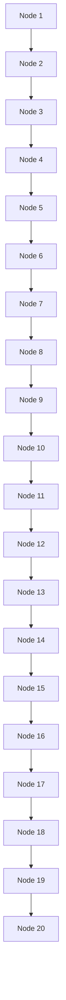

## Taylor & Francis

Taylor & Francis Group

http://taylorandfrancis.com

# Probability and counting

Luck. Coincidence. Randomness. Uncertainty. Risk. Doubt. Fortune. Chance. You’ve probably heard these words countless times, but chances are that they were used in a vague, casual way. Unfortunately, despite its ubiquity in science and everyday life, probability can be deeply counterintuitive. If we rely on intuitions of doubtful validity, we run a serious risk of making inaccurate predictions or overconfident decisions. The goal of this book is to introduce probability as a logical framework for quantifying uncertainty and randomness in a principled way. We’ll also aim to strengthen intuition, both when our initial guesses coincide with logical reasoning and when we’re not so lucky.

## 1.1 Why study probability?

Mathematics is the logic of certainty; probability is the logic of uncertainty. Probability is extremely useful in a wide variety of fields, since it provides tools for understanding and explaining variation, separating signal from noise, and modeling complex phenomena. To give just a small sample from a continually growing list of applications:

1. Statistics: Probability is the foundation and language for statistics, enabling many powerful methods for using data to learn about the world.
2. Physics: Einstein famously said “God does not play dice with the universe”, but current understanding of quantum physics heavily involves probability at the most fundamental level of nature. Statistical mechanics is another major branch of physics that is built on probability.
3. Biology: Genetics is deeply intertwined with probability, both in the inheritance of genes and in modeling random mutations.
4. Computer science: Randomized algorithms make random choices while they are run, and in many important applications they are simpler and more efficient than any currently known deterministic alternatives. Probability also plays an essential role in studying the performance of algorithms, and in machine learning and artificial intelligence.

5. Meteorology: Weather forecasts are (or should be) computed and expressed in terms of probability.

6. Gambling: Many of the earliest investigations of probability were aimed at answering questions about gambling and games of chance.

7. Finance: At the risk of redundancy with the previous example, it should be pointed out that probability is central in quantitative finance. Modeling stock prices over time and determining “fair” prices for financial instruments are based heavily on probability.

8. Political science: In recent years, political science has become more and more quantitative and statistical, with applications such as analyzing surveys of public opinion, assessing gerrymandering, and predicting elections.

9. Medicine: The development of randomized clinical trials, in which patients are randomly assigned to receive treatment or placebo, has transformed medical research in recent years. As the biostatistician David Harrington remarked, “Some have conjectured that it could be the most significant advance in scientific medicine in the twentieth century. . . . In one of the delightful ironies of modern science, the randomized trial ‘adjusts’ for both observed and unobserved heterogeneity in a controlled experiment by introducing chance variation into the study design.” [16]

10. Life: Life is uncertain, and probability is the logic of uncertainty. While it isn’t practical to carry out a formal probability calculation for every decision made in life, thinking hard about probability can help us avert some common fallacies, shed light on coincidences, and make better predictions.

Probability provides procedures for principled problem-solving, but it can also produce pitfalls and paradoxes. For example, we’ll see in this chapter that even Gottfried Wilhelm von Leibniz and Sir Isaac Newton, the two people who independently discovered calculus in the 17th century, were not immune to basic errors in probability. Throughout this book, we will use the following strategies to help avoid potential pitfalls.

1. Simulation: A beautiful aspect of probability is that it is often possible to study problems via simulation. Rather than endlessly debating an answer with someone who disagrees with you, you can run a simulation and see empirically who is right. Each chapter in this book ends with a section that gives examples of how to do calculations and simulations in R, a free statistical computing environment.

2. Biohazards: Studying common mistakes is important for gaining a stronger understanding of what is and is not valid reasoning in probability. In this book, common mistakes are called biohazards and are denoted by h (since making such mistakes can be hazardous to one’s health!).

3. Sanity checks: After solving a problem one way, we will often try to solve the same problem in a different way or to examine whether our answer makes sense in simple and extreme cases.

## 1.2 Sample spaces and Pebble World

The mathematical framework for probability is built around sets. Imagine that an experiment is performed, resulting in one out of a set of possible outcomes. Before the experiment is performed, it is unknown which outcome will be the result; after, the result “crystallizes” into the actual outcome.

Definition 1.2.1 (Sample space and event). The sample space S of an experiment is the set of all possible outcomes of the experiment. An event A is a subset of the sample space S, and we say that A occurred if the actual outcome is in A.

text_image

A
B

## FIGURE 1.1

A sample space as Pebble World, with two events A and B spotlighted.

The sample space of an experiment can be finite, countably infinite, or uncountably infinite (see Section A.1.5 of the math appendix for an explanation of countable and uncountable sets). When the sample space is finite, we can visualize it as Pebble World, as shown in Figure 1.1. Each pebble represents an outcome, and an event is a set of pebbles.

Performing the experiment amounts to randomly selecting one pebble. If all the pebbles are of the same mass, all the pebbles are equally likely to be chosen. This special case is the topic of the next two sections. In Section 1.6, we give a general definition of probability that allows the pebbles to differ in mass.

Set theory is very useful in probability, since it provides a rich language for expressing and working with events; Section A.1 of the math appendix provides a review of set theory. Set operations, especially unions, intersections, and complements, make it easy to build new events in terms of already-defined events. These concepts also let us express an event in more than one way; often, one expression for an event is much easier to work with than another expression for the same event.

For example, let S be the sample space of an experiment and let A, $B \subseteq S$ be events. Then the union $A \cup B$ is the event that occurs if and only if at least one of A, B occurs, the intersection $A \cap B$ is the event that occurs if and only if both A and B occur, and the complement $A ^ { c }$ is the event that occurs if and only if A does not occur. We also have De Morgan’s laws:

$$
(A \cup B) ^ {c} = A ^ {c} \cap B ^ {c} \text {and} (A \cap B) ^ {c} = A ^ {c} \cup B ^ {c},
$$

since saying that it is not the case that at least one of A and B occur is the same as saying that A does not occur and B does not occur, and saying that it is not the case that both occur is the same as saying that at least one does not occur. Analogous results hold for unions and intersections of more than two events.

In the example shown in Figure 1.1, A is a set of 5 pebbles, B is a set of 4 pebbles, $A \cup B$ consists of the 8 pebbles in A or B (including the pebble that is in both), $A \cap B$ consists of the pebble that is in both A and $B ,$ and $A ^ { c }$ consists of the 4 pebbles that are not in A.

The notion of sample space is very general and abstract, so it is important to have some concrete examples in mind.

Example 1.2.2 (Coin flips). A coin is flipped 10 times. Writing Heads as H and Tails as $T ,$ a possible outcome (pebble) is HHHTHHT T HT, and the sample space is the set of all possible strings of length 10 of H’s and $T ^ { \prime } \mathrm { s }$ . We can (and will) encode H as 1 and $T$ as 0, so that an outcome is a sequence $( s _ { 1 } , \ldots , s _ { 1 0 } )$ with $s _ { j } \in \{ 0 , 1 \}$ and the sample space is the set of all such sequences. Now let’s look at some events:

1. Let $A _ { 1 }$ be the event that the first $\mathrm { f l i p }$ is Heads. As a set,

$$
A _ {1} = \{(1, s _ {2}, \dots , s _ {1 0}): s _ {j} \in \{0, 1 \} \text {for} 2 \leq j \leq 1 0 \}.
$$

This is a subset of the sample space, so it is indeed an event; saying that $A _ { 1 }$ occurs is the same thing as saying that the first flip is Heads. Similarly, let $A _ { j }$ be the event that the jth flip is Heads for $j = 2 , 3 , \ldots , 1 0$

2. Let B be the event that at least one flip was Heads. As a set,

$$
B = \bigcup_ {j = 1} ^ {1 0} A _ {j}.
$$

3. Let $C$ be the event that all the flips were Heads. As a set,

$$
C = \bigcap_ {j = 1} ^ {1 0} A _ {j}.
$$

4. Let D be the event that there were at least two consecutive Heads. As a set,

$$
D = \bigcup_ {j = 1} ^ {9} (A _ {j} \cap A _ {j + 1}).
$$

Example 1.2.3 (Pick a card, any card). Pick a card from a standard deck of 52 cards. The sample space S is the set of all 52 cards (so there are 52 pebbles, one for each card). Consider the following four events:

• A: card is an ace.
• B: card has a black suit.
• D: card is a diamond.
• H: card is a heart.

As a set, H consists of 13 cards:

{Ace of Hearts, Two of Hearts, . . . , King of Hearts}.

We can create various other events in terms of the events A, B, D, and H. Unions, intersections, and complements are especially useful for this. For example:

$A \cap H$ is the event that the card is the Ace of Hearts.
$A \cap B$ is the event {Ace of Spades, Ace of Clubs}.
$A \cup D \cup H$ is the event that the card is red or an ace.
$( A \cup B ) ^ { c } = A ^ { c } \cap B ^ { c }$ is the event that the card is a red non-ace.

Also, note that $( D \cup H ) ^ { c } = D ^ { c } \cap H ^ { c } = B ,$ so B can be expressed in terms of D and H. On the other hand, the event that the card is a spade can’t be written in terms of A, B, D, H since none of them are fine-grained enough to be able to distinguish between spades and clubs.

There are many other events that could be defined using this sample space. In fact, the counting methods introduced later in this chapter show that there are $2 ^ { 5 2 } \approx 4 . 5 \times 1 0 ^ { 1 5 }$ events in this problem, even though there are only 52 pebbles.

What if the card drawn were a joker? That would indicate that we had the wrong sample space; we are assuming that the outcome of the experiment is guaranteed to be an element of S. 

As the preceding examples demonstrate, events can be described in English or in set notation. Sometimes the English description is easier to interpret while the set notation is easier to manipulate. Let S be a sample space and $s _ { \mathrm { a c t u a l } }$ be the actual outcome of the experiment (the pebble that ends up getting chosen when the experiment is performed). A mini-dictionary for converting between English and sets is given on the next page.

<table><tr><td>English</td><td>Sets</td></tr><tr><td colspan="2">Events and occurrences</td></tr><tr><td>sample space</td><td>S</td></tr><tr><td>s is a possible outcome</td><td> $s \in S$ </td></tr><tr><td>A is an event</td><td> $A \subseteq S$ </td></tr><tr><td>A occurred</td><td> $s_{\text{actual}} \in A$ </td></tr><tr><td>something must happen</td><td> $s_{\text{actual}} \in S$ </td></tr><tr><td colspan="2">New events from old events</td></tr><tr><td>A or B (inclusive)</td><td> $A \cup B$ </td></tr><tr><td>A and B</td><td> $A \cap B$ </td></tr><tr><td>not A</td><td> $A^{c}$ </td></tr><tr><td>A or B, but not both</td><td> $(A \cap B^{c}) \cup (A^{c} \cap B)$ </td></tr><tr><td>at least one of  $A_{1}, \ldots, A_{n}$ </td><td> $A_{1} \cup \cdots \cup A_{n}$ </td></tr><tr><td>all of  $A_{1}, \ldots, A_{n}$ </td><td> $A_{1} \cap \cdots \cap A_{n}$ </td></tr><tr><td colspan="2">Relationships between events</td></tr><tr><td>A implies B</td><td> $A \subseteq B$ </td></tr><tr><td>A and B are mutually exclusive</td><td> $A \cap B = \emptyset$ </td></tr><tr><td> $A_{1}, \ldots, A_{n}$  are a partition of S</td><td> $A_{1} \cup \cdots \cup A_{n} = S, A_{i} \cap A_{j} = \emptyset$  for  $i \neq j$ </td></tr></table>

## 1.3 Naive definition of probability

Historically, the earliest definition of the probability of an event was to count the number of ways the event could happen and divide by the total number of possible outcomes for the experiment. We call this the naive definition since it is restrictive and relies on strong assumptions; nevertheless, it is important to understand, and useful when not misused.

Definition 1.3.1 (Naive definition of probability). Let A be an event for an experiment with a finite sample space S. The naive probability of A is

$$
P _ {\mathrm{naive}} (A) = \frac {| A |}{| S |} = \frac {\text {number of outcomes favorable to} A}{\text {total number of outcomes in} S}.
$$

(We use $| A |$ to denote the size of $A ;$ see Section A.1.5 of the math appendix.)

In terms of Pebble World, the naive definition just says that the probability of A is the fraction of pebbles that are in A. For example, in Figure 1.1 it says

$$
P _ {\mathrm{naive}} (A) = \frac {5}{9}, P _ {\mathrm{naive}} (B) = \frac {4}{9}, P _ {\mathrm{naive}} (A \cup B) = \frac {8}{9}, P _ {\mathrm{naive}} (A \cap B) = \frac {1}{9}.
$$

For the complements of the events just considered,

$$
P _ {\text {naive}} (A ^ {c}) = \frac {4}{9}, P _ {\text {naive}} (B ^ {c}) = \frac {5}{9}, P _ {\text {naive}} ((A \cup B) ^ {c}) = \frac {1}{9}, P _ {\text {naive}} ((A \cap B) ^ {c}) = \frac {8}{9}.
$$

In general,

$$
P _ {\text {naive}} (A ^ {c}) = \frac {| A ^ {c} |}{| S |} = \frac {| S | - | A |}{| S |} = 1 - \frac {| A |}{| S |} = 1 - P _ {\text {naive}} (A).
$$

In Section 1.6, we will see that this result about complements always holds for probability, even when we go beyond the naive definition. A good strategy when trying to find the probability of an event is to start by thinking about whether it will be easier to find the probability of the event or the probability of its complement. De Morgan’s laws are especially useful in this context, since it may be easier to work with an intersection than a union, or vice versa.

The naive definition is very restrictive in that it requires S to be finite, with equal mass for each pebble. It has often been misapplied by people who assume equally likely outcomes without justification and make arguments to the effect of “either it will happen or it won’t, and we don’t know which, so it’s $50 - 50$ . In addition to sometimes giving absurd probabilities, this type of reasoning isn’t even internally consistent. For example, it would say that the probability of life on Mars is $1 / 2$ (“either there is or there isn’t life there”), but it would also say that the probability of intelligent life on Mars is 1/2, and it is clear intuitively—and by the properties of probability developed in Section 1.6—that the latter should have strictly lower probability than the former. But there are several important types of problems where the naive definition is applicable:

• when there is symmetry in the problem that makes outcomes equally likely. It is common to assume that a coin has a 50% chance of landing Heads when tossed, due to the physical symmetry of the coin.1 For a standard, well-shuffled deck of cards, it is reasonable to assume that all orders are equally likely. There aren’t certain overeager cards that especially like to be near the top of the deck; any particular location in the deck is equally likely to house any of the 52 cards.
• when the outcomes are equally likely by design. For example, consider conducting a survey of n people in a population of N people. A common goal is to obtain a simple random sample, which means that the n people are chosen randomly with all subsets of size n being equally likely. If successful, this ensures that the naive definition is applicable, but in practice this may be hard to accomplish because of various complications, such as not having a complete, accurate list of contact information for everyone in the population.

<small>1See Diaconis, Holmes, and Montgomery [7] for a physical argument that the chance of a tossed coin coming up the way it started is about 0.51 (close to but slightly more than 1/2), and Gelman and Nolan [11] for an explanation of why the probability of Heads is close to 1/2 even for a coin that is manufactured to have different weights on the two sides (for standard coin-tossing; allowing the coin to spin is a different matter).</small>

• when the naive definition serves as a useful null model. In this setting, we assume that the naive definition applies just to see what predictions it would yield, and then we can compare observed data with predicted values to assess whether the hypothesis of equally likely outcomes is tenable.

## 1.4 How to count

Calculating the naive probability of an event A involves counting the number of pebbles in A and the number of pebbles in the sample space S. Often the sets we need to count are extremely large. This section introduces some fundamental methods for counting; further methods can be found in books on combinatorics, the branch of mathematics that studies counting.

## 1.4.1 Multiplication rule

In some problems, we can directly count the number of possibilities using a basic but versatile principle called the multiplication rule. We’ll see that the multiplication rule leads naturally to counting rules for sampling with replacement and sampling without replacement, two scenarios that often arise in probability and statistics.

Theorem 1.4.1 (Multiplication rule). Consider a compound experiment consisting of two sub-experiments, Experiment A and Experiment B. Suppose that Experiment A has a possible outcomes, and for each of those outcomes Experiment B has b possible outcomes. Then the compound experiment has ab possible outcomes.

To see why the multiplication rule is true, imagine a tree diagram as in Figure 1.2. Let the tree branch a ways according to the possibilities for Experiment A, and for each of those branches create b further branches for Experiment B. Overall, there are $\underbrace{b + b + \cdots + b}_{a} = ab$ possibilities.

h 1.4.2. It is often easier to think about the experiments as being in chronological order, but there is no requirement in the multiplication rule that Experiment A has to be performed before Experiment B.

Example 1.4.3 (Runners). Suppose that 10 people are running a race. Assume that ties are not possible and that all 10 will complete the race, so there will be welldefined first place, second place, and third place winners. How many possibilities are there for the first, second, and third place winners?

Solution: There are 10 possibilities for who gets first place, then once that is fixed there are 9 possibilities for who gets second place, and once these are both fixed

flowchart

## FIGURE 1.2

Tree diagram illustrating the multiplication rule. If Experiment A has 3 possible outcomes, for each of which Experiment B has 4 possible outcomes, then overall there are $3 \cdot 4 = 1 2$ possible outcomes.

there are 8 possibilities for third place. So by the multiplication rule, there are 10 · 9 · 8 = 720 possibilities.

We did not have to consider the first place winner first. We could just as well have said that there are 10 possibilities for who got third place, then once that is fixed there are 9 possibilities for second place, and once those are both fixed there are 8 possibilities for first place. Or imagine that there are 3 platforms, which the first, second, and third place runners will stand on after the race. The platforms are gold, silver, and bronze, allocated to the first, second, and third place runners, respectively. Again there are $1 0   \cdot   9   \cdot   8   =   7 2 0$ possibilities for how the platforms will be occupied after the race, and there is no reason that the platforms must be considered in the order (gold, silver, bronze). 

Example 1.4.4 (Chessboard). How many squares are there in an $8 \times 8$ chessboard, as in Figure 1.3? Even the name $^ \mathrm { ~  ~ } { 8 \times 8 }$ chessboard” makes this easy: there are $8 \cdot 8 = 6 4$ squares on the board. The grid structure makes this clear, but we can also think of this as an example of the multiplication rule: to specify a square, we can specify which row and which column it is in. There are 8 choices of row, for each of which there are 8 choices of column.

Furthermore, we can see without doing any calculations that half the squares are white and half are black. Imagine rotating the chessboard 90 degrees clockwise. Then all the positions that had a white square now contain a black square, and vice versa, so the number of white squares must equal the number of black squares. We

## FIGURE 1.3

An 8 × 8 chessboard (left) and a crossword puzzle grid (right). The chessboard has 8 · 8 = 64 squares, whereas counting the number of white squares in the crossword puzzle grid requires more work.

can also count the number of white squares using the multiplication rule: in each of the 8 rows there are 4 white squares, giving a total of 8 · 4 = 32 white squares.

In contrast, it would require more effort to count the number of white squares in the crossword puzzle grid shown in Figure 1.3. The multiplication rule does not apply, since different rows sometimes have different numbers of white squares. 

Example 1.4.5 (Ice cream cones). Suppose you are buying an ice cream cone. You can choose whether to have a cake cone or a waffle cone, and whether to have chocolate, vanilla, or strawberry as your flavor. This decision process can be visualized with a tree diagram, as in Figure 1.4.

## FIGURE 1.4

Tree diagram for choosing an ice cream cone. Regardless of whether the type of cone or the flavor is chosen first, there are 2 · 3 = 3 · 2 = 6 possibilities.

By the multiplication rule, there are $2 \cdot 3 = 6$ possibilities. This is a very simple example, but is worth thinking through in detail as a foundation for thinking about and visualizing more complicated examples. Soon we will encounter examples where drawing the tree in a legible size would take up more space than exists in the known universe, yet where conceptually we can still think in terms of the ice cream example. Some things to note:

1. It doesn’t matter whether you choose the type of cone first $( \mathrm { ` T d }$ like a waffle cone with chocolate ice cream”) or the flavor first (“I’d like chocolate ice cream on a waffle cone”). Either way, there are $2 \cdot 3 = 3 \cdot 2 = 6$ possibilities.

2. It doesn’t matter whether the same flavors are available on a cake cone as on a waffle cone. What matters is that there are exactly 3 flavor choices for each cone choice. If for some strange reason it were forbidden to have chocolate ice cream on a waffle cone, with no substitute flavor available (aside from vanilla and strawberry), there would be $3 + 2 = 5$ possibilities and the multiplication rule wouldn’t apply. In larger examples, such complications could make counting the number of possibilities vastly more difficult.

Now suppose you buy two ice cream cones on a certain day, one in the afternoon and the other in the evening. Write, for example, (cakeC, waffleV) to mean a cake cone with chocolate in the afternoon, followed by a waffle cone with vanilla in the evening. By the multiplication rule, there are $6 ^ { 2 } = 3 6$ possibilities in your delicious compound experiment.

But what if you’re only interested in what kinds of ice cream cones you had that day, not the order in which you had them, so you don’t want to distinguish, for example, between (cakeC, waffleV) and (waffleV, cakeC)? Are there now $3 6 / 2 = 1 8$ possibilities? No, since possibilities like (cakeC, cakeC) were already only listed once each. There are $6 \cdot 5 = 3 0$ ordered possibilities $( x , y )$ with $x \neq y ,$ which turn into 15 possibilities if we treat $( x , y )$ as equivalent to $( y , x )$ , plus 6 possibilities of the form $( x , x )$ , giving a total of 21 possibilities. Note that if the 36 original ordered pairs $( x , y )$ are equally likely, then the 21 possibilities here are not equally likely. 

Example 1.4.6 (Subsets). A set with n elements has $2 ^ { n }$ subsets, including the empty set ∅ and the set itself. This follows from the multiplication rule since for each element, we can choose whether to include it or exclude it. For example, the set $\{ 1 , 2 , 3 \}$ has the 8 subsets $\emptyset , \{ 1 \} , \{ 2 \} , \{ 3 \} , \{ 1 , 2 \} , \{ 1 , 3 \} , \{ 2 , 3 \} , \{ 1 , 2 , 3 \}$ . This result explains why in Example 1.2.3 there are $2 ^ { 5 2 }$ events that can be defined. 

We can use the multiplication rule to arrive at formulas for sampling with and without replacement. Many experiments in probability and statistics can be interpreted in one of these two contexts, so it is appealing that both formulas follow directly from the same basic counting principle.

Theorem 1.4.7 (Sampling with replacement). Consider n objects and making k choices from them, one at a time with replacement (i.e., choosing a certain object does not preclude it from being chosen again). Then there are $n ^ { k }$ possible outcomes (where order matters, in the sense that, e.g., choosing object 3 and then object 7 is counted as a different outcome than choosing object 7 and then object 3.)

For example, imagine a jar with n balls, labeled from 1 to n. We sample balls one at a time with replacement, meaning that each time a ball is chosen, it is returned to the jar. Each sampled ball is a sub-experiment with n possible outcomes, and there are k sub-experiments. Thus, by the multiplication rule there are $n ^ { k }$ ways to obtain a sample of size k.

Theorem 1.4.8 (Sampling without replacement). Consider n objects and making k choices from them, one at a time without replacement (i.e., choosing a certain object precludes it from being chosen again). Then there are $n ( n - 1 ) \cdot \cdot \cdot ( n - k + 1 )$ possible outcomes for $1 \leq k \leq n$ , and 0 possibilities for $k > n$ (where order matters). By convention, $n ( n - 1 ) \cdots ( n - k + 1 ) = n { \mathrm { ~ f o r ~ } } k = 1$

This result also follows directly from the multiplication rule: each sampled ball is again a sub-experiment, and the number of possible outcomes decreases by 1 each time. Note that for sampling k out of n objects without replacement, we need $k \leq n$ whereas in sampling with replacement the objects are inexhaustible.

Example 1.4.9 (Permutations and factorials). A permutation of $1 , 2 , \ldots , n$ is an arrangement of them in some order, e.g., 3, 5, 1, 2, 4 is a permutation of 1, 2, 3, 4, 5. By Theorem 1.4.8 with $k = n$ , there are n! permutations of 1, $2 , \ldots , n$ . For example, there are n! ways in which n people can line up for ice cream. (Recall that n! is $n(n - 1)(n - 2) \cdots 1$ for any positive integer n, and 0! = 1.) 

Theorems 1.4.7 and 1.4.8 are theorems about counting, but when the naive definition applies, we can use them to calculate probabilities. This brings us to our next example, a famous problem in probability called the birthday problem. The solution incorporates both sampling with replacement and sampling without replacement.

Example 1.4.10 (Birthday problem). There are k people in a room. Assume each person’s birthday is equally likely to be any of the 365 days of the year (we exclude February 29), and that people’s birthdays are independent (we will define independence formally later, but intuitively it means that knowing some people’s birthdays gives us no information about other people’s birthdays; this would not hold if, e.g., we knew that two of the people were twins). What is the probability that at least one pair of people in the group have the same birthday?

## Solution:

There are $3 6 5 ^ { k }$ ways to assign birthdays to the people in the room, since we can imagine the 365 days of the year being sampled k times, with replacement. By assumption, all of these possibilities are equally likely, so the naive definition of probability applies.

Used directly, the naive definition says we just need to count the number of ways to assign birthdays to k people such that there are two people who share a birthday.

But this counting problem is hard, since it could be Emma and Steve who share a birthday, or Steve and Naomi, or all three of them, or the three of them could share a birthday while two others in the group share a different birthday, or various other possibilities.

Instead, let’s count the complement: the number of ways to assign birthdays to k people such that no two people share a birthday. This amounts to sampling the 365 days of the year without replacement, so the number of possibilities is $3 6 5 \cdot 3 6 4 \cdot 3 6 3 \cdots ( 3 6 5 - k + 1 )$ for $k \leq 3 6 5$ . Therefore the probability of no birthday matches in a group of k people is

$$
P (\text {no birthday match}) = \frac {3 6 5 \cdot 3 6 4 \cdots (3 6 5 - k + 1)}{3 6 5 ^ {k}},
$$

and the probability of at least one birthday match is

$$
P (\text {at least 1 birthday match}) = 1 - \frac {3 6 5 \cdot 3 6 4 \cdots (3 6 5 - k + 1)}{3 6 5 ^ {k}}.
$$

Figure 1.5 plots the probability of at least one birthday match as a function of k. The first value of k for which the probability of a match exceeds 0.5 is $k = 2 3$ . Thus, in a group of 23 people, there is a better than 50% chance that there is at least one birthday match. At $k = 5 7$ , the probability of a match already exceeds 99%.

line

| k | Probability of birthday match |
| --- | --- |
| 0 | 0 |
| ~2 | ~0.01 |
| ~4 | ~0.03 |
| ~6 | ~0.07 |
| ~8 | ~0.12 |
| ~10 | ~0.18 |
| ~12 | ~0.25 |
| ~14 | ~0.32 |
| ~16 | ~0.39 |
| ~18 | ~0.45 |
| ~20 | ~0.50 |
| ~22 | ~0.55 |
| ~24 | ~0.60 |
| ~26 | ~0.65 |
| ~28 | ~0.70 |
| ~30 | ~0.75 |
| ~32 | ~0.79 |
| ~34 | ~0.83 |
| ~36 | ~0.86 |
| ~38 | ~0.89 |
| ~40 | ~0.91 |
| ~42 | ~0.93 |
| ~44 | ~0.94 |
| ~46 | ~0.95 |
| ~48 | ~0.96 |
| ~50 | ~0.97 |
| ~52 | ~0.97 |
| ~54 | ~0.98 |
| ~56 | ~0.98 |
| ~58 | ~0.99 |
| ~60 | ~0.99 |
| ~62 | ~0.99 |
| ~64 | ~0.99 |
| ~66 | ~0.99 |
| ~68 | ~0.99 |
| ~70 | ~0.99 |
| ~72 | ~0.99 |
| ~74 | ~0.99 |
| ~76 | ~0.99 |
| ~78 | ~0.99 |
| ~80 | ~0.99 |
| ~82 | ~0.99 |
| ~84 | ~0.99 |
| ~86 | ~0.99 |
| ~88 | ~0.99 |
| ~90 | ~0.99 |
| ~92 | ~0.99 |
| ~94 | ~0.99 |
| ~96 | ~0.99 |
| ~98 | ~0.99 |
| 100 | 1 |

## FIGURE 1.5

Probability that in a room of k people, at least two were born on the same day. This probability first exceeds 0.5 when $k = 2 3$

Of course, for $k = 3 6 6$ we are guaranteed to have a match, but it’s surprising that even with a much smaller number of people it’s overwhelmingly likely that there is a birthday match. For a quick intuition into why it should not be so surprising, note that with 23 people there are ${ \binom { 2 3 } { 2 } }   =   2 5 3$ pairs of people, any of which could be a birthday match.

Problems 26 and 27 show that the birthday problem is much more than a fun party game, and much more than a way to build intuition about coincidences; there are also important applications in statistics and computer science. Problem 62 explores the more general setting in which the probability is not necessarily 1/365 for each day. It turns out that in the non-equal probability case, having at least one match becomes even more likely. 

h 1.4.11 (Labeling objects). Drawing a sample from a population is a very fundamental concept in statistics. It is important to think of the objects or people in the population as named or labeled. For example, if there are n balls in a jar, we can imagine that they have labels from 1 to n, even if the balls look the same to the human eye. In the birthday problem, we can give each person an ID (identification) number, rather than thinking of the people as indistinguishable particles or a faceless mob.

A related example is an instructive blunder made by Leibniz in a seemingly simple problem (see Gorroochurn [14] for discussion of this and a variety of other probability problems from a historical perspective).

Example 1.4.12 (Leibniz’s mistake). If we roll two fair dice, which is more likely: a sum of 11 or a sum of 12?

## Solution:

Label the dice A and B, and consider each die to be a sub-experiment. By the multiplication rule, there are 36 possible outcomes for ordered pairs of the form (value of A, value of B), and they are equally likely by symmetry. Of these, (5, 6) and (6, 5) are favorable to a sum of 11, while only (6, 6) is favorable to a sum of 12. Therefore a sum of 11 is twice as likely as a sum of 12; the probability is 1/18 for the former, and 1/36 for the latter.

However, Leibniz wrongly argued that a sum of 11 and a sum of 12 are equally likely, claiming that each of these sums can be attained in only one way. Here Leibniz was making the mistake of treating the two dice as indistinguishable objects, viewing (5, 6) and (6, 5) as the same outcome.

What are the antidotes to Leibniz’s mistake? First, as explained in h 1.4.11, we should label the objects in question instead of treating them as indistinguishable. If Leibniz had labeled his dice A and B, or green and orange, or left and right, he would not have made this mistake. Second, before we use counting for probability, we should ask ourselves whether the naive definition applies (see h 1.4.23 for another example showing that caution is needed before applying the naive definition). 

## 1.4.2 Adjusting for overcounting

In many counting problems, it is not easy to directly count each possibility once and only once. If, however, we are able to count each possibility exactly c times for some c, then we can adjust by dividing by c. For example, if we have exactly double-counted each possibility, we can divide by 2 to get the correct count. We call this adjusting for overcounting.

Example 1.4.13 (Committees and teams). Consider a group of four people.

(a) How many ways are there to choose a two-person committee?
(b) How many ways are there to break the people into two teams of two?

Solution:

(a) One way to count the possibilities is by listing them out: labeling the people as 1, 2, 3, 4, the possibilities are 12 , 13 , 14 , 23 24 , 34 .

Another approach is to use the multiplication rule with an adjustment for overcounting. By the multiplication rule, there are 4 ways to choose the first person on the committee and 3 ways to choose the second person on the committee, but this counts each possibility twice, since picking 1 and 2 to be on the committee is the same as picking 2 and 1 to be on the committee. Since we have overcounted by a factor of 2, the number of possibilities is $( 4 \cdot 3 ) / 2 = 6$

(b) Here are 3 ways to see that there are 3 ways to form th<u>e teams</u>. <u>Labelin</u>g the <u>people</u> as 1, 2, 3, 4, we can directly list out the possibilities: <u>12 34</u> , <u>13 24</u> , and <u>14 23</u> . Listing out all possibilities would quickly become tedious or infeasible with more people though. Another approach is to note that it suffices to specify person 1’s teammate (and then the other team is determined). A third way is to use (a) to see that there are 6 ways to choose one team. This overcounts by a factor of 2, since picking 1 and 2 to be a team is equivalent to picking 3 and 4 to be a team. So again the answer is $6 / 2 = 3$ 

A binomial coefficient counts the number of subsets of a certain size for a set, such as the number of ways to choose a committee of size k from a set of n people. Sets and subsets are by definition unordered, e.g., $\{ 3 , 1 , 4 \} = \{ 4 , 1 , 3 \}$ , so we are counting the number of ways to choose k objects out of n, without replacement and without distinguishing between the different orders in which they could be chosen.

Definition 1.4.14 (Binomial coefficient). For any nonnegative integers k and $n ,$ the binomial coefficient $\binom { n } { k }$ , read as $^ { \mathfrak { a } } n$ choose $k ^ { \flat }$ , is the number of subsets of size k for a set of size n.

For example, ${ \binom { 4 } { 2 } }   =   6 ,$ as shown in Example 1.4.13. The binomial coefficient $\binom { n } { k }$ is sometimes called a combination, but we do not use that terminology here since “combination” is such a useful general-purpose word. Algebraically, binomial coefficients can be computed as follows.

Theorem 1.4.15 (Binomial coefficient formula). For $k \leq n$ , we have

$$
\binom {n} {k} = \frac {n (n - 1) \cdots (n - k + 1)}{k !} = \frac {n !}{(n - k) ! k !}.
$$