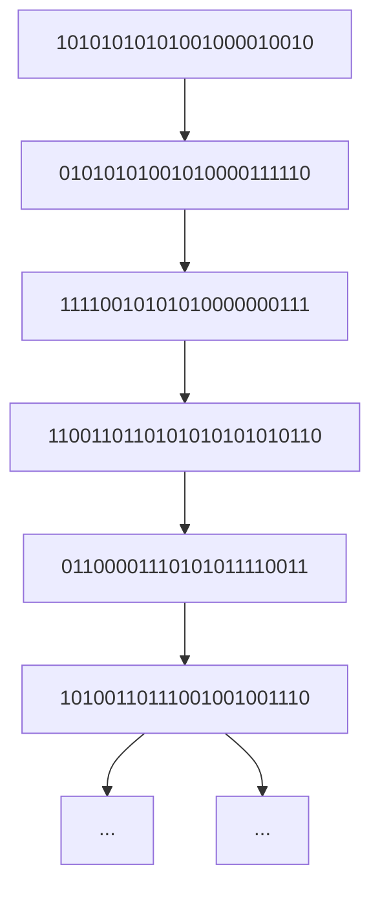
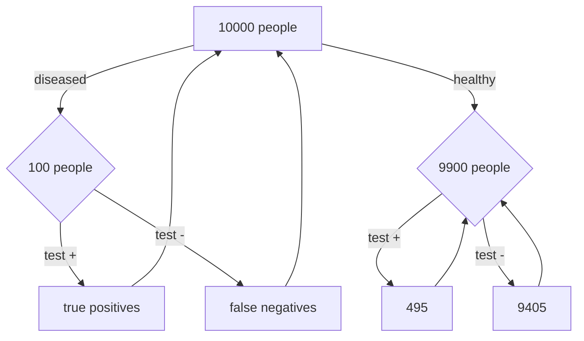

Intuition 2.2.3 (Pebble World). Consider a finite sample space, with the outcomes visualized as pebbles with total mass 1. Since A is an event, it is a set of pebbles, and likewise for B. Figure 2.1(a) shows an example.

## FIGURE 2.1

Pebble World intuition for $P ( A | B )$ . From left to right: (a) Events A and B are subsets of the sample space. (b) Because we know B occurred, get rid of the outcomes in Bc. (c) In the restricted sample space, renormalize so the total mass is still 1.

Now suppose that we learn that B occurred. In Figure 2.1(b), upon obtaining this information, we get rid of all the pebbles in $B ^ { c }$ because they are incompatible with the knowledge that B has occurred. Then $P ( A \cap B )$ is the total mass of the pebbles remaining in A. Finally, in Figure 2.1(c), we renormalize, that is, divide all the masses by a constant so that the new total mass of the remaining pebbles is 1. This is achieved by dividing by $P ( B )$ , the total mass of the pebbles in B. The updated mass of the outcomes corresponding to event A is the conditional probability $P(A|B)=P(A\cap B)/P(B)$

In this way, our probabilities have been updated in accordance with the observed evidence. Outcomes that contradict the evidence are discarded, and their mass is redistributed among the remaining outcomes, preserving the relative masses of the remaining outcomes. For example, if pebble 2 weighs twice as much as pebble 1 initially, and both are contained in B, then after conditioning on B it is still true that pebble 2 weighs twice as much as pebble 1. But if pebble 2 is not contained in B, then after conditioning on B its mass is updated to 0. 

Intuition 2.2.4 (Frequentist interpretation). Recall that the frequentist interpretation of probability is based on relative frequency over a large number of repeated trials. Imagine repeating our experiment many times, generating a long list of observed outcomes. The conditional probability of A given B can then be thought of in a natural way: it is the fraction of times that A occurs, restricting attention to the trials where B occurs.

In Figure 2.2, our experiment has outcomes which can be written as a string of 0’s and 1’s; B is the event that the first digit is 1 and A is the event that the second digit is 1. Conditioning on B, we circle all the repetitions where B occurred, and then we look at the fraction of circled repetitions in which event A also occurred.

In symbols, let $n _ { A } , n _ { B } , n _ { A B }$ be the number of occurrences of A, B, A∩B respectively in a large number n of repetitions of the experiment. The frequentist interpretation

is that

$$
P (A) \approx \frac {n _ {A}}{n}, P (B) \approx \frac {n _ {B}}{n}, P (A \cap B) \approx \frac {n _ {A B}}{n}.
$$

Then $P ( A | B )$ is interpreted as $n _ { A B } / n _ { B }$ , which equals $( n _ { A B } / n ) / ( n _ { B } / n )$ . This interpretation again translates to $P(A|B)=P(A\cap B)/P(B)$ 

flowchart

## FIGURE 2.2

Frequentist intuition for $P ( A | B )$ . The repetitions where B occurred are circled; among these, the repetitions where A occurred are highlighted in bold. $P ( A | B )$ is the long-run relative frequency of the repetitions where A occurs, within the subset of repetitions where B occurs.

For practice with applying the definition of conditional probability, let’s do some more examples. The next three examples all start with the same basic scenario of a family with two children, but subtleties arise depending on the exact assumptions and the exact information we condition on.

Example 2.2.5 (Two children). Martin Gardner posed the following puzzle in the 1950s, in his column in Scientific American.

Mr. Jones has two children. The older child is a girl. What is the probability that both children are girls?

Mr. Smith has two children. At least one of them is a boy. What is the probability that both children are boys?

At first glance this problem seems like it should be a simple application of conditional probability, but for decades there have been controversies about whether or why the two parts of the problem should have different answers, and the extent to which the problem is ambiguous. Gardner gave the answers 1/2 and $1 / 3$ to the two parts, respectively, which may seem paradoxical: why should it matter whether we learn the older child’s gender, as opposed to just learning one child’s gender?

It is important to clarify the assumptions of the problem. Several implicit assumptions are being made to obtain the answers that Gardner gave.

• It assumes that gender is binary, so that each child can be definitively categorized as a boy or a girl. In fact, many people don’t neatly fit into either of the categories “male” or “female”, and identify themselves as having a non-binary gender.
• It assumes that $P ( \mathrm { b o y } )   =   P ( \mathrm { g i r l } )$ , both for the elder child and for the younger child. In fact, in most countries slightly more boys are born than girls. For example, in the United States it is commonly estimated that 105 boys are born for every 100 girls who are born.
• It assumes that the genders of the two children are independent, i.e., knowing the elder child’s gender gives no information about the younger child’s gender, and vice versa. This would be unrealistic if, e.g., the children were identical twins.

Under these (admittedly problematic) simplifying assumptions, we can solve the problem as follows.

Solution:

With the assumptions listed above, the definition of conditional probability gives

$$
P (\text {both girls} | \text {elder is a girl}) = \frac {P (\text {both girls, elder is a girl})}{P (\text {elder is a girl})} = \frac {1 / 4}{1 / 2} = 1 / 2,
$$

$$
P (\text {both girls} | \text {at least one girl}) = \frac {P (\text {both girls, at least one girl})}{P (\text {at least one girl})} = \frac {1 / 4}{3 / 4} = 1 / 3.
$$

(We solved the second part of the problem in terms of girls rather than boys to make it a bit easier to compare the two parts of the problem.) It may seem counterintuitive that the two results are different, since there is no reason for us to care whether the elder child is a girl as opposed to the younger child. Indeed, by symmetry,

$$
P (\text {both girls|younger is a girl}) = P (\text {both girls|elder is a girl}) = 1 / 2.
$$

However, there is no such symmetry between the conditional probabilities P(both girls|elder is a girl) and P(both girls|at least one girl). Saying that the elder child is a girl designates a specific child, and then the other child (the younger child) has a 50% chance of being a girl. “At least one” does not refer to a specific child. Conditioning on a specific child being a girl knocks away 2 of the 4 “pebbles” in the sample space $\{ G G , G B , B G , B B \}$ , where, for example, GB means the elder child is a girl and the younger child is a boy. In contrast, conditioning on at least one child being a girl knocks away only BB. 

Example 2.2.6 (Random child is a girl). A family has two children. You randomly run into one of the two, and learn that she is a girl. With assumptions as in the previous example, what is the conditional probability that both are girls? Also assume that you are equally likely to run into either child, and that which one you run into has nothing to do with gender.

## Solution:

Intuitively, the answer should be $1 / 2 :$ imagine that the child we encountered is in front of us and the other is at home. Both being girls just says that the child who is at home is a girl, which seems to have nothing to do with the fact that the child in front of us is a girl. But let us check this more carefully, using the definition of conditional probability. This is also good practice with writing events in set notation.

Let $G _ { 1 } , G _ { 2 }$ , and $G _ { 3 }$ be the events that the elder, younger, and random child is a girl, respectively. By assumption, $P ( G _ { 1 } )   =   P ( G _ { 2 } )   =   P ( G _ { 3 } )   =   1 / 2$ . By the naive definition, or by independence as explained in Section 2.5, $P ( G _ { 1 } \cap G _ { 2 } ) = 1 / 4$ . Thus,

$$
P (G _ {1} \cap G _ {2} | G _ {3}) = P (G _ {1} \cap G _ {2} \cap G _ {3}) / P (G _ {3}) = (1 / 4) / (1 / 2) = 1 / 2,
$$

since $G _ { 1 } \cap G _ { 2 } \cap G _ { 3 } = G _ { 1 } \cap G _ { 2 }$ (if both children are girls, it guarantees that the random child is a girl).

Keep in mind though that in order to arrive at $1 / 2$ , an assumption was needed about how the random child was selected. In statistical language, we say that we collected a random sample; here the sample consists of one of the two children. One of the most important principles in statistics is that it is essential to think carefully about how the sample was collected, not just stare at the raw data without understanding where they came from. To take a simple extreme case, suppose that a repressive law forbids a boy from leaving the house if he has a sister. Then “the random child is a $\mathrm { g i r l } ^ { \mathfrak { s } }$ is equivalent to “at least one of the children is a $\mathrm { g i r l ^ { \prime \prime } }$ , so the problem reduces to the first part of Example 2.2.5. 

Example 2.2.7 (A girl born in winter). A family has two children. Find the probability that both children are girls, given that at least one of the two is a girl who was born in winter. In addition to the assumptions from Example 2.2.5, assume that the four seasons are equally likely and that gender is independent of season. (This means that knowing the gender gives no information about the probabilities of the seasons, and vice versa; see Section 2.5 for much more about independence.)

## Solution:

By definition of conditional probability,

$$
P (\text {both girls} | \text {at least one winter girl}) = \frac {P (\text {both girls, at least one winter girl})}{P (\text {at least one winter girl})}.
$$

Since the probability that a specific child is a winter-born girl is $1 / 8$ , the denominator equals

$$
P (\text {at least one winter girl}) = 1 - (7 / 8) ^ {2}.
$$

To compute the numerator, use the fact that “both girls, at least one winter $\mathrm { g i r l } ^ { \flat }$ is the same event as “both girls, at least one winter $\mathrm { c h i l d ^ { \prime \prime } }$ ; then use the assumption

that gender and season are independent:

$$
\begin{array}{l} P (\text { both   girls,   at   least   one   winter   girl }) = P (\text { both   girls,   at   least   one   winter   child }) \\ = (1 / 4) P (\text {at least one winter child}) \\ = (1 / 4) (1 - P (\text {both are non - winter})) \\ = (1 / 4) (1 - (3 / 4) ^ {2}). \\ \end{array}
$$

Thus,

$$
P (\text {both girls|at least one winter girl}) = \frac {(1 / 4) (1 - (3 / 4) ^ {2})}{1 - (7 / 8) ^ {2}} = \frac {7 / 6 4}{1 5 / 6 4} = 7 / 1 5.
$$

At first this result seems absurd! In Example 2.2.5, the result was that the conditional probability of both children being girls, given that at least one is a girl, is $1 / 3 ;$ why should it be any different when we learn that at least one is a winter-born girl? The point is that information about the birth season brings “at least one is a $\mathrm { g i r l ^ { \prime \prime } }$ closer to $^ { \mathrm { a } }$ specific one is a $\mathrm { g i r l } ^ { \flat }$ . Conditioning on more and more specific information brings the probability closer and closer to $1 / 2 .$

For example, conditioning on “at least one is a girl who was born on a March 31 at 8:20 pm” comes very close to specifying a child, and learning information about a specific child does not give us information about the other child. The seemingly irrelevant information such as season of birth interpolates between the two parts of Example 2.2.5. Exercise 29 generalizes this example to an arbitrary characteristic that is independent of gender. 

## 2.3 Bayes’ rule and the law of total probability

The definition of conditional probability is simple—just a ratio of two probabilities— but it has far-reaching consequences. The first consequence is obtained easily by moving the denominator in the definition to the other side of the equation.

Theorem 2.3.1 (Probability of the intersection of two events). For any events A and B with positive probabilities,

$$
P (A \cap B) = P (B) P (A | B) = P (A) P (B | A).
$$

This follows from taking the definition of $P ( A | B )$ and multiplying both sides by $P ( B )$ , and then taking the definition of $P ( B | A )$ and multiplying both sides by $P ( A )$ . At first sight this theorem may not seem very useful: it is the definition of conditional probability, just written slightly differently, and anyway it seems circular to use $P ( A | B )$ to help find $P ( A \cap B )$ when $P ( A | B )$ was defined in terms of $P ( A \cap B )$ But we will see that the theorem is in fact very useful, since it often turns out to be possible to find conditional probabilities without going back to the definition, and in such cases Theorem 2.3.1 can help us more easily find $P ( A \cap B )$

Applying Theorem 2.3.1 repeatedly, we can generalize to the intersection of n events.

Theorem 2.3.2 (Probability of the intersection of n events). For any events $A _ { 1 } , \ldots , A _ { n }$ with $P ( A _ { 1 } , A _ { 2 } , \ldots , A _ { n - 1 } ) > 0$ ,

$$
P (A _ {1}, A _ {2}, \dots , A _ {n}) = P (A _ {1}) P (A _ {2} | A _ {1}) P (A _ {3} | A _ {1}, A _ {2}) \dots P (A _ {n} | A _ {1}, \dots , A _ {n - 1}),
$$

The commas denote intersections, e.g., $P ( A _ { 3 } | A _ { 1 } , A _ { 2 } )$ is $P ( A _ { 3 } | A _ { 1 } \cap A _ { 2 } )$

In fact, this is n! theorems in one, since we can permute $A _ { 1 } , \ldots , A _ { n }$ however we want without affecting the left-hand side. Often the right-hand side will be much easier to compute for some orderings than for others. For example,

$$
P (A _ {1}, A _ {2}, A _ {3}) = P (A _ {1}) P (A _ {2} | A _ {1}) P (A _ {3} | A _ {1}, A _ {2}) = P (A _ {2}) P (A _ {3} | A _ {2}) P (A _ {1} | A _ {2}, A _ {3}),
$$

and there are 4 other expansions of this form too. It often takes practice and thought to be able to know which ordering to use.

We are now ready to introduce the two main theorems of this chapter—Bayes’ rule and the law of total probability—which will allow us to compute conditional probabilities in a wide range of problems. Bayes’ rule is an extremely famous, extremely useful result that relates $P ( A | B )$ to $P ( B | A )$

Theorem 2.3.3 (Bayes’ rule).

$$
P (A | B) = \frac {P (B | A) P (A)}{P (B)}.
$$

This follows immediately from Theorem 2.3.1, which in turn followed immediately from the definition of conditional probability. Yet Bayes’ rule has important implications and applications in probability and statistics, since it is so often necessary to find conditional probabilities, and often $P ( B | A )$ is much easier to find directly than $P ( A | B )$ (or vice versa).

Another way to write Bayes’ rule is in terms of odds rather than probability.

Definition 2.3.4 (Odds). The odds of an event A are

$$
\mathrm{odds} (A) = P (A) / P (A ^ {c}).
$$

For example, if $P ( A )   =   2 / 3$ , we say the odds in favor of A are 2 to 1. (This is sometimes written as 2 : 1, and is sometimes stated as 1 to 2 odds against A; care is needed since some sources do not explicitly state whether they are referring to odds in favor or odds against an event.) Of course we can also convert from odds back to probability:

$$
P (A) = \mathrm{odds} (A) / (1 + \mathrm{odds} (A)).
$$

By taking the Bayes’ rule expression for $P ( A | B )$ and dividing it by the Bayes’ rule expression for $P ( A ^ { c } | B )$ , we arrive at the odds form of Bayes’ rule.

Theorem 2.3.5 (Odds form of Bayes’ rule). For any events A and B with positive probabilities, the odds of A after conditioning on B are

$$
\frac {P (A | B)}{P (A ^ {c} | B)} = \frac {P (B | A)}{P (B | A ^ {c})} \frac {P (A)}{P (A ^ {c})}.
$$

In words, this says that the posterior odds $P ( A | B ) / P ( A ^ { c } | B )$ are equal to the prior odds $P ( A ) / P ( A ^ { c } )$ times the factor $P ( B | A ) / P ( B | A ^ { c } )$ , which is known in statistics as the likelihood ratio. Sometimes it is convenient to work with this form of Bayes rule to get the posterior odds, and then if desired we can convert from odds back to probability.

The law of total probability (LOTP) relates conditional probability to unconditional probability. It is essential for fulfilling the promise that conditional probability can be used to decompose complicated probability problems into simpler pieces, and it is often used in tandem with Bayes’ rule.

Theorem 2.3.6 (Law of total probability). Let $A _ { 1 } , \ldots , A _ { n }$ be a partition of the sample space $S ( \mathrm { i . e . } ,$ the $A _ { i }$ are disjoint events and their union is S), with $P ( A _ { i } ) > 0$ for all i. Then

$$
P (B) = \sum_ {i = 1} ^ {n} P (B | A _ {i}) P (A _ {i}).
$$

Proof. Since the $A _ { i }$ form a partition of S, we can decompose B as

$$
B = (B \cap A _ {1}) \cup (B \cap A _ {2}) \cup \dots \cup (B \cap A _ {n}).
$$

This is illustrated in Figure 2.3, where we have chopped B into the smaller pieces $B \cap A _ { 1 }$ through $B \cap A _ { n }$ . By the second axiom of probability, because these pieces are disjoint, we can add their probabilities to get $P ( B )$

$$
P (B) = P (B \cap A _ {1}) + P (B \cap A _ {2}) + \dots + P (B \cap A _ {n}).
$$

Now we can apply Theorem 2.3.1 to each of the $P ( B \cap A _ { i } )$

$$
P (B) = P (B | A _ {1}) P (A _ {1}) + \dots + P (B | A _ {n}) P (A _ {n}).
$$

The law of total probability tells us that to get the unconditional probability of $B ,$ we can divide the sample space into disjoint slices $A _ { i }$ , find the conditional probability of B within each of the slices, then take a weighted sum of the conditional probabilities, where the weights are the probabilities $P ( A _ { i } )$ . The choice of how to divide up the sample space is crucial: a well-chosen partition will reduce a complicated problem into simpler pieces, whereas a poorly chosen partition will only exacerbate our problems, requiring us to calculate n difficult probabilities instead of just one!

The next few examples show how we can use Bayes’ rule together with the law of total probability to update our beliefs based on observed evidence.

text_image

B∩A₁
B∩A₂
B∩A₃
B∩A₄
B
B∩A₅
B∩A₆
A₁
A₂
A₃
A₄
A₅
A₆

## FIGURE 2.3

The $A _ { i }$ partition the sample space; $P ( B )$ is equal to $\textstyle \sum _ { i } P ( B \cap A _ { i } )$

Example 2.3.7 (Random coin). You have one fair coin, and one biased coin which lands Heads with probability $3 / 4$ . You pick one of the coins at random and flip it three times. It lands Heads all three times. Given this information, what is the probability that the coin you picked is the fair one?

## Solution:

Let A be the event that the chosen coin lands Heads three times and let $F$ be the event that we picked the fair coin. We are interested in $P ( F | A )$ , but it is easier to find $P ( A | F )$ and $P ( A | F ^ { c } )$ since it helps to know which coin we have; this suggests using Bayes’ rule and the law of total probability. Doing so, we have

$$
\begin{array}{l} P (F | A) = \frac {P (A | F) P (F)}{P (A)} \\ = \frac {P (A | F) P (F)}{P (A | F) P (F) + P (A | F ^ {c}) P (F ^ {c})} \\ = \frac {(1 / 2) ^ {3} \cdot 1 / 2}{(1 / 2) ^ {3} \cdot 1 / 2 + (3 / 4) ^ {3} \cdot 1 / 2} \\ \approx 0. 2 3. \\ \end{array}
$$

Before flipping the coin, we thought we were equally likely to have picked the fair coin as the biased coin: $P ( F ) = P ( F ^ { c } ) = 1 / 2$ . Upon observing three Heads, however, it becomes more likely that we’ve chosen the biased coin than the fair coin, so $P ( F | A )$ is only about 0.23. 

h 2.3.8 (Prior vs. posterior). It would not be correct in the calculation in the above example to say after the first step, ${ } ^ { \llangle } P ( A ) = 1$ because we know A happened.” It is true that $P ( A | A ) = 1$ , but $P ( A )$ is the prior probability of A and $P ( F )$ is the prior probability of F—both are the probabilities before we observe any data in the experiment. These must not be confused with posterior probabilities conditional on the evidence A.

Example 2.3.9 (Testing for a rare disease). A patient named Fred is tested for a disease called conditionitis, a medical condition that afflicts 1% of the population. The test result is positive, i.e., the test claims that Fred has the disease. Let D be the event that Fred has the disease and T be the event that he tests positive.

Suppose that the test is $\textquotesingle 9 5 \%$ accurate”; there are different measures of the accuracy of a test, but in this problem it is assumed to mean that $P ( T | D ) \; = \; 0 . 9 5$ and $P ( T ^ { c } | D ^ { c } ) = 0 . 9 5$ . The quantity $P ( T | D )$ is known as the sensitivity or true positive rate of the test, and $P ( T ^ { c } | D ^ { c } )$ is known as the specificity or true negative rate.

Find the conditional probability that Fred has conditionitis, given the evidence provided by the test result.

Solution:

Applying Bayes’ rule and the law of total probability, we have

$$
\begin{array}{l} P (D | T) = \frac {P (T | D) P (D)}{P (T)} \\ = \frac {P (T | D) P (D)}{P (T | D) P (D) + P (T | D ^ {c}) P (D ^ {c})} \\ = \frac {0 . 9 5 \cdot 0 . 0 1}{0 . 9 5 \cdot 0 . 0 1 + 0 . 0 5 \cdot 0 . 9 9} \\ \approx 0. 1 6. \\ \end{array}
$$

So there is only a 16% chance that Fred has conditionitis, given that he tested positive, even though the test seems to be quite reliable!

Most people find it surprising to learn that the conditional probability of having the disease given a positive test result is only 16%, even though the test is 95% accurate (see Gigerenzer and Hoffrage [13]). The key to understanding this surprisingly low posterior probability of having the disease is to realize that there are two factors at play: the evidence from the test, and our prior information about the prevalence of the disease.

Although the test provides evidence in favor of disease, conditionitis is also a rare condition! The conditional probability $P ( D | T )$ reflects a balance between these two factors, appropriately weighing the rarity of the disease against the rarity of a mistaken test result.

For further intuition, consider a population of 10000 people as illustrated in Figure 2.4, where 100 have conditionitis and 9900 don’t; this corresponds to a 1% disease rate. If we tested everybody in the population, we’d expect that out of the 100 diseased individuals, 95 would test positive and 5 would test negative. Out of the 9900 healthy individuals, we’d expect $( 0 . 9 5 ) ( 9 9 0 0 ) \approx 9 4 0 5$ to test negative and 495 to test positive.

flowchart

FIGURE 2.4

Testing for a rare disease in a population of 10000 people, where the prevalence of the disease is 1% and the true positive and true negative rates are both equal to 95%. Bubbles are not to scale.

Now let’s focus in on those individuals who test positive; that is, let’s condition on a positive test result. The 95 true positives (i.e., the individuals who test positive and have the disease) are far outnumbered by the 495 false positives (i.e., the individuals who test positive despite not having the disease). So most people who test positive for the disease don’t actually have the disease! 

Example 2.3.10 (Six-fingered man). A crime has been committed in a certain country. The perpetrator is one (and only one) of the n men who live in the country. Initially, these n men are all deemed equally likely to be the perpetrator. An eyewitness then reports that the crime was committed by a man with six fingers on his right hand.

Let $p _ { 0 }$ be the probability that an innocent man has six fingers on his right hand, and $p _ { 1 }$ be the probability that the perpetrator has six fingers on his right hand, with $p _ { 0 } < p _ { 1 }$ . (We may have $p _ { 1 } < 1$ , since eyewitnesses are not 100% reliable.) Let $a = p _ { 0 } / p _ { 1 }$ and $b = ( 1 - p _ { 1 } ) / ( 1 - p _ { 0 } )$

Rugen lives in the country. He is found to have six fingers on his right hand.

(a) Given this information, what is the probability that Rugen is the perpetrator?
(b) Now suppose that all n men who live in the country have their hands checked, and Rugen is the only one with six fingers on his right hand. Given this information, what is the probability that Rugen is the perpetrator?

## Solution:

(a) Let R be the event that Rugen is guilty and M be the event that he has six fingers on his right hand. By Bayes’ rule and LOTP,

$$
P (R | M) = \frac {P (M | R) P (R)}{P (M | R) P (R) + P (M | R ^ {c}) P (R ^ {c})} = \frac {p _ {1} \cdot \frac {1}{n}}{p _ {1} \cdot \frac {1}{n} + p _ {0} \left(1 - \frac {1}{n}\right)} = \frac {1}{1 + a (n - 1)}.
$$

(b) Let N be the event that none of the men in the country other than Rugen have six fingers on their right hands. With notation as above,

$$
\begin{array}{l} P (R | M, N) = \frac {P (M , N | R) P (R)}{P (M , N | R) P (R) + P (M , N | R ^ {c}) P (R ^ {c})} \\ = \frac {p _ {1} (1 - p _ {0}) ^ {n - 1} \cdot \frac {1}{n}}{p _ {1} (1 - p _ {0}) ^ {n - 1} \cdot \frac {1}{n} + p _ {0} (1 - p _ {1}) (1 - p _ {0}) ^ {n - 2} \left(1 - \frac {1}{n}\right)} \\ = \frac {1}{1 + a b (n - 1)}. \\ \end{array}
$$



## 2.4 Conditional probabilities are probabilities

When we condition on an event $E ,$ we update our beliefs to be consistent with this knowledge, effectively putting ourselves in a universe where we know that E occurred. Within our new universe, however, the laws of probability operate just as before. Conditional probability satisfies all the properties of probability! Therefore, any of the results we have derived about probability are still valid if we replace all unconditional probabilities with probabilities conditional on $E .$ In particular:

• Conditional probabilities are between 0 and 1.
$P ( S | E ) = 1 ,   P ( \emptyset | E ) = 0 .$
• If $A _ { 1 } , A _ { 2 } , \ldots$ are disjoint, then $\textstyle P ( \cup _ { j = 1 } ^ { \infty } A _ { j } | E ) = \sum _ { j = 1 } ^ { \infty } P ( A _ { j } | E )$
$P(A^{c}|E)=1-P(A|E)$
• Inclusion-exclusion: $P ( A \cup B | E ) = P ( A | E ) + P ( B | E ) - P ( A \cap B | E ) .$

h 2.4.1. When we write $P ( A | E )$ , it does not mean that $A | E$ is an event and we’re taking its probability; $A | E$ is not an event. Rather, $P ( \cdot | E )$ is a probability function which assigns probabilities in accordance with the knowledge that E has occurred, and $P ( \cdot )$ is a different probability function which assigns probabilities without regard for whether $E$ has occurred or not. When we take an event A and plug it into the $P ( \cdot )$ function, we’ll get a number, $P ( A )$ ; when we plug it into the $P ( \cdot | E )$ function, we’ll get another number, $P ( A | E )$ , which incorporates the information (if any) provided by knowing that $E$ occurred.

To prove mathematically that conditional probabilities are probabilities, fix an event $E$ with $P ( E ) > 0$ , and for any event A, define $\tilde { P } ( A ) = P ( A | E )$ . This notation helps emphasize the fact that we are fixing $E$ and treating $P ( \cdot | E )$ as our new probability function. We just need to check the two axioms of probability. First,

$$
\tilde {P} (\emptyset) = P (\emptyset | E) = \frac {P (\emptyset \cap E)}{P (E)} = 0, \tilde {P} (S) = P (S | E) = \frac {P (S \cap E)}{P (E)} = 1.
$$

Second, if $A _ { 1 } , A _ { 2 } , \ldots$ . are disjoint events, then

$$
\tilde {P} (A _ {1} \cup A _ {2} \cup \dots) = \frac {P ((A _ {1} \cap E) \cup (A _ {2} \cap E) \cup \cdots)}{P (E)} = \frac {\sum_ {j = 1} ^ {\infty} P (A _ {j} \cap E)}{P (E)} = \sum_ {j = 1} ^ {\infty} \tilde {P} (A _ {j}).
$$

So $\tilde { P }$ satisfies the axioms of probability.

Conversely, all probabilities can be thought of as conditional probabilities: whenever we make a probability statement, there is always some background information that we are conditioning on, even if we don’t state it explicitly. Consider the rain example from the beginning of this chapter. It would be natural to base the initial probability of rain today, $P ( R )$ , on the fraction of days in the past on which it rained. But which days in the past should we look at? If it’s November 1, should we only count past rainy days in autumn, thus conditioning on the season? What about conditioning on the exact month, or the exact day? We could ask the same about location: should we look at days when it rained in our exact location, or is it enough for it to have rained somewhere nearby?

In order to determine the seemingly unconditional probability $P ( R )$ , we actually have to make decisions about what background information to condition on! These choices require careful thought and different people may come up with different prior probabilities $P ( R )$ (though everyone can agree on how to update based on new evidence).

Since all probabilities are conditional on background information, we can imagine that there is always a vertical conditioning bar, with background knowledge K to the right of the vertical bar. Then the unconditional probability $P ( A )$ is just shorthand for $P ( A | K )$ ; the background knowledge is absorbed into the letter $P$ instead of being written explicitly.

To summarize our discussion in a nutshell:

Conditional probabilities are probabilities, and all probabilities are conditional.

We now state conditional forms of Bayes’ rule and the law of total probability. These are obtained by taking the ordinary forms of Bayes’ rule and LOTP and adding $E$ to the right of the vertical bar everywhere.

Theorem 2.4.2 (Bayes’ rule with extra conditioning). Provided that $P ( A \cap E ) > 0$ and $P(B \cap E) > 0$ , we have

$$
P (A | B, E) = \frac {P (B | A , E) P (A | E)}{P (B | E)}.
$$

Theorem 2.4.3 (LOTP with extra conditioning). Let $A _ { 1 } , \ldots , A _ { n }$ be a partition of S. Provided that $P ( A _ { i } \cap E ) > 0$ for all i, we have

$$
P (B | E) = \sum_ {i = 1} ^ {n} P (B | A _ {i}, E) P (A _ {i} | E).
$$

The extra conditioning forms of Bayes’ rule and LOTP can be proved similarly to how we verified that $\tilde { P }$ satisfies the axioms of probability, but they also follow directly from the “metatheorem” that conditional probabilities are probabilities.

Example 2.4.4 (Random coin, continued). Continuing with the scenario from Example 2.3.7, suppose that we have now seen our chosen coin land Heads three times. If we toss the coin a fourth time, what is the probability that it will land Heads once more?

## Solution:

As before, let A be the event that the chosen coin lands Heads three times, and define a new event H for the chosen coin landing Heads on the fourth toss. We are interested in $P ( H | A )$ . It would be very helpful to know whether we have the fair coin. LOTP with extra conditioning gives us $P ( H | A )$ as a weighted average of $P ( H | F , A )$ and $P ( H | F ^ { c } , A )$ , and within these two conditional probabilities we do know whether we have the fair coin:

$$
\begin{array}{l} P (H | A) = P (H | F, A) P (F | A) + P (H | F ^ {c}, A) P (F ^ {c} | A) \\ \approx \frac {1}{2} \cdot 0. 2 3 + \frac {3}{4} \cdot (1 - 0. 2 3) \\ \approx 0. 6 9. \\ \end{array}
$$

The posterior probabilities $P ( F | A )$ and $P ( F ^ { c } | A )$ are from our answer to Example 2.3.7.

An equivalent way to solve this problem is to define a new probability function $\tilde { P }$ such that for any event B, $\tilde { P } ( B ) = P ( B | A )$ . This new function assigns probabilities that are updated with the knowledge that A occurred. Then by the ordinary law of total probability,

$$
\tilde {P} (H) = \tilde {P} (H | F) \tilde {P} (F) + \tilde {P} (H | F ^ {c}) \tilde {P} (F ^ {c}),
$$

which is exactly the same as our use of LOTP with extra conditioning. This once again illustrates the principle that conditional probabilities are probabilities. 

Example 2.4.5 (Unanimous agreement). The article “Why too much evidence can be a bad thing” by Lisa $\mathrm { Z y g a }$ [30] says:

Under ancient Jewish law, if a suspect on trial was unanimously found guilty by all judges, then the suspect was acquitted. This reasoning sounds counterintuitive, but the legislators of the time had noticed that unanimous agreement often indicates the presence of systemic error in the judicial process.

There are $n$ judges deciding a case. The suspect has prior probability $p$ of being guilty. Each judge votes whether to convict or acquit the suspect. With probability s, a systemic error occurs (e.g., the defense is incompetent). If a systemic error occurs, then the judges unanimously vote to convict (i.e., all n judges vote to convict).

Whether a systemic error occurs is independent of whether the suspect is guilty. Given that a systemic error doesn’t occur and that the suspect is guilty, each judge has probability $c$ of voting to convict, independently. Given that a systemic error doesn’t occur and that the suspect is not guilty, each judge has probability w of voting to convict, independently. Suppose that

$$
0 <   p <   1, 0 <   s <   1, \text {and} 0 <   w <   \frac {1}{2} <   c <   1.
$$

(a) For this part only, suppose that exactly k out of $n$ judges vote to convict, where $k < n$ . Given this information, find the probability that the suspect is guilty.

(b) Now suppose that all n judges vote to convict. Given this information, find the probability that the suspect is guilty.

(c) Is the answer to (b), viewed as a function of $n ,$ an increasing function? Give a short, intuitive explanation in words.

## Solution:

(a) Since $k < n$ , a systemic error didn’t occur. We will implicitly condition on this in this part. Let G be the event that the suspect is guilty and X be the number of judges who vote to convict. Using Bayes’ rule, LOTP, and the Binomial PMF,

$$
P (G | X = k) = \frac {P (X = k | G) P (G)}{P (X = k)} = \frac {p c ^ {k} (1 - c) ^ {n - k}}{p c ^ {k} (1 - c) ^ {n - k} + (1 - p) w ^ {k} (1 - w) ^ {n - k}}.
$$

(b) Let $U$ be the event $X = n$ and B be the event that a systemic error occurs. Then

$$
P (G | U) = \frac {P (U | G) P (G)}{P (U)} = \frac {p P (U | G)}{p P (U | G) + (1 - p) P (U | G ^ {c})}.
$$

By LOTP with extra conditioning,

$$
P (U | G) = P (U | G, B) P (B | G) + P (U | G, B ^ {c}) P (B ^ {c} | G) = s + (1 - s) c ^ {n},
$$

$$
P (U | G ^ {c}) = P (U | G ^ {c}, B) P (B | G ^ {c}) + P (U | G ^ {c}, B ^ {c}) P (B ^ {c} | G ^ {c}) = s + (1 - s) w ^ {n}.
$$

Thus,

$$
P (G | U) = \frac {p (s + (1 - s) c ^ {n})}{p (s + (1 - s) c ^ {n}) + (1 - p) (s + (1 - s) w ^ {n})}.
$$

(c) No, since a large value of n yields a high chance of systemic error, and if a systemic error occurs then the judges’ votes are uninformative about whether the suspect is guilty. The answer to (b) reverts to the prior probability p as $n \to \infty$ 

We often want to condition on more than one piece of information, and we now have several ways of doing that. For example, here are some approaches for finding $P ( A | B , C )$

1. We can think of $B , C$ as the single event B∩C and use the definition of conditional probability to get

$$
P (A | B, C) = \frac {P (A , B , C)}{P (B , C)}.
$$

This is a natural approach if it’s easiest to think about B and $C$ in tandem. We can then try to evaluate the numerator and denominator. For example, we can use LOTP in both the numerator and the denominator, or we can write the numerator as $P ( B , C | A ) P ( A )$ (which would give us a version of Bayes’ rule) and use LOTP to help with the denominator.

2. We can use Bayes’ rule with extra conditioning on $C$ to get

$$
P (A | B, C) = \frac {P (B | A , C) P (A | C)}{P (B | C)}.
$$

This is a natural approach if we want to think of everything in our problem as being conditioned on C.

3. We can use Bayes’ rule with extra conditioning on B to get

$$
P (A | B, C) = \frac {P (C | A , B) P (A | B)}{P (C | B)}.
$$

This is the same as the previous approach, except with the roles of B and C swapped. We mention it separately just to emphasize that it’s a bad idea to plug into a formula without thinking about which event should play which role.

It is both challenging and powerful that there are a variety of ways to approach this kind of conditioning problem.

## 2.5 Independence of events

We have now seen several examples where conditioning on one event changes our beliefs about the probability of another event. The situation where events provide no information about each other is called independence.

Definition 2.5.1 (Independence of two events). Events A and B are independent if

$$
P (A \cap B) = P (A) P (B).
$$

If $P(A) > 0$ and $P(B) > 0$ , then this is equivalent to

$$
P (A | B) = P (A),
$$

and also equivalent to $P(B|A)=P(B)$

In words, two events are independent if we can obtain the probability of their intersection by multiplying their individual probabilities. Alternatively, A and B are independent if learning that B occurred gives us no information that would change our probabilities for A occurring (and vice versa).

Note that independence is a symmetric relation: if A is independent of B, then B is independent of A.

h 2.5.2. Independence is completely different from disjointness. If A and B are disjoint, then $P ( A \cap B ) = 0 ,$ , so disjoint events can be independent only if $P ( A ) = 0$ or $P ( B ) = 0$ . Knowing that A occurs tells us that B definitely did not occur, so A clearly conveys information about B, meaning the two events are not independent (except if A or B already has zero probability).

Intuitively, it makes sense that if A provides no information about whether or not B occurred, then it also provides no information about whether or not $B ^ { c }$ occurred. We now prove a handy result along those lines.