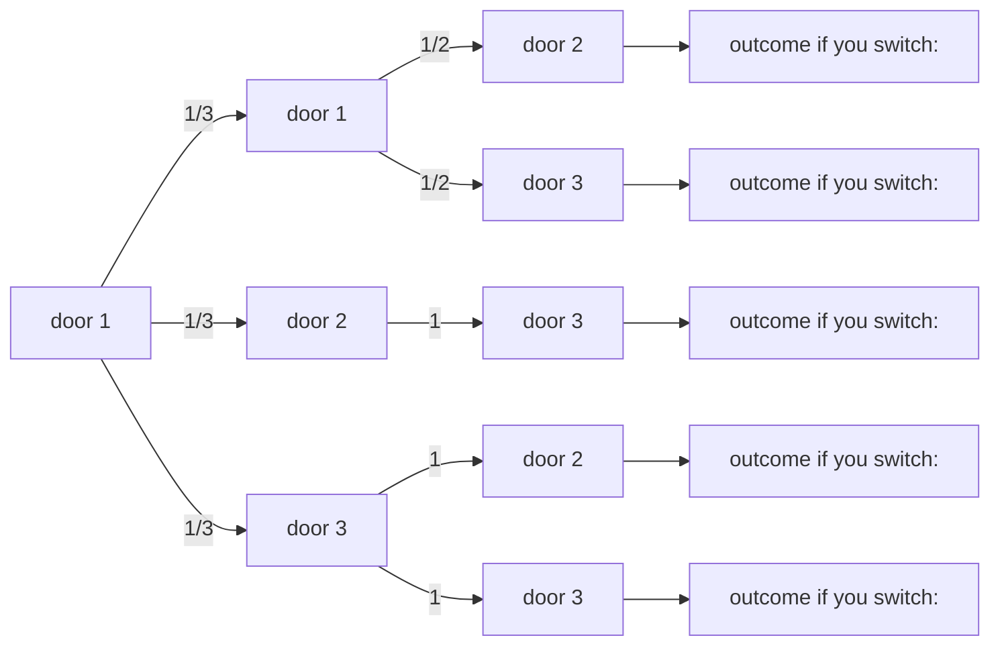

Proposition 2.5.3. If A and B are independent, then A and $B ^ { c }$ are independent, $A ^ { c }$ and B are independent, and $A ^ { c }$ and $B ^ { c }$ are independent.

Proof. Let A and B be independent. We will first show that A and $B ^ { c }$ are independent. If $P(A) = 0$ , then A is independent of every event, including $B ^ { c }$ . So assume $P ( A ) \neq 0$ . Then

$$
P (B ^ {c} | A) = 1 - P (B | A) = 1 - P (B) = P (B ^ {c}),
$$

so A and $B ^ { c }$ are independent. Swapping the roles of A and $B ,$ we have that $A ^ { c }$ and B are independent. Using the fact that A, B independent implies $A , B ^ { c }$ independent, with $A ^ { c }$ playing the role of A, we also have that $A ^ { c }$ and $B ^ { c }$ are independent. 

We also often need to talk about independence of three or more events.

Definition 2.5.4 (Independence of three events). Events A, B, and $C$ are said to be independent if all of the following equations hold:

$$
\begin{array}{l} P (A \cap B) = P (A) P (B), \\ P (A \cap C) = P (A) P (C), \\ P (B \cap C) = P (B) P (C), \\ \end{array}
$$

$$
P (A \cap B \cap C) = P (A) P (B) P (C).
$$

If the first three conditions hold, we say that A, B, and C are pairwise independent. Pairwise independence does not imply independence: it is possible that just learning about A or just learning about $B$ is of no use in predicting whether $C$ occurred, but learning that both A and B occurred could still be highly relevant for C. Here is a simple example of this distinction.

Example 2.5.5 (Pairwise independence doesn’t imply independence). Consider two fair, independent coin tosses, and let A be the event that the first is Heads, B the event that the second is Heads, and C the event that both tosses have the same result. Then A, B, and C are pairwise independent but not independent, since $P ( A \cap B \cap C ) = 1 / 4$ while $P(A)P(B)P(C)=1/8$ . The point is that just knowing about A or just knowing about B tells us nothing about $C ,$ but knowing what happened with both A and B gives us information about C (in fact, in this case it gives us perfect information about C). 

On the other hand, $P ( A   \cap   B   \cap   C )   =   P ( A ) P ( B ) P ( C )$ does not imply pairwise independence; this can be seen quickly by looking at the extreme case $P ( A ) = 0$ when the equation becomes $0 = 0$ , which tells us nothing about B and $C .$

We can define independence of any number of events similarly. Intuitively, the idea is that knowing what happened with any particular subset of the events gives us no information about what happened with the events not in that subset.

Definition 2.5.6 (Independence of many events). For n events $A _ { 1 } , A _ { 2 } , \ldots , A _ { n }$ to be independent, we require any pair to satisfy $P ( A _ { i } \cap A _ { j } ) = P ( A _ { i } ) P ( A _ { j } )$ (for $i \neq j )$ any triplet to satisfy $P ( A _ { i } \cap A _ { j } \cap A _ { k } ) \: = \: P ( A _ { i } ) P ( A _ { j } ) P ( A _ { k } )$ (for $i , j ,$ k distinct), and similarly for all quadruplets, quintuplets, and so on. This can quickly become unwieldy, but later we will discuss other ways to think about independence. For infinitely many events, we say that they are independent if every finite subset of the events is independent.

Conditional independence is defined analogously to independence.

Definition 2.5.7 (Conditional independence). Events A and B are said to be conditionally independent given E if $P(A \cap B|E) = P(A|E)P(B|E)$

h 2.5.8. It is easy to make terrible blunders stemming from confusing independence and conditional independence. Two events can be conditionally independent given $E$ , but not independent given $E ^ { c }$ . Two events can be conditionally independent given $E ,$ but not independent. Two events can be independent, but not conditionally independent given $E .$

In particular, $P(A,B)=P(A)P(B)$ does not imply $P(A,B|E)=P(A|E)P(B|E)$ we can’t just insert “given $E ^ { \flat }$ everywhere, as we did in going from LOTP to $\mathrm { L O T P }$ with extra conditioning. This is because LOTP always holds (it is a consequence of the axioms of probability), whereas $P(A,B)$ may or may not equal $P(A)P(B)$ depending on what A and B are.

The next few examples illustrate these distinctions. Great care is needed in working with conditional probabilities and conditional independence!

Example 2.5.9 (Conditional independence given E vs. given $E ^ { c } )$ . Suppose there are two types of classes: good classes and bad classes. In good classes, if you work hard, you are very likely to get an A. In bad classes, the professor randomly assigns grades to students regardless of their effort. Let G be the event that a class is good, W be the event that you work hard, and A be the event that you receive an A. Then W and A are conditionally independent given $G ^ { c }$ , but they are not conditionally independent given G. 

Example 2.5.10 (Conditional independence doesn’t imply independence). Returning once more to the scenario from Example 2.3.7, suppose we have chosen either a fair coin or a biased coin with probability $3 / 4$ of Heads, but we do not know which one we have chosen. We flip the coin a number of times. Conditional on choosing the fair coin, the coin tosses are independent, with each toss having probability $1 / 2$ of Heads. Similarly, conditional on choosing the biased coin, the tosses are independent, each with probability $3 / 4$ of Heads.

However, the coin tosses are not unconditionally independent, because if we don’t know which coin we’ve chosen, then observing the sequence of tosses gives us information about whether we have the fair coin or the biased coin in our hand. This in turn helps us to predict the outcomes of future tosses from the same coin.

To state this formally, let $F$ be the event that we’ve chosen the fair coin, and let $A _ { 1 }$ and $A _ { 2 }$ be the events that the first and second coin tosses land Heads. Conditional on $F ,   A _ { 1 }$ and $A _ { 2 }$ are independent, but $A _ { 1 }$ and $A _ { 2 }$ are not unconditionally independent because $A _ { 1 }$ provides information about $A _ { 2 }$ 

Example 2.5.11 (Independence doesn’t imply conditional independence). My friends Alice and Bob are the only two people who ever call me on the phone. Each day, they decide independently whether to call me that day. Let A be the event that Alice calls me next Friday and B be the event that Bob calls me next Friday. Assume A and B are unconditionally independent with $P ( A ) > 0$ and $P(B) > 0$

However, given that I receive exactly one call next Friday, A and B are no longer independent: the call is from Alice if and only if it is not from Bob. In other words, letting C be the event that I receive exactly one call next Friday, $P ( B | C ) > 0$ while $P ( B | A , C ) = 0$ , so A and B are not conditionally independent given C. 

Example 2.5.12. (Why is the baby crying?) A certain baby cries if and only if she is hungry, tired, or both. Let C be the event that the baby is crying, H be the event that she is hungry, and $T$ be the event that she is tired. Let $P(C)=c,P(H)=h$ and $P ( T ) = t$ , where none of $c , h , t$ are equal to 0 or 1. Let H and T be independent.

(a) Find $c _ { \gamma }$ in terms of h and t.
(b) Find $P ( H | C ) , P ( T | C )$ , and $P ( H , T | C )$
(c) Are H and T conditionally independent given C? Explain in two ways: algebraically using the quantities from (b), and with an intuitive explanation in words.

Solution:

(a) Since H and T are independent, we have

$$
P (C) = P (H \cup T) = P (H) + P (T) - P (H \cap T) = h + t - h t.
$$

(b) By Bayes’ rule,

$$
\begin{array}{l} P (H | C) = \frac {P (C | H) P (H)}{P (C)} = \frac {h}{c}, \\ P (T | C) = \frac {P (C | T) P (T)}{P (C)} = \frac {t}{c}, \\ P (H, T | C) = \frac {P (C | H , T) P (H , T)}{P (C)} = \frac {h t}{c}. \\ \end{array}
$$

(c) No, H and $T$ are not conditionally independent given $C ,$ since

$$
P (H, T | C) = \frac {h t}{c} <   \frac {h t}{c ^ {2}} = P (H | C) P (T | C).
$$

We can also see intuitively why they are not conditionally independent given C: if the baby is crying but not hungry, she must be tired. 

## 2.6 Coherency of Bayes’ rule

An important property of Bayes’ rule is that it is coherent: if we receive multiple pieces of information and wish to update our probabilities to incorporate all the information, it does not matter whether we update sequentially, taking each piece of evidence into account one at a time, or simultaneously, using all the evidence at once. Suppose, for example, that we’re conducting a weeklong experiment that yields data at the end of each day. We could use Bayes’ rule every day to update our probabilities based on the data from that day. Or we could go on vacation for the week, come back on Friday afternoon, and update using the entire week’s worth of data. Either method will give the same result.

Let’s look at a concrete application of this principle.

Example 2.6.1 (Testing for a rare disease, continued). Fred, who tested positive for conditionitis in Example 2.3.9, decides to get tested a second time. The new test is independent of the original test (given his disease status) and has the same sensitivity and specificity. Unfortunately for Fred, he tests positive a second time. Find the probability that Fred has the disease, given the evidence, in two ways: in one step, conditioning on both test results simultaneously, and in two steps, first updating the probabilities based on the first test result, and then updating again based on the second test result.

## Solution:

Let D be the event that he has the disease, $T _ { 1 }$ that the first test result is positive, and $T _ { 2 }$ that the second test result is positive. In Example 2.3.9, we used Bayes’ rule and the law of total probability to find $P ( D | T _ { 1 } )$ . Another quick solution uses the odds form of Bayes’ rule:

$$
\frac {P (D | T _ {1})}{P (D ^ {c} | T _ {1})} = \frac {P (D)}{P (D ^ {c})} \frac {P (T _ {1} | D)}{P (T _ {1} | D ^ {c})} = \frac {1}{9 9} \cdot \frac {0 . 9 5}{0 . 0 5} \approx 0. 1 9.
$$

Since $P ( D | T _ { 1 } ) / ( 1 - P ( D | T _ { 1 } ) ) = 0 . 1 9$ , we have $P ( D | T _ { 1 } ) = 0 . 1 9 / ( 1 + 0 . 1 9 ) \approx 0 . 1 6 ,$ in agreement with our answer from before. The odds form of Bayes’ rule is faster in this case because we don’t need to compute the unconditional probability $P ( T _ { 1 } )$ in the denominator of the ordinary Bayes’ rule. Now, again using the odds form of Bayes’ rule, let’s find out what happens if Fred tests positive a second time.

One-step method: Updating based on both test results at once, we have

$$
\begin{array}{l} \frac {P (D \mid T _ {1} \cap T _ {2})}{P (D ^ {c} \mid T _ {1} \cap T _ {2})} = \frac {P (D)}{P (D ^ {c})} \frac {P (T _ {1} \cap T _ {2} \mid D)}{P (T _ {1} \cap T _ {2} \mid D ^ {c})} \\ = \frac {1}{9 9} \cdot \frac {0 . 9 5 ^ {2}}{0 . 0 5 ^ {2}} = \frac {3 6 1}{9 9} \approx 3. 6 4 6, \\ \end{array}
$$

which corresponds to a probability of 0.78.

Two-step method: After the first test, the posterior odds of Fred having the disease are

$$
\frac {P (D | T _ {1})}{P (D ^ {c} | T _ {1})} = \frac {1}{9 9} \cdot \frac {0 . 9 5}{0 . 0 5} \approx 0. 1 9,
$$

from the above. These posterior odds become the new prior odds, and then updating based on the second test gives

$$
\begin{array}{l} \frac {P (D | T _ {1} \cap T _ {2})}{P (D ^ {c} | T _ {1} \cap T _ {2})} = \frac {P (D | T _ {1})}{P (D ^ {c} | T _ {1})} \frac {P (T _ {2} | D , T _ {1})}{P (T _ {2} | D ^ {c} , T _ {1})} \\ = \left(\frac {1}{9 9} \cdot \frac {0 . 9 5}{0 . 0 5}\right) \frac {0 . 9 5}{0 . 0 5} = \frac {3 6 1}{9 9} \approx 3. 6 4 6, \\ \end{array}
$$

which is the same result as above.

Note that with a second positive test result, the probability that Fred has the disease jumps from 0.16 to 0.78, making us much more confident that Fred is actually afflicted with conditionitis. The moral of the story is that getting a second opinion is a good idea! 

## 2.7 Conditioning as a problem-solving tool

Conditioning is a powerful tool for solving problems because it lets us engage in wishful thinking: when we encounter a problem that would be made easier if only we knew whether E happened or not, we can condition on $E$ and then on $E ^ { c }$ consider these possibilities separately, then combine them using LOTP.

## 2.7.1 Strategy: condition on what you wish you knew

Example 2.7.1 (Monty Hall). On the game show Let’s Make a Deal, hosted by Monty Hall, a contestant chooses one of three closed doors, two of which have a goat behind them and one of which has a car. Monty, who knows where the car is, then opens one of the two remaining doors. The door he opens always has a goat behind it (he never reveals the car!). If he has a choice, then he picks a door at random with equal probabilities. Monty then offers the contestant the option of switching to the other unopened door. If the contestant’s goal is to get the car, should she switch doors?


## Solution:

Let’s label the doors 1 through 3. Without loss of generality, we can assume the contestant picked door 1 (if she didn’t pick door 1, we could simply relabel the doors, or rewrite this solution with the door numbers permuted). Monty opens a door, revealing a goat. As the contestant decides whether or not to switch to the remaining unopened door, what does she really wish she knew? Naturally, her decision would be a lot easier if she knew where the car was! This suggests that we should condition on the location of the car. Let $C _ { i }$ be the event that the car is behind door $i ,$ for $i = 1 , 2 , 3$ . By the law of total probability,

$$
P (\text {get car}) = P (\text {get car} | C _ {1}) \cdot \frac {1}{3} + P (\text {get car} | C _ {2}) \cdot \frac {1}{3} + P (\text {get car} | C _ {3}) \cdot \frac {1}{3}.
$$

Suppose the contestant employs the switching strategy. If the car is behind door 1, then switching will fail, so $P ( \mathrm { g e t } ~ \mathrm { c a r } | C _ { 1 } ) = 0$ . If the car is behind door 2 or $3 ,$ then because Monty always reveals a goat, the remaining unopened door must contain the car, so switching will succeed. Thus,

$$
P (\text {get car}) = 0 \cdot \frac {1}{3} + 1 \cdot \frac {1}{3} + 1 \cdot \frac {1}{3} = \frac {2}{3},
$$

so the switching strategy succeeds $2 / 3$ of the time. The contestant should switch to the other door.

Figure 2.5 is a tree diagram of the argument we have just outlined: using the switching strategy, the contestant will win as long as the car is behind doors 2 or 3, which has probability $2 / 3$ . We can also give an intuitive frequentist argument in favor of switching. Imagine playing this game 1000 times. Typically, about 333 times your initial guess for the car’s location will be correct, in which case switching will fail. The other 667 or so times, you will win by switching.

There’s a subtlety though, which is that when the contestant chooses whether to switch, she also knows which door Monty opened. We showed that the unconditional probability of success is $2 / 3$ (when following the switching strategy), but let’s also show that the conditional probability of success for switching, given the information that Monty provides, is also $2 / 3$

Let $M _ { j }$ be the event that Monty opens door $j ,$ for $j = 2 , 3$ . Then

$$
P (\text {get car}) = P (\text {get car} | M _ {2}) P (M _ {2}) + P (\text {get car} | M _ {3}) P (M _ {3}),
$$


<details>
<summary>flowchart</summary>


</details>

## FIGURE 2.5

Tree diagram of Monty Hall problem. Switching gets the car $2 / 3$ of the time.

where by symmetry $P ( M _ { 2 } ) = P ( M _ { 3 } ) = 1 / 2$ and $P ( \mathrm { g e t } ~ \mathrm { c a r } | M _ { 2 } )   =   P ( \mathrm { g e t } ~ \mathrm { c a r } | M _ { 3 } )$ The symmetry here is that there is nothing in the statement of the problem that distinguishes between door 2 and door $3 ;$ in contrast, Problem 40 considers a scenario where Monty enjoys opening door 2 more than he enjoys opening door 3.

Let $x = P ( \mathrm { g e t ~ c a r } | M _ { 2 } ) = P ( \mathrm { g e t ~ c a r } | M _ { 3 } )$ . Plugging in what we know,

$$
\frac {2}{3} = P (\text {get car}) = \frac {x}{2} + \frac {x}{2} = x,
$$

as claimed.

Bayes’ rule also works nicely for finding the conditional probability of success using the switching strategy, given the evidence. Suppose that Monty opens door 2. Using the notation and results above,

$$
P (C _ {1} | M _ {2}) = \frac {P (M _ {2} | C _ {1}) P (C _ {1})}{P (M _ {2})} = \frac {(1 / 2) (1 / 3)}{1 / 2} = \frac {1}{3}.
$$

So given that Monty opens door $^ { 2 , }$ there is a $1 / 3$ chance that the contestant’s original choice of door has the car, which means that there is a $2 / 3$ chance that the switching strategy will succeed.

Many people, upon seeing this problem for the first time, argue that there is no advantage to switching: “There are two doors remaining, and one of them has the car, so the chances are $50 - 50.$ After the last chapter, we recognize that this argument misapplies the naive definition of probability. Yet the naive definition, even when inappropriate, has a powerful hold on people’s intuitions. When Marilyn vos Savant presented a correct solution to the Monty Hall problem in her column for Parade magazine in 1990, she received thousands upon thousands of letters from readers (even mathematicians) insisting that she was wrong.

To build correct intuition, let’s consider an extreme case. Suppose that there are a million doors, 999,999 of which contain goats and 1 of which has a car. After the contestant’s initial pick, Monty opens 999,998 doors with goats behind them and offers the choice to switch. In this extreme case, it becomes clear that the probabilities are not 50-50 for the two unopened doors; very few people would stubbornly stick with their original choice. The same is true for the three-door case.

Just as we had to make assumptions about how we came across the random girl in Example 2.2.6, here the $2 / 3$ success rate of the switching strategy depends on the assumptions we make about how Monty decides which door to open. In the exercises, we consider several variants and generalizations of the Monty Hall problem, some of which change the desirability of the switching strategy. 

## 2.7.2 Strategy: condition on the first step

In problems with a recursive structure, it can often be useful to condition on the first step of the experiment. The next two examples apply this strategy, which we call first-step analysis.

Example 2.7.2 (Branching process). A single amoeba, Bobo, lives in a pond. After one minute Bobo will either die, split into two amoebas, or stay the same, with equal probability, and in subsequent minutes all living amoebas will behave the same way, independently. What is the probability that the amoeba population will eventually die out?


<details>
<summary>flowchart</summary>

```mermaid
graph TD
  A[""] -->|"1/3"| B[""]
  A -->|"1/3"| C[""]
  A -->|"1/3"| D[""]
```
</details>

## Solution:

Let D be the event that the population eventually dies out; we want to find $P ( D )$ We proceed by conditioning on the outcome at the first step: let $B _ { i }$ be the event that Bobo turns into $i$ amoebas after the first minute, for $i   =   0 , 1 , 2 .$ We know $P ( D | B _ { 0 } ) = 1$ and $P ( D | B _ { 1 } ) = P ( D )$ (if Bobo stays the same, we’re back to where we started). If Bobo splits into two, then we just have two independent versions of our original problem! We need both of the offspring to eventually die out, so $P ( D | B _ { 2 } ) = P ( D ) ^ { 2 }$ . Now we have exhausted all the possible cases and can combine them with the law of total probability:

$$
\begin{array}{l} P (D) = P (D | B _ {0}) \cdot \frac {1}{3} + P (D | B _ {1}) \cdot \frac {1}{3} + P (D | B _ {2}) \cdot \frac {1}{3} \\ = 1 \cdot \frac {1}{3} + P (D) \cdot \frac {1}{3} + P (D) ^ {2} \cdot \frac {1}{3}. \\ \end{array}
$$

Solving for $P ( D )$ gives $P(D)=1;$ the amoeba population will die out with probability 1.

The strategy of first-step analysis works here because the problem is self-similar in nature: when Bobo continues as a single amoeba or splits into two, we end up with another version or another two versions of our original problem. Conditioning on the first step allows us to express $P ( D )$ in terms of itself. 

Example 2.7.3 (Gambler’s ruin). Two gamblers, A and B, make a sequence of \$1 bets. In each bet, gambler A has probability p of winning, and gambler B has probability $q = 1 - p$ of winning. Gambler A starts with i dollars and gambler B starts with N − i dollars; the total wealth between the two remains constant since every time A loses a dollar, the dollar goes to B, and vice versa.

We can visualize this game as a random walk on the integers between 0 and N, where $p$ is the probability of going to the right in a given step: imagine a person who starts at position i and, at each time step, moves one step to the right with probability p and one step to the left with probability $q = 1 - p .$ The game ends when either A or B is ruined, i.e., when the random walk reaches 0 or N. What is the probability that A wins the game (walking away with all the money)?


<details>
<summary>text_image</summary>

0 1 2 ... i - 1 i i + 1 ... N
p
q
</details>

## Solution:

We recognize that this game, like Bobo’s reproductive process, has a recursive structure: after the first step, it’s exactly the same game, except that A’s wealth is now either $i + 1 { \mathrm { ~ o r ~ } } i - 1$ . Let $p _ { i }$ be the probability that A wins the game, given that A starts with i dollars. We will use first-step analysis to solve for the $p _ { i }$ . Let W be the event that A wins the game. By LOTP, conditioning on the outcome of the first

round, we have

$$
\begin{array}{l} p _ {i} = P (W | \mathrm{A} \text {starts at} i, \text {wins round 1}) \cdot p + P (W | \mathrm{A} \text {starts at} i, \text {loses round 1}) \cdot q \\ = P (W | \text {A starts at} i + 1) \cdot p + P (W | \text {A starts at} i - 1) \cdot q \\ = p _ {i + 1} \cdot p + p _ {i - 1} \cdot q. \\ \end{array}
$$

This must be true for all i from 1 to $N   -   1$ , and we also have the boundary conditions $p _ { 0 } = 0$ and $p _ { N } = 1$ . Now we can solve this equation, called a difference equation, to obtain the $p _ { i }$ . Section A.4 of the math appendix discusses how to solve difference equations, so we will omit some of the steps here.

The characteristic equation of the difference equation is $p x ^ { 2 } - x + q = 0$ , which has roots 1 and $q / p . { \mathrm { ~ I f ~ } } p \neq 1 / 2$ , these roots are distinct, and the general solution is

$$
p _ {i} = a \cdot 1 ^ {i} + b \cdot \left(\frac {q}{p}\right) ^ {i}.
$$

Using the boundary conditions $p _ { 0 } = 0$ and $p _ { N } = 1$ , we get

$$
a = - b = \frac {1}{1 - \left(\frac {q}{p}\right) ^ {N}},
$$

and we simply plug these back in to get the specific solution. If $p = 1 / 2 ,$ the roots of the characteristic polynomial are not distinct, so the general solution is

$$
p _ {i} = a \cdot 1 ^ {i} + b \cdot i \cdot 1 ^ {i}.
$$

The boundary conditions give $a = 0$ and $b = 1 / N$

In summary, the probability of A winning with a starting wealth of i is

$$
p _ {i} = \left\{ \begin{array}{l l} \frac {1 - \left(\frac {q}{p}\right) ^ {i}}{1 - \left(\frac {q}{p}\right) ^ {N}} & \text {if} p \neq 1 / 2, \\ \frac {i}{N} & \text {if} p = 1 / 2. \end{array} \right.
$$

The $p = 1 / 2$ case is consistent with the $p \neq 1 / 2$ case, in the sense that

$$
\lim _ {p \to \frac {1}{2}} \frac {1 - (\frac {q}{p}) ^ {i}}{1 - (\frac {q}{p}) ^ {N}} = \frac {i}{N}.
$$

To see this, let $x = q / p$ and let x approach 1. By L’Hôpital’s rule,

$$
\lim _ {x \to 1} \frac {1 - x ^ {i}}{1 - x ^ {N}} = \lim _ {x \to 1} \frac {i x ^ {i - 1}}{N x ^ {N - 1}} = \frac {i}{N}.
$$

The answer for the $p   =   1 / 2$ case has a simple interpretation: A’s probability of winning equals the proportion of the wealth that A starts out with. So if $p = 1 / 2$ and A starts out with much less money than B, then A’s chance of winning the game is low. Having $p < 1 / 2$ may also make A’s chance of winning low, even if $p$ is only a little bit less than $1 / 2$ and the players start out with the same amount of money. For example, if $p = 0 . 4 9$ and each player starts out with \$100, then A has only about a $1 . 8 \%$ chance of winning the game.

We have focused on the probability of A winning the game, but what about B? Rather than starting from scratch, we can use symmetry: aside from notation, there is nothing in the description of the game to distinguish A from B. By symmetry, the probability of B winning from a starting wealth of $N - i$ is obtained by switching the roles of $q$ and $p ,$ and of i and $N - i$ . This gives

$$
P (\text {B wins} | \text {B starts at} N - i) = \left\{ \begin{array}{l l} \frac {1 - \left(\frac {p}{q}\right) ^ {N - i}}{1 - \left(\frac {p}{q}\right) ^ {N}} & \text {if} p \neq 1 / 2, \\ \frac {N - i}{N} & \text {if} p = 1 / 2. \end{array} \right.
$$

It can then be verified that for all i and all $p,   P( A wins ) + P( B wins ) = 1$ , so the game is guaranteed to end: the probability is 0 that it will oscillate forever. 

## 2.8 Pitfalls and paradoxes

The next two examples are fallacies of conditional thinking that have arisen in the legal context. The prosecutor’s fallacy is the confusion of $P ( A | B )$ with $P ( B | A )$ ; the defense attorney’s fallacy is the failure to condition on all the evidence.

h 2.8.1 (Prosecutor’s fallacy). In 1998, Sally Clark was tried for murder after two of her sons died shortly after birth. During the trial, an expert witness for the prosecution testified that the probability of a newborn dying of sudden infant death syndrome (SIDS) was $1 / 8 5 0 0$ , so the probability of two deaths due to SIDS in one family was $( 1 / \dot { 8 5 } 0 0 ) ^ { 2 }$ , or about one in 73 million. Therefore, he continued, the probability of Clark’s innocence was one in 73 million.

There are at least two major problems with this line of reasoning. First, the expert witness found the probability of the intersection of “first son dies of SIDS” and “second son dies of $\mathrm { S I D S ^ { \prime \prime } }$ by multiplying the individual event probabilities; as we know, this is only valid if deaths due to SIDS are independent within a family. This independence would not hold if genetic or other family-specific risk factors cause all newborns within certain families to be at increased risk of SIDS.

Second, the so-called expert has confused two different conditional probabilities: P(innocence|evidence) is different from P(evidence|innocence). The witness claims that the probability of observing two newborn deaths if the defendant were innocent is extremely low; that is, P(evidence|innocence) is small. What we are interested in, however, is P(innocence|evidence), the probability that the defendant is innocent given all the evidence. By Bayes’ rule,

$$
P (\text {innocence} | \text {evidence}) = \frac {P (\text {evidence} | \text {innocence}) P (\text {innocence})}{P (\text {evidence})},
$$

so to calculate the conditional probability of innocence given the evidence, we must take into account P(innocence), the prior probability of innocence. This probability is extremely high: although double deaths due to SIDS are rare, so are double infanticides! Expanding the denominator as

$$
P (\text {evidence} | \text {innocence}) P (\text {innocence}) + P (\text {evidence} | \text {guilt}) P (\text {guilt}),
$$

note that if P(guilt) is small enough so that the second term is negligible compared to the first term, then the denominator of P(innocence|evidence) is approximately equal to the numerator, making P(innocence|evidence) close to 1.

The posterior probability of innocence given the evidence depends strongly on both P(evidence|innocence), which is very low, and P(innocence), which is very high. The expert’s probability of $( 1 / 8 5 0 0 ) ^ { 2 }$ , questionable in and of itself, is only part of the equation.

Sadly, Clark was convicted of murder and sent to prison, partly based on the expert’s wrongheaded testimony, and spent over three years in jail before her conviction was overturned. The outcry over the misuse of conditional probability in the Sally Clark case led to the review of hundreds of other cases where similar faulty logic was used by the prosecution.

h 2.8.2 (Defense attorney’s fallacy). A woman has been murdered, and her husband is put on trial for this crime. Evidence comes to light that the defendant had a history of abusing his wife. The defense attorney argues that the evidence of abuse should be excluded on grounds of irrelevance, since only 1 in 10,000 men with wives they abuse subsequently murder their wives. Should the judge grant the defense attorney’s motion to bar this evidence from trial?

Suppose that the defense attorney’s 1-in-10,000 figure is correct, and further assume the following for a relevant population of husbands and wives: 1 in 10 husbands abuse their wives, 1 in 5 murdered wives were murdered by their husbands, and 50% of husbands who murder their wives previously abused them. Also, assume that if the husband of a murdered wife is not guilty of the murder, then the probability that he abused his wife reverts to the unconditional probability of abuse.

How to define the “relevant population” and how to estimate such probabilities are difficult issues. For example, should we look at citywide, statewide, national, or international statistics? How should we account for unreported abuse and unsolved murders? What if murder rates are changing over time? For this problem, assume that a reasonable choice of the relevant population has been agreed on, and that the stated probabilities are known to be correct.

Let A be the event that the husband commits abuse against his wife, and let G be the event that the husband is guilty. The defense’s argument is that $P ( G | A ) = 1 / 1 0 { , } 0 0 0 ,$ so guilt is still extremely unlikely conditional on a previous history of abuse.

However, the defense attorney fails to condition on a crucial fact: in this case, we know that the wife was murdered. Therefore, the relevant probability is not $P ( G | A )$ but $P ( G | A , M )$ , where M is the event that the wife was murdered.

Bayes’ rule with extra conditioning gives

$$
\begin{array}{l} P (G | A, M) = \frac {P (A | G , M) P (G | M)}{P (A | G , M) P (G | M) + P (A | G ^ {c} , M) P (G ^ {c} | M)} \\ = \frac {0 . 5 \cdot 0 . 2}{0 . 5 \cdot 0 . 2 + 0 . 1 \cdot 0 . 8} \\ = \frac {5}{9}. \\ \end{array}
$$

So the posterior probability of guilt, $P ( G | A , M )$ , is over 5,000 times as large as the quantity $P ( G | A )$ that the defense attorney focused on. Conditioning on the evidence of abuse increases the probability of guilt from $P ( G | M ) = 0 . 2 \; \mathrm { t o } \; P ( G | A , M ) \approx 0 . 5 6$ so the defendant’s history of abuse gives very important information, contrary to the defense attorney’s argument.

In the above calculation of $P ( G | A , M )$ , we did not use the defense attorney’s $P ( G | A )$ number anywhere; it is irrelevant to our calculation because it does not account for the fact that the wife was murdered. We must condition on all the evidence.

We end this chapter with a paradox about conditional probability and aggregation of data.

Example 2.8.3 (Simpson’s paradox). Two doctors, Dr. Hibbert and Dr. Nick, each perform two types of surgeries: heart surgery and Band-Aid removal. Each surgery can be either a success or a failure. The two doctors’ respective records are given in the following tables, and shown graphically in Figure 2.6, where white dots represent successful surgeries and black dots represent failed surgeries.

|  | Heart | Band-Aid |
| --- | --- | --- |
| Success | 70 | 10 |
| Failure | 20 | 0 |

Dr. Hibbert

|  | Heart | Band-Aid |
| --- | --- | --- |
| Success | 2 | 81 |
| Failure | 8 | 9 |

Dr. Nick

Dr. Hibbert had a higher success rate than Dr. Nick in heart surgeries: 70 out of 90 versus 2 out of 10. Dr. Hibbert also had a higher success rate in Band-Aid removal: 10 out of 10 versus 81 out of 90. But if we aggregate across the two types of surgeries to compare overall surgery success rates, Dr. Hibbert was successful in 80 out of 100 surgeries while Dr. Nick was successful in 83 out of 100 surgeries: Dr. Nick’s overall success rate is higher!


<details>
<summary>text_image</summary>

heart
band-aid
Dr. Hibbert
Dr. Nick
</details>

## FIGURE 2.6

An example of Simpson’s paradox. White dots represent successful surgeries and black dots represent failed surgeries. Dr. Hibbert is better in both types of surgery but has a lower overall success rate, because he is performing the harder type of surgery much more often than Dr. Nick is.

What’s happening is that Dr. Hibbert, presumably due to his reputation as the superior doctor, is performing a greater number of heart surgeries, which are inherently riskier than Band-Aid removals. His overall success rate is lower not because of lesser skill on any particular type of surgery, but because a larger fraction of his surgeries are risky.

Let’s use event notation to make this precise. For events A, B, and C, we say that we have a Simpson’s paradox if

$$
P (A | B, C) <   P (A | B ^ {c}, C)
$$

$$
P (A | B, C ^ {c}) <   P (A | B ^ {c}, C ^ {c}),
$$

but

$$
P (A | B) > P (A | B ^ {c}).
$$

In this case, let A be the event of a successful surgery, B be the event that Dr. Nick is the surgeon, and C be the event that the surgery is a heart surgery. The conditions for Simpson’s paradox are fulfilled because the probability of a successful surgery is lower under Dr. Nick than under Dr. Hibbert whether we condition on heart surgery or on Band-Aid removal, but the overall probability of success is higher for Dr. Nick.

The law of total probability tells us mathematically why this can happen:

$$
P (A | B) = P (A | C, B) P (C | B) + P (A | C ^ {c}, B) P (C ^ {c} | B)
$$

$$
P (A | B ^ {c}) = P (A | C, B ^ {c}) P (C | B ^ {c}) + P (A | C ^ {c}, B ^ {c}) P (C ^ {c} | B ^ {c}).
$$

The above equations express $P ( A | B )$ as a weighted average of $P ( A | C , B )$ and $P ( A | C ^ { c } , B )$ , and $P ( A | B ^ { c } )$ as a weighted average of $P ( A | C , B ^ { c } )$ and $P ( A | C ^ { c } , B ^ { c } )$ . If the corresponding weights were the same in both of these weighted averages, then Simpson’s paradox could not occur. But the weights here are different:

$$
P (C | B) <   P (C | B ^ {c}) \text {and} P (C ^ {c} | B) > P (C ^ {c} | B ^ {c}),
$$

since Dr. Nick is much less likely than Dr. Hibbert to be performing a heart surgery.

Although we have

$$
P (A | C, B) <   P (A | C, B ^ {c})
$$

and

$$
P (A | C ^ {c}, B) <   P (A | C ^ {c}, B ^ {c}),
$$

the fact that the weights are so different results in the inequality flipping when we do not condition on whether or not C occurred:

$$
P (A | B) > P (A | B ^ {c}).
$$

Numerically, the two weighted averages are

$$
P (A | B) = 0. 8 3 = (2 / 1 0) \cdot 0. 1 + (8 1 / 9 0) \cdot 0. 9
$$

$$
P (A | B ^ {c}) = 0. 8 0 = (7 0 / 9 0) \cdot 0. 9 + (1 0 / 1 0) \cdot 0. 1.
$$

The first equation (corresponding to Dr. Nick) puts much more weight on the second term (corresponding to the easier surgery) than does the second equation.

Aggregation across different types of surgeries presents a misleading picture of the doctors’ abilities because we lose the information about which doctor tends to perform which type of surgery. When we think confounding variables like surgery type could be at play, we should examine the disaggregated data to see what is really going on.

Simpson’s paradox arises in many real-world contexts. In the following examples, you should try to identify the events A, B, and C that create the paradox.

Gender discrimination in college admissions: In the 1970s, men were significantly more likely than women to be admitted for graduate study at the University of California, Berkeley, leading to charges of gender discrimination. Yet within most individual departments, women were admitted at a higher rate than men. It was found that women tended to apply to the departments with more competitive admissions, while men tended to apply to less competitive departments.
• Baseball batting averages: It is possible for player 1 to have a higher batting average than player 2 in the first half of a baseball season and a higher batting average than player 2 in the second half of the season, yet have a lower overall batting average for the entire season. It depends on how many at-bats the players have in each half of the season. (An at-bat is when it’s a player’s turn to try to hit the ball; the player’s batting average is the number of hits the player gets divided by the player’s number of at-bats.)

• Health effects of smoking: Cochran [4] found that within any age group, cigarette smokers had higher mortality rates than cigar smokers, but because cigarette smokers were on average younger than cigar smokers, overall mortality rates were lower for cigarette smokers. 

## 2.9 Recap

The conditional probability of A given B is

$$
P (A | B) = \frac {P (A \cap B)}{P (B)}.
$$

Conditional probability has exactly the same properties as probability, but $P ( \cdot | B )$ updates our uncertainty about events to reflect the observed evidence B. Events whose probabilities are unchanged after observing the evidence B are said to be independent of B. Two events can also be conditionally independent given a third event E. Conditional independence does not imply unconditional independence, nor does unconditional independence imply conditional independence.

Two important results about conditional probability are Bayes’ rule, which relates $P ( A | B )$ to $P ( B | A )$ , and the law of total probability, which allows us to get unconditional probabilities by partitioning the sample space and calculating conditional probabilities within each slice of the partition.

Bayes’ rule says that

$$
P (A | B) = \frac {P (B | A) P (A)}{P (B)},
$$

while LOTP says that

$$
P (B) = \sum_ {i = 1} ^ {n} P (B | A _ {i}) P (A _ {i}),
$$

for any partition $A _ { 1 } , \ldots , A _ { n }$ of the sample space. Bayes’ rule and LOTP are often used in tandem.

Conditioning is extremely helpful for problem-solving because it allows us to break a problem into smaller pieces, consider all possible cases separately, and then combine them. When using this strategy, we should try to condition on the information that, if known, would make the problem simpler, hence the saying condition on what you wish you knew. When a problem involves multiple stages, it can be helpful to condition on the first step to obtain a recursive relationship.

Common mistakes in thinking conditionally include:

• confusion of the prior probability $P ( A )$ with the posterior probability $P ( A | B )$