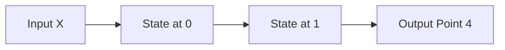

(c) Assume it is true that someone who has a lot of a commodity will have less desire to acquire more of the commodity. Explain what is wrong with Homer’s reasoning that the evidence about Blackheart makes it less likely that he will harm Stampy.

57. (a) There are two crimson jars (labeled $C _ { 1 }$ and $C _ { 2 } )$ and two mauve jars (labeled $M _ { 1 }$ and $\left| M _ { 2 } \right\rangle$ . Each jar contains a mixture of green gummi bears and red gummi bears. Show by example that it is possible that $C _ { 1 }$ has a much higher percentage of green gummi bears than $M _ { 1 }$ , and $C _ { 2 }$ has a much higher percentage of green gummi bears than $M _ { 2 } ,$ yet if the contents of $C _ { 1 }$ and $C _ { 2 }$ are merged into a new jar and likewise for $M _ { 1 }$ and $M _ { 2 }$ , then the combination of $C _ { 1 }$ and $C _ { 2 }$ has a lower percentage of green gummi bears than the combination of $M _ { 1 }$ and $M _ { 2 }$

(b) Explain how (a) relates to Simpson’s paradox, both intuitively and by explicitly defining events $A , B , C$ as in the statement of Simpson’s paradox.

58. As explained in this chapter, Simpson’s paradox says that it is possible to have events $A , B , C$ such that $\begin{aligned} { P ( A | B , C ) < P ( A | B ^ { c } , C ) } \\ \end{aligned}$ and $\begin{aligned} { P ( A | B , C ^ { c } ) < P ( A | B ^ { c } , C ^ { c } ) } \\ \end{aligned}$ , yet $P ( A | B ) > P ( A | B ^ { c } )$

(a) Can Simpson’s paradox occur if A and B are independent? If so, give a concrete example (with both numbers and an interpretation); if not, prove that it is impossible.

(b) Can Simpson’s paradox occur if A and C are independent? If so, give a concrete example (with both numbers and an interpretation); if not, prove that it is impossible.

(c) Can Simpson’s paradox occur if B and C are independent? If so, give a concrete example (with both numbers and an interpretation); if not, prove that it is impossible.

59. s The book Red State, Blue State, Rich State, Poor State by Andrew Gelman [12] discusses the following election phenomenon: within any U.S. state, a wealthy voter is more likely to vote for a Republican than a poor voter, yet the wealthier states tend to favor Democratic candidates!

(a) Assume for simplicity that there are only 2 states (called Red and Blue), each of which has 100 people, and that each person is either rich or poor, and either a Democrat or a Republican. Make up numbers consistent with the above, showing how this phenomenon is possible, by giving a $2 \times 2$ table for each state (listing how many people in each state are rich Democrats, etc.). So within each state, a rich voter is more likely to vote for a Republican than a poor voter, but the percentage of Democrats is higher in the state with the higher percentage of rich people than in the state with the lower percentage of rich people.

(b) In the setup of (a) (not necessarily with the numbers you made up there), let D be the event that a randomly chosen person is a Democrat (with all 200 people equally likely), and B be the event that the person lives in the Blue State. Suppose that 10 people move from the Blue State to the Red State. Write $P _ { \mathrm { o l d } }$ and $P _ { \mathrm { n e w } }$ for probabilities before and after they move. Assume that people do not change parties, so we have $P_{ new }(D) = P_{ old }(D)$ . Is it possible that both $P _ { \operatorname { n e w } } ( D | B ) \: > \: P _ { \operatorname { o l d } } ( D | B )$ and $P _ { \operatorname { n e w } } ( D | B ^ { c } ) > P _ { \operatorname { o l d } } ( D | B ^ { c } )$ are true? If so, explain how it is possible and why it does not contradict the law of total probability $\begin{aligned} { P ( D ) = } & { { } P ( D | B ) P ( B ) + P ( D | B ^ { c } ) P ( B ^ { c } ) } \\ \end{aligned}$ ; if not, show that it is impossible.

## Mixed practice

60. A patient is being given a blood test for the disease conditionitis. Let p be the prior probability that the patient has conditionitis. The blood sample is sent to one of two labs for analysis, lab A or lab B. The choice of which lab to use is made randomly, independent of the patient’s disease status, with probability $1 / 2$ for each lab.

For lab A, the probability of someone testing positive given that they do have the disease is $a _ { 1 }$ , and the probability of someone testing negative given that they do not have the disease is $a _ { 2 }$ . The corresponding probabilities for lab B are $b _ { 1 }$ and $b _ { 2 }$

(a) Find the probability that the patient has the disease, given that they tested positive.
(b) Find the probability that the patient’s blood sample was analyzed by lab A, given that the patient tested positive.

61. Fred decides to take a series of n tests, to diagnose whether he has a certain disease (any individual test is not perfectly reliable, so he hopes to reduce his uncertainty by taking multiple tests). Let D be the event that he has the disease, $p   =   P ( D )$ be the prior probability that he has the disease, and $q = 1 - p$ Let $T _ { j }$ be the event that he tests positive on the jth test.

(a) Assume for this part that the test results are conditionally independent given Fred’s disease status. Let $a = P ( T _ { j } | D )$ and $b = P ( T _ { j } | D ^ { c } )$ , where a and b don’t depend on $j .$ Find the posterior probability that Fred has the disease, given that he tests positive on all n of the n tests.
(b) Suppose that Fred tests positive on all n tests. However, some people have a certain gene that makes them always test positive. Let G be the event that Fred has the gene. Assume that $P ( G ) = 1 / 2$ and that D and G are independent. If Fred does not have the gene, then the test results are conditionally independent given his disease status. Let $a _ { 0 } = P ( T _ { j } | D , G ^ { c } )$ and $b _ { 0 } = P ( T _ { j } | D ^ { c } , G ^ { c } )$ , where $a _ { 0 }$ and $b _ { 0 }$ don’t depend on $j .$ Find the posterior probability that Fred has the disease, given that he tests positive on all n of the tests.

62. A certain hereditary disease can be passed from a mother to her children. Given that the mother has the disease, her children independently will have it with probability $1 / 2$ Given that she doesn’t have the disease, her children won’t have it either. A certain mother, who has probability $1 / 3$ of having the disease, has two children.

(a) Find the probability that neither child has the disease.
(b) Is whether the elder child has the disease independent of whether the younger child has the disease? Explain.
(c) The elder child is found not to have the disease. A week later, the younger child is also found not to have the disease. Given this information, find the probability that the mother has the disease.

63. Three fair coins are tossed at the same time. Explain what is wrong with the following argument: “there is a 50% chance that the three coins all landed the same way, since obviously it is possible to find two coins that match, and then the other coin has a 50% chance of matching those two”.

64. An urn contains red, green, and blue balls. Let $r , g ,$ b be the proportions of red, green, blue balls, respectively $( r + g + b = 1 )$ .

(a) Balls are drawn randomly with replacement. Find the probability that the first time a green ball is drawn is before the first time a blue ball is drawn.
Hint: Explain how this relates to finding the probability that a draw is green, given that it is either green or blue.
(b) Balls are drawn randomly without replacement. Find the probability that the first time a green ball is drawn is before the first time a blue ball is drawn. Is the answer the same or different than the answer in $( \mathrm { a } ) ?$

Hint: Imagine the balls all lined up, in the order in which they will be drawn. Note that where the red balls are standing in this line is irrelevant.

(c) Generalize the result from (a) to the following setting. Independent trials are performed, and the outcome of each trial is classified as being exactly one of type 1, type 2,. , or type n, with probabilities $p _ { 1 } , p _ { 2 } , \ldots , p _ { n } ,$ respectively. Find the probability that the first trial to result in type i comes before the first trial to result in type j, for $i \neq j$

65. Marilyn vos Savant was asked the following question for her column in Parade:

You’re at a party with 199 other guests when robbers break in and announce that they are going to rob one of you. They put 199 blank pieces of paper in a hat, plus one marked “you lose.” Each guest must draw, and the person who draws “you lose” will get robbed. The robbers offer you the option of drawing first, last, or at any time in between. When would you take your turn?

The draws are made without replacement, and for (a) are uniformly random.

(a) Determine whether it is optimal to draw first, last, or somewhere in between (or whether it does not matter), to maximize the probability of not being robbed. Give a clear, concise, and compelling explanation.
(b) More generally, suppose that there is one “you lose” piece of paper, with “weight” v, and there are n blank pieces of paper, each with “weight” w. At each stage, draws are made with probability proportional to weight, i.e., the probability of drawing a particular piece of paper is its weight divided by the sum of the weights of all the remaining pieces of paper. Determine whether it is better to draw first or second (or whether it does not matter); here $v > 0 , w > 0$ , and $n \geq 1$ are known constants.

66. A fair die is rolled repeatedly, until the running total is at least 100 (at which point the rolling stops). Find the most likely value of the final running total (i.e., the value of the running total at the first time when it is at least 100).

Hint: Consider the possibilities for what the running total is just before the last roll.

67. Homer has a box of donuts, which currently contains exactly c chocolate, g glazed, and j jelly donuts. Homer eats donuts one after another, each time choosing uniformly at random from the remaining donuts.

(a) Find the probability that the last donut remaining in the box is a chocolate donut.
(b) Find the probability of the following event: glazed is the first type of donut that Homer runs out of, and then jelly is the second type of donut that he runs out of.

Hint: Consider the last donut remaining, and the last donut that is either glazed or jelly.

68. Let D be the event that a person develops a certain disease, and C be the event that the person was exposed to a certain substance (e.g., D may correspond to lung cancer and C may correspond to smoking cigarettes). We are interested in whether exposure to the substance is related to developing the disease (and if so, how they are related).

The odds ratio is a very widely used measure in epidemiology of the association between disease and exposure, defined as

$$
\mathrm{OR} = \frac {\mathrm{odds} (D | C)}{\mathrm{odds} (D | C ^ {c})},
$$

where conditional odds are defined analogously to unconditional odds: odds $(A|B) =$ $\frac { P ( A | B ) } { P ( A ^ { c } | B ) }$ . The relative risk of the disease for someone exposed to the substance, another widely used measure, is

$$
\mathrm{RR} = \frac {P (D | C)}{P (D | C ^ {c})}.
$$

The relative risk is especially easy to interpret, e.g., RR = 2 says that someone exposed to the substance is twice as likely to develop the disease as someone who isn’t exposed (though this does not necessarily mean that the substance causes the increased chance of getting the disease, nor is there necessarily a causal interpretation for the odds ratio).

(a) Show that if the disease is rare, both for exposed people and for unexposed people, then the relative risk is approximately equal to the odds ratio.

(b) Let $p _ { i j }$ for $i = 0 , 1$ and $j = 0 ,$ 1 be the probabilities in the following $2 \times 2$ table.

|  | $D$ | $D^{c}$ |
| --- | --- | --- |
| $C$ | $p_{11}$ | $p_{10}$ |
| $C^{c}$ | $p_{01}$ | $p_{00}$ |

For example, $p _ { 1 0 }   =   P ( C , D ^ { c } )$ . Show that the odds ratio can be expressed as a cross-product ratio, in the sense that

$$
\mathrm{OR} = \frac {p _ {1 1} p _ {0 0}}{p _ {1 0} p _ {0 1}}.
$$

(c) Show that the odds ratio has the neat symmetry property that the roles of C and D can be swapped without changing the value:

$$
\mathrm{OR} = \frac {\mathrm{odds} (C | D)}{\mathrm{odds} (C | D ^ {c})}.
$$

This property is one of the main reasons why the odds ratio is so widely used, since it turns out that it allows the odds ratio to be estimated in a wide variety of problems where relative risk would be hard to estimate well.

69. A researcher wants to estimate the percentage of people in some population who have used illegal drugs, by conducting a survey. Concerned that a lot of people would lie when asked a sensitive question like “Have you ever used illegal drugs?”, the researcher uses a method known as randomized response. A hat is filled with slips of paper, each of which says either “I have used illegal drugs” or “I have not used illegal drugs”. Let p be the proportion of slips of paper that say “I have used illegal drugs” (p is chosen by the researcher in advance).

Each participant chooses a random slip of paper from the hat and answers (truthfully) “yes” or “no” to whether the statement on that slip is true. The slip is then returned to the hat. The researcher does not know which type of slip the participant had. Let y be the probability that a participant will say “yes”, and d be the probability that a participant has used illegal drugs.

(a) Find $y ,$ in terms of d and $p .$
(b) What would be the worst possible choice of p that the researcher could make in designing the survey? Explain.
(c) Now consider the following alternative system. Suppose that proportion p of the slips of paper say “I have used illegal drugs”, but that now the remaining 1 − p say “I was born in winter” rather than “I have not used illegal drugs”. Assume that 1/4 of people are born in winter, and that a person’s season of birth is independent of whether they have used illegal drugs. Find $d ,$ in terms of y and $p .$

70. At the beginning of the play Rosencrantz and Guildenstern Are Dead by Tom Stoppard [25], Guildenstern is spinning coins and Rosencrantz is betting on the outcome for each. The coins have been landing Heads over and over again, prompting the following remark:

Guildenstern: A weaker man might be moved to re-examine his faith, if in nothing else at least in the law of probability.

The coin spins have resulted in Heads 92 times in a row.

(a) Fred and his friend are watching the play. Upon seeing the events described above, they have the following conversation:

Fred: That outcome would be incredibly unlikely with fair coins. They must be using trick coins (maybe with double-headed coins), or the experiment must have been rigged somehow (maybe with magnets).

Fred’s friend: It’s true that the string HH. . . H of length 92 is very unlikely; the chance is $1 / 2 ^ { 9 2 }   \approx   2   \times   1 0 ^ { - 2 8 }$ with fair coins. But any other specific string of H’s and T’s with length 92 has exactly the same probability! The reason the outcome seems extremely unlikely is that the number of possible outcomes grows exponentially as the number of spins grows, so any outcome would seem extremely unlikely. You could just as well have made the same argument even without looking at the results of their experiment, which means you really don’t have evidence against the coins being fair.

Discuss these comments, to help Fred and his friend resolve their debate.

(b) Suppose there are only two possibilities: either the coins are all fair (and spun fairly), or double-headed coins are being used (in which case the probability of Heads is 1). Let $p$ be the prior probability that the coins are fair. Find the posterior probability that the coins are fair, given that they landed Heads in 92 out of 92 trials.

(c) Continuing from (b), for which values of $p$ is the posterior probability that the coins are fair greater than 0.5? For which values of $p$ is it less than 0.05?

71. There are n types of toys, which you are collecting one by one. Each time you buy a toy, it is randomly determined which type it has, with equal probabilities. Let $p_{ij}$ be the probability that just after you have bought your ith toy, you have exactly $j$ toy types in your collection, for $i \geq 1$ and $0 \leq j \leq n$ . (This problem is in the setting of the coupon collector problem, a famous problem which we study in Example 4.3.12.)

(a) Find a recursive equation expressing $p _ { i j }$ in terms of $p _ { i - 1 , j }$ and $p _ { i - 1 , j - 1 }$ , for $i \geq 2$ and $1 \leq j \leq n$

(b) Describe how the recursion from (a) can be used to calculate $p _ { i j }$

72. $A / B$ testing is a form of randomized experiment that is used by many companies to learn about how customers will react to different treatments. For example, a company may want to see how users will respond to a new feature on their website (compared with how users respond to the current version of the website) or compare two different advertisements.

As the name suggests, two different treatments, Treatment A and Treatment B, are being studied. Users arrive one by one, and upon arrival are randomly assigned to one of the two treatments. The trial for each user is classified as “success” (e.g., the user made a purchase) or “failure”. The probability that the nth user receives Treatment A is allowed to depend on the outcomes for the previous users. This set-up is known as a two-armed bandit.

Many algorithms for how to randomize the treatment assignments have been studied. Here is an especially simple (but fickle) algorithm, called a stay-with-a-winner procedure:

(i) Randomly assign the first user to Treatment A or Treatment B, with equal probabilities.
(ii) If the trial for the nth user is a success, stay with the same treatment for the $( n + 1 ) \mathrm { s t }$ user; otherwise, switch to the other treatment for the $( n + 1 ) \mathrm { s t }$ user.

Let a be the probability of success for Treatment A, and b be the probability of success for Treatment B. Assume that $a \neq b ,$ but that a and b are unknown (which is why the test is needed). Let $p _ { n }$ be the probability of success on the nth trial and $a _ { n }$ be the probability that Treatment A is assigned on the nth trial (using the above algorithm).

(a) Show that

$$
p _ {n} = (a - b) a _ {n} + b,
$$

$$
a _ {n + 1} = (a + b - 1) a _ {n} + 1 - b.
$$

(b) Use the results from (a) to show that $p _ { n + 1 }$ satisfies the following recursive equation:

$$
p _ {n + 1} = (a + b - 1) p _ {n} + a + b - 2 a b.
$$

(c) Use the result from (b) to find the long-run probability of success for this algorithm, $\operatorname { l i m } _ { n \to \infty } p _ { n } ,$ assuming that this limit exists.

73. In humans (and many other organisms), genes come in pairs. A certain gene comes in two types (alleles): type a and type A. The genotype of a person for that gene is the types of the two genes in the pair: AA, Aa, or aa (aA is equivalent to Aa). Assume that the Hardy-Weinberg law applies here, which means that the frequencies of AA, Aa, aa in the population are $p ^ { 2 } , 2 p ( 1 - p ) , ( 1 - p ) ^ { 2 }$ respectively, for some p with $0 < p < 1$

When a woman and a man have a child, the child’s gene pair has one gene contributed by each parent. Suppose that the mother is equally likely to contribute either of the two genes in her gene pair, and likewise for the father, independently. Also suppose that the genotypes of the parents are independent of each other (with probabilities given by the Hardy-Weinberg law).

(a) Find the probabilities of each possible genotype (AA, Aa, aa) for a child of two random parents. Explain what this says about stability of the Hardy-Weinberg law from one generation to the next.

Hint: Condition on the genotypes of the parents.

(b) A person of type AA or aa is called homozygous (for the gene under consideration), and a person of type Aa is called heterozygous (for that gene). Find the probability that a child is homozygous, given that both parents are homozygous. Also, find the probability that a child is heterozygous, given that both parents are heterozygous.

(c) Suppose that having genotype aa results in a distinctive physical characteristic, so it is easy to tell by looking at someone whether or not they have that genotype. A mother and father, neither of whom are of type aa, have a child. The child is also not of type aa. Given this information, find the probability that the child is heterozygous.

Hint: Use the definition of conditional probability. Then expand both the numerator and the denominator using LOTP, conditioning on the genotypes of the parents.

74. A standard deck of cards will be shuffled and then the cards will be turned over one at a time until the first ace is revealed. Let B be the event that the next card in the deck will also be an ace.

(a) Intuitively, how do you think P(B) compares in size with 1/13 (the overall proportion of aces in a deck of cards)? Explain your intuition. (Give an intuitive discussion rather than a mathematical calculation; the goal here is to describe your intuition explicitly.)
(b) Let $C _ { j }$ be the event that the first ace is at position $j$ in the deck. Find $P ( B | C _ { j } )$ i n terms of j, fully simplified.
(c) Using the law of total probability, find an expression for $P ( B )$ as a sum. (The sum can be left unsimplified, but it should be something that could easily be computed in software such as R that can calculate sums.)
(d) Find a fully simplified expression for $P ( B )$ using a symmetry argument.

Hint: If you were deciding whether to bet on the next card after the first ace being an ace or to bet on the last card in the deck being an ace, would you have a preference?

## Taylor & Francis

Taylor & Francis Group

http://taylorandfrancis.com

# Random variables and their distributions

In this chapter, we introduce random variables, an incredibly useful concept that simplifies notation and expands our ability to quantify uncertainty and summarize the results of experiments. Random variables are essential throughout the rest of this book, and throughout statistics, so it is crucial to think through what they mean, both intuitively and mathematically.

## 3.1 Random variables

To see why our current notation can quickly become unwieldy, consider again the gambler’s ruin problem from Chapter 2. In this problem, we may be very interested in how much wealth each gambler has at any particular time. So we could make up notation like letting $A _ { j k }$ be the event that gambler A has exactly j dollars after k rounds, and similarly defining an event $B _ { j k }$ for gambler B, for all j and k.

This is already too complicated. Furthermore, we may also be interested in other quantities, such as the difference in their wealths (gambler A’s minus gambler B’s) after k rounds, or the duration of the game (the number of rounds until one player is bankrupt). Expressing the event “the duration of the game is r rounds” in terms of the $A _ { j k }$ and $B _ { j k }$ would involve a long, awkward string of unions and intersections. And then what if we want to express gambler A’s wealth as the equivalent amount in euros rather than dollars? We can multiply a number in dollars by a currency exchange rate, but we can’t multiply an event by an exchange rate.

Instead of having convoluted notation that obscures how the quantities of interest are related, wouldn’t it be nice if we could say something like the following?

Let $X _ { k }$ be the wealth of gambler A after k rounds. Then $Y _ { k }   =   N   -   X _ { k }$ is the wealth of gambler B after k rounds (where N is the fixed total wealth); $X _ { k }   -   Y _ { k } = 2 X _ { k }   -   N$ is the difference in wealths after k rounds; $c _ { k } X _ { k }$ is the wealth of gambler A in euros after k rounds, where $c _ { k }$ is the euros per dollar exchange rate after k rounds; and the duration is $R = \operatorname* { m i n } \{ n : X _ { n } = 0 { \mathrm { ~ o r ~ } } Y _ { n } = 0 \}$

The notion of a random variable will allow us to do exactly this! It needs to be introduced carefully though, to make it both conceptually and technically correct. Sometimes a definition of “random variable” is given that is a barely paraphrased version of $^ { \mathrm { a } }$ random variable is a variable that takes on random values”, but such a feeble attempt at a definition fails to say where the randomness come from. Nor does it help us to derive properties of random variables: we’re familiar with working with algebraic equations like $x ^ { 2 } + y ^ { 2 }   =   1$ , but what are the valid mathematical operations if x and y are random variables? To make the notion of random variable precise, we define it as a function mapping the sample space to the real line. (See the math appendix for review of some concepts about functions.)

flowchart

## FIGURE 3.1

A random variable maps the sample space into the real line. The r.v. X depicted here is defined on a sample space with 6 elements, and has possible values 0, 1, and 4. The randomness comes from choosing a random pebble according to the probability function P for the sample space.

Definition 3.1.1 (Random variable). Given an experiment with sample space S, a random variable (r.v.) is a function from the sample space S to the real numbers R. It is common, but not required, to denote random variables by capital letters.

Thus, a random variable X assigns a numerical value X(s) to each possible outcome s of the experiment. The randomness comes from the fact that we have a random experiment (with probabilities described by the probability function P); the mapping itself is deterministic, as illustrated in Figure 3.1. The same r.v. is shown in a simpler way in the left panel of Figure 3.2, in which we inscribe the values inside the pebbles.

This definition is abstract but fundamental; one of the most important skills to develop when studying probability and statistics is the ability to go back and forth between abstract ideas and concrete examples. Relatedly, it is important to work on recognizing the essential pattern or structure of a problem and how it connects to problems you have studied previously. We will often discuss stories that involve tossing coins or drawing balls from urns because they are simple, convenient scenarios to work with, but many other problems are isomorphic: they have the same essential structure, but in a different guise.

To start, let’s consider a coin-tossing example. The structure of the problem is that we have a sequence of trials where there are two possible outcomes for each trial. Here we think of the possible outcomes as H (Heads) and T (Tails), but we could just as well think of them as “success” and “failure” or as 1 and 0, for example.

Example 3.1.2 (Coin tosses). Consider an experiment where we toss a fair coin twice. The sample space consists of four possible outcomes: $S _ { \mathrm { ~ \tiny ~ \bar ~ } } =$ {HH, HT, T H, T T}. Here are some random variables on this space (for practice, you can think up some of your own). Each r.v. is a numerical summary of some aspect of the experiment.

• Let X be the number of Heads. This is a random variable with possible values 0, 1, and 2. Viewed as a function, X assigns the value 2 to the outcome HH, 1 to the outcomes HT and T H, and 0 to the outcome T T. That is,

$$
X (H H) = 2, X (H T) = X (T H) = 1, X (T T) = 0.
$$

• Let Y be the number of Tails. In terms of X, we have $Y = 2 - X$ . In other words, Y and $2 - X$ are the same r.v.: $Y ( s ) = 2 - X ( s )$ for all s.

• Let I be 1 if the first toss lands Heads and 0 otherwise. Then I assigns the value 1 to the outcomes HH and HT and 0 to the outcomes T H and T T. This r.v. is an example of what is called an indicator random variable since it indicates whether the first toss lands Heads, using 1 to mean “yes” and 0 to mean “no”.

We can also encode the sample space as $\{ ( 1 , 1 ) , ( 1 , 0 ) , ( 0 , 1 ) , ( 0 , 0 ) \}$ , where 1 is the code for Heads and 0 is the code for Tails. Then we can give explicit formulas for $X , Y , I ;$

$$
X (s _ {1}, s _ {2}) = s _ {1} + s _ {2}, Y (s _ {1}, s _ {2}) = 2 - s _ {1} - s _ {2}, I (s _ {1}, s _ {2}) = s _ {1},
$$

where for simplicity we write $X ( s _ { 1 } , s _ { 2 } )$ to mean $X ( ( s _ { 1 } , s _ { 2 } ) )$ , etc.

For most r.v.s we will consider, it is tedious or infeasible to write down an explicit formula in this way. Fortunately, it is usually unnecessary to do so, since (as we saw in this example) there are other ways to define an r.v., and (as we will see throughout the rest of this book) there are many ways to study the properties of an r.v. other than by doing computations with an explicit formula for what it maps each outcome s to. 

As in the previous chapters, for a sample space with a finite number of outcomes we can visualize the outcomes as pebbles, with the mass of a pebble corresponding to its probability, such that the total mass of the pebbles is 1. A random variable simply labels each pebble with a number. Figure 3.2 shows two random variables defined on the same sample space: the pebbles or outcomes are the same, but the real numbers assigned to the outcomes are different.

## FIGURE 3.2

Two random variables defined on the same sample space.

As we’ve mentioned earlier, the source of the randomness in a random variable is the experiment itself, in which a sample outcome $s   \in   S$ is chosen according to a probability function P. Before we perform the experiment, the outcome s has not yet been realized, so we don’t know the value of $X$ , though we could calculate the probability that X will take on a given value or range of values. After we perform the experiment and the outcome s has been realized, the random variable crystallizes into the numerical value $X ( s )$

Random variables provide numerical summaries of the experiment in question. This is very handy because the sample space of an experiment is often incredibly complicated or high-dimensional, and the outcomes $s   \in   S$ may be non-numeric. For example, the experiment may be to collect a random sample of people in a certain city and ask them various questions, which may have numeric (e.g., age or height) or non-numeric (e.g., political party or favorite movie) answers. The fact that r.v.s take on numerical values is a very convenient simplification compared to having to work with the full complexity of S at all times.

## 3.2 Distributions and probability mass functions

There are two main types of random variables used in practice: discrete r.v.s and continuous r.v.s. In this chapter and the next, our focus is on discrete r.v.s. Continuous r.v.s are introduced in Chapter 5.

Definition 3.2.1 (Discrete random variable). A random variable X is said to be discrete if there is a finite list of values $a _ { 1 } , a _ { 2 } , \ldots , a _ { n }$ or an infinite list of values $a _ { 1 } , a _ { 2 } , \ldots$ . such that $P ( X   =   a _ { j }$ for some $j )   =   1$ . If X is a discrete r.v., then the finite or countably infinite set of values x such that $P ( X   =   x )   >   0$ is called the support of X.

Most commonly in applications, the support of a discrete r.v. is a set of integers. In contrast, a continuous r.v. can take on any real value in an interval (possibly even the entire real line); such r.v.s are defined more precisely in Chapter 5. It is also possible to have an r.v. that is a hybrid of discrete and continuous, such as by flipping a coin and then generating a discrete r.v. if the coin lands Heads and generating a continuous r.v. if the coin lands Tails. But the starting point for understanding such r.v.s is to understand discrete and continuous r.v.s.

Given a random variable, we would like to be able to describe its behavior using the language of probability. For example, we might want to answer questions about the probability that the r.v. will fall into a given range: if L is the lifetime earnings of a randomly chosen U.S. college graduate, what is the probability that L exceeds a million dollars? If M is the number of major earthquakes in California in the next five years, what is the probability that M equals 0?

The distribution of a random variable provides the answers to these questions; it specifies the probabilities of all events associated with the r.v., such as the probability of it equaling 3 and the probability of it being at least 110. We will see that there are several equivalent ways to express the distribution of an r.v. For a discrete r.v., the most natural way to do so is with a probability mass function, which we now define.

Definition 3.2.2 (Probability mass function). The probability mass function (PMF) of a discrete r.v. X is the function $p _ { X }$ given by $p _ { X } ( x ) = P ( X = x )$ . Note that this is positive if x is in the support of X, and 0 otherwise.

h 3.2.3. In writing $P ( X = x )$ , we are using $X = x$ to denote an event, consisting of all outcomes s to which X assigns the number x. This event is also written as $\{ X = x \}$ ; formally, $\{ X = x \}$ is defined as $\{ s \in S : X ( s ) = x \}$ , but writing $\{ X = x \}$ is shorter and more intuitive. Going back to Example 3.1.2, if X is the number of Heads in two fair coin tosses, then $\{ X   =   1 \}$ consists of the sample outcomes HT and T H, which are the two outcomes to which X assigns the number 1. Since $\{ H T , T H \}$ is a subset of the sample space, it is an event. So it makes sense to talk about $P ( X = 1 )$ , or more generally, $P ( X   =   x ) . { \mathrm { ~ I f ~ } } \{ X   =   x \}$ were anything other than an event, it would make no sense to calculate its probability! It does not make sense to write $\text{" }P(X) \text{" }$ ; we can only take the probability of an event, not of an r.v.

Let’s look at a few examples of PMFs.

Example 3.2.4 (Coin tosses continued). In this example we’ll find the PMFs of all the random variables in Example 3.1.2, the example with two fair coin tosses. Here are the r.v.s we defined, along with their PMFs:

• X, the number of Heads. Since X equals 0 if T T occurs, 1 if HT or T H occurs,

and 2 if HH occurs, the PMF of X is the function $p _ { X }$ given by

$$
p _ {X} (0) = P (X = 0) = 1 / 4,
$$

$$
p _ {X} (1) = P (X = 1) = 1 / 2,
$$

$$
p _ {X} (2) = P (X = 2) = 1 / 4,
$$

and $p _ { X } ( x ) = 0$ for all other values of $x .$

$Y = 2 - X$ , the number of Tails. Reasoning as above or using the fact that

$$
P (Y = y) = P (2 - X = y) = P (X = 2 - y) = p _ {X} (2 - y),
$$

the PMF of Y is

$$
p _ {Y} (0) = P (Y = 0) = 1 / 4,
$$

$$
p _ {Y} (1) = P (Y = 1) = 1 / 2,
$$

$$
p _ {Y} (2) = P (Y = 2) = 1 / 4,
$$

and $p _ { Y } ( y ) = 0$ for all other values of $y .$

Note that X and Y have the same PMF (that is, pX and pY are the same function) even though X and Y are not the same r.v. (that is, X and Y are two different functions from {HH, HT, TH, T T} to the real line).

• I, the indicator of the first toss landing Heads. Since I equals 0 if T H or T T occurs and 1 if HH or HT occurs, the PMF of I is

$$
p _ {I} (0) = P (I = 0) = 1 / 2,
$$

$$
p _ {I} (1) = P (I = 1) = 1 / 2,
$$

and $p _ { I } ( i ) = 0$ for all other values of $i .$

## FIGURE 3.3

Left to right: PMFs of X, Y , and I, with X the number of Heads in two fair coin tosses, Y the number of Tails, and I the indicator of Heads on the first toss.

The PMFs of X, Y , and I are plotted in Figure 3.3. Vertical bars are drawn to make it easier to compare the heights of different points. 

Example 3.2.5 (Sum of die rolls). We roll two fair 6-sided dice. Let $T = X + Y$ be the total of the two rolls, where X and Y are the individual rolls. The sample space of this experiment has 36 equally likely outcomes:

$$
S = \{(1, 1), (1, 2), \dots , (6, 5), (6, 6) \}.
$$

For example, 7 of the 36 outcomes s are shown in the table below, along with the corresponding values of $X , Y ,$ and T. After the experiment is performed, we observe values for X and Y , and then the observed value of T is the sum of those values.

| s | X | Y | $X + Y$ |
| --- | --- | --- | --- |
| (1,2) | 1 | 2 | 3 |
| (1,6) | 1 | 6 | 7 |
| (2,5) | 2 | 5 | 7 |
| (3,1) | 3 | 1 | 4 |
| (4,3) | 4 | 3 | 7 |
| (5,4) | 5 | 4 | 9 |
| (6,6) | 6 | 6 | 12 |

Since the dice are fair, the PMF of X is

$$
P (X = j) = 1 / 6,
$$

for $j = 1 , 2 , \ldots , 6$ (and $P ( X = j ) = 0$ otherwise); we say that X has a Discrete Uniform distribution on $1 , 2 , \ldots , 6 .$ Similarly, Y is also Discrete Uniform on $1 , 2 , \ldots , 6 .$

Note that Y has the same distribution as X but is not the same random variable as X. In fact, we have

$$
P (X = Y) = 6 / 3 6 = 1 / 6.
$$

Two more r.v.s in this experiment with the same distribution as X are $7 - X$ and $7 - Y$ . To see this, we can use the fact that for a standard die, $7 - X$ is the value on the bottom if X is the value on the top. If the top value is equally likely to be any of the numbers $1 , 2 , \ldots , 6 ,$ then so is the bottom value. Note that even though $7   -   X$ has the same distribution as $X .$ , it is never equal to X in a run of the experiment!

Let’s now find the PMF of T. By the naive definition of probability,

$$
\begin{array}{l} P (T = 2) = P (T = 1 2) = 1 / 3 6, \\ P (T = 3) = P (T = 1 1) = 2 / 3 6, \\ P (T = 4) = P (T = 1 0) = 3 / 3 6, \\ P (T = 5) = P (T = 9) = 4 / 3 6, \\ P (T = 6) = P (T = 8) = 5 / 3 6, \\ P (T = 7) = 6 / 3 6. \\ \end{array}
$$

For all other values of t, $P ( T = t ) = 0$ . We can see directly that the support of $T$ is $\{ 2 , 3 , \ldots , 1 2 \}$ just by looking at the possible totals for two dice, but as a check, note that

$$
P (T = 2) + P (T = 3) + \dots + P (T = 1 2) = 1,
$$

which shows that all possibilities have been accounted for. The symmetry property of T that appears above, $P ( T = t ) = P ( T = 1 4   -   t )$ , makes sense since each outcome $\{ X = x , Y = y \}$ which makes $T = t$ has a corresponding outcome $\{ X = 7 - x , Y =$ $\{ 7 - y \}$ of the same probability which makes $T = 1 4 - t$

stem

| t | PMF |
| --- | --- |
| 2 | ~0.03 |
| 3 | ~0.055 |
| 4 | ~0.085 |
| 5 | ~0.11 |
| 6 | ~0.14 |
| 7 | ~0.165 |
| 8 | ~0.14 |
| 9 | ~0.11 |
| 10 | ~0.085 |
| 11 | ~0.055 |
| 12 | ~0.03 |

## FIGURE 3.4

PMF of the sum of two die rolls.

The PMF of T is plotted in Figure 3.4; it has a triangular shape, and the symmetry noted above is very visible. 

Example 3.2.6 (Children in a U.S. household). Suppose we choose a household in the United States at random. Let X be the number of children in the chosen household. Since X can only take on integer values, it is a discrete r.v. The probability that X takes on the value x is proportional to the number of households in the United States with x children.

Using data from the 2010 General Social Survey [23], we can approximate the proportion of households with 0 children, 1 child, 2 children, etc., and hence approximate the PMF of X, which is plotted in Figure 3.5. 

We will now state the properties of a valid PMF.

Theorem 3.2.7 (Valid PMFs). Let X be a discrete r.v. with support $x _ { 1 } , x _ { 2 } , \ldots$ (assume these values are distinct and, for notational simplicity, that the support is countably infinite; the analogous results hold if the support is finite). The PMF $p _ { X }$ of X must satisfy the following two criteria:

• Nonnegative: $p _ { X } ( x ) > 0 { \mathrm { ~ i f ~ } } x = x _ { j }$ for some j, and $p _ { X } ( x ) = 0$ otherwise;
• Sums to 1: $\begin{array} { r } { \sum _ { j = 1 } ^ { \infty } p _ { X } ( x _ { j } ) = 1 } \end{array}$

stem

| x | PMF |
| --- | --- |
| 0 | ~0.28 |
| 1 | ~0.16 |
| 2 | ~0.26 |
| 3 | ~0.16 |
| 4 | ~0.07 |
| 5 | ~0.03 |
| 6 | ~0.02 |
| 7 | ~0.01 |
| 8 | ~0.02 |

## FIGURE 3.5

PMF of the number of children in a randomly selected U.S. household.

Proof. The first criterion is true since probability is nonnegative. The second is true since X must take on some value, and the events $\{ X = x _ { j } \}$ are disjoint, so

$$
\sum_ {j = 1} ^ {\infty} P (X = x _ {j}) = P \left(\bigcup_ {j = 1} ^ {\infty} \{X = x _ {j} \}\right) = P (X = x _ {1} \text {or} X = x _ {2} \text {or} \dots) = 1.\quad \blacksquare
$$

Conversely, if distinct values $x _ { 1 } , x _ { 2 } , \ldots$ are specified and we have a function satisfying the two criteria above, then this function is the PMF of some r.v.; we will show how to construct such an r.v. in Chapter 5.

We claimed earlier that the PMF is one way of expressing the distribution of a discrete r.v. This is because once we know the PMF of $X .$ we can calculate the probability that X will fall into a given subset of the real numbers by summing over the appropriate values of $x ,$ as the next example shows.

Example 3.2.8. Returning to Example 3.2.5, let T be the sum of two fair die rolls. We have already calculated the PMF of T. Now suppose we’re interested in the probability that $T$ is in the interval [1, 4]. There are only three values in the interval [1, 4] that $T$ can take on, namely, 2, 3, and 4. We know the probability of each of these values from the PMF of $T ,$ so

$$
P (1 \leq T \leq 4) = P (T = 2) + P (T = 3) + P (T = 4) = 6 / 3 6.
$$

In general, given a discrete r.v. X and a set B of real numbers, if we know the PMF of X we can find $P ( X \in B )$ , the probability that X is in B, by summing up the heights of the vertical bars at points in B in the plot of the PMF of X. Knowing the PMF of a discrete r.v. determines its distribution.