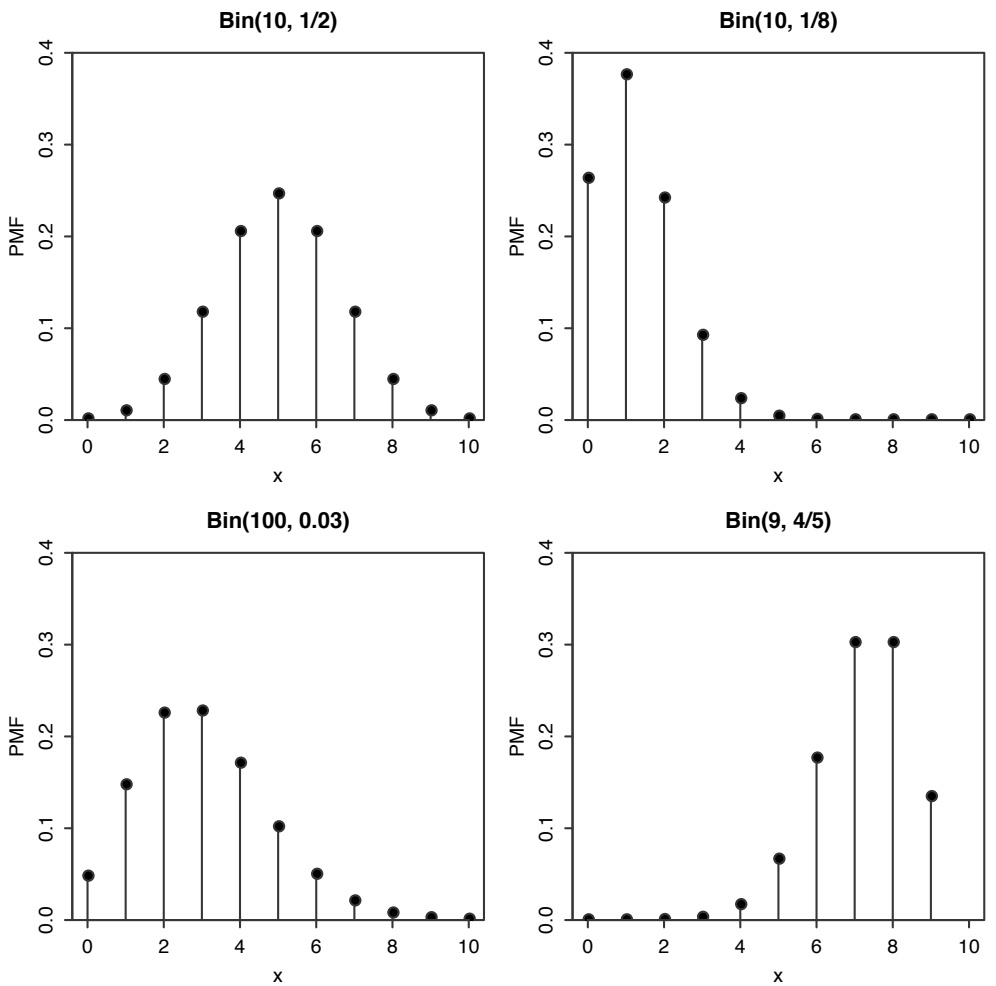
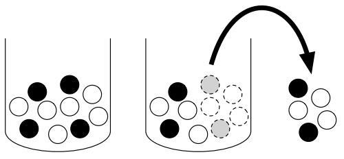
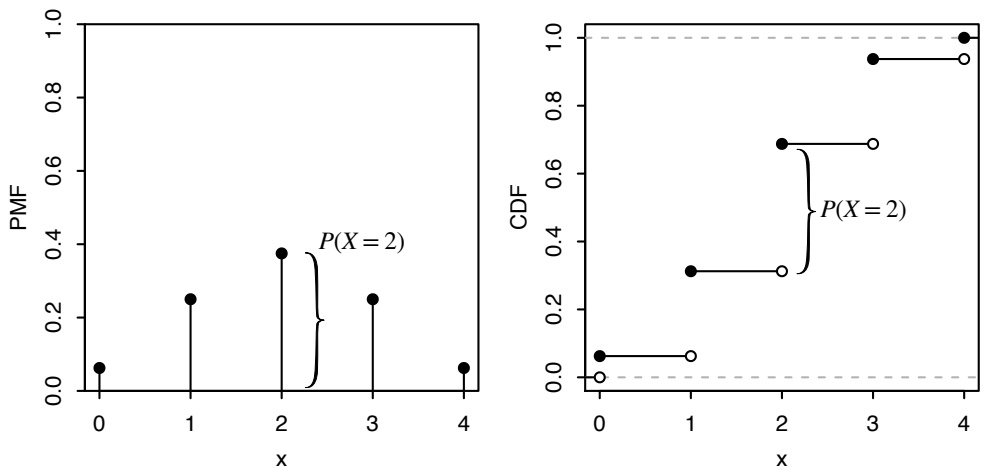
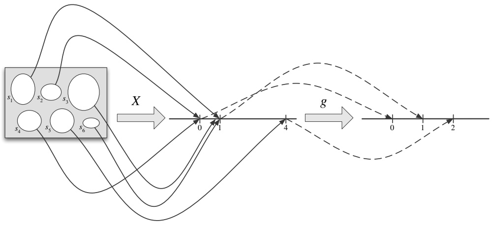
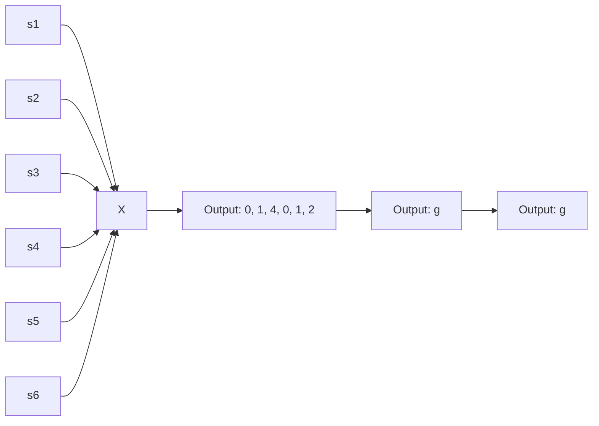
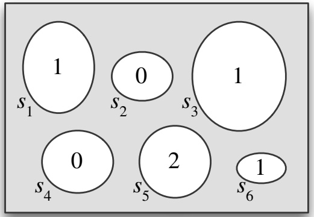

## 3.3 Bernoulli and Binomial

Some distributions are so ubiquitous in probability and statistics that they have their own names. We will introduce these named distributions throughout the book, starting with a very simple but useful case: an r.v. that can take on only two possible values, 0 and 1.

Definition 3.3.1 (Bernoulli distribution). An r.v. X is said to have the Bernoulli distribution with parameter p if $P ( X   =   1 )   =   p$ and $P ( X   =   0 )   =   1   -   p ,$ where $0 < p < 1$ . We write this as $X \sim \mathrm { B e r n } ( p )$ . The symbol ∼ is read “is distributed $\mathrm { a s } ^ { \prime \prime }$

Any r.v. whose possible values are 0 and 1 has a Bern(p) distribution, with p the probability of the r.v. equaling 1. This number $p$ in Bern(p) is called the parameter of the distribution; it determines which specific Bernoulli distribution we have. Thus there is not just one Bernoulli distribution, but rather a family of Bernoulli distributions, indexed by $p .$ For example, if $X \sim \mathrm { B e r n } ( 1 / 3 )$ , it would be correct but incomplete to say $^ { \circ } X$ is Bernoulli”; to fully specify the distribution of $X ,$ we should both say its name (Bernoulli) and its parameter value $( 1 / 3 )$ , which is the point of the notation $X \sim \mathrm { B e r n } ( 1 / 3 )$

Any event has a Bernoulli r.v. that is naturally associated with it, equal to 1 if the event happens and 0 otherwise. This is called the indicator random variable of the event; we will see that such r.v.s are extremely useful.

Definition 3.3.2 (Indicator random variable). The indicator random variable of an event A is the r.v. which equals 1 if A occurs and 0 otherwise. We will denote the indicator r.v. of A by $I _ { A }$ or $I ( A )$ . Note that $I _ { A } \sim \mathrm { B e r n } ( p )$ with $p = P ( A )$

We often imagine Bernoulli r.v.s using coin tosses, but this is just convenient language for discussing the following general story.

Story 3.3.3 (Bernoulli trial). An experiment that can result in either a “success” or a “failure” (but not both) is called a Bernoulli trial. A Bernoulli random variable can be thought of as the indicator of success in a Bernoulli trial: it equals 1 if success occurs and 0 if failure occurs in the trial. 

Because of this story, the parameter p is often called the success probability of the Bern $( p )$ distribution. Once we start thinking about Bernoulli trials, it’s hard not to start thinking about what happens when we have more than one trial.

Story 3.3.4 (Binomial distribution). Suppose that n independent Bernoulli trials are performed, each with the same success probability $p .$ Let X be the number of successes. The distribution of X is called the Binomial distribution with parameters n and $p .$ We write $X   \sim   \mathrm { B i n } ( n , p )$ to mean that X has the Binomial distribution with parameters n and $p ,$ where n is a positive integer and $0 < p < 1$ 

Notice that we define the Binomial distribution not by its PMF, but by a story about the type of experiment that could give rise to a random variable with a Binomial distribution. The most famous distributions in statistics all have stories which explain why they are so often used as models for data, or as the building blocks for more complicated distributions.

Thinking about the named distributions first and foremost in terms of their stories has many benefits. It facilitates pattern recognition, allowing us to see when two problems are essentially identical in structure; it often leads to cleaner solutions that avoid PMF calculations altogether; and it helps us understand how the named distributions are connected to one another. Here it is clear that Bern $( p )$ is the same distribution as $\operatorname { B i n } ( 1 , p )$ : the Bernoulli is a special case of the Binomial.

Using the story definition of the Binomial, let’s find its PMF.

Theorem 3.3.5 (Binomial PMF). If $X \sim \operatorname { B i n } ( n , p )$ , then the PMF of X is

$$
P (X = k) = \binom {n} {k} p ^ {k} (1 - p) ^ {n - k}
$$

for $k = 0 , 1 , \ldots , n$ (and $P ( X = k ) = 0 { \mathrm { ~ o t h e r w i s e } } )$

h 3.3.6. To save writing, it is often left implicit that a PMF is zero wherever it is not specified to be nonzero, but in any case it is important to understand what the support of a random variable is, and good practice to check that PMFs are valid. If two discrete r.v.s have the same PMF, then they also must have the same support. So we sometimes refer to the support of a discrete distribution; this is the support of any r.v. with that distribution.

Proof. An experiment consisting of n independent Bernoulli trials produces a sequence of successes and failures. The probability of any specific sequence of k successes and $n - k$ failures is $p ^ { k } ( 1 - p ) ^ { n - k }$ . There are $\binom { n } { k }$ such sequences, since we just need to select where the successes are. Therefore, letting $X$ be the number of successes,

$$
P (X = k) = \binom {n} {k} p ^ {k} (1 - p) ^ {n - k}
$$

for $k = 0 , 1 , \ldots , n ,$ and $P(X = k) = 0$ otherwise. This is a valid PMF because it is nonnegative and it sums to 1 by the binomial theorem. 

Figure 3.6 shows plots of the Binomial PMF for various values of $n$ and $p .$ Note that the PMF of the $\mathrm { B i n } ( 1 0 , 1 / 2 )$ distribution is symmetric about 5, but when the success probability is not $1 / 2 ,$ the PMF is skewed. For a fixed number of trials $n , X$ tends to be larger when the success probability is high and lower when the success probability is low, as we would expect from the story of the Binomial distribution. Also recall that in any PMF plot, the sum of the heights of the vertical bars must be 1.

We’ve used Story 3.3.4 to find the $\operatorname { B i n } ( n , p )$ PMF. The story also gives us a straightforward proof of the fact that if X is Binomial, then $n - X$ is also Binomial.

FIGURE 3.6

Some Binomial PMFs. In the lower left, we plot the Bin(100, 0.03) PMF between 0 and 10 only, as the probability of more than 10 successes is close to 0.

Theorem 3.3.7. Let $X \sim \operatorname { B i n } ( n , p )$ , and $q = 1 - p$ (we often use $q$ to denote the failure probability of a Bernoulli trial). Then $n - X \sim \mathrm { B i n } ( n , q )$

Proof. Using the story of the Binomial, interpret X as the number of successes in n independent Bernoulli trials. Then $n - X$ is the number of failures in those trials. Interchanging the roles of success and failure, we have $n - X \sim \operatorname { B i n } ( n , q )$ Alternatively, we can check that $n - X$ has the $\operatorname { B i n } ( n , q )$ PMF. Let $Y = n - X$ . The PMF of $Y$ is

$$
P (Y = k) = P (X = n - k) = \binom{n}{n - k} p ^ {n - k} q ^ {k} = \binom{n}{k} q ^ {k} p ^ {n - k},
$$

for $k = 0 , 1 , \ldots , n$

Corollary 3.3.8. Let $X \sim \operatorname { B i n } ( n , p )$ with $p = 1 / 2$ and n even. Then the distribution of X is symmetric about $n / 2$ , in the sense that $P(X = n/2 + j) = P(X = n/2 - j)$ for all nonnegative integers $j$

Proof. By Theorem 3.3.7, $n - X$ is also $\operatorname { B i n } ( n , 1 / 2 )$ , so

$$
P (X = k) = P (n - X = k) = P (X = n - k)
$$

for all nonnegative integers k. Letting $k = n / 2 + j$ , the desired result follows. This explains why the $\mathrm { B i n } ( 1 0 , 1 / 2 )$ PMF is symmetric about 5 in Figure 3.6. 

Example 3.3.9 (Coin tosses continued). Going back to Example 3.1.2, we now know that $X \sim \mathrm { B i n } ( 2 , 1 / 2 ) ,   Y \sim \mathrm { B i n } ( 2 , 1 / 2 )$ , and $I \sim \mathrm { B e r n } ( 1 / 2 )$ . Consistent with Theorem 3.3.7, X and $Y = 2 - X$ have the same distribution, and consistent with Corollary 3.3.8, the distribution of X (and of $Y )$ is symmetric about 1. 

## 3.4 Hypergeometric

If we have an urn filled with w white and b black balls, then drawing n balls out of the urn with replacement yields a $\operatorname { B i n } ( n , w / ( w + b ) )$ distribution for the number of white balls obtained in n trials, since the draws are independent Bernoulli trials, each with probability $w / ( w   +   b )$ of success. If we instead sample without replacement, as illustrated in Figure 3.7, then the number of white balls follows a Hypergeometric distribution.

Story 3.4.1 (Hypergeometric distribution). Consider an urn with $w$ white balls and b black balls. We draw n balls out of the urn at random without replacement, such that all ${ \binom { w + b } { n } }$ samples are equally likely. Let X be the number of white balls in the sample. Then X is said to have the Hypergeometric distribution with parameters $w ,   b ,$ and $n ;$ we denote this by $X \sim \operatorname { H G e o m } ( w , b , n )$ 

text_image

Diagram illustrating particle distribution in a container with solid black and white particles, showing a transformation or process arrow.

## FIGURE 3.7

Hypergeometric story. An urn contains $w = 6$ white balls and $b = 4$ black balls. We sample $n = 5$ without replacement. The number X of white balls in the sample is Hypergeometric; here we observe $X = 3$

As with the Binomial distribution, we can obtain the PMF of the Hypergeometric distribution from the story.

Theorem 3.4.2 (Hypergeometric PMF). If $X \sim \operatorname { H G e o m } ( w , b , n )$ , then the PMF of X is

$$
P (X = k) = \frac {\binom {w} {k} \binom {b} {n - k}}{\binom {w + b} {n}},
$$

for integers k satisfying $0 \leq k \leq w$ and $0 \leq n - k \leq b .$ and $P ( X = k ) = 0$ otherwise.

Proof. To get $P ( X = k )$ , we first count the number of possible ways to draw exactly k white balls and $n - k$ black balls from the urn (without distinguishing between different orderings for getting the same set of balls). If $k > w$ or $n - k > b$ , then the draw is impossible. Otherwise, there are ${ \binom { w } { k } } { \binom { \hat { b } } { n - k } }$ ways to draw k white and $n - k$ black balls by the multiplication rule, and there are ${ \binom { w + b } { n } }$ total ways to draw n balls. Since all samples are equally likely, the naive definition of probability gives

$$
P (X = k) = \frac {\binom {w} {k} \binom {b} {n - k}}{\binom {w + b} {n}}
$$

for integers k satisfying $0 \leq k \leq w$ and $0 \leq n   -   k \leq b$ This PMF is valid because the numerator, summed over all k, equals ${ w + b \choose n }$ by Vandermonde’s identity (Example 1.5.3), so the PMF sums to 1. 

The Hypergeometric distribution comes up in many scenarios which, on the surface, have little in common with white and black balls in an urn. The essential structure of the Hypergeometric story is that items in a population are classified using two sets of tags: in the urn story, each ball is either white or black (this is the first set of tags), and each ball is either sampled or not sampled (this is the second set of tags). Furthermore, at least one of these sets of tags is assigned completely at random (in the urn story, the balls are sampled randomly, with all sets of the correct size equally likely). Then $X \sim \operatorname { H G e o m } ( w , b , n )$ represents the number of twice-tagged items: in the urn story, balls that are both white and sampled.

The next two examples show seemingly dissimilar scenarios that are nonetheless isomorphic to the urn story.

Example 3.4.3 (Elk capture-recapture). A forest has N elk. Today, m of the elk are captured, tagged, and released into the wild. At a later date, n elk are recaptured at random. Assume that the recaptured elk are equally likely to be any set of n of the elk, e.g., an elk that has been captured does not learn how to avoid being captured again.

By the story of the Hypergeometric, the number of tagged elk in the recaptured sample is $\mathrm{HGecom}(m, N - m, n)$ . The m tagged elk in this story correspond to the white balls and the N − m untagged elk correspond to the black balls. Instead of sampling n balls from the urn, we recapture n elk from the forest. 

Example 3.4.4 (Aces in a poker hand). In a five-card hand drawn at random from a well-shuffled standard deck, the number of aces in the hand has the HGeom(4, 48, 5) distribution, which can be seen by thinking of the aces as white balls and the non-aces as black balls. Using the Hypergeometric PMF, the probability that the hand has exactly three aces is

$$
\frac {\binom {4} {3} \binom {4 8} {2}}{\binom {5 2} {5}} \approx 0. 0 0 1 7.
$$

The following table summarizes how the above examples can be thought of in terms of two sets of tags. In each example, the r.v. of interest is the number of items falling into both the second and the fourth columns: white and sampled, tagged and recaptured, ace and in one’s hand.

<table><tr><td>Story</td><td colspan="2">First set of tags</td><td colspan="2">Second set of tags</td></tr><tr><td>urn</td><td>white</td><td>black</td><td>sampled</td><td>not sampled</td></tr><tr><td>elk</td><td>tagged</td><td>untagged</td><td>recaptured</td><td>not recaptured</td></tr><tr><td>cards</td><td>ace</td><td>not ace</td><td>in hand</td><td>not in hand</td></tr></table>

The next theorem describes a symmetry between two Hypergeometric distributions with different parameters; the proof follows from swapping the two sets of tags in the Hypergeometric story.

Theorem 3.4.5. The $\operatorname { H G e o m } ( w , b , n )$ and HGeom $\left| \left( n , w + b - n , w \right) \right.$ distributions are identical. That is, if $X   \sim   \operatorname { H G e o m } ( w , b , n )$ and $Y \sim$ HGeom $( n , w + b - n , w )$ then X and Y have the same distribution.

Proof. Using the story of the Hypergeometric, imagine an urn with w white balls, b black balls, and a sample of size n made without replacement. Let $X \sim$ HGeom $( w , b , n )$ be the number of white balls in the sample, thinking of white/black as the first set of tags and sampled/not sampled as the second set of tags. Let $Y   \sim   \mathrm { H G e o m } ( n , w   +   b   -   n , w )$ be the number of sampled balls among the white balls, thinking of sampled/not sampled as the first set of tags and white/black as the second set of tags. Both X and $Y$ count the number of white sampled balls, so they have the same distribution.

Alternatively, we can check algebraically that X and Y have the same PMF:

$$
\begin{array}{l} P (X = k) = \frac {\binom {w} {k} \binom {b} {n - k}}{\binom {w + b} {n}} = \frac {w ! b ! n ! (w + b - n) !}{k ! (w + b) ! (w - k) ! (n - k) ! (b - n + k) !}, \\ P (Y = k) = \frac {\binom {n} {k} \binom {w + b - n} {w - k}}{\binom {w + b} {w}} = \frac {w ! b ! n ! (w + b - n) !}{k ! (w + b) ! (w - k) ! (n - k) ! (b - n + k) !}. \\ \end{array}
$$

We prefer the story proof because it is less tedious and more memorable.

h 3.4.6 (Binomial vs. Hypergeometric). The Binomial and Hypergeometric distributions are often confused. Both are discrete distributions taking on integer values between 0 and n for some n, and both can be interpreted as the number of successes in n Bernoulli trials (for the Hypergeometric, each tagged elk in the recaptured sample can be considered a success and each untagged elk a failure). However, a crucial part of the Binomial story is that the Bernoulli trials involved are independent. The Bernoulli trials in the Hypergeometric story are dependent, since the sampling is done without replacement: knowing that one elk in our sample is tagged decreases the probability that the second elk will also be tagged.

## 3.5 Discrete Uniform

A very simple story, closely connected to the naive definition of probability, describes picking a random number from some finite set of possibilities.

Story 3.5.1 (Discrete Uniform distribution). Let C be a finite, nonempty set of numbers. Choose one of these numbers uniformly at random (i.e., all values in $C$ are equally likely). Call the chosen number $X$ . Then $X$ is said to have the Discrete Uniform distribution with parameter $C ;$ we denote this by $X \sim \operatorname { D U n i f } ( C )$ 

The PMF of $X \sim \operatorname { D U n i f } ( C )$ is

$$
P (X = x) = \frac {1}{| C |}
$$

for $x \in C$ (and 0 otherwise), since a PMF must sum to 1. As with questions based on the naive definition of probability, questions based on a Discrete Uniform distribution reduce to counting problems. Specifically, for $X \sim \operatorname { D U n i f } ( C )$ and any $A \subseteq C$ , we have

$$
P (X \in A) = \frac {| A |}{| C |}.
$$

Example 3.5.2 (Random slips of paper). There are 100 slips of paper in a hat, each of which has one of the numbers $1 , 2 , \ldots , 1 0 0$ written on it, with no number appearing more than once. Five of the slips are drawn, one at a time.

First consider random sampling with replacement (with equal probabilities).

(a) What is the distribution of how many of the drawn slips have a value of at least 80 written on them?
(b) What is the distribution of the value of the jth draw (for $1 \leq j \leq 5 ) ?$
(c) What is the probability that the number 100 is drawn at least once?

Now consider random sampling without replacement (with all sets of five slips equally likely to be chosen).

(d) What is the distribution of how many of the drawn slips have a value of at least 80 written on them?

(e) What is the distribution of the value of the jth draw (for $1 \leq j \leq 5 ) ?$

(f) What is the probability that the number 100 is drawn in the sample?

## Solution:

(a) By the story of the Binomial, the distribution is Bin(5, 0.21).

(b) Let $X _ { j }$ be the value of the jth draw. By symmetry, $X _ { j } \sim \operatorname { D U n i f } ( 1 , 2 , \ldots , 1 0 0 )$ There aren’t certain slips that love being chosen on the jth draw and others that avoid being chosen then; all are equally likely.

(c) Taking complements,

$$
P (X _ {j} = 1 0 0 \text {for at least one} j) = 1 - P (X _ {1} \neq 1 0 0, \dots , X _ {5} \neq 1 0 0).
$$

By the naive definition of probability, this is

$$
1 - (9 9 / 1 0 0) ^ {5} \approx 0. 0 4 9.
$$

This solution just uses new notation for concepts from Chapter 1. It is useful to have this new notation since it is compact and flexible. In the above calculation, it is important to see why

$$
P (X _ {1} \neq 1 0 0, \dots , X _ {5} \neq 1 0 0) = P (X _ {1} \neq 1 0 0) \dots P (X _ {5} \neq 1 0 0).
$$

This follows from the naive definition in this case, but a more general way to think about such statements is through independence of r.v.s, a concept discussed in detail in Section 3.8.

(d) By the story of the Hypergeometric, the distribution is HGeom(21, 79, 5).
(e) Let $Y _ { j }$ be the value of the jth draw. By symmetry, $Y _ { j } { \sim } \mathrm { D U n i f } ( 1 , 2 , \ldots , 1 0 0 )$

Learning any $Y _ { i }$ gives information about the other values (so $Y _ { 1 } , \ldots , Y _ { 5 }$ are not independent, as defined in Section 3.8), but symmetry still holds since, unconditionally, the jth slip drawn is equally likely to be any of the slips. This is the unconditional distribution of $Y _ { j }$ : we are working from a vantage point before drawing any of the slips.

For further insight into why each of $Y _ { 1 } , \ldots , Y _ { 5 }$ is Discrete Uniform and how to think about $Y _ { j }$ unconditionally, imagine that instead of one person drawing five slips, one at a time, there are five people who draw one slip each, all reaching into the hat simultaneously, with all possibilities equally likely for who gets which slip. This formulation does not change the problem in any important way, and it helps avoid getting distracted by irrelevant chronological details. Label the five people $1 , 2 , \ldots , 5$ in some way, e.g., from youngest to oldest, and let $Z _ { j }$ be the value drawn by person $j .$ . By symmetry, $Z _ { j } \sim \operatorname { D U n i f } ( 1 , 2 , \ldots , 1 0 0 )$ for each $j ;$ the $Z _ { j }$ ’s are dependent but, looked at individually, each person is drawing a uniformly random slip.

(f) The events $Y _ { 1 } \: = \: 1 0 0 , \ldots , Y _ { 5 } \: = \: 1 0 0$ are disjoint since we are now sampling without replacement, so

$$
P (Y _ {j} = 1 0 0 \text {for some} j) = P (Y _ {1} = 1 0 0) + \dots + P (Y _ {5} = 1 0 0) = 0. 0 5.
$$

Sanity check: This answer makes sense intuitively since we can just as well think of first choosing five random slips out of 100 blank slips and then randomly writing the numbers from 1 to 100 on the slips, which gives a $5 / 1 0 0$ chance that the number 100 is on one of the five chosen slips.

It would be bizarre if the answer to (c) were greater than or equal to the answer to (f), since sampling without replacement makes it easier to find the number 100. (For the same reason, when searching for a lost possession it makes more sense to sample locations without replacement than with replacement.) But it makes sense that the answer to (c) is only slightly less than the answer to (f), since it is unlikely in (c) that the same slip will be sampled more than once (though by the birthday problem it’s less unlikely than many people would guess).

More generally, if k slips are drawn without replacement, where $0 \leq k \leq 1 0 0$ , then the same reasoning gives that the probability of drawing the number 100 is $k / 1 0 0$ Note that this makes sense in the extreme case $k = 1 0 0$ , since in that case we draw all of the slips. 

## 3.6 Cumulative distribution functions

Another function that describes the distribution of an r.v. is the cumulative distribution function (CDF). Unlike the PMF, which only discrete r.v.s possess, the CDF is defined for all r.v.s.

Definition 3.6.1. The cumulative distribution function (CDF) of an r.v. X is the function $F _ { X }$ given by $F _ { X } ( x ) = P ( X \leq x )$ . When there is no risk of ambiguity, we sometimes drop the subscript and just write F (or some other letter) for a CDF.

The next example demonstrates that for discrete r.v.s, we can freely convert between CDF and PMF.

Example 3.6.2. Let $X \sim \mathrm { B i n } ( 4 , 1 / 2 )$ Figure 3.8 shows the PMF and CDF of X.

## FIGURE 3.8

Bin(4, 1/2) PMF and CDF. The height of the vertical bar $P ( X = 2 )$ in the PMF is also the height of the jump in the CDF at 2.

• From PMF to CDF: To find $P ( X \leq 1 . 5 )$ , which is the CDF evaluated at 1.5, we sum the PMF over all values of the support that are less than or equal to 1.5:

$$
P (X \leq 1. 5) = P (X = 0) + P (X = 1) = \left(\frac {1}{2}\right) ^ {4} + 4 \left(\frac {1}{2}\right) ^ {4} = \frac {5}{1 6}.
$$

Similarly, the value of the CDF at an arbitrary point x is the sum of the heights of the vertical bars of the PMF at values less than or equal to x.

• From CDF to PMF: The CDF of a discrete r.v. consists of jumps and flat regions. The height of a jump in the CDF at x is equal to the value of the PMF at x. For example, in Figure 3.8, the height of the jump in the CDF at 2 is the same as the height of the corresponding vertical bar in the PMF; this is indicated in the figure with curly braces. The flat regions of the CDF correspond to values outside the support of X, so the PMF is equal to 0 in those regions. 

Valid CDFs satisfy the following criteria.

Theorem 3.6.3 (Valid CDFs). Any CDF F has the following properties.

• Increasing: If $x _ { 1 } \leq x _ { 2 }$ , then $F ( x _ { 1 } ) \leq F ( x _ { 2 } )$

• Right-continuous: As in Figure 3.8, the CDF is continuous except possibly for having some jumps. Wherever there is a jump, the CDF is continuous from the right. That is, for any a, we have

$$
F (a) = \lim _ {x \to a ^ {+}} F (x).
$$

• Convergence to 0 and 1 in the limits:

$$
\lim _ {x \to - \infty} F (x) = 0 \text {and} \lim _ {x \to \infty} F (x) = 1.
$$

Proof. The above criteria are true for all CDFs, but for simplicity we will only prove it for the case where F is the CDF of a discrete r.v. X whose possible values are $0 , 1 , 2 , \ldots . \mathrm { A s }$ an example of how to visualize the criteria, consider Figure 3.8: the CDF shown there is increasing (with some flat regions), continuous from the right (it is continuous except at jumps, and each jump has an open dot at the bottom and a closed dot at the top), and it converges to 0 as $x \to - \infty$ and to 1 as $x \to \infty$ (in this example, it reaches 0 and 1; in some examples, one or both of these values may be approached but never reached).

The first criterion is true since the event $\{ X \leq x _ { 1 } \}$ is a subset of the event $\{ X \leq x _ { 2 } \}$ so $P ( X \leq x _ { 1 } ) \leq P ( X \leq x _ { 2 } )$

For the second criterion, note that

$$
P (X \leq x) = P (X \leq \lfloor x \rfloor),
$$

where bxc is the greatest integer less than or equal to x. For example, $P(X \leq 4.9) =$ $P ( X \leq 4 )$ since X is integer-valued. So $F ( a + b ) = F ( a )$ for any $b > 0$ that is small enough so that $a + b < \lfloor a \rfloor + 1 ,   \mathrm { e . g . }$ , for $a = 4 . 9$ , this holds for $0 < b < 0 . 1$ . This implies $\begin{array} { r } { F ( a ) = \operatorname* { l i m } _ { x \to a ^ { + } } F ( x ) } \end{array}$ (in fact, it’s much stronger since it says $F ( x )$ equals $F ( a )$ when x is close enough to a and on the right).

For the third criterion, we have $F ( x ) = 0 { \mathrm { ~ f o r ~ } } x < 0 ,$ and

$$
\lim _ {x \to \infty} F (x) = \lim _ {x \to \infty} P (X \leq \lfloor x \rfloor) = \lim _ {x \to \infty} \sum_ {n = 0} ^ {\lfloor x \rfloor} P (X = n) = \sum_ {n = 0} ^ {\infty} P (X = n) = 1. \quad \blacksquare
$$

The converse is true too: we will show in Chapter 5 that given any function $F$ meeting these criteria, we can construct a random variable whose CDF is F.

To recap, we have now seen three equivalent ways of expressing the distribution of a random variable. Two of these are the PMF and the CDF: we know these two functions contain the same information, since we can always figure out the CDF from the PMF and vice versa. Generally the PMF is easier to work with for discrete r.v.s, since evaluating the CDF requires a summation.

A third way to describe a distribution is with a story that explains (in a precise way) how the distribution can arise. We used the stories of the Binomial and Hypergeometric distributions to derive the corresponding PMFs. Thus the story and the PMF also contain the same information, though we can often achieve more intuitive proofs with the story than with PMF calculations.

## 3.7 Functions of random variables

In this section we will discuss what it means to take a function of a random variable, and we will build understanding for why a function of a random variable is a random variable. That is, if X is a random variable, then $X ^ { 2 } , e ^ { X }$ , and sin(X) are also random variables, as is $g ( X )$ for any function $g : \mathbb { R } \rightarrow \mathbb { R }$

For example, imagine that two basketball teams (A and B) are playing a sevengame match, and let X be the number of wins for team A (so $X \sim \mathrm { B i n } ( 7 , 1 / 2 )$ if the teams are evenly matched and the games are independent). Let $g ( x ) = 7 - x ,$ and let $h ( x ) = 1 { \mathrm { ~ i f ~ } } x \geq 4$ and $h ( x ) = 0 { \mathrm { ~ i f ~ } } x < 4$ . Then $g ( X ) = 7 - X$ is the number of wins for team B, and $h ( X )$ is the indicator of team A winning the majority of the games. Since X is an r.v., both $g ( X )$ and $h ( X )$ are also r.v.s.

To see how to define functions of an r.v. formally, let’s rewind a bit. At the beginning of this chapter, we considered a random variable X defined on a sample space with 6 elements. Figure 3.1 used arrows to illustrate how X maps each pebble in the sample space to a real number, and the left half of Figure 3.2 showed how we can equivalently imagine X writing a real number inside each pebble.

Now we can, if we want, apply the same function g to all the numbers inside the pebbles. Instead of the numbers $X ( s _ { 1 } )$ through $X ( s _ { 6 } )$ , we now have the numbers $g ( X ( s _ { 1 } ) )$ through $g ( X ( s _ { 6 } ) )$ , which gives a new mapping from sample outcomes to real numbers—we’ve created a new random variable, $g ( X )$

Definition 3.7.1 (Function of an r.v.). For an experiment with sample space $S ,$ an $\operatorname { r . v . } X$ , and a function $g : \mathbb { R } \to \mathbb { R } ,   g ( X )$ is the r.v. that maps s to $g ( X ( s ) )$ for all $s \in S$

Taking $g ( x ) = { \sqrt { x } }$ for concreteness, Figure 3.9 shows that $g ( X )$ is the composition of the functions X and $g ,$ saying “first apply X, then apply $g ^ { \flat }$ . Figure 3.10 represents $g ( X )$ more succinctly by directly labeling the sample outcomes. Both figures show us that $g ( X )$ is an r.v.; if X crystallizes to 4, then $g ( X )$ crystallizes to 2.

Given a discrete r.v. X with a known PMF, how can we find the PMF of $Y = g(X) ?$ In the case where $g$ is a one-to-one function, the answer is straightforward: the support of $Y$ is the set of all $g ( x )$ with x in the support of $X$ , and

$$
P (Y = g (x)) = P (g (X) = g (x)) = P (X = x).
$$

flowchart

FIGURE 3.9

The r.v. X is defined on a sample space with 6 elements, and has possible values 0, 1, and 4. The function g is the square root function. Composing X and g gives the random variable $g ( X ) = { \sqrt { X } }$ , which has possible values 0, 1, and 2.

text_image

1
s₁ 0 s₂ s₃ 1
0
s₄ 2 s₅ s₆ 1

FIGURE 3.10

Since $g ( X ) = { \sqrt { X } }$ labels each pebble with a number, it is an r.v.

The case where $Y = g ( X )$ with g one-to-one is illustrated in the following tables; the idea is that if the distinct possible values of X are $x _ { 1 } , x _ { 2 } , \ldots$ . with probabilities $p _ { 1 } , p _ { 2 } , \ldots$ (respectively), then the distinct possible values of Y are $g ( x _ { 1 } ) , g ( x _ { 2 } )$ with the same list $p _ { 1 } , p _ { 2 } , \ldots$ of probabilities.

| x | $P(X = x)$ |
| --- | --- |
| $x_{1}$ | $p_{1}$ |
| $x_{2}$ | $p_{2}$ |
| $x_{3}$ | $p_{3}$ |
| $\vdots$ | $\vdots$ |

PMF of X, in table form

| y | $P(Y = y)$ |
| --- | --- |
| $g(x_1)$ | $p_1$ |
| $g(x_2)$ | $p_2$ |
| $g(x_3)$ | $p_3$ |
| $\vdots$ | $\vdots$ |

PMF of Y , in table form

This suggests a strategy for finding the PMF of an r.v. with an unfamiliar distribution: try to express the r.v. as a one-to-one function of an r.v. with a known distribution. The next example illustrates this method.

Example 3.7.2 (Random walk). A particle moves n steps on a number line. The particle starts at 0, and at each step it moves 1 unit to the right or to the left, with equal probabilities. Assume all steps are independent. Let Y be the particle’s position after n steps. Find the PMF of Y .

## Solution:

Consider each step to be a Bernoulli trial, where right is considered a success and left is considered a failure. Then the number of steps the particle takes to the right is a $\operatorname { B i n } ( n , 1 / 2 )$ random variable, which we can name X. If $X = j$ , then the particle has taken j steps to the right and $n - j$ steps to the left, giving a final position of $j - (n - j) = 2j - n$ . So we can express Y as a one-to-one function of X, namely, $Y = 2X - n$ . Since X takes values in $\{ 0 , 1 , 2 , \ldots , n \}$ , Y takes values in $\{ - n , 2 - n , 4 - n , \ldots , n \}$

The PMF of Y can then be found from the PMF of X:

$$
P (Y = k) = P (2 X - n = k) = P (X = (n + k) / 2) = \binom{n}{\frac {n + k}{2}} \left(\frac {1}{2}\right) ^ {n},
$$

if k is an integer between −n and n (inclusive) such that $n { + } k$ is an even number. 

If g is not one-to-one, then for a given y, there may be multiple values of x such that $g ( x ) = y$ . To compute $P ( g ( X ) = y )$ , we need to sum up the probabilities of X taking on any of these candidate values of x.

Theorem 3.7.3 (PMF of $g ( X ) )$ . Let X be a discrete r.v. and $g : \mathbb { R } \rightarrow \mathbb { R }$ . Then the support of $g ( X )$ is the set of all y such that $g ( x ) = y$ for at least one x in the support of X, and the PMF of $g ( X )$ is

$$
P (g (X) = y) = \sum_ {x: g (x) = y} P (X = x),
$$

for all y in the support of $g ( X )$

Example 3.7.4. Continuing as in the previous example, let D be the particle’s distance from the origin after n steps. Assume that n is even. Find the PMF of D.

Solution:

We can write $D = | Y | ;$ this is a function of Y , but it isn’t one-to-one. The event $D = 0$ is the same as the event $Y = 0$ . For $k = 2 , 4 , \ldots , n$ , the event $D = k$ is the same as the event $\{ Y = k \} \cup \{ Y = - k \}$ . So the PMF of D is

$$
\begin{array}{l} P (D = 0) = \binom{n}{\frac {n}{2}} \left(\frac {1}{2}\right) ^ {n}, \\ P (D = k) = P (Y = k) + P (Y = - k) = 2 \binom{n}{\frac {n + k}{2}} \left(\frac {1}{2}\right) ^ {n}, \\ \end{array}
$$

for $k = 2 , 4 , \ldots , n$ . In the final step we used symmetry (imagine a new random walk that moves left each time our random walk moves right, and vice versa) to see that $P(Y = k) = P(Y = -k)$ 

The same reasoning we have used to handle functions of one random variable can be extended to deal with functions of multiple random variables. We have already seen an example of this with the addition function (which maps two numbers x, y to their sum $x + y )$ : in Example 3.2.5, we saw how to view $T = X + Y$ as an r.v. in its own right, where X and $Y$ are obtained by rolling dice.

Definition 3.7.5 (Function of two r.v.s). Given an experiment with sample space S, if X and $Y$ are r.v.s that map $s \in S$ to $X ( s )$ and $Y ( s )$ respectively, then $g ( X , Y )$ is the r.v. that maps s to $g(X(s),Y(s))$

Note that we are assuming that X and Y are defined on the same sample space S. Usually we assume that S is chosen to be rich enough to encompass whatever r.v.s we wish to work with. For example, if X is based on a coin flip and Y is based on a die roll, and we initially were using the sample space $S _ { 1 } = \{ H , T \}$ for X and the sample space $S _ { 2 } = \{ 1 , 2 , 3 , 4 , 5 , 6 \}$ for Y , we can easily redefine X and Y so that both are defined on the richer space $S = S _ { 1 } \times S _ { 2 } = \{ ( s _ { 1 } , s _ { 2 } ) : s _ { 1 } \in S _ { 1 } , s _ { 2 } \in S _ { 2 } \}$

One way to understand the mapping from S to R represented by the r.v. $g ( X , Y )$ is with a table displaying the values of X, Y , and $g ( X , Y )$ under various possible outcomes. Interpreting $X   +   Y$ as an r.v. is intuitive: if we observe $X = x$ and $Y = y$ then $X   +   Y$ crystallizes to $x   +   y$ . For a less familiar example like max $( X , Y )$ , students often are unsure how to interpret it as an r.v. But the idea is the same: if we observe $X = x { \mathrm { ~ a n d ~ } } Y = y$ , then $\operatorname* { m a x } ( X , Y )$ crystallizes to $\operatorname* { m a x } ( x , y )$

Example 3.7.6 (Maximum of two die rolls). We roll two fair 6-sided dice. Let X be the number on the first die and Y the number on the second die. The following table gives the values of $X ,   Y$ , and $\operatorname* { m a x } ( X , Y )$ under $7$ of the 36 outcomes in the sample space, analogously to the table in Example 3.2.5.

| s | X | Y | max(X,Y) |
| --- | --- | --- | --- |
| (1,2) | 1 | 2 | 2 |
| (1,6) | 1 | 6 | 6 |
| (2,5) | 2 | 5 | 5 |
| (3,1) | 3 | 1 | 3 |
| (4,3) | 4 | 3 | 4 |
| (5,4) | 5 | 4 | 5 |
| (6,6) | 6 | 6 | 6 |

So $\operatorname* { m a x } ( X , Y )$ assigns a numerical value to each sample outcome. The PMF is

$$
P (\max (X, Y) = 1) = 1 / 3 6,
$$

$$
P (\max (X, Y) = 2) = 3 / 3 6,
$$

$$
P (\max (X, Y) = 3) = 5 / 3 6,
$$

$$
P (\max (X, Y) = 4) = 7 / 3 6,
$$

$$
P (\max (X, Y) = 5) = 9 / 3 6,
$$

$$
P (\max (X, Y) = 6) = 1 1 / 3 6.
$$

These probabilities can be obtained by tabulating the values of $\operatorname* { m a x } ( x , y )$ in a $6 \times 6$ grid and counting how many times each value appears in the grid, or with calculations such as

$$
\begin{array}{l} P (\max (X, Y) = 5) = P (X = 5, Y \leq 4) + P (X \leq 4, Y = 5) + P (X = 5, Y = 5) \\ = 2 P (X = 5, Y \leq 4) + 1 / 3 6 \\ = 2 (4 / 3 6) + 1 / 3 6 = 9 / 3 6. \\ \end{array}
$$

h 3.7.7 (Category errors and sympathetic magic). Many common mistakes in probability can be traced to confusing two of the following fundamental objects with each other: distributions, random variables, events, and numbers. Such mistakes are examples of category errors. In general, a category error is a mistake that doesn’t just happen to be wrong, but in fact is necessarily wrong since it is based on the wrong category of object. For example, answering the question “How many people live in Boston?” with $\text{" } -42 \text{" }$ or $a _ { \pi }$ or “pink elephants” would be a category error—we may not know the population size of a city, but we do know that it is a nonnegative integer at any point in time. To help avoid being categorically wrong, always think about what category an answer should have.

An especially common category error is to confuse a random variable with its distribution. We call this error sympathetic magic; this term comes from anthropology, where it is used for the belief that one can influence an object by manipulating a representation of that object. The following saying sheds light on the distinction between a random variable and its distribution:

The word is not the thing; the map is not the territory. – Alfred Korzybski