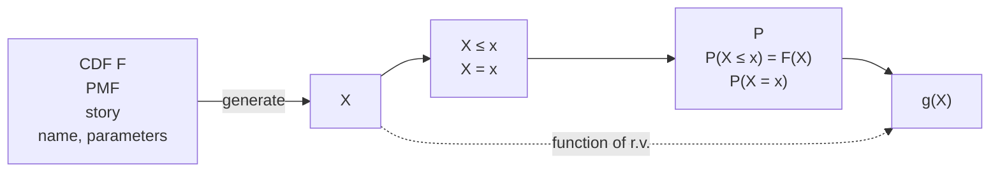

We can think of the distribution of a random variable as a map or blueprint describing the r.v. Just as different houses can share the same blueprint, different r.v.s can have the same distribution, even if the experiments they summarize, and the sample spaces they map from, are not the same.

Here are two examples of sympathetic magic:

• Given an r.v. X, trying to get the PMF of 2X by multiplying the PMF of X by 2. It does not make sense to multiply a PMF by 2, since the probabilities would no longer sum to 1. As we saw above, if X takes on values $x _ { j }$ with probabilities $p _ { j }$ , then 2X takes on values $2 x _ { j }$ with probabilities $p _ { j }$ . Therefore the PMF of 2X is a horizontal stretch of the PMF of X; it is not a vertical stretch, as would result from multiplying the PMF by 2. Figure 3.11 shows the PMF of a discrete r.v. X with support {0, 1, 2, 3, 4}, along with the PMF of 2X, which has support {0, 2, 4, 6, 8}. Note that X can take on odd values, but 2X is necessarily even.

FIGURE 3.11

PMF of X (above) and PMF of 2X (below).

• Claiming that because X and Y have the same distribution, X must always equal Y , i.e., $P ( X = Y ) = 1$ . Just because two r.v.s have the same distribution does not mean they are always equal, or ever equal. We saw this in Example 3.2.5. As another example, consider flipping a fair coin once. Let X be the indicator of Heads and $Y = 1 - X$ be the indicator of Tails. Both X and Y have the Bern(1/2) distribution, but the event X = Y is impossible. The PMFs of X and Y are the same function, but X and Y are different mappings from the sample space to the real numbers.

If Z is the indicator of Heads in a second flip (independent of the first flip), then Z is also Bern(1/2), but Z is not the same r.v. as X. Here

$$
P (Z = X) = P (H H \text {or} T T) = 1 / 2.
$$

## 3.8 Independence of r.v.s

Just as we had the notion of independence of events, we can define independence of random variables. Intuitively, if two r.v.s X and Y are independent, then knowing the value of X gives no information about the value of Y , and vice versa. The definition formalizes this idea.

Definition 3.8.1 (Independence of two r.v.s). Random variables X and Y are said to be independent if

$$
P (X \leq x, Y \leq y) = P (X \leq x) P (Y \leq y),
$$

for all $x , y \in \mathbb { R }$

In the discrete case, this is equivalent to the condition

$$
P (X = x, Y = y) = P (X = x) P (Y = y),
$$

for all x, y with x in the support of X and y in the support of Y .

The definition for more than two r.v.s is analogous.

Definition 3.8.2 (Independence of many r.v.s). Random variables $X _ { 1 } , \ldots , X _ { n }$ are independent if

$$
P (X _ {1} \leq x _ {1}, \dots , X _ {n} \leq x _ {n}) = P (X _ {1} \leq x _ {1}) \dots P (X _ {n} \leq x _ {n}),
$$

for all $x _ { 1 } , \ldots , x _ { n } \in \mathbb { R }$ . For infinitely many r.v.s, we say that they are independent if every finite subset of the r.v.s is independent.

Comparing this to the criteria for independence of n events, it may seem strange that the independence of $X _ { 1 } , \ldots , X _ { n }$ requires just one equality, whereas for events we needed to verify pairwise independence for all $\left( \begin{matrix} { n } \\ { 2 } \\ \end{matrix} \right)$ pairs, three-way independence for all ${ \binom { n } { 3 } }$ triplets, and so on. However, upon closer examination of the definition, we see that independence of r.v.s requires the equality to hold for all possible $x _ { 1 } , \ldots , x _ { n } { \mathrm {  —  } }$ infinitely many conditions! If we can find even a single list of values $x _ { 1 } , \ldots , x _ { n }$ for which the above equality fails to hold, then $X _ { 1 } , \ldots , X _ { n }$ are not independent.

h 3.8.3. If $X _ { 1 } , \ldots , X _ { n }$ are independent, then they are pairwise independent, i.e., $X _ { i }$ is independent of $X _ { j }$ for $i \neq j$ . The idea behind proving that $X _ { i }$ and $X _ { j }$ are independent is to let all the $x _ { k }$ other than $x _ { i } , x _ { j }$ go to $\infty$ in the definition of independence, since we already know $X _ { k } < \infty$ is true (though it takes some work to give a complete justification for the limit). But pairwise independence does not imply independence in general, as we saw in Chapter 2 for events.

Example 3.8.4. In a roll of two fair dice, if X is the number on the first die and $Y$ is the number on the second die, then $X + Y$ is not independent of $X - Y$ since

$$
0 = P (X + Y = 1 2, X - Y = 1) \neq P (X + Y = 1 2) P (X - Y = 1) = \frac {1}{3 6} \cdot \frac {5}{3 6}.
$$

Knowing the total is 12 tells us the difference must be 0, so the r.v.s provide information about each other. 

If X and Y are independent then it is also true, e.g., that $X ^ { 2 }$ is independent of $Y ^ { 4 }$ since if $X ^ { 2 }$ provided information about $Y ^ { 4 }$ , then X would give information about Y (using $X ^ { 2 }$ and $Y ^ { 4 }$ as intermediaries: X determines $X ^ { 2 }$ , which would give information about $Y ^ { 4 }$ , which in turn would give information about Y ). More generally, we have the following result (for which we omit a formal proof).

Theorem 3.8.5 (Functions of independent r.v.s). If X and Y are independent r.v.s, then any function of X is independent of any function of $Y$

Definition 3.8.6 (i.i.d.). We will often work with random variables that are inde pendent and have the same distribution. We call such r.v.s independent and identically distributed, or i.i.d. for short.

h 3.8.7 (i. vs. i.d.). “Independent” and “identically distributed” are two oftenconfused but completely different concepts. Random variables are independent if they provide no information about each other; they are identically distributed if they have the same PMF (or equivalently, the same CDF). Whether two r.v.s are independent has nothing to do with whether they have the same distribution. We can have r.v.s that are:

• independent and identically distributed. Let X be the result of a die roll, and let Y be the result of a second, independent die roll. Then X and Y are i.i.d.
• independent and not identically distributed. Let X be the result of a die roll, and let Y be the closing price of the Dow Jones (a stock market index) a month from now. Then X and Y provide no information about each other (one would fervently hope), and X and Y do not have the same distribution.

• dependent and identically distributed. Let X be the number of Heads in n independent fair coin tosses, and let Y be the number of Tails in those same n tosses. Then X and Y are both distributed Bin $( n , 1 / 2 )$ , but they are highly dependent: if we know X, then we know Y perfectly.
• dependent and not identically distributed. Let X be the indicator of whether the majority party retains control of the House of Representatives in the U.S. after the next election, and let Y be the average favorability rating of the majority party in polls taken within a month of the election. Then X and $Y$ are dependent, and X and Y do not have the same distribution.

By taking a sum of i.i.d. Bernoulli r.v.s, we can write down the story of the Binomial distribution in an algebraic form.

Theorem 3.8.8. If $X \sim \operatorname { B i n } ( n , p )$ , viewed as the number of successes in n independent Bernoulli trials with success probability $p ,$ then we can write $X = X _ { 1 } { + } { \cdots + } X _ { n }$ where the $X _ { i }$ are i.i.d. Bern $( p )$

Proof. Let $X _ { i } = 1$ if the ith trial was a success, and 0 if the ith trial was a failure. It’s as though we have a person assigned to each trial, and we ask each person to raise their hand if their trial was a success. If we count the number of raised hands (which is the same as adding up the $X _ { i } )$ , we get the total number of successes. 

An important fact about the Binomial distribution is that the sum of independent Binomial r.v.s with the same success probability is also Binomial.

Theorem 3.8.9. If $X   \sim   \mathrm { B i n } ( n , p ) ,   Y   \sim   \mathrm { B i n } ( m , p )$ , and X is independent of $Y$ , then $X + Y \sim \mathrm { B i n } ( n + m , p )$

Proof. We present three proofs, since each illustrates a useful technique.

1. LOTP: We can directly find the PMF of $X + Y$ by conditioning on $X   (or   Y$ whichever we prefer) and using the law of total probability:

$$
\begin{array}{l} P (X + Y = k) = \sum_ {j = 0} ^ {k} P (X + Y = k | X = j) P (X = j) \\ = \sum_ {j = 0} ^ {k} P (Y = k - j) P (X = j) \\ = \sum_ {j = 0} ^ {k} \binom {m} {k - j} p ^ {k - j} q ^ {m - k + j} \binom {n} {j} p ^ {j} q ^ {n - j} \\ = p ^ {k} q ^ {n + m - k} \sum_ {j = 0} ^ {k} \binom{m}{k - j} \binom{n}{j} \\ = \binom{n + m}{k} p ^ {k} q ^ {n + m - k}. \\ \end{array}
$$

In the second line, we used the independence of X and Y to justify dropping the conditioning in

$$
P (X + Y = k | X = j) = P (Y = k - j | X = j) = P (Y = k - j),
$$

and in the last line, we used the fact that

$$
\sum_ {j = 0} ^ {k} \binom{m}{k - j} \binom{n}{j} = \binom{n + m}{k}
$$

by Vandermonde’s identity. The resulting expression is the $\mathrm { B i n } ( n + m , p )$ PMF, so $X + Y \sim \mathrm { B i n } ( n + m , p )$

2. Representation: A much simpler proof is to represent both X and Y as the sum of i.i.d. Bern(p) r.v.s: $X = X _ { 1 } + \cdots + X _ { n }$ and $Y = Y _ { 1 } + \cdots + Y _ { m }$ , where the $X _ { i }$ and $Y _ { j }$ are all i.i.d. Bern(p). Then $X + Y$ is the sum of n + m i.i.d. Bern(p) r.v.s, so its distribution, by the previous theorem, is $\mathrm { B i n } ( n + m , p )$

3. Story: By the Binomial story, X is the number of successes in n independent trials and $Y$ is the number of successes in m additional independent trials, all with the same success probability, so $X + Y$ is the total number of successes in the $n   +   m$ trials, which is the story of the $\operatorname { B i n } ( n + m , p )$ distribution.

Of course, if we have a definition for independence of r.v.s, we should have an analogous definition for conditional independence of r.v.s.

Definition 3.8.10 (Conditional independence of r.v.s). Random variables X and Y are conditionally independent given an r.v. Z if for all $x , y \in \mathbb { R }$ and all z in the support of $Z ,$

$$
P (X \leq x, Y \leq y | Z = z) = P (X \leq x | Z = z) P (Y \leq y | Z = z).
$$

For discrete r.v.s, an equivalent definition is to require

$$
P (X = x, Y = y | Z = z) = P (X = x | Z = z) P (Y = y | Z = z).
$$

As we might expect from the name, this is the definition of independence, except that we condition on $Z = z$ everywhere, and require the equality to hold for all $z$ in the support of $Z .$

Definition 3.8.11 (Conditional PMF). For any discrete r.v.s X and $Z ,$ the function $P ( X   =   x | Z   =   z )$ , when considered as a function of x for fixed $z ,$ is called the conditional PMF of X given $Z = z$

Independence of r.v.s does not imply conditional independence, nor vice versa. First let us show why independence does not imply conditional independence.

Example 3.8.12 (Matching pennies). Consider the simple game called matching pennies. Each of two players, A and B, has a fair penny. They flip their pennies independently. If the pennies match, A wins; otherwise, B wins. Let X be 1 if A’s penny lands Heads and −1 otherwise, and define Y similarly for B (the r.v.s X and Y are called random signs).

Let $Z = X Y$ , which is 1 if A wins and −1 if B wins. Then X and Y are unconditionally independent, but given $Z = 1$ , we know that $X = Y$ (the pennies match). So X and Y are conditionally dependent given Z. 

Example 3.8.13 (Two friends). Consider again the “I have only two friends who ever call me” scenario from Example 2.5.11, except now with r.v. notation. Let X be the indicator of Alice calling me next Friday, Y be the indicator of Bob calling me next Friday, and Z be the indicator of exactly one of them calling me next Friday. Then X and Y are independent (by assumption). But given $Z = 1$ , we have that X and Y are completely dependent: given that $Z = 1$ , we have $Y = 1 - X$ 

Next let’s see why conditional independence does not imply independence.

Example 3.8.14 (Mystery opponent). Suppose that you are going to play two games of tennis against one of two identical twins. Against one of the twins, you are evenly matched, and against the other you have a 3/4 chance of winning. Suppose that you can’t tell which twin you are playing against until after the two games. Let Z be the indicator of playing against the twin with whom you’re evenly matched, and let X and Y be the indicators of victory in the first and second games, respectively.

Conditional on $Z = 1$ , X and Y are i.i.d. $\mathrm { B e r n } ( 1 / 2 )$ , and conditional on $Z   =   0$ X and Y are i.i.d. Bern $( 3 / 4 )$ . So X and Y are conditionally independent given Z. Unconditionally, X and Y are dependent because observing $X = 1$ makes it more likely that we are playing the twin who is worse. That is,

$$
P (Y = 1 | X = 1) > P (Y = 1).
$$

Past games give us information which helps us infer who our opponent is, which in turn helps us predict future games! Note that this example is isomorphic to the “random coin” scenario from Example 2.3.7. 

## 3.9 Connections between Binomial and Hypergeometric

The Binomial and Hypergeometric distributions are connected in two important ways. As we will see in this section, we can get from the Binomial to the Hypergeometric by conditioning, and we can get from the Hypergeometric to the Binomial by taking a limit. We’ll start with a motivating example.

Example 3.9.1 (Fisher exact test). A scientist wishes to study whether women or men are more likely to have a certain disease, or whether they are equally likely. A random sample of n women and m men is gathered, and each person is tested for the disease (assume for this problem that the test is completely accurate). The numbers of women and men in the sample who have the disease are X and $Y$ respectively, with $X \sim \operatorname { B i n } ( n , p _ { 1 } )$ and $Y \sim \mathrm { B i n } ( m , p _ { 2 } )$ , independently. Here $p _ { 1 }$ and $p _ { 2 }$ are unknown, and we are interested in testing whether $p _ { 1 } = p _ { 2 }$ (this is known as a null hypothesis in statistics).

Consider a $2 \times 2$ table with rows corresponding to disease status and columns corresponding to gender. Each entry is the count of how many people have that disease status and gender, so $n + m$ is the sum of all 4 entries. Suppose that it is observed that $X + Y = r$

The Fisher exact test is based on conditioning on both the row and column sums, so $n , m , r$ are all treated as fixed, and then seeing if the observed value of X is “extreme” compared to this conditional distribution. Assuming the null hypothesis, find the conditional PMF of X given $X + Y = r .$

Solution:

First we’ll build the $2 \times 2$ table, treating $n ,   m ,$ and $r$ as fixed.

|  | Women | Men | Total |
| --- | --- | --- | --- |
| Disease | x | r - x | r |
| No disease | n - x | m - r + x | n + m - r |
| Total | n | m | n + m |

Next, let’s compute the conditional PMF $P(X = x|X + Y = r)$ . By Bayes’ rule,

$$
\begin{array}{l} P (X = x \mid X + Y = r) = \frac {P (X + Y = r \mid X = x) P (X = x)}{P (X + Y = r)} \\ = \frac {P (Y = r - x) P (X = x)}{P (X + Y = r)}. \\ \end{array}
$$

The step $P ( X   +   Y = r | X = x ) = P ( Y = r   -   x )$ is justified by the independence of X and Y . Assuming the null hypothesis and letting $p = p _ { 1 } = p _ { 2 }$ , we have $X \sim \operatorname { B i n } ( n , p )$ and $Y \sim \mathrm { B i n } ( m , p )$ , independently, so $X + Y \sim \mathrm { B i n } ( n + m , p )$ . Thus,

$$
\begin{array}{l} P (X = x \mid X + Y = r) = \frac {\binom {m} {r - x} p ^ {r - x} (1 - p) ^ {m - r + x} \binom {n} {x} p ^ {x} (1 - p) ^ {n - x}}{\binom {n + m} {r} p ^ {r} (1 - p) ^ {n + m - r}} \\ = \frac {\binom {n} {x} \binom {m} {r - x}}{\binom {n + m} {r}}. \\ \end{array}
$$

So the conditional distribution of X is Hypergeometric with parameters $n , m , r .$

To understand why the Hypergeometric appeared, seemingly out of nowhere, let’s connect this problem to the elk story for the Hypergeometric. In the elk story, we are interested in the distribution of the number of tagged elk in the recaptured sample. By analogy, think of women as tagged elk and men as untagged elk. Instead of recapturing $r$ elk at random from the forest, we infect $X + Y = r$ people with the disease; under the null hypothesis, the set of diseased people is equally likely to be any set of $r$ people. Thus, conditional on $X + Y = r ,$ X represents the number of women among the $r$ diseased individuals. This is exactly analogous to the number of tagged elk in the recaptured sample, which is distributed HGeom $( n , m , r )$

An interesting fact, which turns out to be useful in statistics, is that the conditional distribution of X does not depend on $p ;$ unconditionally, $X   \sim   \mathrm { B i n } ( n , p )$ , but $p$ disappears from the parameters of the conditional distribution! This makes sense upon reflection, since once we know $X + Y = r$ , we can work directly with the fact that we have a population with r diseased and $n + m - r$ healthy people, without worrying about the value of $p$ that originally generated the population. 

This motivating example serves as a proof of the following theorem.

Theorem 3.9.2. If $X   \sim   \mathrm { B i n } ( n , p ) ,   Y   \sim   \mathrm { B i n } ( m , p )$ , and X is independent of $Y .$ then the conditional distribution of X given $X + Y = r$ is $\operatorname { H G e o m } ( n , m , r )$

In the other direction, the Binomial is a limiting case of the Hypergeometric.

Theorem 3.9.3. If $X   \sim   \operatorname { H G e o m } ( w , b , n )$ and $N   =   w   +   b   \rightarrow   \infty$ such that $p =$ $w / ( w + b )$ remains fixed, then the PMF of $X$ converges to the $\mathrm { B i n } ( n , p ) \mathrm { P M F }$

Proof. We take the stated limit of the HGeom $( w , b , n )$ PMF:

$$
\begin{array}{l} P (X = k) = \frac {\binom{w}{k} \binom{b}{n - k}}{\binom{w + b}{n}} \\ = \binom {n} {k} \frac {\binom {w + b - n} {w - k}}{\binom {w + b} {w}} \quad \text {by Theorem 3.4.5} \\ = \binom {n} {k} \frac {w !}{(w - k) !} \frac {b !}{(b - n + k) !} \frac {(w + b - n) !}{(w + b) !} \\ = \binom {n} {k} \frac {w (w - 1) \dots (w - k + 1) b (b - 1) \dots (b - n + k + 1)}{(w + b) (w + b - 1) \dots (w + b - n + 1)} \\ = \binom{n}{k} \frac {p \left(p - \frac {1}{N}\right) \dots \left(p - \frac {k - 1}{N}\right) q \left(q - \frac {1}{N}\right) \dots \left(q - \frac {n - k - 1}{N}\right)}{\left(1 - \frac {1}{N}\right) \left(1 - \frac {2}{N}\right) \dots \left(1 - \frac {n - 1}{N}\right)}. \\ \end{array}
$$

As $N \to \infty$ , the denominator goes to 1, and the numerator goes to $p ^ { k } q ^ { n - k }$ . Thus

$$
P (X = k) \rightarrow \binom{n}{k} p ^ {k} q ^ {n - k},
$$

which is the $\operatorname { B i n } ( n , p )$ PMF.

The stories of the Binomial and Hypergeometric provide intuition for this result: given an urn with w white balls and b black balls, the Binomial distribution arises from sampling n balls from the urn with replacement, while the Hypergeometric arises from sampling without replacement. As the number of balls in the urn grows very large relative to the number of balls that are drawn, sampling with replacement and sampling without replacement become essentially equivalent. In practical terms, this theorem tells us that if $N = w + b$ is large relative to n, we can approximate the HGeom $( w , b , n )$ PMF by the Bin $( n , w / ( w + b ) )$ PMF.

The birthday problem implies that it is surprisingly likely that some ball will be sampled more than once if sampling with replacement; for example, if 1,200 out of 1,000,000 balls are drawn randomly with replacement, then there is about a 51% chance that some ball will be drawn more than once! But this becomes less and less likely as N grows, and even if it is likely that there will be a few coincidences, the approximation can still be reasonable if it is very likely that the vast majority of balls in the sample are sampled only once each.

## 3.10 Recap

A random variable (r.v.) is a function assigning a real number to every possible outcome of an experiment. The distribution of an r.v. X is a full specification of the probabilities for the events associated with X, such as $\{ X = 3 \}$ and $\{ 1 \leq X \leq 5 \}$ The distribution of a discrete r.v. can be defined using a PMF, a CDF, or a story. The PMF of X is the function $P ( X = x )$ for $x \in \mathbb { R }$ . The CDF of X is the function $P ( X \leq x )$ for $x \in \mathbb { R }$ . A story for X describes an experiment that could give rise to a random variable with the same distribution as X.

For a PMF to be valid, it must be nonnegative and sum to 1. For a CDF to be valid, it must be increasing, right-continuous, converge to 0 as $x \to - \infty$ , and converge to 1 as $x \to \infty$

It is important to distinguish between a random variable and its distribution: the distribution is a blueprint for building the r.v., but different r.v.s can have the same distribution, just as different houses can be built from the same blueprint.

Four named discrete distributions are the Bernoulli, Binomial, Hypergeometric, and Discrete Uniform. Each of these is actually a family of distributions, indexed by parameters; to fully specify one of these distributions, we need to give both the name and the parameter values.

• A Bern(p) r.v. is the indicator of success in a Bernoulli trial with probability of success p.
• A $\operatorname { B i n } ( n , p )$ r.v. is the number of successes in n independent Bernoulli trials, all with the same probability p of success.

• A HGeom $( w , b , n )$ r.v. is the number of white balls obtained in a sample of size n drawn without replacement from an urn of w white and b black balls.
• A DUnif(C) r.v. is obtained by randomly choosing an element of the finite set $C ,$ with equal probabilities for each element.

A function of a random variable is still a random variable. If we know the PMF of X, we can find $P ( g ( X ) = k )$ , the PMF of $g ( X )$ , by translating the event $\{ g ( X ) = k \}$ into an equivalent event involving X, then using the PMF of X.

Two random variables are independent if knowing the value of one r.v. gives no information about the value of the other. This is unrelated to whether the two r.v.s are identically distributed. In Chapter $^ { 7 , }$ we will learn how to deal with dependent random variables by considering them jointly rather than separately.

We have now seen four fundamental types of objects in probability: distributions, random variables, events, and numbers. Figure 3.12 shows connections between these four fundamental objects. A CDF can be used as a blueprint for generating an r.v., and then there are various events describing the behavior of the r.v., such as the events $X \leq x$ for all x. Knowing the probabilities of these events determines the CDF, taking us full circle. For a discrete r.v. we can also use the PMF as a blueprint, and go from distribution to r.v. to events and back again.

flowchart

FIGURE 3.12

Four fundamental objects in probability: distributions (blueprints), random variables, events, and numbers. From a CDF F we can generate an r.v. X. From $X$ , we can generate many other r.v.s by taking functions of $X$ . There are various events describing the behavior of X. Most notably, for any constant x the events $X \leq x$ and $X = x$ are of interest. Knowing the probabilities of these events for all x gives us the CDF and (in the discrete case) the PMF, taking us full circle.

## 3.11 R

## Distributions in R

All of the named distributions that we’ll encounter in this book have been implemented in R. In this section we’ll explain how to work with the Binomial and Hypergeometric distributions in R. We will also explain in general how to generate r.v.s from any discrete distribution with a finite support. Typing help(distributions) gives a handy list of built-in distributions; many others are available through R packages that can be loaded.

In general, for many named discrete distributions, three functions starting with d, p, and r will give the PMF, CDF, and random generation, respectively. Note that the function starting with p is not the PMF, but rather is the CDF.

## Binomial distribution

The Binomial distribution is associated with the following three R functions: dbinom, pbinom, and rbinom. For the Bernoulli distribution we can just use the Binomial functions with n = 1.

• dbinom is the Binomial PMF. It takes three inputs: the first is the value of x at which to evaluate the PMF, and the second and third are the parameters n and p. For example, dbinom(3,5,0.2) returns the probability $P ( X = 3 )$ where $X \sim \mathrm { B i n } ( 5 , 0 . 2 )$ . In other words,

$$
\mathrm{dbinom} (3, 5, 0. 2) = \binom {5} {3} (0. 2) ^ {3} (0. 8) ^ {2} = 0. 0 5 1 2.
$$

• pbinom is the Binomial CDF. It takes three inputs: the first is the value of x at which to evaluate the CDF, and the second and third are the parameters. pbinom(3,5,0.2) is the probability $P ( X \leq 3 )$ where $X \sim \mathrm { B i n } ( 5 , 0 . 2 )$ . So

$$
\mathrm{pbinom} (3, 5, 0. 2) = \sum_ {k = 0} ^ {3} \binom {5} {k} (0. 2) ^ {k} (0. 8) ^ {5 - k} = 0. 9 9 3 3.
$$

• rbinom is a function for generating Binomial random variables. For rbinom, the first input is how many r.v.s we want to generate, and the second and third inputs are still the parameters. Thus the command rbinom $( 7   , 5   , 0   . 2 )$ produces realizations of seven i.i.d. Bin(5, 0.2) r.v.s. When we ran this command, we got

but you’ll probably get something different when you try it!

We can also evaluate PMFs and CDFs at an entire vector of values. For example, recall that 0:n is a quick way to list the integers from 0 to $n .$ The command dbinom $( 0 : 5 , 5 , 0 . 2 )$ returns 6 numbers, $P(X = 0),P(X = 1),\ldots,P(X = 5)$ , where $X \sim \mathrm { B i n } ( 5 , 0 . 2 )$

## Hypergeometric distribution

The Hypergeometric distribution also has three functions: dhyper, phyper, and rhyper. As one might expect, dhyper is the Hypergeometric PMF, phyper is the Hypergeometric CDF, and rhyper generates Hypergeometric r.v.s. Since the Hypergeometric distribution has three parameters, each of these functions takes four inputs. For dhyper and phyper, the first input is the value at which we wish to evaluate the PMF or CDF, and the remaining inputs are the parameters of the distribution.

Thus dhyper $( \mathtt { k } , \mathtt { w } , \mathtt { b } , \mathtt { n } )$ returns $P ( X ~ = ~ k )$ where $X \sim \operatorname { H G e o m } ( w , b , n )$ , and phyper $( \mathtt { k } , \mathtt { w } , \mathtt { b } , \mathtt { n } )$ returns $P ( X \leq k )$ . For rhyper, the first input is the number of r.v.s we want to generate, and the remaining inputs are the parameters; rhyper $(100, \mathrm{w}, \mathrm{b}, \mathrm{n})$ generates 100 i.i.d. HGeom $( w , b , n )$ r.v.s.

## Discrete distributions with finite support

We can generate r.v.s from any discrete distribution with finite support using the sample command. When we first introduced the sample command, we said that it can be used in the form sample $( \mathbf { n } , \mathbf { k } )$ or sample(n,k,replace=TRUE) to sample k times from the integers 1 through n, either without or with replacement. For example, to generate 5 independent DUnif(1, 2, . . . , 100) r.v.s, we can use the command sample(100,5,replace=TRUE).

It turns out that sample is far more versatile. If we want to sample from the values $x _ { 1 } , \ldots , x _ { n }$ with probabilities $p _ { 1 } , \ldots , p _ { n }$ , we simply create a vector x containing all the $x _ { i }$ and a vector p containing all the $p _ { i }$ , then feed them into sample. Suppose we want realizations of i.i.d. r.v.s $X _ { 1 } , \ldots , X _ { 1 0 0 }$ whose PMF is

$$
P (X _ {j} = 0) = 0. 2 5,
$$

$$
P (X _ {j} = 1) = 0. 5,
$$

$$
P (X _ {j} = 5) = 0. 1,
$$

$$
P (X _ {j} = 1 0) = 0. 1 5,
$$

and $P ( X _ { j } \; = \; x ) \; = \; 0$ for all other values of x. First, we use the c function to create vectors with the support of the distribution and the corresponding probabilities.

$$
\mathrm{x} <   - \mathrm{c} (0, 1, 5, 1 0)
$$

$$
\mathrm{p} <   - \mathrm{c} (0. 2 5, 0. 5, 0. 1, 0. 1 5)
$$

Next, we use sample. Here’s how to get 100 draws from the PMF above:

$$
\text {sample} (x, 1 0 0, \text {prob} = p, \text {replace} = \text {TRUE})
$$

The inputs are the vector x to sample from, the sample size (100 in this case), the probabilities p to use when sampling from x (if this is omitted, the probabilities are assumed equal), and whether to sample with replacement.

## 3.12 Exercises

Exercises marked with s have detailed solutions at [http://stat110.net](http://stat110.net).

## PMFs and CDFs

1. People are arriving at a party one at a time. While waiting for more people to arrive they entertain themselves by comparing their birthdays. Let X be the number of people needed to obtain a birthday match, i.e., before person X arrives no two people have the same birthday, but when person X arrives there is a match. Find the $\mathrm { P M F }$ of $X$

2. (a) Independent Bernoulli trials are performed, with probability $1 / 2$ of success, until there has been at least one success. Find the PMF of the number of trials performed.

(b) Independent Bernoulli trials are performed, with probability $1 / 2$ of success, until there has been at least one success and at least one failure. Find the PMF of the number of trials performed.

3. Let X be an r.v. with CDF $F ,$ and $Y = \mu + \sigma X$ , where $\mu$ and $\sigma$ are real numbers with $\sigma > 0$ . (Then Y is called a location-scale transformation of $X ;$ we will encounter this concept many times in Chapter 5 and beyond.) Find the CDF of $Y ,$ in terms of $F$

4. Let n be a positive integer and

$$
F (x) = \frac {\lfloor x \rfloor}{n}
$$

for $0 \leq x \leq n,   F(x) = 0$ for $x < 0$ , and $F ( x ) = 1$ for $x > n ,$ where $\lfloor x \rfloor$ is the greatest integer less than or equal to x. Show that F is a CDF, and find the PMF that it corresponds to.

5. (a) Show that $\textstyle p ( n ) = { \big ( } { \frac { 1 } { 2 } } { \big ) } ^ { n + 1 }$ for $n = 0 , 1 , 2 , \ldots$ . is a valid PMF for a discrete r.v.

(b) Find the CDF of a random variable with the PMF from (a).

6. s Benford’s law states that in a very large variety of real-life data sets, the first digit approximately follows a particular distribution with about a 30% chance of a 1, an 18% chance of a 2, and in general

$$
P (D = j) = \log_ {1 0} \left(\frac {j + 1}{j}\right), \text {for} j \in \{1, 2, 3, \dots , 9 \},
$$

where D is the first digit of a randomly chosen element. Check that this is a valid PMF (using properties of logs, not with a calculator).

7. Bob is playing a video game that has 7 levels. He starts at level 1, and has probability $p _ { 1 }$ of reaching level 2. In general, given that he reaches level $j ,$ he has probability $p _ { j }$ of reaching level $j + 1$ , for $1 \leq j \leq 6$ . Let X be the highest level that he reaches. Find the PMF of X (in terms of $p _ { 1 } , \ldots , p _ { 6 } )$

8. There are 100 prizes, with one worth \$1, one worth $\S 2 , \ldots$ , and one worth \$100. There are 100 boxes, each of which contains one of the prizes. You get 5 prizes by picking random boxes one at a time, without replacement. Find the PMF of how much your most valuable prize is worth (as a simple expression in terms of binomial coefficients).

9. Let $F _ { 1 }$ and $F _ { 2 }$ be CDFs, $0 < p < 1$ , and $F ( x ) = p F _ { 1 } ( x ) + ( 1 - p ) F _ { 2 } ( x )$ for all x.

(a) Show directly that F has the properties of a valid CDF (see Theorem 3.6.3). The distribution defined by F is called a mixture of the distributions defined by $F _ { 1 }$ and $F _ { 2 }$
(b) Consider creating an r.v. in the following way. Flip a coin with probability p of Heads. If the coin lands Heads, generate an r.v. according to $F _ { 1 } ;$ if the coin lands Tails, generate an r.v. according to $F _ { 2 }$ . Show that the r.v. obtained in this way has CDF F.

10. (a) Is there a discrete distribution with support $1 , 2 , 3 , \ldots ,$ such that the value of the PMF at n is proportional to $1 / n ?$

Hint: See the math appendix for a review of some facts about series.

(b) Is there a discrete distribution with support 1, $2 , 3 , \ldots ,$ such that the value of the PMF at n is proportional to $1 / n ^ { 2 } ?$

11. s Let X be an r.v. whose possible values are 0, 1, 2, . . . , with CDF F. In some countries, rather than using a CDF, the convention is to use the function G defined by $G ( x ) =$ $P ( X < x )$ to specify a distribution. Find a way to convert from F to G, i.e., if F is a known function, show how to obtain $G ( x )$ for all real x.

12. (a) Give an example of r.v.s X and Y such that $F _ { X } ( x ) \leq F _ { Y } ( x )$ for all x, where the inequality is strict for some x. Here $F _ { X }$ is the CDF of X and $F _ { Y }$ is the CDF of Y . For the example you gave, sketch the CDFs of both X and Y on the same axes. Then sketch their PMFs on a second set of axes.

(b) In Part (a), you found an example of two different CDFs where the first is less than or equal to the second everywhere. Is it possible to find two different PMFs where the first is less than or equal to the second everywhere? In other words, find discrete r.v.s X and Y such that $P ( X = x ) \leq P ( Y = x )$ for all x, where the inequality is strict for some x, or show that it is impossible to find such r.v.s.

13. Let X, Y, Z be discrete r.v.s such that X and Y have the same conditional distribution given Z, i.e., for all a and z we have

$$
P (X = a | Z = z) = P (Y = a | Z = z).
$$

Show that X and Y have the same distribution (unconditionally, not just when given $Z )$

14. Let X be the number of purchases that Fred will make on the online site for a certain company (in some specified time period). Suppose that the PMF of X is $P(X = k) =$ $e ^ { - \lambda \bar { \lambda } ^ { k } / \bar { k } ! }$ for $k   =   0 , 1 , 2 , \ldots$ . This distribution is called the Poisson distribution with parameter λ, and it will be studied extensively in later chapters.

(a) Find $P ( X \geq 1 )$ and $P ( X \geq 2 )$ without summing infinite series.

(b) Suppose that the company only knows about people who have made at least one purchase on their site (a user sets up an account to make a purchase, but someone who has never made a purchase there doesn’t appear in the customer database). If the company computes the number of purchases for everyone in their database, then these data are draws from the conditional distribution of the number of purchases, given that at least one purchase is made. Find the conditional PMF of X given $X   \geq   1$ . (This conditional distribution is called a truncated Poisson distribution.)

## Named distributions

15. Find the CDF of an r.v. $X \sim \operatorname { D U n i f } ( 1 , 2 , \ldots , n )$
16. Let $X \sim \operatorname { D U n i f } ( C )$ , and B be a nonempty subset of C. Find the conditional distribution of X, given that X is in B.
17. An airline overbooks a flight, selling more tickets for the flight than there are seats on the plane (figuring that it’s likely that some people won’t show up). The plane has 100 seats, and 110 people have booked the flight. Each person will show up for the flight with probability 0.9, independently. Find the probability that there will be enough seats for everyone who shows up for the flight.

18. s (a) In the World Series of baseball, two teams (call them A and B) play a sequence of games against each other, and the first team to win four games wins the series. Let p be the probability that A wins an individual game, and assume that the games are independent. What is the probability that team A wins the series?

(b) Give a clear intuitive explanation of whether the answer to (a) depends on whether the teams always play 7 games (and whoever wins the majority wins the series), or the teams stop playing more games as soon as one team has won 4 games (as is actually the case in practice: once the match is decided, the two teams do not keep playing more games).

19. In a chess tournament, n games are being played, independently. Each game ends in a win for one player with probability 0.4 and ends in a draw (tie) with probability 0.6. Find the PMFs of the number of games ending in a draw, and of the number of players whose games end in draws.

20. Suppose that a lottery ticket has probability p of being a winning ticket, independently of other tickets. A gambler buys 3 tickets, hoping this will triple the chance of having at least one winning ticket.

(a) What is the distribution of how many of the 3 tickets are winning tickets?

(b) Show that the probability that at least 1 of the 3 tickets is winning is $3 p - 3 p ^ { 2 } + p ^ { 3 }$ in two different ways: by using inclusion-exclusion, and by taking the complement of the desired event and then using the PMF of a certain named distribution.

(c) Show that the gambler’s chances of having at least one winning ticket do not quite triple (compared with buying only one ticket), but that they do approximately triple if p is small.

21. s Let $X \sim \operatorname { B i n } ( n , p )$ and $Y \sim \operatorname { B i n } ( m , p )$ , independent of X. Show that $X - Y$ is not Binomial.

22. There are two coins, one with probability p1 of Heads and the other with probability $p _ { 2 }$ of Heads. One of the coins is randomly chosen (with equal probabilities for the two coins). It is then flipped $n \geq 2$ times. Let X be the number of times it lands Heads.

(a) Find the PMF of X.
(b) What is the distribution of X if $p _ { 1 } = p _ { 2 } ?$
(c) Give an intuitive explanation of why X is not Binomial for $p _ { 1 } \neq p _ { 2 }$ (its distribution is called a mixture of two Binomials). You can assume that n is large for your explanation, so that the frequentist interpretation of probability can be applied.

23. There are n people eligible to vote in a certain election. Voting requires registration. Decisions are made independently. Each of the n people will register with probability p1. Given that a person registers, they will vote with probability p2. Given that a person votes, they will vote for Kodos (who is one of the candidates) with probability $p _ { 3 }$ . What is the distribution of the number of votes for Kodos (give the PMF, fully simplified, or the name of the distribution, including its parameters)?

24. Let X be the number of Heads in 10 fair coin tosses.

(a) Find the conditional PMF of X, given that the first two tosses both land Heads.
(b) Find the conditional PMF of X, given that at least two tosses land Heads.

25. s Alice flips a fair coin n times and Bob flips another fair coin $n + 1$ times, resulting in independent $X \sim \mathrm { B i n } ( n , { \textstyle { \frac { 1 } { 2 } } } )$ and $Y \sim \mathrm { B i n } ( n + 1 , { \textstyle { \frac { 1 } { 2 } } } )$

(a) Show that $P(X < Y) = P(n - X < n + 1 - Y)$
(b) Compute $P(X < Y)$

Hint: Use (a) and the fact that X and Y are integer-valued.

26. If $X \sim \operatorname { H G e o m } ( w , b , n )$ , what is the distribution of $n - X ?$ Give a short proof.
27. Recall de Montmort’s matching problem from Chapter 1: in a deck of n cards labeled 1 through n, a match occurs when the number on the card matches the card’s position in the deck. Let X be the number of matching cards. Is X Binomial? Is X Hypergeometric?
28. s There are n eggs, each of which hatches a chick with probability p (independently). Each of these chicks survives with probability r, independently. What is the distribution of the number of chicks that hatch? What is the distribution of the number of chicks that survive? (Give the PMFs; also give the names of the distributions and their parameters, if applicable.)
29. s A sequence of n independent experiments is performed. Each experiment is a success with probability p and a failure with probability $q = 1 - p .$ Show that conditional on the number of successes, all valid possibilities for the list of outcomes of the experiment are equally likely.
30. A certain company has n + m employees, consisting of n women and m men. The company is deciding which employees to promote.

(a) Suppose for this part that the company decides to promote t employees, where $1 \leq t \leq n + m$ , by choosing t random employees (with equal probabilities for each set of t employees). What is the distribution of the number of women who get promoted?
(b) Now suppose that instead of having a predetermined number of promotions to give, the company decides independently for each employee, promoting the employee with probability p. Find the distributions of the number of women who are promoted, the number of women who are not promoted, and the number of employees who are promoted.
(c) In the set-up from (b), find the conditional distribution of the number of women who are promoted, given that exactly t employees are promoted.

31. Once upon a time, a famous statistician offered tea to a lady. The lady claimed that she could tell whether milk had been added to the cup before or after the tea. The statistician decided to run some experiments to test her claim.

(a) The lady is given 6 cups of tea, where it is known in advance that 3 will be milkfirst and 3 will be tea-first, in a completely random order. The lady gets to taste each and then guess which 3 were milk-first. Assume for this part that she has no ability whatsoever to distinguish milk-first from tea-first cups of tea. Find the probability that at least 2 of her 3 guesses are correct.
(b) Now the lady is given one cup of tea, with probability $1 / 2$ of it being milk-first. She needs to say whether she thinks it was milk-first. Let $p _ { 1 }$ be the lady’s probability of being correct given that it was milk-first, and $p _ { 2 }$ be her probability of being correct given that it was tea-first. She claims that the cup was milk-first. Find the posterior odds that the cup is milk-first, given this information.