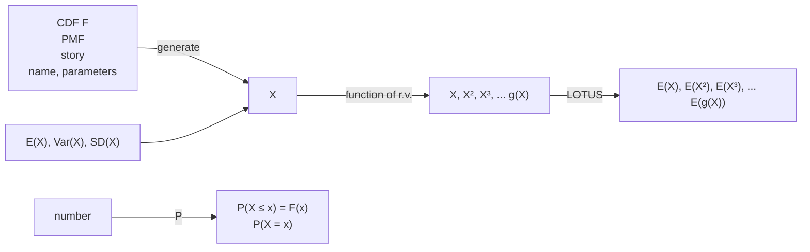

<details>
<summary>flowchart</summary>


</details>

FIGURE 4.9

Four fundamental objects in probability: distributions, random variables, events, and numbers. From an r.v. X, we can generate many other r.v.s by taking functions of X, and we can use LOTUS to find their expected values. The mean, variance, and standard deviation of X express the average and spread of the distribution of X (in particular, they only depend on F, not directly on X itself).

## 4.11 R

## Geometric, Negative Binomial, and Poisson

The three functions for the Geometric distribution in R are dgeom, pgeom, and rgeom, corresponding to the PMF, CDF, and random generation. For dgeom and pgeom, we need to supply the following as inputs: (1) the value at which to evaluate the PMF or CDF, and (2) the parameter p. For rgeom, we need to input (1) the number of random variables to generate and (2) the parameter $p .$

For example, to calculate $P ( X = 3 )$ and $P ( X \leq 3 )$ where $X \sim \mathrm { G e o m } ( 0 . 5 )$ , we use dgeom(3,0.5) and pgeom(3,0.5), respectively. To generate 100 i.i.d. Geom(0.8) r.v.s, we use rgeom(100,0.8). If instead we want 100 i.i.d. FS(0.8) r.v.s, we just need to add 1 to include the success: rgeom(100,0.8)+1.

For the Negative Binomial distribution, we have dnbinom, pnbinom, and rnbinom.

These take three inputs. For example, to calculate the NBin(5, 0.5) PMF at 3, we type dnbinom(3,5,0.5).

Finally, for the Poisson distribution, the three functions are dpois, ppois, and rpois. These take two inputs. For example, to find the Pois(10) CDF at 2, we type ppois(2,10).

## Matching simulation

Continuing with Example 4.4.4, let’s use simulation to calculate the expected number of matches in a deck of cards. As in Chapter 1, we let n be the number of cards in the deck and perform the experiment $1 0 ^ { 4 }$ 10 times using replicate.

```r
n <- 100
r <- replicate(10^4,sum(sample(n)==(1:n)))
```

Now r contains the number of matches from each of the $1 0 ^ { 4 }$ simulations. But instead of looking at the probability of at least one match, as in Chapter 1, we now want to find the expected number of matches. We can approximate this by the average of all the simulation results, that is, the arithmetic mean of the elements of r. This is accomplished with the mean function:

```txt
mean(r)
```

The command mean(r) is equivalent to sum(r)/length(r). The result we get is very close to 1, confirming the calculation we did in Example 4.4.4 using indicator r.v.s. You can verify that no matter what value of n you choose, mean(r) will be very close to 1.

## Distinct birthdays simulation

Let’s calculate the expected number of distinct birthdays in a group of k people by simulation. We’ll let k = 20, but you can choose whatever value of k you like.

```r
k <- 20
r <- replicate(10^4,{bdays <- sample(365,k,replace=TRUE);
            length(unique(bdays))})
```

In the second line, replicate repeats the expression in the curly braces $1 0 ^ { 4 }$ times, so we just need to understand what is inside the curly braces. First, we sample k times with replacement from the numbers 1 through 365 and call these the birthdays of the k people, bdays. Then, unique(bdays) removes duplicates in the vector bdays, and length(unique(bdays)) calculates the length of the vector after duplicates have been removed. The two commands need to be separated by a semicolon.

Now r contains the number of distinct birthdays that we observed in each of the $1 0 ^ { 4 }$ simulations. The average number of distinct birthdays across the $1 0 ^ { 4 }$ simulations is mean(r). We can compare the simulated value to the theoretical value that we found in Example 4.4.5 using indicator r.v.s:

mean(r)

365\*(1-(364/365)^k)

When we ran the code, both the simulated and theoretical values gave us approximately 19.5.

## 4.12 Exercises

Exercises marked with s have detailed solutions at [http://stat110.net](http://stat110.net).

## Expectations and variances

1. Bobo, the amoeba from Chapter 2, currently lives alone in a pond. After one minute Bobo will either die, split into two amoebas, or stay the same, with equal probability. Find the expectation and variance for the number of amoebas in the pond after one minute.

2. In the Gregorian calendar, each year has either 365 days (a normal year) or 366 days (a leap year). A year is randomly chosen, with probability 3/4 of being a normal year and 1/4 of being a leap year. Find the mean and variance of the number of days in the chosen year.

3. (a) A fair die is rolled. Find the expected value of the roll.

(b) Four fair dice are rolled. Find the expected total of the rolls.

4. A fair die is rolled some number of times. You can choose whether to stop after 1, 2, or 3 rolls, and your decision can be based on the values that have appeared so far. You receive the value shown on the last roll of the die, in dollars. What is your optimal strategy (to maximize your expected winnings)? Find the expected winnings for this strategy.

Hint: Start by considering a simpler version of this problem, where there are at most 2 rolls. For what values of the first roll should you continue for a second roll?

5. Find the mean and variance of a Discrete Uniform r.v. on 1, 2, . . . , n.

Hint: See the math appendix for some useful facts about sums.

6. Two teams are going to play a best-of-7 match (the match will end as soon as either team has won 4 games). Each game ends in a win for one team and a loss for the other team. Assume that each team is equally likely to win each game, and that the games played are independent. Find the mean and variance of the number of games played.

7. A certain small town, whose population consists of 100 families, has 30 families with 1 child, 50 families with 2 children, and 20 families with 3 children. The birth rank of one of these children is 1 if the child is the firstborn, 2 if the child is the secondborn, and 3 if the child is the thirdborn.

(a) A random family is chosen (with equal probabilities), and then a random child within that family is chosen (with equal probabilities). Find the PMF, mean, and variance of the child’s birth rank.

(b) A random child is chosen in the town (with equal probabilities). Find the PMF, mean, and variance of the child’s birth rank.

8. A certain country has four regions: North, East, South, and West. The populations of these regions are 3 million, 4 million, 5 million, and 8 million, respectively. There are 4 cities in the North, 3 in the East, 2 in the South, and there is only 1 city in the West. Each person in the country lives in exactly one of these cities.

(a) What is the average size of a city in the country? (This is the arithmetic mean of the populations of the cities, and is also the expected value of the population of a city chosen uniformly at random.)

Hint: Give the cities names (labels).

(b) Show that without further information it is impossible to find the variance of the population of a city chosen uniformly at random. That is, the variance depends on how the people within each region are allocated between the cities in that region.

(c) A region of the country is chosen uniformly at random, and then a city within that region is chosen uniformly at random. What is the expected population size of this randomly chosen city?

Hint: First find the selection probability for each city.

(d) Explain intuitively why the answer to (c) is larger than the answer to (a).

9. Consider the following simplified scenario based on Who Wants to Be a Millionaire?, a game show in which the contestant answers multiple-choice questions that have 4 choices per question. The contestant (Fred) has answered 9 questions correctly already, and is now being shown the 10th question. He has no idea what the right answers are to the 10th or 11th questions are. He has one “lifeline” available, which he can apply on any question, and which narrows the number of choices from 4 down to 2. Fred has the following options available.

(a) Walk away with \$16,000.
(b) Apply his lifeline to the 10th question, and then answer it. If he gets it wrong, he will leave with \$1,000. If he gets it right, he moves on to the 11th question. He then leaves with \$32,000 if he gets the 11th question wrong, and \$64,000 if he gets the 11th question right.
(c) Same as the previous option, except not using his lifeline on the 10th question, and instead applying it to the 11th question (if he gets the 10th question right).

Find the expected value of each of these options. Which option has the highest expected value? Which option has the lowest variance?

10. Consider the St. Petersburg paradox (Example 4.3.14), except that you receive \$n rather than \$2<sup>n</sup>if the game lasts for n rounds. What is the fair value of this game? What if the payoff is \$n<sup>2</sup>?

11. Martin has just heard about the following exciting gambling strategy: bet \$1 that a fair coin will land Heads. If it does, stop. If it lands Tails, double the bet for the next toss, now betting \$2 on Heads. If it does, stop. Otherwise, double the bet for the next toss to \$4. Continue in this way, doubling the bet each time and then stopping right after winning a bet. Assume that each individual bet is fair, i.e., has an expected net winnings of 0. The idea is that

$$
1 + 2 + 2 ^ {2} + 2 ^ {3} + \dots + 2 ^ {n} = 2 ^ {n + 1} - 1,
$$

so the gambler will be \$1 ahead after winning a bet, and then can walk away with a profit.

Martin decides to try out this strategy. However, he only has \$31, so he may end up walking away bankrupt rather than continuing to double his bet. On average, how much money will Martin win?

12. Let X be a discrete r.v. with support $- n , - n + 1 , \ldots , 0 , \ldots , n - 1$ , n for some positive integer n. Suppose that the PMF of X satisfies the symmetry property $P(X = -k) =$ $P ( X = k )$ for all integers k. Find $E ( X )$

13. s Are there discrete random variables X and $Y$ such that $E(X) > 100E(Y)$ but $Y$ is greater than X with probability at least 0.99?

14. Let X have PMF

$$
P (X = k) = c p ^ {k} / k \text {for} k = 1, 2, \dots ,
$$

where p is a parameter with $0 \: < \: p \: < \: 1$ and $c$ is a normalizing constant. We have $c = - 1 / \log ( 1 - p )$ , as seen from the Taylor series

$$
- \log (1 - p) = p + \frac {p ^ {2}}{2} + \frac {p ^ {3}}{3} + \dots
$$

This distribution is called the Logarithmic distribution (because of the log in the above Taylor series), and has often been used in ecology. Find the mean and variance of $X$

15. Player A chooses a random integer between 1 and 100, with probability $p _ { j }$ of choosing $j ( { \mathrm { f o r ~ } } j = 1 , 2 , \ldots , 1 0 0 )$ . Player B guesses the number that player A picked, and receives from player A that amount in dollars if the guess is correct (and 0 otherwise).

(a) Suppose for this part that player B knows the values of $p _ { j }$ . What is player B’s optimal strategy (to maximize expected earnings)?

(b) Show that if both players choose their numbers so that the probability of picking j is proportional to $1 / j$ , then neither player has an incentive to change strategies, assuming the opponent’s strategy is fixed. (In game theory terminology, this says that we have found a Nash equilibrium.)

(c) Find the expected earnings of player B when following the strategy from (b). Express your answer both as a sum of simple terms and as a numerical approximation. Does the value depend on what strategy player A uses?

16. The dean of Blotchville University boasts that the average class size there is 20. But the reality experienced by the majority of students there is quite different: they find themselves in huge courses, held in huge lecture halls, with hardly enough seats or Haribo gummi bears for everyone. The purpose of this problem is to shed light on the situation. For simplicity, suppose that every student at Blotchville University takes only one course per semester.

(a) Suppose that there are 16 seminar courses, which have 10 students each, and 2 large lecture courses, which have 100 students each. Find the dean’s-eye-view average class size (the simple average of the class sizes) and the student’s-eye-view average class size (the average class size experienced by students, as it would be reflected by surveying students and asking them how big their classes are). Explain the discrepancy intuitively.

(b) Give a short proof that for any set of class sizes (not just those given above), the dean’s-eye-view average class size will be strictly less than the student’s-eye-view average class size, unless all classes have exactly the same size.

Hint: Relate this to the fact that variances are nonnegative.

17. The sociologist Elizabeth Wrigley-Field posed the following puzzle [29]:

American fertility fluctuated dramatically in the decades surrounding the Second World War. Parents created the smallest families during the Great Depression, and the largest families during the postwar Baby Boom. Yet children born during the Great Depression came from larger families than those born during the Baby Boom. How can this be?

(a) For a particular era, let $n _ { k }$ be the number of American families with exactly k children, for each $k \geq 0$ . (Assume for simplicity that American history has cleanly been separated into eras, where each era has a well-defined set of families, and each family has a well-defined set of children; we are ignoring the fact that a particular family’s size may change over time, that children grow up, etc.) For each $j \geq 0$ , let

$$
m _ {j} = \sum_ {k = 0} ^ {\infty} k ^ {j} n _ {k}.
$$

For a family selected randomly in that era (with all families equally likely), find the expected number of children in the family. Express your answer only in terms of the ${ m _ { j } } ^ { \prime } \mathbf { s } .$

(b) For a child selected randomly in that era (with all children equally likely), find the expected number of children in the child’s family, only in terms of the ${ m _ { j } } ^ { \prime } \mathbf { s }$

(c) Give an intuitive explanation in words for which of the answers to (a) and (b) is larger, or whether they are equal. Explain how this relates to the Wrigley-Field puzzle.

## Named distributions

18. s A fair coin is tossed repeatedly, until it has landed Heads at least once and has landed Tails at least once. Find the expected number of tosses.

19. s A coin is tossed repeatedly until it lands Heads for the first time. Let X be the number of tosses that are required (including the toss that landed Heads), and let $p$ be the probability of Heads, so that $\dot { \left[ \boldsymbol { X } \sim \mathrm { F S } ( \boldsymbol { p } ) \right. }$ . Find the CDF of X, and for $p = 1 / 2$ sketch its graph.

20. Let $X \sim \mathrm { B i n } ( 1 0 0 , 0 . 9 )$ . For each of the following parts, construct an example showing that it is possible, or explain clearly why it is impossible. In this problem, Y is a random variable on the same probability space as $X ;$ note that X and Y are not necessarily independent.

(a) Is it possible to have $Y \sim  Pois (0.01)$ with $P(X \geq Y) = 1?$

(b) Is it possible to have Y ∼ Bin(100, 0.5) with $P(X \geq Y) = 1?$

(c) Is it possible to have $Y \sim \mathrm { B i n } ( 1 0 0 , 0 . 5 )$ with $P(X \leq Y) = 1?$

21. s Let $X \sim \mathrm { B i n } ( n , { \textstyle { \frac { 1 } { 2 } } } )$ and $Y \sim \mathrm { B i n } ( n + 1 , { \textstyle { \frac { 1 } { 2 } } } )$ , independently.

(a) Let $V   =   \operatorname* { m i n } ( X , Y )$ be the smaller of X and Y , and let $W   =   \operatorname* { m a x } ( X , Y )$ be the larger of X and Y . So if X crystallizes to x and Y crystallizes to $y ,$ then V crystallizes to min $\mathbf { \ell } ( x , y )$ and W crystallizes to $\operatorname* { m a x } ( x , y )$ . Find $E ( V ) + E ( W )$

(b) Show that $E | X - Y | = E ( W ) - E ( V )$ , with notation as in (a).

(c) Compute $\operatorname { V a r } ( n - X )$ in two different ways.

22. s Raindrops are falling at an average rate of 20 drops per square inch per minute. What would be a reasonable distribution to use for the number of raindrops hitting a particular region measuring 5 inches<sup>2</sup>in t minutes? Why? Using your chosen distribution, compute the probability that the region has no rain drops in a given 3-second time interval.

23. s Alice and Bob have just met, and wonder whether they have a mutual friend. Each has 50 friends, out of 1000 other people who live in their town. They think that it’s unlikely that they have a friend in common, saying “each of us is only friends with 5% of the people here, so it would be very unlikely that our two 5%’s overlap.”

Assume that Alice’s 50 friends are a random sample of the 1000 people (equally likely to be any 50 of the 1000), and similarly for Bob. Also assume that knowing who Alice’s friends are gives no information about who Bob’s friends are.

(a) Compute the expected number of mutual friends Alice and Bob have.
(b) Let X be the number of mutual friends they have. Find the PMF of X.
(c) Is the distribution of X one of the important distributions we have looked at? If so, which?

24. Let $X   \sim   \mathrm { B i n } ( n , p )$ and $Y   \sim   \mathrm { N B i n } ( r , p )$ . Using a story about a sequence of Bernoulli trials, prove that $P(X < r) = P(Y > n - r)$

25. s Calvin and Hobbes play a match consisting of a series of games, where Calvin has probability $p$ of winning each game (independently). They play with a “win by two” rule: the first player to win two games more than his opponent wins the match. Find the expected number of games played.

Hint: Consider the first two games as a pair, then the next two as a pair, etc.

26. Nick and Penny are independently performing independent Bernoulli trials. For concreteness, assume that Nick is flipping a nickel with probability $p _ { 1 }$ of Heads and Penny is flipping a penny with probability p<sub>2</sub> of Heads. Let $X _ { 1 } , X _ { 2 } , \ldots$ be Nick’s results and $Y _ { 1 } , Y _ { 2 } , \ldots$ . be Penny’s results, with $X _ { i } \sim \operatorname { B e r n } ( p _ { 1 } )$ and $Y _ { j } \sim \operatorname { B e r n } ( p _ { 2 } )$

(a) Find the distribution and expected value of the first time at which they are simultaneously successful, i.e., the smallest n such that $X _ { n } = Y _ { n } = 1$
Hint: Define a new sequence of Bernoulli trials and use the story of the Geometric.
(b) Find the expected time until at least one has a success (including the success).
Hint: Define a new sequence of Bernoulli trials and use the story of the Geometric.
(c) For $p _ { 1 } = p _ { 2 }$ , find the probability that their first successes are simultaneous, and use this to find the probability that Nick’s first success precedes Penny’s.

27. s Let X and Y be Pois(λ) r.v.s, and $T   =   X + Y$ . Suppose that X and Y are not independent, and in fact $X = Y$ . Prove or disprove the claim that $T \sim  Pois (2\lambda)$ in this scenario.
28. William is on a treasure hunt. There are t pieces of treasure, each of which is hidden in one of n locations. William searches these locations one by one, without replacement, until he has found all the treasure. (Assume that no location contains more than one piece of treasure, and that William will find the treasure piece when he searches a location that does have treasure.) Let X be the number of locations that William searches during his treasure hunt. Find the distribution of X, and find $E ( X )$
29. Let $X \sim \operatorname { G e o m } ( p )$ , and define the function f by $f(x) = P(X = x)$ , for all real $x .$ Find $E ( f ( X ) )$ . (The notation $f ( X )$ means first evaluate $f ( x )$ in terms of p and $x ,$ and then plug in X for $x ;$ it is not correct to say $`` f(X)=P(X=X)=1  .)$
30. (a) Use LOTUS to show that for $X \sim  Pois (\lambda)$ and any function $g ,$

$$
E (X g (X)) = \lambda E (g (X + 1)),
$$

assuming that both sides exist. This is called the Stein-Chen identity for the Poisson.

(b) Find the third moment $E ( X ^ { 3 } )$ for $X \sim  Pois (\lambda)$ by using the identity from (a) and a bit of algebra to reduce the calculation to the fact that X has mean λ and variance λ.

31. In many problems about modeling count data, it is found that values of zero in the data are far more common than can be explained well using a Poisson model (we can make $P ( X = 0 )$ large for $X \sim  Pois (\lambda)$ by making λ small, but that also constrains the mean and variance of X to be small since both are λ). The Zero-Inflated Poisson distribution is a modification of the Poisson to address this issue, making it easier to handle frequent zero values gracefully.

A Zero-Inflated Poisson r.v. X with parameters p and λ can be generated as follows. First flip a coin with probability of p of Heads. Given that the coin lands Heads, $X = 0$ Given that the coin lands Tails, X is distributed $\operatorname { P o i s } ( \lambda )$ . Note that if $X = 0$ occurs, there are two possible explanations: the coin could have landed Heads (in which case the zero is called a structural zero), or the coin could have landed Tails but the Poisson r.v. turned out to be zero anyway.

For example, if X is the number of chicken sandwiches consumed by a random person in a week, then $X = 0$ for vegetarians (this is a structural zero), but a chicken-eater could still have $X = 0$ occur by chance (since they might happen not to eat any chicken sandwiches that week).

(a) Find the PMF of a Zero-Inflated Poisson r.v. X.
(b) Explain why X has the same distribution as $( 1 - I ) Y$ , where $I \sim \mathrm { B e r n } ( p )$ is independent of $Y \sim  Pois (\lambda)$ .
(c) Find the mean of X in two different ways: directly using the PMF of X, and using the representation from (b). For the latter, you can use the fact (which we prove in Chapter 7) that if r.v.s Z and W are independent, then $E ( Z W ) = E ( Z ) E ( W )$
(d) Find the variance of X.

32. s A discrete distribution has the memoryless property if for X a random variable with that distribution, $P ( X \geq j + k | X \geq j ) = P ( X \geq k )$ for all nonnegative integers $j , k$

(a) If X has a memoryless distribution with CDF F and PMF $p _ { i } = P ( X = i )$ , find an expression for $P ( X \geq j + k )$ in terms of $F ( j ) , F ( k ) , p _ { j } , p _ { k }$
(b) Name a discrete distribution which has the memoryless property. Justify your answer with a clear interpretation in words or with a computation.

33. Find values of $w , b , r$ such that the Negative Hypergeometric distribution with parameters $w , b , r$ reduces to a Discrete Uniform on $\{ 0 , 1 , \ldots , n \}$ . Justify your answer both in terms of the story of the Negative Hypergeometric and in terms of its PMF.

## Indicator r.v.s

34. s Randomly, k distinguishable balls are placed into n distinguishable boxes, with all possibilities equally likely. Find the expected number of empty boxes.

35. s A group of 50 people are comparing their birthdays (as usual, assume their birthdays are independent, are not February 29, etc.). Find the expected number of pairs of people with the same birthday, and the expected number of days in the year on which at least two of these people were born.

36. s A group of $n \geq 4$ people are comparing their birthdays (as usual, assume their birthdays are independent, are not February 29, etc.). Let $I _ { i j }$ be the indicator r.v. of i and j having the same birthday (for $i < j )$ . Is I<sub>12</sub> independent of $I _ { 3 4 } ?$ Is $I _ { 1 2 }$ independent of $I _ { 1 3 } ?$ Are the $I _ { i j }$ independent?

37. s A total of 20 bags of Haribo gummi bears are randomly distributed to 20 students. Each bag is obtained by a random student, and the outcomes of who gets which bag are independent. Find the average number of bags of gummi bears that the first three students get in total, and find the average number of students who get at least one bag.

38. Each of $n \geq 2$ people puts their name on a slip of paper (no two have the same name). The slips of paper are shuffled in a hat, and then each person draws one (uniformly at random at each stage, without replacement). Find the average number of people who draw their own names.

39. Two researchers independently select simple random samples from a population of size N, with sample sizes m and n (for each researcher, the sampling is done without replacement, with all samples of the prescribed size equally likely). Find the expected size of the overlap of the two samples.

40. In a sequence of n independent fair coin tosses, what is the expected number of occurrences of the pattern HT H (consecutively)? Note that overlap is allowed, e.g., HT HT H contains two overlapping occurrences of the pattern.

41. You have a well-shuffled 52-card deck. On average, how many pairs of adjacent cards are there such that both cards are red?

42. Suppose there are n types of toys, which you are collecting one by one. Each time you collect a toy, it is equally likely to be any of the n types. What is the expected number of distinct toy types that you have after you have collected t toys? (Assume that you will definitely collect t toys, whether or not you obtain a complete set before then.)

43. A building has n floors, labeled $1 , 2 , \ldots , n .$ At the first floor, k people enter the elevator, which is going up and is empty before they enter. Independently, each decides which of floors $2 , 3 , \ldots , n$ to go to and presses that button (unless someone has already pressed it).

(a) Assume for this part only that the probabilities for floors $2 , 3 , \ldots , n$ are equal. Find the expected number of stops the elevator makes on floors $2 , 3 , \ldots , n$
(b) Generalize (a) to the case that floors $2 , 3 , \ldots , n$ have probabilities $p _ { 2 } , \ldots , p _ { n }$ (respectively); you can leave your answer as a finite sum.

44. s There are 100 shoelaces in a box. At each stage, you pick two random ends and tie them together. Either this results in a longer shoelace (if the two ends came from different pieces), or it results in a loop (if the two ends came from the same piece). What are the expected number of steps until everything is in loops, and the expected number of loops after everything is in loops? (This is a famous interview problem; leave the latter answer as a sum.)

Hint: For each step, create an indicator r.v. for whether a loop was created then, and note that the number of free ends goes down by 2 after each step.

45. Show that for any events $A _ { 1 } , \ldots , A _ { n }$

$$
P (A _ {1} \cap A _ {2} \dots \cap A _ {n}) \geq \sum_ {j = 1} ^ {n} P (A _ {j}) - n + 1.
$$

Hint: First prove a similar-looking statement about indicator r.v.s, by interpreting what the events $I ( A _ { 1 } \cap A _ { 2 } \cdots \cap A _ { n } ) = 1$ and $I ( A _ { 1 } \cap A _ { 2 } \cdots \cap A _ { n } ) = 0$ mean.

46. You have a well-shuffled 52-card deck. You turn the cards face up one by one, without replacement. What is the expected number of non-aces that appear before the first ace? What is the expected number between the first ace and the second ace?

47. You are being tested for psychic powers. Suppose that you do not have psychic powers. A standard deck of cards is shuffled, and the cards are dealt face down one by one. Just after each card is dealt, you name any card (as your prediction). Let X be the number of cards you predict correctly. (See Diaconis [5] for much more about the statistics of testing for psychic powers.)

(a) Suppose that you get no feedback about your predictions. Show that no matter what strategy you follow, the expected value of X stays the same; find this value. (On the other hand, the variance may be very different for different strategies. For example, saying “Ace of Spades” every time gives variance 0.)

Hint: Indicator r.v.s.

(b) Now suppose that you get partial feedback: after each prediction, you are told immediately whether or not it is right (but without the card being revealed). Suppose you use the following strategy: keep saying a specific card’s name (e.g., “Ace of Spades”) until you hear that you are correct. Then keep saying a different card’s name (e.g., “Two of Spades”) until you hear that you are correct (if ever). Continue in this way, naming the same card over and over again until you are correct and then switching to a new card, until the deck runs out. Find the expected value of X, and show that it is very close to $e - 1$

Hint: Indicator r.v.s.

(c) Now suppose that you get complete feedback: just after each prediction, the card is revealed. Call a strategy “stupid” if it allows, e.g., saying “Ace of Spades” as a guess after the Ace of Spades has already been revealed. Show that any non-stupid strategy gives the same expected value for $X ;$ find this value.

Hint: Indicator r.v.s.

48. s Let X be Hypergeometric with parameters w, $b ,$ n .

(a) Find $E { \binom { X } { 2 } }$ by thinking, without any complicated calculations.

(b) Use (a) to find the variance of X. You should get

$$
\mathrm{Var} (X) = \frac {N - n}{N - 1} n p q,
$$

where $N = w + b , p = w / N , q = 1 - p .$

49. There are n prizes, with values \$1, $\S 2 , \; \ldots , \; \S n$ . You get to choose k random prizes, without replacement. What is the expected total value of the prizes you $\mathrm { g e t ? }$

Hint: Express the total value in the form $a _ { 1 } I _ { 1 } { + } { \cdots } { + } a _ { n } I _ { n }$ , where the $a _ { j }$ are constants and the $I _ { j }$ are indicator r.v.s. Or find the expected value of the jth prize received directly.

50. Ten random chords of a circle are chosen, independently. To generate each of these chords, two independent uniformly random points are chosen on the circle (intuitively, “uniformly” means that the choice is completely random, with no favoritism toward certain angles; formally, it means that the probability of any arc is proportional to the length of that arc). On average, how many pairs of chords intersect?

Hint: Consider two random chords. An equivalent way to generate them is to pick four independent uniformly random points on the circle, and then pair them up randomly.

51. s A hash table is being used to store the phone numbers of k people, storing each person’s phone number in a uniformly random location, represented by an integer between 1 and n (see Exercise 27 from Chapter 1 for a description of hash tables). Find the expected number of locations with no phone numbers stored, the expected number with exactly one phone number, and the expected number with more than one phone number (should these quantities add up to n?).

52. A coin with probability p of Heads is flipped n times. The sequence of outcomes can be divided into runs (blocks of $H ^ { \flat } \mathrm { s }$ or blocks of $T ^ { \flat } \mathrm { s } )$ , e.g., HHHT T HT T T H becomes <u>HHH T T H T T T H</u> , which has 5 runs. Find the expected number of runs.

Hint: Start by finding the expected number of tosses (other than the first) where the outcome is different from the previous one.

53. A coin with probability p of Heads is flipped 4 times. Let X be the number of occurrences of HH (for example, T HHT has 1 occurrence and HHHH has 3 occurrences). Find $E ( X )$ and Var(X).

54. A population has N people, with ID numbers from 1 to N. Let $y _ { j }$ be the value of some numerical variable for person $j ,$ and

$$
\bar {y} = \frac {1}{N} \sum_ {j = 1} ^ {N} y _ {j}
$$

be the population average of the quantity. For example, if $y _ { j }$ is the height of person $j$ then $\bar { y }$ is the average height in the population, and if $y _ { j }$ is 1 if person $j$ holds a certain belief and 0 otherwise, then $\bar { y }$ is the proportion of people in the population who hold that belief. In this problem, $y _ { 1 } , y _ { 2 } , \ldots , y _ { n }$ are thought of as constants rather than random variables.

A researcher is interested in learning about $\bar { y } ,$ but it is not feasible to measure $y _ { j }$ for all $j .$ Instead, the researcher gathers a random sample of size $n ,$ by choosing people one at a time, with equal probabilities at each stage and without replacement. Let $W _ { j }$ be the value of the numerical variable $( \mathbf { e . g . }$ , height) for the jth person in the sample. Even though $y _ { 1 } , \ldots , y _ { n }$ are constants, $W _ { j }$ is a random variable because of the random sampling. A natural way to estimate the unknown quantity $\bar { y }$ is using

$$
\bar {W} = \frac {1}{n} \sum_ {j = 1} ^ {n} W _ {j}.
$$

Show that $E ( \bar { W } ) = \bar { y }$ in two different ways:

(a) by directly evaluating $E ( W _ { j } )$ using symmetry;

(b) by showing that $\bar { W }$ can be expressed as a sum over the population by writing

$$
\bar {W} = \frac {1}{n} \sum_ {j = 1} ^ {N} I _ {j} y _ {j},
$$

where $I _ { j }$ is the indicator of person $j$ being included in the sample, and then using linearity and the fundamental bridge.

55. s Consider the following algorithm, known as bubble sort, for sorting a list of n distinct numbers into increasing order. Initially they are in a random order, with all orders equally likely. The algorithm compares the numbers in positions 1 and 2, and swaps them if needed, then it compares the new numbers in positions 2 and 3, and swaps them if needed, etc., until it has gone through the whole list. Call this one “sweep” through the list. After the first sweep, the largest number is at the end, so the second sweep (if needed) only needs to work with the first $n - 1$ positions. Similarly, the third sweep (if needed) only needs to work with the first $n - 2$ positions, etc. Sweeps are performed until $n - 1$ sweeps have been completed or there is a swapless sweep.

For example, if the initial list is 53241 (omitting commas), then the following 4 sweeps are performed to sort the list, with a total of 10 comparisons:

$$
\begin{array}{l} 5 3 2 4 1 \rightarrow 3 5 2 4 1 \rightarrow 3 2 5 4 1 \rightarrow 3 2 4 5 1 \rightarrow 3 2 4 1 5. \\ 3 2 4 1 5 \rightarrow 2 3 4 1 5 \rightarrow 2 3 4 1 5 \rightarrow 2 3 1 4 5. \\ 2 3 1 4 5 \rightarrow 2 3 1 4 5 \rightarrow 2 1 3 4 5. \\ 2 1 3 4 5 \rightarrow 1 2 3 4 5. \\ \end{array}
$$

(a) An inversion is a pair of numbers that are out of order (e.g., 12345 has no inversions, while 53241 has 8 inversions). Find the expected number of inversions in the original list.

(b) Show that the expected number of comparisons is between $\frac { 1 } { 2 } \left( \begin{matrix} { n } \\ { 2 } \end{matrix} \right)$ and $\textstyle { \binom { n } { 2 } }$

Hint: For one bound, think about how many comparisons are made if $n - 1$ sweeps are done; for the other bound, use Part (a).

56. A certain basketball player practices shooting free throws over and over again. The shots are independent, with probability p of success.

(a) In n shots, what is the expected number of streaks of 7 consecutive successful shots? (Note that, for example, 9 in a row counts as 3 streaks.)

(b) Now suppose that the player keeps shooting until making 7 shots in a row for the first time. Let X be the number of shots taken. Show that $E ( X ) \leq 7 / p ^ { 7 }$

Hint: Consider the first 7 trials as a block, then the next 7 as a block, etc.

57. s An urn contains red, green, and blue balls. Balls are chosen randomly with replacement (each time, the color is noted and then the ball is put back). Let $r , g , b$ be the probabilities of drawing a red, green, blue ball, respectively $( r + g + b = 1 )$

(a) Find the expected number of balls chosen before obtaining the first red ball, not including the red ball itself.

(b) Find the expected number of different colors of balls obtained before getting the first red ball.

(c) Find the probability that at least 2 of n balls drawn are red, given that at least 1 is red.

58. s Job candidates $C _ { 1 } , C _ { 2 } , \ldots$ are interviewed one by one, and the interviewer compares them and keeps an updated list of rankings (if n candidates have been interviewed so far, this is a list of the n candidates, from best to worst). Assume that there is no limit on the number of candidates available, that for any n the candidates $C _ { 1 } , C _ { 2 } , \ldots , C _ { n }$ are equally likely to arrive in any order, and that there are no ties in the rankings given by the interview.

Let X be the index of the first candidate to come along who ranks as better than the very first candidate $C _ { 1 }$ (so $C _ { X }$ is better than $C _ { 1 }$ , but the candidates after 1 but prior to $X { \mathrm { ~ ( i f ~ a n y ) } }$ are worse than $C _ { 1 }$ . For example, if $C _ { 2 }$ and $C _ { 3 }$ are worse than $C _ { 1 }$ but $C _ { 4 }$ is better than $C _ { 1 }$ , then $X = 4$ . All 4! orderings of the first 4 candidates are equally likely, so it could have happened that the first candidate was the best out of the first 4 candidates, in which case $X > 4$

What is $E ( X )$ (which is a measure of how long, on average, the interviewer needs to wait to find someone better than the very first candidate)?

Hint: Find $P ( X > n )$ by interpreting what $X > n$ says about how $C _ { 1 }$ compares with other candidates, and then apply the result of Theorem 4.4.8.

59. People are arriving at a party one at a time. While waiting for more people to arrive they entertain themselves by comparing their birthdays. Let X be the number of people needed to obtain a birthday match, i.e., before person X arrives there are no two people with the same birthday, but when person X arrives there is a match.

Assume for this problem that there are 365 days in a year, all equally likely. By the result of the birthday problem from Chapter 1, for 23 people there is a 50.7% chance of a birthday match (and for 22 people there is a less than 50% chance). But this has to do with the median of X (defined below); we also want to know the mean of $X$ , and in this problem we will find it, and see how it compares with 23.

(a) A median of a random variable Y is a value m for which $P ( Y   \leq   m )   \geq   1 / 2$ and $P ( Y \geq m ) \geq 1 / 2$ (this is also called a median of the distribution of $Y ;$ note that the notion is completely determined by the CDF of Y ). Every distribution has a median, but for some distributions it is not unique. Show that 23 is the unique median of $X$

(b) Show that $X = I _ { 1 } + I _ { 2 } + \cdots + I _ { 3 6 6 }$ , where $I _ { j }$ is the indicator r.v. for the event $X \geq j$ Then find $E ( X )$ in terms of ${ p _ { j } } ^ { \prime } \mathbf { s }$ defined by $p _ { 1 } = p _ { 2 } = 1$ and for $3 \leq j \leq 3 6 6$

$$
p _ {j} = \left(1 - \frac {1}{3 6 5}\right) \left(1 - \frac {2}{3 6 5}\right) \dots \left(1 - \frac {j - 2}{3 6 5}\right).
$$

(c) Compute $E ( X )$ numerically. In R, the pithy command cumprod(1-(0:364)/365) produces the vector $( p _ { 2 } , \ldots , p _ { 3 6 6 } )$
(d) Find the variance of X, both in terms of the $p _ { j }$ ’s and numerically.

Hint: What is $I _ { i } ^ { 2 }$ , and what is $I _ { i } I _ { j }$ for $i < j ?$ Use this to simplify the expansion

$$
X ^ {2} = I _ {1} ^ {2} + \dots + I _ {3 6 6} ^ {2} + 2 \sum_ {j = 2} ^ {3 6 6} \sum_ {i = 1} ^ {j - 1} I _ {i} I _ {j}.
$$

Note: In addition to being an entertaining game for parties, the birthday problem has many applications in computer science, such as in a method called the birthday attack in cryptography. It can be shown that if there are n days in a year and n is large, then

$$
E (X) \approx \sqrt {\frac {\pi n}{2}} + \frac {2}{3}.
$$

60. Elk dwell in a certain forest. There are N elk, of which a simple random sample of size n is captured and tagged (so all ${ \binom { N } { n } }$ sets of n elk are equally likely). The captured elk are returned to the population, and then a new sample is drawn. This is an important method that is widely used in ecology, known as capture-recapture. If the new sample is also a simple random sample, with some fixed size, then the number of tagged elk in the new sample is Hypergeometric.

For this problem, assume that instead of having a fixed sample size, elk are sampled one by one without replacement until m tagged elk have been recaptured, where m is specified in advance (of course, assume that $1   \leq   m   \leq   n   \leq   N )$ . An advantage of this sampling method is that it can be used to avoid ending up with a very small number of tagged elk (maybe even zero), which would be problematic in many applications of capture-recapture. A disadvantage is not knowing how large the sample will be.

(a) Find the PMFs of the number of untagged elk in the new sample (call this X) and of the total number of elk in the new sample (call this Y ).
(b) Find the expected sample size EY using symmetry, linearity, and indicator r.v.s.
(c) Suppose that m, n, N are such that EY is an integer. If the sampling is done with a fixed sample size equal to $E Y$ rather than sampling until exactly m tagged elk are obtained, find the expected number of tagged elk in the sample. Is it less than m, equal to m, or greater than m (for $n < N ) ?$

## LOTUS

61. s For $X \sim  Pois (\lambda)$ , find E(X!) (the average factorial of X), if it is finite.

62. For $X \sim  Pois (\lambda)$ , find $E ( 2 ^ { X } )$ , if it is finite.

63. For $X \sim \operatorname { G e o m } ( p )$ , find $E ( 2 ^ { X } )$ (if it is finite) and $E ( 2 ^ { - X } )$ (if it is finite). For each, make sure to clearly state what the values of $p$ are for which it is finite.

64. s Let $X \sim \operatorname { G e o m } ( p )$ and let t be a constant. Find $E ( e ^ { t X } )$ , as a function of t (this is known as the moment generating function; we will see in Chapter 6 how this function is useful).

65. s The number of fish in a certain lake is a $\operatorname { P o i s } ( \lambda )$ random variable. Worried that there might be no fish at all, a statistician adds one fish to the lake. Let Y be the resulting number of fish (so Y is 1 plus a $\operatorname { P o i s } ( \lambda )$ random variable).

(a) Find $E ( Y ^ { 2 } )$

(b) Find $E ( 1 / Y )$

66. s Let X be a Pois(λ) random variable, where λ is fixed but unknown. Let $\theta = e ^ { - 3 \lambda }$ and suppose that we are interested in estimating θ based on the data. Since X is what we observe, our estimator is a function of X, call it $g ( X )$ . The bias of the estimator $g ( X )$ is defined to be $E ( g ( X ) ) - \theta ,   \mathrm { i . e . }$ , how far off the estimate is on average; the estimator is unbiased if its bias is 0.

(a) For estimating λ, the r.v. X itself is an unbiased estimator. Compute the bias of the estimator $T = e ^ { - \tilde { 3 } X }$ . Is it unbiased for estimating θ?

(b) Show that $g ( X ) = ( - 2 ) ^ { X }$ is an unbiased estimator for θ. (In fact, it turns out to be the only unbiased estimator for θ.)

(c) Explain intuitively why $g ( X )$ is a silly choice for estimating θ, despite (b), and show how to improve it by finding an estimator $h ( X )$ for θ that is always at least as good as $g ( X )$ and sometimes strictly better than $g ( X )$ . That is,

$$
| h (X) - \theta | \leq | g (X) - \theta |,
$$

with the inequality sometimes strict.

## Poisson approximation

67. s Law school courses often have assigned seating to facilitate the Socratic method. Suppose that there are 100 first-year law students, and each takes the same two courses: Torts and Contracts. Both are held in the same lecture hall (which has 100 seats), and the seating is uniformly random and independent for the two courses.

(a) Find the probability that no one has the same seat for both courses (exactly; you should leave your answer as a sum).

(b) Find a simple but accurate approximation to the probability that no one has the same seat for both courses.

(c) Find a simple but accurate approximation to the probability that at least two students have the same seat for both courses.

68. s A group of n people play “Secret Santa” as follows: each puts their name on a slip of paper in a hat, picks a name randomly from the hat (without replacement), and then buys a gift for that person. Unfortunately, they overlook the possibility of drawing one’s own name, so some may have to buy gifts for themselves (on the bright side, some may like self-selected gifts better). Assume $n \geq 2$

(a) Find the expected value of the number X of people who pick their own names.

(b) Find the expected number of pairs of people, A and B, such that A picks B’s name and B picks A’s name (where $A \neq B$ and order doesn’t matter).

(c) What is the approximate distribution of X if n is large (specify the parameter value or values)? What does $P ( X = 0 )$ converge to as $n \to \infty ?$

69. A survey is being conducted in a city with a million $( 1 0 ^ { 6 } )$ people. A sample of size 1000 is collected by choosing people in the city at random, with replacement and with equal probabilities for everyone in the city. Find a simple, accurate approximation to the probability that at least one person will get chosen more than once (in contrast, Exercise 26 from Chapter 1 asks for an exact answer).

Hint: Indicator r.v.s are useful here, but creating 1 indicator for each of the million people is not recommended since it leads to a messy calculation. Feel free to use the fact that $9 9 9 \approx 1 0 0 0$

70. s Ten million people enter a certain lottery. For each person, the chance of winning is one in ten million, independently.

(a) Find a simple, good approximation for the PMF of the number of people who win the lottery.
(b) Congratulations! You won the lottery. However, there may be other winners. Assume now that the number of winners other than you is $W \sim \mathrm { P o i s ( 1 ) }$ , and that if there is more than one winner, then the prize is awarded to one randomly chosen winner. Given this information, find the probability that you win the prize (simplify).

71. In a group of 90 people, find a simple, good approximation for the probability that there is at least one pair of people such that they share a birthday and their biological mothers share a birthday. Assume that no one among the 90 people is the biological mother of another one of the 90 people, nor do two of the 90 people have the same biological mother. Express your answer as a fully simplified fraction in the form $a / b ,$ where a and b are positive integers and $b \leq 1 0 0$

Make the usual assumptions as in the birthday problem. To simplify the calculation, you can use the approximations $3 6 5 \approx 3 6 0$ and $8 9 \approx 9 0$ , and the fact that $e ^ { x } \approx 1 + x$ for $x \approx 0$

72. Use Poisson approximations to investigate the following types of coincidences. The usual assumptions of the birthday problem apply.

(a) How many people are needed to have a 50% chance that at least one of them has the same birthday as you?
(b) How many people are needed to have a 50% chance that there is at least one pair of people who not only were born on the same day of the year, but also were born at the same hour (e.g., two people born between 2 pm and 3 pm are considered to have been born at the same hour)?
(c) Considering that only 1/24 of pairs of people born on the same day were born at the same hour, why isn’t the answer to (b) approximately 24 · 23?

(d) With 100 people, there is a 64% chance that there is at least one set of 3 people with the same birthday (according to R, using pbirthday(100,classes=365,coincident=3) to compute it). Provide two different Poisson approximations for this value, one based on creating an indicator r.v. for each triplet of people, and the other based on creating an indicator r.v. for each day of the year. Which is more accurate?

73. A chess tournament has 100 players. In the first round, they are randomly paired to determine who plays whom (so 50 games are played). In the second round, they are again randomly paired, independently of the first round. In both rounds, all possible pairings are equally likely. Let X be the number of people who play against the same opponent twice.

(a) Find the expected value of X.
(b) Explain why X is not approximately Poisson.
(c) Find good approximations to $P ( X = 0 )$ and $P ( X = 2 )$ , by thinking about games in the second round such that the same pair played each other in the first round.

## \*Existence

74. s Each of 111 people names their 5 favorite movies out of a list of 11 movies.

(a) Alice and Bob are 2 of the 111 people. Assume for this part only that Alice’s 5 favorite movies out of the 11 are random, with all sets of 5 equally likely, and likewise for Bob, independently. Find the expected number of movies in common to Alice’s and Bob’s lists of favorite movies.

(b) Show that there are 2 movies such that at least 21 of the people name both of these movies as favorites.

75. s The circumference of a circle is colored with red and blue ink such that 2/3 of the circumference is red and 1/3 is blue. Prove that no matter how complicated the coloring scheme is, there is a way to inscribe a square in the circle such that at least three of the four corners of the square touch red ink.

76. s A hundred students have taken an exam consisting of 8 problems, and for each problem at least 65 of the students got the right answer. Show that there exist two students who collectively got everything right, in the sense that for each problem, at least one of the two got it right.

77. s Ten points in the plane are designated. You have ten circular coins (of the same radius). Show that you can position the coins in the plane (without stacking them) so that all ten points are covered.

Hint: Consider a honeycomb tiling of the plane (this is a way to divide the plane into hexagons). You can use the fact from geometry that if a circle is inscribed in a hexagon then the ratio of the area of the circle to the area of the hexagon is $\textstyle { \frac { \pi } { 2 { \sqrt { 3 } } } } > 0 . 9$

78. s Let S be a set of binary strings $a _ { 1 } \ldots a _ { n }$ of length n (where juxtaposition means concatenation). We call S k-complete if for any indices $1 \leq i _ { 1 } < \cdots < i _ { k } \leq n$ and any binary string $b _ { 1 } \ldots b _ { k }$ of length k, there is a string $s _ { 1 } \ldots s _ { n }$ in S such that $s _ { i _ { 1 } } s _ { i _ { 2 } } \ldots s _ { i _ { k } } =$ $b _ { 1 } b _ { 2 } \ldots b _ { k }$ . For example, for $n = 3$ , the set S = {001, 010, 011, 100, 101, 110} is 2-complete since all 4 patterns of 0’s and 1’s of length 2 can be found in any 2 positions. Show that if ${ \textstyle { \binom { n } { k } } 2 ^ { k } ( 1 - 2 ^ { - k } ) ^ { m } < 1 }$ , then there exists a k-complete set of size at most m.

## Mixed practice

79. A hacker is trying to break into a password-protected website by randomly trying to guess the password. Let m be the number of possible passwords.

(a) Suppose for this part that the hacker makes random guesses (with equal probability), with replacement. Find the average number of guesses it will take until the hacker guesses the correct password (including the successful guess).

(b) Now suppose that the hacker guesses randomly, without replacement. Find the average number of guesses it will take until the hacker guesses the correct password (including the successful guess).

Hint: Use symmetry.

(c) Show that the answer to (a) is greater than the answer to (b) (except in the degenerate case m = 1), and explain why this makes sense intuitively.

(d) Now suppose that the website locks out any user after n incorrect password attempts, so the hacker can guess at most n times. Find the PMF of the number of guesses that the hacker makes, both for the case of sampling with replacement and for the case of sampling without replacement.