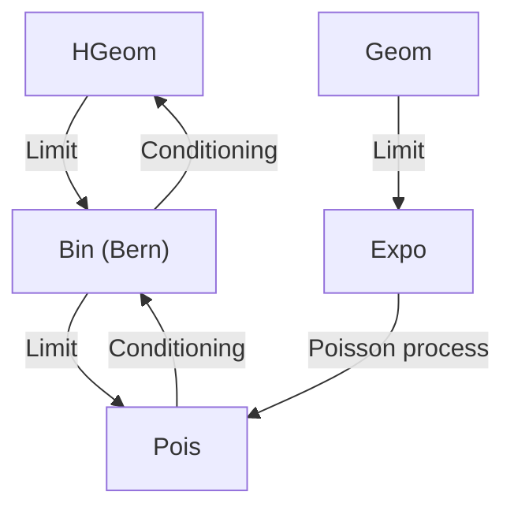
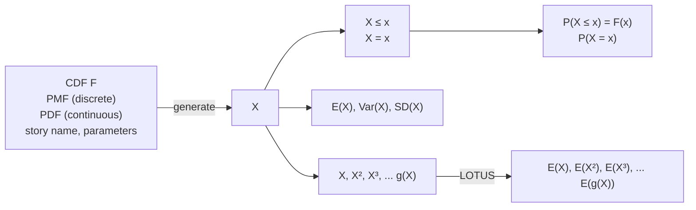

For $Y = X / \lambda \sim \operatorname { E x p o } ( \lambda )$ we then have

$$
E (Y) = \frac {1}{\lambda} E (X) = \frac {1}{\lambda},
$$

$$
\mathrm{Var} (Y) = \frac {1}{\lambda^ {2}} \mathrm{Var} (X) = \frac {1}{\lambda^ {2}},
$$

so the mean and variance of the Expo(λ) distribution are $1 / \lambda$ and $1 / \lambda ^ { 2 }$ , respectively. As we’d expect intuitively, the faster the rate of arrivals λ, the shorter the average waiting time.

The Exponential distribution has a very special property called the memoryless property, which says that even if you’ve waited for hours or days without success, the success isn’t any more likely to arrive soon. In fact, you might as well have just started waiting 10 seconds ago. The definition formalizes this idea.

Definition 5.5.2 (Memoryless property). A continuous distribution is said to have the memoryless property if a random variable X from that distribution satisfies

$$
P (X \geq s + t | X \geq s) = P (X \geq t)
$$

for all $s , t \geq 0 .$

Here s represents the time you’ve already spent waiting; the definition says that after you’ve waited s minutes, the probability you’ll have to wait another t minutes is exactly the same as the probability of having to wait t minutes with no previous waiting time under your belt. Another way to state the memoryless property is that conditional on $X \geq s .$ , the additional waiting time $X - s$ is still distributed Expo(λ). In particular, this implies

$$
E (X | X \geq s) = s + E (X) = s + \frac {1}{\lambda}.
$$

(Conditional expectation is explained in detail in Chapter 9, but the meaning should already be clear: for any r.v. X and event A, $E ( X | A )$ is the expected value of X given A; this can be defined by replacing the unconditional PMF or PDF of X in the definition of $E ( X )$ by the conditional PMF or PDF of X given A.)

Using the definition of conditional probability, we can directly verify that the Exponential distribution has the memoryless property. Let $X \sim \operatorname { E x p o } ( \lambda )$ . Then

$$
P (X \geq s + t | X \geq s) = \frac {P (X \geq s + t)}{P (X \geq s)} = \frac {e ^ {- \lambda (s + t)}}{e ^ {- \lambda s}} = e ^ {- \lambda t} = P (X \geq t).
$$

What are the implications of the memoryless property? If you’re waiting at a bus stop and the time until the bus arrives has an Exponential distribution, then conditional on your having waited 30 minutes, the bus isn’t due to arrive soon. The distribution simply forgets that you’ve been waiting for half an hour, and your remaining wait time is the same as if you had just shown up to the bus stop. If the lifetime of a machine has an Exponential distribution, then no matter how long the machine has been functional, conditional on having lived that long, the machine is as good as new: there is no wear-and-tear effect that makes the machine more likely to break down soon. If human lifetimes were Exponential, then conditional on having survived to the age of 80, your remaining lifetime would have the same distribution as that of a newborn baby!

Clearly, the memoryless property is not an appropriate description for human or machine lifetimes. Why then do we care about the Exponential distribution?

1. Some physical phenomena, such as radioactive decay, truly do exhibit the memoryless property, so the Exponential is an important model in its own right.

2. The Exponential distribution is well-connected to other named distributions. In the next section, we’ll see how the Exponential and Poisson distributions can be united by a shared story, and we’ll discover many more connections in later chapters.

3. The Exponential serves as a building block for more flexible distributions, such as the Weibull distribution (introduced in Chapter 6), that allow for a wear-and-tear effect (where older units are due to break down) or a survival-of-the-fittest effect (where the longer you’ve lived, the stronger you get). To understand these distributions, we first have to understand the Exponential.

The memoryless property is a very special property of the Exponential distribution: no other continuous distribution on $( 0 , \infty )$ is memoryless! Let’s prove this.

Theorem 5.5.3. If X is a positive continuous random variable with the memoryless property, then X has an Exponential distribution.

Proof. Suppose X is a positive continuous r.v. with the memoryless property. Let F be the CDF of X and G be the survival function of X, given by $G ( x ) = 1 - F ( x )$ We will show that $G ( x ) = e ^ { - \lambda x }$ for some λ, by first showing that $G ( x t ) = G ( t ) ^ { x }$ for all real $x > 0$ . The memoryless property says that

$$
G (s + t) = G (s) G (t)
$$

for all $s , t \geq 0$ . Putting $s = t ,$ we have

$$
G (2 t) = G (t) ^ {2},
$$

so

$$
G (3 t) = G (2 t + t) = G (2 t) G (t) = G (t) ^ {3}, G (4 t) = G (t) ^ {4}, \dots
$$

We now have

$$
G (m t) = G (t) ^ {m}
$$

for m a positive integer. Let’s extend this in stages. Replacing t by $t / 2$ in $G(2t) =$ $G ( t ) ^ { 2 }$ , we have $G ( t / \dot { 2 } ) = G ( t ) ^ { 1 / 2 }$ . Similarly,

$$
G \left(\frac {t}{n}\right) = G (t) ^ {1 / n}
$$

for any positive integer n. It follows that

$$
G \left(\frac {m}{n} t\right) = \left(G \left(\frac {t}{n}\right)\right) ^ {m} = G (t) ^ {m / n}
$$

for any positive integers m, n, so

$$
G (x t) = G (t) ^ {x}
$$

for all positive rational numbers x. Any positive real number can be written as a limit of positive rational numbers so, using the fact that G is a continuous function, the above equation holds for all positive real numbers $x .$ Taking $t = 1$ , we have

$$
G (x) = G (1) ^ {x} = e ^ {- \lambda x},
$$

where $\lambda = - \log ( G ( 1 ) ) > 0$ . This is exactly the form we wanted for $G ,$ so $X$ has an Exponential distribution. 

The memoryless property is defined analogously for discrete distributions: a discrete distribution is memoryless if for X an r.v. with that distribution,

$$
P (X \geq j + k | X \geq j) = P (X \geq k)
$$

for all nonnegative integers $j , k .$ In view of the analogy between the Geometric and Exponential stories (or if you have solved Exercise 32 from Chapter 4), you might guess that the Geometric distribution is memoryless. If so, you would be correct! If we’re waiting for the first Heads in a sequence of fair coin tosses, and in a streak of bad luck we happen to get ten Tails in a row, this has no impact on how many additional tosses we’ll need: the coin isn’t due for a Heads, nor conspiring against us to perpetually land Tails. The coin is memoryless. The Geometric is the only memoryless discrete distribution taking values in $\{ 0 , 1 , 2 , \ldots \}$ , and the Exponential is the only memoryless continuous distribution taking values in (0, ∞).

As practice with the memoryless property, the following example chronicles the adventures of Fred, who experiences firsthand the frustrations of the memoryless property after moving to a town with a memoryless public transportation system.

Example 5.5.4 (Blissville and Blotchville). Fred lives in Blissville, where buses always arrive exactly on time, with the time between successive buses fixed at 10 minutes. Having lost his watch, he arrives at the bus stop at a uniformly random time on a certain day (assume that buses run 24 hours a day, every day, and that the time that Fred arrives is independent of the bus arrival process).

(a) What is the distribution of how long Fred has to wait for the next bus? What is the average time that Fred has to wait?

(b) Given that the bus has not yet arrived after 6 minutes, what is the probability that Fred will have to wait at least 3 more minutes?

(c) Fred moves to Blotchville, a city with inferior urban planning and where buses are much more erratic. Now, when any bus arrives, the time until the next bus arrives is an Exponential random variable with mean 10 minutes. Fred arrives at the bus stop at a random time (assume that Blotchville has followed and will follow this system for all of eternity, and that the time that Fred arrives is independent of the bus arrival process). What is the distribution of Fred’s waiting time for the next bus? What is the average time that Fred has to wait?

(d) When Fred complains to a friend how much worse transportation is in Blotchville, the friend says: “Stop whining so much! You arrive at a uniform instant between the previous bus arrival and the next bus arrival. The average length of that interval between buses is 10 minutes, but since you are equally likely to arrive at any time in that interval, your average waiting time is only 5 minutes.”

Fred disagrees, both from experience and from solving Part (c) while waiting for the bus. Explain what is wrong with the friend’s reasoning.

## Solution:

(a) The distribution is Uniform on (0, 10), so the mean is 5 minutes.

(b) Let T be the waiting time. Then

$$
P (T \geq 6 + 3 | T > 6) = \frac {P (T \geq 9 , T > 6)}{P (T > 6)} = \frac {P (T \geq 9)}{P (T > 6)} = \frac {1 / 1 0}{4 / 1 0} = \frac {1}{4}.
$$

In particular, Fred’s waiting time in Blissville is not memoryless; conditional on having waited 6 minutes already, there’s only a $1 / 4$ chance that he’ll have to wait at least another 3 minutes, whereas if he had just showed up, there would be a $P ( T \geq 3 ) = 7 / 1 0$ chance of having to wait at least 3 minutes.

(c) By the memoryless property, the distribution is Exponential with parameter $1 / 1 0$ (and mean 10 minutes) regardless of when Fred arrives; how much longer the next bus will take to arrive is independent of how long ago the previous bus arrived. The average time that Fred has to wait is 10 minutes.

(d) Fred’s friend is making the mistake, explained in h 4.1.3, of replacing a random variable (the time between buses) by its expectation (10 minutes), thereby ignoring the variability in interarrival times. The average length of a time interval between two buses is 10 minutes, but Fred is not equally likely to arrive at any of these intervals: Fred is more likely to arrive during a long interval between buses than to arrive during a short interval between buses. For example, if one interval between buses is 50 minutes and another interval is 5 minutes, then Fred is 10 times more likely to arrive during the 50-minute interval.

This phenomenon is known as length-biased sampling, and it comes up in many reallife situations. For example, asking randomly chosen mothers how many children they have yields a different distribution from asking randomly chosen people how many siblings they have, including themselves. Asking students the sizes of their classes and averaging those results may give a much higher value than taking a list of classes and averaging the sizes of each; this is called the class size paradox. See exercises 16 and 17 from Chapter 4 for more about the class size paradox and length-biased sampling.

Fred’s adventures in Blissville and Blotchville continue in the exercises (see also MacKay [17] for more of Fred’s adventures). The bus arrivals in Blotchville follow a Poisson process, which is the topic of the next section. 

## 5.6 Poisson processes

The Exponential distribution is closely connected to the Poisson distribution, as suggested by our use of λ for the parameters of both distributions. In this section we will see that the Exponential and Poisson are linked by a common story, which is the story of the Poisson process. A Poisson process is a sequence of arrivals occurring at different points on a timeline, such that the number of arrivals in a particular interval of time has a Poisson distribution. Poisson processes are discussed in much greater detail in Chapter 13, but we already have the tools to understand the definition and basic properties.

Definition 5.6.1 (Poisson process). A process of arrivals in continuous time is called a Poisson process with rate λ if the following two conditions hold:

1. The number of arrivals that occur in an interval of length t is a Pois(λt) random variable.
2. The numbers of arrivals that occur in disjoint intervals are independent of each other. For example, the numbers of arrivals in the intervals (0, 10), [10, 12), and [15, ∞) are independent.

In this section, we will focus on Poisson processes on (0, ∞), but we can also define Poisson processes on $( - \infty , \infty )$ or other intervals, and in Chapter 13 we will introduce Poisson processes in more than one dimension. A sketch of a Poisson process on (0, ∞) is pictured in Figure 5.13. Each X marks the spot of an arrival.

For concreteness, suppose that the arrivals are emails landing in an inbox according to a Poisson process with rate λ. There are several things we might want to know about this process. One question we could ask is: in one hour, how many emails will arrive? The answer comes directly from the definition, which tells us that the


<details>
<summary>text_image</summary>

0
T₁
T₂ T₃
T₄ T₅
</details>

## FIGURE 5.13

A Poisson process on $( 0 , \infty )$ . Each X corresponds to an arrival.

number of emails in an hour follows a $\operatorname { P o i s } ( \lambda )$ distribution. Notice that the number of emails is a nonnegative integer, so a discrete distribution is appropriate.

But we could also flip the question around and ask: how long does it take until the first email arrives (measured relative to some fixed starting point)? The waiting time for the first email is a positive real number, so a continuous distribution on $( 0 , \infty )$ is appropriate. Let $T _ { 1 }$ be the time until the first email arrives. To find the distribution of $T _ { 1 }$ , we just need to understand one crucial fact: saying that the waiting time for the first email is greater than t is the same as saying that no emails have arrived between 0 and t. In other words, if $N _ { t }$ is the number of emails that arrive at or before time t, then

$$
T _ {1} > t \text {is the same event as} N _ {t} = 0.
$$

We call this the count-time duality because it connects a discrete $\mathrm { r . v . , } N _ { t }$ , which counts the number of arrivals, with a continuous r.v., $T _ { 1 }$ , which marks the time of the first arrival. More generally, the count-time duality says that

$$
T _ {n} > t \text {is the same event as} N _ {t} <   n.
$$

Saying that the nth arrival has not happened yet as of time t is equivalent to saying that, up until time t, there have been fewer than n arrivals.

If two events are the same, they have the same probability. Since $N _ { t } \sim \operatorname { P o i s } ( \lambda t )$ by the definition of Poisson process,

$$
P (T _ {1} > t) = P (N _ {t} = 0) = \frac {e ^ {- \lambda t} (\lambda t) ^ {0}}{0 !} = e ^ {- \lambda t}.
$$

Therefore $P ( T _ { 1 } \leq t ) = 1 - e ^ { - \lambda t }$ , so $T _ { 1 } \sim \operatorname { E x p o } ( \lambda ) !$ The time until the first arrival in a Poisson process of rate λ has an Exponential distribution with parameter λ.

What about $T _ { 2 } - T _ { 1 }$ , the time between the first and second arrivals? Since disjoint intervals in a Poisson process are independent by definition, the past is irrelevant once the first arrival occurs. Thus $T _ { 2 } - T _ { 1 }$ is independent of the time until the first arrival, and by the same argument as before, $T _ { 2 } - T _ { 1 }$ also has an Exponential distribution with rate λ.

Similarly, $T _ { 3 } { - } T _ { 2 } \sim \operatorname { E x p o } ( \lambda )$ independently of $T _ { 1 }$ and $T _ { 2 } { - } T _ { 1 }$ . Continuing in this way, we deduce that all the interarrival times are i.i.d. Expo(λ) random variables. Thus, Poisson processes tie together two important distributions, one discrete and one continuous, and the use of a common symbol λ for both the Poisson and Exponential parameters is felicitous notation, for λ is the arrival rate in the process that unites the two distributions.

h 5.6.2. The total time until the second arrival, $T _ { 2 }$ , is the sum of two independent $\mathrm{Expo}(\lambda) \text { r.v.s, } T_{1}$ and $T _ { 2 } - T _ { 1 }$ . This does not have an Exponential distribution, but rather a Gamma distribution, which is introduced in Chapter 8.

The story of the Poisson process provides intuition for the fact, shown below, that the minimum of independent Exponential r.v.s is another Exponential r.v.

Example 5.6.3 (Minimum of independent Expos). Let $X _ { 1 } , \ldots , X _ { n }$ be independent, with $X _ { j } \sim \operatorname { E x p o } ( \lambda _ { j } )$ . Let $L = \operatorname* { m i n } ( X _ { 1 } , \ldots , X _ { n } )$ . Show that $L \sim \operatorname { E x p o } ( \lambda _ { 1 } + \cdots + \lambda _ { n } )$ and interpret this intuitively.

Solution:

We can find the distribution of L by considering its survival function $P ( L   >   t )$ since the survival function is 1 minus the CDF.

$$
\begin{array}{l} P (L > t) = P (\min (X _ {1}, \dots , X _ {n}) > t) = P (X _ {1} > t, \dots , X _ {n} > t) \\ = P (X _ {1} > t) \dots P (X _ {n} > t) = e ^ {- \lambda_ {1} t} \dots e ^ {- \lambda_ {n} t} = e ^ {- (\lambda_ {1} + \dots + \lambda_ {n}) t}. \\ \end{array}
$$

The second equality holds since saying that the minimum of the $X _ { j }$ is greater than t is the same as saying that all of the $X _ { j }$ are greater than t. The third equality holds by independence of the $X _ { j }$ . Thus, L has the survival function (and the CDF) of an Exponential distribution with parameter $\lambda _ { 1 } + \cdots + \lambda _ { n }$

Intuitively, we can interpret the $\lambda _ { j }$ as the rates of n independent Poisson processes. We can imagine, for example, $X _ { 1 }$ as the waiting time for a green car to pass by, $X _ { 2 }$ as the waiting time for a blue car to pass by, and so on, assigning a color to each $X _ { j }$ . Then $L$ is the waiting time for a car with any of these colors to pass by, so it makes sense that $L$ has a combined rate of $\lambda _ { 1 } + \cdots + \lambda _ { n }$ 

h 5.6.4. The minimum of independent Exponentials is Exponential, but the maximum of independent Exponentials is not Exponential. However, the result about such a minimum turns out to be useful in studying such a maximum, as illustrated in the next two examples.

Example 5.6.5 (Maximum of 3 independent Exponentials). Three students are working independently on their probability homework. All 3 start at 1 pm on a certain day, and each takes an Exponential time with mean 6 hours to complete the homework. What is the earliest time at which all 3 students will have completed the homework, on average?

Solution: Label the students as 1, 2, 3, and let $X _ { j }$ be how long it takes student $j$ to finish the homework. Let $\lambda = 1 / 6 ,$ and let $T$ be the time when all 3 students will have completed the homework, so $T = \max(X_1, X_2, X_3)$ with $X _ { i } \sim \operatorname { E x p o } ( \lambda )$ . The CDF of T is

$$
P (T \leq t) = P (X _ {1} \leq t, X _ {2} \leq t, X _ {3} \leq t) = (1 - e ^ {- \lambda t}) ^ {3}.
$$

So the PDF of T is

$$
f _ {T} (t) = 3 \lambda e ^ {- \lambda t} (1 - e ^ {- \lambda t}) ^ {2}.
$$

In particular, T is not Exponential.

Finding $E ( T )$ by integrating $t f _ { T } ( t )$ is possible but not especially pleasant. A neater approach is to use the memoryless property and the fact that the minimum of independent Exponentials is Exponential. We can decompose

$$
T = T _ {1} + T _ {2} + T _ {3},
$$

where $T _ { 1 } { = } \operatorname* { m i n } ( X _ { 1 } , X _ { 2 } , X _ { 3 } )$ is how long it takes for one student to complete the homework, $T _ { 2 }$ is the additional time it takes for a second student to complete the homework, and $T _ { 3 }$ is the additional time until all 3 have completed the homework. Then $T _ { 1 } \sim \mathrm { E x p o } ( 3 \lambda )$ , by the result of Example 5.6.3.

By the memoryless property, at the first time when a student completes the homework the other two students are starting from fresh, so $T _ { \mathrm { 2 } } \sim \mathrm { E x p o } ( 2 \lambda )$ . Again by the memoryless property, $T _ { 3 } \sim \mathrm { E x p o } ( \lambda )$ . The memoryless property also implies that $T _ { 1 } , T _ { 2 } , T _ { 3 }$ are independent (which would be very useful if we were finding Var(T)). By linearity,

$$
E (T) = \frac {1}{3 \lambda} + \frac {1}{2 \lambda} + \frac {1}{\lambda} = 2 + 3 + 6 = 1 1,
$$

which shows that on average, the 3 students will have all completed the homework at midnight, 11 hours after they started. 

Example 5.6.6 (Machine repair). A certain machine often breaks down and needs to be fixed. At time 0, the machine is working. It works for an Expo(λ) period of time (measured in days), and then breaks down. It then takes an Expo(λ) amount of time to get it fixed, after which it will work for an Expo(λ) time until it breaks down again, after which it will take an Expo(λ) time to get it fixed, etc. Assume that these Expo(λ) r.v.s are i.i.d.

(a) A transition occurs when the machine switches from working to being broken, or switches from being broken to working. Find the distribution of the number of transitions that occur in the time interval (0, t).

(b) Hoping to reduce the frequency of breakdowns, the machine is redesigned so that it can continue to function even if one component has failed. The redesigned machine has 5 components, each of which works for an Expo(λ) amount of time and then fails, independently. The machine works properly if and only if at most one component has failed. Currently, all 5 components are working (none have failed). Find the expected time until the machine breaks down.

## Solution:

(a) The times between transitions are i.i.d. Expo(λ), so the times at which transitions occur follow a Poisson process of rate λ. So the desired distribution is Pois(λt).
(b) The time until a component fails is Expo(5λ). Then by the memoryless property, the additional time until another component fails is Expo(4λ). So the expected time until the machine breaks down is

$$
\frac {1}{5 \lambda} + \frac {1}{4 \lambda} = \frac {9}{2 0 \lambda}.
$$

## 5.7 Symmetry of i.i.d. continuous r.v.s

Continuous r.v.s that are independent and identically distributed have an important symmetry property: all possible orderings are equally likely. Intuitively, this is because if all we are told is that $X _ { 1 } , \ldots , X _ { n }$ are i.i.d., then they are interchangeable, in the sense that we have been given no information that distinguishes one $X _ { i }$ from another $X _ { j }$ . This is reminiscent of the fact that it is common for someone to say “Do you want the good news first or the bad news first?” but rare for someone to say $^ { c } \mathrm { I }$ have two pieces of news. Which do you want to hear first?”, since in the latter case no distinguishing information has been provided for the two pieces of news.

Proposition 5.7.1. Let $X _ { 1 } , \ldots , X _ { n }$ be i.i.d. from a continuous distribution. Then

$$
P (X _ {a _ {1}} <   X _ {a _ {2}} <   \dots <   X _ {a _ {n}}) = \frac {1}{n !}
$$

for any permutation $a _ { 1 } , a _ { 2 } , \ldots , a _ { n }$ of $1 , 2 , \ldots , n$

Proof. Let F be the CDF of $X _ { j }$ . By symmetry, all orderings of $X _ { 1 } , \ldots , X _ { n }$ are equally likely. For example, $P ( \dot { X _ { 3 } } \: < \: X _ { 2 } \: < \: X _ { 1 } ) \: = \: P ( X _ { 1 } \: < \: X _ { 2 } \: < \: X _ { 3 } )$ since both sides have exactly the same structure: they are both of the form $P ( A < B < C )$ where $A , B , C$ are i.i.d. draws from F. For any i and $j$ with $i \neq j$ , the probability of the tie $X _ { i } = X _ { j }$ is 0 since $X _ { i }$ and $X _ { j }$ are independent continuous r.v.s. So the probability of there being at least one tie among $X _ { 1 } , \ldots , X _ { n }$ is also 0, since

$$
P \left(\bigcup_ {i \neq j} \{X _ {i} = X _ {j} \}\right) \leq \sum_ {i \neq j} P (X _ {i} = X _ {j}) = 0.
$$

Thus, $X _ { 1 } , \ldots , X _ { n }$ are distinct with probability 1, and the probability of any particular ordering is $1 / n !$

h 5.7.2. This proposition may fail if the r.v.s are dependent. Let $n \: = \: 2$ , and consider the extreme case where $X _ { 1 }$ and $X _ { 2 }$ are so dependent that they are always equal, i.e., $X _ { 1 } = X _ { 2 }$ with probability 1. Then $P ( X _ { 1 } < X _ { 2 } ) = P ( X _ { 2 } < X _ { 1 } ) = 0$ . For dependent $X _ { 1 } , X _ { 2 }$ we can also make $P ( X _ { 1 } < X _ { 2 } ) \neq P ( X _ { 2 } < X _ { 1 } )$ . For an example, see Exercise 42 from Chapter 3.

h 5.7.3. If X and Y are i.i.d. continuous r.v.s, then

$$
P (X <   Y) = P (Y <   X) = \frac {1}{2},
$$

by symmetry and since the probability of a tie is 0. In contrast, if X and Y are i.i.d. discrete r.v.s, it is still true that $P(X < Y) = P(Y < X)$ by symmetry, but this number is less than $1 / 2$ because of the possibility of a tie. For example, if X and $Y$ are i.i.d. nonnegative integer-valued r.v.s with $P ( X = j ) = c _ { j }$ , then

$$
1 = P (X <   Y) + P (X = Y) + P (Y <   X) = 2 P (X <   Y) + P (X = Y),
$$

so

$$
P (X <   Y) = \frac {1}{2} \cdot (1 - P (X = Y)) = \frac {1}{2} \cdot \left(1 - \sum_ {j = 0} ^ {\infty} c _ {j} ^ {2}\right) <   \frac {1}{2}.
$$

The ranks of a list of distinct numbers are defined by giving the smallest number a rank of 1, the second smallest a rank of 2, and so on. For example, the ranks for 3.14, 2.72, 1.41, 1.62 are 4, 3, 1, 2. Proposition 5.7.1 says that the ranks of i.i.d. continuous $X _ { 1 } , \ldots , X _ { n }$ are a uniformly random permutation of the numbers $1 , \ldots , n$ The next example shows how we can use this symmetry property in conjunction with indicator r.v.s in problems involving records, such as the record level of rainfall or the record performance on a high jump.

Example 5.7.4 (Records). Athletes compete one at a time at the high jump. Let $X _ { j }$ be how high the jth jumper jumped, with $X _ { 1 } , X _ { 2 } , \ldots { \mathrm { ~ i . i . d } }$ . with a continuous distribution. We say that the jth jumper sets a record if $X _ { j }$ is greater than all of $X _ { j - 1 } , \ldots , X _ { 1 }$

(a) Is the event “the 110th jumper sets a record” independent of the event “the 111th jumper sets a record”?

(b) Find the mean number of records among the first n jumpers. What happens to the mean as $n \rightarrow \infty ?$

(c) A double record occurs at time j if both the jth and (j −1)st jumpers set records. Find the mean number of double records among the first n jumpers. What happens to the mean as $n \rightarrow \infty ?$

## Solution:

(a) Let $I _ { j }$ be the indicator r.v. for the jth jumper setting a record. By symmetry, $P ( I _ { j } = \dot { 1 ) } = 1 / j$ (as any of the first $j$ jumps is equally likely to be the highest of those jumps). Also,

$$
P (I _ {1 1 0} = 1, I _ {1 1 1} = 1) = \frac {1 0 9 !}{1 1 1 !} = \frac {1}{1 1 0 \cdot 1 1 1},
$$

since in order for both the 110th and 111th jumps to be records, we need the highest of the first 111 jumps to be in position 111 and the second highest to be in position 110, and the remaining 109 can be in any order. So

$$
P (I _ {1 1 0} = 1, I _ {1 1 1} = 1) = P (I _ {1 1 0} = 1) P (I _ {1 1 1} = 1),
$$

which shows that the 110th jumper setting a record is independent of the 111th jumper setting a record. Intuitively, this makes sense since learning that the 111th jumper sets a record gives us no information about the “internal” matter of how the first 110 jumps are arranged amongst themselves.

(b) By linearity, the expected number of records among the firstn jumpers is $\textstyle \sum _ { j = 1 } ^ { n } { \frac { 1 } { j } }$ , which goes to ∞ as n → ∞ since the harmonic series diverges.
(c) Let $J _ { j }$ be the indicator r.v. for a double record occurring at time j, for $2 \leq j \leq n$ Then $\begin{array} { r } { \check { P ( J _ { j } = 1 ) } = \frac { 1 } { j ( j - 1 ) } } \end{array}$ , following the logic of Part (a). So the expected number of double records is

$$
\sum_ {j = 2} ^ {n} \frac {1}{j (j - 1)} = \sum_ {j = 2} ^ {n} \left(\frac {1}{j - 1} - \frac {1}{j}\right) = 1 - \frac {1}{n},
$$

since all the other terms cancel out. Thus, the expected number of records goes to ∞ as $n \to \infty$ , but the expected number of double records goes to 1. 

## 5.8 Recap

A continuous r.v. can take on any value in an interval, although the probability that it equals any particular value is 0. The CDF of a continuous r.v. is differentiable, and the derivative is called the probability density function (PDF). Probability is given by area under the PDF curve, not by the value of the PDF at a point. We must integrate the PDF to get a probability. The table below summarizes and compares some important concepts in the discrete case and the continuous case.

<table><tr><td></td><td>Discrete r.v.</td><td>Continuous r.v.</td></tr><tr><td>CDF</td><td> $F(x) = P(X \leq x)$ </td><td> $F(x) = P(X \leq x)$ </td></tr><tr><td rowspan="2">PMF/PDF</td><td> $P(X = x)$ </td><td> $f(x) = F'(x)$ </td></tr><tr><td>PMF is height of jump of  $F$  at  $x$ .PMF is nonnegative.PMF sums to 1. $P(X \in A) = \sum_{x \in A} P(X = x)$ .</td><td>PDF is derivative of  $F$ .PDF is nonnegative.PDF integrates to 1. $P(X \in A) = \int_{A} f(x) dx$ .</td></tr><tr><td>Expectation</td><td> $E(X) = \sum_{x} xP(X = x)$ </td><td> $E(X) = \int_{-\infty}^{\infty} xf(x) dx$ </td></tr><tr><td>LOTUS</td><td> $E(g(X)) = \sum_{x} g(x)P(X = x)$ </td><td> $E(g(X)) = \int_{-\infty}^{\infty} g(x)f(x)dx$ </td></tr></table>

Three important continuous distributions are the Uniform, Normal, and Exponential. A $\operatorname { U n i f } ( a , b )$ r.v. is a “completely random” number in the interval $( a , b )$ , and it has the property that probability is proportional to length. The universality of the Uniform tells us how we can use a $\mathrm { U n i f } ( 0 , 1 )$ r.v. to construct r.v.s from other distributions we may be interested in; it also says that if we plug a continuous r.v. into its own CDF, the resulting r.v. has a $\mathrm { U n i f } ( 0 , 1 )$ distribution.

A $\mathcal { N } ( \mu , \sigma ^ { 2 } )$ r.v. has a symmetric bell-shaped PDF centered at $\mu ,$ with $\sigma$ controlling how spread out the curve is. The mean is $\mu$ and standard deviation is $\sigma .$ The 68-95-99.7% rule gives important benchmarks for the probability of a Normal r.v. falling within 1, 2, and 3 standard deviations of its mean.

An Expo(λ) r.v. represents the waiting time for the first success in continuous time, analogous to how a Geometric r.v. represents the number of failures before the first success in discrete time; the parameter $\lambda$ can be interpreted as the rate at which successes arrive. The Exponential distribution has the memoryless property, which says that conditional on our having waited a certain amount of time without success, the distribution of the remaining wait time is exactly the same as if we hadn’t waited at all. In fact, the Exponential is the only positive continuous distribution with the memoryless property.

A Poisson process is a sequence of arrivals in continuous time such that the number of arrivals in an interval is Poisson (with mean proportional to the length of the interval) and disjoint intervals have independent numbers of arrivals. The interarrival times in a Poisson process of rate λ are i.i.d. Expo(λ) r.v.s.

A useful symmetry property of i.i.d. r.v.s $X _ { 1 } , X _ { 2 } , \ldots , X _ { n }$ is that all orderings are equally likely. For example, $P ( X _ { 1 } \: < \: X _ { 2 } \: < \: X _ { 3 } ) \: = \: P ( X _ { 3 } \: < \: X _ { 2 } \: < \: X _ { 1 } )$ . If the $X _ { j }$ are continuous in addition to being i.i.d., then we can also conclude, e.g., that $P ( X _ { 1 } < X _ { 2 } < X _ { 3 } ) = 1 / 6$ , whereas in the discrete case we also have to account for the possibility of ties.

A new strategy that we learned for continuous distributions is location-scale transformation, which says that if shifting and scaling will not take us outside the family of distributions we’re studying, then we can start with the simplest member of the family, find the answer for the simple case, then use shifting and scaling to arrive at the general case. For the three main distributions of this chapter, this approach works as follows.

• Uniform: If $U \sim \mathrm { U n i f } ( 0 , 1 )$ , then $\tilde { U } = a + ( b - a ) U \sim \mathrm { U n i f } ( a , b )$
• Normal: If $Z \sim \mathcal { N } ( 0 , 1 )$ , then $X = \mu + \sigma Z \sim \mathcal { N } ( \mu , \sigma ^ { 2 } )$
• Exponential: If $X   \sim   \mathrm { E x p o ( 1 ) }$ , then $Y   =   X / \lambda   \sim   \mathrm { E x p o } ( \lambda )$ . We do not consider shifts here since a nonzero shift would prevent the support from being $( 0 , \infty )$

We can now add the Exponential and Geometric distributions to our diagram of connections between distributions: the Exponential is a continuous limit of the Geometric, and the Poisson and Exponential are connected by the Poisson process.


<details>
<summary>flowchart</summary>


</details>

And in our map of the four fundamental objects in probability, we add the PDF as another blueprint for continuous random variables.


<details>
<summary>flowchart</summary>


</details>

FIGURE 5.14

Four fundamental objects in probability: distributions, random variables, events, and numbers. For a continuous r.v. X, we have $P ( X = x ) = 0$ , so we use the PDF as a blueprint in place of the PMF.

## 5.9 R

In this section we will introduce continuous distributions in R, learn how to make basic plots, demonstrate the universality of the Uniform by simulation, and simulate arrival times in a Poisson process.

## Uniform, Normal, and Exponential distributions

For continuous distributions, the function that starts with d is the PDF instead of the PMF. Thus, we have the following functions:

• dunif, punif, runif. To evaluate the Unif(a, b) PDF at x, we use dunif $( \mathbf { x } , \mathbf { a } , \mathbf { b } )$ For the CDF, we use punif(x,a,b). To generate n realizations from the Unif(a, b) distribution, we use runif(n,a,b).
• dnorm, pnorm, rnorm. To evaluate the $\mathcal { N } ( \mu , \sigma ^ { 2 } )$ PDF at $x ,$ we use dnorm(x,mu,sigma), where mu is the mean $\mu$ and sigma is the standard deviation (not variance) σ. For the CDF, we use pnorm(x,mu,sigma). To generate n realizations from the $\mathcal { N } ( \mu , \sigma ^ { 2 } )$ distribution, we use rnorm(n,mu,sigma).

h 5.9.1 (Normal parameters in R). Note that we have to input the standard deviation, not the variance! For example, to get the $\mathcal { N } ( 1 0 , 3 )$ CDF at 12, we use pnorm(12,10,sqrt(3)). Ignoring this is a common, disastrous coding error.

• dexp, pexp, rexp. To evaluate the Expo(λ) PDF at x, we use dexp(x,lambda). For the CDF, we use pexp(x,lambda). To generate n realizations from the Expo(λ) distribution, we use rexp(n,lambda).

Due to the importance of location-scale transformations for continuous distributions, R has default parameter settings for each of these three families. The default for the Uniform is Unif(0, 1), the default for the Normal is $\mathcal { N } ( 0 , 1 )$ , and the default for the Exponential is Expo(1). For example, dunif(0.5), with no additional inputs, evaluates the Unif(0, 1) PDF at 0.5, and rnorm(10), with no additional inputs, generates 10 realizations from the $\mathcal { N } ( 0 , 1 )$ distribution. This means there are two ways to generate a $\mathcal { N } ( \mu , \sigma ^ { 2 } )$ random variable in R. After choosing our values of $\mu$ and $\sigma ,$ such as

```txt
mu <- 1
sigma <- 2
```

we can do either of the following:

```txt
rnorm(1,mu,sigma)
mu + sigma*rnorm(1)
```

Either way, we end up generating a draw from the $\mathcal { N } ( \mu , \sigma ^ { 2 } )$ distribution.

## Plots in R

A simple way to plot a function in R is with the curve command. For example,

curve(dnorm, from=-3, to=3, n=1000)

creates a plot of the standard Normal PDF from −3 to 3. What is actually happening is that R evaluates the function at a finite number of closely spaced points and connects the points with very short lines to create the illusion of a curve. The input n=1000 tells R to evaluate at 1000 points so that the curve looks very smooth; if we were to choose n=20, the piecewise linearity would become very apparent.

Another command that creates plots is called, fittingly, plot. This command has many, many possible inputs to customize what the plot looks like; for the sake of demonstration, we’ll plot the standard Normal PDF once again, using plot instead of curve.

The most important inputs to plot are a vector of x values and a vector of y values to plot. A useful command for this purpose is seq. As introduced in Chapter 1, seq(a,b,d) creates the vector of values ranging from a to b, with successive entries spaced apart by d.

$$
\mathrm{x} <   - \operatorname{seq} (- 3, 3, 0. 0 1)
$$

$$
\mathrm{y} <   - \mathrm{dnorm} (\mathrm{x})
$$

So x consists of all numbers from −3 to 3, spaced 0.01 apart, and y contains the values of the Normal PDF at each of the points in x. Now we simply plot the two with plot(x,y). The default is a scatterplot. For a line plot, we use $\tt p l o t ( x , y , t y p e = 1 )$ . We can also set the axis labels and plot title with xlab, ylab, and main.

$$
\text {plot} (x, y, \text {type} = " l", x \text {lab} = " x", y \text {lab} = " d \text {norm} (x) ", \text {main} = " N (0, 1) \text {PDF}")
$$

The axis limits can be set manually with xlim and ylim. If, for example, you wanted the vertical axis to range from 0 to 1, you would add ylim=c(0,1) inside the plot command.

Finally, to change the color of the plot, add col="orange" or col="green", or whatever your favorite color is!

## Universality with Logistic

We proved in Example 5.3.4 that for $U \sim \mathrm { U n i f } ( 0 , 1 )$ , the r.v. log(U/(1 − U)) follows a Logistic distribution. In R, we can simply generate a large number of Unif(0, 1) realizations and transform them.

$$
\mathrm{u} <   - \text {runif} (1 0 ^ {\wedge} 4)
$$

$$
\mathrm{x} <   - \log (\mathrm{u} / (1 - \mathrm{u}))
$$

Now x contains $1 0 ^ { 4 }$ realizations from the distribution of log $( U / ( 1   -   U ) )$ . We can visualize them with a histogram, using the command hist(x). The histogram resembles a Logistic PDF, which is reassuring. To control how fine-grained the histogram is, we can set the number of breaks in the histogram: hist(x,breaks=100) produces a finer histogram, while hist(x,breaks=10) produces a coarser histogram.

## Poisson process simulation

To simulate n arrivals in a Poisson process with rate λ, we first generate the interarrival times as i.i.d. Exponentials and store them in a vector:

```r
n <- 50
lambda <- 10
x <- rexp(n,lambda)
```

Then we convert the interarrival times into arrival times using the cumsum function, which stands for “cumulative sum”.

```r
t <- cumsum(x)
```

The vector t now contains all the simulated arrival times.

## 5.10 Exercises

Exercises marked with s have detailed solutions at [http://stat110.net](http://stat110.net).

## PDFs and CDFs

1. The Rayleigh distribution from Example 5.1.7 has PDF

$$
f (x) = x e ^ {- x ^ {2} / 2}, \quad x > 0.
$$

Let X have the Rayleigh distribution.

(a) Find $P ( 1 < X < 3 )$
(b) Find the first quartile, median, and third quartile of X; these are defined to be the values $q _ { 1 } , q _ { 2 } , q _ { 3 }$ (respectively) such that $P ( X \leq q _ { j } ) = j / 4$ for $j = 1 , 2 , 3$

2. (a) Make up a PDF f, with an application for which that PDF would be plausible, where $f ( x ) > 1$ for all x in a certain interval.
(b) Show that if a PDF f has $f ( x ) > 1$ for all x in a certain interval, then that interval must have length less than 1.

3. Let F be the CDF of a continuous $\mathbf { r } . \mathbf { v } . ,$ and $f = F ^ { \prime }$ be the PDF.

(a) Show that g defined by $g ( x ) = 2 F ( x ) f ( x )$ is also a valid PDF.
(b) Show that h defined by $\begin{array} { r } { h ( x ) = \frac { 1 } { 2 } f ( - x ) + \frac { 1 } { 2 } f ( x ) } \end{array}$ is also a valid PDF.