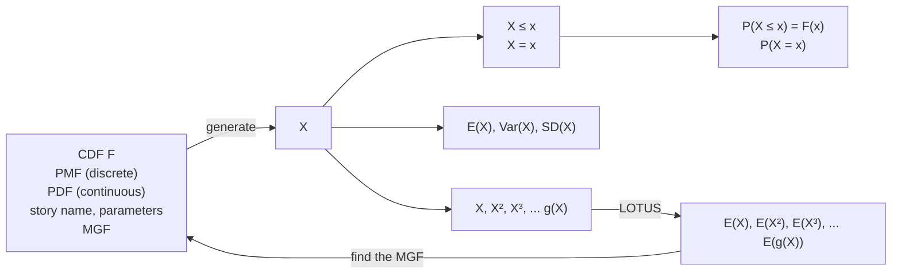

to conquer a seemingly intractable counting problem. Then we’ll prove that the PGF of a nonnegative integer-valued r.v. determines its distribution, which we omitted in the more general MGF setting.

Definition 6.7.1 (Probability generating function). The probability generating function (PGF) of a nonnegative integer-valued r.v. X with PMF $p _ { k } = P ( X = k )$ is the generating function of the PMF. By LOTUS, this is

$$
E (t ^ {X}) = \sum_ {k = 0} ^ {\infty} p _ {k} t ^ {k}.
$$

The PGF converges to a value in [−1, 1] for all t in [−1, 1] since $\textstyle \sum _ { k = 0 } ^ { \infty } p _ { k } = 1$ and $| p _ { k } t ^ { k } | \leq p _ { k }$ for $| t | \leq 1$

The MGF is closely related to the PGF, when both exist: for $t > 0$

$$
E (t ^ {X}) = E (e ^ {X \log t})
$$

is the MGF evaluated at log t.

Example 6.7.2 (Generating dice probabilities). Frederick Mosteller, the founder of the Harvard Statistics Department, once recounted the following life-changing moment:

A key moment in my life occurred in one of those classes during my sophomore year. We had the question: When three dice are rolled what is the chance that the sum of the faces will be 10? The students in this course were very good, but we all got the answer largely by counting on our fingers. When we came to class, I said to the teacher, “That’s all very well—we got the answer—but if we had been asked about six dice and the probability of getting 18, we would still be home counting. How do you do problems like that?” He said, “I don’t know, but I know a man who probably does and I’ll ask him.”

One day I was in the library and Professor Edwin G. Olds of the Mathematics Department came in. He shouted at me, “I hear you’re interested in the three dice problem.” He had a huge voice, and you know how libraries are. I was embarrassed. “Well, come and see me,” he said, “and I’ll show you about it.” “Sure,” I said. But I was saying to myself, “I’ll never go.” Then he said, “What are you doing?” I showed him. “That’s nothing important,” he said. “Let’s go now.”

So we went to his office, and he showed me a generating function. It was the most marvelous thing I had ever seen in mathematics. It used mathematics that, up to that time, in my heart of hearts, I had thought was something that mathematicians just did to create homework problems for innocent students in high school and college. I don’t know where I had got ideas like that about various parts of mathematics. Anyway, I was stunned when I saw how Olds used this mathematics that I hadn’t believed in. He used it in such an unusually outrageous way. It was a total retranslation of the meaning of the numbers. [1]

Let X be the total from rolling 6 fair dice, and let $X _ { 1 } , \ldots , X _ { 6 }$ be the individual rolls. What is $P(X = 18) ?$ It turns out that there are 3431 ways to obtain a sum of 18, so the probability is $3 4 3 1 / 6 ^ { 6 } \approx 0 . 0 7 3 5$ . Listing out all possibilities is extremely tedious, and the tedium would be compounded with the worry of having somehow missed a case. And what if we laboriously listed out all 3431 cases, and then were asked to find $P(X = 19) ?$

The PGF of X lets us count the cases in a systematic way. The PGF of $X _ { 1 }$ is

$$
E (t ^ {X _ {1}}) = \frac {1}{6} (t + t ^ {2} + \dots + t ^ {6}).
$$

Since the $X _ { j }$ are i.i.d., the PGF of X is

$$
E \left(t ^ {X}\right) = E \left(t ^ {X _ {1}} \dots t ^ {X _ {6}}\right) = E \left(t ^ {X _ {1}}\right) \dots E \left(t ^ {X _ {6}}\right) = \frac {t ^ {6}}{6 ^ {6}} (1 + t + \dots + t ^ {5}) ^ {6}.
$$

By definition, the coefficient of $t ^ { 1 8 }$ in the PGF is $P ( X   =   1 8 )$ . So the number of ways to get a sum of 18 is the coefficient of $t ^ { 1 8 }$ in $t ^ { 6 } ( \dot { 1 + t + \cdots + t ^ { 5 } } ) ^ { 6 }$ , which is the coefficient of $t ^ { 1 2 }$ in $( 1 + t + \cdots + t ^ { 5 } ) ^ { 6 }$ . Multiplying this out by hand is tedious, but it is vastly easier than listing out 3431 cases, and it can also be done easily on a computer without having to write a special program.

Better yet, we can use the fact that $1 + t + \cdots + t ^ { 5 }$ is a geometric series to write

$$
(1 + t + \dots + t ^ {5}) ^ {6} = \frac {(1 - t ^ {6}) ^ {6}}{(1 - t) ^ {6}}.
$$

(Assume that $| t |   <   1$ , which we can do since, as with the MGF, we just need to know how the PGF behaves in an open interval containing 0.) The above equation is just algebra since we have the bookkeeping device t, but would have been hard to fathom if everything were still in sequence notation. By the binomial theorem, the numerator is

$$
(1 - t ^ {6}) ^ {6} = \sum_ {j = 0} ^ {6} \binom{6}{j} (- 1) ^ {j} t ^ {6 j}.
$$

For the denominator, write

$$
\frac {1}{(1 - t) ^ {6}} = (1 + t + t ^ {2} + \dots) ^ {6} = \sum_ {k = 0} ^ {\infty} a _ {k} t ^ {k}.
$$

Here $a _ { k }$ is the number of ways to choose one term from each of the six $( 1 { + } t { + } t ^ { 2 } { + } \dots )$ factors, such that the degrees add up to k. For example, for $k = 2 0$ one possibility is to choose the $t ^ { 3 } , 1 , t ^ { 2 } , \dot { t } ^ { 1 0 } , 1 , t ^ { 5 }$ terms, respectively, since these choices contribute one $t ^ { 2 0 }$ term when the product is expanded out. So $a _ { k }$ is the number of solutions to $y _ { 1 } + y _ { 2 } + \dots + y _ { 6 } = k$ , with the $y _ { j }$ nonnegative integers. We saw how to count this number of solutions in Chapter 1: $a _ { k }$ is the Bose-Einstein value ${ \binom { 6 + k - 1 } { k } } = { \binom { k + 5 } { 5 } }$ . So

$$
\frac {1}{(1 - t) ^ {6}} = \sum_ {k = 0} ^ {\infty} \binom{k + 5}{5} t ^ {k}.
$$

For $0 < t < 1$ , another way to see why this equation holds is to write it as

$$
\sum_ {k = 0} ^ {\infty} \binom{k + 5}{5} (1 - t) ^ {6} t ^ {k} = 1,
$$

which we already knew to be true since the $\mathrm { N B i n } ( 6 , 1   -   t )$ PMF must sum to 1. (The identity for $( 1 - t ) ^ { - 6 }$ is an example of a generalization of the binomial theorem to allow for negative integer powers; this helps explain why the Negative Binomial is called that despite being neither negative nor Binomial!)

Putting together the above results, we just need the coefficient of $t ^ { 1 2 }$ in

$$
\left(\sum_ {j = 0} ^ {2} \binom {6} {j} (- 1) ^ {j} t ^ {6 j}\right) \left(\sum_ {k = 0} ^ {1 2} \binom {k + 5} {5} t ^ {k}\right),
$$

where we summed only up to $j = 2$ and $k = 1 2$ in the two factors since any further terms will not contribute to the coefficient of $t ^ { 1 2 }$ . This lets us reduce the 3431 cases down to just three cases: $( j , k )$ is (0, 12), (1, 6), or $( 2 , 0 )$ . The coefficient of $t ^ { 1 2 }$ is

$$
\binom {1 7} {5} - 6 \binom {1 1} {5} + \binom {6} {2} = 3 4 3 1,
$$

since, for example, when $j = 1$ and $k = 6$ we get the term

$$
- \binom {6} {1} t ^ {6} \cdot \binom {6 + 5} {5} t ^ {6} = - 6 \binom {1 1} {5} t ^ {1 2}.
$$

Thus,

$$
P (X = 1 8) = \frac {3 4 3 1}{6 ^ {6}}.
$$

Since the PGF is just a handy bookkeeping device for the PMF, it fully determines the distribution (for any nonnegative integer-valued r.v.). The theorem below shows how to pluck the PMF values down from the “clothesline” of the PGF.

Theorem 6.7.3. Let X and Y be nonnegative integer-valued r.v.s, with PGFs $g _ { X }$ and $g _ { Y }$ respectively. Suppose that $g _ { X } ( t )   =   g _ { Y } ( t )$ for all t in $( - a , a )$ , where $0   <   a   <   1$ . Then X and $Y$ have the same distribution, and their PMF can be recovered by taking derivatives of $g _ { X }$ :

$$
P (X = k) = P (Y = k) = \frac {g _ {X} ^ {(k)} (0)}{k !}.
$$

Proof. Write

$$
g _ {X} (t) = \sum_ {k = 0} ^ {\infty} p _ {k} t ^ {k}.
$$

Then $g _ { X } ( 0 ) = p _ { 0 }$ , so $P ( X = 0 )$ has been recovered—from knowing the function $g _ { X }$ we can extract the value of $P ( X = 0 )$ . The derivative is

$$
g _ {X} ^ {\prime} (t) = \sum_ {k = 1} ^ {\infty} k p _ {k} t ^ {k - 1},
$$

so $g _ { X } ^ { \prime } ( 0 ) = p _ { 1 }$ (swapping the derivative and the infinite sum is justified by results in real analysis). Then $P ( X = 1 )$ has been recovered. Continuing in this way, we can recover the entire PMF by taking derivatives. 

Example 6.7.4. Let $X   \sim   \mathrm { B i n } ( n , p )$ . The PGF of a Bern(p) r.v. is $p t + q$ (with $q = 1 - p )$ , so the PGF of X is $g ( t ) = ( p t + q ) ^ { n }$ . The above theorem says that any r.v. with this PGF must in fact be Binomial. Furthermore, we can recover the $\mathrm { P M F }$ by computing

$$
g (0) = q ^ {n},   g ^ {\prime} (0) = n p q ^ {n - 1},   g ^ {\prime \prime} (0) / 2! = \binom {n} {2} p ^ {2} q ^ {n - 2}, \dots
$$

We can avoid having to take derivatives by using the binomial theorem to write

$$
g (t) = (p t + q) ^ {n} = \sum_ {k = 0} ^ {n} \binom {n} {k} p ^ {k} q ^ {n - k} t ^ {k},
$$

from which we can directly read off the Binomial PMF.

While we’re working with the Binomial PGF, let’s see how it can be used to get the moments of a Binomial. Letting $p _ { k } = P ( X = k )$ , we have

$$
g ^ {\prime} (t) = n p (p t + q) ^ {n - 1} = \sum_ {k = 1} ^ {n} k p _ {k} t ^ {k - 1},
$$

so

$$
g ^ {\prime} (1) = n p = \sum_ {k = 1} ^ {n} k p _ {k} = E (X).
$$

Taking the derivative again,

$$
g ^ {\prime \prime} (t) = n (n - 1) p ^ {2} (p t + q) ^ {n - 2} = \sum_ {k = 2} ^ {n} k (k - 1) p _ {k} t ^ {k - 2},
$$

so

$$
E (X (X - 1)) = g ^ {\prime \prime} (1) = n (n - 1) p ^ {2}.
$$

Rearranging these results gives another proof that $\operatorname { V a r } ( X )   =   n p q$ . Continuing in this way, we have computed what are called the factorial moments of the Binomial:

$$
E (X (X - 1) \dots (X - k + 1)) = k! \binom {n} {k} p ^ {k}.
$$

Dividing by k! on both sides, this implies $E { \binom { X } { k } }   =   { \binom { n } { k } } p ^ { k }$ , which can also be seen with a story proof: ${ \binom { X } { k } }$ is the number of ways to choose k out of the X successful Bernoulli trials, which is the number of ways to choose k out of the n original trials such that all k are successes. Creating an indicator r.v. for each of the $\left( \begin{matrix} { n } \\ { k } \\ \end{matrix} \right)$ subsets of size k and using linearity, the result follows. 

## 6.8 Recap

A useful way to study a distribution is via its moments. The first 4 moments are widely used as a basis for quantitatively describing what the distribution looks like, though many other descriptions are also possible. In particular, the first moment is the mean, the second central moment is the variance, the third standardized moment measures skew (asymmetry), and the fourth standardized moment minus 3 is a measure of how heavy the tails are.

Moments are useful for far more than studying the location and shape of a distribution, especially when the moment generating function (MGF) exists (which is stronger than saying that all the moments exist). The MGF of an r.v. X is the function M defined by

$$
M (t) = E (e ^ {t X}),
$$

if this is finite for all t in some open interval containing 0. If the MGF exists, then

$$
M (0) = 1, M ^ {\prime} (0) = E (X), M ^ {\prime \prime} (0) = E (X ^ {2}), M ^ {\prime \prime \prime} (0) = E (X ^ {3}), \dots
$$

MGFs are useful for three main reasons: for computing moments (as an alternative to LOTUS), for studying sums of independent r.v.s, and since they fully determine the distribution and thus serve as an additional blueprint for a distribution.

We also introduced the Log-Normal and Weibull distributions in this chapter, both of which are widely used in practice. The Log-Normal and Weibull are connected to the Normal and Exponential, respectively, via simple transformations. The log of a Log-Normal r.v. is Normal, and raising a Wei(λ, γ) r.v. to the power γ yields an Expo(λ) r.v. Often the best way to study a Log-Normal is to transform it back to Normal, and likewise for Weibull and Exponential. Chapter 8 goes into much more detail about how to work with transformations.

Figure 6.8 augments our map of the connections between fundamental objects in probability. If the MGF of X exists, then the sequence $E(X),E(X^{2}),E(X^{3})$ of moments provides enough information (at least in principle) to determine the distribution of X.


<details>
<summary>flowchart</summary>


</details>

## FIGURE 6.8

For an r.v. X, we can study its moments $E ( X ) , E ( X ^ { 2 } ) , \ldots .$ These can be computed using LOTUS or by the MGF (if it exists). If the MGF exists, it determines the distribution, taking us full circle and adding to our list of blueprints.

## 6.9 R

## Functions

The MGF of an r.v. is a function. As an example of defining and working with functions in R, let’s use the $\mathcal { N } ( 0 , 1 )$ MGF, which is given by $M ( t )   =   e ^ { t ^ { 2 } / \widetilde { 2 } }$ . The code

$$
\mathrm{M} <   - \text {function(t)} \{\exp (\mathrm{t} ^ {\wedge} 2 / 2) \}
$$

defines M to be this function. The function(t) says that we’re defining a function of one variable t (called the argument of the function). Then, for example, M(0) evaluates the function at 0, M(1:10) evaluates the function at 1, 2, . . . , 10, and curve(M,from=-3,to=3) plots the graph of M from −3 to 3. Writing

$$
\mathrm{M} <   - \text {function} (\mathrm{x}) \{\exp (\mathrm{x} ^ {\wedge} 2 / 2) \}
$$

would define the same function M, except that now the argument is named x. Giving the arguments names is helpful for functions of more than one variable, since R then saves us from having to remember the order in which to write the arguments, and allows us to assign default values. For example, the $\mathcal { N } ( \mu , \sigma ^ { 2 } )$ MGF is given by $g ( t ) = \exp ( \mu t + \sigma ^ { 2 } t ^ { 2 } / 2 )$ , which depends on $t , \mu ,$ and σ. We can define this in R by

$$
\mathrm{g} <   - \text {function} (\mathrm{t}, \text {mean} = 0, \mathrm{sd} = 1) \{\exp (\text {mean} * \mathrm{t} + \mathrm{sd} ^ {\wedge} 2 * \mathrm{t} ^ {\wedge} 2 / 2) \}
$$

What is $\mathrm{g}(1,2,3)?$ It’s the $\mathcal { N } ( 2 , 3 ^ { 2 } )$ MGF evaluated at 1, but it may be hard to remember which argument is which, especially when working with many functions with many arguments over the course of many months. So we can also write $\mathrm{g}(\mathrm{t}=1, \mathrm{mean}=2, \mathrm{sd}=3)$ or g(mean=2,sd=3,t=1) or any of the other 4 permutations to mean the same thing.

Also, when defining g we specified default values of 0 for the mean and 1 for the standard deviation, so if we want the $\mathcal { N } ( 0 , 5 ^ { 2 } )$ MGF evaluated at 3, we can use $g(t=3,\mathbf{s}\mathbf{d}=5)$ as shorthand. It would be bad here to write $\mathtt { g } ( 3 , 5 )$ , since that is ambiguous about which argument is omitted; in fact, R interprets this as $g(t=3,  mean =5)$

## Moments

LOTUS makes it easy to write down any moment of a continuous r.v. as an integral, and then R can help us do the integral numerically, using the integrate command. For example, let’s approximate the 6th moment of a $\mathcal { N } ( 0 , 1 )$ r.v. The code

$$
\begin{array}{l} \mathrm{g} <   - \text {function(x)} \mathrm{x} ^ {\wedge} 6 * \text {dnorm(x)} \\ \text {integrate(g, lower = -Inf, upper = Inf)} \end{array}
$$

asks R to compute $\textstyle \int _ { - \infty } ^ { \infty } g ( x ) d x$ , where $g ( x ) = x ^ { 6 } \varphi ( x )$ with ϕ the $\mathcal { N } ( 0 , 1 )$ PDF. When we ran this, R reported 15 (the correct answer, as we know from this chapter!) and that the absolute error was less than $7 . 9 \times 1 0 ^ { - 5 }$ . Similarly, to check that the 2nd moment (and variance) of a Unif(−1, 1) r.v. is $1 / 3$ , we can use

$$
\begin{array}{l} \text {h < - function(x) x^2 * dunif(x, - 1, 1)} \\ \text {integrate(h, lower = -1, upper = 1)} \end{array}
$$

h 6.9.1. Numerical integration runs into difficulties for some functions; as usual, checking answers in multiple ways is a good idea. Using upper = Inf is preferred to using a large number as the upper limit when integrating up to ∞ (and likewise for a lower limit of −∞). For example, on many systems integrate(dnorm,0,10^6) reports 0 while integrate(dnorm,0,Inf) reports the correct answer, 0.5.

For moments of a discrete r.v., we can use LOTUS and the sum command. For example, to find the 2nd moment of $X \sim \mathrm { P o i s ( 7 ) }$ , we can use

$$
\begin{array}{l} \text {g < - function(k) k^2*dpois(k,7)} \\ \text {sum(g(0:100))} \end{array}
$$

Here we summed up to 100 since it’s clear after getting a sense of the terms that the total contribution of all the terms after $k \; = \; 1 0 0$ is negligible (choosing an upper limit in this way is in contrast to how to use the integrate command in the continuous case). The result is extremely close to 56, which is comforting since $E(X^{2}) =  Var (X) + (EX)^{2} = 7 + 49 = 56.$

A sample moment can be found in one line in R. If x is a vector of data, then mean(x) gives its sample mean and, more generally, mean $( x ^ { n } n )$ gives the nth sample mean for any positive integer n. For example,

```r
x <- rnorm(100)
mean(x^6)
```

gives the 6th sample moment of 100 i.i.d. N (0, 1) r.v.s. How close is it to the true 6th moment? How close are other sample moments to the corresponding true moments?

The sample variance can also be found in one line in R. If x is a vector of data, then var(x) gives its sample variance. This returns NA (not available) if x has length 1, since the n − 1 in the denominator is 0 in this case. It makes sense not to return a numerical value in this case, not only because of the definition but also because it would be insane to try to estimate the variability of a population if we only have one observation!

For a simple demonstration of using the sample mean and sample variance to estimate the true mean and true variance of a distribution, we generate 1000 times from a N (0, 1) distribution and store the values in z. We then compute the sample mean and sample variance with mean and var.

```r
z <- rnorm(1000)
mean(z)
var(z)
```

We find that mean(z) is close to 0 and var(z) is close to 1. You can try this out for a $\mathcal { N } ( \mu , \sigma ^ { 2 } )$ distribution (or other distribution) of your choosing; just remember that rnorm takes σ and not $\sigma ^ { 2 }$ as an input!

The sample standard deviation of x can be found using sd(x). This gives the same result as sqrt(var(x)).

R does not come with built-in functions for sample skewness or sample kurtosis, but we can define our own functions as follows.

```r
skew <- function(x) {
    centrmoment <- mean((x-mean(x))^3)
    centrmoment/(sd(x)^3)
}

kurt <- function(x) {
    centrmoment <- mean((x-mean(x))^4)
    centrmoment/(sd(x)^4) - 3
}
```

## Medians and modes

To find the median of a continuous r.v. with CDF F, we need to solve the equation $F ( x ) = 1 / 2$ for x, which is equivalent to finding the root (zero) of the function g given by $g ( x ) = F ( x ) - 1 / 2$ . This can be done using uniroot in R. For example, let’s find the median of the Expo(1) distribution. The code

```r
g <- function(x) pexp(x) - 1/2
uniroot(g,lower=0,upper=1)
```

asks R to find a root of the desired function between 0 and 1. This returns an answer very close to the true answer of $\log ( 2 ) \approx 0 . 6 9 3$ . Of course, in this case we can solve $1 - e ^ { - x } = 1 / 2$ directly without having to use numerical methods.

h 6.9.2. The uniroot command is useful but it only attempts to find one root (as the name suggests), and there is no guarantee that it will find a root.

An easier way to find the median of the Expo(1) in R is to use qexp(1/2). The function qexp is the quantile function of the Expo(1) distribution, which means that qexp(p) is the value of x such that $P ( X \leq x ) = p$ for $X \sim \mathrm { E x p o ( 1 ) }$

For finding the mode of a continuous distribution, we can use the optimize function in R. For example, let’s find the mode of the Gamma(6, 1) distribution, which is an important distribution that we will introduce in the next chapter. Its PDF is proportional to $x ^ { 5 } e ^ { - x }$ . Using calculus, we can find that the mode is at x = 5. Using R, we can find that the mode is very close to x = 5 as follows.

```r
h <- function(x) x^5*exp(-x)
optimize(h,lower=0,upper=20,maximum=TRUE)
```

If we had wanted to minimize instead of maximize, we could have put maximum=FALSE.

Next, let’s do a discrete example of median and mode. An interesting fact about the Bin(n, p) distribution is that if the mean np is an integer, then the median and mode are also np (even if the distribution is very skewed). To check this fact about the median for the Bin(50, 0.2) distribution, we can use the following code.

```txt
n <- 50; p <- 0.2
which.max(pbinom(0:n,n,p)>=0.5)
```

The which.max function finds the location of the maximum of a vector, giving the index of the first occurrence of a maximum. Since TRUE is encoded as 1 and FALSE is encoded as 0, the first maximum in pbinom $( 0 : \mathrm { n } , \mathrm { n } , \mathrm { p } ) > = 0 . 5$ is at the first value for which the CDF is at least 0.5. The output of the above code is 11, but we must be careful to avoid an off-by-one error: the index 11 corresponds to the median being 10, since we started evaluating the CDF at 0. Similarly, which.max(dbinom $( 0 : \mathrm { n } , \mathrm { n } , \mathrm { p } )$ returns 11, showing that the mode is at 10.

The sample median of a vector x of data can be found using median(x). But mode(x) does not give the sample mode of x (rather, it gives information about what type of object x is). To find the sample mode (or sample modes, in case there are ties), we can use the following function.

```r
datamode <- function(x) {
    t <- table(x)
    m <- max(t)
    as.numeric(names(t[t==m]))
}
```

## Log-Normal and Weibull distributions

Analogous to the functions dnorm, pnorm, and rnorm for the Normal distribution, the functions dlnorm, plnorm, and rlnorm give the Log-Normal PDF, the Log-Normal CDF, and random generation of Log-Normal r.v.s, respectively. The parameters used for these functions for the Log-Normal are the mean and standard deviation of the underlying Normal.

For example, dlnorm(x,1,2) gives the PDF of the $\mathcal { L N } ( 1 , 4 )$ distribution (not LN (1, 2), nor a Log-Normal whose mean is 1). Because of the relationship between Normal and Log-Normal, rlnorm(n,mu,sigma) is equivalent to exp(rnorm(n,mu,sigma)).

For the Weibull, we can obtain the PDF, the CDF, and random generation with the functions dweibull, pweibull, and rweibull, respectively. The parametrization in R is different from the one we are using, but it is easy to convert between them: for the Wei(λ, γ) distribution, let a = γ and $b = \lambda ^ { - 1 / \gamma }$

Then dweibull(x,a,b) gives the Wei(λ, γ) PDF, pweibull(x,a,b) gives the CDF, and rweibull(n,a,b) generates n i.i.d. draws from the distribution. Because of the relationship between Exponential and Weibull, another way to generate Wei(λ, γ) r.v.s is to generate Expo(λ) r.v.s and then raise each of them to the 1/γ power.

## Dice simulation

In the starred Section 6.7, we showed that in rolling 6 fair dice, the probability of a total of 18 is 3431 $/ 6 ^ { 6 } \approx 0 . 0 7 3 5 4$ . But the proof was complicated. If we only need an approximate answer, simulation is a much easier approach. And we already know how to do it! Here is the code for a million repetitions:

```r
r <- replicate(10^6,sum(sample(6,6,replace=TRUE)))
sum(r==18)/10^6
```

In our simulation this yielded 0.07346, which is very close to 0.07354.

## 6.10 Exercises

Exercises marked with s have detailed solutions at [http://stat110.net](http://stat110.net).

## Means, medians, modes, and moments

1. Let $U \sim \operatorname { U n i f } ( a , b )$ . Find the median and mode of $U$
2. Let $X \sim \operatorname{Expo}(\lambda)$ . Find the median and mode of $X$ .
3. Let X have the Pareto distribution with parameter $a > 0 ;$ this means that X has PDF $f ( x ) = a / x ^ { a + 1 }$ for $x \geq 1$ (and 0 otherwise). Find the median and mode of X.
4. Let $X \sim \operatorname { B i n } ( n , p )$

(a) For $n = 5 ,   p = 1 / 3$ , find all medians and all modes of X. How do they compare to the mean?
(b) For $n = 6 ,   p = 1 / 3$ , find all medians and all modes of X. How do they compare to the mean?

5. Let X be Discrete Uniform on $1 , 2 , \ldots , n$ . Find all medians and all modes of X (your answer can depend on whether n is even or odd).

6. Suppose that we have data giving the amount of rainfall in a city each day in a certain year. We want useful, informative summaries of how rainy the city was that year. On the majority of days in that year, it did not rain at all in the city. Discuss and compare the following six summaries: the mean, median, and mode of the rainfall on a randomly chosen day from that year, and the mean, median, and mode of the rainfall on a randomly chosen rainy day from that year (where by “rainy day” we mean that it did rain that day in the city).

7. Let a and b be positive constants. The Beta distribution with parameters a and $b ,$ which we introduce in detail in Chapter 8, has PDF proportional to $x^{a - 1}(1 - x)^{b - 1}$ for $0 < x < 1$ (and the PDF is 0 outside of this range). Show that for $a > 1 , b > 1$ , the mode of the distribution is $(a - 1) / (a + b - 2)$

Hint: Take the log of the PDF first (note that this does not affect where the maximum is achieved).

8. Find the median of the Beta distribution with parameters $a   =   3$ and $b = 1$ (see the previous problem for information about the Beta distribution).

9. Let Y be Log-Normal with parameters $\mu$ and $\sigma ^ { 2 }$ . So $Y = e ^ { X }$ with $X \sim \mathcal { N } ( \mu , \sigma ^ { 2 } )$ . Three students are discussing the median and the mode of Y . Evaluate and explain whether or not each of the following arguments is correct.

(a) Student A: The median of $Y$ is $e ^ { \mu }$ because the median of X is $\mu$ and the exponential function is continuous and strictly increasing, so the event $Y \leq e ^ { \mu }$ is the same as the event $X \leq \mu$
(b) Student B: The mode of $Y$ is $e ^ { \mu }$ because the mode of X is $\mu ,$ which corresponds to $e ^ { \mu }$ for $Y$ since $Y = e ^ { X }$
(c) Student C: The mode of $Y$ is $\mu$ because the mode of X is $\mu$ and the exponential function is continuous and strictly increasing, so maximizing the PDF of X is equivalent to maximizing the PDF of $Y = { \dot { e } } ^ { X }$

10. A distribution is called symmetric unimodal if it is symmetric (about some point) and has a unique mode. For example, any Normal distribution is symmetric unimodal. Let X have a continuous symmetric unimodal distribution for which the mean exists. Show that the mean, median, and mode of X are all equal.

11. Let $X _ { 1 } , \ldots , X _ { n }$ be i.i.d. r.v.s with mean $\mu ,$ variance $\sigma ^ { 2 }$ , and skewness $\gamma .$

(a) Standardize the $X _ { j }$ by letting

$$
Z _ {j} = \frac {X _ {j} - \mu}{\sigma}.
$$

Let $\bar{X}_{n}$ and $\bar{Z}_{n}$ be the sample means of the $X _ { j }$ and $Z _ { j } ,$ respectively. Show that $Z _ { j }$ has the same skewness as $X _ { j } ,$ and ${ \bar { Z } } _ { n }$ has the same skewness as $\bar{X}_{n}$

(b) Show that the skewness of the sample mean $X _ { n }$ is $\gamma / { \sqrt { n } } .$ You can use the fact, shown in Chapter 7, that if X and Y are independent then $E ( X Y ) = E ( X ) E ( Y )$

Hint: By (a), we can assume $\mu = 0$ and $\sigma ^ { 2 } = 1$ without loss of generality; if the $X _ { j }$ are not standardized initially, then we can standardize them. If $( X _ { 1 } + X _ { 2 } + \cdots + X _ { n } ) ^ { 3 }$ is expanded out, there are 3 types of terms: terms such as $X _ { 1 } ^ { 3 }$ , terms such as $3 X _ { 1 } ^ { 2 } X _ { 2 }$ , and terms such as $6 X _ { 1 } X _ { 2 } X _ { 3 }$

(c) What does the result of (b) say about the distribution of ${ \bar { X } } _ { n }$ when n is large?

12. Let c be the speed of light in a vacuum. Suppose that c is unknown, and scientists wish to estimate it. But even more so than that, they wish to estimate $c ^ { 2 }$ , for use in the famous equation $E = m c ^ { 2 }$

Through careful experiments, they obtain i.i.d. measurements $X _ { 1 } , \ldots , X _ { n } { \sim } \mathcal { N } ( c , \sigma ^ { 2 } )$ Using these data, there are various possible ways to estimate $c ^ { 2 }$ . Two natural ways are: (1) estimate c using the average of the $X _ { j } { } ^ { \prime } \mathrm { s }$ and then square the estimated $c _ { \gamma }$ and (2) average the $X _ { j } ^ { 2 } { } ^ { , } \mathbf { s }$ . So let

$$
\bar {X} _ {n} = \frac {1}{n} \sum_ {j = 1} ^ {n} X _ {j},
$$

and consider the two estimators

$$
T _ {1} = \bar {X} _ {n} ^ {2} \text {and} T _ {2} = \frac {1}{n} \sum_ {j = 1} ^ {n} X _ {j} ^ {2}.
$$

Note that $T _ { 1 }$ is the square of the first sample moment and $T _ { 2 }$ is the second sample moment.

(a) Find $P ( T _ { 1 } < T _ { 2 } )$

Hint: Start by comparing $( \textstyle \frac { 1 } { n } \sum _ { j = 1 } ^ { n } x _ { j } ) ^ { 2 }$ and ${ \textstyle { \frac { 1 } { n } } \sum _ { j = 1 } ^ { n } x _ { j } ^ { 2 } }$ when $x _ { 1 } , \ldots , x _ { n }$ are numbers, by considering a discrete r.v. whose possible values are $x _ { 1 } , \ldots , x _ { n }$

(b) When an r.v. T is used to estimate an unknown parameter $\theta ,$ the bias of the estimator $T$ is defined to be $E ( T ) - \theta$ . Find the bias of $T _ { 1 }$ and the bias of $T _ { 2 }$

Hint: First find the distribution of $\bar{X}_{n}$ . In general, for finding $E ( Y ^ { 2 } )$ for an r.v. $Y$ , it is often useful to write it as $E(Y^{2}) = \mathrm{Var}(Y) + (EY)^{2}$

## Moment generating functions

13. s A fair die is rolled twice, with outcomes X for the first roll and $Y$ for the second roll. Find the moment generating function $M _ { X + Y } ( t )$ of $X + Y$ (your answer should be a function of t and can contain unsimplified finite sums).

14. s Let $U _ { 1 } , U _ { 2 } , \ldots , U _ { 6 0 }$ be i.i.d. Unif(0, 1) and $X = U _ { 1 } + U _ { 2 } + \cdots + U _ { 6 0 }$ . Find the MGF of $X$

15. Let $W = X ^ { 2 }   +   Y ^ { 2 }$ , with $\overline { { X } } , \overline { { Y } } \; \mathrm { i . i . d . } \; \mathcal { N } ( 0 , 1 )$ . The MGF of $X ^ { 2 }$ turns out to be $( 1   -   2 t ) ^ { - 1 / 2 }$ for $t < 1 / 2$ (you can assume this).

(a) Find the MGF of W.

(b) What famous distribution that we have studied so far does W follow (be sure to state the parameters in addition to the name)? In fact, the distribution of W is also a special case of two more famous distributions that we will study in later chapters!

16. Let $X \sim \operatorname { E x p o } ( \lambda )$ . Find the skewness of X, and explain why it is positive and why it does not depend on λ.

Hint: Recall that $\lambda X \sim \mathrm{Exp}(1)$ and the nth moment of an Expo(1) r.v. is n! for all n.

17. Let $X _ { 1 } , \ldots , X _ { n }$ be i.i.d. with mean $\mu ,$ variance $\sigma ^ { 2 }$ , and MGF M. Let

$$
Z _ {n} = \sqrt {n} \left(\frac {\bar {X} _ {n} - \mu}{\sigma}\right).
$$

(a) Show that $Z _ { n }$ is a standardized quantity, i.e., it has mean 0 and variance 1.

(b) Find the MGF of $Z _ { n }$ in terms of M, the MGF of each $X _ { j }$

18. Use the MGF of the ${ \mathrm { G e o m } } ( p )$ distribution to give another proof that the mean of this distribution is $q / p$ and the variance is $q / p ^ { 2 }$ , with $q = 1 - p$

19. Use MGFs to determine whether $X + 2 Y$ is Poisson if X and Y are i.i.d. Pois(λ).

20. s Let $X \sim  Pois (\lambda)$ , and let $M ( t )$ be the MGF of X. The cumulant generating function is defined to be $g ( t ) = \log M ( t )$ . Expanding $g ( t )$ as a Taylor series

$$
g (t) = \sum_ {j = 1} ^ {\infty} \frac {c _ {j}}{j !} t ^ {j}
$$

(the sum starts at $j = 1$ because $g ( 0 ) = 0 )$ , the coefficient $c _ { j }$ is called the jth cumulant of X. Find the jth cumulant of X, for all $j \geq 1$

21. s Let $X _ { n } \: \sim \: \operatorname { B i n } ( n , p _ { n } )$ for all $n \geq 1$ , where $n p _ { n }$ is a constant $\lambda   >   0$ for all n (so $p _ { n } = \lambda / n )$ . Let $X \sim  Pois (\lambda)$ . Show that the MGF of $X _ { n }$ converges to the MGF of X (this gives another way to see that the $\operatorname { B i n } ( n , p )$ distribution can be well-approximated by the $\operatorname { P o i s } ( \lambda )$ when n is large, p is small, and $\lambda = n p$ is moderate).

22. Consider a setting where a Poisson approximation should work well: let $A _ { 1 } , \ldots , A _ { n }$ be independent, rare events, with n large and $p _ { j }   =   P ( A _ { j } )$ small for all j. Let $X =$ $I ( A _ { 1 } ) + \cdots + I ( A _ { n } )$ count how many of the rare events occur, and let $\lambda = E(X)$

(a) Find the MGF of X.

(b) If the approximation $1 + x \approx e ^ { x }$ (this is a good approximation when x is very close to 0 but terrible when x is not close to 0) is used to write each factor in the MGF of X as e to a power, what happens to the MGF? Explain why the result makes sense intuitively.

23. Let $U _ { 1 } , U _ { 2 }$ be i.i.d. Unif(0, 1). Example 8.2.5 in Chapter 8 shows that $U _ { 1 } + U _ { 2 }$ has a Triangle distribution, with PDF given by

$$
f (t) = \left\{ \begin{array}{l l} t & \text {for} 0 <   t \leq 1, \\ 2 - t & \text {for} 1 <   t <   2. \end{array} \right.
$$

The method in Example 8.2.5 is useful but it often leads to difficult integrals, so having alternative methods is important. Show that $U _ { 1 } + U _ { 2 }$ has a Triangle distribution by showing that they have the same MGF.

24. Let X and Y be i.i.d. Expo(1), and $L = X - Y$ . The Laplace distribution has PDF

$$
f (x) = \frac {1}{2} e ^ {- | x |}
$$

for all real x. Use MGFs to show that the distribution of L is Laplace.

25. Let $Z \sim \mathcal { N } ( 0 , 1 )$ , and $Y = | Z |$ . So Y has the Folded Normal distribution, discussed in Example 5.4.7. Find two expressions for the MGF of $Y$ as unsimplified integrals: one integral based on the PDF of $Y .$ and one based on the PDF of $Z .$

26. Let $X , Y , Z , W \sim \mathcal { N } ( 0 , 1 )$ be i.i.d.

(a) Find an expression for $E \left( \Phi ( Z ) e ^ { Z } \right)$ as an unsimplified integral.
(b) Find $E ( \Phi ( Z ) )$ and $E ( e ^ { Z } )$ as fully simplified numbers.


## Taylor & Francis

Taylor & Francis Group

http://taylorandfrancis.com

## Joint distributions

When we first introduced random variables and their distributions in Chapter 3, we noted that the individual distributions of two r.v.s do not tell us anything about whether the r.v.s are independent or dependent. For example, two Bern(1/2) r.v.s X and Y could be independent if they indicate Heads on two different coin flips, or dependent if they indicate Heads and Tails, respectively, on the same coin flip. Thus, although the PMF of X is a complete blueprint for X and the PMF of Y is a complete blueprint for Y , these individual PMFs are missing important information about how the two r.v.s are related.

Of course, in real life, we usually care about the relationship between multiple r.v.s in the same experiment. To give just a few examples:

• Medicine: To evaluate the effectiveness of a treatment, we may take multiple measurements per patient; an ensemble of blood pressure, heart rate, and cholesterol readings can be more informative than any of these measurements considered separately.
• Genetics: To study the relationships between various genetic markers and a particular disease, if we only looked separately at distributions for each genetic marker, we could fail to learn about whether an interaction between markers is related to the disease.
• Time series: To study how something evolves over time, we can often make a series of measurements over time, and then study the series jointly. There are many applications of such series, such as global temperatures, stock prices, or national unemployment rates. The series of measurements considered jointly can help us deduce trends for the purpose of forecasting future measurements.

This chapter considers joint distributions, also called multivariate distributions, which capture the previously missing information about how multiple r.v.s interact. We introduce multivariate analogs of the CDF, PMF, and PDF in order to provide a complete specification of the relationship between multiple r.v.s. After this groundwork is in place, we’ll study a couple of famous named multivariate distributions, generalizing the Binomial and Normal distributions to higher dimensions.