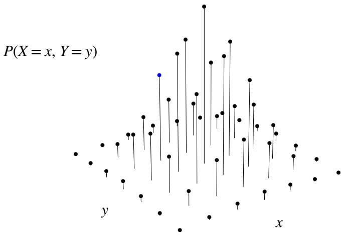
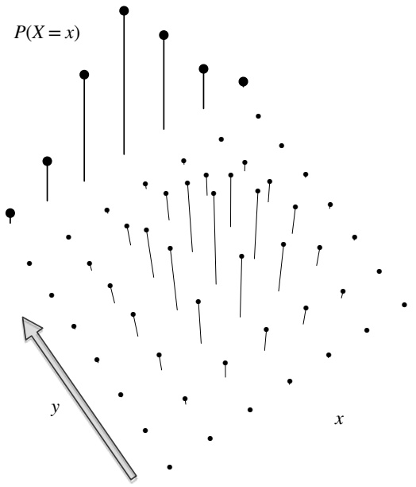
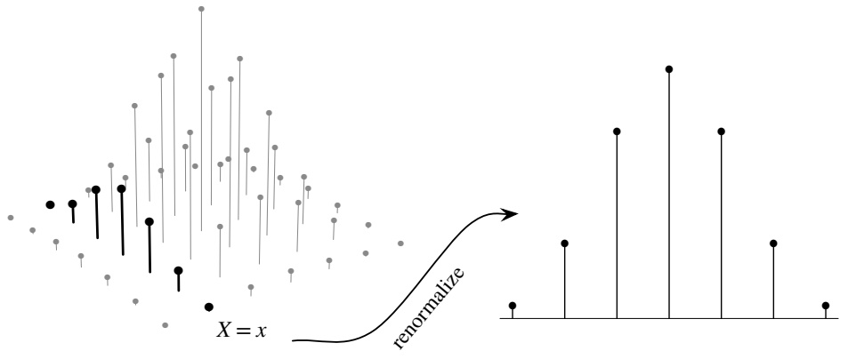
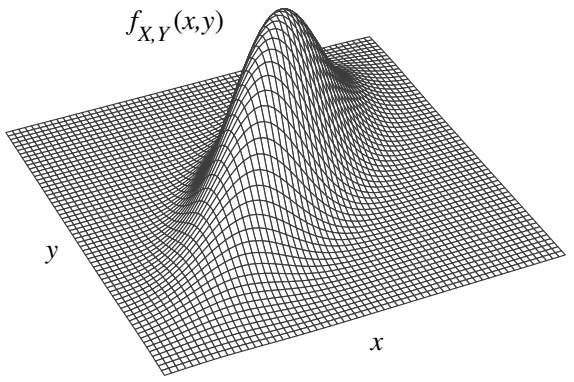
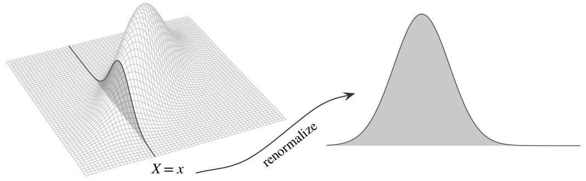
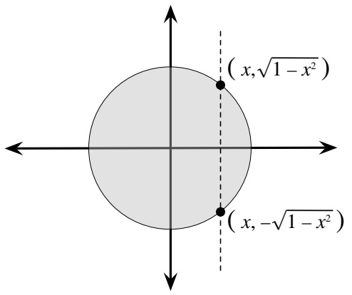

## 7.1 Joint, marginal, and conditional

The three key concepts for this section are joint, marginal, and conditional distributions. Recall that the distribution of a single r.v. X provides complete information about the probability of X falling into any subset of the real line. Analogously, the joint distribution of two r.v.s X and Y provides complete information about the probability of the vector (X, Y ) falling into any subset of the plane. The marginal distribution of X is the individual distribution of X, ignoring the value of Y , and the conditional distribution of X given $Y   =   y$ is the updated distribution for X after observing $Y = y$ . We’ll look at these concepts in the discrete case first, then extend them to the continuous case.

## 7.1.1 Discrete

The most general description of the joint distribution of two r.v.s is the joint CDF, which applies to discrete and continuous r.v.s alike.

Definition 7.1.1 (Joint CDF). The joint CDF of r.v.s X and Y is the function $F _ { X , Y }$ given by

$$
F _ {X, Y} (x, y) = P (X \leq x, Y \leq y).
$$

The joint CDF of n r.v.s is defined analogously.

Unfortunately, the joint CDF of discrete r.v.s is not a well-behaved function; as in the univariate case, it consists of jumps and flat regions. For this reason, with discrete r.v.s we usually work with the joint PMF, which also determines the joint distribution and is much easier to visualize.

Definition 7.1.2 (Joint PMF). The joint PMF of discrete r.v.s X and Y is the function $p _ { X , Y }$ given by

$$
p _ {X, Y} (x, y) = P (X = x, Y = y).
$$

The joint PMF of n discrete r.v.s is defined analogously.

Just as univariate PMFs must be nonnegative and sum to 1, we require valid joint PMFs to be nonnegative and sum to 1, where the sum is taken over all possible values of X and Y :

$$
\sum_ {x} \sum_ {y} P (X = x, Y = y) = 1.
$$

The joint PMF determines the distribution because we can use it to find the probability of the event $( X , Y ) \in A$ for any set A of points in the support of $( X , Y )$ . All we have to do is sum the joint PMF over A:

$$
P ((X, Y) \in A) = \sum_ {(x, y) \in A} P (X = x, Y = y).
$$

Figure 7.1 shows a sketch of what the joint PMF of two discrete r.v.s could look like. The height of a vertical bar at $( x , y )$ represents the probability $P ( X = x , Y = y )$ For the joint PMF to be valid, the total height of the vertical bars must be 1.

scatter

| Category | X (range) | Y (range) |
| --- | --- | --- |
| Data Points | 0~100 | 0~100 |

## FIGURE 7.1

Joint PMF of discrete r.v.s X and Y .

From the joint distribution of X and $Y ,$ we can get the distribution of X alone by summing over the possible values of Y . This gives us the familiar PMF of X that we have seen in previous chapters. In the context of joint distributions, we will call it the marginal or unconditional distribution of $X$ , to make it clear that we are referring to the distribution of X alone, without regard for the value of $Y$

Definition 7.1.3 (Marginal PMF). For discrete r.v.s X and $Y .$ the marginal PMF of X is

$$
P (X = x) = \sum_ {y} P (X = x, Y = y).
$$

The marginal PMF of X is the PMF of $X ,$ viewing X individually rather than jointly with Y . The above equation follows from the axioms of probability (we are summing over disjoint cases). The operation of summing over the possible values of $Y$ in order to convert the joint PMF into the marginal PMF of X is known as marginalizing out $Y$

The process of obtaining the marginal PMF from the joint PMF is illustrated in Figure 7.2. Here we take a bird’s-eye view of the joint PMF for a clearer perspective; each column of the joint PMF corresponds to a fixed x and each row corresponds to a fixed $y .$ For any x, the probability $P ( X = x )$ is the total height of the bars in the corresponding column of the joint PMF: we can imagine taking all the bars in that column and stacking them on top of each other to get the marginal probability. Repeating this for all $x ,$ we arrive at the marginal PMF, depicted in bold.

text_image

P(X = x)
y
x

## FIGURE 7.2

Bird’s-eye view of the joint PMF from Figure 7.1. The marginal PMF $P ( X = x )$ is obtained by summing over the joint PMF in the y-direction.

Similarly, the marginal PMF of Y is obtained by summing over all possible values of X. So given the joint PMF, we can marginalize out Y to get the PMF of $X .$ , or marginalize out X to get the PMF of Y . But if we only know the marginal PMFs of X and Y , there is no way to recover the joint PMF without further assumptions. It is clear how to stack the bars in Figure 7.2, but very unclear how to unstack the bars after they have been stacked!

Another way to go from joint to marginal distributions is via the joint CDF. In that case, we take a limit rather than a sum: the marginal CDF of X is

$$
F _ {X} (x) = P (X \leq x) = \lim _ {y \to \infty} P (X \leq x, Y \leq y) = \lim _ {y \to \infty} F _ {X, Y} (x, y).
$$

However, as mentioned above it is usually easier to work with joint PMFs.

Now suppose that we observe the value of X and want to update our distribution of $Y$ to reflect this information. Instead of using the marginal PMF $P ( Y   =   y )$ which does not take into account any information about $X$ , we should use a PMF that conditions on the event $X = x$ , where x is the value we observed for X. This naturally leads us to consider conditional PMFs.

Definition 7.1.4 (Conditional PMF). For discrete r.v.s X and $Y$ , the conditional PMF of $Y$ given $X = x$ is

$$
P (Y = y | X = x) = \frac {P (X = x , Y = y)}{P (X = x)}.
$$

This is viewed as a function of $y$ for fixed $x .$

Note that the conditional PMF (for fixed x) is a valid PMF. So we can define the conditional expectation of Y given $X = x ,$ denoted by $E ( Y | X = x )$ , in the same way that we defined $E ( Y )$ except that we replace the PMF of Y with the conditional PMF of $Y$ . Chapter 9 is devoted to conditional expectation.

Figure 7.3 illustrates the definition of conditional PMF. To condition on the event $X = x$ , we first take the joint PMF and focus in on the vertical bars where X takes on the value $x ;$ in the figure, these are shown in bold. All of the other vertical bars are irrelevant because they are inconsistent with the knowledge that $X = x$ occurred. Since the total height of the bold bars is the marginal probability $P ( X \; = \; x )$ we then renormalize the conditional PMF by dividing by $P ( X = x )$ ; this ensures that the conditional PMF will sum to 1. Therefore conditional PMFs are PMFs, just as conditional probabilities are probabilities. Notice that there is a different conditional PMF of Y for every possible value of X; Figure 7.3 highlights just one of these conditional PMFs.

text_image

X = x
renormalize

## FIGURE 7.3

Conditional PMF of $Y$ given $X   =   x$ . The conditional PMF $P ( Y   =   y | X   =   x )$ is obtained by renormalizing the column of the joint PMF that is compatible with the event $X = x$

We can also relate the conditional distribution of $Y$ given $X = x$ to that of X given $Y = y$ , using Bayes’ rule:

$$
P (Y = y | X = x) = \frac {P (X = x | Y = y) P (Y = y)}{P (X = x)}.
$$

And using LOTP, we have another way of getting the marginal PMF: the marginal PMF of $X$ is a weighted average of the conditional PMFs $P ( X = x | Y = y )$ , where the weights are the probabilities $P ( Y = y )$

$$
P (X = x) = \sum_ {y} P (X = x | Y = y) P (Y = y).
$$

Let’s work through a numerical example to complement the graphs we’ve been looking at.

Example 7.1.5 (2 × 2 table). The simplest example of a discrete joint distribution is when X and Y are both Bernoulli r.v.s. In this case, the joint PMF is fully specified by the four values $P(X = 1,Y = 1),   P(X = 0,Y = 1),   P(X = 1,Y = 0)$ and $P ( X = 0 , Y = 0 )$ , so we can represent the joint PMF of X and Y using a $2 \times 2$ table.

This very simple scenario actually has an important place in statistics, as these socalled contingency tables are often used to study whether a treatment is associated with a particular outcome. In such scenarios, X may be the indicator of receiving the treatment, and Y may be the indicator of the outcome of interest.

For example, suppose we randomly sample an adult male from the United States population. Let X be the indicator of the sampled individual being a current smoker, and let Y be the indicator of his developing lung cancer at some point in his life. Suppose the joint PMF is as follows (these numbers are for illustrative purposes; they are not estimated from real data).

|  | $Y = 1$ | $Y = 0$ |
| --- | --- | --- |
| $X = 1$ | $\frac{5}{100}$ | $\frac{20}{100}$ |
| $X = 0$ | $\frac{3}{100}$ | $\frac{72}{100}$ |

To get the marginal probability $P ( Y = 1 )$ , we add the probabilities in the two cells of the table where $Y = 1$ . We do the same for $P(Y = 0),   P(X = 1)$ , and $P ( X = 0 )$ and write these probabilities in the margins of the table (making “marginal” an appropriate name!).

|  | $Y = 1$ | $Y = 0$ | Total |
| --- | --- | --- | --- |
| $X = 1$ | $\frac{5}{100}$ | $\frac{20}{100}$ | $\frac{25}{100}$ |
| $X = 0$ | $\frac{3}{100}$ | $\frac{72}{100}$ | $\frac{75}{100}$ |
| Total | $\frac{8}{100}$ | $\frac{92}{100}$ | $\frac{100}{100}$ |

This shows that the marginal distribution of X is Bern(0.25) and the marginal distribution of Y is $\mathrm { B e r n } ( 0 . 0 8 )$ . In words, the unconditional probability that the individual is a current smoker is 0.25, and the unconditional probability of his developing lung cancer is 0.08.

Now suppose we observe X = 1, i.e., the individual is a current smoker. We can then update our beliefs about his risk for lung cancer.

$$
P (Y = 1 | X = 1) = \frac {P (X = 1 , Y = 1)}{P (X = 1)} = \frac {5 / 1 0 0}{2 5 / 1 0 0} = 0. 2,
$$

so the conditional distribution of Y given X = 1 is Bern(0.2). By a similar calculation, the conditional distribution of Y given X = 0 is Bern(0.04). This tells us that the probability of developing lung cancer is 0.2 for current smokers but only 0.04 for non-smokers. 

h 7.1.6. The word “marginal” has opposite meanings in economics and statistics. In economics it refers to a derivative, e.g., marginal revenue is the derivative of revenue with respect to quantity sold. In statistics it refers to an integral or sum, which can be thought of intuitively by writing totals in the margins of a table, as in the above example.

Armed with an understanding of joint, marginal, and conditional distributions, we can revisit the definition of independence that we introduced in Chapter 3.

Definition 7.1.7 (Independence of discrete r.v.s). Random variables X and Y are independent if for all x and $y ,$

$$
F _ {X, Y} (x, y) = F _ {X} (x) F _ {Y} (y).
$$

If X and Y are discrete, this is equivalent to the condition

$$
P (X = x, Y = y) = P (X = x) P (Y = y)
$$

for all $x , y ,$ , and it is also equivalent to the condition

$$
P (Y = y | X = x) = P (Y = y)
$$

for all x, y such that $P(X = x) > 0$

Using the terminology from this chapter, the definition says that for independent r.v.s, the joint CDF factors into the product of the marginal CDFs, or that the joint PMF factors into the product of the marginal PMFs. Remember that in general, the marginal distributions do not determine the joint distribution: this is the reason why we wanted to study joint distributions in the first place! But in the special case of independence, the marginal distributions are all we need in order to specify the joint distribution; we can get the joint PMF by multiplying the marginal PMFs.

Another way of looking at independence is that all the conditional PMFs are the same as the marginal PMF. That is, starting with the marginal PMF of Y , no updating is necessary when we condition on $X = x$ , regardless of what x is.

Example 7.1.8 (Independence in the $2 \times 2$ table). Returning to the table from the previous example, we can use these two views of independence to see why X and Y are not independent.

|  | Y = 1 | Y = 0 | Total |
| --- | --- | --- | --- |
| X = 1 | $\frac{5}{100}$ | $\frac{20}{100}$ | $\frac{25}{100}$ |
| X = 0 | $\frac{3}{100}$ | $\frac{72}{100}$ | $\frac{75}{100}$ |
| Total | $\frac{8}{100}$ | $\frac{92}{100}$ | $\frac{100}{100}$ |

First, the joint PMF is not the product of the marginal PMFs. For example,

$$
P (X = 1, Y = 1) \neq P (X = 1) P (Y = 1).
$$

Finding even one pair of values x and $y$ such that

$$
P (X = x, Y = y) \neq P (X = x) P (Y = y)
$$

is enough to rule out independence.

Second, we found that the marginal distribution of Y is Bern(0.08), whereas the conditional distribution of Y given $X = 1$ is Bern(0.2) and the conditional distribution of $Y$ given $X = 0$ is Bern(0.04). Since conditioning on the value of X alters the distribution of Y , X and $Y$ are not independent: learning whether or not the sampled individual is a current smoker gives us information about the probability that he will develop lung cancer.

Although we have found that X and $Y$ are dependent, we cannot make conclusions about whether smoking causes lung cancer based on this association alone. As we learned from Simpson’s paradox, misleading associations can arise when we fail to account for confounding variables. 

We’ll do one more example of a discrete joint distribution to round out this section. We’ve named it the chicken-egg story; in it, we use wishful thinking to find a joint PMF, and our efforts land us a surprising independence result.

Story 7.1.9 (Chicken-egg). Suppose a chicken lays a random number of eggs, $N ,$ where $N \sim  Pois (\lambda)$ . Each egg independently hatches with probability $p$ and fails to hatch with probability $q = 1 - p$ . Let X be the number of eggs that hatch and $Y$ the number that do not hatch, so $X + Y = N$ . What is the joint PMF of $X$ and $Y ?$

Solution:

We seek the joint PMF $P ( X   =   i , Y   =   j )$ for nonnegative integers $i$ and $j .$ Conditional on the total number of eggs N, the eggs are independent Bernoulli trials with probability of success $p ,$ so by the story of the Binomial, the conditional distributions of $X$ and $Y$ are $X | N = n \sim \mathrm { B i n } ( n , p )$ and $Y | N = n \sim \mathrm { B i n } ( n , q )$ . Since our lives would be easier if only we knew the total number of eggs, let’s use wishful thinking: condition on $N$ and apply the law of total probability. This gives

$$
P (X = i, Y = j) = \sum_ {n = 0} ^ {\infty} P (X = i, Y = j | N = n) P (N = n).
$$

The sum is over all possible values of $n ,$ holding $i$ and $j$ fixed. But unless $n = i + j$ it is impossible for $X$ to equal $i$ and Y to equal $j .$ For example, the only way there can be 5 hatched eggs and $6$ unhatched eggs is if there are 11 eggs in total. So

$$
P (X = i, Y = j | N = n) = 0
$$

unless $n = i + j$ , which means all other terms in the sum can be dropped:

$$
P (X = i, Y = j) = P (X = i, Y = j | N = i + j) P (N = i + j).
$$

Conditional on $N = i + j$ , the events $X = i$ and $Y = j$ are exactly the same event, so keeping both is redundant. We’ll keep $X   =   i ;$ the rest is a matter of plugging in the Binomial PMF to get $P ( X   =   i | N   =   i   +   j )$ and the Poisson PMF to get $P ( N = i + j )$ . Thus,

$$
\begin{array}{l} P (X = i, Y = j) = P (X = i | N = i + j) P (N = i + j) \\ = \binom{i + j}{i} p ^ {i} q ^ {j} \cdot \frac {e ^ {- \lambda} \lambda^ {i + j}}{(i + j) !} \\ = \frac {e ^ {- \lambda p} (\lambda p) ^ {i}}{i !} \cdot \frac {e ^ {- \lambda q} (\lambda q) ^ {j}}{j !}. \\ \end{array}
$$

The joint PMF factors into the product of the $\operatorname { P o i s } ( \lambda p )$ PMF (as a function of i) and the $\operatorname { P o i s } ( \lambda q )$ PMF (as a function of j). This tells us two elegant facts: (1) X and $Y$ are independent, since their joint PMF is the product of their marginal PMFs, and (2) $X \sim  Pois (\lambda p)$ and $Y \sim  Pois (\lambda q)$

At first it may seem deeply counterintuitive that X is independent of Y . Doesn’t knowing that a lot of eggs hatched mean that there are probably not so many that didn’t hatch? For a fixed number of eggs, this independence would be impossible: knowing the number of hatched eggs would perfectly determine the number of unhatched eggs. But in this example, the number of eggs is random, following a Poisson distribution, and this happens to be the right kind of randomness to make X and Y unconditionally independent. This is a very special property of the Poisson. 

The chicken-egg story supplements the following result from Chapter 4:

Theorem 7.1.10. If $X \sim  Pois (\lambda p),   Y \sim  Pois (\lambda q)$ , and X and Y are independent, then $N = X + Y \sim  Pois (\lambda)$ and $X | N = n \sim \mathrm { B i n } ( n , p )$

By the chicken-egg story, we now have the converse to this theorem.

Theorem 7.1.11. If $N \sim  Pois (\lambda)$ and $X | N = n \sim \mathrm { B i n } ( n , p )$ , then $X \sim  Pois (\lambda p)$ $Y = N - X \sim \mathrm{Poisson}(\lambda q)$ , and X and Y are independent.

h 7.1.12. In the chicken-egg story, it is not valid to say $^ { \backsim } P ( X   =   x | N   =   n )   =$ $P ( X   =   x | X   +   Y   =   n )   =   P ( X   =   x | Y   =   n   -   x )$ , since in $P ( X   =   x | N   =   n )$ we are not conditioning on $X = x$ . Indeed, $P ( X   =   x | N   =   n )$ is the $\operatorname { B i n } ( n , p )$ PMF, whereas $P ( X = x | Y = n - x ) = P ( X = x )$ is the $\operatorname { P o i s } ( \lambda p )$ PMF. This blunder of plugging in x for X on the right side of the conditioning bar illustrates how crucial it is to carefully distinguish between X and $x ,$ and between the left side and the right side of the conditioning bar.

## 7.1.2 Continuous

Once we have a handle on discrete joint distributions, it isn’t much harder to consider continuous joint distributions. We simply make the now-familiar substitutions of integrals for sums and PDFs for PMFs, remembering that the probability of any individual point is now 0.

Formally, in order for X and Y to have a continuous joint distribution, we require that the joint CDF

$$
F _ {X, Y} (x, y) = P (X \leq x, Y \leq y)
$$

be differentiable with respect to x and y. The partial derivative with respect to x and $y$ is called the joint PDF. The joint PDF determines the joint distribution, as does the joint CDF.

Definition 7.1.13 (Joint PDF). If X and Y are continuous with joint CDF $F _ { X , Y }$ their joint PDF is the derivative of the joint CDF with respect to x and $y ;$

$$
f _ {X, Y} (x, y) = \frac {\partial^ {2}}{\partial x \partial y} F _ {X, Y} (x, y).
$$

We require valid joint PDFs to be nonnegative and integrate to 1:

$$
f _ {X, Y} (x, y) \geq 0, \text {and} \int_ {- \infty} ^ {\infty} \int_ {- \infty} ^ {\infty} f _ {X, Y} (x, y) d x d y = 1.
$$

In the univariate case, the PDF was the function we integrated to get the probability of an interval. Similarly, the joint PDF of two r.v.s is the function we integrate to get the probability of a two-dimensional region. For example,

$$
P (X <   3, 1 <   Y <   4) = \int_ {1} ^ {4} \int_ {- \infty} ^ {3} f _ {X, Y} (x, y) d x d y.
$$

For a general region $A \subseteq \mathbb { R } ^ { 2 }$

$$
P ((X, Y) \in A) = \iint_ {A} f _ {X, Y} (x, y) d x d y.
$$

Figure 7.4 shows a sketch of what a joint PDF of two r.v.s could look like. As usual with continuous r.v.s, we need to keep in mind that the height of the surface $f _ { X , Y } ( x , y )$ at a single point does not represent a probability. The probability of any specific point in the plane is 0. Now that we’ve gone up a dimension, the probability of any line or curve in the plane is also 0. The only way we can get nonzero probability is by integrating over a region of positive area in the xy-plane.

When we integrate the joint PDF over a region A, we are calculating the volume under the surface of the joint PDF and above A. Thus, probability is represented by volume under the joint PDF. The total volume under a valid joint PDF is 1.

text_image

f_{X,Y}(x,y)
y
x

## FIGURE 7.4

Joint PDF of continuous r.v.s X and Y .

In the discrete case, we get the marginal PMF of X by summing over all possible values of Y in the joint PMF. In the continuous case, we get the marginal PDF of X by integrating over all possible values of Y in the joint PDF.

Definition 7.1.14 (Marginal PDF). For continuous r.v.s X and Y with joint PDF $f _ { X , Y }$ , the marginal PDF of X is

$$
f _ {X} (x) = \int_ {- \infty} ^ {\infty} f _ {X, Y} (x, y) d y.
$$

This is the PDF of X, viewing X individually rather than jointly with Y .

To simplify notation, we have mainly been looking at the joint distribution of two r.v.s rather than n r.v.s, but marginalization works analogously with any number of variables. For example, if we have the joint PDF of X, Y, Z, W but want the joint PDF of X, W, we just have to integrate over all possible values of Y and Z:

$$
f _ {X, W} (x, w) = \int_ {- \infty} ^ {\infty} \int_ {- \infty} ^ {\infty} f _ {X, Y, Z, W} (x, y, z, w) d y d z.
$$

Conceptually this is easy—just integrate over the unwanted variables to get the joint PDF of the wanted variables—but computing it may or may not be easy.

Returning to the case of the joint distribution of two r.v.s X and Y , let’s consider how to update our distribution for Y after observing the value of X, using the conditional PDF.

Definition 7.1.15 (Conditional PDF). For continuous r.v.s X and Y with joint PDF $f _ { X , Y }$ , the conditional PDF of Y given $X = x$ is

$$
f _ {Y \mid X} (y \mid x) = \frac {f _ {X , Y} (x , y)}{f _ {X} (x)},
$$

for all x with $f _ { X } ( x )   >   0$ . This is considered as a function of y for fixed x. As a convention, in order to make $f _ { Y | X } ( y | x )$ well-defined for all real $x ,$ let $f _ { Y | X } ( y | x ) = 0$ for all x with $f _ { X } ( x ) = 0$

Notation 7.1.16. The subscripts that we place on all the $f ^ { \prime } \mathrm { s }$ are just to remind us that we have three different functions on our plate. We could just as well write $g ( y | x ) = f ( x , y ) / h ( x )$ , where f is the joint PDF, h is the marginal PDF of X, and g is the conditional PDF of Y given $X   =   x$ , but that makes it more difficult to remember which letter stands for which function.

Figure 7.5 illustrates the definition of conditional PDF. We take a vertical slice of the joint PDF corresponding to the observed value of X. Since the total area under this slice is $f _ { X } ( x )$ , we then divide by $f _ { X } ( x )$ to ensure that the conditional PDF will have an area of 1. So the conditional PDF of $Y$ given $X = x$ satisfies the properties of a valid PDF, for any x in the support of X.

text_image

X = x
renormalize

## FIGURE 7.5

Conditional PDF of Y given $X = x$ . The conditional PDF $f _ { Y | X } ( y | x )$ is obtained by renormalizing the slice of the joint PDF at the fixed value x.

h 7.1.17. How can we speak of conditioning on $X = x$ for X a continuous $\mathbf { r } . \mathbf { V } .$ considering that this event has probability 0? Rigorously speaking, we are actually conditioning on the event that X falls within a small interval containing x, say $X \in ( x - \epsilon , x + \epsilon )$ , and then taking a limit as  approaches 0 from the right. We will not fuss over this technicality; fortunately, many important results such as Bayes rule work in the continuous case exactly as one would hope.

Note that we can recover the joint PDF $f _ { X , Y }$ if we have the conditional PDF $f _ { Y | X }$ and the corresponding marginal $f _ { X }$ :

$$
f _ {X, Y} (x, y) = f _ {Y | X} (y | x) f _ {X} (x).
$$

Similarly, we can recover the joint PDF if we have $f _ { X | Y }$ and $f _ { Y }$ :

$$
f _ {X, Y} (x, y) = f _ {X | Y} (x | y) f _ {Y} (y).
$$

This allows us to develop continuous versions of Bayes’ rule and LOTP. The continuous versions are analogous to the discrete versions, with probability density functions in place of probabilities and integrals in place of sums.

Theorem 7.1.18 (Continuous form of Bayes’ rule and LOTP). For continuous r.v.s X and $Y .$ we have the following continuous form of Bayes’ rule:

$$
f _ {Y \mid X} (y \mid x) = \frac {f _ {X \mid Y} (x \mid y) f _ {Y} (y)}{f _ {X} (x)}, \text {for} f _ {X} (x) > 0.
$$

And we have the following continuous form of the law of total probability:

$$
f _ {X} (x) = \int_ {- \infty} ^ {\infty} f _ {X | Y} (x | y) f _ {Y} (y) d y.
$$

Proof. By definition of conditional PDFs, we have

$$
f _ {Y \mid X} (y \mid x) f _ {X} (x) = f _ {X, Y} (x, y) = f _ {X \mid Y} (x \mid y) f _ {Y} (y).
$$

The continuous version of Bayes’ rule follows immediately from dividing by $f _ { X } ( x )$ The continuous version of LOTP follows immediately from integrating with respect to $y ;$

$$
f _ {X} (x) = \int_ {- \infty} ^ {\infty} f _ {X, Y} (x, y) d y = \int_ {- \infty} ^ {\infty} f _ {X | Y} (x | y) f _ {Y} (y) d y.
$$

Out of curiosity, let’s see what would have happened if we had plugged in the other expression for $f _ { X , Y } ( x , y )$ instead in the proof of LOTP:

$$
f _ {X} (x) = \int_ {- \infty} ^ {\infty} f _ {X, Y} (x, y) d y = \int_ {- \infty} ^ {\infty} f _ {Y | X} (y | x) f _ {X} (x) d y = f _ {X} (x) \int_ {- \infty} ^ {\infty} f _ {Y | X} (y | x) d y.
$$

This just says that, for any x with $f _ { X } ( x ) > 0$

$$
\int_ {- \infty} ^ {\infty} f _ {Y | X} (y | x) d y = 1,
$$

confirming the fact that conditional PDFs must integrate to 1.

We now have versions of Bayes’ rule and LOTP for two discrete r.v.s and for two continuous r.v.s. Better yet, there are also versions when we have one discrete r.v. and one continuous r.v. After understanding the discrete versions, it is easy to remember and use the other versions since they are analogous, replacing probabilities by PDFs when appropriate. For example, for X discrete and $Y$ continuous, we have the following version of LOTP:

$$
P (X = x) = \int_ {- \infty} ^ {\infty} P (X = x | Y = y) f _ {Y} (y) d y.
$$

Taking $X$ to be the indicator r.v. of an event $A$ and $x = 1$ , we have an expression for a general probability $P ( A )$ based on conditioning on a continuous r.v. $Y ;$

$$
P (A) = \int_ {- \infty} ^ {\infty} P (A | Y = y) f _ {Y} (y) d y.
$$

Here are the four versions of Bayes’ rule, summarized in a table.

|  | Y discrete | Y continuous |
| --- | --- | --- |
| X discrete | $P(Y = y\|X = x) = \frac{P(X=x\|Y=y)P(Y=y)}{P(X=x)}$ | $f_{Y}(y\|X = x) = \frac{P(X=x\|Y=y)f_{Y}(y)}{P(X=x)}$ |
| X continuous | $P(Y = y\|X = x) = \frac{f_{X}(x\|Y=y)P(Y=y)}{f_{X}(x)}$ | $f_{Y\|X}(y\|x) = \frac{f_{X\|Y}(x\|y)f_{Y}(y)}{f_{X}(x)}$ |

And here are the four versions of LOTP, summarized in a table. The top row gives expressions for $P ( X = x )$ , while the bottom row gives expressions for $f _ { X } ( x )$

|  | Y discrete | Y continuous |
| --- | --- | --- |
| X discrete | $\sum_{y} P(X = x \| Y = y)P(Y = y)$ | $\int_{-\infty}^{\infty} P(X = x \| Y = y)f_Y(y)dy$ |
| X continuous | $\sum_{y} f_X(x \| Y = y)P(Y = y)$ | $\int_{-\infty}^{\infty} f_{X\|Y}(x \| y)f_Y(y)dy$ |

Finally, let’s discuss the definition of independence for continuous r.v.s; then we’ll turn to concrete examples. As in the discrete case, we can view independence of continuous r.v.s in two ways. One is that the joint CDF factors into the product of the marginal CDFs, or the joint PDF factors into the product of the marginal PDFs. The other is that the conditional PDF of Y given $X = x$ is the same as the marginal PDF of Y , so conditioning on X provides no information about Y .

Definition 7.1.19 (Independence of continuous r.v.s). Random variables X and Y are independent if for all x and $y ,$

$$
F _ {X, Y} (x, y) = F _ {X} (x) F _ {Y} (y).
$$

If X and Y are continuous with joint PDF $f _ { X , Y }$ , this is equivalent to the condition

$$
f _ {X, Y} (x, y) = f _ {X} (x) f _ {Y} (y)
$$

for all $x , y ,$ and it is also equivalent to the condition

$$
f _ {Y \mid X} (y \mid x) = f _ {Y} (y)
$$

for all x, y such that $f _ { X } ( x ) > 0$

h 7.1.20. The marginal PDF of $Y ,   f _ { Y } ( y )$ , is a function of $y$ only; it cannot depend on x in any way. The conditional PDF $f _ { Y | X } ( y | x )$ can depend on x in general. Only in the special case of independence is $f _ { Y | X } ( y | x )$ free of x.

Sometimes we have a joint PDF for X and Y that factors as a function of x times a function of $y ,$ without knowing in advance whether these functions are the marginal PDFs, or even whether they are valid PDFs. The next result addresses this situation.

Proposition 7.1.21. Suppose that the joint PDF $f _ { X , Y }$ of X and Y factors as

$$
f _ {X, Y} (x, y) = g (x) h (y)
$$

for all x and $y ,$ where g and h are nonnegative functions. Then $X$ and $Y$ are independent. Also, if either $g$ or h is a valid PDF, then the other one is a valid PDF too and $g$ and $h$ are the marginal PDFs of X and $Y$ , respectively. (The analogous result in the discrete case also holds.)

Proof. Let $\begin{array} { r } { c = \int _ { - \infty } ^ { \infty } h ( y ) d y } \end{array}$ . Multiplying and dividing by $c _ { \gamma }$ we can write

$$
f _ {X, Y} (x, y) = c g (x) \cdot \frac {h (y)}{c}.
$$

(The point of this is that $h ( y ) / c$ is a valid PDF.) Then the marginal PDF of $X$ is

$$
f _ {X} (x) = \int_ {- \infty} ^ {\infty} f _ {X, Y} (x, y) d y = c g (x) \int_ {- \infty} ^ {\infty} \frac {h (y)}{c} d y = c g (x).
$$

It follows that $\begin{array} { r } { \int _ { - \infty } ^ { \infty } c g ( x ) d x = 1 } \end{array}$ since a marginal PDF is a valid PDF (knowing the integral of h gave us the integral of $g$ for free!). Then the marginal PDF of $Y$ is

$$
f _ {Y} (y) = \int_ {- \infty} ^ {\infty} f _ {X, Y} (x, y) d x = \frac {h (y)}{c} \int_ {- \infty} ^ {\infty} c g (x) d x = \frac {h (y)}{c}.
$$

Thus, X and Y are independent with PDFs $c g ( x )$ and $h ( y ) / c ,$ respectively. If $g$ or h is already a valid PDF, then $c = 1$ , so the other one is also a valid PDF. 

h 7.1.22. In the above proposition, we need the joint PDF to factor as a function of x times a function of $y$ for all $( x , y )$ in the plane $\mathbb { R } ^ { 2 }$ , not just for $( x , y )$ with $f _ { X , Y } ( x , y ) > 0$ . The reason for this is illustrated in the next example.

A simple case of a continuous joint distribution is when the joint PDF is constant over some region in the plane. In the following example, we’ll compare a joint PDF that is constant on a square to a joint PDF that is constant on a disk.

Example 7.1.23 (Uniform on a region in the plane). Let $( X , Y )$ be a completely random point in the square $\{ ( x , y ) : x , y \in [ 0 , 1 ] \}$ , in the sense that the joint PDF of $X$ and $Y$ is constant over the square and 0 outside of it:

$$
f _ {X, Y} (x, y) = \left\{ \begin{array}{l l} 1 & \text {if} x, y \in [ 0, 1 ], \\ 0 & \text {otherwise}. \end{array} \right.
$$

The constant 1 is chosen so that the joint PDF will integrate to 1. This distribution is called the Uniform distribution on the square.

Intuitively, it makes sense that X and $Y$ should be $\mathrm { U n i f } ( 0 , 1 )$ marginally. We can check this by computing

$$
f _ {X} (x) = \int_ {0} ^ {1} f _ {X, Y} (x, y) d y = \int_ {0} ^ {1} 1 d y = 1,
$$

and similarly for $f _ { Y }$ . Furthermore, X and Y are independent, since the joint PDF factors into the product of the marginal PDFs (this just reduces to $1 = 1 \cdot 1$ , but it’s important to note that the value of X does not constrain the possible values of Y ). So the conditional distribution of Y given $X = x$ is $\mathrm { U n i f } ( 0 , 1 )$ , regardless of $x .$

Now let $( X , Y )$ be a completely random point in the unit disk $\{ ( x , y ) : x ^ { 2 }   +   y ^ { 2 } \leq 1 \}$ with joint PDF

$$
f _ {X, Y} (x, y) = \left\{ \begin{array}{l l} \frac {1}{\pi} & \text {if} x ^ {2} + y ^ {2} \leq 1, \\ 0 & \text {otherwise.} \end{array} \right.
$$

Again, the constant $1 / \pi$ is chosen to make the joint PDF integrate to 1; the value follows from the fact that the integral of 1 over some region in the plane is the area of that region.

Note that X and Y are not independent, since in general, knowing the value of X constrains the possible values of $Y ;$ larger values of $\left| X \right|$ restrict Y to be in a smaller range. It would fall into h 7.1.22 disastrously to conclude independence from the fact that $f _ { X , Y } ( x , y )   =   g ( x ) h ( y )$ for all $( x , y )$ in the disk, where $g ( x )   =   1 / \pi$ and $h ( y ) = 1$ are constant functions. To see from the definition that X and Y are not independent, note that, for example, $f _ { X , Y } ( 0 . 9 , 0 . 9 ) = 0$ since $( 0 . 9 , 0 . 9 )$ is not in the unit disk, but $f _ { X } ( 0 . 9 ) f _ { Y } ( 0 . 9 ) \neq 0$ since 0.9 is in the supports of both X and $Y$

The marginal distribution of X is now

$$
f _ {X} (x) = \int_ {- \sqrt {1 - x ^ {2}}} ^ {\sqrt {1 - x ^ {2}}} \frac {1}{\pi} d y = \frac {2}{\pi} \sqrt {1 - x ^ {2}}, \quad - 1 \leq x \leq 1.
$$

By symmetry, $\begin{array} { r } { f _ { Y } ( y )   =   \frac { 2 } { \pi } \sqrt { 1 - y ^ { 2 } } } \end{array}$ . Note that the marginal distributions of $X$ and $Y$ are not Uniform on $[ - 1 , 1 ]$ ; rather, X and $Y$ are more likely to fall near 0 than near $\pm 1$

text_image

(x,\u221a1-x²)
(x,-\u221a1-x²)

## FIGURE 7.6

Bird’s-eye view of the Uniform joi<u>nt PD</u>F o<u>n the</u> unit disk. Conditional on $X = x$ $Y$ is restricted to the interval $[ - \sqrt { 1 - x ^ { 2 } } , \sqrt { 1 - x ^ { 2 } } ]$

Suppose we observe $X   =   x$ . As illustrated in Figure 7.6, this constrains $Y$ to lie in the interval $[ - \sqrt { 1 - x ^ { 2 } } , \sqrt { 1 - x ^ { 2 } } ]$ . Specifically, the conditional distribution of $Y$ given $X = x$ is

$$
f _ {Y | X} (y | x) = \frac {f _ {X , Y} (x , y)}{f _ {X} (x)} = \frac {\frac {1}{\pi}}{\frac {2}{\pi} \sqrt {1 - x ^ {2}}} = \frac {1}{2 \sqrt {1 - x ^ {2}}}
$$

for $- { \sqrt { 1 - x ^ { 2 } } }   \leq   y   \leq   { \sqrt { 1 - x ^ { 2 } } }$ , and 0 otherwise. This conditional PDF is constant as a function of $y$ , <u>which</u> tell<u>s us th</u>at the conditional distribution of Y is Uniform on the interval $[ - \sqrt { 1 - x ^ { 2 } } , \sqrt { 1 - x ^ { 2 } } ]$ The fact that the conditional PDF is not free of x confirms the fact that X and $Y$ are not independent.

In general, for a region R in the plane, the Uniform distribution on R is defined to have joint PDF that is constant inside R and 0 outside R. The constant is the reciprocal of the area of R. If R is the rectangle $\{ ( x , y ) : a \leq x \leq b , c \leq y \leq d \}$ , then X and Y will be independent; unlike for a disk, the vertical slices of a rectangle all look the same. But for any region where the value of $X$ constrains the possible values of $Y$ or vice versa, X and $Y$ will not be independent. 

As another example of working with joint PDFs, let’s consider a question that comes up often when dealing with Exponentials of different rates.

Example 7.1.24 (Comparing Exponentials of different rates). Let $T _ { 1 } \sim \mathrm { E x p o } ( \lambda _ { 1 } )$ and $T _ { 2 }   \sim   \mathrm { E x p o } ( \lambda _ { 2 } )$ be independent. Find $P ( T _ { 1 }   <   T _ { 2 } )$ . For example, $T _ { 1 }$ could be the lifetime of a refrigerator and $T _ { 2 }$ could be the lifetime of a stove (if we are willing to assume Exponential distributions for these), and then $P ( T _ { 1 } < T _ { 2 } )$ is the probability that the refrigerator fails before the stove. We know from Chapter 5 that min $\underline { { { { } } } } ( T _ { 1 } , T _ { 2 } ) \sim \operatorname { E x p o } ( \lambda _ { 1 } + \lambda _ { 2 } )$ , which tells us about when the first appliance failure will occur, but we may also want to know about which appliance will fail first.

## Solution:

We just need to integrate the joint PDF of $T _ { 1 }$ and $T _ { 2 }$ over the appropriate region, which is all $( t _ { 1 } , t _ { 2 } )$ with $t _ { 1 } > 0 , t _ { 2 } > 0$ , and $t _ { 1 } < t _ { 2 }$ . This yields

$$
\begin{array}{l} P (T _ {1} <   T _ {2}) = \int_ {0} ^ {\infty} \int_ {0} ^ {t _ {2}} \lambda_ {1} e ^ {- \lambda_ {1} t _ {1}} \lambda_ {2} e ^ {- \lambda_ {2} t _ {2}} d t _ {1} d t _ {2} \\ = \int_ {0} ^ {\infty} \left(\int_ {0} ^ {t _ {2}} \lambda_ {1} e ^ {- \lambda_ {1} t _ {1}} d t _ {1}\right) \lambda_ {2} e ^ {- \lambda_ {2} t _ {2}} d t _ {2} \\ = \int_ {0} ^ {\infty} (1 - e ^ {- \lambda_ {1} t _ {2}}) \lambda_ {2} e ^ {- \lambda_ {2} t _ {2}} d t _ {2} \\ = 1 - \int_ {0} ^ {\infty} \lambda_ {2} e ^ {- (\lambda_ {1} + \lambda_ {2}) t _ {2}} d t _ {2} \\ = 1 - \frac {\lambda_ {2}}{\lambda_ {1} + \lambda_ {2}} \\ = \frac {\lambda_ {1}}{\lambda_ {1} + \lambda_ {2}}. \\ \end{array}
$$

This result makes sense intuitively if we interpret $\lambda _ { 1 }$ and $\lambda _ { 2 }$ as rates. For example,