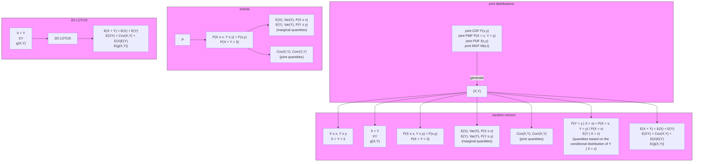

(b) We have $X_{1} \sim \mathrm{Bin}(n, p_{1}), X_{2} \sim \mathrm{Bin}(n, p_{2}), \text { and } \mathrm{Cov}(X_{1}, X_{2}) = -np_{1}p_{2},$ so

$$
\mathrm{Corr} (X _ {1}, X _ {2}) = \frac {\mathrm{Cov} (X _ {1} , X _ {2})}{\mathrm{SD} (X _ {1}) \mathrm{SD} (X _ {2})} = \frac {- n p _ {1} p _ {2}}{\sqrt {n p _ {1} (1 - p _ {1}) n p _ {2} (1 - p _ {2})}} = - \sqrt {\frac {p _ {1} p _ {2}}{(1 - p _ {1}) (1 - p _ {2})}}.
$$

(c) By the lumping property of the Multinomial,

$$
(X _ {1}, X _ {2 3}) \sim \mathrm{Mult} _ {2} (n, (p _ {1}, p _ {2} + p _ {3})).
$$

(d) In general for $X \sim \operatorname { B i n } ( n , p )$ , if $X = x$ is observed then the MLE of $p$ is the value of $p$ that maximizes the function

$$
L (p) = \binom {n} {x} p ^ {x} (1 - p) ^ {n - x}.
$$

(The function $L$ is called the likelihood function in statistics. It is the probability of the data, regarded as a function of the parameter with the data treated as fixed.)

$\mathrm { A s }$ if often the case when dealing with a product of positive numbers, it is helpful to take the log. It is equivalent to find the value $\hat { p }$ that maximizes

$$
\log L (p) = \log \binom{n}{x} + x \log p + (n - x) \log (1 - p),
$$

since log is a continuous, strictly increasing function. Setting the derivative of log $L ( p )$ (with respect to $p ,$ holding x constant) equal to 0, we have

$$
\frac {x}{\hat {p}} - \frac {n - x}{1 - \hat {p}} = 0,
$$

which rearranges to $\hat { p } = x / n$ . We have found a maximum since the second derivative of log $L ( p )$ is

$$
- \frac {x}{p ^ {2}} - \frac {n - x}{(1 - p) ^ {2}} <   0.
$$

So the MLE of $p _ { 3 }$ is $\hat { p } _ { 3 } = 3 6 / 3 6 0 = 0 . 1$

(e) By the result on Multinomial conditioning,

$$
(X _ {1}, X _ {2}) | (X _ {3} = 0) \sim \mathrm{Mult} _ {2} \left(n, \left(\frac {p _ {1}}{p _ {1} + p _ {2}}, \frac {p _ {2}}{p _ {1} + p _ {2}}\right)\right).
$$

(f) Reasoning as in the chicken-egg story,

$$
P (X _ {1} = x _ {1}, X _ {2} = x _ {2}, X _ {3} = x _ {3}) = \sum_ {n = 0} ^ {\infty} P (X _ {1} = x _ {1}, X _ {2} = x _ {2}, X _ {3} = x _ {3} | N = n) P (N = n),
$$

where all terms of the sum are 0 except the term with $n = x _ { 1 } + x _ { 2 } + x _ { 3 }$ . For this value of $n ,$

$$
\begin{array}{l} P (X _ {1} = x _ {1}, X _ {2} = x _ {2}, X _ {3} = x _ {3}) = P (X _ {1} = x _ {1}, X _ {2} = x _ {2}, X _ {3} = x _ {3} | N = n) P (N = n) \\ = \frac {n !}{x _ {1} ! x _ {2} ! x _ {3} !} p _ {1} ^ {x _ {1}} p _ {2} ^ {x _ {2}} p _ {3} ^ {x _ {3}} \cdot e ^ {- \lambda} \frac {\lambda^ {n}}{n !} \\ = \frac {e ^ {- \lambda p _ {1}} (\lambda p _ {1}) ^ {x _ {1}}}{x _ {1} !} \cdot \frac {e ^ {- \lambda p _ {2}} (\lambda p _ {2}) ^ {x _ {2}}}{x _ {2} !} \cdot \frac {e ^ {- \lambda p _ {3}} (\lambda p _ {3}) ^ {x _ {3}}}{x _ {3} !}, \\ \end{array}
$$

for all nonnegative integers $x _ { 1 } , x _ { 2 } , x _ { 3 }$ . Therefore, $X _ { 1 } , X _ { 2 } , X _ { 3 }$ are independent, with $X_{j} \sim  Pois (\lambda p_{j})$ . This result is a Multinomial extension of the chicken-egg story. 

## 7.5 Multivariate Normal

The Multivariate Normal is a continuous multivariate distribution that generalizes the Normal distribution into higher dimensions. We will not work with the rather unwieldy joint PDF of the Multivariate Normal. Instead we define the Multivariate Normal by its relationship to the ordinary Normal.

Definition 7.5.1 (Multivariate Normal distribution). A k-dimensional random vector $\mathbf { X } = ( X _ { 1 } , \ldots , X _ { k } )$ is said to have a Multivariate Normal (MVN) distribution if every linear combination of the $X _ { j }$ has a Normal distribution. That is, we require

$$
t _ {1} X _ {1} + \dots + t _ {k} X _ {k}
$$

to have a Normal distribution for any constants $t _ { 1 } , \ldots , t _ { k } . \mathrm { ~ I f ~ } t _ { 1 } X _ { 1 } + \cdots + t _ { k } X _ { k }$ is a constant (such as when all $t _ { i } = 0 )$ , we consider it to have a Normal distribution, albeit a degenerate Normal with variance 0. An important special case is $k   =   2$ this distribution is called the Bivariate Normal (BVN).

If $( X _ { 1 } , \ldots , X _ { k } )$ is MVN, then the marginal distribution of $X _ { 1 }$ is Normal, since we can take $t _ { 1 }$ to be 1 and all other $t _ { j }$ to be 0. Similarly, the marginal distribution of each $X _ { j }$ is Normal. However, the converse is false: it is possible to have Normally distributed r.v.s $X _ { 1 } , \ldots , X _ { k }$ such that $( X _ { 1 } , \ldots , X _ { k } )$ is not Multivariate Normal.

Example 7.5.2 (Non-example of MVN). Here is an example of two r.v.s whose marginal distributions are Normal but whose joint distribution is not Bivariate Normal. Let $X \sim \mathcal { N } ( 0 , 1 )$ , and let

$$
S = \left\{ \begin{array}{l l} 1 & \text {with probability 1 / 2} \\ - 1 & \text {with probability 1 / 2} \end{array} \right.
$$

be a random sign independent of X. Then $Y = S X$ is a standard Normal $\mathbf { r } . \mathbf { v } . ,$ due to the symmetry of the Normal distribution (see Exercise 30 from Chapter 5). However, $( X , Y )$ is not Bivariate Normal because $P(X+Y=0)=P(S=-1)=1/2$ , which implies that $X + Y$ can’t be Normal (or, for that matter, have any continuous distribution). Since $X + Y$ is a linear combination of X and Y that is not Normally distributed, $( X , Y )$ is not Bivariate Normal. 

Example 7.5.3 (Actual MVN). For $Z , W \stackrel { \mathrm { i . i . d . } } { \sim } \mathcal { N } ( 0 , 1 ) ,   ( Z , W )$ is Bivariate Normal because the sum of independent Normals is Normal. Also, $( Z + 2 W , 3 Z + 5 W )$ is Bivariate Normal, since an arbitrary linear combination

$$
t _ {1} (Z + 2 W) + t _ {2} (3 Z + 5 W)
$$

can also be written as a linear combination of Z and W,

$$
(t _ {1} + 3 t _ {2}) Z + (2 t _ {1} + 5 t _ {2}) W,
$$

which is Normal.

The above example showed that if we start with a Multivariate Normal and take linear combinations of the components, we form a new Multivariate Normal. The next two theorems state that we can also produce new MVNs from old MVNs with the operations of subsetting and concatenation.

Theorem 7.5.4. If $( X _ { 1 } , X _ { 2 } , X _ { 3 } )$ is Multivariate Normal, then so is the subvector $( X _ { 1 } , X _ { 2 } )$

Proof. Any linear combination $t _ { 1 } X _ { 1 } { + } t _ { 2 } X _ { 2 }$ can be thought of as a linear combination of $X _ { 1 } , X _ { 2 } , X _ { 3 }$ where the coefficient of $X _ { 3 }$ is 0. So $t _ { 1 } X _ { 1 } + t _ { 2 } X _ { 2 }$ is Normal for all $t _ { 1 } , t _ { 2 }$ which shows that $( X _ { 1 } , X _ { 2 } )$ is MVN. 

Theorem 7.5.5. If $\mathbf { X } \; = \; ( X _ { 1 } , \ldots , X _ { n } )$ and $\mathbf { Y } \; = \; ( Y _ { 1 } , \ldots , Y _ { m } )$ are Multivariate Normal random vectors with X independent of Y, then the concatenated random vector $\mathbf { W } = ( X _ { 1 } , \ldots , X _ { n } , Y _ { 1 } , \ldots , Y _ { m } )$ is Multivariate Normal.

Proof. Any linear combination $s _ { 1 } X _ { 1 } { + } \dots { + } s _ { n } X _ { n } { + } t _ { 1 } Y _ { 1 } { + } \dots { + } t _ { m } Y _ { m }$ is Normal since $s _ { 1 } X _ { 1 } + \cdots + s _ { n } X _ { n }$ and $t _ { 1 } Y _ { 1 } + \cdots + t _ { m } Y _ { m }$ are Normal (by definition of MVN) and are independent, so their sum is Normal (as shown in Chapter 6 using MGFs). 

A Multivariate Normal distribution is fully specified by knowing the mean of each component, the variance of each component, and the covariance or correlation between any two components. Another way to say this is that the parameters of an MVN random vector $( X _ { 1 } , \ldots , X _ { k } )$ are as follows:

• the mean vector $( \mu _ { 1 } , \ldots , \mu _ { k } )$ , where $E ( X _ { j } ) = \mu _ { j } ;$
• the covariance matrix, which is the $k \times k$ matrix of covariances between components, arranged so that the row i, column j entry is $\mathrm{Cov}(X_{i},X_{j})$

For example, in order to fully specify a Bivariate Normal distribution for $( X , Y )$ we need to know five parameters:

• the means $E(X),   E(Y)$ ;
• the variances $\operatorname { V a r } ( X ) ,   \operatorname { V a r } ( Y )$ ;
• the correlation $\mathrm{Corr}(X,Y)$

We will show in Example 8.1.10 that the joint PDF of a Bivariate Normal $( X , Y )$ with $\mathcal { N } ( 0 , 1 )$ marginal distributions and correlation $\rho \in ( - 1 , 1 )$ is

$$
f _ {X, Y} (x, y) = \frac {1}{2 \pi \tau} \exp \left(- \frac {1}{2 \tau^ {2}} (x ^ {2} + y ^ {2} - 2 \rho x y)\right),
$$

with $\tau   =   \sqrt { 1 - \rho ^ { 2 } }$ . Figure 7.10 plots the joint PDFs for two different Bivariate Normal distributions with $\mathcal { N } ( 0 , 1 )$ marginals, along with the corresponding contour plots. On the left, X and Y are uncorrelated, so the level curves of the joint PDF are circles. On the right, X and Y have a correlation of 0.75, so the level curves are ellipsoidal, reflecting the fact that Y tends to be large when X is large.

Just as the distribution of an r.v. is determined by its CDF, PMF/PDF, or MGF, the joint distribution of a random vector is determined by its joint CDF, joint PMF/PDF, or joint MGF, which we now define.

Definition 7.5.6 (Joint MGF). The joint moment generating function (joint MGF) of a random vector $\mathbf { X } = ( X _ { 1 } , \ldots , X _ { k } )$ is the function M defined by

$$
M (\mathbf {t}) = E (e ^ {\mathbf {t} ^ {\prime} \mathbf {X}}) = E \left(e ^ {t _ {1} X _ {1} + \dots + t _ {k} X _ {k}}\right),
$$

for $\mathbf { t } = ( t _ { 1 } , \ldots , t _ { k } ) \in \mathbb { R } ^ { k }$ . We require this expectation to be finite in a box containing the origin in $\mathbb { R } ^ { k } ;$ otherwise we say the joint MGF does not exist.

For a Multivariate Normal random vector, the joint MGF is particularly nice because the term in the exponent, $t _ { 1 } X _ { 1 } + \cdots + t _ { k } X _ { k }$ , is a Normal r.v. by definition. This means we can use what we know about the univariate Normal MGF to find the Multivariate Normal joint MGF! Recall that for any Normal r.v. W,

$$
E (e ^ {W}) = e ^ {E (W) + \frac {1}{2} \mathrm{Var} (W)}.
$$

Therefore the joint MGF of a Multivariate Normal $( X _ { 1 } , \ldots , X _ { k } )$ is

$$
E (e ^ {t _ {1} X _ {1} + \dots + t _ {k} X _ {k}}) = \exp \left(t _ {1} E (X _ {1}) + \dots + t _ {k} E (X _ {k}) + \frac {1}{2} \mathrm{Var} (t _ {1} X _ {1} + \dots + t _ {k} X _ {k})\right).
$$

The variance term can be expanded using properties of covariance.

We know that in general, independence is a stronger condition than zero correlation; r.v.s can be uncorrelated but not independent. A special property of the Multivariate Normal distribution is that for r.v.s whose joint distribution is MVN, independence and zero correlation are equivalent conditions.

Theorem 7.5.7. Within an MVN random vector, uncorrelated implies independent. That is, if $\mathbf { X } \sim \mathrm { M V N }$ can be written as $\mathbf { X } = \left( \mathbf { X } _ { 1 } , \mathbf { X } _ { 2 } \right)$ , where $\mathbf { X } _ { 1 }$ and $\mathbf { X } _ { 2 }$ are


FIGURE 7.10

Joint PDFs of two Bivariate Normal distributions, and the corresponding contour plots. On the left, X and $Y$ are marginally $\mathcal { N } ( 0 , 1 )$ and have zero correlation. On the right, X and $Y$ are marginally $\mathcal { N } ( 0 , 1 )$ and have correlation 0.75.

subvectors, and every component of $\mathbf { X } _ { 1 }$ is uncorrelated with every component of $\mathbf { X } _ { 2 }$ , then $\mathbf { X } _ { 1 }$ and $\mathbf { X } _ { 2 }$ are independent.<sup>1</sup>

In particular, if $( X , Y )$ is Bivariate Normal and $\mathrm { C o r r } ( X , Y ) = 0$ , then $X$ and $Y$ are independent.

Proof. We will prove this theorem in the case of a Bivariate Normal; the proof in higher dimensions is analogous. Let $( X , Y )$ be Bivariate Normal with $E ( X ) = \mu _ { 1 }$ $E ( Y ) = \mu _ { 2 } ,   \mathrm { V a r } ( X ) = \sigma _ { 1 } ^ { 2 } ,   \mathrm { V a r } ( Y ) = \dot { \sigma _ { 2 } ^ { 2 } } .$ , and $\operatorname { C o r r } ( X , Y ) = \rho .$ The joint MGF is

$$
\begin{array}{l} M _ {X, Y} (s, t) = E \left(e ^ {s X + t Y}\right) = \exp \left(s \mu_ {1} + t \mu_ {2} + \frac {1}{2} \operatorname{Var} (s X + t Y)\right) \\ = \exp \left(s \mu_ {1} + t \mu_ {2} + \frac {1}{2} (s ^ {2} \sigma_ {1} ^ {2} + t ^ {2} \sigma_ {2} ^ {2} + 2 s t \sigma_ {1} \sigma_ {2} \rho)\right). \\ \end{array}
$$

If $\rho = 0$ , the joint MGF reduces to

$$
M _ {X, Y} (s, t) = \exp \left(s \mu_ {1} + t \mu_ {2} + \frac {1}{2} (s ^ {2} \sigma_ {1} ^ {2} + t ^ {2} \sigma_ {2} ^ {2})\right).
$$

But this is also the joint MGF of $( Z , W )$ where $Z \sim \mathcal { N } ( \mu _ { 1 } , \sigma _ { 1 } ^ { 2 } )$ and $W \sim \mathcal { N } ( \mu _ { 2 } , \sigma _ { 2 } ^ { 2 } )$ and Z is independent of W. Since the joint MGF determines the joint distribution, it must be that $( X , Y )$ has the same joint distribution as $( Z , W )$ . Therefore X and $Y$ are independent. 

This theorem does not apply to Example 7.5.2. In that example, as you can verify, X and Y are uncorrelated and not independent, but this does not contradict the theorem because $( X , Y )$ is not BVN. The next two examples show situations where the theorem does apply.

Example 7.5.8 (Independence of sum and difference). Let $X , Y \stackrel { \mathrm { i . i . d . } } { \sim } \mathcal { N } ( 0 , 1 )$ . Find the joint distribution of $\left( X + Y , X - Y \right)$

Solution:

Since $( X + Y , X - Y )$ is Bivariate Normal and

$$
\operatorname{Cov} (X + Y, X - Y) = \operatorname{Var} (X) - \operatorname{Cov} (X, Y) + \operatorname{Cov} (Y, X) - \operatorname{Var} (Y) = 0,
$$

$X + Y$ is independent of $X - Y$ . Furthermore, they are i.i.d. $\mathcal { N } ( 0 , 2 )$ . By the same method, we have that if $X \sim \mathcal { N } ( \mu _ { 1 } , \sigma ^ { 2 } )$ and $Y \sim \mathcal { N } ( \mu _ { 2 } , \sigma ^ { 2 } )$ are independent (with the same variance), then $X + Y$ is independent of $X - Y$

It can be shown that the independence of the sum and difference is a unique characteristic of the Normal! That is, if X and $Y$ are i.i.d. and $X + Y$ is independent of $X - Y$ , then X and $Y$ must have Normal distributions.

<small><span class="docvortex-page-footnote" data-block-type="page_footnote" style="color:#6b7280"><sup>1</sup>Independence of random vectors is defined analogously to independence of random variables. In particular, if X<sub>i</sub> has joint PDF f<sub>Xi</sub> , then it says that f<sub>X</sub>(x<sub>1</sub>, x2) = f<sub>X1</sub> (x<sub>1</sub>)f<sub>X2</sub> (x2) for all x1, x2.</span></small>

In Exercise $7 2$ , you’ll extend this example to the case where X and Y are Bivariate Normal with general correlation $\rho .$ 

Example 7.5.9 (Independence of sample mean and sample variance). Let $X _ { 1 } , \ldots , X _ { n }$ be i.i.d. $\left[ \mathcal { N } ( \mu , \sigma ^ { 2 } ) \right.$ , with $n \geq 2$ . Define

$$
\begin{array}{l} \bar {X} _ {n} = \frac {1}{n} (X _ {1} + \dots + X _ {n}), \\ S _ {n} ^ {2} = \frac {1}{n - 1} \sum_ {j = 1} ^ {n} (X _ {j} - \bar {X} _ {n}) ^ {2}. \\ \end{array}
$$

As shown in Chapter 6, the sample mean ${ \bar { X } } _ { n }$ has expectation $\mu$ (the true mean) and the sample variance $S _ { n } ^ { 2 }$ has expectation $\sigma ^ { 2 }$ (the true variance). Show that ${ \bar { X } } _ { n }$ and $S _ { n } ^ { 2 }$ are independent by applying MVN ideas to $( \bar { X } _ { n } , X _ { 1 } - \bar { X } _ { n } , \ldots , X _ { n } - \bar { X } _ { n } )$

Solution:

The vector $( \bar { X } _ { n } , X _ { 1 } - \bar { X } _ { n } , \ldots , X _ { n } - \bar { X } _ { n } )$ is MVN since any linear combination of its components can be written as a linear combination of $X _ { 1 } , \ldots , X _ { n }$ . Furthermore, $E ( X _ { j } - { \bar { X } } _ { n } ) = 0$ by linearity. Now we compute the covariance of $X _ { n }$ with $X _ { j } - \bar { X } _ { n }$

$$
\mathrm{Cov} (\bar {X} _ {n}, X _ {j} - \bar {X} _ {n}) = \mathrm{Cov} (\bar {X} _ {n}, X _ {j}) - \mathrm{Cov} (\bar {X} _ {n}, \bar {X} _ {n}).
$$

For $\mathrm{Cov}(\bar{X}_{n},X_{j})$ , we can expand out ${ \bar { X } } _ { n }$ , and most of the terms cancel due to independence:

$$
\operatorname{Cov} \left(\bar {X} _ {n}, X _ {j}\right) = \operatorname{Cov} \left(\frac {1}{n} X _ {1} + \dots + \frac {1}{n} X _ {n}, X _ {j}\right) = \operatorname{Cov} \left(\frac {1}{n} X _ {j}, X _ {j}\right) = \frac {1}{n} \operatorname{Var} \left(X _ {j}\right) = \frac {\sigma^ {2}}{n}.
$$

For $\operatorname { C o v } ( \bar { X } _ { n } , \bar { X } _ { n } )$ , we use properties of variance:

$$
\mathrm{Cov} (\bar {X} _ {n}, \bar {X} _ {n}) = \mathrm{Var} (\bar {X} _ {n}) = \frac {1}{n ^ {2}} \left(\mathrm{Var} (X _ {1}) + \dots + \mathrm{Var} (X _ {n})\right) = \frac {\sigma^ {2}}{n}.
$$

Therefore $\mathrm{Cov}(\bar{X}_{n},X_{j}-\bar{X}_{n})=0$ , which means ${ \bar { X } } _ { n }$ is uncorrelated with every component of $( X _ { 1 } { - } \bar { X } _ { n } , \dot { \ldots } , X _ { n } { - } \bar { X } _ { n } )$ . Since uncorrelated implies independent within an MVN vector, we have that ${ \bar { X } } _ { n }$ is independent of the vector $( X _ { 1 }   -   \bar { X } _ { n } , \ldots , X _ { n }   -   \bar { X } _ { n } )$ But $S _ { n } ^ { 2 }$ is a function of $( X _ { 1 } - \bar { X } _ { n } , \ldots , X _ { n } - \bar { X } _ { n } )$ , so ${ \bar { X } } _ { n }$ is also independent of $S _ { n } ^ { 2 }$

It can be shown that the independence of the sample mean and variance is another unique characteristic of the Normal! If the $X _ { j }$ followed any other distribution, then ${ \bar { X } } _ { n }$ and $S _ { n } ^ { 2 }$ would be dependent. 

Example 7.5.10 (Bivariate Normal generation). Suppose that we have access to i.i.d. random variables $X , Y \sim \mathcal { N } ( 0 , 1 )$ , but want to generate a Bivariate Normal random vector $( Z , W )$ with $\operatorname { C o r r } ( Z , W ) = \rho$ and $Z , W$ marginally $\mathcal { N } ( 0 , 1 )$ , for the purpose of running a simulation. How can we construct $Z$ and W from linear combinations of X and $Y ?$

Solution:

By definition of Multivariate Normal, any (Z, W) of the form

$$
Z = a X + b Y
$$

$$
W = c X + d Y
$$

will be Bivariate Normal. So let’s try to find suitable $a , b , c , d .$ The means are already 0. Setting the variances equal to 1 gives

$$
a ^ {2} + b ^ {2} = 1, c ^ {2} + d ^ {2} = 1.
$$

Setting the covariance of Z and W equal to ρ gives

$$
a c + b d = \rho .
$$

There are more unknowns than equations here, and we just need one solution. To simplify, let’s look for a solution with $b = 0$ . Then $a ^ { 2 } = 1$ , so let’s take $a = 1$ . Now $a c + b d = \rho$ reduces to $c = \rho ,$ and then we can use $c ^ { 2 } + d ^ { 2 } = 1$ to find a suitable d. Putting everything together, we can generate $( Z , W )$ as

$$
Z = X
$$

$$
W = \rho X + \sqrt {1 - \rho^ {2}} Y.
$$

Note that in the extreme case $\rho = 1$ (known as perfect positive correlation) this says to let $W   =   Z   \sim   \mathcal { N } ( 0 , 1 )$ , in the extreme case $\rho = - 1$ (known as perfect negative correlation) it says to let $W = - Z$ with $Z \sim \mathcal { N } ( 0 , 1 )$ , and in the simple case $\rho = 0$ it says to just let $( Z , W ) = ( X , Y )$ 

## 7.6 Recap

Joint distributions allow us to describe the behavior of multiple random variables that arise from the same experiment. Important functions associated with a joint distribution are the joint CDF, joint PMF/PDF, marginal PMF/PDF, and conditional PMF/PDF. The table on the next page summarizes these definitions for two discrete r.v.s and two continuous r.v.s. Joint distributions can also be a hybrid of discrete and continuous, in which case we mix and match PMFs and PDFs.

|  | Two discrete r.v.s | Two continuous r.v.s |
| --- | --- | --- |
| Joint CDF | $F_{X,Y}(x,y) = P(X \leq x, Y \leq y)$ | $F_{X,Y}(x,y) = P(X \leq x, Y \leq y)$ |
| Joint PMF/PDF | $P(X = x, Y = y)$Joint PMF is nonnegative.Joint PMF sums to 1.$P((X,Y) \in A) = \sum_{(x,y) \in A} P(X = x, Y = y)$. | $f_{X,Y}(x,y) = \frac{\partial^2}{\partial x \partial y} F_{X,Y}(x,y)$Joint PDF is nonnegative.Joint PDF integrates to 1.$P((X,Y) \in A) = \iint_A f_{X,Y}(x,y) dxdy$. |
| Marginal PMF/PDF | $P(X = x) = \sum_{y} P(X = x, Y = y)$$= \sum_{y} P(X = x \| Y = y) P(Y = y)$ | $f_X(x) = \int_{-\infty}^{\infty} f_{X,Y}(x,y) dy$$= \int_{-\infty}^{\infty} f_{X\|Y}(x\|y) f_Y(y) dy$ |
| Conditional PMF/PDF | $P(Y = y \| X = x) = \frac{P(X = x, Y = y)}{P(X = x)}$$= \frac{P(X = x \| Y = y) P(Y = y)}{P(X = x)}$ | $f_{Y\|X}(y\|x) = \frac{f_{X,Y}(x,y)}{f_X(x)}$$= \frac{f_{X\|Y}(x\|y) f_Y(y)}{f_X(x)}$ |
| Independence | $P(X \leq x, Y \leq y) = P(X \leq x) P(Y \leq y)$$P(X = x, Y = y) = P(X = x) P(Y = y)$for all $x$ and $y$. | $P(X \leq x, Y \leq y) = P(X \leq x) P(Y \leq y)$$f_{X,Y}(x,y) = f_X(x) f_Y(y)$for all $x$ and $y$. |
| LOTUS | $E(g(X,Y)) = \sum_{y} \sum_{x} g(x,y) P(X = x, Y = y)$ | $E(g(X,Y)) = \int_{-\infty}^{\infty} \int_{-\infty}^{\infty} g(x,y) f_{X,Y}(x,y) dxdy$ |

Covariance is a single-number summary of the tendency of two r.v.s to move in the same direction. If two r.v.s are independent, then they are uncorrelated, but the converse does not hold. Correlation is a unitless, standardized version of covariance that is always between −1 and 1.

Two important named multivariate distributions are the Multinomial and Multi-variate Normal. The Multinomial distribution is a generalization of the Binomial; a $\mathrm { M u l t } _ { k } ( n , \mathbf { p } )$ random vector counts the number of objects, out of n, that fall into each of k categories, where p is the vector of probabilities for the k categories.

The Multivariate Normal distribution is a generalization of the Normal; a random vector is defined to be MVN if any linear combination of its components has a Normal distribution. A key property of the MVN distribution is that within an MVN random vector, uncorrelated implies independent.


<details>
<summary>flowchart</summary>


</details>

FIGURE 7.11

Fundamental objects of probability for multivariate distributions. A joint distribution is determined by a joint CDF, joint PMF/PDF, or joint MGF. A random vector (X, Y ) gives rise to many useful joint, marginal, and conditional quantities. Using 2D LOTUS, we can find the expected value of a function of X and Y . Summing the joint PMF or integrating the joint PDF over all y gives the marginal distribution of X, bringing us back to the case of a one-dimensional distribution.

Figure 7.11 extends our diagram of the fundamental objects of probability to the multivariate setting (taken as bivariate to simplify notation). A joint distribution can be used to generate random vectors (X, Y ). Various joint, marginal, and conditional quantities can then be studied. Summing the joint PMF or integrating the joint PDF over all y gives the marginal distribution of X, bringing us back to the one-dimensional realm.

## 7.7 R

## Multinomial

The functions for the Multinomial distribution are dmultinom (which is the joint PMF of the Multinomial distribution) and rmultinom (which generates realizations of Multinomial random vectors). The joint CDF of the Multinomial is a pain to work with, so it is not built into R.

To use dmultinom, we have to input the value at which to evaluate the joint PMF, as well as the parameters of the distribution. For example,

```r
x <- c(2,0,3)
n <- 5
p <- c(1/3,1/3,1/3)
dmultinom(x,n,p)
```

returns the probability $P(X_{1}=2,X_{2}=0,X_{3}=3)$ , where

$$
\mathbf {X} = (X _ {1}, X _ {2}, X _ {3}) \sim \mathrm{Mult} _ {3} (5, (1 / 3, 1 / 3, 1 / 3)).
$$

Of course, n has to equal sum(x); if we attempted to do dmultinom(x,7,p), R would report an error.

For rmultinom, the first input is the number of Multinomial random vectors to generate, and the other inputs are the same. When we typed rmultinom(10,n,p) with n and p as above, R gave us the following matrix:

| 0 | 2 | 1 | 3 | 2 | 3 | 1 | 2 | 3 | 4 |
| --- | --- | --- | --- | --- | --- | --- | --- | --- | --- |
| 2 | 2 | 2 | 2 | 3 | 0 | 1 | 2 | 0 | 0 |
| 3 | 1 | 2 | 0 | 0 | 2 | 3 | 1 | 2 | 1 |

Each column of the matrix corresponds to a draw from the Mult<sub>3</sub>(5, (1/3, 1/3, 1/3)) distribution. In particular, the sum of each column is 5.

## Multivariate Normal

Functions for the Multivariate Normal distribution are located in the package mvtnorm. Online resources can teach you how to install packages in R for your system, but for many systems an easy way is to use the install.packages command, e.g., by typing install.packages("mvtnorm") to install the mvtnorm package. After installing it, load the package with library(mvtnorm). Then dmvnorm can be used for calculating the joint PDF, and rmvnorm can be used for generating random vectors. For example, suppose that we want to generate 1000 independent Bivariate Normal pairs (Z, W), with correlation ρ = 0.7 and N (0, 1) marginals. To do this, we can enter the following:

```r
meanvector <- c(0,0)
rho <- 0.7
covmatrix <- matrix(c(1,rho,rho,1), nrow = 2, ncol = 2)
r <- rmvnorm(n = 10^3, mean = meanvector, sigma = covmatrix)
```

The covariance matrix here is

$$
\left( \begin{array}{c c} 1 & \rho \\ \rho & 1 \end{array} \right)
$$

because

• Cov(Z, Z) = Var(Z) = 1 (this is the upper left entry),
• Cov(W, W) = Var(W) = 1 (this is the lower right entry),
• Cov(Z, W) = Corr(Z, W)SD(Z)SD(W) = ρ (this is the other two entries).

Now r is a 1000 × 2 matrix, with each row a BVN random vector. To see these as points in the plane, we can use plot(r) to make a scatter plot, from which the strong positive correlation should be clear. To estimate the covariance of Z and W, we can use cov(r), which the true covariance matrix.

Example 7.5.10 gives another approach to the BVN generation problem:

```r
rho <- 0.7
tau <- sqrt(1-rho^2)
x <- rnorm(10^3)
y <- rnorm(10^3)
z <- x
w <- rho*x + tau*y
```

This gives the Z-coordinates in a vector z and the W-coordinates in a vector w. If we want to put them into one 1000 × 2 matrix as we had above, we can type cbind(z,w) to bind the vectors together as columns.

## Cauchy

We can work with the Cauchy distribution introduced in Example 7.1.25 using the three functions dcauchy, pcauchy, and rcauchy. Only one input is needed; for example, dcauchy(0) is the Cauchy PDF evaluated at 0.

For an amusing demonstration of the very heavy tails of the Cauchy distribution, try creating a histogram of 1000 simulated values of the Cauchy distribution:

hist(rcauchy(1000))

Due to extreme values in the tails of the distribution, this histogram looks nothing like the PDF of the distribution from which it was generated.

## 7.8 Exercises

Exercises marked with s have detailed solutions at [http://stat110.net](http://stat110.net).

## Joint, marginal, and conditional distributions

1. Alice and Bob arrange to meet for lunch on a certain day at noon. However, neither is known for punctuality. They both arrive independently at uniformly distributed times between noon and 1 pm on that day. Each is willing to wait up to 15 minutes for the other to show up. What is the probability they will meet for lunch that day?

2. Alice, Bob, and Carl arrange to meet for lunch on a certain day. They arrive independently at uniformly distributed times between 1 pm and 1:30 pm on that day.

(a) What is the probability that Carl arrives first?
For the rest of this problem, assume that Carl arrives first at 1:10 pm, and condition on this fact.
(b) What is the probability that Carl will be waiting alone for more than 10 minutes?
(c) What is the probability that Carl will have to wait more than 10 minutes until his party is complete?
(d) What is the probability that the person who arrives second will have to wait more than 5 minutes for the third person to show up?

3. One of two doctors, Dr. Hibbert and Dr. Nick, is called upon to perform a series of n surgeries. Let H be the indicator r.v. for Dr. Hibbert performing the surgeries, and suppose that $E ( H ) = p .$ Given that Dr. Hibbert is performing the surgeries, each surgery is successful with probability a, independently. Given that Dr. Nick is performing the surgeries, each surgery is successful with probability b, independently. Let X be the number of successful surgeries.

(a) Find the joint PMF of H and X.
(b) Find the marginal PMF of X.
(c) Find the conditional PMF of H given X = k.

4. A fair coin is flipped twice. Let X be the number of Heads in the two tosses, and Y be the indicator r.v for the tosses landing the same way.

(a) Find the joint PMF of X and Y .
(b) Find the marginal PMFs of X and Y .

(c) Are X and Y independent?
(d) Find the conditional PMFs of Y given X = x and of X given $Y = y$

5. A fair die is rolled, and then a coin with probability p of Heads is flipped as many times as the die roll says, e.g., if the result of the die roll is a 3, then the coin is flipped 3 times. Let X be the result of the die roll and Y be the number of times the coin lands Heads.

(a) Find the joint PMF of X and Y . Are they independent?
(b) Find the marginal PMFs of X and Y .
(c) Find the conditional PMFs of Y given X = x and of Y given $X = x .$

6. A committee of size k is chosen from a group of n women and m men. All possible committees of size k are equally likely. Let X and Y be the numbers of women and men on the committee, respectively.

(a) Find the joint PMF of X and Y . Be sure to specify the support.
(b) Find the marginal PMF of X in two different ways: by doing a computation using the joint PMF, and using a story.
(c) Find the conditional PMF of Y given that X = x.

7. A stick of length L (a positive constant) is broken at a uniformly random point X. Given that $X = x ,$ another breakpoint Y is chosen uniformly on the interval [0, x].

(a) Find the joint PDF of X and Y . Be sure to specify the support.
(b) We already know that the marginal distribution of X is Unif(0, L). Check that marginalizing out Y from the joint PDF agrees that this is the marginal distribution of X .
(c) We already know that the conditional distribution of Y given X = x is $\operatorname { U n i f } ( 0 , x )$ Check that using the definition of conditional PDFs (in terms of joint and marginal PDFs) agrees that this is the conditional distribution of Y given X = x.

(d) Find the marginal PDF of Y .
(e) Find the conditional PDF of X given $Y = y$

8. (a) Five cards are randomly chosen from a standard deck, one at a time with replacement. Let X, Y, Z be the numbers of chosen queens, kings, and other cards. Find the joint PMF of X, Y, Z.

(b) Find the joint PMF of X and Y .

Hint: In summing the joint PMF of X, Y, Z over the possible values of Z, note that most terms are 0 because of the constraint that the number of chosen cards is five.

(c) Now assume instead that the sampling is without replacement (all 5-card hands are equally likely). Find the joint PMF of X, Y, Z.

Hint: Use the naive definition of probability.

9. Let X and Y be i.i.d. Geom(p), and $N = X + Y$

(a) Find the joint PMF of X, Y, N.
(b) Find the joint PMF of X and N.
(c) Find the conditional PMF of X given $N = n$ , and give a simple description in words of what the result says.

10. Let X and Y be i.i.d. Expo(λ), and $T = X + Y$

(a) Find the conditional CDF of T given $X = x$ . Be sure to specify where it is zero.
(b) Find the conditional PDF $f _ { T | X } ( t | x )$ , and verify that it is a valid PDF.
(c) Find the conditional PDF $f _ { X | T } ( x | t )$ , and verify that it is a valid PDF.

Hint: This can be done using $\mathrm { B a y e s } ^ { \mathrm { { ' } } }$ rule without having to know the marginal PDF of $T ,$ by recognizing what the conditional PDF is up to a normalizing constant—then the normalizing constant must be whatever is needed to make the conditional PDF valid.

(d) In Example 8.2.4, we will show that the marginal PDF of T is $f _ { T } ( t ) = \lambda ^ { 2 } t e ^ { - \lambda t }$ , for $t > 0$ . Give a short alternative proof of this fact, based on the previous parts and Bayes’ rule.

11. Let $X , Y , Z$ be r.v.s such that $X   \sim   \mathcal { N } ( 0 , 1 )$ and conditional on $X = x ,   Y$ and Z are i.i.d. $\mathcal { N } ( x , 1 )$

(a) Find the joint PDF of X, Y, Z.
(b) By definition, Y and Z are conditionally independent given X. Discuss intuitively whether or not Y and $Z$ are also unconditionally independent.
(c) Find the joint PDF of Y and Z. You can leave your answer as an integral, though the integral can be done with some algebra (such as completing the square) and facts about the Normal distribution.

12. Let $X \sim \operatorname{Expo}(\lambda)$ , and let c be a positive constant.

(a) If you remember the memoryless property, you already know that the conditional distribution of X given $X > c$ is the same as the distribution of $c   +   X$ (think of waiting c minutes for a “success” and then having a fresh Expo(λ) additional waiting time). Derive this in another way, by finding the conditional CDF of X given $X > c$ and the conditional PDF of X given $X > c .$
(b) Find the conditional CDF of X given $X < c$ and the conditional PDF of X given $X < c .$

13. Let X and Y be i.i.d. Expo(λ). Find the conditional distribution of X given $X < Y$ in two different ways:

(a) by using calculus to find the conditional PDF.
(b) without using calculus, by arguing that the conditional distribution of X given $X < Y$ is the same distribution as the unconditional distribution of min(X, Y ), and then applying an earlier result about the minimum of independent Exponentials.

14. s (a) A stick is broken into three pieces by picking two points independently and uniformly along the stick, and breaking the stick at those two points. What is the probability that the three pieces can be assembled into a triangle?

Hint: A triangle can be formed from 3 line segments of lengths $a , b , c$ if and only if $a , b , c   \in   ( 0 , 1 / 2 )$ . The probability can be interpreted geometrically as proportional to an area in the plane, avoiding all calculus, but make sure for that approach that the distribution of the random point in the plane is Uniform over some region.
(b) Three legs are positioned uniformly and independently on the perimeter of a round table. What is the probability that the table will stand?

15. Let X and Y be continuous r.v.s., with joint CDF $F ( x , y )$ . Show that the probability that $( X , Y )$ falls into the rectangle $[ a _ { 1 } , a _ { 2 } ] \times [ b _ { 1 } , b _ { 2 } ]$ is

$$
F (a _ {2}, b _ {2}) - F (a _ {1}, b _ {2}) + F (a _ {1}, b _ {1}) - F (a _ {2}, b _ {1}).
$$

16. Let X and Y have joint PDF

$$
f _ {X, Y} (x, y) = x + y, \text {for} 0 <   x <   1 \text {and} 0 <   y <   1.
$$

(a) Check that this is a valid joint PDF.
(b) Are X and Y independent?
(c) Find the marginal PDFs of X and Y .
(d) Find the conditional PDF of Y given $X = x .$

17. Let X and Y have joint PDF

$$
f _ {X, Y} (x, y) = c x y, \text {for} 0 <   x <   y <   1.
$$

(a) Find c to make this a valid joint PDF.
(b) Are X and Y independent?
(c) Find the marginal PDFs of X and Y .
(d) Find the conditional PDF of Y given $X = x .$

18. s Let (X, Y ) be a uniformly random point in the triangle in the plane with vertices (0, 0), (0, 1), (1, 0). Find the joint PDF of X and Y , the marginal PDF of X, and the conditional PDF of X given Y .

19. s A random point $( X , Y , Z )$ is chosen uniformly in the ball

$$
B = \{(x, y, z): x ^ {2} + y ^ {2} + z ^ {2} \leq 1 \}.
$$

(a) Find the joint PDF of $X , Y , Z .$
(b) Find the joint PDF of X, Y .
(c) Find an expression for the marginal PDF of X, as an integral.

20. s Let $U _ { 1 } , U _ { 2 } , U _ { 3 }$ be i.i.d. Unif(0, 1), and let $L = \operatorname* { m i n } ( U _ { 1 } , U _ { 2 } , U _ { 3 } ) , M = \operatorname* { m a x } ( U _ { 1 } , U _ { 2 } , U _ { 3 } )$

(a) Find the marginal CDF and marginal PDF of M, and the joint CDF and joint PDF of $L , M .$

Hint: For the latter, start by considering $P ( L \geq l , M \leq m )$

(b) Find the conditional PDF of M given L.

21. Find the probability that the quadratic polynomial $A x ^ { 2 }   +   B x   +   1$ , where the coefficients A and B are determined by drawing i.i.d. Unif(0, 1) random variables, has at least one real root.

Hint: By the quadratic formula, the polynomial $a x ^ { 2 } + b x + c$ has a real root if and only if $b ^ { 2 } - { \dot { 4 } } a c \geq 0$

22. Let X and $Y$ each have support $( 0 , \infty )$ marginally, and suppose that the joint PDF $f _ { X , Y }$ of X and Y is positive for $0 < x < y$ and 0 otherwise.

(a) What is the support of the conditional PDF of Y given $X = x ?$
(b) Show that X and Y can’t be independent.