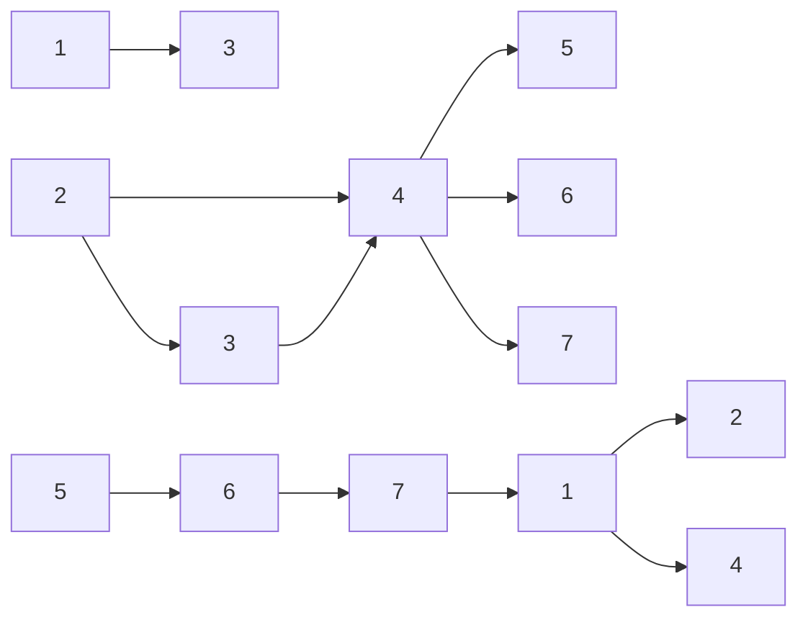

23. The volume of a region in n-dimensional Euclidean space $\mathbb { R } ^ { n }$ is the integral of 1 over that region. The unit ball in $\mathbb { R } ^ { n }$ is $\{ ( x _ { 1 } , \dots , x _ { n } ) : x _ { 1 } ^ { 2 } + \dots + x _ { n } ^ { 2 } \leq 1 \}$ , the ball of radius 1 centered at 0. As mentioned in Section A.7 of the math appendix, the volume of the unit ball in n dimensions is

$$
v _ {n} = \frac {\pi^ {n / 2}}{\Gamma (n / 2 + 1)},
$$

where Γ is the gamma function, a very famous function which is defined by

$$
\Gamma (a) = \int_ {0} ^ {\infty} x ^ {a} e ^ {- x} \frac {d x}{x}
$$

for all $a > 0 ,$ and which will play an important role in the next chapter. A few useful facts about the gamma function (which you can assume) are that $\Gamma ( a + 1 )   =   a \Gamma ( a )$ for any $a   >   0 .$ and that $\Gamma ( 1 )   =   1$ and $\Gamma ( { \textstyle { \frac { 1 } { 2 } } } )   =   { \sqrt { \pi } }$ . Using these facts, it follows that $\Gamma ( n )   =   ( n - 1 ) !$ for n a positive integer, and we can also find $\Gamma ( n + { \textstyle { \frac { 1 } { 2 } } } )$ when $n$ is a nonnegative integer. For practice, verify that $v _ { 2 }   =   \pi$ (the area of the unit disk in 2 dimensions) and $\textstyle v _ { 3 } = { \frac { 4 } { 3 } } \pi$ (the volume of the unit ball in 3 dimensions).

Let $U _ { 1 } , U _ { 2 } , \ldots , U _ { n } \sim \operatorname { U n i f } ( - 1 , 1 ) \mathrel { \operatorname { b e } \vdots }$ i.i.d.

(a) Find the probability that $( U _ { 1 } , U _ { 2 } , \ldots , U _ { n } )$ is in the unit ball in $\mathbb { R } ^ { n }$

(b) Evaluate the result from (a) numerically for $n   =   1 , 2 , \ldots , 1 0 ,$ and plot the results (using a computer unless you are extremely good at making hand-drawn graphs). The facts above about the gamma function are sufficient so that you can do this without doing any integrals, but you can also use the command gamma in R to compute the gamma function.

(c) Let c be a constant with $0 < c < 1$ , and let $X _ { n }$ count how many of the $U _ { j }$ satisfy $| U _ { j } | > c .$ What is the distribution of $X _ { n } ?$

(d) For $c = 1 / { \sqrt { 2 } } ,$ use the result of Part (c) to give a simple, short derivation of what happens to the probability from (a) as $n \to \infty$

24. s Two students, A and $B ,$ are working independently on homework assignments. Student $A$ takes $Y _ { 1 } ~ \sim ~ \operatorname { E x p o } ( \lambda _ { 1 } )$ hours to finish their homework, while B takes $Y _ { 2 } \sim \operatorname { E x p o } ( \lambda _ { 2 } )$ hours.

(a) Find the CDF and PDF of $Y _ { 1 } / Y _ { 2 }$ , the ratio of their problem-solving times.

(b) Find the probability that A finishes their homework before B does.

25. Two companies, Company 1 and Company 2, have just been founded. Stock market crashes occur according to a Poisson process with rate $\lambda _ { 0 }$ . Such a crash would put both companies out of business. For $j \in \{ 1 , 2 \}$ , there may be an adverse event of type j, which puts Company $j$ out of business (if it is not already out of business) but does not affect the other company; such events occur according to a Poisson process with rate $\lambda _ { j }$ . If there has not been a stock market crash or an adverse event of type $j ,$ then Company $j$ remains in business. The three Poisson processes are independent of each other. Let $X _ { 1 }$ and $X _ { 2 }$ be how long Company 1 and Company 2 stay in business, respectively.

(a) Find the marginal distributions of $X _ { 1 }$ and $X _ { 2 }$
(b) Find $P ( X _ { 1 } > x _ { 1 } , X _ { 2 } > x _ { 2 } )$ , and use this to find the joint CDF of $X _ { 1 }$ and $X _ { 2 }$

26. s The bus company from Blissville decides to start service in Blotchville, sensing a promising business opportunity. Meanwhile, Fred has moved back to Blotchville. Now when Fred arrives at the bus stop, either of two independent bus lines may come by (both of which take him home). The Blissville company’s bus arrival times are exactly 10 minutes apart, whereas the time from one Blotchville company bus to the next is $\scriptstyle \mathrm { E x p o } ( { \frac { 1 } { 1 0 } } )$ . Fred arrives at a uniformly random time on a certain day.

(a) What is the probability that the Blotchville company bus arrives first?

Hint: One good way is to use the continuous law of total probability.

(b) What is the CDF of Fred’s waiting time for a bus?

27. A longevity study is being conducted on n married hobbit couples. Let $p$ be the probability that an individual hobbit lives at least until their eleventy-first birthday, and assume that the lifespans of different hobbits are independent. Let $N _ { 0 } , N _ { 1 } , N _ { 2 }$ be the number of couples in which neither hobbit reaches age eleventy-one, one hobbit does but not the other, and both hobbits reach eleventy-one, respectively.

(a) Find the joint PMF of $N _ { 0 } , N _ { 1 } , N _ { 2 }$

For the rest of this problem, suppose that it is observed that exactly h of the cohort of hobbits reach their eleventy-first birthdays.

(b) Using (a) and the definition of conditional probability, find the conditional PMF of $N _ { 2 }$ given this information, up to a normalizing constant (that is, you do not need to find the normalizing constant in this part, but just to give a simplified expression that is proportional to the conditional PMF). For simplicity, you can and should ignore multiplicative constants in this part; this includes multiplicative factors that are functions of $h ,$ since h is now being treated as a known constant.

(c) Now obtain the conditional PMF of $N _ { 2 }$ using a direct counting argument, now including any normalizing constants needed in order to have a valid conditional PMF.

(d) Discuss intuitively whether or not p should appear in the answer to $( \mathrm { c } )$

(e) What is the conditional expectation of $N _ { 2 }$ , given the above information (simplify fully)? This can be done without doing any messy sums.

28. There are n stores in a shopping center, labeled from 1 to $n .$ Let $X _ { i }$ be the number of customers who visit store i in a particular month, and suppose that $X _ { 1 } , X _ { 2 } , \ldots , X _ { n }$ are i.i.d. with PMF $p ( x )   =   P ( X _ { i }   =   x )$ . Let $I   \sim   \mathrm { D U n i f } ( 1 , 2 , \ldots , n )$ be the label of a randomly chosen store, so $X _ { I }$ is the number of customers at a randomly chosen store.

(a) For $i \neq j$ , find $P ( X _ { i } = X _ { j } )$ in terms of a sum involving the ${ \mathrm { P M F } } p ( x )$

(b) Find the joint PMF of I and $X _ { I }$ . Are they independent?

(c) Does $X _ { I } ,$ the number of customers for a random store, have the same marginal distribution as $X _ { 1 }$ , the number of customers for store 1?

(d) Let $J \sim \operatorname { D U n i f } ( 1 , 2 , \ldots , n )$ also be the label of a randomly chosen store, with I and J independent. Find $P ( X _ { I } = X _ { J } )$ in terms of a sum involving the ${ \mathrm { P M F } } p ( x )$ . How does $P ( X _ { I } = X _ { J } )$ compare to $P ( X _ { i } = X _ { j } )$ for fixed $i , j$ with $i \neq j ?$

29. Let X and Y be i.i.d. Geom(p), $L = \operatorname* { m i n } ( X , Y )$ , and $M = \operatorname* { m a x } ( X , Y )$

(a) Find the joint PMF of L and M. Are they independent?

(b) Find the marginal distribution of L in two ways: using the joint PMF, and using a story.

(c) Find EM.

Hint: A quick way is to use (b) and the fact that $L + M = X + Y$

(d) Find the joint PMF of L and $M - L$ . Are they independent?

30. Let X, Y have the joint CDF

$$
F (x, y) = 1 - e ^ {- x} - e ^ {- y} + e ^ {- (x + y + \theta x y)},
$$

for $x>0,y>0$ (and $F ( x , y ) = 0$ otherwise), where the parameter θ is in [0, 1].

(a) Find the joint PDF of X, Y . For which values of θ (if any) are they independent?
(b) Explain why we require θ to be in [0, 1].
(c) Find the marginal PDFs of X and Y by working directly from the joint PDF from (a). When integrating, do not use integration by parts or computer assistance; rather, pattern-match to facts we know about moments of famous distributions.
(d) Find the marginal CDFs of X and Y by working directly from the joint CDF.

## 2D LOTUS

31. s Let X and Y be i.i.d. Unif(0, 1). Find the standard deviation of the distance between X and Y .
32. s Let X, Y be i.i.d. Expo(λ). Find $E [ X   -   Y ]$ in two different ways: (a) using 2D LOTUS and (b) using the memoryless property without any calculus.
33. Alice walks into a post office with 2 clerks. Both clerks are in the midst of serving customers, but Alice is next in line. The clerk on the left takes an $\mathrm{Exp}(\lambda_1)$ time to serve a customer, and the clerk on the right takes an $\mathrm{Exp}(\lambda_{2})$ time to serve a customer. Let T be the amount of time Alice has to wait until it is her turn.

(a) Write down expressions for the mean and variance of $T ,$ in terms of double integrals (which you do not need to evaluate).
(b) Find the distribution, mean, and variance of T, without using calculus.

34. Let (X, Y ) be a uniformly random point in the triangle in the plane with vertices $( 0 , 0 ) , ( 0 , 1 ) , ( 1 , 0 )$ . Find $\mathrm{Cov}(X,Y)$ . (Exercise 18 is about joint, marginal, and conditional PDFs in this setting.)
35. A random point is chosen uniformly in the unit disk $\{ ( x , y ) : x ^ { 2 } + y ^ { 2 } \leq 1 \}$ . Let R be its distance from the origin.

(a) Find E(R) using 2D LOTUS.
Hint: To do the integral, convert to polar coordinates (see the math appendix).
(b) Find the CDFs of $R ^ { 2 }$ and of R without using calculus, using the fact that for a Uniform distribution on a region, probability within that region is proportional to area. Then get the PDFs of $R ^ { 2 }$ and of R, and find $E ( R )$ in two more ways: using the definition of expectation, and using a 1D LOTUS by thinking of R as a function of $R ^ { 2 }$

36. Let X and Y be discrete r.v.s.

(a) Use 2D LOTUS (without assuming linearity) to show that $E ( X { + } Y ) = E ( X ) { + } E ( Y )$
(b) Now suppose that X and Y are independent. Use 2D LOTUS to show that they are uncorrelated, $i.e.,   E(XY) = E(X)E(Y)$

37. Let X and $Y$ be i.i.d. continuous random variables with PDF $f ,$ mean $\mu ,$ and variance $\sigma ^ { 2 }$ . We know that the expected squared distance of X from its mean is $\sigma ^ { 2 }$ , and likewise for $Y ;$ this problem is about the expected squared distance of X from $Y$

(a) Use 2D LOTUS to express $E(X - Y)^{2}$ as a double integral.

(b) By expanding $( x - y ) ^ { 2 } = x ^ { 2 } - 2 x y + y ^ { 2 }$ and evaluating the double integral from (a), show that

$$
E (X - Y) ^ {2} = 2 \sigma^ {2}.
$$

(c) Give an alternative proof of the result from (b), based on the trick of adding and subtracting $\mu ;$

$$
(X - Y) ^ {2} = (X - \mu + \mu - Y) ^ {2} = (X - \mu) ^ {2} - 2 (X - \mu) (Y - \mu) + (Y - \mu) ^ {2}.
$$

## Covariance

38. s Let X and Y be r.v.s. Is it correct to say $`` \mathrm{max}(X,Y)+\mathrm{min}(X,Y)=X+Y ''$ Is it correct to say $\operatorname{Cov}(\max(X, Y), \min(X, Y)) = \operatorname{Cov}(X, Y)$ since either the max is X and the min is $Y$ or vice versa, and covariance is symmetric”? Explain.

39. s Two fair, six-sided dice are rolled (one green and one orange), with outcomes X and Y for the green die and the orange die, respectively.

(a) Compute the covariance of $X + Y$ and $X - Y$

(b) Are $X + Y$ and $X - Y$ independent?

40. Let X and Y be i.i.d. Unif(0, 1).

(a) Compute the covariance of $X + Y$ and $X - Y$

(b) Are $X + Y$ and $X - Y$ independent?

41. s Let X and Y be standardized r.v.s (i.e., marginally they each have mean 0 and variance 1) with correlation $\rho \in ( - 1 , 1 )$ . Find $a , b , c , d$ (in terms of ρ) such that $Z =$ $a X + b Y$ and $W = c X + d Y$ are uncorrelated but still standardized.

42. s Let X be the number of distinct birthdays in a group of 110 people (i.e., the number of days in a year such that at least one person in the group has that birthday). Under the usual assumptions (no February 29, all the other 365 days of the year are equally likely, and the day when one person is born is independent of the days when the other people are born), find the mean and variance of X.

43. (a) Let X and Y be Bernoulli r.v.s, possibly with different parameters. Show that if X and $Y$ are uncorrelated, then they are independent.

(b) Give an example of three Bernoulli r.v.s such that each pair of them is uncorrelated, yet the three r.v.s are dependent.

44. Find the variance of the number of toys needed until you have a complete set in Example 4.3.12 (the coupon collector problem), as a sum.

45. A random triangle is formed in some way, such that all pairs of angles have the same joint distribution. What is the correlation between two of the angles (assuming that the variance of the angles is nonzero)?

46. Each of $n \geq 2$ people puts their name on a slip of paper (no two have the same name). The slips of paper are shuffled in a hat, and then each person draws one (uniformly at random at each stage, without replacement). Find the standard deviation of the number of people who draw their own names.

47. As in Example 4.4.7, an urn contains w white balls and b black balls. The balls are randomly drawn one by one without replacement until r white balls have been drawn. Let X ∼ NHGeom $( w , b , r )$ be the number of black balls drawn before drawing the rth white ball. In this exercise, you will derive $\operatorname { V a r } ( X )$

As explained in Example 4.4.7, we can assume that we continue drawing balls until the urn has been emptied out. Label the black balls as $1 , 2 , \ldots , b ,$ and write $\begin{array} { r } { X = \sum _ { j = 1 } ^ { b } I _ { j } } \end{array}$ where $I _ { j }$ is the indicator of black ball $j$ being drawn before the rth white ball is drawn.

(a) Show that

$$
E (I _ {j}) = \frac {r}{w + 1}.
$$

(b) Give an intuitive explanation of whether $I _ { i }$ and $I _ { j }$ are positively correlated, uncorrelated, or negatively correlated, for $i \neq j$

(c) Show that for $i \neq j$

$$
E (I _ {i} I _ {j}) = \frac {\binom {r + 1} {2}}{\binom {w + 2} {2}} = \frac {(r + 1) r}{(w + 2) (w + 1)}.
$$

Hint: Imagine $w + 2$ slots, into which black balls i and $j$ and the w white balls will be placed. All orderings for these $w + 2$ balls are equally likely.

(d) Find an expression for $\operatorname { V a r } ( X )$ . With some algebra (which you don’t have to do), your expression should simplify to

$$
\operatorname{Var} (X) = \frac {r b (w + b + 1) (w - r + 1)}{(w + 1) ^ {2} (w + 2)}.
$$

48. s Athletes compete one at a time at the high jump. Let $X _ { j }$ be how high the jth jumper jumped, with $X _ { 1 } , X _ { 2 } , \ldots { \mathrm { ~ i . i . d } }$ . with a continuous distribution. We say that the jth jumper sets a record if $X _ { j }$ is greater than all of $X _ { j - 1 } , \ldots , X _ { 1 }$

Find the variance of the number of records among the first n jumpers (as a sum). What happens to the variance as $n \to \infty ?$

49. s A chicken lays a $\operatorname { P o i s } ( \lambda )$ number N of eggs. Each egg hatches a chick with probability $p ,$ independently. Let X be the number which hatch, so $X | N = n \sim \mathrm { B i n } ( n , p )$

Find the correlation between N (the number of eggs) and X (the number of eggs which hatch). Simplify; your final answer should work out to a simple function of $p$ (the λ should cancel out).

50. Let $X _ { 1 } , \ldots , X _ { n }$ be random variables such that $\mathrm{Corr}(X_{i},X_{j}) = \rho$ for all $i \neq j$ . Show that $\begin{array} { r } { \rho \geq - \frac { 1 } { n - 1 } } \end{array}$ . This is a bound on how negatively correlated a collection of r.v.s can all be with each other.

Hint: Assume $\operatorname { V a r } ( X _ { i } ) = 1$ for all $i ;$ this can be done without loss of generality, since rescaling two r.v.s does not affect the correlation between them. Then use the fact that $\operatorname { V a r } ( X _ { 1 } + \cdots + X _ { n } ) \geq 0$

51. Let X and $Y$ be independent r.v.s. Show that

$$
\mathrm{Var} (X Y) = \mathrm{Var} (X) \mathrm{Var} (Y) + (E X) ^ {2} \mathrm{Var} (Y) + (E Y) ^ {2} \mathrm{Var} (X).
$$

Hint: It is often useful when working with a second moment $E ( T ^ { 2 } )$ to express it as $\mathrm { V a r } ( T ) + ( E T ) ^ { 2 }$

52. Stat 110 shirts come in 3 sizes: small, medium, and large. There are n shirts of each size (where $n \geq 2 )$ . There are 3n students. For each size, n of the students have that size as the best fit. This seems ideal. But suppose that instead of giving each student the right size shirt, each student is given a shirt completely randomly (all allocations of the shirts to the students, with one shirt per student, are equally likely). Let X be the number of students who get their right size shirt.

(a) Find $E ( X )$

(b) Give each student an ID number from 1 to $3 n ,$ such that the right size shirt is small for students 1 through $n ,$ medium for students $n + 1$ through $2 n$ and large for students

$2 n + 1$ through 3n. Let $A _ { j }$ be the event that student $j$ gets their right size shirt. Find $P ( A _ { 1 } , A _ { 2 } )$ and $P ( A _ { 1 } , A _ { n + 1 } )$

(c) Find $\operatorname { V a r } ( X )$

53. s A drunken man wanders around randomly in a large space. At each step, he moves one unit of distance North, South, East, or West, with equal probabilities. Choose coordinates such that his initial position is (0, 0) and if he is at $( x , y )$ at some time, then one step later he is at (x, y + 1), (x, y − 1), (x + 1, y), or $( x - 1 , y )$ . Let $( X _ { n } , Y _ { n } )$ and $R _ { n }$ be his position and distance from the origin after n steps, respectively.

General hint: Note that $X _ { n }$ is a sum of r.v.s with possible values $- 1 , 0 , 1$ , and likewise for $Y _ { n }$ , but be careful throughout the problem about independence.

(a) Determine whether or not $X _ { n }$ is independent of $Y _ { n }$
(b) Find $\operatorname { C o v } ( X _ { n } , Y _ { n } )$
(c) Find $E ( R _ { n } ^ { 2 } )$

54. s A scientist makes two measurements, considered to be independent standard Normal r.v.s. Find the correlation between the larger and smaller of the values.

Hint: Note that $\operatorname* { m a x } ( x , y ) + \operatorname* { m i n } ( x , y ) = x + y { \mathrm { ~ a n d ~ } } \operatorname* { m a x } ( x , y ) - \operatorname* { m i n } ( x , y ) = | x - y | .$

55. Let $U \sim \mathrm { U n i f } ( - 1 , 1 )$ and $V = 2 | U | - 1$

(a) Find the distribution of V (give the PDF and, if it is a named distribution we have studied, its name and parameters).

Hint: Find the support of V , and then find the CDF of V by reducing $P ( V   \leq   v )$ to probability calculations about U.

(b) Show that U and V are uncorrelated, but not independent. This is also another example illustrating the fact that knowing the marginal distributions of two r.v.s does not determine the joint distribution.

56. s Consider the following method for creating a bivariate Poisson (a joint distribution for two r.v.s such that both marginals are Poissons). Let $X = V + { \dot { W } } , { \dot { Y } } = V + Z$ where $V , W , Z$ are i.i.d. Pois(λ) (the idea is to have something borrowed and something new but not something old or something blue).

(a) Find Cov(X, Y ).
(b) Are X and Y independent? Are they conditionally independent given V ?
(c) Find the joint PMF of X, Y (as a sum).

57. You are playing an exciting game of Battleship. Your opponent secretly positions ships on a 10 by 10 grid and you try to guess where the ships are. Each of your guesses is a hit if there is a ship there and a miss otherwise.

The game has just started and your opponent has 3 ships: a battleship (length 4), a submarine (length 3), and a destroyer (length 2). (Usually there are 5 ships to start, but to simplify the calculations we are considering 3 here.) You are playing a variation in which you unleash a salvo, making 5 simultaneous guesses. Assume that your 5 guesses are a simple random sample drawn from the 100 grid positions, i.e., all sets of 5 grid positions are equally likely.

Find the mean and variance of the number of distinct ships you will hit in your salvo. (Give exact answers in terms of binomial coefficients or factorials, and also numerical values computed using a computer.)

Hint: First work in terms of the number of ships missed, expressing this as a sum of indicator r.v.s. Then use the fundamental bridge and naive definition of probability.

58. This problem explores a visual interpretation of covariance. Data are collected for n individuals, where for each individual two variables are measured (e.g., height and weight). Assume independence across individuals (e.g., person 1’s variables gives no information about the other people), but not within individuals (e.g., a person’s height and weight may be correlated).

Let $( x _ { 1 } , y _ { 1 } ) , \ldots , ( x _ { n } , y _ { n } )$ be the n data points, with $n \geq 2 .$ The data are considered here as fixed, known numbers—they are the observed values after performing an experiment. Imagine plotting all the points $( x _ { i } , y _ { i } )$ in the plane, and drawing the rectangle determined by each pair of points. For example, the points (1, 3) and $( 4 , 6 )$ determine the rectangle with vertices $( 1 , 3 ) , ( 1 , 6 ) , ( 4 , 6 ) , ( 4 , 3 )$

The signed area contributed by $( x _ { i } , y _ { i } )$ and $( x _ { j } , y _ { j } )$ is the area of the rectangle they determine if the slope of the line between them is positive, and is the negative of the area of the rectangle they determine if the slope of the line between them is negative. (Define the signed area to be 0 if $x _ { i }   =   x _ { j }$ or $y _ { i } \; = \; y _ { j }$ , since then the rectangle is degenerate.) So the signed area is positive if a higher x value goes with a higher y value for the pair of points, and negative otherwise. Assume that the $x _ { i }$ are all distinct and the $y _ { i }$ are all distinct.

(a) The sample covariance of the data is defined to be

$$
r = \frac {1}{n} \sum_ {i = 1} ^ {n} (x _ {i} - \bar {x}) (y _ {i} - \bar {y}),
$$

where

$$
\bar {x} = \frac {1}{n} \sum_ {i = 1} ^ {n} x _ {i} \text {and} \bar {y} = \frac {1}{n} \sum_ {i = 1} ^ {n} y _ {i}
$$

are the sample means. (There are differing conventions about whether to divide by $n   -   1$ or n in the definition of sample covariance, but that need not concern us here.)

Let $( X , Y )$ be one of the $( x _ { i } , y _ { i } )$ pairs, chosen uniformly at random. Determine precisely how $\mathrm{Cov}(X,Y)$ is related to the sample covariance.

(b) Let $( X , Y )$ be as in (a), and $( \tilde { X } , \tilde { Y } )$ be an independent draw from the same distribution. That is, (X, Y ) and $\left[ ( \tilde { X } , \tilde { Y } \right)$ are randomly chosen from the n points, independently (so it is possible for the same point to be chosen twice).

Express the total signed area of the rectangles as a constant times $E ( ( X - { \tilde { X } } ) ( Y - { \tilde { Y } } ) )$ Then show that the sample covariance of the data is a constant times the total signed area of the rectangles.

Hint: Consider $E ( ( X { - } \tilde { X } ) ( Y { - } \tilde { Y } ) )$ in two ways: as the average signed area of the random rectangle formed by $( X , Y )$ and $\left[ ( \tilde { X } , \tilde { Y } ) \right.$ , and using properties of expectation to relate it to $\mathrm{Cov}(X,Y)$ . For the former, consider the $n ^ { 2 }$ possibilities for which point $( X , Y )$ is and which point $( \tilde { X } , \tilde { Y } ) ;$ note that n such choices result in degenerate rectangles.

(c) Based on the interpretation from (b), give intuitive explanations of why for any r.v.s $W _ { 1 } , W _ { 2 } , W _ { 3 }$ and constants $a _ { 1 } , a _ { 2 }$ , covariance has the following properties:

(i) Cov $( W _ { 1 } , W _ { 2 } ) = \operatorname { C o v } ( W _ { 2 } , W _ { 1 } ) ;$
(ii) Cov $\begin{aligned} { \epsilon ( a _ { 1 } W _ { 1 } , a _ { 2 } W _ { 2 } ) = a _ { 1 } a _ { 2 } { \operatorname { C o v } } ( W _ { 1 } , W _ { 2 } ) ; } \\ \end{aligned}$
(iii) $\operatorname { C o v } ( W _ { 1 } + a _ { 1 } , W _ { 2 } + a _ { 2 } ) = \operatorname { C o v } ( W _ { 1 } , W _ { 2 } ) ;$
(iv) $\operatorname { C o v } ( W _ { 1 } , W _ { 2 } + W _ { 3 } ) = \operatorname { C o v } ( W _ { 1 } , W _ { 2 } ) + \operatorname { C o v } ( W _ { 1 } , W _ { 3 } ) .$

59. A statistician is trying to estimate an unknown parameter θ based on some data. She has available two independent estimators $\hat { \theta } _ { 1 }$ and $\hat { \theta } _ { 2 }$ (an estimator is a function of the data, used to estimate a parameter). For example, $\hat { \theta } _ { 1 }$ could be the sample mean of a subset of the data and $\hat { \theta } _ { 2 }$ could be the sample mean of another subset of the data, disjoint from the subset used to calculate $\hat { \theta } _ { 1 }$ . Assume that both of these estimators are unbiased, i.e., $E ( \hat { \theta } _ { j } ) = \theta$

Rather than having a bunch of separate estimators, the statistician wants one combined estimator. It may not make sense to give equal weights to $\hat { \theta } _ { 1 }$ and $\hat { \theta } _ { 2 }$ since one could be much more reliable than the other, so she decides to consider combined estimators of the form

$$
\hat {\theta} = w _ {1} \hat {\theta} _ {1} + w _ {2} \hat {\theta} _ {2},
$$

a weighted combination of the two estimators. The weights $w _ { 1 }$ and $w _ { 2 }$ are nonnegative and satisfy $w _ { 1 } + w _ { 2 } = 1$

(a) Check that $\hat { \theta }$ is also unbiased, i.e., $E ( { \hat { \theta } } ) = \theta$

(b) Determine the optimal weights $w _ { 1 } , w _ { 2 }$ , in the sense of minimizing the mean squared error $E ( \hat { \theta }   -   \theta ) ^ { 2 }$ . Express your answer in terms of the variances of $\hat { \theta } _ { 1 }$ and $\hat { \theta } _ { 2 }$ . The optimal weights are known as Fisher weights.

Hint: As discussed in Exercise 53 from Chapter 5, mean squared error is variance plus squared bias, so in this case the mean squared error of $\hat { \theta }$ is $\operatorname { V a r } ( { \hat { \theta } } )$ . Note that there is no need for multivariable calculus here, since $w _ { 2 } = 1 - w _ { 1 }$

(c) Give a simple description of what the estimator found in (b) amounts to if the data are i.i.d. random variables $X _ { 1 } , \ldots , X _ { n } , Y _ { 1 } , \ldots , Y _ { m } , \thinspace \hat { \theta } _ { 1 }$ is the sample mean of $X _ { 1 } , \ldots , X _ { n }$ , and $\hat { \theta } _ { 2 }$ is the sample mean of $Y _ { 1 } , \ldots , Y _ { m }$

## Chicken-egg

60. s A Pois(λ) number of people vote in a certain election. Each voter votes for candidate A with probability p and for candidate B with probability $q = 1 - p ,$ independently of all the other voters. Let V be the difference in votes, defined as the number of votes for A minus the number for B.

(a) Find $E ( V )$
(b) Find $\operatorname { V a r } ( V )$

61. A traveler gets lost $N \sim  Pois (\lambda)$ times on a long journey. When lost, the traveler asks someone for directions with probability p. Let X be the number of times that the traveler is lost and asks for directions, and Y be the number of times that the traveler is lost and does not ask for directions.

(a) Find the joint PMF of N, X, Y . Are they independent?
(b) Find the joint PMF of N, X. Are they independent?
(c) Find the joint PMF of X, Y . Are they independent?

62. The number of people who visit the Leftorium store in a day is Pois(100). Suppose that 10% of customers are sinister (left-handed), and 90% are dexterous (right-handed). Half of the sinister customers make purchases, but only a third of the dexterous customers make purchases. The characteristics and behavior of people are independent, with probabilities as described in the previous two sentences. On a certain day, there are 42 people who arrive at the store but leave without making a purchase. Given this information, what is the conditional PMF of the number of customers on that day who make a purchase?

63. A chicken lays n eggs. Each egg independently does or doesn’t hatch, with probability p of hatching. For each egg that hatches, the chick does or doesn’t survive (independently of the other eggs), with probability s of survival. Let $N \sim \operatorname { B i n } ( n , p )$ be the number of eggs which hatch, X be the number of chicks which survive, and Y be the number of chicks which hatch but don’t survive (so ${ \bar { X } } + Y = N )$ . Find the marginal PMF of X, and the joint PMF of X and Y . Are X and Y independent?

64. There will be $X \sim  Pois (\lambda)$ courses offered at a certain school next year.

(a) Find the expected number of choices of 4 courses (in terms of λ, fully simplified), assuming that simultaneous enrollment is allowed if there are time conflicts.
(b) Now suppose that simultaneous enrollment is not allowed. Suppose that most faculty only want to teach on Tuesdays and Thursdays, and most students only want to take courses that start at 10 am or later, and as a result there are only four possible time slots: 10 am, 11:30 am, 1 pm, 2:30 pm (each course meets Tuesday-Thursday for an hour and a half, starting at one of these times). Rather than trying to avoid major conflicts, the school schedules the courses completely randomly: after the list of courses for next year is determined, they randomly get assigned to time slots, independently and with probability 1/4 for each time slot.

Let $X _ { \mathrm { a m } }$ and $X _ { \mathrm { p m } }$ be the number of morning and afternoon courses for next year, respectively (where “morning” means starting before noon). Find the joint PMF of $X _ { \mathrm { a m } }$ and $X _ { \mathrm { p m } } ,   \mathrm { i . e . }$ , find $P(X_{ am } = a, X_{ pm } = b)$ for all $a , b .$

(c) Continuing as in (b), let $X _ { 1 } , X _ { 2 } , X _ { 3 } , X _ { 4 }$ be the number of 10 am, 11:30 am, 1 pm, 2:30 pm courses for next year, respectively. What is the joint distribution of $X _ { 1 } , X _ { 2 } , X _ { 3 } , X _ { 4 } ?$ (The result is completely analogous to that of $X _ { \mathrm { a m } } , X _ { \mathrm { p m } } ;$ you can derive it by thinking conditionally, but for this part you are also allowed to just use the fact that the result is analogous to that of (b).) Use this to find the expected number of choices of 4 non-conflicting courses (in terms of λ, fully simplified). What is the ratio of the expected value from (a) to this expected value?

## Multinomial

65. s Let $( X _ { 1 } , \ldots , X _ { k } )$ be Multinomial with parameters n and $( p _ { 1 } , \ldots , p _ { k } )$ . Use indicator r.v.s to show that Cov $( X _ { i } , X _ { j } ) = - n p _ { i } p _ { j }$ for $i \neq j$
66. s Consider the birthdays of 100 people. Assume people’s birthdays are independent, and the 365 days of the year (exclude the possibility of February 29) are equally likely. Find the covariance and correlation between how many of the people were born on January 1 and how many were born on January 2.
67. A certain course has a freshmen, b sophomores, c juniors, and d seniors. Let X be the number of freshmen and sophomores (total), Y be the number of juniors, and Z be the number of seniors in a random sample of size n, where for Part (a) the sampling is with replacement and for Part (b) the sampling is without replacement (for both parts, at each stage the allowed choices have equal probabilities).

(a) Find the joint PMF of $X , Y , Z ,$ for sampling with replacement.
(b) Find the joint PMF of $X , Y , Z$ , for sampling without replacement.

68. s A group of $n \geq 2$ people decide to play an exciting game of Rock-Paper-Scissors. As you may recall, Rock smashes Scissors, Scissors cuts Paper, and Paper covers Rock (despite Bart Simpson once saying “Good old rock, nothing beats that!”).

Usually this game is played with 2 players, but it can be extended to more players as follows. If exactly 2 of the 3 choices appear when everyone reveals their choice, say a, b ∈ {Rock, Paper, Scissors} where a beats b, the game is decisive: the players who chose a win, and the players who chose b lose. Otherwise, the game is indecisive and the players play again.

For example, with 5 players, if one player picks Rock, two pick Scissors, and two pick Paper, the round is indecisive and they play again. But if 3 pick Rock and 2 pick Scissors, then the Rock players win and the Scissors players lose the game.

Assume that the n players independently and randomly choose between Rock, Scissors, and Paper, with equal probabilities. Let X, Y, Z be the number of players who pick Rock, Scissors, Paper, respectively in one game.

(a) Find the joint PMF of X, Y, Z.
(b) Find the probability that the game is decisive. Simplify your answer.
(c) What is the probability that the game is decisive for $n = 5 ?$ What is the limiting probability that a game is decisive as $n \to \infty ?$ Explain briefly why your answer makes sense.

69. s Emails arrive in an inbox according to a Poisson process with rate λ (so the number of emails in a time interval of length t is distributed as Pois(λt), and the numbers of emails arriving in disjoint time intervals are independent). Let X, Y, Z be the numbers of emails that arrive from 9 am to noon, noon to 6 pm, and 6 pm to midnight (respectively) on a certain day.

(a) Find the joint PMF of X, Y, Z.
(b) Find the conditional joint PMF of X, Y, Z given that $X + Y + Z = 3 6$
(c) Find the conditional PMF of $X + Y$ given that $X + Y + Z = 36.$

(d) Find $E(X + Y|X + Y + Z = 36)$ and $\mathrm { V a r } ( X + Y | X + Y + Z = 3 6 )$ . (Conditional expectation and conditional variance given an event are defined in the same way as expectation and variance, using the conditional distribution given the event in place of the unconditional distribution; these concepts are explored more in Chapter 9.)

70. Let X be the number of statistics majors in a certain college in the Class of 2030, viewed as an r.v. Each statistics major chooses between two tracks: a general track in statistical principles and methods, and a track in quantitative finance. Suppose that each statistics major chooses randomly which of these two tracks to follow, independently, with probability p of choosing the general track. Let Y be the number of statistics majors who choose the general track, and Z be the number of statistics majors who choose the quantitative finance track.

(a) Suppose that X ∼ Pois(λ). (This isn’t the exact distribution in reality since a Poisson is unbounded, but it may be a very good approximation.) Find the correlation between X and Y .
(b) Let n be the size of the Class of 2030, where n is a known constant. For this part and the next, instead of assuming that X is Poisson, assume that each of the n students chooses to be a statistics major with probability r, independently. Find the joint distribution of Y , Z, and the number of non-statistics majors, and their marginal distributions.
(c) Continuing as in (b), find the correlation between X and Y .

71. In humans (and many other organisms), genes come in pairs. Consider a gene of interest, which comes in two types (alleles): type a and type A. The genotype of a person for that gene is the types of the two genes in the pair: AA, Aa, or aa (aA is equivalent to Aa). According to the Hardy-Weinberg law, for a population in equilibrium, the frequencies of AA, Aa, aa will be $p ^ { 2 } , 2 p ( 1 - p ) , ( 1 - p ) ^ { 2 }$ , respectively, for some p with $0 < p < 1$ Suppose that the Hardy-Weinberg law holds, and that n people are drawn randomly from the population, independently. Let $X _ { 1 } , X _ { 2 } , X _ { 3 }$ be the number of people in the sample with genotypes AA, Aa, aa, respectively.

(a) What is the joint PMF of $X _ { 1 } , X _ { 2 } , X _ { 3 } ?$
(b) What is the distribution of the number of people in the sample who have an A?
(c) What is the distribution of how many of the 2n genes among the people are A’s?

(d) Now suppose that $p$ is unknown, and must be estimated using the observed data $X _ { 1 } , X _ { 2 } , X _ { 3 }$ . The maximum likelihood estimator (MLE) of $p$ is the value of $p$ for which the observed data are as likely as possible. Find the MLE of $p .$

(e) Now suppose that $p$ is unknown, and that our observations can’t distinguish between AA and $A a$ . So for each person in the sample, we just know whether or not that person is an aa (in genetics terms, AA and Aa have the same phenotype, and we only $\mathrm { { \bf g } e t }$ to observe the phenotypes, not the genotypes). Find the MLE of $p .$

## Multivariate Normal

72. s Let $( X , Y )$ be Bivariate Normal, with X and Y marginally $\mathcal { N } ( 0 , 1 )$ and with correlation $\rho$ between X and Y .

(a) Show that $\left( X + Y , X - Y \right)$ is also Bivariate Normal.

(b) Find the joint PDF of $X + Y$ and $X - Y$ (without using calculus), assuming that $- 1 < \rho < 1$

73. Let the joint PDF of X and Y be

$$
f _ {X, Y} (x, y) = c \exp \left(- \frac {x ^ {2}}{2} - \frac {y ^ {2}}{2}\right) \text { for   all } x \text { and } y,
$$

where c is a constant.

(a) Find c to make this a valid joint PDF.

(b) What are the marginal distributions of X and Y ? Are X and Y independent?

(c) Is (X, Y ) Bivariate Normal?

74. Let the joint PDF of X and $Y$ be

$$
f _ {X, Y} (x, y) = c \exp \left(- \frac {x ^ {2}}{2} - \frac {y ^ {2}}{2}\right) \text {for} x y > 0,
$$

where c is a constant (the joint PDF is 0 for $x y \leq 0 )$

(a) Find c to make this a valid joint PDF.
(b) What are the marginal distributions of X and Y ? Are X and Y independent?
(c) Is (X, Y ) Bivariate Normal?

75. Let $X , Y , Z$ be i.i.d. N (0, 1). Find the joint MGF of $( X + 2 Y , 3 X + 4 Z , 5 Y + 6 Z )$

76. Let X and Y be i.i.d. $\mathcal { N } ( 0 , 1 )$ , and let S be a random sign $( 1 ~ \mathrm { o r } ~ \mathrm { - 1 }$ , with equal probabilities) independent of (X, Y ).

(a) Determine whether or not $( X , Y , X + Y )$ is Multivariate Normal.
(b) Determine whether or not $( X , Y , S X + S Y )$ is Multivariate Normal.
(c) Determine whether or not (SX, SY ) is Multivariate Normal.

77. Let (X, Y ) be Bivariate Normal with $X \sim \mathcal { N } ( 0 , \sigma _ { 1 } ^ { 2 } )$ and $Y \sim \mathcal { N } ( 0 , \sigma _ { 2 } ^ { 2 } )$ marginally and with $\operatorname { C o r r } ( X , Y ) = \rho .$ Find a constant c such that $Y - c X$ is independent of $X$

Hint: First find c (in terms of $\rho , \sigma _ { 1 } , \sigma _ { 2 } )$ such that $Y - c X$ and X are uncorrelated.

78. A mother and a father have 6 children. The 8 heights in the family (in inches) are $\mathcal { N } ( \mu , \sigma ^ { 2 } )$ r.v.s (with the same distribution, but not necessarily independent).

(a) Assume for this part that the heights are all independent. On average, how many of the children are taller than both parents?
(b) Let $X _ { 1 }$ be the height of the mother, $X _ { 2 }$ be the height of the father, and $Y _ { 1 } , \ldots , Y _ { 6 }$ be the heights of the children. Suppose that $( X _ { 1 } , X _ { 2 } , Y _ { 1 } , \ldots , Y _ { 6 } )$ is Multivariate Normal, with $\mathcal { N } ( \mu , \sigma ^ { 2 } )$ marginals and $\mathrm { C o r r } ( X _ { 1 } , Y _ { j } ) = \rho$ for $1 \leq j \leq 6 ,$ with $\rho < 1$ . On average, how many of the children are more than 1 inch taller than their mother?

## Mixed practice

79. Cars pass by a certain point on a road according to a Poisson process with rate λ cars/minute. Let $N _ { t } \sim \mathrm { P o i s } ( \lambda t )$ be the number of cars that pass by that point in the time interval [0, t], with t measured in minutes.

(a) A certain device is able to count cars as they pass by, but it does not record the arrival times. At time 0, the counter on the device is reset to 0. At time 3 minutes, the device is observed and it is found that exactly 1 car had passed by. Given this information, find the conditional CDF of when that car arrived. Also describe in words what the result says.
(b) In the late afternoon, you are counting blue cars. Each car that passes by is blue with probability b, independently of all other cars. Find the joint PMF and marginal PMFs of the number of blue cars and number of non-blue cars that pass by the point in 10 minutes.

80. In a U.S. election, there will be $V \sim  Pois (\lambda)$ registered voters. Suppose each registered voter is a registered Democrat with probability p and a registered Republican with probability $1 - p ,$ independent of other voters. Also, each registered voter shows up to the polls with probability s and stays home with probability $1 - s ,$ independent of other voters and independent of their own party affiliation. In this problem, we are interested in X, the number of registered Democrats who actually vote.

(a) What is the distribution of X, before we know anything about the number of registered voters?
(b) Suppose we learn that $V   =   v ;$ that is, v people registered to vote. What is the conditional distribution of X given this information?
(c) Suppose we learn there were d registered Democrats and r registered Republicans (where $d + r = v )$ . What is the conditional distribution of X given this information?
(d) Finally, we learn in addition to all of the above information that n people showed up at the polls on election day. What is the conditional distribution of X given this information?

81. A certain college has m freshmen, m sophomores, m juniors, and m seniors. A certain class at the college consists of a simple random sample of size n students, i.e., all sets of n of the 4m students are equally likely. Let $X _ { 1 } , \ldots , X _ { 4 }$ be the numbers of freshmen,. . . , seniors in the class.

(a) Find the joint PMF of $X _ { 1 } , X _ { 2 } , X _ { 3 } , X _ { 4 }$
(b) Give both an intuitive explanation and a mathematical justification for whether or not the distribution from (a) is Multinomial.
(c) Find $\mathrm{Cov}(X_{1},X_{3})$ , fully simplified.

Hint: Take the variance of both sides of $X _ { 1 } + X _ { 2 } + X _ { 3 } + X _ { 4 } = n$

82. Let $X \sim \operatorname { E x p o } ( \lambda )$ and let Y be a nonnegative random variable, discrete or continuous, whose MGF M is finite everywhere. Show that $P ( Y < X ) = M ( c )$ for a certain value of c (which you should specify).

83. A publishing company employs two proofreaders, Prue and Frida. When Prue is proofreading a book, for each typo she has probability p of catching it and $q = 1   -   p$ of missing it, independently. When Frida is proofreading a book, for each typo she has probability f of catching it and $g = 1 - f$ of missing it, independently.

(a) A certain book draft has n typos. The company randomly assigns it to one of the two proofreaders, with equal probabilities. Find the distribution of the number of typos that get detected.

(b) Another book is being written. When a draft of the book is complete, it will have a Pois(λ) number of typos, and will be assigned to Prue to proofread. Find the probability that Prue catches exactly k typos, given that she misses exactly m typos.

84. Two authors, Bob and Martha, are about to begin writing an epic co-authored book, The Adventures of Aaron the Aardwolf. It will take them A years to write. When they finish this book, they will immediately begin work on new, individually authored books. Bob will spend X years writing The Bilinear Bonanza of Bonnie the Butterfly, and Martha will spend Y years writing Memoirs of Maude the Magnificent Mangabey, independently. Suppose that A, X, Y are i.i.d. Expo(λ). On a timeline where time 0 is defined as the time when they begin their collaboration, consider the following quantities.

A: time at which The Adventures of Aaron the Aardwolf is completed;

B: time at which The Bilinear Bonanza of Bonnie the Butterfly is completed;

M: time at which Memoirs of Maude the Magnificent Mangabey is completed;

T: time at which the last to be completed of these three books is completed.

(a) Find the distribution of B (which is also the distribution of M).
(b) Find Cov(A, B).
(c) Find E(T).

85. A DNA sequence can be represented as a sequence of letters, where the alphabet has 4 letters: A,C,G,T. Suppose that a random DNA sequence of length $n \geq 4$ is formed by independently generating letters one at a time, with $p _ { A } , p _ { C } , p _ { G } , p _ { T }$ the probabilities of $\mathrm { A , } \mathrm { C , } \mathrm { G , } \mathrm { T , }$ respectively, where $p _ { A } + p _ { C } + p _ { G } + p _ { T } = 1$

(a) Find the covariance between the number of A’s and the number of C’s in the sequence.
(b) It is observed that the sequence contains exactly a $\mathrm { A ^ { \prime } s , } c \mathrm { \nabla } \mathrm { C ^ { \prime } s , } g \mathrm { \nabla } \mathrm { G ^ { \prime } s , }$ and $t \mathrm { T } \mathrm { s } ,$ where $a + c + g + t = n { \mathrm { ~ a n d ~ } } a \geq 2 .$ Given this information, find the probability that the first A in the sequence is followed immediately by another A.

Hint: How does this part relate to Exercise 74 in Chapter 2?

(c) Given the information from (b) about how many times each letter occurs, find the expected number of occurrences of the expression CAT in the sequence.

86. To test for a certain disease, the level of a certain substance in the blood is measured. Let T be this measurement, considered as a continuous r.v. The patient tests positive (i.e., is declared to have the disease) if $T > t _ { 0 }$ and tests negative if $T \leq t _ { 0 }$ , where $t _ { 0 }$ is a threshold decided upon in advance. Let D be the indicator of having the disease. As discussed in Example 2.3.9, the sensitivity of the test is the probability of testing positive given that the patient has the disease, and the specificity of the test is the probability of testing negative given that the patient does not have the disease.

(a) The ROC (receiver operator characteristic) curve of the test is the plot of sensitivity vs. 1 minus specificity, where sensitivity (the vertical axis) and 1 minus specificity (the horizontal axis) are viewed as functions of the threshold t0. ROC curves are widely used in medicine and engineering as a way to study the performance of procedures for classifying individuals into two groups (in this case, the two groups are “diseased people” and “non-diseased people”).

Given that $D = 1$ , T has CDF G and PDF g; given that $D = 0 ,   T$ has CDF H and PDF h. Here g and h are positive on an interval [a, b] and 0 outside this interval. Show that the area under the ROC curve is the probability that a randomly selected diseased person has a higher $T$ value than a randomly selected non-diseased person.

(b) Explain why the result of $( \mathrm { a } )$ makes sense in two extreme cases: when $g = h$ , and when there is a threshold $t _ { 0 }$ such that $P ( T > t _ { 0 } | D = 1 )$ and $P ( T \leq t _ { 0 } | D = 0 )$ are very close to 1.

87. Let J be Discrete Uniform on $\{ 1 , 2 , \ldots , n \}$

(a) Find $E ( J )$ and $\operatorname { V a r } ( J )$ , fully simplified, using results from Section A.8 of the math appendix.

(b) Discuss intuitively whether the results in (a) should be approximately the same as the mean and variance (respectively) of a Uniform distribution on a certain interval.

(c) Let $X _ { 1 } , \ldots , X _ { n }$ be i.i.d. $\mathcal { N } ( 0 , 1 )$ r.v.s, and let $R _ { 1 } , \ldots , R _ { n }$ be their ranks (the smallest $X _ { i }$ has rank 1, the next has rank $2 , \ldots$ , and the largest has rank n). Explain why

$$
R _ {n} = 1 + \sum_ {j = 1} ^ {n - 1} I _ {j},
$$

where $I _ { j } \; = \; I ( X _ { n } \; > \; X _ { j } )$ . Then use this to find $E ( R _ { n } )$ and $\operatorname { V a r } ( R _ { n } )$ directly using symmetry, linearity, the fundamental bridge, and properties of covariance.

(d) Explain how the results of (a) and (c) relate. Then prove the identities

$$
\sum_ {j = 1} ^ {n} j = \frac {n (n + 1)}{2} \text {and} \sum_ {j = 1} ^ {n} j ^ {2} = \frac {n (n + 1) (2 n + 1)}{6},
$$

by giving them probabilistic interpretations.

88. s A network consists of n nodes, each pair of which may or may not have an edge joining them. For example, a social network can be modeled as a group of n nodes (representing people), where an edge between i and $j$ means they know each other. Assume the network is undirected and does not have edges from a node to itself (for a social network, this says that if i knows j, then $j$ knows i and that, contrary to Socrates’ advice, a person does not know himself or herself). A clique of size k is a set of k nodes where every node has an edge to every other node $( \mathbf { i . e . }$ , within the clique, everyone knows everyone). An anticlique of size k is a set of k nodes where there are no edges between them (i.e., within the anticlique, no one knows anyone else). For example, the picture below shows a network with nodes labeled 1, $, 2 , \ldots , 7 ,$ where {1, 2, 3, 4} is a clique of size 4, and {3, 5, 7} is an anticlique of size 3.

flowchart

(a) Form a random network with n nodes by independently flipping fair coins to decide for each pair $\{ x , y \}$ whether there is an edge joining them. Find the expected number of cliques of size k (in terms of n and k).

(b) A triangle is a clique of size 3. For a random network as in (a), find the variance of the number of triangles (in terms of n).

Hint: Find the covariances of the indicator random variables for each possible clique. There are ${ \binom { n } { 3 } }$ such indicator r.v.s, some pairs of which are dependent.

$^ * ( \mathrm { c } )$ Suppose that ${ \binom { n } { k } } < 2 ^ { { \binom { k } { 2 } } - 1 }$ . Show that there is a network with n nodes containing no cliques of size k or anticliques of size $k .$

Hint: Explain why it is enough to show that for a random network with n nodes, the probability of the desired property is positive; then consider the complement.

89. s Shakespeare wrote a total of 884647 words in his known works. Of course, many words are used more than once, and the number of distinct words in Shakespeare’s known writings is 31534 (according to one computation). This puts a lower bound on the size of Shakespeare’s vocabulary, but it is likely that Shakespeare knew words which he did not use in these known writings.

More specifically, suppose that a new poem of Shakespeare were uncovered, and consider the following (seemingly impossible) problem: give a good prediction of the number of words in the new poem that do not appear anywhere in Shakespeare’s previously known works.

Ronald Thisted and Bradley Efron studied this problem in the papers [8] and [9], developing theory and methods and then applying the methods to try to determine whether Shakespeare was the author of a poem discovered by a Shakespearean scholar in 1985. A simplified version of their method is developed in the problem below. The method was originally invented by Alan Turing (the founder of computer science) and I.J. Good as part of the effort to break the German Enigma code during World War II.

Let N be the number of distinct words that Shakespeare knew, and assume these words are numbered from 1 to N. Suppose for simplicity that Shakespeare wrote only two plays, A and B. The plays are reasonably long and they are of the same length. Let $X _ { j }$ be the number of times that word $j$ appears in play A, and $Y _ { j }$ be the number of times it appears in play $B ,$ for $1 \leq j \leq N$

(a) Explain why it is reasonable to model $X _ { j }$ as being Poisson, and $Y _ { j }$ as being Poisson with the same parameter as $X _ { j }$
(b) Let the numbers of occurrences of the word “eyeball” (which was coined by Shakespeare) in the two plays be independent Pois(λ) r.v.s. Show that the probability that “eyeball” is used in play B but not in play A is

$$
e ^ {- \lambda} (\lambda - \lambda^ {2} / 2! + \lambda^ {3} / 3! - \lambda^ {4} / 4! + \dots).
$$

(c) Now assume that λ from (b) is unknown and is itself taken to be a random variable to reflect this uncertainty. So let λ have a PDF $f _ { 0 }$ . Let X be the number of times the word “eyeball” appears in play A and Y be the corresponding value for play B. Assume that the conditional distribution of X, Y given $\lambda$ is that they are independent Pois(λ) r.v.s. Show that the probability that “eyeball” is used in play B but not in play A is the alternating series

$$
P (X = 1) - P (X = 2) + P (X = 3) - P (X = 4) + \dots
$$

Hint: Condition on λ and use Part (b).

(d) Assume that every word’s numbers of occurrences in A and B are distributed as in Part (c), where λ may be different for different words but $f _ { 0 }$ is fixed. Let $W _ { j }$ be the number of words that appear exactly $j$ times in play A. Show that the expected number of distinct words appearing in play B but not in play A is

$$
E (W _ {1}) - E (W _ {2}) + E (W _ {3}) - E (W _ {4}) + \dots
$$

(This shows that $W _ { 1 } - W _ { 2 } + W _ { 3 } - W _ { 4 } + \ldots$ is an unbiased predictor of the number of distinct words appearing in play B but not in play A: on average it is correct. Moreover, it can be computed just from having seen play A, without needing to know $f _ { 0 }$ or any of the $\lambda _ { j }$ . This method can be extended in various ways to give predictions for unobserved plays based on observed plays.)

## Transformations

The topic for this chapter is transformations of random variables and random vectors. After applying a function to a random variable X or random vector X, the goal is to find the distribution of the transformed random variable or joint distribution of the transformed random vector.

Transformations of random variables appear all over the place in statistics. Here are a few examples, to preview the kinds of transformations we’ll be looking at in this chapter.

• Unit conversion: In one dimension, we’ve already seen how standardization and location-scale transformations can be useful tools for learning about an entire family of distributions. A location-scale change is linear, converting an r.v. X to the r.v. $Y = a X + b$ where a and b are constants (with $a > 0 )$

There are also many situations in which we may be interested in nonlinear transformations, e.g., converting from the dollar-yen exchange rate to the yen-dollar exchange rate, or converting information like “Janet’s waking hours yesterday consisted of 8 hours of work, 4 hours visiting friends, and 4 hours surfing the web” to the format “Janet was awake for 16 hours yesterday; she spent $\frac { 1 } { 2 }$ of that time working, $\frac { 1 } { 4 }$ of that time visiting friends, and $\frac { 1 } { 4 }$ of that time surfing the web”. The change of variables formula, which is the first result in this chapter, shows what happens to the distribution when a random vector is transformed.

• Sums and averages as summaries: It is common in statistics to summarize n observations by their sum or sample average. Turning $X _ { 1 } , \ldots , X _ { n }$ into the sum $T = X _ { 1 } + \cdots + X _ { n }$ or sample mean $\bar { X } _ { n } = T / n$ is a transformation from $\mathbb { R } ^ { n }$ to R.

The term for a sum of independent random variables is convolution. We have already encountered stories and MGFs as two techniques for dealing with convolutions. In this chapter, convolution sums and integrals, which are based on the law of total probability, will give us another way of obtaining the distribution of a sum of r.v.s.

• Extreme values: In many contexts, we may be interested in the distribution of the most extreme observations. For disaster preparedness, government agencies may be concerned about the most extreme flood or earthquake in a 100-year period; in finance, a portfolio manager with an eye toward risk management will want to know the worst 1% or 5% of portfolio returns. In these applications, we are concerned with the maximum or minimum of a set of observations. The