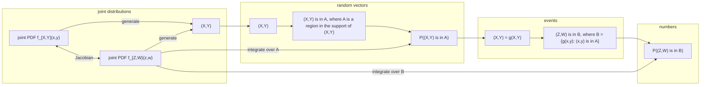
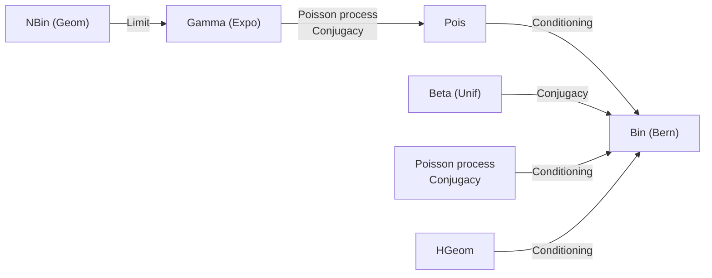

and only if all of the $X _ { j }$ are less than x, the CDF of $X _ { ( n ) }$ is

$$
\begin{array}{l} F _ {X _ {(n)}} (x) = P (\max (X _ {1}, \dots , X _ {n}) \leq x) \\ = P (X _ {1} \leq x, \dots , X _ {n} \leq x) \\ = P (X _ {1} \leq x) \dots P (X _ {n} \leq x) \\ = (F (x)) ^ {n}, \\ \end{array}
$$

where F is the CDF of the individual $X _ { i }$ . Similarly, $X _ { ( 1 ) } = \operatorname* { m i n } ( X _ { 1 } , \ldots , X _ { n } )$ exceeds x if and only if all of the $X _ { j }$ exceed x, so the CDF of $X _ { ( 1 ) }$ is

$$
\begin{array}{l} F _ {X _ {(1)}} (x) = 1 - P (\min (X _ {1}, \dots , X _ {n}) > x) \\ = 1 - P (X _ {1} > x, \dots , X _ {n} > x) \\ = 1 - (1 - F (x)) ^ {n}. \\ \end{array}
$$

The same logic lets us find the CDF of $X _ { ( j ) }$ . For the event $X _ { ( j ) } \; \leq \; x$ to occur, we need at least $j$ of the $X _ { i }$ to fall to the left of x. This is illustrated in Figure 8.10.


<details>
<summary>text_image</summary>

at least j to the left of x
X(1) ... X(j) X(j+1) x X(j+2) ...
</details>

## FIGURE 8.10

The event $X _ { ( j ) } \leq x$ is equivalent to the event $\mathrm { { ` a t } }$ least j $X _ { i } { } ^ { \flat } \mathrm { s }$ fall to the left of $x ^ { \flat }$

Since it appears that the number of $X _ { i }$ to the left of x will be important to us, let’s define a new random variable, N, to keep track of just that: define N to be the number of $X _ { i }$ that land to the left of x. Each $X _ { i }$ lands to the left of x with probability $F ( x )$ , independently. If we define success as landing to the left of $x ,$ we have n independent Bernoulli trials with probability $F ( x )$ of success, so $N \sim \mathrm { B i n } ( n , F ( x ) )$ . Then, by the Binomial PMF,

$$
\begin{array}{l} P (X _ {(j)} \leq x) = P (\text {at least} j \text {of the} X _ {i} \text {are to the left of} x) \\ = P (N \geq j) \\ = \sum_ {k = j} ^ {n} \binom {n} {k} F (x) ^ {k} (1 - F (x)) ^ {n - k}. \\ \end{array}
$$

We thus have the following result for the CDF of $X _ { ( j ) }$

Theorem 8.6.3 (CDF of order statistic). Let $X _ { 1 } , \ldots , X _ { n }$ be i.i.d. continuous r.v.s with CDF F. Then the CDF of the jth order statistic $X _ { ( j ) }$ is

$$
P (X _ {(j)} \leq x) = \sum_ {k = j} ^ {n} \binom{n}{k} F (x) ^ {k} (1 - F (x)) ^ {n - k}.
$$

To get the PDF of $X _ { ( j ) }$ , we can differentiate the CDF with respect to $x ,$ but the resulting expression is ugly (though it can be simplified). Instead we will take a more direct approach. Consider $f_{X_{(j)}}(x)dx$ , the probability that the jth order statistic falls into an infinitesimal interval of length dx around x. The only way this can happen is illustrated in Figure 8.11. We need one of the $X _ { i }$ to fall into the infinitesimal interval around x, and we need exactly $j - 1$ of the $X _ { i }$ to fall to the left of x, leaving the remaining $n - j$ to fall to the right of x.


<details>
<summary>text_image</summary>

j - 1 to the left of x
1 in a tiny interval around x
n - j to the right of x
x
</details>

## FIGURE 8.11

In order for $X _ { ( j ) }$ to fall within a small interval of $x ,$ we require that one of the $X _ { i }$ fall within the small interval and that exactly $j - 1$ fall to the left of $x .$

What is the probability of this extremely specific event? Let’s break up the experiment into stages.

• First, we choose which one of the $X _ { i }$ will fall into the infinitesimal interval around x. There are n such choices, each of which occurs with probability $f ( x ) d x$ , where $f$ is the PDF of the $X _ { i }$
• Next, we choose exactly $j - 1$ out of the remaining $n - 1$ to fall to the left of x. There are ${ \binom { n - 1 } { j - 1 } }$ such choices, each with probability $F ( x ) ^ { j - 1 } ( 1 - F ( x ) ) ^ { n - j }$ by the Bin $( n , F ( x ) \tilde { ) } \; \mathrm { \vec { P } M F }$

We multiply the probabilities of the two stages to get

$$
f _ {X _ {(j)}} (x) d x = n f (x) d x \binom {n - 1} {j - 1} F (x) ^ {j - 1} (1 - F (x)) ^ {n - j}.
$$

Dropping the $d x ^ { \flat } \mathrm { s }$ from both sides gives us the PDF we desire.

Theorem 8.6.4 (PDF of order statistic). Let $X _ { 1 } , \ldots , X _ { n }$ be i.i.d. continuous r.v.s with CDF F and PDF f. Then the marginal PDF of the jth order statistic $X _ { ( j ) }$ is

$$
f _ {X _ {(j)}} (x) = n \binom {n - 1} {j - 1} f (x) F (x) ^ {j - 1} (1 - F (x)) ^ {n - j}.
$$

In general, the order statistics of $X _ { 1 } , \ldots , X _ { n }$ will not follow a named distribution, but the order statistics of the standard Uniform distribution are an exception.

Example 8.6.5 (Order statistics of Uniforms). Let $U _ { 1 } , \ldots , U _ { n }$ be i.i.d. Unif(0, 1). Then for $0 \leq x \leq 1,   f(x) = 1$ and $F ( x ) = x ,$ so the PDF of $U _ { ( j ) }$ is

$$
f _ {U _ {(j)}} (x) = n \binom {n - 1} {j - 1} x ^ {j - 1} (1 - x) ^ {n - j}.
$$

This is the Beta $( j , n - j + 1 )$ PDF! So $U _ { ( j ) } \sim \mathrm { B e t a } ( j , n - j + 1 )$ , and $\begin{array} { r } { E ( U _ { ( j ) } ) = \frac { j } { n + 1 } } \end{array}$

The simple case $n = 2$ is consistent with Example 7.2.2, where we used 2D LOTUS to show that for i.i.d. $U _ { 1 } , U _ { 2 } \sim \mathrm { U n i f } ( 0 , 1 )$ ,

$$
E (\max (U _ {1}, U _ {2})) = 2 / 3, E (\min (U _ {1}, U _ {2})) = 1 / 3.
$$

Now that we know max $( U _ { 1 } , U _ { 2 } )$ and min $\left( U _ { 1 } , U _ { 2 } \right)$ follow Beta distributions, the expectation of the Beta distribution confirms our earlier findings. 

## 8.7 Recap

In this chapter we discussed three broad classes of transformations:

• invertible transformations $\mathbf { Y } = g ( \mathbf { X } )$ of continuous random vectors, which can be handled with the change of variables formula (under some technical assumptions, most notably that the partial derivatives $\partial x _ { i } / \partial y _ { j }$ exist and are continuous);
• convolutions, for which we can determine the distribution using (in decreasing order of preference) stories, MGFs, or convolution sums/integrals;
• the transformation of i.i.d. continuous r.v.s to their order statistics.

Figure 8.12 illustrates connections between the original random vector $( X , Y )$ and the transformed random vector $( Z , W )   =   g ( X , Y )$ , where $g$ is an invertible transformation satisfying certain technical assumptions. The change of variables formula uses Jacobians to take us back and forth between the joint PDF of $( X , Y )$ and the joint PDF of $( Z , W )$

Let A be a region in the support of $( X , Y )$ , and $B = \{ g ( x , y ) : ( x , y ) \in A \}$ be the corresponding region in the support of $( Z , W )$ . Then $( X , Y ) \in A$ is the same event as $( Z , W ) \in B$ , so

$$
P ((X, Y) \in A) = P ((Z, W) \in B).
$$

To find this probability, we can either integrate the joint PDF of $( X , Y )$ over $A$ or integrate the joint PDF of $( Z , W )$ over B.


<details>
<summary>flowchart</summary>


</details>

FIGURE 8.12

Let $( Z , W )   =   g ( X , Y )$ , where g is an invertible transformation satisfying certain technical assumptions. The change of variables formula lets us go back and forth between the joint PDFs of $( X , Y )$ and (Z, W).

In this chapter, as in many others, we made extensive use of Bayes’ rule and LOTP, especially in continuous or hybrid forms. And we often used the strategy of integration by pattern recognition. Since any valid PDF must integrate to 1, and by now we know lots of valid PDFs, we can often use probability to help us do calculus in addition to using calculus to help us do probability!

The two new distributions we introduced are the Beta and Gamma, which are laden with stories and connections to other distributions. The Beta is a generalization of the Unif(0, 1) distribution, and it has the following stories.

• Order statistics of the Uniform: The jth order statistic of n i.i.d. $\mathrm { U n i f } ( 0 , 1 )$ r.v.s is distributed $Beta (j,n - j + 1)$ .
• Unknown probability, conjugate prior of the Binomial: If $p \sim \mathrm { B e t a } ( a , b )$ and $X | p \sim$ $\operatorname { B i n } ( n , p )$ , then $p | X   =   k   \sim   \mathrm { B e t a } ( a   +   k , b   +   n   -   k )$ . The posterior distribution of p stays within the Beta family of distributions after updating based on Binomial data, a property known as conjugacy. The parameters a and b can be interpreted as the prior number of successes and failures, respectively.

The Gamma is a generalization of the Exponential distribution, and it has the following stories.

• Poisson process: In a Poisson process of rate λ, the total waiting time for n arrivals is distributed $Gamma (n,\lambda)$ . Thus the Gamma is the continuous analog of the Negative Binomial distribution.

• Unknown rate, conjugate prior of the Poisson: If $\lambda \sim  Gamma (r_0, b_0)$ and $Y | \lambda \sim$ Pois(λt), then $\lambda | Y = y \sim \operatorname { G a m m a } ( r _ { 0 } + y , b _ { 0 } + t )$ . The posterior distribution of $\lambda$ stays within the Gamma family of distributions after updating based on Poisson data. The parameters $r _ { 0 }$ and $b _ { 0 }$ can be interpreted as the prior number of observed successes and the total waiting time for those successes, respectively.

The Beta and Gamma distributions are related by the bank–post office story, which says that if $X \sim  Gamma (a, \lambda),   Y \sim  Gamma (b, \lambda)$ are independent, then $X + Y \sim$ Gamma $\begin{array} { r } { ( a + b , \lambda ) ,   \frac { X } { X + Y } \sim \mathrm { B e t a } ( a , b ) } \end{array}$ , with $X + Y$ and $\frac { X } { X + Y }$ independent.

The diagram of connections, which we last saw in Chapter $^ { 5 , }$ is hereby updated to include the Beta and Gamma distributions. Distributions listed in parentheses are special cases of the ones not in parentheses.


<details>
<summary>flowchart</summary>


</details>

## 8.8 R

## Beta and Gamma distributions

The Beta and Gamma distributions are programmed into R.

• dbeta, pbeta, rbeta: To evaluate the Beta $( a , b )$ PDF or CDF at $x ,$ we use dbeta $( \mathbf { x } , \mathbf { a } , \mathbf { b } )$ and pbeta $( \mathbf { x } , \mathbf { a } , \mathbf { b } )$ . To generate n realizations from the Beta(a, b) distribution, we use rbeta(n,a,b).

• dgamma, pgamma, rgamma: To evaluate the Gamma(a, λ) PDF or CDF at $x ,$ we use dgamma(x,a,lambda) or pgamma(x,a,lambda). To generate n realizations from the Gamma(a, λ) distribution, we use rgamma(n,a,lambda).

For example, we can check that the Gamma(3, 2) distribution has mean $3 / 2$ and variance $3 / 4$ . To do this, we generate a large number of Gamma(3, 2) random variables using rgamma, then compute their mean and var:

```r
y <- rgamma(10^5,3,2)
mean(y)
var(y)
```

Did you get values that were close to 1.5 and 0.75, respectively?

## Convolution of Uniforms

Using R, we can quickly verify that for $X , Y { \overset { \mathrm { ~ i . i . d . ~ } } { \sim } } \operatorname { U n i f } ( 0 , 1 )$ , the distribution of $T = X + Y$ is triangular in shape:

```r
x <- runif(10^5)
y <- runif(10^5)
hist(x+y)
```

The histogram looks like an ascending and then descending staircase, a discrete approximation to a triangle.

## Bayes’ billiards

In the Bayes’ billiards story, we have n white balls and 1 gray ball, throw them onto the unit interval completely at random, and count the number of white balls to the left of the gray ball. Letting p be the position of the gray ball and X be the number of white balls to the left of the gray ball, we have

$$
\begin{array}{l} p \sim \mathrm{Unif} (0, 1) \\ X | p \sim \mathrm{Bin} (n, p). \\ \end{array}
$$

By performing this experiment a large number of times, we can verify the results we derived in this chapter about the marginal PMF of X and the posterior PDF of p given X = x. We’ll let the number of simulations be called nsim, to avoid a name conflict with the number of white balls, n, which we set equal to 10:

```txt
nsim <- 10^5
n <- 10
```

We simulate $1 0 ^ { 5 }$ values of $p ,$ then simulate $1 0 ^ { 5 }$ 105 values from the conditional distribution of X given $p ;$

```r
p <- runif(nsim)
x <- rbinom(nsim,n,p)
```

Notice that we feed the entire vector p into rbinom. This means that the first element of x is generated using the first element of p, the second element of x is generated using the second element of p, and so forth. Thus, conditional on a particular element of p, the corresponding element of x is Binomial, but the elements of p are themselves Uniform, exactly as the model specifies.

According to the Bayes’ billiards argument, the marginal distribution of X should be Discrete Uniform on the integers 0 through n. Is this in fact the case? We can make a histogram of x to check! Because the distribution of X is discrete, we tell R to make the histogram breaks at −0.5, 0.5, 1.5, . . . so that each bar is centered at an integer value:

```txt
hist(x,breaks=seq(-0.5,n+0.5,1))
```

Indeed, all the histogram bars are approximately equal in height, consistent with a Discrete Uniform distribution.

Now for the posterior distribution of p given X = x. Conditioning is very simple in R. To consider only the simulated values of p where the value of X was 3, we use square brackets, like this: p[x==3]. In particular, we can create a histogram of these values to see what the posterior distribution of p given X = 3 looks like; try hist(p[x==3]).

According to the Beta-Binomial conjugacy result, the true posterior distribution is $p | X   =   3   \sim   \mathrm { B e t a } ( 4 , 8 )$ . We can plot the histogram of p[x==3] next to a histogram of simulated values from the Beta(4, 8) distribution to confirm that they look similar:

```txt
par(mfrow=c(1,2))
hist(p[x==3])
hist(rbeta(10^4,4,8))
```

The first line tells R we want two side-by-side plots, and the second and third lines create the histograms.

## Simulating order statistics

Simulating order statistics in R is easy: we simply simulate i.i.d. r.v.s and use sort to sort them in increasing order. For example,

```txt
sort(rnorm(10))
```

produces one realization of $X _ { ( 1 ) } , \ldots , X _ { ( 1 0 ) }$ , where $X _ { 1 } , \ldots , X _ { 1 0 }$ are i.i.d. $\mathcal { N } ( 0 , 1 )$

If we want to plot a histogram of realizations of, say, $X _ { ( 9 ) }$ , we’ll need to use replicate:

order\_stats <- replicate(10^4, sort(rnorm(10)))

This creates a matrix, order\_stats, with 10 rows. The ith row of the matrix contains $1 0 ^ { 4 }$ realizations of $X _ { ( i ) }$ . Now we can create a histogram of $X _ { ( 9 ) }$ , simply by selecting row 9 of the matrix:

x9 <- order\_stats[9,]

hist(x9)

We can also compute summaries like mean(x9) and $\mathtt { v a r } ( \mathtt { x } 9 )$

## 8.9 Exercises

Exercises marked with s have detailed solutions at [http://stat110.net](http://stat110.net).

## Change of variables

1. Find the PDF of $e ^ { - X }$ for $X \sim \mathrm { E x p o ( 1 ) }$

2. Find the PDF of $X ^ { 7 }$ for $X \sim \operatorname{Expo}(\lambda)$

3. Find the PDF of $Z ^ { 3 }$ for $Z \sim \mathcal { N } ( 0 , 1 )$

4. s Find the PDF of $Z ^ { 4 }$ for $Z \sim \mathcal { N } ( 0 , 1 )$

5. Find the PDF of $| Z |$ for $Z \sim \mathcal { N } ( 0 , 1 )$

6. s Let $U \sim \mathrm { U n i f } ( 0 , 1 )$ . Find the PDFs of $U ^ { 2 }$ and $\sqrt { U }$

7. Let $\begin{array} { r } { U \sim \mathrm { U n i f } ( 0 , \frac { \pi } { 2 } ) } \end{array}$ . Find the PDF of sin(U).

8. (a) Find the distribution of $X ^ { 2 }$ for $X \sim \operatorname { D U n i f } ( 0 , 1 , \ldots , n )$

(b) Find the distribution of $X ^ { 2 }$ for $X \sim \operatorname { D U n i f } ( - n , - n + 1 , \ldots , 0 , 1 , \ldots , n )$

9. Let $X \sim \operatorname { B e r n } ( p )$ and let a and b be constants with $a < b .$ Find a simple transformation of X that yields an r.v. that equals a with probability $1   -   p$ and equals b with probability $p .$

10. Let $X \sim  Pois (\lambda)$ and Y be the indicator of X being odd. Find the PMF of $Y .$

Hint: Find $P ( Y = 0 ) - P ( Y = 1 )$ by writing $P ( Y = 0 )$ and $P ( Y = 1 )$ as series and then using the fact that $( - 1 ) ^ { k }$ is 1 if k is even and −1 if k is odd.

11. Let T be a continuous r.v. and $V = 1 / T$ . Show that their CDFs are related as follows:

$$
F _ {V} (v) = \left\{ \begin{array}{l} F _ {T} (0) + 1 - F _ {T} (\frac {1}{v}) \text {for} v > 0, \\ F _ {T} (0) \text {for} v = 0, \\ F _ {T} (0) - F _ {T} (\frac {1}{v}) \text {for} v <   0. \end{array} \right.
$$

12. Let $T$ be the ratio $X / Y$ of two i.i.d. $\mathcal { N } ( 0 , 1 ) \; \mathrm { r . v . s . } \; X , Y$ . This is the Cauchy distribution and, as shown in Example 7.1.25, it has PDF

$$
f _ {T} (t) = \frac {1}{\pi (1 + t ^ {2})}.
$$

(a) Use the result of the previous problem to find the CDF of $1 / T$ Then use calculus to find the PDF of $1 / T .$ (Note that the one-dimensional change of variables formula does not apply directly, since the function $g ( t )   =   1 / t$ , even though it has $g ^ { \prime } ( t )   <   0$ for all $t \neq 0 ,$ is undefined at $t = 0$ and is not a strictly decreasing function on its domain.)

(b) Show that $1 / T$ has the same distribution as T without using calculus, in 140 characters or fewer.

13. Let X and Y be i.i.d. $\operatorname { E x p o } ( \lambda )$ , and $T = \log ( X / Y )$ . Find the CDF and PDF of $T .$

14. Let X and Y have joint PDF $f _ { X , Y } ( x , y )$ , and transform $( X , Y ) \mapsto ( T , W )$ linearly by letting

$$
T = a X + b Y \text { and } W = c X + d Y,
$$

where $a , b , c , d$ are constants such that ad $- b c \neq 0 .$

(a) Find the joint PDF $f _ { T , W } ( t , w )$ (in terms of $f _ { X , Y }$ , though your answer should be written as a function of t and w).

(b) For the case where $T = X + Y, W = X - Y$ , show that

$$
f _ {T, W} (t, w) = \frac {1}{2} f _ {X, Y} \left(\frac {t + w}{2}, \frac {t - w}{2}\right).
$$

15. s Let $X , Y$ be continuous r.v.s with a spherically symmetric joint distribution, which means that the joint PDF is of the form $f(x,y) = g(x^2 + y^2)$ for some function $g .$ Let $( R , \theta )$ be the polar coordinates of $( X , Y )$ , so $R ^ { 2 } = X ^ { 2 }   +   Y ^ { 2 }$ is the squared distance from the origin and θ is the angle (in $[ 0 , 2 \pi ) )$ , with $X = R$ cos $\theta , Y = R \sin \theta .$

(a) Explain intuitively why R and θ are independent. Then prove this by finding the joint PDF of $( R , \theta )$

(b) What is the joint PDF of $( R , \theta )$ when $( X , Y )$ is Uniform in the unit disk $\{ ( x , y ) :$ $\stackrel{\frown}{x^{2}} + y^{2} \leq 1 \}?$

(c) What is the joint PDF of $( R , \theta )$ when X and Y are i.i.d. $\mathcal { N } ( 0 , 1 ) ?$

16. Let X and Y be i.i.d. $\mathcal { N } ( 0 , 1 )$ r.v.s, $T   =   X + Y$ , and $W   =   X - Y$ . We know from Example 7.5.8 that T and W are independent $\mathcal { N } ( 0 , 2 )$ r.v.s (note that (T, W) is Multi-variate Normal with $\mathrm { C o v } ( T , W ) = 0 )$ . Give another proof of this fact, using the change of variables theorem.

17. Let X and Y be i.i.d. $\mathcal { N } ( 0 , 1 ) \mathrm { r . v . s . }$ and $( R , \theta )$ be the polar coordinates for the point $( X , Y )$ , so $X = R \cos \theta$ and $Y = R \sin \theta$ with $R \geq 0$ and $\theta \in [ 0 , 2 \pi )$ . Find the joint PDF of $R ^ { 2 }$ and θ. Also find the marginal distributions of $R ^ { 2 }$ and $\theta ,$ giving their names (and parameters) if they are distributions we have studied before.

18. Let X and Y be independent positive r.v.s, with PDFs $f _ { X }$ and $f _ { Y }$ , respectively. Let $T$ be the ratio $X / Y$

(a) Find the joint PDF of T and X, using a Jacobian.
(b) Find the marginal PDF of T, as a single integral.

19. Let X and Y be i.i.d. Expo(λ), and transform them to $T = X + Y , W = X / Y$

(a) Find the joint PDF of T and W. Are they independent?
(b) Find the marginal PDFs of $T$ and W.

## Convolutions

20. Let $U \sim \mathrm { U n i f } ( 0 , 1 )$ and $X \sim \mathrm { E x p o ( 1 ) }$ , independently. Find the PDF of $U + X$

21. Let X and Y be i.i.d. Expo(1). Use a convolution integral to show that the PDF of $L = X - Y$ is $\begin{array} { r } { f ( t ) = \frac { 1 } { 2 } e ^ { - | t | } } \end{array}$ for all real $t ;$ this is known as the Laplace distribution.

22. Use a convolution integral to show that if $X \: \sim \: \mathcal { N } ( \mu _ { 1 } , \sigma ^ { 2 } )$ and $Y \: \sim \: \mathcal { N } ( \mu _ { 2 } , \sigma ^ { 2 } )$ are independent, then $T = X + Y \sim \mathcal { N } ( \mu _ { 1 } + \mu _ { 2 } , 2 \sigma ^ { 2 } )$ (to simplify the calculation, we are assuming that the variances are equal). You can use a standardization (location-scale) idea to reduce to the standard Normal case before setting up the integral.

Hint: Complete the square.

23. s Let X and Y be independent positive r.v.s, with PDFs $f _ { X }$ and $f _ { Y }$ , respectively, and consider the product $T = X Y$ . When asked to find the PDF of $T ,$ Jacobno argues that: $\mathrm { { } ^ { \mathrm { { } ^ { \mathrm { { c } } } } } I t   ^ { \mathrm { { } ^ { \mathrm { { , } } } } } s }$ like a convolution, with a product instead of a sum. To have $T = t$ we need $X = x$ and $Y   =   t / x$ for some x; that has probability $f _ { X } ( x ) f _ { Y } ( t / x )$ , so summing up these possibilities we get that the PDF of $T$ is $\begin{array} { l } { \int _ { 0 } ^ { \infty } f _ { X } ( x ) f _ { Y } ( t / x ) d x . } \\ \end{array}$

Evaluate Jacobno’s argument, while getting the PDF of T (as an integral) in 2 ways:

(a) using the continuous version of the law of total probability to get the CDF, and then taking the derivative (you can assume that swapping the derivative and integral is valid);

(b) by taking the log of both sides of $T   =   X Y$ and doing a convolution (and then converting back to get the PDF of T).

24. Let X and Y be i.i.d. Discrete Uniform r.v.s on $\{ 0 , 1 , \ldots , n \}$ , where n is a positive integer. Find the PMF of $T = X + Y$

Hint: In finding $P ( T = k )$ , it helps to consider the cases $0 \leq k \leq n$ and $n + 1 \leq k \leq 2 n$ separately. Be careful about the range of summation in the convolution sum.

25. Let X and Y be i.i.d. Unif(0, 1), and let $W = X - Y$

(a) Find the mean and variance of W, without yet deriving the PDF.
(b) Show that the distribution of W is symmetric about 0, without yet deriving the PDF.

(c) Find the PDF of W.

(d) Use the PDF of W to verify your results from (a) and (b).

(e) How does the distribution of W relate to the distribution of $X + Y$ , the Triangle distribution derived in Example 8.2.5? Give a precise description, e.g., using the concepts of location and scale.

26. Let X and Y be i.i.d. Unif(0, 1), and $T   =   X + Y$ . We derived the distribution of T (a Triangle distribution) in Example 8.2.5, using a convolution integral. Since $( X , Y )$ is Uniform in the unit square $\{ ( x , y )   :   0   <   x   <   1 , 0   <   y   <   1 \}$ , we can also interpret $P ( ( X , Y ) \in A )$ as the area of A, for any region A within the unit square. Use this idea to find the CDF of T, by interpreting the CDF (evaluated at some point) as an area.

27. Let X, Y, Z be i.i.d. $\mathrm { U n i f } ( 0 , 1 )$ , and $W = X + Y + Z .$ Find the $\mathrm { P D F }$ of W .

Hint: We already know the PDF of $X + Y$ . Be careful about limits of integration in the convolution integral; there are 3 cases that should be considered separately.

## Beta and Gamma

28. s Let $B \sim \mathrm { B e t a } ( a , b )$ . Find the distribution of $1 - B$ in two ways: (a) using a change of variables and (b) using a story proof. Also explain why the result makes sense in terms of Beta being the conjugate prior for the Binomial.
29. s Let $X \sim  Gamma (a, \lambda)$ and $Y \sim  Gamma (b, \lambda)$ be independent, with a and b integers. Show that $X + Y \sim \mathrm { G a m m a } ( a + b , \lambda )$ in three ways: (a) with a convolution integral; (b) with MGFs; (c) with a story proof.
30. Let $B \sim \mathrm { B e t a } ( a , b )$ . Use integration by pattern recognition to find $E ( B ^ { k } )$ for positive integers k. In particular, show that

$$
\operatorname{Var} (B) = \frac {a b}{(a + b) ^ {2} (a + b + 1)}.
$$

31. s Fred waits $X   \sim   \operatorname { G a m m a } ( a , \lambda )$ minutes for the bus to work, and then waits $Y \sim$ $Gamma (b,\lambda)$ for the bus going home, with X and $Y$ independent. Is the ratio $X / Y$ independent of the total wait time $X + Y ?$

32. s The F-test is a very widely used statistical test based on the $F ( m , n )$ distribution, which is the distribution of $\frac { X / m } { Y / n }$ with $\begin{array} { r } { X \sim \mathrm { G a m m a } ( \frac { m } { 2 } , \frac { 1 } { 2 } ) , Y \sim \mathrm { G a m m a } ( \frac { n } { 2 } , \frac { 1 } { 2 } ) } \end{array}$ . Find the distribution of m $V / ( n + m V )$ for $V \sim F ( m , n )$

33. s Customers arrive at the Leftorium store according to a Poisson process with rate λ customers per hour. The true value of λ is unknown, so we treat it as a random variable. Suppose that our prior beliefs about λ can be expressed as $\lambda \sim \mathrm{Exp}(3)$ . Let X be the number of customers who arrive at the Leftorium between 1 pm and 3 pm tomorrow. Given that $X = 2$ is observed, find the posterior PDF of λ.

34. s Let X and Y be independent, positive r.v.s. with finite expected values.

(a) Give an example where $\textstyle E ( \frac { X } { X + Y } ) \neq \frac { E ( X ) } { E ( X + Y ) }$ , computing both sides exactly.

Hint: Start by thinking about the simplest examples you can think of!

(b) If X and Y are i.i.d., then is it necessarily true that $\begin{array} { l } { E ( \frac { X } { X + Y } ) = \frac { E ( X ) } { E ( X + Y ) } ? } \\ \end{array}$

(c) Now let $X \sim  Gamma (a, \lambda)$ and $Y \sim  Gamma (b, \lambda)$ . Show without using calculus that

$$
E \left(\frac {X ^ {c}}{(X + Y) ^ {c}}\right) = \frac {E (X ^ {c})}{E ((X + Y) ^ {c})}
$$

for every real $c > 0$

35. Let $T = X ^ { 1 / \gamma }$ , with $X \sim \operatorname { E x p o } ( \lambda )$ and $\lambda , \gamma > 0$ . So T has a Weibull distribution, as discussed in Example 6.5.5. Using LOTUS and the definition of the gamma function, we showed in this chapter that for $Y \sim  Gamma (a, \lambda)$

$$
E (Y ^ {c}) = \frac {1}{\lambda^ {c}} \cdot \frac {\Gamma (a + c)}{\Gamma (a)},
$$

for all real $c > - a$ . Use this result to show that

$$
E (T) = \frac {\Gamma \left(1 + 1 / \gamma\right)}{\lambda^ {1 / \gamma}} \text {and} \operatorname{Var} (T) = \frac {\Gamma \left(1 + 2 / \gamma\right) - \left(\Gamma \left(1 + 2 / \gamma\right)\right) ^ {2}}{\lambda^ {2 / \gamma}}.
$$

36. Alice walks into a post office with 2 clerks. Both clerks are in the midst of serving customers, but Alice is next in line. The clerk on the left takes an $\mathrm{Exp}(\lambda_1)$ time to serve a customer, and the clerk on the right takes an $\mathrm{Exp}(\lambda_{2})$ time to serve a customer. Let $T _ { 1 }$ be the time until the clerk on the left is done serving their current customer, and define $T _ { 2 }$ likewise for the clerk on the right.

(a) If $\lambda _ { 1 } = \lambda _ { 2 } .$ is $T _ { 1 } / T _ { 2 }$ independent of $T _ { 1 } + T _ { 2 } ?$

Hint: Note that $T _ { 1 } / T _ { 2 } = ( T _ { 1 } / ( T _ { 1 } + T _ { 2 } ) ) / ( T _ { 2 } / ( T _ { 1 } + T _ { 2 } ) ) .$

(b) Find $P ( T _ { 1 }   <   T _ { 2 } )$ (do not assume $\lambda _ { 1 } = \lambda _ { 2 }$ here or in the next part, but do check that your answers make sense in that special case).

(c) Find the expected total amount of time that Alice spends in the post office (assuming that she leaves immediately after she is done being served).

37. Let $X \sim \operatorname { P o i s } ( \lambda t )$ and $Y \sim  Gamma (j, \lambda)$ , where j is a positive integer. Show using a story about a Poisson process that

$$
P (X \geq j) = P (Y \leq t).
$$

38. Visitors arrive at a certain scenic park according to a Poisson process with rate λ visitors per hour. Fred has just arrived (independent of anyone else), and will stay for an $\mathrm{Exp}(\lambda_{2})$ number of hours. Find the distribution of the number of other visitors who arrive at the park while Fred is there.

39. (a) Let $p   \sim   \mathrm { B e t a } ( a , b )$ , where a and b are positive real numbers. Find $E ( p ^ { 2 } ( 1 - p ) ^ { 2 } )$ fully simplified (Γ should not appear in your final answer).

Two teams, A and B, have an upcoming match. They will play five games and the winner will be declared to be the team that wins the majority of games. Given $p ,$ the outcomes of games are independent, with probability $p$ of team A winning and $1 - p$ of team B winning. But you don’t know $p ,$ so you decide to model it as an r.v., with $p \sim \mathrm { U n i f } ( 0 , 1 )$ a priori (before you have observed any data).

To learn more about $p ,$ you look through the historical records of previous games between these two teams, and find that the previous outcomes were, in chronological order, AAABBAABAB. (Assume that the true value of p has not been changing over time and will be the same for the match, though your beliefs about p may change over time.)

(b) Does your posterior distribution for $p ,$ given the historical record of games between A and B, depend on the specific order of outcomes or only on the fact that A won exactly 6 of the 10 games on record? Explain.

(c) Find the posterior distribution for p, given the historical data.

The posterior distribution for $p$ from (c) becomes your new prior distribution, and the match is about to begin!

(d) Conditional on $p ,$ is the indicator of A winning the first game of the match positively correlated with, uncorrelated with, or negatively correlated with the indicator of A winning the second game? What about if we only condition on the historical data?

(e) Given the historical data, what is the expected value for the probability that the match is not yet decided when going into the fifth game (viewing this probability as an r.v. rather than a number, to reflect our uncertainty about it)?

40. An engineer is studying the reliability of a product by performing a sequence of n trials. Reliability is defined as the probability of success. In each trial, the product succeeds with probability $p$ and fails with probability $1 - p .$ The trials are conditionally independent given $p .$ Here $p$ is unknown (else the study would be unnecessary!). The engineer takes a Bayesian approach, with $p \sim \mathrm { U n i f } ( 0 , 1 )$ as prior.

Let r be a desired reliability level and c be the corresponding confidence level, in the sense that, given the data, the probability is c that the true reliability $p$ is at least r. For example, if $r = 0 . 9 , c = 0 . 9 5$ , we can be 95% sure, given the data, that the product is at least 90% reliable. Suppose that it is observed that the product succeeds all n times. Find a simple equation for c as a function of $r .$

## Order statistics

41. s Let $X \sim \operatorname { B i n } ( n , p )$ and $B \sim \mathrm { B e t a } ( j , n - j + 1 )$ , where n is a positive integer and $j$ is a positive integer with $j \leq n$ . Show using a story about order statistics that

$$
P (X \geq j) = P (B \leq p).
$$

This shows that the CDF of the continuous r.v. B is closely related to the CDF of the discrete $\operatorname { r . v . } X$ , and is another connection between the Beta and Binomial.

42. Show that for i.i.d. continuous r.v.s $X , Y , Z ,$

$$
P (X <   \min (Y, Z)) + P (Y <   \min (X, Z)) + P (Z <   \min (X, Y)) = 1.
$$

43. Show that

$$
\int_ {0} ^ {x} \frac {n !}{(j - 1) ! (n - j) !} t ^ {j - 1} (1 - t) ^ {n - j} d t = \sum_ {k = j} ^ {n} \binom{n}{k} x ^ {k} (1 - x) ^ {n - k},
$$

without using calculus, for all $x \in [ 0 , 1 ]$ and $j , n$ positive integers with $j \leq n$

44. Let $X _ { 1 } , \ldots , X _ { n }$ be i.i.d. continuous r.v.s with PDF f and a strictly increasing CDF F. Suppose that we know that the jth order statistic of n i.i.d. Unif(0, 1) r.v.s is a $\mathrm { B e t a } ( j , n - j + 1 )$ , but we have forgotten the formula and derivation for the distribution of the jth order statistic of $X _ { 1 } , \ldots , X _ { n }$ . Show how we can recover the PDF of $X _ { ( j ) }$ quickly using a change of variables.

45. s Let X and Y be independent Expo(λ) r.v.s and $M = \operatorname* { m a x } ( X , Y )$ . Show that M has the same distribution as $X   +   { \textstyle \frac { 1 } { 2 } } Y$ , in two ways: (a) using calculus and (b) by remembering the memoryless property and other properties of the Exponential.

46. s (a) If X and Y are i.i.d. continuous r.v.s with CDF $F ( x )$ and PDF $f ( x )$ , then $M   =   \operatorname* { m a x } ( X , Y )$ has PDF $2 F ( x ) f ( x )$ . Now let X and Y be discrete and i.i.d., with CDF $F ( x )$ and PMF $f ( x )$ . Explain in words why the PMF of M is not $2 F ( x ) f ( x )$

(b) Let X and Y be i.i.d. Bern(1/2) r.v.s, $M = \operatorname* { m a x } ( X , Y )$ and $L = \operatorname* { m i n } ( X , Y )$ . Find the joint PMF of M and L, i.e., $P ( M = a , L = b )$ , and the marginal PMFs of M and L.

47. Let $X _ { 1 } , X _ { 2 } , \ldots$ be i.i.d. r.v.s with CDF F, and let $M _ { n } { = } \operatorname* { m a x } ( X _ { 1 } , X _ { 2 } , \ldots , X _ { n } )$ . Find the joint distribution of $M _ { n }$ and $M _ { n + 1 }$ , for each $n \geq 1$

48. s Let $X _ { 1 } , X _ { 2 } , \ldots , X _ { n }$ be i.i.d. r.v.s with CDF F and PDF f. Find the joint PDF of the order statistics $X _ { ( i ) }$ and $X _ { ( j ) }$ for $1 \leq i < j \leq n$ , by drawing and thinking about a picture.

49. s Two women are pregnant, both with the same due date. On a timeline, define time 0 to be the instant when the due date begins. Suppose that the time when the woman gives birth has a Normal distribution, centered at 0 and with standard deviation 8 days. The two birth times are i.i.d. Let T be the time of the first of the two births (in days).

(a) Show that

$$
E (T) = \frac {- 8}{\sqrt {\pi}}.
$$

Hint: For any two random variables X and Y , we have max $\operatorname { \mathsf { t } } ( X , Y )   +   \operatorname* { m i n } ( X , Y ) = X   +   Y$ and max $( X , Y ) - \operatorname* { m i n } ( X , Y ) { = } | X - Y |$ . Example 7.2.3 derives the expected distance between two i.i.d. $\mathcal { N } ( 0 , 1 )$ r.v.s.

(b) Find $\operatorname { V a r } ( T )$ , in terms of integrals. You can leave your answers unsimplified for this part, but it can be shown that the answer works out to

$$
\mathrm{Var} (T) = 6 4 \left(1 - \frac {1}{\pi}\right).
$$

50. We are about to observe random variables $Y _ { 1 } , Y _ { 2 } , \ldots , Y _ { n }$ , i.i.d. from a continuous distribution. We will need to predict an independent future observation $Y _ { \mathrm { n e w } }$ , which will also have the same distribution. The distribution is unknown, so we will construct our prediction using $Y _ { 1 } , Y _ { 2 } , \ldots , Y _ { n }$ rather than the distribution of $Y _ { \mathrm { n e w } }$ . In forming a prediction, we do not want to report only a single number; rather, we want to give a predictive interval with “high confidence” of containing $Y _ { \mathrm { n e w } }$ . One approach to this is via order statistics.

(a) For fixed $j$ and k with $1 \leq j < k \leq n$ , find $P ( Y _ { \operatorname { n e w } } \in [ Y _ { ( j ) } , Y _ { ( k ) } ] )$

Hint: By symmetry, all orderings of $Y _ { 1 } , \ldots , Y _ { n } , Y _ { \operatorname { n e w } }$ are equally likely.

(b) Let $n = 9 9$ . Construct a predictive interval, as a function of $Y _ { 1 } , \ldots , Y _ { n }$ , such that the probability of the interval containing $Y _ { \mathrm { n e w } }$ is 0.95.

51. Let $X _ { 1 } , \ldots , X _ { n }$ be i.i.d. continuous r.v.s with n odd. Show that the median of the distribution of the sample median of the $X _ { i } { } ^ { \prime } \mathbf { s }$ is the median of the distribution of the $X _ { i } { } ^ { \flat } \mathbf { s } .$

Hint: Start by reading the problem carefully; it is crucial to distinguish between the median of a distribution (as defined in Chapter 6) and the sample median of a collection of r.v.s (as defined in this chapter). Of course they are closely related: the sample median of i.i.d. r.v.s is a very natural way to estimate the true median of the distribution that the r.v.s are drawn from. Two approaches to evaluating a sum that might come up are (i) use the first story proof example and first story proof exercise from Chapter 1, or (ii) use the fact that, by the story of the Binomial, $Y \sim \mathrm { B i n } ( n , 1 / 2 )$ implies $n   -   Y \sim \mathrm { B i n } ( n , 1 / 2 )$

## Mixed practice

52. Let $U _ { 1 } , U _ { 2 } , \ldots , U _ { n }$ be i.i.d. $\mathrm { U n i f } ( 0 , 1 )$ , and let $X _ { j } = - \log ( U _ { j } )$ for all $j .$

(a) Find the distribution of $X _ { j }$ . What is its name?
(b) Find the distribution of the product $U _ { 1 } U _ { 2 } \ldots U _ { n }$

Hint: First take the log.

53. s A DNA sequence can be represented as a sequence of letters, where the alphabet has 4 letters: A,C,T,G. Suppose such a sequence is generated randomly, where the letters are independent and the probabilities of $\scriptstyle \mathrm { A , } \mathrm { C , } \mathrm { T , } \mathrm { G }$ are $p _ { 1 } , p _ { 2 } , p _ { 3 } , p _ { 4 }$ , respectively.

(a) In a DNA sequence of length 115, what is the expected number of occurrences of the expression $\text{" } CATCAT  \text{" }$ (in terms of the $p _ { j } ) ?$ (Note that, for example, the expression $``CATCATCAT''$ counts as 2 occurrences.)
(b) What is the probability that the first A appears earlier than the first C appears, as letters are generated one by one (in terms of the $| p _ { j } \rangle _ { } ^ { 2 }$
(c) For this part, assume that the $p _ { j }$ are unknown. Suppose we treat $p _ { 2 }$ as a $\mathrm { U n i f } ( 0 , 1 )$ r.v. before observing any data, and that then the first 3 letters observed are $\text{° C A T " }$ Given this information, what is the probability that the next letter is C?

54. s Consider independent Bernoulli trials with probability $p$ of success for each. Let X be the number of failures incurred before getting a total of r successes.

(a) Determine what happens to the distribution of ${ \frac { p } { 1   -   p } } X$ as $p \to 0$ , using MGFs; what is the PDF of the limiting distribution, and its name and parameters if it is one we have studied?

Hint: Start by finding the Geom(p) MGF. Then find the MGF of ${ \frac { p } { 1 { - } p } } X$ , and use the fact that if the MGFs of $Y _ { n }$ converges to the MGF of $Y$ , then the $\mathrm { C D \vec { F } }$ of $Y _ { n }$ converges to the CDF of $Y$

(b) Explain intuitively why the result of (a) makes sense.


## Taylor & Francis

Taylor & Francis Group

http://taylorandfrancis.com

# Conditional expectation

Given that you’ve read the earlier chapters, you already know what conditional expectation is: expectation, but using conditional probabilities. This is an essential concept, for reasons analogous to why we need conditional probability:

• Conditional expectation is a powerful tool for calculating expectations. Using strategies such as conditioning on what we wish we knew and first-step analysis, we can often decompose complicated expectation problems into simpler pieces.
• Conditional expectation is a relevant quantity in its own right, allowing us to predict or estimate unknowns based on whatever evidence is currently available. For example, in statistics we often want to predict a response variable (such as test scores or earnings) based on explanatory variables (such as number of practice problems solved or enrollment in a job training program).

There are two different but closely linked notions of conditional expectation:

• Conditional expectation $E ( Y | A )$ given an event: let Y be an r.v., and A be an event. If we learn that A occurred, our updated expectation for Y is denoted by $E ( Y | A )$ and is computed analogously to $E ( Y )$ , except using conditional probabilities given A.
• Conditional expectation $E ( Y | X )$ given a random variable: a more subtle question is how to define $E ( Y | X )$ , where X and Y are both r.v.s. Intuitively, $E ( Y | X )$ is the r.v. that best predicts Y using only the information available from X.

In this chapter, we explore the definitions, properties, intuitions, and applications of both forms of conditional expectation.

## 9.1 Conditional expectation given an event

Recall that the expectation $E ( Y )$ of a discrete r.v. Y is a weighted average of its possible values, where the weights are the PMF values $P ( Y = y )$ . After learning that an event A occurred, we want to use weights that have been updated to reflect this new information. The definition of $E ( Y | A )$ simply replaces the probability $P ( Y = y )$ with the conditional probability $P ( Y = y | A )$