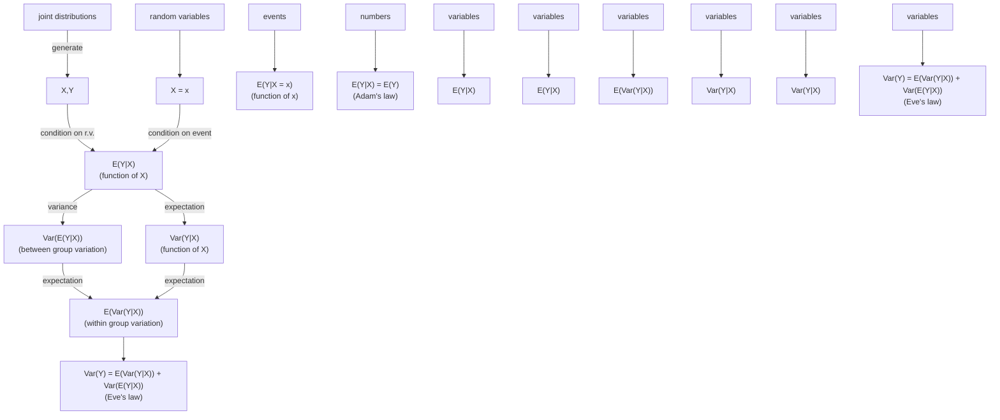

We can now also give a geometric interpretation for Adam’s law: $E ( Y )$ says to project Y in one step onto the space of all constants; $E ( E ( Y | X ) )$ says to do it in two steps, by first projecting onto the plane and then projecting $E ( Y | X )$ onto the space of all constants, which is a line within that plane. Adam’s law says that the one-step and two-step methods yield the same result.

In the next section we will introduce Eve’s law, which serves the same purpose for variance as Adam’s law does for expectation. As a preview and to further explore the geometric interpretation of conditional expectation, let’s look at $\operatorname { V a r } ( Y )$ from the perspective of this section. Assume that $E(Y)=0 (  if  E(Y) \neq 0,$ we can center $Y$ by subtracting $E ( Y )$ ; doing so has no effect on the variance of Y ).

We can decompose $Y$ into two orthogonal terms, the residual $Y - E ( Y | X )$ and the conditional expectation $E ( Y | X )$ :

$$
Y = (Y - E (Y | X)) + E (Y | X).
$$

The two terms are orthogonal since $Y - E ( Y | X )$ is uncorrelated with any function of $X$ , and $E ( Y | X )$ is a function of X. So by the Pythagorean theorem,

$$
| | Y | | ^ {2} = | | Y - E (Y | X) | | ^ {2} + | | E (Y | X) | | ^ {2}.
$$

That is,

$$
\operatorname{Var} (Y) = \operatorname{Var} (Y - E (Y | X)) + \operatorname{Var} (E (Y | X)).
$$

As we will see in the next section, this identity is a form of Eve’s law. So it turns out that Eve’s law, which may look cryptic at first glance, can be interpreted as just being the Pythagorean theorem for a “triangle” whose sides are the vectors $Y - E ( Y | X ) , E ( Y | X )$ , and $Y$

## 9.5 Conditional variance

Once we’ve defined conditional expectation given an r.v., we have a natural way to define conditional variance given a random variable: replace all instances of $E ( \cdot )$ in the definition of unconditional variance with $E ( \cdot | X )$

Definition 9.5.1 (Conditional variance). The conditional variance of Y given X is

$$
\mathrm{Var} (Y | X) = E ((Y - E (Y | X)) ^ {2} | X).
$$

This is equivalent to

$$
\mathrm{Var} (Y | X) = E (Y ^ {2} | X) - (E (Y | X)) ^ {2}.
$$

h 9.5.2. Like $E(Y|X), \operatorname{Var}(Y|X)$ is a random variable, and it is a function of $X$

Since conditional variance is defined in terms of conditional expectations, we can use results about conditional expectation to help us calculate conditional variance. Here’s an example.

Example 9.5.3. Let $Z \sim \mathcal { N } ( 0 , 1 )$ and $Y = Z ^ { 2 }$ . Find $\operatorname { V a r } ( Y | Z )$ and $\operatorname { V a r } ( Z | Y )$

Solution:

Without any calculations we can see that $\mathrm { V a r } ( Y | Z )   =   0 ;$ conditional on $Z , \; Y$ is a known constant, and the variance of a constant is 0. By the same reasoning, $\mathrm { V a r } ( h ( Z ) | Z ) = 0$ for any function $h .$

To get $\operatorname { V a r } ( Z | Y )$ , apply the definition:

$$
\mathrm{Var} (Z | Z ^ {2}) = E (Z ^ {2} | Z ^ {2}) - (E (Z | Z ^ {2})) ^ {2}.
$$

The first term equals $Z ^ { 2 }$ . The second term equals 0 by symmetry, as we found in Example 9.3.3. Thus $\mathrm { V a r } ( Z | Z ^ { 2 } ) = Z ^ { 2 }$ , which we can write as $\operatorname { V a r } ( Z | Y ) = Y$ 

In the next example, we will practice working with conditional expectation and conditional variance in the context of the Bivariate Normal.

Example 9.5.4 (Conditional expectation and conditional variance in a BVN). Let $( Z , W )$ be Bivariate Normal, with Corr $( Z , W ) = \rho$ and $Z , W$ marginally $\mathcal { N } ( 0 , 1 )$ Find $E ( W | Z )$ and $\operatorname { V a r } ( W | Z )$

Solution: We can assume that $( Z , W )$ has been constructed as in Example 7.5.10, since $E ( W | Z )$ and $\operatorname { V a r } ( W | Z )$ depend only on the joint distribution of $( Z , W )$ , not on the specific method that was used to create $( Z , W )$ . So let

$$
\begin{array}{l} Z = X \\ W = \rho X + \sqrt {1 - \rho^ {2}} Y, \\ \end{array}
$$

with $X , Y   i.i.d.  \mathcal{N}(0,1)$ . We can then solve the problem very neatly, without having to resort to messy integrals based on the Bivariate Normal joint PDF. The conditional expectation is

$$
E (W | Z) = E (W | X) = \rho X + \sqrt {1 - \rho^ {2}} E (Y | X) = \rho X + \sqrt {1 - \rho^ {2}} E (Y) = \rho Z,
$$

since X and Y are independent. And the conditional variance is

$$
\operatorname{Var} (W | Z) = \operatorname{Var} (W | X) = \operatorname{Var} (\sqrt {1 - \rho^ {2}} Y | X) = (1 - \rho^ {2}) \operatorname{Var} (Y) = 1 - \rho^ {2},
$$

since $\rho X$ acts as a constant if we are given $X$ , and Y is independent of $X$ .

Interestingly, the same argument with the roles of $Z$ and $W$ reversed shows that

$$
E (Z | W) = \rho W, \text {and} \operatorname{Var} (Z | W) = 1 - \rho^ {2}.
$$

One might have guessed that if we should multiply by $\rho$ to go from an observed value of $Z$ to a predicted value of W, then we should divide by $\rho$ to go from an observed value of $W$ to a predicted value of $Z .$ But the above results say to multiply by the same $\rho ,$ regardless of whether using $Z$ to predict $W$ or vice versa! This is closely related to the fact that correlation is symmetric $( \operatorname { C o r r } ( Z , W )   =   \rho   =   \operatorname { C o r r } ( W , Z ) )$ and to an important concept in statistics known as regression toward the mean. 

We learned in the previous section that Adam’s law relates conditional expectation to unconditional expectation. A companion result for Adam’s law is $E v e   ^ { \prime } s$ law, which relates conditional variance to unconditional variance.

Theorem 9.5.5 (Eve’s law). For any r.v.s X and $Y$ ,

$$
\mathrm{Var} (Y) = E (\mathrm{Var} (Y | X)) + \mathrm{Var} (E (Y | X)).
$$

The ordering of $E ^ { \flat } \mathrm { s }$ and $\mathrm { V a r ^ { \prime } s }$ on the right-hand side spells EVVE, whence the name Eve’s law. Eve’s law is also known as the law of total variance or the variance decomposition formula.

Proof. Let $g ( X ) = E ( Y | X )$ . By Adam’s law, $E(g(X)) = E(Y)$ . Then

$$
E (\operatorname{Var} (Y | X)) = E (E (Y ^ {2} | X) - g (X) ^ {2}) = E (Y ^ {2}) - E (g (X) ^ {2}),
$$

$$
\mathrm{Var} (E (Y | X)) = E (g (X) ^ {2}) - (E g (X)) ^ {2} = E (g (X) ^ {2}) - (E Y) ^ {2}.
$$

Adding these equations, we have Eve’s law.

To visualize Eve’s law, imagine a population where each person has a value of $X$ and a value of $Y$ . We can divide this population into subpopulations, one for each possible value of $X .$ . For example, if $X$ represents age and $Y$ represents height, we can group people based on age. Then there are two sources contributing to the variation in people’s heights in the overall population. First, within each age group, people have different heights. The average amount of variation in height within each age group is the within-group variation, $E ( \operatorname { V a r } ( Y | X ) )$ . Second, across age groups, the average heights are different. The variance of average heights across age groups is the between-group variation, $\operatorname { V a r } ( E ( Y | X ) )$ . Eve’s law says that to get the total variance of $Y ,$ we simply add these two sources of variation.

Figure 9.7 illustrates Eve’s law in the simple case where we have three age groups. The average amount of scatter within each of the groups $X   =   1 , \; X   =   2$ , and $X \; = \; 3$ is the within-group variation, $E ( \operatorname { V a r } ( Y | X ) )$ . The variance of the group means $E(Y|X=1),   E(Y|X=2)$ , and $E ( Y | X = 3 )$ is the between-group variation, $\operatorname { V a r } ( E ( Y | X ) )$

Another way to think about Eve’s law is in terms of prediction. If we wanted to predict someone’s height based on their age alone, the ideal scenario would be if everyone within an age group had exactly the same height, while different age groups had different heights. Then, given someone’s age, we would be able to predict their height perfectly. In other words, the ideal scenario for prediction is $n o$ within-group


<details>
<summary>natural_image</summary>

Simple diagram of black dots arranged inside an oval outline (no text or symbols)
</details>

X = 1


<details>
<summary>natural_image</summary>

Simple diagram of black dots arranged inside an oval boundary (no text or symbols)
</details>

X = 2


<details>
<summary>natural_image</summary>

Simple diagram of black dots arranged inside an oval outline (no text or symbols)
</details>

X = 3

## FIGURE 9.7

Eve’s law says that total variance is the sum of within-group and between-group variation.

variation in height, since the within-group variation cannot be explained by age differences. For this reason, within-group variation is also called unexplained variation, and between-group variation is also called explained variation. Eve’s law says that the overall variance of Y is the sum of unexplained and explained variation.

We can also write Eve’s law in the form

$$
\mathrm{Var} (Y) = \mathrm{Var} (Y - E (Y | X)) + \mathrm{Var} (E (Y | X)),
$$

since, letting W be the residual $Y - E ( Y | X )$

$$
\mathrm{Var} (Y - E (Y | X)) = E (W ^ {2}) = E (E (W ^ {2} | X)) = E (\mathrm{Var} (Y | X)).
$$

Again this says that we can decompose variance into within-group variation plus between-group variation.

h 9.5.6. Let Y be an r.v. and A be an event. It is wrong to say $\operatorname { { } ^ { \operatorname { { \mathcal { C } } } } V a r } ( Y ) \; = \;$ $\mathrm { V a r } ( Y | A ) P ( A ) + \mathrm { V a r } ( Y | A ^ { c } ) P ( A ^ { c } )$ , even though this looks analogous to the law of total expectation. (For a simple counterexample, let $Y \sim \mathrm { B e r n } ( 1 / 2 )$ and A be the event $Y = 0$ . Then $\operatorname { V a r } ( Y | A )$ and $\operatorname { V a r } ( Y | A ^ { c } )$ are both 0, but $\operatorname { V a r } ( Y ) = 1 / 4 . )$

Instead, we should use Eve’s law if we want to condition on whether or not A occurred: letting I be the indicator of A,

$$
\mathrm{Var} (Y) = E (\mathrm{Var} (Y | I)) + \mathrm{Var} (E (Y | I)).
$$

To see how this expression relates to the “wrong expression”, let

$$
p = P (A), q = P (A ^ {c}), a = E (Y | A), b = E (Y | A ^ {c}), v = \operatorname{Var} (Y | A), w = \operatorname{Var} (Y | A ^ {c}).
$$

Then $E ( Y | I )$ is a with probability p and b with probability q, and $\operatorname { V a r } ( Y | I )$ is v with probability p and w with probability q. So

$$
E (\operatorname{Var} (Y | I)) = v p + w q = \operatorname{Var} (Y | A) P (A) + \operatorname{Var} (Y | A ^ {c}) P (A ^ {c}),
$$

which is exactly the “wrong expression”, and Var(Y ) consists of this plus the term

$$
\mathrm{Var} (E (Y | I)) = a ^ {2} p + b ^ {2} q - (a p + b q) ^ {2}.
$$

It is crucial to account for both within-group and between-group variation.

## 9.6 Adam and Eve examples

We conclude this chapter with several examples showing how Adam’s law and Eve’s law allow us to find the mean and variance of complicated r.v.s, especially in situations that involve multiple levels of randomness.

In our first example, the r.v. of interest is a random sum: the sum of a random number of random variables. There are thus two levels of randomness: first, each term in the sum is a random variable; second, the number of terms in the sum is also a random variable.

Example 9.6.1 (Random sum). A store receives N customers in a day, where N is an r.v. with finite mean and variance. Let $X _ { j }$ be the amount spent by the jth customer at the store. Assume that each $X _ { j }$ has mean $\mu$ and variance $\sigma ^ { 2 }$ , and that N and all the $X _ { j }$ are independent of one another. Find the mean and variance of the random sum $\begin{array} { r } { \tilde { X } = \sum _ { j = 1 } ^ { N } X _ { j } } \end{array}$ , which is the store’s total revenue in a day, in terms of $\mu ,   \sigma ^ { 2 } ,   E ( N )$ , and Var(N).

## Solution:

Since X is a sum, our first impulse might be to claim ${ } ^ { \propto } E ( X ) = N \mu$ by linearity”. Alas, this would be a category error, since $E ( X )$ is a number and $N \mu$ is a random variable. The key is that X is not merely a sum, but a random sum; the number of terms we are adding up is itself random, whereas linearity applies to sums with a fixed number of terms.

Yet this category error actually suggests the correct strategy: if only we were allowed to treat N as a constant, then linearity would apply. So let’s condition on N. By linearity of conditional expectation,

$$
E (X | N) = E \left(\sum_ {j = 1} ^ {N} X _ {j} | N\right) = \sum_ {j = 1} ^ {N} E (X _ {j} | N) = \sum_ {j = 1} ^ {N} E (X _ {j}) = N \mu .
$$

We used the independence of the $X _ { j }$ and N to assert $E ( X _ { j } | N )   =   E ( X _ { j } )$ for all $j .$ . Note that the statement ${ } ^ { \backprime \backprime } E ( X | N ) = N \mu$ is not a category error because both sides of the equality are r.v.s that are functions of N. Finally, by Adam’s law,

$$
E (X) = E (E (X | N)) = E (N \mu) = \mu E (N).
$$

This is a pleasing result: the average total revenue is the average amount spent per customer, multiplied by the average number of customers.

For $\operatorname { V a r } ( X )$ , we again condition on N to get $\operatorname { V a r } ( X | N )$

$$
\operatorname{Var} (X | N) = \operatorname{Var} \left(\sum_ {j = 1} ^ {N} X _ {j} | N\right) = \sum_ {j = 1} ^ {N} \operatorname{Var} (X _ {j} | N) = \sum_ {j = 1} ^ {N} \operatorname{Var} (X _ {j}) = N \sigma^ {2}.
$$

Eve’s law then tells us how to obtain the unconditional variance of $X$ :

$$
\begin{array}{l} \mathrm{Var} (X) = E (\mathrm{Var} (X | N)) + \mathrm{Var} (E (X | N)) \\ = E (N \sigma^ {2}) + \mathrm{Var} (N \mu) \\ = \sigma^ {2} E (N) + \mu^ {2} \mathrm{Var} (N). \\ \end{array}
$$

In the next example, two levels of randomness arise because our experiment takes place in two stages. We sample a city from a group of cities, then sample citizens within the city. This is an example of a multilevel model.

Example 9.6.2 (Random sample from a random city). To study the prevalence of a disease in several cities of interest within a certain county, we pick a city at random, then pick a random sample of n people from that city. This is a form of a widely used survey technique known as cluster sampling.

Let $Q$ be the proportion of diseased people in the chosen city, and let X be the number of diseased people in the sample. As illustrated in Figure 9.8 (where white dots represent healthy individuals and black dots represent diseased individuals), different cities may have very different prevalences. Since each city has its own disease prevalence, $Q$ is a random variable. Suppose that $Q \; \sim \; \mathrm { U n i f } ( 0 , 1 )$ . Also assume that conditional on $Q ,$ each individual in the sample independently has probability $Q$ of having the disease; this is true if we sample with replacement from the chosen city, and is approximately true if we sample without replacement but the population size is large. Find $E ( X )$ and Var(X).


<details>
<summary>natural_image</summary>

Diagram showing four quadrants with shaded regions containing black and white dots, no text or symbols present
</details>

## FIGURE 9.8

A certain oval-shaped county has 4 cities. Each city has healthy people (represented as white dots) and diseased people (represented as black dots). A random city is chosen, and then a random sample of n people is chosen from within that city. There are two components to the variability in the number of diseased people in the sample: variation due to different cities having different disease prevalence, and variation due to the randomness of the sample within the chosen city.

## Solution:

With our assumptions, $X | Q   \sim   \mathrm { B i n } ( n , Q )$ ; this notation says that conditional on knowing the disease prevalence in the chosen city, we can treat Q as a constant, and each sampled individual is an independent Bernoulli trial with probability Q of success. Using the mean and variance of the Binomial distribution, $E ( X | Q ) = n Q$ and $\mathrm { V a r } ( X | Q ) \; = \; n Q ( 1   -   Q )$ . Furthermore, using the moments of the standard Uniform distribution, $E(Q)=1/2,   E(Q^2)=1/3$ , and $\operatorname { V a r } ( Q ) = 1 / 1 2$ . Now we can apply Adam’s law and Eve’s law to get the unconditional mean and variance of $X$

$$
E (X) = E (E (X | Q)) = E (n Q) = \frac {n}{2},
$$

$$
\begin{array}{l} \operatorname{Var} (X) = E (\operatorname{Var} (X | Q)) + \operatorname{Var} (E (X | Q)) \\ = E (n Q (1 - Q)) + \operatorname{Var} (n Q) \\ = n E (Q) - n E (Q ^ {2}) + n ^ {2} \mathrm{Var} (Q) \\ = \frac {n}{6} + \frac {n ^ {2}}{1 2}. \\ \end{array}
$$

Note that the structure of this problem is identical to that in the story of Bayes billiards. Therefore, we actually know the distribution of $X$ , not just its mean and variance: X is Discrete Uniform on $\{ 0 , 1 , 2 , \ldots , n \}$ . But the Adam-and-Eve approach can be applied when $Q$ has a more complicated distribution, or with more levels in the multilevel model, whether or not it is feasible to work out the distribution of X. For example, we could have people within cities within counties within states within countries. 

Last but not least, we revisit Story 8.4.5, the Gamma-Poisson problem from the previous chapter.

Example 9.6.3 (Gamma-Poisson revisited). Recall that Fred decided to find out about the rate of Blotchville’s Poisson process of buses by waiting at the bus stop for t hours and counting the number of buses $Y$ . He then used the data to update his prior distribution $\lambda \sim \mathrm { G a m m a } ( r _ { 0 } , b _ { 0 } )$ . Thus, Fred was using the two-level model

$$
\lambda \sim \operatorname{Gamma} (r _ {0}, b _ {0})
$$

$$
Y | \lambda \sim \operatorname{Pois} (\lambda t).
$$

We found that under Fred’s model, the marginal distribution of Y is Negative Binomial with parameters $r = r _ { 0 }$ and $p = b _ { 0 } / ( b _ { 0 } + t )$ . In particular,

$$
E (Y) = \frac {r q}{p} = \frac {r _ {0} t}{b _ {0}},
$$

$$
\mathrm{Var} (Y) = \frac {r q}{p ^ {2}} = \frac {r _ {0} t (b _ {0} + t)}{b _ {0} ^ {2}}.
$$

Let’s independently verify this with Adam’s law and Eve’s law. Using results about the Poisson distribution, the conditional mean and variance of $Y$ given λ are $E ( Y | \lambda )   =   \mathrm { V a r } ( Y | \lambda )   =   \lambda t$ . Using results about the Gamma distribution, the marginal mean and variance of λ are $E ( \lambda ) = r _ { 0 } / b _ { 0 }$ and $\mathrm { V a r } ( \lambda ) = r _ { 0 } / b _ { 0 } ^ { 2 }$ . For Adam and Eve, this is all that is required:

$$
\begin{array}{l} E (Y) = E (E (Y | \lambda)) = E (\lambda t) = \frac {r _ {0} t}{b _ {0}}, \\ \operatorname{Var} (Y) = E (\operatorname{Var} (Y | \lambda)) + \operatorname{Var} (E (Y | \lambda)) \\ = E (\lambda t) + \operatorname{Var} (\lambda t) \\ = \frac {r _ {0} t}{b _ {0}} + \frac {r _ {0} t ^ {2}}{b _ {0} ^ {2}} = \frac {r _ {0} t (b _ {0} + t)}{b _ {0} ^ {2}}, \\ \end{array}
$$

which is consistent with our earlier answers. The difference is that when using Adam and Eve, we don’t need to know that Y is Negative Binomial! If we had been too lazy to derive the marginal distribution of Y , or if we weren’t so lucky as to have a named distribution for Y , Adam and Eve would still deliver the mean and variance of $Y$ (though not the PMF).

Lastly, let’s compare the mean and variance of Y under the two-level model to the mean and variance we would get if Fred were absolutely sure of the true value of λ. In other words, suppose we replaced λ by its mean, $E ( \lambda )   =   r _ { 0 } / b _ { 0 }$ , making λ a constant instead of an r.v. Then the marginal distribution of the number of buses (which we’ll call $\tilde { Y }$ under the new assumptions) would just be Poisson with parameter $r _ { 0 } t / b _ { 0 }$ . Then we would have

$$
E (\tilde {Y}) = \frac {r _ {0} t}{b _ {0}},
$$

$$
\mathrm{Var} (\tilde {Y}) = \frac {r _ {0} t}{b _ {0}}.
$$

Notice that $E ( \tilde { Y } ) = E ( Y )$ , but $\mathrm { V a r } ( \tilde { Y } ) < \mathrm { V a r } ( Y )$ : the extra term $r _ { 0 } t ^ { 2 } / b _ { 0 } ^ { 2 }$ <sup>from</sup> Eve’s law is missing. Intuitively, when we fix λ at its mean, we are eliminating a level of uncertainty in the model, and this causes a reduction in the unconditional variance.

Figure 9.9 overlays the plots of two PMFs, that of $Y \sim \mathrm { N B i n } ( r _ { 0 } , b _ { 0 } / ( b _ { 0 }   +   t ) )$ in gray and that of $\tilde { Y } \sim \operatorname { P o i s } ( r _ { 0 } t / b _ { 0 } )$ in black. The values of the parameters are arbitrarily chosen to be $r _ { 0 } = 5 ,   b _ { 0 } = 1 ,   t = 2$ . These two PMFs have the same center of mass, but the PMF of Y is noticeably more dispersed. 

## 9.7 Recap

To calculate an unconditional expectation, we can divide up the sample space and use the law of total expectation

$$
E (Y) = \sum_ {i = 1} ^ {n} E (Y | A _ {i}) P (A _ {i}),
$$


<details>
<summary>scatter</summary>

| x | Black Series (PMF) | Grey Series (PMF) |
|---|---|---|
| 0 | ~0.005 | ~0.005 |
| 1 | ~0.002 | ~0.015 |
| 2 | ~0.003 | ~0.028 |
| 3 | ~0.008 | ~0.042 |
| 4 | ~0.018 | ~0.056 |
| 5 | ~0.038 | ~0.068 |
| 6 | ~0.062 | ~0.075 |
| 7 | ~0.090 | ~0.078 |
| 8 | ~0.112 | ~0.078 |
| 9 | ~0.125 | ~0.075 |
| 10 | ~0.125 | ~0.072 |
| 11 | ~0.112 | ~0.065 |
| 12 | ~0.095 | ~0.058 |
| 13 | ~0.072 | ~0.050 |
| 14 | ~0.052 | ~0.042 |
| 15 | ~0.035 | ~0.035 |
| 16 | ~0.022 | ~0.030 |
| 17 | ~0.012 | ~0.025 |
| 18 | ~0.008 | ~0.020 |
| 19 | ~0.005 | ~0.015 |
| 20 | ~0.003 | ~0.012 |
</details>

## FIGURE 9.9

PMF of $Y   \sim   \mathrm { N B i n } ( r _ { 0 } , b _ { 0 } / ( b _ { 0 } + t ) )$ in gray and $\tilde { Y }   \sim   \mathrm { P o i s } ( r _ { 0 } t / b _ { 0 } )$ in black, where $r _ { 0 } = 5 ,   b _ { 0 } = 1 ,   t = 2$

but we must be careful not to destroy information in subsequent steps (such as by forgetting in the midst of a long calculation to condition on something that needs to be conditioned on). In problems with a recursive structure, we can also use first-step analysis for expectations.

The conditional expectation $E ( Y | X )$ and conditional variance $\operatorname { V a r } ( Y | X )$ are random variables that are functions of $X ;$ they are obtained by treating X as if it were a known constant. If X and $Y$ are independent, then $E ( Y | X )   =   E ( Y )$ and $\operatorname { V a r } ( Y | X ) = \operatorname { V a r } ( Y )$ . Conditional expectation has the properties

$$
E (h (X) Y | X) = h (X) E (Y | X)
$$

$$
E (Y _ {1} + Y _ {2} | X) = E (Y _ {1} | X) + E (Y _ {2} | X),
$$

analogous to the properties $E ( c Y ) = c E ( Y )$ and $E(Y_{1} + Y_{2}) = E(Y_{1}) + E(Y_{2})$ for unconditional expectation. The conditional expectation $E ( Y | X )$ is also the random variable that makes the residual $Y - E ( Y | X )$ uncorrelated with any function of $X$ which means we can interpret it geometrically as a projection.

Finally, Adam’s law and Eve’s law,

$$
E (Y) = E (E (Y | X))
$$

$$
\operatorname{Var} (Y) = E (\operatorname{Var} (Y | X)) + \operatorname{Var} (E (Y | X)),
$$

often help us calculate $E ( Y )$ and $\operatorname { V a r } ( Y )$ in problems that feature multiple forms or levels of randomness.

Figure 9.10 illustrates how the number $E ( Y | X = x )$ connects with the r.v. $E ( Y | X )$ whose expectation is $E ( Y )$ by Adam’s law. Additionally, it shows how the ingredients in Eve’s law are formed and come together to give a useful decomposition of $\operatorname { V a r } ( Y )$ in terms of quantities that condition on $X$


<details>
<summary>flowchart</summary>


</details>

FIGURE 9.10

We often observe an r.v. X and want to predict another r.v. Y based on the information about X. If we observe that $X = x ,$ then we can condition on that event and use $E ( Y | X = x )$ as our prediction. The conditional expectation $E ( Y | X )$ is the r.v. that takes the value $E ( Y | X = x )$ when $X = x$ . Adam’s law lets us compute the unconditional expectation $E ( Y )$ by starting with the conditional expectation $E ( Y | X )$ . Similarly, Eve’s law lets us compute $\operatorname { V a r } ( Y )$ in terms of quantities that condition on $X$

## 9.8 R

## Mystery prize simulation

We can use simulation to show that in Example 9.1.7, the example of bidding on a mystery prize with unknown value, any bid will lead to a negative payout on average. First choose a bid b (we chose 0.6); then simulate a large number of hypothetical mystery prizes and store them in v:

$$
b <   - 0. 6
$$

```txt
nsim <- 10^5
v <- runif(nsim)
```

The bid is accepted if b > (2/3)\*v. To get the average profit conditional on an accepted bid, we use square brackets to keep only those values of v satisfying the condition:

```txt
mean(v[b > (2/3)*v]) - b
```

This value is negative regardless of b, as you can check by experimenting with different values of b.

## Time until HH vs. HT

To verify the results of Example 9.1.9, we can start by generating a long sequence of fair coin tosses. This is done with the sample command. We use paste with the collapse="" argument to turn these tosses into a single string of H’s and T’s:

```txt
paste(sample(c("H","T"),100,replace=TRUE),collapse="")
```

A sequence of length 100 is enough to virtually guarantee that both HH and HT will have appeared at least once.

To determine how many tosses are required on average to see HH and HT, we need to generate many sequences of coin tosses. For this, we use our familiar friend replicate:

```txt
r <- replicate(10^3,paste(sample(c("H","T"),100,replace=T),
            collapse=""))
```

Now r contains a thousand sequences of coin tosses, each of length 100. To find the first appearance of HH in each of these sequences, you can use the str\_locate command from the stringr package. After you’ve installed and loaded the package,

```r
t <- str_locate(r,"HH")
```

creates a two-column table t, whose columns contain the starting and ending positions of the first appearance of HH in each sequence of coin tosses. (Use head(t) to display the first few rows of the table and get an idea of what your results look like.) What we want are the ending positions, given by the second column. In particular, we want the average value of the second column, which is an approximation of the average waiting time for HH :

```txt
mean(t[,2])
```

Is your answer around 6? Trying again with "HT" instead of "HH", is your answer around 4?

## Linear regression

In Example 9.3.10, we derived formulas for the slope and intercept of a linear regression model, which can be used to predict a response variable using an explanatory variable. Let’s try to apply these formulas to a simulated dataset:

```txt
x <- rnorm(100)
y <- 3 + 5*x + rnorm(100)
```

The vector x contains 100 realizations of the random variable $X \sim \mathcal { N } ( 0 , 1 )$ , and the vector y contains 100 realizations of the random variable $Y = a + b X + \epsilon$ where $\epsilon \sim \mathcal { N } ( 0 , 1 )$ . As we can see, the true values of a and b for this dataset are 3 and 5, respectively. We can visualize the data as a scatterplot with plot(x,y).

Now let’s see if we can get good estimates of the true a and b, using the formulas in Example 9.3.10:

```r
b <- cov(x,y) / var(x)
a <- mean(y) - b*mean(x)
```

Here cov(x,y), var(x), and mean(x) provide the sample covariance, sample variance, and sample mean, estimating the quantities Cov(X, Y ), Var(X), and E(X), respectively. (We have discussed sample mean and sample variance in detail in earlier chapters. Sample covariance is defined analogously, and is a natural way to estimate the true covariance.)

You should find that b is close to 5 and a is close to 3. These estimated values define the line of best fit. The abline command lets us plot the line of best fit on top of our scatterplot:

```txt
plot(x,y)
abline(a=a,b=b)
```

The first argument to abline is the intercept of the line, and the second argument is the slope.

## 9.9 Exercises

Exercises marked with s have detailed solutions at [http://stat110.net](http://stat110.net).

## Conditional expectation given an event

1. Fred wants to travel from Blotchville to Blissville, and is deciding between 3 options (involving different routes or different forms of transportation). The jth option would take an average of $\mu _ { j }$ hours, with a standard deviation of $\sigma _ { j }$ hours. Fred randomly chooses between the 3 options, with equal probabilities. Let T be how long it takes for him to get from Blotchville to Blissville.

(a) Find $E ( T )$ . Is it simply $( \mu _ { 1 } + \mu _ { 2 } + \mu _ { 3 } ) / 3$ , the average of the expectations?
(b) Find $\operatorname { V a r } ( T )$ . Is it simply $( \sigma _ { 1 } ^ { 2 } + \sigma _ { 2 } ^ { 2 } + \sigma _ { 3 } ^ { 2 } ) / 3$ the average of the variances?

2. While Fred is sleeping one night, X legitimate emails and Y spam emails are sent to him. Suppose that X and Y are independent, with $X   \sim   \mathrm { P o i s ( 1 0 ) }$ and $Y   \sim   \mathrm { P o i s ( 4 0 ) }$ When he wakes up, he observes that he has 30 new emails in his inbox. Given this information, what is the expected value of how many new legitimate emails he has?

3. A group of 21 women and 14 men are enrolled in a medical study. Each of them has a certain disease with probability p, independently. It is then found (through extremely reliable testing) that exactly 5 of the people have the disease. Given this information, what is the expected number of women who have the disease?

4. A researcher studying crime is interested in how often people have gotten arrested. Let $X \sim  Pois (\lambda)$ be the number of times that a random person got arrested in the last 10 years. However, data from police records are being used for the researcher’s study, and people who were never arrested in the last 10 years do not appear in the records. In other words, the police records have a selection bias: they only contain information on people who have been arrested in the last 10 years.

So averaging the numbers of arrests for people in the police records does not directly estimate $E ( X )$ ; it makes more sense to think of the police records as giving us information about the conditional distribution of how many times a person was arrest, given that the person was arrested at least once in the last 10 years. The conditional distribution of X, given that $X \geq 1$ , is called a truncated Poisson distribution (see Exercise 14 from Chapter 3 for another example of this distribution).

(a) Find $E ( X | X \geq 1 )$
(b) Find $\operatorname { V a r } ( X | X \geq 1 )$

5. A fair 20-sided die is rolled repeatedly, until a gambler decides to stop. The gambler pays \$1 per roll, and receives the amount shown on the die when the gambler stops (e.g., if the die is rolled 7 times and the gambler decides to stop then, with an 18 as the value of the last roll, then the net payoff is $\S 18-\S 7=\S 11)$ . Suppose the gambler uses the following strategy: keep rolling until a value of m or greater is obtained, and then stop (where m is a fixed integer between 1 and 20).

(a) What is the expected net payoff?

Hint: The average of consecutive integers $a , a + 1 , \ldots , a + n$ is the same as the average of the first and last of these. See the math appendix for more information about series.

(b) Use R or other software to find the optimal value of m.

6. Let $X \sim \operatorname{Expo}(\lambda)$ . Find $E ( X | X < 1 )$ in two different ways:

(a) by calculus, working with the conditional PDF of X given $X < 1$
(b) without calculus, by expanding E(X) using the law of total expectation.

7. You are given an opportunity to bid on a mystery box containing a mystery prize! The value of the prize is completely unknown, except that it is worth at least nothing, and at most a million dollars. So the true value V of the prize is considered to be Uniform on [0,1] (measured in millions of dollars).

You can choose to bid any nonnegative amount b (in millions of dollars). If $\begin{array} { r } { b < \frac { 1 } { 4 } V } \end{array}$ , then your bid is rejected and nothing is gained or lost. If $\begin{array} { r } { b \geq \frac { 1 } { 4 } V } \end{array}$ , then your bid is accepted and your net payoff is $V - b$ (since you pay b to get a prize worth V ).

Find your expected payoff as a function of b (be sure to specify it for all $b \geq 0 )$ . Then find the optimal bid $b ,$ to maximize your expected payoff.

8. s You get to choose between two envelopes, each of which contains a check for some positive amount of money. Unlike in the two-envelope paradox, it is not given that one envelope contains twice as much money as the other envelope. Instead, assume that the two values were generated independently from some distribution on the positive real numbers, with no information given about what that distribution is.

After picking an envelope, you can open it and see how much money is inside (call this value x), and then you have the option of switching. As no information has been given about the distribution, it may seem impossible to have better than a 50% chance of picking the better envelope. Intuitively, we may want to switch if x is “small” and not switch if x is “large”, but how do we define “small” and “large” in the grand scheme of all possible distributions? [The last sentence was a rhetorical question.]

Consider the following strategy for deciding whether to switch. Generate a threshold T ∼ Expo(1), and switch envelopes if and only if the observed value x is less than the value of T. Show that this strategy succeeds in picking the envelope with more money with probability strictly greater than $1 / 2 .$

Hint: Let t be the value of $T$ (generated by a random draw from the Expo(1) distribution). First explain why the strategy works very well if t happens to be in between the two envelope values, and does no harm in any case $( \mathrm { i . e . }$ , there is no case in which the strategy succeeds with probability strictly less than $1 / 2 )$

9. There are two envelopes, each of which has a check for a Unif(0, 1) amount of money, measured in thousands of dollars. The amounts in the two envelopes are independent. You get to choose an envelope and open it, and then you can either keep that amount or switch to the other envelope and get whatever amount is in that envelope.

Suppose that you use the following strategy: choose an envelope and open it. If you observe $U ,$ then stick with that envelope with probability $U ,$ and switch to the other envelope with probability $1 - U$

(a) Find the probability that you get the larger of the two amounts.
(b) Find the expected value of what you will receive.

10. Suppose n people are bidding on a mystery prize that is up for auction. The bids are to be submitted in secret, and the individual who submits the highest bid wins the prize. The ith bidder receives a signal $X _ { i } ,$ with $X _ { 1 } , \ldots , X _ { n }$ i.i.d. The value of the prize, $V ,$ is defined to be the sum of the individual bidders’ signals:

$$
V = X _ {1} + \dots + X _ {n}.
$$

This is known in economics as the wallet game: we can imagine that the n people are bidding on the total amount of money in their wallets, and each person’s signal is the amount of money in their own wallet. Of course, the wallet is a metaphor; the game can also be used to model company takeovers, where each of two companies bids to take over the other, and a company knows its own value but not the value of the other company.

For this problem, assume the $X _ { i }$ are i.i.d. Unif(0, 1).

(a) Before receiving her signal, what is bidder 1’s unconditional expectation for $V ?$
(b) Conditional on receiving the signal $X _ { 1 } = x _ { 1 }$ , what is bidder 1’s expectation for V ?
(c) Suppose each bidder submits a bid equal to their conditional expectation for V , i.e., bidder i bids $E ( V | X _ { i } = x _ { i } )$ . Conditional on receiving the signal $X _ { 1 } = x _ { 1 }$ and winning the auction, what is bidder 1’s expectation for V ? Explain intuitively why this quantity is always less than the quantity calculated in (b).

11. s A coin with probability p of Heads is flipped repeatedly. For (a) and (b), suppose that p is a known constant, with $0 < p < 1$

(a) What is the expected number of flips until the pattern HT is observed?

(b) What is the expected number of flips until the pattern HH is observed?

(c) Now suppose that p is unknown, and that we use a $\mathrm { B e t a } ( a , b )$ prior to reflect our uncertainty about $p$ (where a and b are known constants and are greater than 2). In terms of a and b, find the corresponding answers to (a) and (b) in this setting.

12. A coin with probability p of Heads is flipped repeatedly, where $0   <   p   <   1$ . The sequence of outcomes can be divided into runs (blocks of $H ^ { \flat } \mathrm { s }$ or blocks of $T ^ { \mathrm { { , } } } \mathrm { { s ) , e . g . } }$ HHHT T T T HT T T HH becomes $\boxed { H H H } \boxed { T T T T } \boxed { H } \boxed { T T T } \boxed { H H } .$ which has 5 runs, with lengths 3, 4, 1, 3, 2, respectively. Assume that the coin is flipped at least until the start of the third run.

(a) Find the expected length of the first run.

(b) Find the expected length of the second run.

13. A fair 6-sided die is rolled once. Find the expected number of additional rolls needed to obtain a value at least as large as that of the first roll.

14. A fair 6-sided die is rolled repeatedly.

(a) Find the expected number of rolls needed to get a 1 followed right away by a 2.

Hint: Start by conditioning on whether or not the first roll is a 1.

(b) Find the expected number of rolls needed to get two consecutive 1’s.

(c) Let $a _ { n }$ be the expected number of rolls needed to get the same value n times in a row $( \mathrm { i . e . } ,$ to obtain a streak of n consecutive $j ^ { \prime } \mathrm { s }$ for some not-specified-in-advance value of $j )$ . Find a recursive formula for $a _ { n + 1 }$ in terms of $a _ { n }$

Hint: Divide the time until there are $n + 1$ consecutive appearances of the same value into two pieces: the time until there are n consecutive appearances, and the rest.

(d) Find a simple, explicit formula for $a _ { n }$ for all $n \geq 1$ . What is $a _ { 7 }$ (numerically)?

## Conditional expectation given a random variable

15. s Let $X _ { 1 } , X _ { 2 }$ be i.i.d., and let $\bar { X } = \textstyle { \frac { 1 } { 2 } } ( X _ { 1 } + X _ { 2 } )$ be the sample mean. In many statistics problems, it is useful or important to obtain a conditional expectation given $\bar { X }$ . As an example of this, find $E ( w _ { 1 } X _ { 1 } + w _ { 2 } X _ { 2 } | \bar { X } )$ , where $w _ { 1 } , w _ { 2 }$ are constants with $w _ { 1 }   +   w _ { 2 } = 1$

16. Let $X _ { 1 } , X _ { 2 } , \ldots$ be i.i.d. r.v.s with mean 0, and let $S _ { n } = X _ { 1 } + \cdots + X _ { n }$ . As shown in Example 9.3.6, the expected value of the first term given the sum of the first n terms is

$$
E (X _ {1} | S _ {n}) = \frac {S _ {n}}{n}.
$$

Generalize this result by finding $E ( S _ { k } | S _ { n } )$ for all positive integers k and $n .$

17. s Consider a group of n roommate pairs at a college (so there are $2 n$ students). Each of these 2n students independently decides randomly whether to take a certain course, with probability p of success (where “success” is defined as taking the course).

Let N be the number of students among these 2n who take the course, and let X be the number of roommate pairs where both roommates in the pair take the course. Find $E ( X )$ and $E ( X | N )$ .

18. s Show that $E ( ( Y - E ( Y | X ) ) ^ { 2 } | X ) = E ( Y ^ { 2 } | X ) - ( E ( Y | X ) ) ^ { 2 }$ , so these two expressions for $\operatorname { V a r } ( Y | X )$ agree.

Hint for the variance: Adding a constant (or something acting as a constant) does not affect variance.

19. Let X be the height of a randomly chosen adult man, and Y be his father’s height, where X and Y have been standardized to have mean 0 and standard deviation 1. Suppose that $( X , Y )$ is Bivariate Normal, with $X , Y \sim \mathcal { N } ( 0 , 1 )$ and $\operatorname { C o r r } ( X , Y ) = \rho .$

(a) Let $y   =   a x + b$ be the equation of the best line for predicting Y from X (in the sense of minimizing the mean squared error), e.g., if we were to observe $X = 1 . 3$ then we would predict that Y is $1 . 3 a + b .$ Now suppose that we want to use Y to predict X, rather than using X to predict Y . Give and explain an intuitive guess for what the slope is of the best line for predicting X from Y .

(b) Find a constant c (in terms of $\rho )$ and an r.v. V such that $Y = c X + V$ , with V independent of X.

Hint: Start by finding c such that $\mathrm{Cov}(X,Y-cX)=0.$

(c) Find a constant d (in terms of $\rho )$ and an r.v. W such that $X = d Y + W$ , with W independent of Y .

(d) Find $E ( Y | X )$ and $E ( X | Y )$

(e) Reconcile (a) and (d), if your intuitive guess in (a) differed from what the results of (d) implied. Give a clear and correct intuitive explanation of the relationship between the slope of the best line for predicting Y from X and the slope of the best line for predicting X from Y .

20. Let $\mathbf { X } \sim \operatorname { M u l t } _ { 5 } ( n , \mathbf { p } )$

(a) Find $E ( X _ { 1 } | X _ { 2 } )$ and $\operatorname { V a r } ( X _ { 1 } | X _ { 2 } )$

(b) Find $E ( X _ { 1 } | X _ { 2 } + X _ { 3 } )$

21. Let Y be a discrete r.v., A be an event with $0   <   P(A)   <   1$ , and $I _ { A }$ be the indicator r.v. for A.

(a) Explain precisely how the r.v. $E ( Y | I _ { A } )$ relates to the numbers $E ( Y | A )$ and $E ( Y | A ^ { c } )$

(b) Show that $E(Y|A)=E(YI_{A})/P(A)$ , directly from the definitions of expectation and conditional expectation.

Hint: Let $X = Y I _ { A }$ , and then find an expression for the PMF of X.

(c) Use (b) to give a short proof of the fact that $E ( Y ) = E ( Y | A ) P ( A ) + E ( Y | A ^ { c } ) P ( A ^ { c } )$

22. Show that the following version of LOTP, which we encountered in Section 7.1, is also a consequence of Adam’s law: for any event A and continuous r.v. X with PDF $f _ { X }$

$$
P (A) = \int_ {- \infty} ^ {\infty} P (A | X = x) f _ {X} (x) d x.
$$

Hint: Consider $E ( I ( A ) | X = x )$

23. s Let X and Y be random variables with finite variances, and let $W = Y - E ( Y | X )$ This is a residual: the difference between the true value of Y and the predicted value of Y based on X.

(a) Compute E(W) and $E ( W | X )$

(b) Compute $\operatorname { V a r } ( W )$ , for the case that $W | X \sim \mathcal { N } ( 0 , X ^ { 2 } )$ with $X \sim \mathcal { N } ( 0 , 1 )$