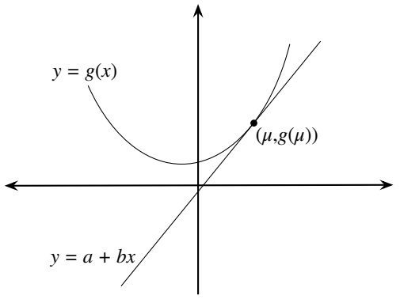

24. $\textcircled{s}$ One of two identical-looking coins is picked from a hat randomly, where one coin has probability $p _ { 1 }$ of Heads and the other has probability $p _ { 2 }$ of Heads. Let X be the number of Heads after flipping the chosen coin n times. Find the mean and variance of $X$

25. Kelly makes a series of n bets, each of which she has probability $p$ of winning, independently. Initially, she has $x _ { 0 }$ dollars. Let $X _ { j }$ be the amount she has immediately after her jth bet is settled. Let $f$ be a constant in $( 0 , 1 )$ , called the betting fraction. On each bet, Kelly wagers a fraction $f$ of her wealth, and then she either wins or loses that amount. For example, if her current wealth is \$100 and $f = 0 . 2 5$ , then she bets \$25 and either gains or loses that amount. (A famous choice when $p   >   1 / 2$ is $f   =   2 p - 1$ , which is known as the Kelly criterion.) Find $E ( X _ { n } )$ (in terms of $n , p , f , x _ { 0 } )$

Hint: First find $E ( X _ { j + 1 } | X _ { j } )$

26. Let $N   \sim   \mathrm { P o i s } ( \lambda _ { \mathrm { 1 } } )$ be the number of movies that will be released next year. Suppose that for each movie the number of tickets sold is $\mathrm { P o i s } ( \lambda _ { 2 } )$ , independent of other movies and of N. Find the mean and variance of the number of movie tickets that will be sold next year.

27. A party is being held from 8:00 pm to midnight on a certain night, and $N \sim  Pois (\lambda)$ people are going to show up. They will all arrive at uniformly random times while the party is going on, independently of each other and of $N .$

(a) Find the expected time at which the first person arrives, given that at least one person shows up. Give both an exact answer in terms of $\lambda ,$ measured in minutes after 8:00 pm, and an answer rounded to the nearest minute for $\lambda = 2 0$ , expressed in time notation (e.g., 8:20 pm).

(b) Find the expected time at which the last person arrives, given that at least one person shows up. As in (a), give both an exact answer and an answer rounded to the nearest minute for $\lambda = 2 0$

28. $\textcircled{8}$ We wish to estimate an unknown parameter θ, based on an r.v. X we will get to observe. As in the Bayesian perspective, assume that X and θ have a joint distribution. Let $\hat { \theta }$ be the estimator (which is a function of X). Then $\hat { \theta }$ is said to be unbiased if $E ( { \hat { \theta } } | \theta ) = \theta$ , and $\hat { \theta }$ is said to be the Bayes procedure if $E ( \theta | X ) = { \hat { \theta } }$

(a) Let $\hat { \theta }$ be unbiased. Find $E ( \hat { \theta } \mathrm { ~ - ~ } \theta ) ^ { 2 }$ (the average squared difference between the estimator and the true value of $\theta )$ , in terms of marginal moments of $\hat { \theta }$ and $\theta .$

Hint: Condition on $\theta .$

(b) Repeat (a), except in this part suppose that $\hat { \theta }$ is the Bayes procedure rather than assuming that it is unbiased.

Hint: Condition on $X .$

(c) Show that it is impossible for $\hat { \theta }$ to be both the Bayes procedure and unbiased, except in silly problems where we get to know θ perfectly by observing X.

Hint: $\operatorname { I f } Y$ is a nonnegative r.v. with mean $0 ,$ then $P ( Y = 0 ) = 1$

29. Show that if $E ( Y | X ) = c$ is a constant, then X and $Y$ are uncorrelated.

Hint: Use Adam’s law to find $E ( Y )$ and $E ( X Y )$

30. Show by example that it is possible to have uncorrelated X and $Y$ such that $E ( Y | X )$ is not a constant.

Hint: Consider a standard Normal and its square.

31. s Emails arrive one at a time in an inbox. Let $T _ { n }$ be the time at which the nth email arrives (measured on a continuous scale from some starting point in time). Suppose that the waiting times between emails are i.i.d. $\operatorname { E x p o } ( \lambda )$ , i.e., $T _ { 1 } , T _ { 2 }   -   T _ { 1 } , T _ { 3 }   -   T _ { 2 } , \ldots$ . are i.i.d. Expo(λ).

Each email is non-spam with probability $p ,$ and spam with probability $q = 1 - p$ (independently of the other emails and of the waiting times). Let X be the time at which the first non-spam email arrives (so X is a continuous $\mathbf { r } . \mathbf { v } . ,$ with $X = T _ { 1 }$ if the 1st email is non-spam, $X = T _ { 2 }$ if the 1st email is spam but the 2nd one isn’t, etc.).

(a) Find the mean and variance of X.
(b) Find the MGF of X. What famous distribution does this imply that X has (be sure to state its parameter values)?

Hint for both parts: Let N be the number of emails until the first non-spam (including that one), and write X as a sum of N terms; then condition on N.

32. Customers arrive at a store according to a Poisson process of rate λ customers per hour. Each makes a purchase with probability $p ,$ independently. Given that a customer makes a purchase, the amount spent has mean $\mu$ (in dollars) and variance $\sigma ^ { 2 }$

(a) Find the mean and variance of how much a random customer spends (note that the customer may spend nothing).
(b) Find the mean and variance of the revenue the store obtains in an 8-hour time interval, using (a) and results from this chapter.
(c) Find the mean and variance of the revenue the store obtains in an 8-hour time interval, using the chicken-egg story and results from this chapter.

33. Fred’s beloved computer will last an Expo(λ) amount of time until it has a malfunction. When that happens, Fred will try to get it fixed. With probability $p ,$ he will be able to get it fixed. If he is able to get it fixed, the computer is good as new again and will last an additional, independent Expo(λ) amount of time until the next malfunction (when again he is able to get it fixed with probability $p ,$ and so on). If after any malfunction Fred is unable to get it fixed, he will buy a new computer. Find the expected amount of time until Fred buys a new computer. (Assume that the time spent on computer diagnosis, repair, and shopping is negligible.)

34. A green die is rolled until it lands 1 for the first time. An orange die is rolled until it lands 6 for the first time. The dice are fair, six-sided dice. Let $T _ { 1 }$ be the sum of the values of the rolls of the green die (including the 1 at the end) and $T _ { 6 }$ be the sum of the values of the rolls of the orange die (including the 6 at the end). Two students are debating whether $E(T_{1}) = E(T_{6})$ or $E ( T _ { 1 } ) < E ( T _ { 6 } )$ . They kindly gave permission to quote their arguments here.

Student A: We have $E ( T _ { 1 } ) = E ( T _ { 6 } )$ . By Adam’s law, the expected sum of the rolls of a die is the expected number of rolls times the expected value of one roll, and each of these factors is the same for the two dice. In more detail, let $N _ { 1 }$ be the number of rolls of the green die and $N _ { 6 }$ be the number of rolls of the orange die. By Adam’s law and linearity,

$$
E (T _ {1}) = E (E (T _ {1} | N _ {1})) = E (3. 5 N _ {1}) = 3. 5 E (N _ {1}),
$$

and the same method applied to the orange die gives $3 . 5 E ( N _ { 6 } )$ , which equals $3 . 5 E ( N _ { 1 } )$

Student B: Actually, $E ( T _ { 1 } ) < E ( T _ { 6 } )$ . I agree that the expected number of rolls is the same for the two dice, but the key difference is that we know the last roll is a 1 for the green die and a 6 for the orange die. The expected totals are the same for the two dice excluding the last roll of each, and then including the last roll makes $E ( T _ { 1 } ) < E ( T _ { 6 } )$

(a) Discuss in words the extent to which Student A’s argument is convincing and correct.
(b) Discuss in words the extent to which Student B’s argument is convincing and correct.
(c) Give careful derivations of $E ( T _ { 1 } )$ and $E ( T _ { 6 } )$

35. s Judit plays in a total of $N \sim \operatorname { G e o m } ( s )$ chess tournaments in her career. Suppose that in each tournament she has probability $p$ of winning the tournament, independently. Let $T$ be the number of tournaments she wins in her career.

(a) Find the mean and variance of $T .$
(b) Find the MGF of T. What is the name of this distribution (with its parameters)?

36. In Story 8.4.5, we showed (among other things) that if $\lambda \sim$ Gamma $. ( r _ { 0 } , b _ { 0 } )$ and $Y | \lambda \sim$ Pois(λ), then the marginal distribution of $Y$ is NBin $\imath ( r _ { 0 } , b _ { 0 } / ( b _ { 0 } + 1 ) )$ . Derive this result using Adam’s law and MGFs.

Hint: Consider the conditional MGF of $Y | \lambda$

37. Let $X _ { 1 } , \ldots , X _ { n }$ be i.i.d. r.v.s with mean $\mu$ and variance $\sigma ^ { 2 }$ , and $n \geq 2$ A bootstrap sample of $X _ { 1 } , \ldots , X _ { n }$ is a sample of n r.v.s $X _ { 1 } ^ { * } , \ldots , X _ { n } ^ { * }$ formed from the $X _ { j }$ by sampling with replacement with equal probabilities. Let $\bar{X}^*$ denote the sample mean of the bootstrap sample:

$$
\bar {X} ^ {*} = \frac {1}{n} \left(X _ {1} ^ {*} + \dots + X _ {n} ^ {*}\right).
$$

(a) Calculate $E ( X _ { j } ^ { * } )$ and $\operatorname { V a r } ( X _ { j } ^ { * } )$ for each $j .$
(b) Calculate $E ( \bar { X } ^ { * } | X _ { 1 } , \ldots , X _ { n } )$ and $\operatorname { V a r } ( \bar { X } ^ { * } | X _ { 1 } , \ldots , X _ { n } )$

Hint: Conditional on $X _ { 1 } , \ldots , X _ { n } ,$ the $X _ { j } ^ { * }$ Xi are independent, with a $\mathrm { P M F }$ that puts probability $1 / n$ at each of the points $X _ { 1 } , \ldots , X _ { n }$ . As a check, your answers should be random variables that are functions of $X _ { 1 } , \ldots , X _ { n }$

(c) Calculate $E ( \bar { X } ^ { * } )$ and $\operatorname { V a r } ( { \bar { X } } ^ { * } )$
(d) Explain intuitively why $\operatorname { V a r } ( { \bar { X } } ) < \operatorname { V a r } ( { \bar { X } } ^ { * } )$

38. An insurance company covers disasters in two neighboring regions, $R _ { 1 }$ and $R _ { 2 }$ . Let $I _ { 1 }$ and $I _ { 2 }$ be the indicator r.v.s for whether $R _ { 1 }$ and $R _ { 2 }$ are hit by the insured disaster, respectively. The indicators $I _ { 1 }$ and $I _ { 2 }$ may be dependent. Let $p _ { j } = E ( I _ { j } )$ for $j = 1 , 2$ and $p _ { 1 2 } = E ( I _ { 1 } I _ { 2 } )$

The company reimburses a total cost of

$$
C = I _ {1} \cdot T _ {1} + I _ {2} \cdot T _ {2}
$$

to these regions, where $T _ { j }$ has mean $\mu _ { j }$ and variance $\sigma _ { j } ^ { 2 }$ . Assume that $T _ { 1 }$ and $T _ { 2 }$ are independent of each other and that $( T _ { 1 } , T _ { 2 } )$ is independent of $( I _ { 1 } , I _ { 2 } )$

(a) Find $E ( C )$
(b) Find $\operatorname { V a r } ( C )$

39. s A certain stock has low volatility on some days and high volatility on other days. Suppose that the probability of a low volatility day is $p$ and of a high volatility day is $q = 1 - p ,$ and that on low volatility days the percent change in the stock price is $\mathcal { N } ( 0 , \sigma _ { 1 } ^ { 2 } )$ , while on high volatility days the percent change is $\mathcal { N } ( 0 , \sigma _ { 2 } ^ { 2 } )$ , with $\sigma _ { 1 } < \sigma _ { 2 }$

Let X be the percent change of the stock on a certain day. The distribution is said to be a mixture of two Normal distributions, and a convenient way to represent $X$ is as $X = I _ { 1 } X _ { 1 }   +   I _ { 2 } X _ { 2 }$ where $I _ { 1 }$ is the indicator r.v. of having a low volatility day, $I _ { 2 } = 1   -   I _ { 1 }$ , $X _ { j } \sim \mathcal { N } ( 0 , \sigma _ { j } ^ { 2 } )$ , and $I _ { 1 } , X _ { 1 } , X _ { 2 }$ are independent.

(a) Find $\operatorname { V a r } ( X )$ in two ways: using Eve’s law, and by using properties of covariance to calculate Cov $\left( I _ { 1 } X _ { 1 } + I _ { 2 } X _ { 2 } , I _ { 1 } X _ { 1 } + I _ { 2 } X _ { 2 } \right)$
(b) Recall from Chapter 6 that the kurtosis of an r.v. Y with mean $\mu$ and standard deviation $\sigma$ is defined by

$$
\operatorname{Kurt} (Y) = \frac {E (Y - \mu) ^ {4}}{\sigma^ {4}} - 3.
$$

Find the kurtosis of X (in terms of $p , q , \sigma _ { 1 } ^ { 2 } , \sigma _ { 2 } ^ { 2 }$ , fully simplified). The result will show that even though the kurtosis of any Normal distribution is 0, the kurtosis of X is positive and in fact can be very large depending on the parameter values.

40. Let $X _ { 1 } , X _ { 2 }$ , and Y be random variables, such that Y has finite variance. Let

$$
A = E (Y | X _ {1}) \text {   and   } B = E (Y | X _ {1}, X _ {2}).
$$

Show that

$$
\operatorname{Var} (A) \leq \operatorname{Var} (B).
$$

Also, check that this make sense in the extreme cases where Y is independent of $X _ { 1 }$ and where $Y = h ( X _ { 2 } )$ for some function h.

Hint: Use Eve’s law on B.

41. Show that for any r.v.s X and Y ,

$$
E (Y | E (Y | X)) = E (Y | X).
$$

This has a nice intuitive interpretation if we think of $E ( Y | X )$ as the prediction we would make for $Y$ based on X: given the prediction we would use for predicting Y from X, we no longer need to know X to predict Y —we can just use the prediction we have! For example, letting $E ( Y | X ) = g ( X )$ , if we observe $g ( X )   =   7 ,$ then we may or may not know what X is (since g may not be one-to-one). But even without knowing X, we know that the prediction for Y based on X is 7.

Hint: Use Adam’s law with extra conditioning.

42. A researcher wishes to know whether a new treatment for the disease conditionitis is more effective than the standard treatment. It is unfortunately not feasible to do a randomized experiment, but the researcher does have the medical records of patients who received the new treatment and those who received the standard treatment. She is worried, though, that doctors tend to give the new treatment to younger, healthier patients. If this is the case, then naively comparing the outcomes of patients in the two groups would be like comparing apples and oranges.

Suppose each patient has background variables X, which might be age, height and weight, and measurements relating to previous health status. Let Z be the indicator of receiving the new treatment. The researcher fears that $Z$ is dependent on X, i.e., that the distribution of X given $Z = 1$ is different from the distribution of X given $Z = 0$

In order to compare apples to apples, the researcher wants to match every patient who received the new treatment to a patient with similar background variables who received the standard treatment. But X could be a high-dimensional random vector, which often makes it very difficult to find a match with a similar value of X.

The propensity score reduces the possibly high-dimensional vector of background variables down to a single number (then it is much easier to match someone to a person with a similar propensity score than to match someone to a person with a similar value of X). The propensity score of a person with background characteristics X is defined as

$$
S = E (Z | \mathbf {X}).
$$

By the fundamental bridge, a person’s propensity score is their probability of receiving the treatment, given their background characteristics. Show that conditional on S, the treatment indicator Z is independent of the background variables X.

Hint: This problem relates to the previous one. Show that $P ( Z = 1 | S , \mathbf { X } ) = P ( Z = 1 | S )$ which is equivalent to showing $E ( Z | S , \mathbf { X } ) = E ( Z | S )$

43. This exercise develops a useful identity for covariance, similar in spirit to Adam’s law for expectation and Eve’s law for variance. First define conditional covariance in a manner analogous to how we defined conditional variance:

$$
\mathrm{Cov} (X, Y | Z) = E \big ((X - E (X | Z)) (Y - E (Y | Z)) | Z \big).
$$

(a) Show that

$$
\operatorname{Cov} (X, Y | Z) = E (X Y | Z) - E (X | Z) E (Y | Z).
$$

This should be true since it is the conditional version of the fact that

$$
\operatorname{Cov} (X, Y) = E (X Y) - E (X) E (Y)
$$

and conditional probabilities are probabilities, but for this problem you should prove it directly using properties of expectation and conditional expectation.

(b) ECCE, or the law of total covariance, says that

$$
\mathrm{Cov} (X, Y) = E (\mathrm{Cov} (X, Y | Z)) + \mathrm{Cov} (E (X | Z), E (Y | Z)).
$$

That is, the covariance of X and Y is the expected value of their conditional covariance plus the covariance of their conditional expectations, where all these conditional quantities are conditional on Z. Prove this identity.

Hint: We can assume without loss of generality that $E ( X ) = E ( Y ) = 0$ since adding a constant to an r.v. has no effect on its covariance with any r.v. Then expand out the covariances on the right-hand side of the identity and apply Adam’s law.

## Mixed practice

44. A group of n friends often go out for dinner together. At their dinners, they play “credit card roulette” to decide who pays the bill. This means that at each dinner, one person is chosen uniformly at random to pay the entire bill (independently of what happens at the other dinners).

(a) Find the probability that in k dinners, no one will have to pay the bill more than once (do not simplify for the case $k \leq n ,$ but do simplify fully for the case $k > n )$
(b) Find the expected number of dinners it takes in order for everyone to have paid at least once (you can leave your answer as a finite sum of simple-looking terms).
(c) Alice and Bob are two of the friends. Find the covariance between how many times Alice pays and how many times Bob pays in k dinners.

45. As in the previous problem, a group of n friends play “credit card roulette” at their dinners. In this problem, let the number of dinners be a Pois(λ) r.v.

(a) Alice is one of the friends. Find the correlation between how many dinners Alice pays for and how many free dinners Alice gets.
(b) The costs of the dinners are i.i.d. Gamma(a, b) r.v.s, independent of the number of dinners. Find the mean and variance of the total cost.

46. Joe will read $N \sim  Pois (\lambda)$ books next year. Each book has a Pois(µ) number of pages, with book lengths independent of each other and independent of N.

(a) Find the expected number of book pages that Joe will read next year.
(b) Find the variance of the number of book pages Joe will read next year.
(c) For each of the N books, Joe likes it with probability p and dislikes it with probability $1 - p ,$ independently. Find the conditional distribution of how many of the N books Joe likes, given that he dislikes exactly d of the books.

47. Buses arrive at a certain bus stop according to a Poisson process of rate λ. Each bus has n seats and, at the instant when it arrives at the stop, has a $\operatorname { B i n } ( n , p )$ number of passengers. Assume that the numbers of passengers on different buses are independent of each other, and independent of the arrival times of the buses.

Let $N _ { t }$ be the number of buses that arrive in the time interval $[ 0 , t ] ,$ and $X _ { t }$ be the total number of passengers on the buses that arrive in the time interval [0, t].

(a) Find the mean and variance of $N _ { t }$
(b) Find the mean and variance of $X _ { t }$
(c) A bus is full if it has exactly n passengers when it arrives at the stop. Find the probability that exactly $a + b$ buses arrive in $[ 0 , t ]$ , of which a are full and b are not full.

48. Paul and n other runners compete in a marathon. Their times are independent continuous r.v.s with CDF F.

(a) For $j = 1 , 2 , \ldots , n ,$ let $A _ { j }$ be the event that anonymous runner j completes the race faster than Paul. Explain whether the events $A _ { j }$ are independent, and whether they are conditionally independent given Paul’s time to finish the race.
(b) For the rest of this problem, let N be the number of runners who finish faster than Paul. Find $E ( N )$ . (Your answer should depend only on n, since Paul’s time is an r.v.)
(c) Find the conditional distribution of N, given that Paul’s time to finish the marathon is t.
(d) Find $\operatorname { V a r } ( N )$ . (Your answer should depend only on n, since Paul’s time is an r.v.)

Hint: Let T be Paul’s time, and use Eve’s law to condition on T. Alternatively, use indicator r.v.s.

49. Emails arrive in an inbox according to a Poisson process of rate λ emails per hour.

(a) Find the name and parameters of the conditional distribution of the number of emails that arrive in the first 2 hours of an 8-hour time period, given that exactly n emails arrive in that time period.
(b) Each email is legitimate with probability p and spam with probability $q = 1 - p ,$ independently. Find the name and parameters of the conditional distribution of the number of legitimate emails that arrive in an 8-hour time period, given that exactly s spams arrived in that time period.
(c) Reading an email takes a random amount of time, with mean $\mu$ hours and standard deviation $\sigma$ hours. These reading times are i.i.d. and independent of the email arrival process. Find the (unconditional) mean and variance of the total time it takes to read all the emails that arrive in an 8-hour time period.

50. An actuary wishes to estimate various quantities related to the number of insurance claims and the dollar amounts of those claims for someone named Fred. Suppose that Fred will make N claims next year, where $N | \lambda \sim \mathrm{Poisson}(\lambda)$ . But λ is unknown, so the actuary, taking a Bayesian approach, gives λ a prior distribution based on past experience. Specifically, the prior is $\lambda \sim \mathrm{Exp}(1)$ . The dollar amount of a claim is Log-Normal with parameters $\mu$ and $\sigma ^ { 2 }$ (here $\mu$ and $\sigma ^ { 2 }$ are the mean and variance of the underlying Normal), with $\mu$ and $\sigma ^ { 2 }$ known. The dollar amounts of the claims are i.i.d. and independent of $N$

(a) Find $E ( N )$ and $\operatorname { V a r } ( N )$ using properties of conditional expectation (your answers should not depend on $\lambda ,$ since $\lambda$ is unknown and being treated as an r.v.!).
(b) Find the mean and variance of the total dollar amount of all the claims.
(c) Find the distribution of N. If it is a named distribution we have studied, give its name and parameters.
(d) Find the posterior distribution of λ, given that it is observed that Fred makes $N = n$ claims next year. If it is a named distribution we have studied, give its name and parameters.

51. s Let $X _ { 1 } , X _ { 2 } , X _ { 3 }$ be independent with $X _ { i } \sim \operatorname { E x p o } ( \lambda _ { i } )$ (so with possibly different rates). Recall from Chapter 7 that

$$
P (X _ {1} <   X _ {2}) = \frac {\lambda_ {1}}{\lambda_ {1} + \lambda_ {2}}.
$$

(a) Find $E ( X _ { 1 } + X _ { 2 } + X _ { 3 } | X _ { 1 } > 1 , X _ { 2 } > 2 , X _ { 3 } > 3 )$ in terms of $\lambda _ { 1 } , \lambda _ { 2 } , \lambda _ { 3 }$
(b) Find $P \left( X _ { 1 } = \operatorname* { m i n } ( X _ { 1 } , X _ { 2 } , X _ { 3 } ) \right)$ , the probability that the first of the three Exponentials is the smallest.

Hint: Restate this in terms of $X _ { 1 }$ and $\operatorname* { m i n } ( X _ { 2 } , X _ { 3 } )$

(c) For the case $\lambda_{1} = \lambda_{2} = \lambda_{3} = 1$ , find the PDF of max $( X _ { 1 } , X _ { 2 } , X _ { 3 } )$ . Is this one of the important distributions we have studied?

52. s A task is randomly assigned to one of two people (with probability $1 / 2$ for each person). If assigned to the first person, the task takes an Expo(λ1) length of time to complete (measured in hours), while if assigned to the second person it takes an $\mathrm{Exp}(\lambda_{2})$ length of time to complete (independent of how long the first person would have taken). Let $T$ be the time taken to complete the task.

(a) Find the mean and variance of $T .$
(b) Suppose instead that the task is assigned to both people, and let X be the time taken to complete it (by whoever completes it first, with the two people working independently). It is observed that after 24 hours, the task has not yet been completed. Conditional on this information, what is the expected value of $X ?$

53. Suppose for this problem that “true $\mathrm { I Q ^ { \prime \prime } }$ is a meaningful concept rather than a reified social construct. Suppose that in the U.S. population, the distribution of true IQs is Normal with mean 100 and SD 15. A person is chosen at random from this population to take an IQ test. The test is a noisy measure of true ability: it’s correct on average but has a Normal measurement error with SD 5.

Let $\mu$ be the person’s true $\operatorname { I Q } ,$ viewed as a random variable, and let $Y$ be her score on the IQ test. Then we have

$$
\begin{array}{l} Y | \mu \sim \mathcal {N} (\mu , 5 ^ {2}) \\ \mu \sim \mathcal {N} (1 0 0, 1 5 ^ {2}). \\ \end{array}
$$

(a) Find the unconditional mean and variance of $Y .$
(b) Find the marginal distribution of Y . One way is via the MGF.
(c) Find $\mathrm { C o v } ( \mu , Y )$

54. s A certain genetic characteristic is of interest. It can be measured numerically. Let $X _ { 1 }$ and $X _ { 2 }$ be the values of the genetic characteristic for two twin boys. Given that they are identical twins, $X _ { 1 } = X _ { 2 }$ and $X _ { 1 }$ has mean 0 and variance $\sigma ^ { 2 }$ ; given that they are fraternal twins, $X _ { 1 }$ and $X _ { 2 }$ have mean $0 ,$ variance $\sigma ^ { 2 }$ , and correlation $\rho .$ The probability that the twins are identical is $1 / 2$ . Find $\mathrm{Cov}(X_{1},X_{2})$ in terms of $\rho , \sigma ^ { 2 }$
55. s The Mass Cash lottery randomly chooses 5 of the numbers from $1 , 2 , \ldots , 3 5$ each day (without repetitions within the choice of 5 numbers). Suppose that we want to know how long it will take until all numbers have been chosen. Let $a _ { j }$ be the average number of additional days needed if we are missing $j$ numbers (so $a _ { 0 } = 0$ and $a _ { 3 5 }$ is the average number of days needed to collect all 35 numbers). Find a recursive formula for the $a _ { j }$
56. Two chess players, Vishy and Magnus, play a series of games. Given $p ,$ the game results are i.i.d. with probability p of Vishy winning, and probability $q   =   1 - p$ of Magnus winning (assume that each game ends in a win for one of the two players). But $p$ is unknown, so we will treat it as an r.v. To reflect our uncertainty about $p ,$ we use the prior $p \sim \mathrm { B e t a } ( a , b )$ , where a and b are known positive integers and $a \geq 2$

(a) Find the expected number of games needed in order for Vishy to win a game (including the win). Simplify fully; your final answer should not use factorials or Γ.

(b) Explain in terms of independence vs. conditional independence the direction of the inequality between the answer to $( \mathrm { a } )$ and $1 + E ( G )$ for $\begin{array} { r } { G \sim \operatorname { G e o m } ( \frac { a } { a + b } ) } \end{array}$

(c) Find the conditional distribution of $p$ given that Vishy wins exactly 7 out of the first 10 games.

57. Laplace’s law of succession says that if $X _ { 1 } , X _ { 2 } , \ldots , X _ { n + 1 }$ are conditionally independent Bern(p) r.v.s given $p ,$ but $p$ is given a Unif(0, 1) prior to reflect ignorance about its value, then

$$
P (X _ {n + 1} = 1 | X _ {1} + \dots + X _ {n} = k) = \frac {k + 1}{n + 2}.
$$

As an example, Laplace discussed the problem of predicting whether the sun will rise tomorrow, given that the sun did rise every time for all n days of recorded history; the above formula then gives $( n + 1 ) / ( n + 2 )$ as the probability of the sun rising tomorrow (of course, assuming independent trials with $p$ unchanging over time may be a very unreasonable model for the sunrise problem).

(a) Find the posterior distribution of $p$ given $X _ { 1 } = x _ { 1 } , X _ { 2 } = x _ { 2 } , \ldots , X _ { n } = x _ { n }$ , and show that it only depends on the sum of the $x _ { j }$ (so we only need the one-dimensional quantity $x _ { 1 } + x _ { 2 } + \cdots + x _ { n }$ to obtain the posterior distribution, rather than needing all n data points).

(b) Prove Laplace’s law of succession, using a form of the law of total probability to find $P ( X _ { n + 1 } = 1 | X _ { 1 } + \cdots + X _ { n } = k )$ by conditioning on $p .$ (The next exercise, which is closely related, involves an equivalent Adam’s law proof.)

58. Two basketball teams, A and B, play an n game match. Let $X _ { j }$ be the indicator of team A winning the jth game. Given $p ,$ the r.v.s $X _ { 1 } , \ldots , X _ { n }$ are i.i.d. with $X _ { j } | p \sim \operatorname { B e r n } ( p )$ But $p$ is unknown, so we will treat it as an r.v. Let the prior distribution be $p \sim \mathrm { U n i f } ( 0 , 1 )$ and let X be the number of wins for team A.

(a) Find $E ( X )$ and $\operatorname { V a r } ( X )$

(b) Use Adam’s law to find the probability that team A will win game $j + 1$ given that they win exactly a of the first $j$ games. (The previous exercise, which is closely related, involves an equivalent LOTP proof.)

Hint: Letting $C$ be the event that team A wins exactly a of the first $j$ games,

$$
P (X _ {j + 1} = 1 | C) = E (X _ {j + 1} | C) = E (E (X _ {j + 1} | C, p) | C) = E (p | C).
$$

(c) Find the PMF of X. (There are various ways to do this, including a very fast way to see it based on results from earlier chapters.)

(d) The Putnam exam from 2002 posed the following problem:

Shanille O’Keal shoots free throws on a basketball court. She hits the first and misses the second, and thereafter the [conditional] probability that she hits the next shot is equal to the proportion of shots she has hit so far. What is the probability she hits exactly 50 of her first 100 shots?

Solve this Putnam problem by applying the result of Part (c). Be sure to explain why it is valid to apply that result, despite the fact that the Putnam problem does not seem to be using the same model, e.g., it does not mention a prior distribution, let alone mention a $\mathrm { U n i f } ( 0 , 1 )$ prior.

59. Let $X | p   \sim   \mathrm { B i n } ( n , p )$ , with $p   \sim   \mathrm { B e t a } ( a , b )$ . So X has a Beta-Binomial distribution, as mentioned in Story 8.3.3 and Example 8.5.3. Find $E ( X )$ and $\operatorname { V a r } ( X )$

60. An election is being held. There are two candidates, A and B, and there are n voters. The probability of voting for Candidate A varies by city. There are m cities, labeled $1 , 2 , \ldots , m$ . The jth city has $n _ { j }$ voters, so $n _ { 1 }   +   n _ { 2 }   +   \cdots   +   n _ { m } = n$ . Let $X _ { j }$ be the number of people in the jth city who vote for Candidate $\mathrm { A } ,$ with $X _ { j } | p _ { j } \sim \operatorname { B i n } ( n _ { j } , p _ { j } )$ . To reflect our uncertainty about the probability of voting in each city, we treat $p _ { 1 } , \ldots , p _ { m }$ as r.v.s, with prior distribution asserting that they are i.i.d. Unif(0, 1). Assume that $X _ { 1 } , \ldots , X _ { m }$ are independent, both unconditionally and conditional on $p _ { 1 } , \ldots , p _ { m }$ . Let X be the total number of votes for Candidate A.

(a) Find the marginal distribution of $X _ { 1 }$ and the posterior distribution of $p _ { 1 } | ( X _ { 1 } = k _ { 1 } )$
(b) Find $E ( X )$ and $\operatorname { V a r } ( X )$ in terms of n and $s _ { \gamma }$ where $s = n _ { 1 } ^ { 2 } + n _ { 2 } ^ { 2 } + \cdots + n _ { m } ^ { 2 }$

# Inequalities and limit theorems

“What should I do if I can’t calculate a probability or expectation exactly?” Almost everyone who uses probability has to deal with this sometimes. Don’t panic. There are powerful strategies available: simulate it, bound it, or approximate it.

• Simulations using Monte Carlo: We have already seen many examples of simulations in this book; the R sections give numerous examples where a few lines of code and a few seconds on a computer suffice to get good approximate answers. “Monte Carlo” just means that the simulations use random numbers (the term originated from the Monte Carlo Casino in Monaco).

Monte Carlo simulation is an extremely powerful technique, and there are many problems where it is the only reasonable approach currently available. So why not always just do a simulation? Here are a few reasons:

1. The simulation may need to run for an extremely long time, even on a fast computer. A major extension known as Markov chain Monte Carlo, introduced in Chapter 12, greatly increases the range of problems for which Monte Carlo simulation is feasible. But even then, the simulation may need to run for a vast, unknown amount of time to get decent answers to the problem.
2. We may hope to get a good answer for all values of the parameters of the problem. For example, in the coupon collector problem (Example 4.3.12) we saw that with n toy types, it takes about n log n toys on average to get a complete set. This is a simple, memorable answer. It would be easy to simulate this for any specific n, e.g., we could run a coupon collector process for n = 20 and get an answer of around 60. But this would not make it easy to see the general n log n result.
3. A simulation result is easy to criticize: how do you know you ran it long enough? How do you know your result is close to the truth? How close is “close”? We may want provable guarantees instead.

• Bounds using inequalities: A bound on a probability gives a provable guarantee that the probability is in a certain range. In the first part of this chapter, we’ll introduce several important inequalities in probability. These inequalities will often allow us to narrow down the range of possible values for the exact answer, that is, to determine an upper bound and/or lower bound. A bound may not provide a good approximation—if we have bounds of [0.2, 0.6] for a probability we’re trying to find, the exact answer could be anywhere within that range—but at least we know the exact answer is guaranteed to be inside the bounds.

• Approximations using limit theorems: Later in the chapter, we will discuss the two most famous theorems in probability: the law of large numbers and the central limit theorem. Both tell us what happens to the sample mean as we obtain more and more data. Limit theorems let us make approximations which are likely to work well when we have a large number of data points. We conclude the chapter by using limit theorems to study a couple of important named distributions in statistics.

## 10.1 Inequalities

## 10.1.1 Cauchy-Schwarz: a marginal bound on a joint expectation

The Cauchy-Schwarz inequality is one of the most famous inequalities in all of mathematics. In probability, it takes the following form.

Theorem 10.1.1 (Cauchy-Schwarz). For any r.v.s X and Y with finite variances,

$$
| E (X Y) | \leq \sqrt {E (X ^ {2}) E (Y ^ {2})}.
$$

Proof. For any $t ,$

$$
0 \leq E (Y - t X) ^ {2} = E (Y ^ {2}) - 2 t E (X Y) + t ^ {2} E (X ^ {2}).
$$

Where did t come from? The idea is to introduce t so that we have infinitely many inequalities, one for each value of t, and then we can use calculus to find the value of t that gives us the best inequality. Differentiating the right-hand side with respect to t and setting it equal to $0 ,$ we get that $t = E ( X Y ) / E ( X ^ { 2 } )$ minimizes the righthand side, resulting in the tightest bound. Plugging in this value of $t ,$ we have the Cauchy-Schwarz inequality. 

If X and $Y$ are uncorrelated, then $E(XY) = E(X)E(Y)$ , which depends only on the marginal expectations $E ( X )$ and $E ( Y )$ . But in general, calculating $E ( X Y )$ exactly requires knowing the joint distribution of $X$ and $Y$ (and being able to work with it). The Cauchy-Schwarz inequality lets us bound $E ( X Y )$ in terms of the marginal second moments $E ( X ^ { 2 } )$ and $E ( Y ^ { 2 } )$

If X and $Y$ have mean $0 ,$ then Cauchy-Schwarz already has a very familiar statistical interpretation: it says that their correlation is between −1 and 1.

Example 10.1.2. Let $E(X) = E(Y) = 0$ . Then

$$
E (X Y) = \operatorname{Cov} (X, Y), E (X ^ {2}) = \operatorname{Var} (X), E (Y ^ {2}) = \operatorname{Var} (Y),
$$

so Cauchy-Schwarz reduces to the statement $\left| \operatorname { C o r r } ( X , Y ) \right| \leq 1$ . Of course, we already knew this from Theorem 7.3.5. Now let’s see what happens if we drop the assumption that the means are 0. Applying Cauchy-Schwarz to the centered r.v.s $X - E ( X )$ and $Y - E(Y)$ , we again have that $\left| \operatorname { C o r r } ( X , Y ) \right| \leq 1$ 

Cauchy-Schwarz can often be applied in creative way<u>s. For exam</u>ple, if we write $X = X \cdot 1$ , then Cauchy-Schwarz gives $| E ( X \cdot 1 ) | \leq \sqrt { E ( X ^ { 2 } ) E ( 1 ^ { 2 } ) }$ , which reduces to $E ( X ^ { 2 } ) \geq ( E X ) ^ { 2 }$ . This gives a quick new proof that variances are nonnegative. As another example, we will obtain an upper bound on the probability of a nonnegative r.v. equaling 0.

Example 10.1.3 (Second moment method). Let X be a nonnegative r.v., and suppose that we want an upper bound on $P ( X   =   0 )$ . For example, X could be the number of questions that Fred gets wrong on an exam (then $P ( X = 0 )$ is the probability of Fred getting a perfect score), or X could be the number of pairs of people at a party with the same birthday (then $P ( X = 0 )$ is the probability of no birthday matches). Note that

$$
X = X I (X > 0),
$$

where $I ( X > 0 )$ is the indicator of $X > 0$ . This is true since if $X = 0$ then both sides are 0, while if $X > 0$ then both sides are X. By Cauchy-Schwarz,

$$
E (X) = E (X I (X > 0)) \leq \sqrt {E (X ^ {2}) E (I (X > 0))}.
$$

Rearranging this and using the fundamental bridge, we have

$$
P (X > 0) \geq \frac {(E X) ^ {2}}{E (X ^ {2})},
$$

or equivalently,

$$
P (X = 0) \leq \frac {\operatorname{Var} (X)}{E (X ^ {2})}.
$$

Applying this bound is sometimes called the second moment method. For example, let’s apply the bound in the case that

$$
X = I _ {1} + \dots + I _ {n},
$$

where the $I _ { j }$ are uncorrelated indicator r.v.s. Let $p _ { j } = E ( I _ { j } )$ . Then

$$
\mathrm{Var} (X) = \sum_ {j = 1} ^ {n} \mathrm{Var} (I _ {j}) = \sum_ {j = 1} ^ {n} (p _ {j} - p _ {j} ^ {2}) = \sum_ {j = 1} ^ {n} p _ {j} - \sum_ {j = 1} ^ {n} p _ {j} ^ {2} = \mu - c,
$$

where $$\mu = E ( X ) , c = \sum _ { j = 1 } ^ { n } p _ { j } ^ { 2 } .$ Also, $E ( X ^ { 2 } ) = \operatorname { V a r } ( X ) + ( E X ) ^ { 2 } = \mu ^ { 2 } + \mu - c .$ So$

$$
P (X = 0) \leq \frac {\operatorname{Var} (X)}{E (X ^ {2})} = \frac {\mu - c}{\mu^ {2} + \mu - c} \leq \frac {1}{\mu + 1},
$$

where the last inequality is easily checked by cross-multiplying. In general, it is wrong to say “if X has a high mean, then it has a small chance of being $0 ^ { \circ }$ , since it could be that X is usually 0 but has a small chance of being extremely large. But in our current setting, we have a simple, quantitative way to say that X having a high mean does mean that X is unlikely to be 0.

For example, suppose there are 14 people in a room. How likely is it that there are two people with the same birthday or birthdays one day apart? This is much harder to solve exactly than the birthday problem, so in Example 4.7.6 we used a Poisson approximation. But we may want a guarantee from a bound rather than worrying about whether the Poisson approximation is good enough. Let X be the number of “near birthday” pairs. Using indicator r.v.s, we have $\widetilde{E(X)} = \binom{14}{2} \frac{3}{365}$ . So

$$
P (X = 0) \leq \frac {1}{E (X) + 1} <   0. 5 7 3.
$$

The true answer for $P ( X = 0 )$ turns out to be 0.46 (to two decimal places), which is consistent with the bound. 

Cauchy-Schwarz also allows us to deduce the existence of a joint MGF from the existence of marginal MGFs; this is another example of the benefit of being able to bound a joint distribution quantity by marginal distribution quantities.

Example 10.1.4 (Existence of joint MGF). Let $X _ { 1 }$ and $X _ { 2 }$ be jointly distributed r.v.s, not necessarily independent or identically distributed. Show that if $X _ { 1 }$ and $X _ { 2 }$ both have MGFs marginally, then the random vector $( X _ { 1 } , X _ { 2 } )$ has a joint MGF.

## Solution:

Recall from Chapter 7 that the joint MGF is defined as $M ( s , t ) = E ( e ^ { s X _ { 1 } + t X _ { 2 } } )$ , and exists if the expectation is finite in a box around the origin. The marginal MGFs are $E ( e ^ { s X _ { 1 } } )$ and $E ( e ^ { t X _ { 2 } } )$ ; each is required to be finite in an interval around the origin.

Suppose the MGFs of $X _ { 1 }$ and $X _ { 2 }$ are finite on $( - a , a )$ . Fix s and t in $( - a / 2 , a / 2 )$ By Cauchy-Schwarz,

$$
E (e ^ {s X _ {1} + t X _ {2}}) \leq \sqrt {E (e ^ {2 s X _ {1}}) E (e ^ {2 t X _ {2}})}.
$$

The right-hand side is finite by assumption, so $E ( e ^ { s X _ { 1 } + t X _ { 2 } } )$ is finite in the box $\{ ( s , t ) : s , t \in ( - a / 2 , a / 2 ) \}$ . Hence the joint MGF of $( X _ { 1 } , X _ { 2 } )$ exists. 

## 10.1.2 Jensen: an inequality for convexity

In h 4.3.13, we discussed that for nonlinear functions g, $E ( g ( X ) )$ may be very different from $g ( E ( X ) )$ . If $g$ is either a convex function or a concave function, Jensen’s inequality tells us exactly which of $E ( g ( X ) )$ and $g ( E ( X ) )$ is greater. See the math appendix for information about convex and concave functions. Often we can take the second derivative to test for convexity or concavity: assuming that $g ^ { \prime \prime }$ exists, $g$ being convex is equivalent to $g ^ { \prime \prime } ( x ) \geq 0$ everywhere in the domain, and g being concave is equivalent to $g ^ { \prime \prime } ( x ) \leq 0$ everywhere in the domain.

Theorem 10.1.5 (Jensen). Let X be a random variable. If g is a convex function, then $E ( g ( X ) ) \geq g ( E ( X ) )$ . If g is a concave function, then $E ( g ( X ) ) \leq g ( E ( X ) )$ . In both cases, the only way that equality can hold is if there are constants a and b such that $g ( X ) = a + b X$ with probability 1.

Proof. If g is convex, then all lines that are tangent to g lie below $g$ (see Figure 10.1). In particular, let $\mu = E ( X )$ , and consider the tangent line at the point $( \mu , g ( \mu ) )$ (If $g$ is differentiable at $\mu$ then the tangent line is unique; otherwise, choose any tangent line at $\mu . )$ Denoting this tangent line by $a + b x$ , we have $g ( x ) \geq a + b x$ for all x by convexity, so $g ( X ) \geq a + b X$ . Taking the expectation of both sides,

$$
E (g (X)) \geq E (a + b X) = a + b E (X) = a + b \mu = g (\mu) = g (E (X)),
$$

as desired. If g is concave, then $h = - g$ is convex, so we can apply what we just proved to h to see that the inequality for $g$ is reversed from the convex case.

Lastly, assume that equality holds in the convex case. Let $Y   =   g ( X )   -   a   -   b X$ Then Y is a nonnegative r.v. with $E ( Y ) = 0$ , so $P ( Y = 0 ) = 1$ (even a tiny nonzero chance of $Y > 0$ occurring would make $E ( Y ) > 0 )$ . So equality holds if and only if $P(g(X)=a+bX)=1$ . For the concave case, we can use the same argument with $Y = a + bX - g(X)$ 

text_image

y = g(x)
(μ,g(μ))
y = a + bx

## FIGURE 10.1

Since g is convex, the tangent lines lie below the curve. In particular, the tangent line at the point $( \mu , g ( \mu ) )$ lies below the curve.

Let’s check Jensen’s inequality in a couple of simple known cases.

• Since $g ( x )   =   x ^ { 2 }$ is convex (its second derivative is 2), Jensen’s inequality says $E ( X ^ { 2 } ) \geq ( E X ) ^ { 2 }$ , which we already knew to be true since variances are nonnegative (or by Cauchy-Schwarz).
• In the St. Petersburg paradox from Chapter 4, we found that $E ( 2 ^ { N } )   >   2 ^ { E N }$ where $N \sim \mathrm { F S } ( 1 / 2 )$ . Jensen’s inequality concurs since $g ( x ) = 2 ^ { x }$ is convex (to find $g ^ { \prime \prime } ( x )$ , write $2 ^ { x } = e ^ { x \log 2 } )$ . Moreover, it tells us that the direction of the inequality would be the same no matter what distribution N has! The inequality will be strict unless N is constant (with probability 1).

If we ever forget the direction of Jensen’s inequality, these simple cases make it easy to recover the correct direction. Here are a few more quick examples of Jensen’s inequality:

$E | X | \geq | E X |$ ,
$E ( 1 / X ) \geq 1 / ( E X )$ , for positive r.v.s $X$
$E ( \operatorname { l o g } ( X ) ) \leq \operatorname { l o g } ( E X )$ , for positive r.v.s $X$

As another example, we can use Jensen’s inequality to see the direction of the bias if we estimate an unknown standard deviation using the sample standard deviation of a data set.

Example 10.1.6 (Bias of sample standard deviation). Let $X _ { 1 } , \ldots , X _ { n }$ be i.i.d. random variables with variance $\sigma ^ { 2 }$ . Recall from Theorem 6.3.4 that the sample variance $S _ { n } ^ { 2 }$ is unbiased for estimating $\sigma ^ { 2 }$ . That is, $E ( S _ { n } ^ { 2 } ) = \sigma ^ { 2 }$ . However, we are often more interested in estimating the standard deviation σ. A natural estimator for $\sigma$ is the sample standard deviation, $S _ { n }$

Jensen’s inequality shows us that $S _ { n }$ is biased for estimating σ. Moreover, it tells us which way the inequality goes:

$$
E (S _ {n}) = E (\sqrt {S _ {n} ^ {2}}) \leq \sqrt {E (S _ {n} ^ {2})} = \sigma ,
$$

so the sample standard deviation tends to underestimate the true standard deviation. How biased it is depends on the distribution (so there is no universal way to fix the bias, in contrast to the fact that defining sample variance with $n - 1$ in the denominator makes it unbiased for all distributions). Fortunately, the bias is typically minor if the sample size is reasonably large. 

One area in which Jensen’s inequality is important is in information theory, the study of how to quantify information. The principles of information theory have become essential for communication and compression (e.g., for MP3s and cell phones). Here are a few examples of applications of Jensen’s inequality.

Example 10.1.7 (Entropy). The surprise of learning that an event with probability p happened is defined as $\log _ { 2 } ( 1 / p )$ , measured in a unit called bits. Low-probability events have high surprise, while an event with probability 1 has zero surprise. The log is there so that if we observe two independent events A and B, the total surprise is the same as the surprise from observing $A \cap B$ . The log is base 2 so that if we learn that an event with probability $1 / 2$ happened, the surprise is 1, which corresponds to having received 1 bit of information.

Let X be a discrete r.v. whose distinct possible values are $a _ { 1 } , a _ { 2 } , \ldots , a _ { n }$ , with probabilities $p _ { 1 } , p _ { 2 } \ldots , p _ { n }$ respectively (so $\left| p _ { 1 } + p _ { 2 } + \cdots + p _ { n } = 1 \right)$ . The entropy of X is defined to be the average surprise of learning the value of X:

$$
H (X) = \sum_ {j = 1} ^ {n} p _ {j} \log_ {2} (1 / p _ {j}).
$$

Note that the entropy of X depends only on the probabilities $p _ { j }$ , not on the values $a _ { j }$ So for example, $H ( X ^ { 3 } ) = H ( X )$ , since $X ^ { 3 }$ has distinct possible values $a _ { 1 } ^ { 3 } , a _ { 2 } ^ { 3 } , \ldots , a _ { n } ^ { \mathring { 3 } }$ with probabilities $p _ { 1 } , p _ { 2 } , \ldots , p _ { n }$ —the same list of ${ p _ { j } } ^ { \prime } \mathbf { s }$ as for $X$

Using Jensen’s inequality, show that the maximum possible entropy for X is when its distribution is uniform over $a _ { 1 } , a _ { 2 } , \ldots , a _ { n } , \: \mathrm { i . e . , } \: p _ { j }   =   1 / n$ for all $j .$ This makes sense intuitively, since learning the value of X conveys the most information on average when X is equally likely to take any of its values, and the least possible information if X is a constant.

Solution:

Let $X \sim \operatorname { D U n i f } ( a _ { 1 } , \ldots , a _ { n } )$ , so that

$$
H (X) = \sum_ {j = 1} ^ {n} \frac {1}{n} \log_ {2} (n) = \log_ {2} (n).
$$

Let Y be an r.v. that takes on values $1 / p _ { 1 } , \ldots , 1 / p _ { n }$ with probabilities $p _ { 1 } , \ldots , p _ { n }$ respectively (with the natural modification if the $1 / p _ { j }$ have some repeated values, $\mathbf { e . g . } ,$ if $1 / p _ { 1 } = 1 / p _ { 2 }$ but none of the others are this value, then it gets $p _ { 1 } + p _ { 2 } = 2 p _ { 1 }$ as its probability). Then $H ( Y )   =   E ( \log _ { 2 } ( Y ) )$ by LOTUS, and $E ( Y )   =   n$ . So by Jensen’s inequality,

$$
H (Y) = E (\log_ {2} (Y)) \leq \log_ {2} (E (Y)) = \log_ {2} (n) = H (X).
$$

Since the entropy of an r.v. depends only on the probabilities $p _ { j }$ and not on the specific values that the r.v. takes on, the entropy of Y is unchanged if we alter the support from $1 / p _ { 1 } , \ldots , 1 / p _ { n }$ to $a _ { 1 } , \ldots , a _ { n }$ . Therefore X, which is uniform on $a _ { 1 } , \ldots , a _ { n }$ , has entropy at least as large as that of any other r.v. with support $a _ { 1 } , \ldots , a _ { n }$ 

Example 10.1.8 (Kullback-Leibler divergence). Let $\mathbf { p } \; = \; ( p _ { 1 } , \ldots , p _ { n } )$ and $\textbf { r } =$ $( r _ { 1 } , \ldots , r _ { n } )$ be probability vectors (so each is nonnegative and sums to 1). Think of each as a possible PMF for a random variable whose support consists of n distinct values. The Kullback-Leibler divergence between p and r is defined as

$$
D (\mathbf {p}, \mathbf {r}) = \sum_ {j = 1} ^ {n} p _ {j} \log_ {2} (1 / r _ {j}) - \sum_ {j = 1} ^ {n} p _ {j} \log_ {2} (1 / p _ {j}).
$$

This is the difference between the average surprise we will experience when the actual probabilities are p but we are instead working with r (for example, if p is unknown and r is our current guess for p), and our average surprise when we work with p. Show that the Kullback-Leibler divergence is nonnegative.