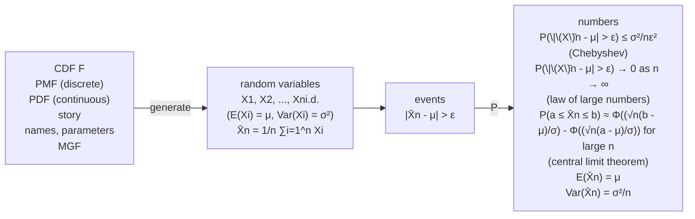
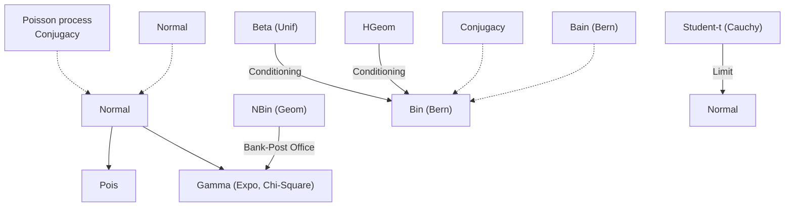

Proof. In the proof of each property, we appeal to Definition 10.4.4.

1. Express

$$
T = \frac {Z}{\sqrt {V / n}},
$$

where $Z \sim \mathcal { N } ( 0 , 1 ) ,   V \sim \chi _ { n } ^ { 2 }$ , and $Z$ is independent of V . Then

$$
- T = \frac {- Z}{\sqrt {V / n}},
$$

where $- Z \sim \mathcal { N } ( 0 , 1 )$ , so $- T \sim t _ { n }$

2. Recall that the Cauchy distribution is defined as the distribution of $X / Y$ where X and Y are i.i.d. $\mathcal { N } ( 0 , 1 )$ . By definition, $T \sim t _ { 1 }$ can be expressed as $T = Z / { \sqrt { V } }$ where $\sqrt { V }   =   \sqrt { Z _ { 1 } ^ { 2 } }   =   | Z _ { 1 } ^ { ' } |$ with $Z _ { 1 }$ independent of $Z .$ But by symmetry, $Z / | Z _ { 1 } |$ has the same distribution as $Z / Z _ { 1 }$ , and $Z / Z _ { 1 }$ is Cauchy. Thus the $t _ { 1 }$ and Cauchy distributions are the same.

3. This follows from the SLLN. Consider a sequence of i.i.d. standard Normal r.v.s $Z _ { 1 } , Z _ { 2 } , \ldots ,$ and let

$$
V _ {n} = Z _ {1} ^ {2} + \dots + Z _ {n} ^ {2}.
$$

By the SLLN, $V _ { n } / n   \to   E ( Z _ { 1 } ^ { 2 } )   =   1$ with probability 1. Now let $Z   \sim   \mathcal { N } ( 0 , 1 )$ b e independent of all the $Z _ { j }$ , and let

$$
T _ {n} = \frac {Z}{\sqrt {V _ {n} / n}}
$$

for all $n .$ Then $T _ { n } \sim t _ { n }$ by definition, and since the denominator converges to 1, we have $T _ { n }   \to   Z   \sim   \mathcal { N } ( 0 , 1 )$ . Therefore, the distribution of the $T _ { n }$ approaches the distribution of $Z$ 

Figure 10.6 plots the Student-t PDF for various values of $n ,$ demonstrating all three properties of the above theorem: the PDFs are all symmetric around 0, the PDF for $n = 1$ looks like that of the Cauchy distribution, and as $n \to \infty$ the heavy tails become lighter, and the PDF approaches the standard Normal PDF.

## 10.5 Recap

Inequalities and limit theorems are two different ways to handle expectations and probabilities that we don’t wish to calculate exactly. Inequalities allow us to obtain lower and/or upper bounds on the unknown value: Cauchy-Schwarz and Jensen give us bounds on expectations, while Markov, Chebyshev, and Chernoff give us bounds on tail probabilities.


<details>
<summary>violin</summary>

| X | PDF (Series 1) | PDF (Series 2) | PDF (Series 3) | PDF (Series 4) | PDF (Series 5) | PDF (Series 6) | PDF (Series 7) | PDF (Series 8) |
|---|---|---|---|---|---|---|---|---|
| -3 | ~0.02 | ~0.02 | ~0.02 | ~0.02 | ~0.02 | ~0.02 | ~0.02 | ~0.02 |
| -2 | ~0.08 | ~0.08 | ~0.08 | ~0.08 | ~0.08 | ~0.08 | ~0.08 | ~0.08 |
| -1 | ~0.25 | ~0.24 | ~0.23 | ~0.22 | ~0.21 | ~0.20 | ~0.19 | ~0.18 |
| 0 | 0.40 | 0.39 | 0.38 | 0.37 | 0.36 | 0.35 | 0.34 | 0.32 |
| 1 | ~0.25 | ~0.24 | ~0.23 | ~0.22 | ~0.21 | ~0.20 | ~0.19 | ~0.18 |
| 2 | ~0.08 | ~0.08 | ~0.08 | ~0.08 | ~0.08 | ~0.08 | ~0.08 | ~0.08 |
| 3 | ~0.02 | ~0.02 | ~0.02 | ~0.02 | ~0.02 | ~0.02 | ~0.02 | ~0.02 |
</details>

## FIGURE 10.6

PDFs of Student-t distribution with (light to dark) n = 1, 2, 3, 5, 10 degrees of freedom, as well as the standard Normal PDF (black). As $n \to \infty$ , the Student-t PDFs approach the standard Normal PDF.

Two limit theorems, the law of large numbers and the central limit theorem, describe the behavior of the sample mean ${ \bar { X } } _ { n }$ of i.i.d. $X _ { 1 } , X _ { 2 } , \ldots$ with mean $\mu$ and variance $\sigma ^ { 2 }$ . The SLLN says that as $n \to \infty$ , the sample mean ${ \bar { X } } _ { n }$ converges to the true mean $\mu$ with probability 1. The CLT says that the distribution of ${ \bar { X } } _ { n } .$ after standardization, converges to the standard Normal distribution:

$$
\sqrt {n} \left(\frac {\bar {X} _ {n} - \mu}{\sigma}\right) \to \mathcal {N} (0, 1).
$$

This can be translated into an approximation for the distribution of ${ \bar { X } } _ { n }$ :

$$
\bar {X} _ {n} \dot {\sim} \mathcal {N} (\mu , \sigma^ {2} / n).
$$

Equivalently, we can say that the distribution of the sum $S _ { n } = X _ { 1 } + \cdots + X _ { n } = n \bar { X } _ { n }$ after standardization, converges to the standard Normal distribution:

$$
\frac {S _ {n} - n \mu}{\sigma \sqrt {n}} \to \mathcal {N} (0, 1).
$$

Figure 10.7 illustrates the progression from a distribution to i.i.d. r.v.s with that distribution, from which a sample mean can be formed and studied as an r.v. in its own right. Chebyshev’s inequality, the LLN, and the CLT all give important information about the behavior of the sample mean.

The Chi-Square and Student-t distributions are two important named distributions in statistics. The Chi-Square is a special case of the Gamma. The Student-t has a bell-shaped PDF with heavier tails than the Normal, and converges to the standard Normal as the degrees of freedom increase.


<details>
<summary>flowchart</summary>


</details>

FIGURE 10.7

The sample mean ${ \bar { X } } _ { n }$ of i.i.d. random variables $X _ { 1 } , \ldots , X _ { n }$ is an important quantity in many problems. Chebyshev’s inequality bounds the probability of the sample mean being far from the true mean. The weak law of large numbers, which follows from Chebyshev’s inequality, says that for n large, the probability is very high that the sample mean will be very close to the true mean. The central limit theorem says that for n large the distribution of the sample mean will be approximately Normal.

Here, one last time, is the diagram of relationships between the named distributions, updated to include the Chi-Square distribution (as a special case of the Gamma) and Student-t distribution (with the Cauchy as a special case). We have also added arrows to show the convergence of the Poisson, Gamma, and Student-t distributions to Normality; the first two are a consequence of the central limit theorem, and the third is a consequence of the law of large numbers.


<details>
<summary>flowchart</summary>


</details>

Now we see that all the named distributions are connected to one another!

## 10.6 R

## Jensen’s inequality

R makes it easy to compare the expectations of X and $g ( X )$ for a given choice of $g ,$ and this allows us to verify some special cases of Jensen’s inequality. For example, suppose we simulate $1 0 ^ { 4 }$ times from the Expo(1) distribution:

$$
\mathrm{x} <   - \operatorname{rexp} (1 0 ^ {\wedge} 4)
$$

According to Jensen’s inequality, $E ( \log X ) \leq \log E X$ . The former can be approximated by mean(log(x)) and the latter can be approximated by log(mean(x)), so compute both:

mean(log(x))

log(mean(x))

For the Expo(1) distribution, we find that mean(log(x)) is approximately −0.6 (the true value is around −0.577), while log(mean(x)) is approximately 0 (the true value is 0). This indeed suggests E(log X) ≤ log EX. We could also compare mean $( x ^ { - 3 } )$ to mean $( x ) \sim 3$ , or mean(sqrt(x)) to sqrt(mean(x))—the possibilities are endless.

## Visualization of the law of large numbers

To plot the running proportion of Heads in a sequence of independent fair coin tosses, we first generate the coin tosses themselves:

nsim <- 300

Then we compute ${ \bar { X } } _ { n }$ for each value of n and store the results in xbar:

xbar <- cumsum(x)/(1:nsim)

The above line of code performs elementwise division of the two vectors cumsum(x) and 1:nsim. Finally, we plot xbar against the number of coin tosses:

plot(1:nsim,xbar,type="l",ylim=c(0,1))

You should see that the values of xbar approach p, by the LLN.

## Monte Carlo estimate of $\pi$

A famous example of Monte Carlo integration is the Monte Carlo estimate of $\pi .$ The unit disk $\{ ( x , y ) : x ^ { 2 }   +   y ^ { 2 } \leq 1 \}$ is inscribed in the square $[ - 1 , 1 ] \times [ - 1 , 1 ]$ , which has area 4. If we generate a large number of points that are Uniform on the square, the proportion of points falling inside the disk is approximately equal to the ratio of the disk’s area to the square’s area, which is $\pi / 4$ . Thus, to estimate $\pi$ we can take the proportion of points inside the circle and multiply by 4.

In R, to generate Uniform points on the 2D square, we can independently generate the x-coordinate and the y-coordinate as Unif(−1, 1) r.v.s, using the results of Example 7.1.23:

nsim $< - 1 0 ^ { \cdot } 6$


<details>
<summary>scatter</summary>

| Series | X (range) | Y (range) |
| --- | --- | --- |
| Points | -1.0~1.0 | -1.0~1.0 |
</details>

## FIGURE 10.8

Monte Carlo estimate of $\pi ;$ Generate points that are Uniform on the 2D square $[ - 1 , 1 ] \times [ - 1 , 1 ]$ , which has area 4. The proportion of points falling in the unit disk is approximately $\pi / 4$

```r
x <- runif(nsim,-1,1)
y <- runif(nsim,-1,1)
```

To count the number of points in the disk, we type sum $( x ^ { - 2 } + y ^ { - 2 } < 1 )$ . The vector $x ^ { 2 } + y ^ { 2 } = 1$ is an indicator vector whose ith element is 1 if the ith point falls inside the disk and 0 otherwise, so the sum of the elements is the number of points in the disk. To get our estimate of $\pi ,$ we convert the sum into a proportion and multiply by 4:

```txt
4*sum(x^2+y^2<1)/nsim
```

How close was your estimate to the actual value of $\pi ?$

## Visualizations of the central limit theorem

One way to visualize the central limit theorem for a distribution of interest is to plot the distribution of ${ \bar { X } } _ { n }$ for various values of $n ,$ as in Figure 10.5. To do this, we first have to generate i.i.d. $X _ { 1 } , \ldots , X _ { n }$ a bunch of times from our distribution of interest. For example, suppose that our distribution of interest is $\mathrm { U n i f } ( 0 , 1 )$ , and we are interested in the distribution of $\bar { X } _ { \mathrm { 1 2 } } ,   \mathrm { i . e . }$ , we set $n   =   1 2$ . In the following code, we create a matrix of i.i.d. standard Uniforms. The matrix has 12 columns, corresponding to $X _ { 1 }$ through $X _ { 1 2 }$ . Each row of the matrix is a different realization of $X _ { 1 }$ through $X _ { 1 2 }$

```r
nsim <- 10^4
n <- 12
x <- matrix(runif(n*nsim), nrow=nsim, ncol=n)
```

Now, to obtain realizations of $\bar { X } _ { 1 2 }$ , we simply take the average of each row of the matrix x; we can do this with the rowMeans function:

xbar <- rowMeans(x)

Finally, we create a histogram:

hist(xbar)

You should see a histogram that looks approximately Normal. Since the Unif(0, 1) distribution is symmetric, the CLT kicks in quickly and the Normal approximation for ${ \bar { X } } _ { n }$ works well, even for $n \: = \: 1 2$ . Changing runif to rexp, we see that for $X _ { j }   \sim   \mathrm { E x p o ( 1 ) }$ , the distribution of ${ \bar { X } } _ { n }$ remains skewed when $n   =   1 2$ , so a larger value of n is required before the Normal approximation is decent.

Another neat visualization of the CLT can be found in the animation package. This package has a built-in animation of a quincunx or bean machine, invented by the statistician and geneticist Francis Galton to illustrate the Normal distribution. After installing the package, try:

library(animation) quincunx()

Can you use the central limit theorem to explain why the histogram produced by a quincunx should look approximately Normal?

## Chi-Square and Student-t distributions

Although the Chi-Square is just a special case of the Gamma, it still has its own functions dchisq, pchisq, and rchisq in R: dchisq(x,n) and pchisq(x,n) return the values of the $\overline { { \chi _ { n } ^ { 2 } } }$ PDF and CDF at x, and rchisq(nsim,n) generates nsim i.i.d. $\chi _ { n } ^ { 2 } \mathrm { { \bf ~ r . v . s . } }$

The Student-t distribution has functions dt, pt, and rt. To evaluate the PDF or CDF of the $t _ { n }$ distribution at x, we use dt(x,n) or $\mathbf { p t } ( \mathbf { x } , \mathbf { n } )$ . To generate nsim i.i.d. r.v.s from the $t _ { n }$ distribution, we use rt(nsim,n). Of course, dt(x,1) is the same as dcauchy(x).

## 10.7 Exercises

Exercises marked with s have detailed solutions at [http://stat110.net](http://stat110.net).

## Inequalities

1. s In a national survey, a random sample of people are chosen and asked whether they support a certain policy. Assume that everyone in the population is equally likely to be surveyed at each step, and that the sampling is with replacement (sampling without replacement is typically more realistic, but with replacement will be a good approximation if the sample size is small compared to the population size). Let n be the sample size, and let $\hat { p }$ and $p$ be the proportion of people who support the policy in the sample and in the entire population, respectively. Show that for every $c > 0$

$$
P (| \hat {p} - p | > c) \leq \frac {1}{4 n c ^ {2}}.
$$

2. s For i.i.d. r.v.s $X _ { 1 } , \ldots , X _ { n }$ with mean $\mu$ and variance $\sigma ^ { 2 }$ , give a value of n (as a specific number) that will ensure that there is at least a 99% chance that the sample mean will be within 2 standard deviations of the true mean $\mu .$

3. s Show that for any two positive r.v.s X and Y with neither a constant multiple of the other,

$$
E (X / Y) E (Y / X) > 1.
$$

4. s The famous arithmetic mean-geometric mean inequality says that for any positive numbers $a _ { 1 } , a _ { 2 } , \ldots , a _ { n }$ ,

$$
\frac {a _ {1} + a _ {2} + \cdots + a _ {n}}{n} \geq (a _ {1} a _ {2} \dots a _ {n}) ^ {1 / n}.
$$

Show that this inequality follows from Jensen’s inequality, by considering $E \log ( X )$ for an r.v. X whose possible values are $a _ { 1 } , \ldots , a _ { n }$ (you should specify the PMF of X; if you want, you can assume that the $a _ { j }$ are distinct (no repetitions), but be sure to say so if you assume this).

5. s Let X be a discrete r.v. whose distinct possible values are $x _ { 0 } , x _ { 1 } , \ldots ,$ and let $p _ { k } =$ $P ( X = x _ { k } )$ . The entropy of X is $\textstyle H ( X ) = \sum _ { k = 0 } ^ { \infty } p _ { k } \operatorname { l o g } _ { 2 } ( 1 / p _ { k } )$

(a) Find H(X) for $X \sim \operatorname { G e o m } ( p )$

Hint: Use properties of logs, and interpret part of the sum as an expected value.

(b) Let X and Y be i.i.d. discrete r.v.s. Show that $P ( X = Y ) \geq 2 ^ { - H ( X ) }$

Hint: Consider $E ( \log _ { 2 } ( W ) )$ , where $W$ is an r.v. taking value $p _ { k }$ with probability $p _ { k }$ .

6. Let X be a random variable with mean $\mu$ and variance $\sigma ^ { 2 }$ . Show that

$$
E (X - \mu) ^ {4} \geq \sigma^ {4},
$$

and use this to show that the kurtosis of X is at least −2.

## Fill-in-the-blank inequalities

7. s Let X and Y be i.i.d. positive r.v.s, and let $c > 0$ . For each part below, fill in the appropriate equality or inequality symbol: write = if the two sides are always equal, $\leq \mathrm { i f }$ the left-hand side is less than or equal to the right-hand side (but they are not necessarily equal), and similarly for $\geq$ If no relation holds in general, write ?.

(a) $E ( \operatorname { l o g } ( X ) ) \_ \_ \_ \_ \operatorname { l o g } ( E ( X ) )$
(b) $E ( X ) \; \underline { { \quad } } \; \sqrt { E ( X ^ { 2 } ) }$
(c) $E ( \operatorname { s i n } ^ { 2 } ( X ) ) + E ( \operatorname { c o s } ^ { 2 } ( X ) ) \mathrel { \underline { { \quad } } } 1$

(d) $E ( | X | ) \; \underline { { \quad } } \; \sqrt { E ( X ^ { 2 } ) }$
(e) $P ( X > c ) \; \_ \_ \_ \; \frac { _ { E ( X ^ { 3 } ) } } { c ^ { 3 } }$
(f) $P ( X \leq Y ) \; \underline { { \quad } } \; P ( X \geq Y )$
(g) $E ( X Y ) \; \underline { { \quad } } \; \sqrt { E ( X ^ { 2 } ) E ( Y ^ { 2 } ) }$
(h) $P ( X + Y > 1 0 ) \; \underline { { \quad } } \; P ( X > 5 { ~ \mathrm { o r } ~ } Y > 5 )$
(i) $E ( \operatorname* { m i n } ( X , Y ) ) \xlongequal { \quad } \operatorname* { m i n } ( E X , E Y )$
(j) $E(X/Y) \xlongequal{\quad } \frac{EX}{EY}$
(k) $E ( X ^ { 2 } ( X ^ { 2 } + 1 ) ) \xlongequal { \quad } E ( X ^ { 2 } ( Y ^ { 2 } + 1 ) )$
(l) $\begin{array} { l } { E \left( \frac { X ^ { 3 } } { X ^ { 3 } + Y ^ { 3 } } \right) \_ \ \ E ( \frac { Y ^ { 3 } } { X ^ { 3 } + Y ^ { 3 } } ) } \\ \end{array}$

8. s Write the most appropriate of $\leq , \geq , = , { \mathrm { ~ o r ~ ? ~ } }$ in the blank for each part (where “?” means that no relation holds in general).

In (c) through (f), X and Y are i.i.d. (independent identically distributed) positive random variables. Assume that the various expected values exist.

(a) (probability that a roll of 2 fair dice totals 9) (probability that a roll of 2 fair dice totals 10)
(b) (probability that at least 65% of 20 fair coin flips land Heads) (probability that at least 65% of 2000 fair coin flips land Heads)

(c) $E ( \sqrt { X } ) \; \underline { { \quad } } \; \sqrt { E ( X ) } .$

(d) $E(\sin X) \xlongequal{\quad } \sin(EX)$

(e) $P ( X + Y > 4 ) \mathrel { \underline { { \quad } } } \quad P ( X > 2 ) P ( Y > 2 )$

(f) $E \left( ( X + Y ) ^ { 2 } \right) \xlongequal { \quad } 2 E ( X ^ { 2 } ) + 2 ( E X ) ^ { 2 }$

9. Let X and Y be i.i.d. continuous r.v.s. Assume that the various expressions below exist. Write the most appropriate of $\leq , \geq , = , { \mathrm { o r ~ ? ~ } }$ in the blank for each part (where “?” means that no relation holds in general).

(a) $e ^ { - E ( X ) } \xlongequal { \quad } E ( e ^ { - X } )$
(b) $P ( X > Y + 3 ) \xlongequal { \quad } P ( Y > X + 3 )$
(c) $P ( X > Y + 3 ) \xlongequal { \quad } P ( X > Y - 3 )$
(d) $E ( X ^ { 4 } ) \; \underline { { \quad } } \; ( E ( X Y ) ) ^ { 2 }$
(e) $\operatorname { V a r } ( Y ) \; \_ \_ \_ \; E ( \operatorname { V a r } ( Y | X ) )$
(f) $P ( | X + Y | > 3 ) \; \_ \_ \_ \; E | X |$

10. s Let X and Y be positive random variables, not necessarily independent. Assume that the various expected values below exist. Write the most appropriate of $\leq , \geq , = , { \mathrm { o r ~ ? ~ } }$ in the blank for each part (where “?” means that no relation holds in general).

(a) $( E ( X Y ) ) ^ { 2 } \xlongequal { \quad } E ( X ^ { 2 } ) E ( Y ^ { 2 } )$
(b) $P ( | X + Y | > 2 ) \xlongequal { \quad } { \textstyle \frac { 1 } { 1 0 } } E ( ( X + Y ) ^ { 4 } )$
(c) $E ( \operatorname { l o g } ( X + 3 ) ) \xlongequal { \quad } \operatorname { l o g } ( E ( X + 3 ) )$
(d) $E ( X ^ { 2 } e ^ { X } ) \xlongequal { \quad } E ( X ^ { 2 } ) E ( e ^ { X } )$
(e) $P(X+Y=2)\xlongequal{\quad}P(X=1)P(Y=1)$
(f) $P ( X + Y = 2 ) \xlongequal { \quad } P \left( \{ X \geq 1 \} \cup \{ Y \geq 1 \} \right)$

11. s Let X and Y be positive random variables, not necessarily independent. Assume that the various expected values below exist. Write the most appropriate of $\leq , \geq , = ,$ or ? in the blank for each part (where “?” means that no relation holds in general).

(a) $E ( X ^ { 3 } ) \xlongequal { \quad } \sqrt { E ( X ^ { 2 } ) E ( X ^ { 4 } ) }$
(b) $P ( | X + Y | > 2 ) \xlongequal { \quad } { \textstyle \frac { 1 } { 1 6 } } E ( ( X + Y ) ^ { 4 } )$
(c) $E ( \sqrt { X + 3 } ) \; \underline { { \quad } } \; \sqrt { E ( X + 3 ) }$
(d) $E ( \operatorname { s i n } ^ { 2 } ( X ) ) + E ( \operatorname { c o s } ^ { 2 } ( X ) ) \mathrel { \underline { { \quad } } } 1$
(e) $E ( Y | X + 3 ) \xlongequal { \quad } E ( Y | X )$
(f) $E ( E ( Y ^ { 2 } | X ) ) \mathrel { \underline { { \quad } } } ( E Y ) ^ { 2 }$

12. s Let X and Y be positive random variables, not necessarily independent. Assume that the various expressions below exist. Write the most appropriate of $\leq , \geq , = , { \mathrm { o r ~ ? ~ } }$ in the blank for each part (where “?” means that no relation holds in general).

(a) $P ( X + Y > 2 ) \xrightarrow { \quad } \frac { E X + E Y } { 2 }$
(b) $P ( X + Y > 3 ) \; \underline { { \quad } } \; P ( X > 3 )$
(c) $E ( \operatorname { c o s } ( X ) ) \mathrel { \underline { { \phantom { \operatorname { c o s } ( X ) } } } } \operatorname { c o s } ( E X )$
(d) $E ( X ^ { 1 / 3 } ) \mathrel { \underline { { \quad } } } ( E X ) ^ { 1 / 3 }$
(e) $E ( X ^ { Y } ) \mathrel { \underline { { \quad } } } ( E X ) ^ { E Y }$
(f) $E \left( E ( X | Y ) + E ( Y | X ) \right) \xlongequal { \quad } E X + E Y$

13. s Let X and Y be i.i.d. positive random variables. Assume that the various expressions below exist. Write the most appropriate of $\leq , \geq , = , \mathrm { o r } \; ?$ in the blank for each part (where “?” means that no relation holds in general).

(a) $E ( e ^ { X + Y } ) \; \_ \_ \_ \; e ^ { 2 E ( X ) }$
(b) $E ( X ^ { 2 } e ^ { X } ) \xlongequal { \quad } \sqrt { E ( X ^ { 4 } ) E ( e ^ { 2 X } ) } .$
(c) $E ( X | 3 X ) \xlongequal { \quad } E ( X | 2 X )$
(d) $E ( X ^ { 7 } Y ) \xlongequal { \quad } E ( X ^ { 7 } E ( Y | X ) )$
(e) $$E ( \frac { X } { Y } + \frac { Y } { X } ) \_ \_ \_$ 2$
(f) $P ( | X - Y | > 2 ) \mathrel { \underline { { \quad } } } \mathrel { \underline { { \quad } } } \textstyle \frac { \operatorname { V a r } ( X ) } { 2 }$

14. s Let X and Y be i.i.d. Gamma( 1,1), and let $Z \sim \mathcal { N } ( 0 , 1 )$ (note that X and Z may be dependent, and Y and Z may be dependent). For $(a),(b),(c)$ , write the most appropriate of $< , > , = ,$ or ? in each blank; for $(d),(e),(f)$ , write the most appropriate of $\leq , \geq , =$ or ? in each blank.

(a) $P ( X < Y ) \_ \_ 1 / 2$
(b) $P ( X = Z ^ { 2 } ) \_ \_ 1$
(c) $P ( Z \geq \textstyle \frac { 1 } { X ^ { 4 } + Y ^ { 4 } + 7 } ) \mathrel { \underline { { \quad } } } 1$
(d) $\begin{array} { l } { E ( \frac { X } { X + Y } ) E ( ( X + Y ) ^ { 2 } ) \xlongequal { \quad } E ( X ^ { 2 } ) + ( E ( X ) ) ^ { 2 } } \\ \end{array}$
(e) $E ( X ^ { 2 } Z ^ { 2 } ) \xlongequal { \quad } \sqrt { E ( X ^ { 4 } ) E ( X ^ { 2 } ) } .$
(f) $E ( ( X + 2 Y ) ^ { 4 } ) \xlongequal { \quad } 3 ^ { 4 }$

15. Let X, Y, Z be i.i.d. N (0, 1) r.v.s. Write the most appropriate of $\leq , \geq , = , { \mathrm { ~ o r ~ ? ~ } }$ in each blank $(where $ ``? '' $$ means that no relation holds in general).

(a) $P ( X ^ { 2 } + Y ^ { 2 } + Z ^ { 2 } > 6 ) \mathrel { \underline { { \quad } } } 1 / 2$
(b) $P ( X ^ { 2 } < 1 ) \; \_ \_ \; 2 / 3$
(c) $\begin{array} { l } { E \left( \frac { X ^ { 2 } } { X ^ { 2 } + Y ^ { 2 } + Z ^ { 2 } } \right) \_ } \\ \end{array}   { 1 / 4 }$
(d) $\operatorname { V a r } ( \Phi ( X ) + \Phi ( Y ) + \Phi ( Z ) ) \mathrel { \underline { { \quad } } } 1 / 4$
(e) $E ( e ^ { - X } ) \xlongequal { \quad } E ( e ^ { X } )$
(f) $E ( | X | e ^ { X } ) \; \underline { { \quad } } \; \sqrt { E ( e ^ { 2 X } ) }$

16. Let $X , Y , Z , W$ be i.i.d. positive r.v.s with CDF F and $E ( X ) \; = \; 1$ . Write the most appropriate of $\leq , \geq , = , { \mathrm { ~ o r ~ ? ~ } }$ in each blank (where “?” means that no relation holds in general).

(a) $F(3) \xlongequal{\quad} 2/3$
(b) $( F ( 3 ) ) ^ { 3 } \xlongequal { \quad } P ( X + Y + Z \leq 9 )$
(c) $\begin{array} { l } { E \left( \frac { X ^ { 2 } } { X ^ { 2 } + Y ^ { 2 } + Z ^ { 2 } + W ^ { 2 } } \right) \xlongequal { \quad } 1 / 4 } \\ \end{array}$
(d) $E ( X Y Z W ) \xlongequal { \quad } E ( X ^ { 4 } )$
(e) $\operatorname { V a r } ( E ( Y | X ) ) \; \_ \_ \_ \; \operatorname { V a r } ( Y )$
(f) $\mathrm{Cov}(X + Y, X - Y) \xlongequal{\quad} 0$

17. Let X, Y, Z be i.i.d. (independent, identically distributed) r.v.s with a continuous distribution. Write the most appropriate of $\leq , \geq , = , { \mathrm { o r ~ ? ~ } }$ in each blank (where “?” means that no relation holds in general).

(a) $P ( X < Y < Z ) \mathrel { \underline { { \quad } } } 1 / 6$
(b) $P ( X > 1 ) \; \_ \_ \_ \; E ( X )$
(c) $P \left( \sum _ { k = 0 } ^ { 2 0 1 5 } \left( \frac { X ^ { 2 } + 1 } { X ^ { 2 } + 2 } \right) ^ { k } > 3 \right) \xlongequal { \quad } P ( X ^ { 2 } > 1 ) .$
(d) $E\left( \sqrt{X^{2} + Y^{2}} \right) \xlongequal{\quad } \sqrt{E(X^{2}) + E(Y^{2})}$
(e) $\operatorname { V a r } ( Y ^ { 2 } | Z ) \; \underline { { \quad } } \; \operatorname { V a r } ( X ^ { 2 } | X )$
(f) $\operatorname { V a r } ( X - 2 Y + 3 Z ) \xlongequal { \quad } 1 4 \operatorname { V a r } ( X )$

18. Let $X , Y , Z   \sim   \mathrm { B i n } ( n , p )$ be i.i.d. (independent and identically distributed). Write the most appropriate of $\leq , \; \geq , \; = , \; \mathrm { o r } \; ?$ in each blank (where “?” means that no relation holds in general).

(a) $P ( X < Y < Z ) \mathrel { \underline { { \quad } } } 1 / 6$
(b) $P(X+Y+Z>n) \xlongequal{\quad} 3p$
(c) $P \left( \sum _ { n = 0 } ^ { 2 0 1 6 } \frac { ( X ^ { 2 } + 1 ) ^ { n } } { n ! } > e ^ { 5 } \right) \xlongequal { \quad } P ( X > 2 ) .$
(d) $E\left(e^{X}\right) \xlongequal{\quad } (pe + 1 - p)^{n}$
(e) $\mathrm{Var}(X + Y) \xlongequal{\quad} n/2$
(f) $E(X \left|   X + Y = n) \right. \xlongequal{\quad} n/2$

19. Let $X , Y , Z , W \sim \mathcal { N } ( c , c ^ { 2 } )$ be i.i.d., where $c > 0$ . Write the most appropriate of $\leq , \geq$ $= , \mathrm { ~ o r ~ ? ~ }$ in each blank (where $\overset { \langle \langle \mathbf { c } \rangle \rangle } { \underset { \bullet } { } }$ means that no relation holds in general).

(a) $P ( X + Y \leq Z - W ) \mathrel { \underline { { \quad } } } \Phi ( - 1 )$
(b) $P ( X ^ { 4 } - Y ^ { 8 } \leq Z ^ { 4 } - W ^ { 8 } ) \mathrel { \underline { { \quad } } } \Phi ( - 1 )$
(c) $E(X - c)^{2} \xlongequal{\quad} c$
(d) $E(X - c)^{3} \xlongequal{\quad} c$
(e) $E\left(\frac{1}{4}X^{2}+X\right)\xlongequal{\quad\quad}\frac{1}{2}c^{2}+c$
(f) $\operatorname { l o g } \left( E ( e ^ { X } ) \right) \_ \qquad { \scriptstyle { \frac { 1 } { 2 } } } c ^ { 2 } + c$

20. Let $X , Y \sim \operatorname { P o i s } ( \lambda )$ be i.i.d., where $\lambda > 1$ . Write the most appropriate of $\leq ,   \geq ,   = ,   \mathrm { o r }$? in each blank (where $\overset { \langle \langle \mathbf { c } \rangle \rangle } { \underset { \bullet } { } }$ means that no relation holds in general).

(a) $P ( X \leq Y ) \; \underline { { \quad } } \; 1 / 2$
(b) $P ( X + Y \leq 1 ) \; \underline { { \quad } } \; 3 e ^ { - 2 \lambda }$
(c) $E\left(e^{X+Y}\right)\xlongequal{\quad}e^{2\lambda}$
(d) $E(X \mid X + Y = 4) \xlongequal{\quad } 2$
(e) $\operatorname { V a r } ( X   |   X + Y = 4 ) \mathrel { \underline { { \quad } } } 1$
(f) $E(X^{2}-Y) \xlongequal{\quad} \lambda^{2}$

## LLN and CLT

21. s Let $X _ { 1 } , X _ { 2 } , \ldots$ . be i.i.d. positive random variables with mean 2. Let $Y _ { 1 } , Y _ { 2 } , \ldots$ . be i.i.d. positive random variables with mean 3. Show that

$$
\frac {X _ {1} + X _ {2} + \cdots + X _ {n}}{Y _ {1} + Y _ {2} + \cdots + Y _ {n}} \rightarrow \frac {2}{3}
$$

with probability 1. Does it matter whether the $X _ { i }$ are independent of the $Y _ { j } ?$

22. s Let $U _ { 1 } , U _ { 2 } , \ldots , U _ { 6 0 }$ be i.i.d. $\mathrm { U n i f ( 0 , } 1 \mathrm { ) }$ and $X = U _ { 1 } + U _ { 2 } + \cdots + U _ { 6 0 }$

(a) Which important distribution is the distribution of X very close to? Specify what the parameters are, and state which theorem justifies your choice.
(b) Give a simple but accurate approximation for $P ( X > 1 7 )$ . Justify briefly.

23. s Let $V _ { n } \sim \chi _ { n } ^ { 2 }$ and $T _ { n } \sim t _ { n }$ for all positive integers n.

(a) Find numbers $a _ { n }$ and $b _ { n }$ such that $a _ { n } ( V _ { n } - b _ { n } )$ converges in distribution to $\mathcal { N } ( 0 , 1 )$
(b) Show that $T _ { n } ^ { 2 } / ( n + T _ { n } ^ { 2 } )$ has a Beta distribution (without using calculus).

24. s Let $T _ { 1 } , T _ { 2 } , \ldots$ . be i.i.d. Student-t r.v.s with $m \geq 3$ degrees of freedom. Find constants $a _ { n }$ and $b _ { n }$ (in terms of m and n) such that $a _ { n } ( T _ { 1 } + T _ { 2 } + \cdots + T _ { n } - b _ { n } )$ converges to $\mathcal { N } ( 0 , 1 )$ in distribution as $n \to \infty$

25. s (a) Let $Y = e ^ { X }$ , with $X \sim \mathrm { E x p o ( 3 ) }$ . Find the mean and variance of $Y$ .

(b) For $Y _ { 1 } , \ldots , Y _ { n }$ i.i.d. with the same distribution as Y from (a), what is the approximate distribution of the sample mean $\begin{array} { r } { \bar { Y } _ { n } = \frac { 1 } { n } \sum _ { j = 1 } ^ { n } Y _ { j } } \end{array}$ when n is large?

26. s (a) Explain why the $\operatorname { P o i s } ( n )$ distribution is approximately Normal if $n$ is a large positive integer (specifying what the parameters of the Normal are).

(b) Stirling’s formula is an amazingly accurate approximation for factorials:

$$
n! \approx \sqrt {2 \pi n} \left(\frac {n}{e}\right) ^ {n},
$$

where in fact the ratio of the two sides goes to 1 as $n \to \infty$ . Use (a) to give a quick heuristic derivation of Stirling’s formula by using a Normal approximation to the probability that a Pois(n) r.v. is $n ,$ with the continuity correction: first write $\begin{array} { r } { P ( N = n ) = P \left( n - \frac { 1 } { 2 } < N < n + \frac { 1 } { 2 } \right) } \end{array}$ , where $N \sim \mathrm { P o i s } ( n )$

27. s (a) Consider i.i.d. Pois(λ) r.v.s $X _ { 1 } , X _ { 2 } , \ldots .$ The MGF of $X _ { j }$ is $M ( t ) = e ^ { \lambda ( e ^ { t } - 1 ) }$ . Find the MGF $M _ { n } ( t )$ of the sample mean $\begin{array} { r } { \bar { X } _ { n } = \frac { 1 } { n } \sum _ { j = 1 } ^ { n } X _ { j } } \end{array}$

(b) Find the limit of $M _ { n } ( t )$ as $n \to \infty$ . (You can do this with almost no calculation using a relevant theorem; or you can use (a) and the fact that $e ^ { x } \approx 1 + x { \mathrm { ~ i f ~ } } x$ is very small.)

28. Let $X _ { n } \sim \operatorname { P o i s } ( n )$ for all positive integers n. Use MGFs to show that the distribution of the standardized version of $X _ { n }$ converges to a Normal distribution as $n \to \infty$ , without invoking the CLT.

29. An important concept in frequentist statistics is that of a confidence interval (CI). Suppose we observe data X from a distribution with parameter θ. Unlike in Bayesian statistics, θ is treated as a fixed but unknown constant; it is not given a prior distribution. A 95% confidence interval consists of a lower bound $L ( X )$ and upper bound $U ( X )$ such that

$$
P (L (X) <   \theta <   U (X)) = 0. 9 5
$$

for all possible values of θ. Note that in the above statement, $L ( X )$ and $U ( X )$ are random variables, as they are functions of the r.v. X, whereas θ is a constant. The definition says that the random interval $( L ( X ) , U ( X ) )$ has a 95% chance of containing the true value of $\theta .$

Imagine an army of frequentists all over the world, independently generating 95% CIs. The jth frequentist observes data $X _ { j }$ and makes a confidence interval for the parameter $\theta _ { j }$ . Show that if there are n of these frequentists, then the fraction of their intervals which contain the corresponding parameter approaches 0.95 as $n \to \infty$

Hint: Consider the indicator r.v. $I _ { j } = I ( L ( X _ { j } ) < \theta _ { j } < U ( X _ { j } ) )$

30. This problem extends Example 10.3.7 to a more general setting. Again, suppose a very volatile stock rises 70% or drops 50% in price each day, with equal probabilities and with different days independent.

(a) Suppose a hedge fund manager always invests half of her current fortune into the stock each day. Let $Y _ { n }$ be her fortune after n days, starting from an initial fortune of $Y _ { 0 } = 1 0 0$ . What happens to $Y _ { n }$ as $n \to \infty ?$

(b) More generally, suppose the hedge fund manager always invests a fraction α of her current fortune into the stock each day (in Part (a), we took $\alpha = 1 / 2 )$ . With $Y _ { 0 }$ and $Y _ { n }$ defined as in Part (a), find the function $g ( \alpha )$ such that

$$
\frac {\log Y _ {n}}{n} \to g (\alpha)
$$

with probability 1 as $n \to \infty$ , and prove that $g ( \alpha )$ is maximized when $\alpha = 2 / 7$

## Mixed practice

31. As in Exercise 36 from Chapter 3, there are n voters in an upcoming election in a certain country, where n is a large, even number. There are two candidates, A and B. Each voter chooses randomly whom to vote for, independently and with equal probabilities.

(a) Use a Normal approximation (with continuity correction) to get an approximation for the probability of a tie, in terms of Φ.
(b) Use a first-order Taylor expansion (linear approximation) to the approximation from Part (a) to show that the probability of a tie is approximately $1 / { \sqrt { c n } }$ , where c is a constant (which you should specify).

32. Cassie enters a casino with $X _ { 0 } = 1$ dollar and repeatedly plays the following game: with probability $1 / 3 ,$ the amount of money she has increases by a factor of 3; with probability $2 / 3$ , the amount of money she has decreases by a factor of 3. Let $X _ { n }$ be the amount of money she has after playing this game n times. For example, $X _ { 1 }$ is 3 with probability $1 / 3$ and is $3 ^ { - 1 }$ with probability $2 / 3$

(a) Compute $E(X_{1}),   E(X_{2})$ and, in general, $E ( X _ { n } )$
(b) What happens to $E ( X _ { n } )$ as $n \to \infty ?$
(c) Let $Y _ { n }$ be the number of times out of the first n games that Cassie triples her money. What happens to $Y _ { n } / n$ as $n \to \infty ?$
(d) What happens to $X _ { n }$ as $n \to \infty ?$

33. A handy rule of thumb in statistics and life is as follows:

Conditioning often makes things better.

This problem explores how the above rule of thumb applies to estimating unknown parameters. Let $\theta$ be an unknown parameter that we wish to estimate based on data $X _ { 1 } , X _ { 2 } , \ldots , X _ { n }$ (these are r.v.s before being observed, and then after the experiment they “crystallize” into data). In this problem, θ is viewed as an unknown constant, and is not treated as an r.v. as in the Bayesian approach. Let $T _ { 1 }$ be an estimator for θ (this means that $T _ { 1 }$ is a function of $X _ { 1 } , \ldots , X _ { n }$ which is being used to estimate θ).

A strategy for improving $T _ { 1 }$ (in some problems) is as follows. Suppose that we have an r.v. R such that $T _ { 2 } = E ( T _ { 1 } | R )$ is a function of $X _ { 1 } , \ldots , X _ { n }$ (in general, $E ( T _ { 1 } | R )$ might involve unknowns such as $\theta$ but then it couldn’t be used as an estimator). Also suppose that $P ( T _ { 1 } = T _ { 2 } ) < 1$ , and that $E ( T _ { 1 } ^ { 2 } )$ is finite.

(a) Use Jensen’s inequality to show that $T _ { 2 }$ is better than $T _ { 1 }$ in the sense that the mean squared error is less, i.e.,

$$
E (T _ {2} - \theta) ^ {2} <   E (T _ {1} - \theta) ^ {2}.
$$

Hint: Use Adam’s law on the right-hand side.

(b) The bias of an estimator $T$ for θ is defined to be $b ( T ) = E ( T ) - \theta$ An important identity in statistics, a form of the bias-variance tradeoff, is that mean squared error is variance plus squared bias:

$$
E (T - \theta) ^ {2} = \mathrm{Var} (T) + (b (T)) ^ {2}.
$$

Use this identity and Eve’s law to give an alternative proof of the result from $( \mathrm { a } )$

(c) Now suppose that $X _ { 1 } , X _ { 2 } , \ldots$ are i.i.d. with mean $\theta ,$ and consider the special case $\begin{array} { r } { \widehat { T _ { 1 } } = X _ { 1 } ,   R = \sum _ { j = 1 } ^ { n } X _ { j } } \end{array}$ . Find $T _ { 2 }$ in simplified form, and check that it has lower mean squared error than $T _ { 1 }$ for $n \geq 2$ . Also, say what happens to $T _ { 1 }$ and $T _ { 2 }$ as $n \to \infty$

34. Each page of an n-page book has a $\operatorname { P o i s } ( \lambda )$ number of typos, where λ is unknown (but is not treated as an $\mathbf { r } . \mathbf { v } . )$ . Typos on different pages are independent. Thus we have i.i.d. $X _ { 1 } , \ldots , X _ { n } \sim \operatorname { P o i s } ( \lambda )$ , where $X _ { j }$ is the number of typos on page j. Suppose we are interested in estimating the probability $\theta$ that a page has no typos:

$$
\theta = P (X _ {j} = 0) = e ^ {- \lambda}.
$$

(a) Let $\bar { X } _ { n } { = } \textstyle \frac { 1 } { n } ( X _ { 1 } + \cdots + X _ { n } )$ . Show that the estimator $T _ { n }   =   e ^ { - \bar { X } _ { n } }$ is biased for θ. (That is, show $E ( T _ { n } ) \neq \theta .$ Estimators and bias are defined in the previous problem.)
(b) Show that as $n \to \infty ,   T_n \to \theta$ with probability 1.
(c) Show that $W = \frac { 1 } { n } ( I ( X _ { 1 } = 0 ) + \cdots + I ( X _ { n } = 0 ) )$ is unbiased for θ. Using the fact that $X _ { 1 } | ( X _ { 1 } + \cdots + \overset { n } { X _ { n } } = s ) \sim \operatorname { B i n } ( s , 1 / n )$ , find $E ( W | X _ { 1 } + \cdots + X _ { n } )$ . Is the estimator $\tilde { W } = E ( W | X _ { 1 } + \cdots + X _ { n } )$ also unbiased for $\theta ?$
(d) Using Eve’s law or otherwise, show that $\tilde { W }$ has lower variance than $W ,$ and relate this to the previous question.

35. A binary sequence is being generated through some process (random or deterministic). You need to sequentially predict each new number, i.e., you predict whether the next number will be 0 or 1, then observe it, then predict the next number, etc. Each of your predictions can be based on the entire past history of the sequence.

(a) Suppose for this part that the binary sequence consists of i.i.d. Bern(p) r.v.s, with $p$ known. What is your optimal strategy (for each prediction, your goal is to maximize the probability of being correct)? What is the probability that you will guess the nth value correctly with this strategy?
(b) Now suppose that the binary sequence consists of i.i.d. Bern(p) r.v.s, with p unknown. Consider the following strategy: say 1 as your first prediction; after that, say $`` 1 ''$ if the proportion of 1’s so far is at least $1 / 2$ , and say $\text{" }0 \text{" }$ otherwise. Find the limit as $n \to \infty$ of the probability of guessing the nth value correctly (in terms of $p )$
(c) Now suppose that you follow the strategy from (b), but that the binary sequence is generated by a nefarious entity who knows your strategy. What can the entity do to make your guesses be wrong as often as possible?

36. s Let X and Y be independent standard Normal r.v.s and let $R ^ { 2 } = X ^ { 2 } + Y ^ { 2 }$ (where $R > 0$ is the distance from $( X , Y )$ to the origin).

(a) The distribution of $R ^ { 2 }$ is an example of three of the important distributions we have seen. State which three of these distributions $R ^ { 2 }$ is an instance $\mathrm { o f } ,$ specifying the parameter values.
(b) Find the PDF of R.

Hint: Start with the PDF $f _ { W } ( w )$ of $W = R ^ { 2 }$

(c) Find $P(X > 2Y + 3)$ in terms of the standard Normal CDF Φ.
(d) Compute $\mathrm{Cov}(R^{2},X)$ . Are $R ^ { 2 }$ and X independent?

37. s Let $Z _ { 1 } , \ldots , Z _ { n } \sim \mathcal { N } ( 0 , 1 )$ be i.i.d.

(a) As a function of $Z _ { 1 }$ , create an Expo(1) r.v. X (your answer can also involve the standard Normal CDF Φ).
(b) Let $Y = e ^ { - R }$ , where $R   =   \sqrt { Z _ { 1 } ^ { 2 } + \cdots + Z _ { n } ^ { 2 } }$ . Write down (but do not evaluate) an integral for $E ( Y )$
(c) Let $X_{1} = 3Z_{1} - 2Z_{2}$ and $X_{2} = 4Z_{1} + 6Z_{2}$ . Determine whether $X _ { 1 }$ and $X _ { 2 }$ are independent (be sure to mention which results you’re using).

38. s Let $X _ { 1 } , X _ { 2 } , \ldots$ . be i.i.d. positive r.v.s. with mean $\mu ,$ and let $\begin{array} { r } { W _ { n } = \frac { X _ { 1 } } { X _ { 1 } + \cdots + X _ { n } } } \end{array}$

(a) Find $E ( W _ { n } )$

Hint: Consider $\textstyle \frac { X _ { 1 } } { X _ { 1 } + \cdots + X _ { n } } + \frac { X _ { 2 } } { X _ { 1 } + \cdots + X _ { n } } + \cdots + \frac { X _ { n } } { X _ { 1 } + \cdots + X _ { n } }$

(b) What random variable does $n W _ { n }$ converge to (with probability 1) as $n \to \infty ?$

(c) For the case that $X _ { j }   \sim   \mathrm { E x p o } ( \lambda )$ , find the distribution of $W _ { n }$ , preferably without using calculus. (If it is one of the named distributions we have studied, state its name and specify the parameters; otherwise, give the PDF.)

39. Let $X _ { 1 } , X _ { 2 } , \ldots$ be i.i.d. Expo(1).

(a) Let $N   =   \operatorname* { m i n } \{ n   :   X _ { n }   \geq   1 \}$ be the index of the first $X _ { j }$ to exceed 1. Find the distribution of $$N - 1$ (give$ the name and parameters), and hence find $E ( N )$

(b) Let $M = \operatorname* { m i n } \{ n : X _ { 1 } + X _ { 2 } + \dots + X _ { n } \geq 1 0 \}$ be the number of $X _ { j } { } ^ { \prime } \mathbf { s }$ we observe until their sum exceeds 10 for the first time. Find the distribution of $M - 1$ (give the name and parameters), and hence find $E ( M )$

Hint: Consider a Poisson process.

(c) Let $\bar { X } _ { n } = ( X _ { 1 } + \cdots + X _ { n } ) / n$ . Find the exact distribution of $\bar{X}_{n}$ (give the name and parameters), as well as the approximate distribution of ${ \bar { X } } _ { n }$ for n large (give the name and parameters).