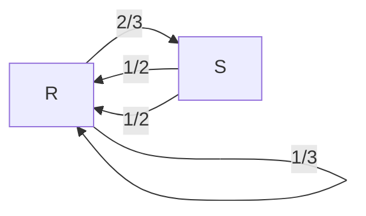
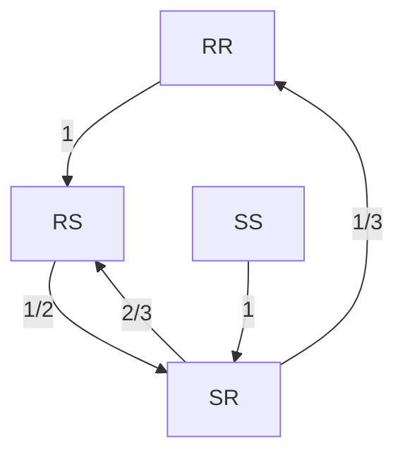
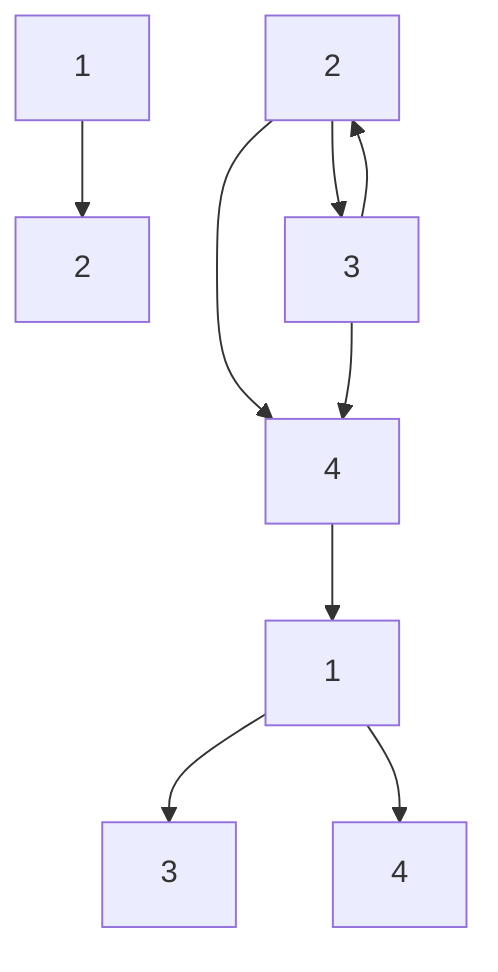
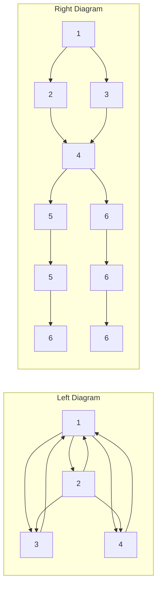
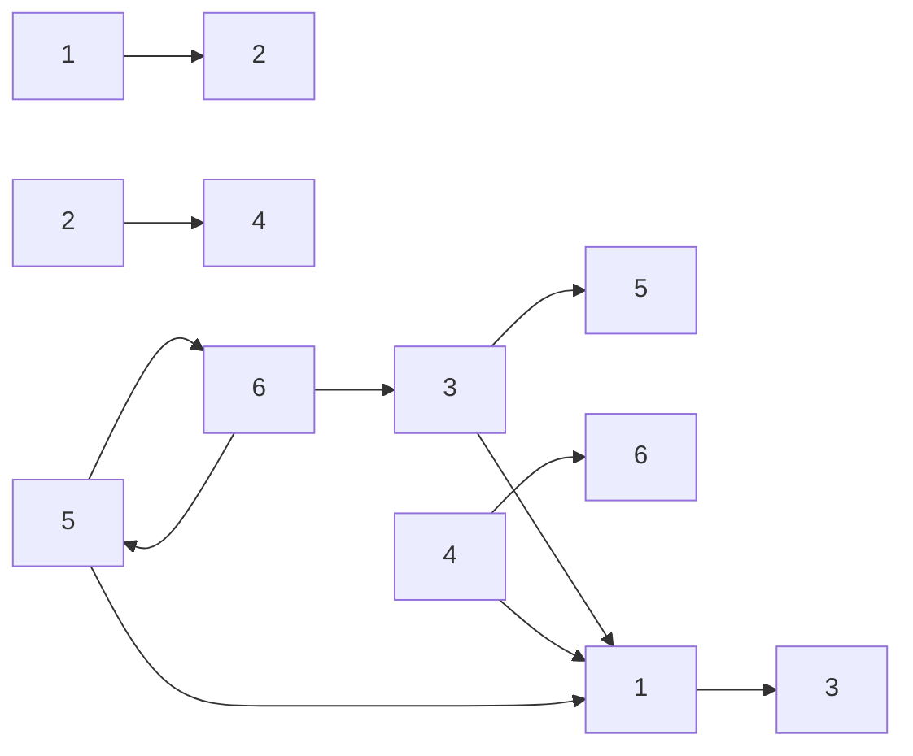
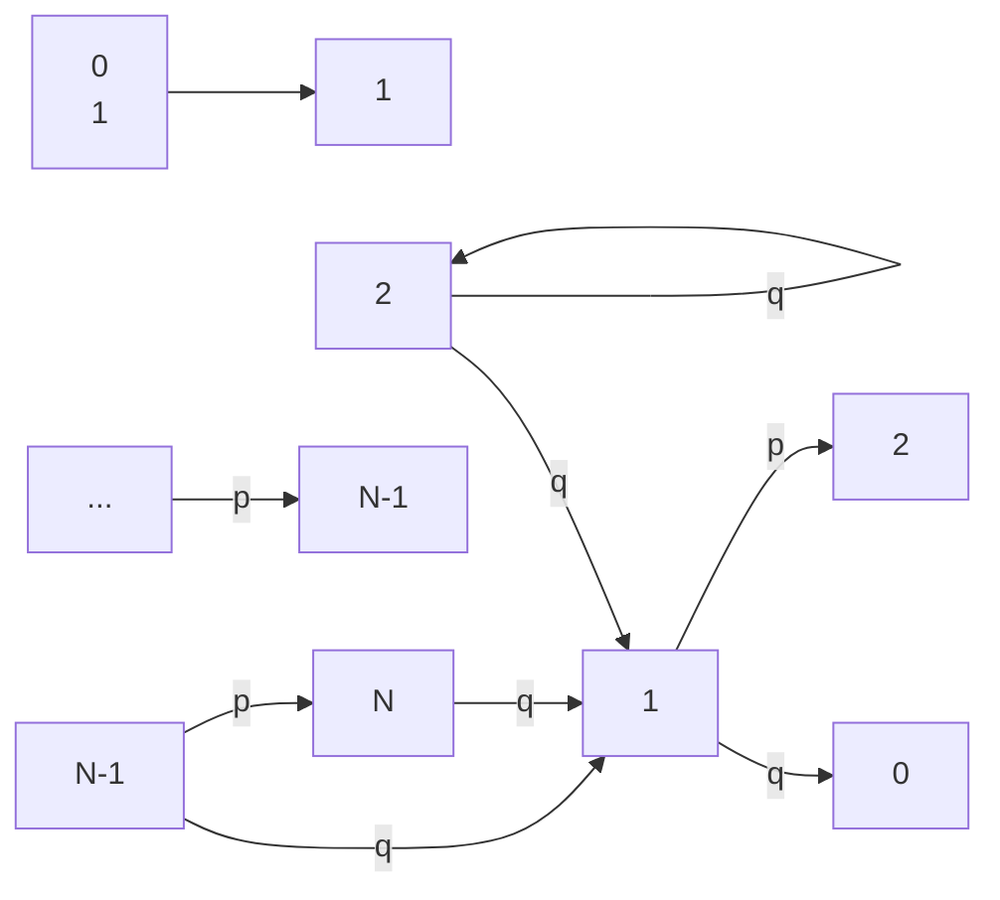
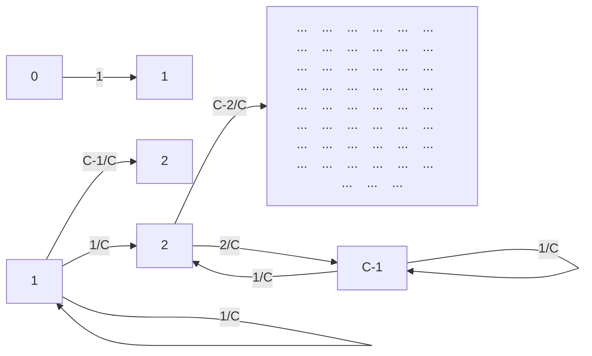
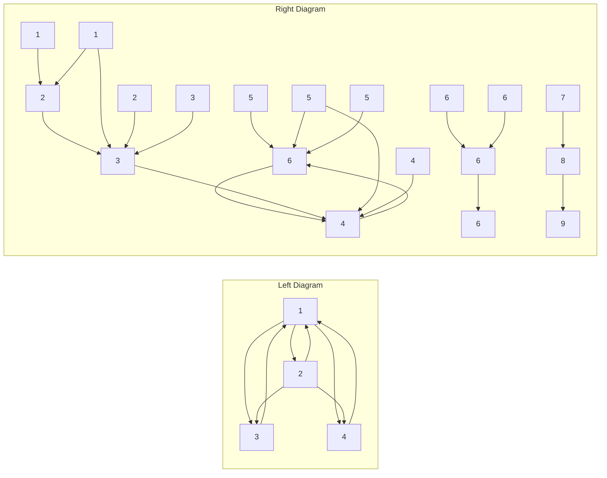
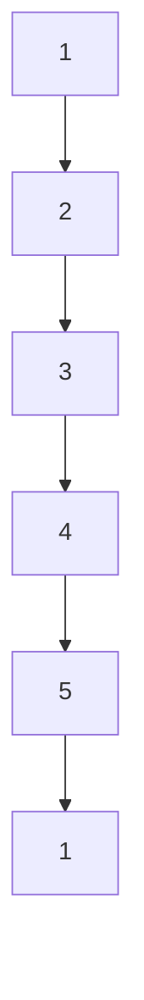

## Taylor & Francis

Taylor & Francis Group

http://taylorandfrancis.com

## Markov chains

Markov chains were first introduced in 1906 by Andrey Markov (of Markov’s inequality), with the goal of showing that the law of large numbers can apply to random variables that are not independent. To see where the Markov model comes from, start by considering an i.i.d. sequence of random variables $X _ { 0 } , X _ { 1 } , \ldots , X _ { n } , \ldots$ where we think of n as time. This is the setting we worked in throughout Chapter 10, but for modeling real-world phenomena, independence can be an excessively restrictive assumption; it means that the $X _ { n }$ provide absolutely no information about each other. At the other extreme, allowing arbitrary interactions between the $X _ { n }$ makes it very difficult to compute even basic things. A Markov chain is a sequence of r.v.s that exhibits one-step dependence, in a precise sense that we shall soon define. Thus Markov chains are a happy medium between complete independence and complete dependence.

Since their invention, Markov chains have become extremely important in a huge number of fields such as biology, game theory, finance, machine learning, and statistical physics. They are also very widely used for simulations of complex distributions, via algorithms known as Markov chain Monte Carlo (MCMC). In this chapter we will introduce Markov chains and their properties, and in the next chapter we’ll look at some examples of MCMC techniques.

## 11.1 Markov property and transition matrix

Markov chains “live” in both space and time: the set of possible values of the $X _ { n }$ is called the state space, and the index n represents the evolution of the process over time. The state space of a Markov chain can be either discrete or continuous, and time can also be either discrete or continuous (in the continuous-time setting, we would imagine a process $X _ { t }$ defined for all real $t \geq 0 )$ . In this chapter we will focus exclusively on discrete-state, discrete-time Markov chains, with a finite state space. Specifically, we will assume that the $X _ { n }$ take values in a finite set, which we usually take to be $\{ 1 , 2 , \ldots , M \}$ or $\{ 0 , 1 , \ldots , M \}$

Definition 11.1.1 (Markov chain). A sequence of random variables $X _ { 0 } , X _ { 1 } , X _ { 2 } , \ldots$ taking values in the state space $\{ 1 , 2 , \ldots , M \}$ is called a Markov chain if for all $n \geq 0$

$$
P (X _ {n + 1} = j | X _ {n} = i, X _ {n - 1} = i _ {n - 1}, \dots , X _ {0} = i _ {0}) = P (X _ {n + 1} = j | X _ {n} = i).
$$

The quantity $P ( X _ { n + 1 }   =   j | X _ { n }   =   i )$ is called the transition probability from state $i$ to state $j .$ In this book, when referring to a Markov chain we will implicitly assume that it is time-homogeneous, which means that the transition probability $P ( X _ { n + 1 }   =   j | X _ { n }   =   i )$ is the same for all times n. But care is needed, since the literature is not consistent about whether to say “time-homogeneous Markov chain” or just “Markov chain”.

The above condition is called the Markov property, and it says that given the entire past history $X _ { 0 } , X _ { 1 } , X _ { 2 } , \ldots , X _ { n }$ , only the most recent term, $X _ { n }$ , matters for predicting $X _ { n + 1 }$ . If we think of time n as the present, times before n as the past, and times after n as the future, the Markov property says that given the present, the past and future are conditionally independent. The Markov property greatly simplifies computations of conditional probability: instead of having to condition on the entire past, we only need to condition on the most recent value.

To describe the dynamics of a Markov chain, we need to know the probabilities of moving from any state to any other state, that is, the probabilities $P(X_{n+1} =$ $j | X _ { n } = i )$ on the right-hand side of the Markov property. This information can be encoded in a matrix, called the transition matrix, whose $( i , j )$ entry is the probability of going from state i to state $j$ in one step of the chain.

Definition 11.1.2 (Transition matrix). Let $X _ { 0 } , X _ { 1 } , X _ { 2 } , \ldots$ be a Markov chain with state space $\{ 1 , 2 , \ldots , M \}$ , and let $q _ { i j } = P ( X _ { n + 1 } = j | X _ { n } = i )$ be the transition probability from state $i$ to state $j$ . The $M \times M$ matrix $Q   =   ( q _ { i j } )$ is called the transition matrix of the chain.

Note that $Q$ is a nonnegative matrix in which each row sums to 1. This is because, starting from any state $i ,$ the events “move to $1 ^ { \flat \flat }$ , “move to $2 , \ldots ,$ “move to $M ^ { \flat }$ are disjoint, and their union has probability 1 because the chain has to go somewhere.

Example 11.1.3 (Rainy-sunny Markov chain). Suppose that on any given day, the weather can either be rainy or sunny. If today is rainy, then tomorrow will be rainy with probability $1 / 3$ and sunny with probability $2 / 3$ . If today is sunny, then tomorrow will be rainy with probability $1 / 2$ and sunny with probability $1 / 2 .$ Letting $X _ { n }$ be the weather on day $n , \: X _ { 0 } , X _ { 1 } , X _ { 2 } , \ldots$ . is a Markov chain on the state space $\{ R , S \}$ , where $R$ stands for rainy and S for sunny. We know that the Markov property is satisfied because, from the description of the process, only today’s weather matters for predicting tomorrow’s.

The transition matrix of the chain is

$$
\begin{array}{c c} R & S \\ R \left( \begin{array}{c c} 1 / 3 & 2 / 3 \\ 1 / 2 & 1 / 2 \end{array} \right). \end{array}
$$

The first row says that starting from state $R ,$ we transition back to state $R$ with probability $1 / 3$ and transition to state $S$ with probability $2 / 3$ . The second row says that starting from state $S ,$ we have a 1/2 $1 / 2$ chance of moving to state R and a $1 / 2$ chance of staying in state S. We could just as well have used

$$
\begin{array}{c c} S & R \\ S \left( \begin{array}{c c} 1 / 2 & 1 / 2 \\ 2 / 3 & 1 / 3 \end{array} \right) \end{array}
$$

as our transition matrix instead. In general, if there isn’t an obvious ordering of the states of a Markov chain (as with the states R and S), we just need to fix an ordering of the states and use it consistently.

The transition probabilities of a Markov chain can also be represented with a diagram. Each state is represented by a circle, and the arrows indicate the possible one-step transitions; we can imagine a particle wandering around from state to state, randomly choosing which arrow to follow. Next to the arrows we write the corresponding transition probabilities.

flowchart

What if the weather tomorrow depended on the weather today and the weather yesterday? For example, suppose that the weather behaves as above, except that if there have been two consecutive days of rain, then tomorrow will definitely be sunny, and if there have been two consecutive days of sun, then tomorrow will definitely be rainy. Under these new weather dynamics, the $X _ { n }$ no longer form a Markov chain, as the Markov property is violated: conditional on today’s weather, yesterday’s weather can still provide useful information for predicting tomorrow’s weather.

However, by enlarging the state space, we can create a new Markov chain: let $Y _ { n } = \left( X _ { n - 1 } , X _ { n } \right)$ for $n \geq 1$ . Then $Y _ { 1 } , Y _ { 2 } , \ldots$ is a Markov chain on the state space $\{ ( R , R ) , ( R , S ) , ( S , R ) , ( S , S ) \}$ . You can verify that the new transition matrix is

$$
\begin{array}{c} (R, R) \quad (R, S) \quad (S, R) \quad (S, S) \\ (R, R) \left( \begin{array}{c c c c} 0 & 1 & 0 & 0 \\ 0 & 0 & 1 / 2 & 1 / 2 \\ 1 / 3 & 2 / 3 & 0 & 0 \\ 0 & 0 & 1 & 0 \end{array} \right) \end{array}
$$

and that its corresponding graphical representation is given in the following figure.

flowchart

Similarly, we could handle third-order or fourth-order dependencies in the weather by further enlarging the state space to make the Markov property hold. 

Once we have the transition matrix $Q$ of a Markov chain, we can work out the transition probabilities for longer timescales.

Definition 11.1.4 (n-step transition probabili $\mathrm { t y } )$ . The n-step transition probability from $i$ to $j$ is the probability of being at $j$ exactly n steps after being at $i .$ We denote this by $q _ { i j } ^ { ( n ) }$ :

$$
q _ {i j} ^ {(n)} = P (X _ {n} = j | X _ {0} = i).
$$

Note that

$$
q _ {i j} ^ {(2)} = \sum_ {k} q _ {i k} q _ {k j}
$$

since to get from i to $j$ in two steps, the chain must go from $i$ to some intermediary state $k ,$ and then from $k$ to $j ;$ these transitions are independent because of the Markov property. Since the right-hand side is the $( i , j )$ entry of $Q ^ { 2 }$ by definition of matrix multiplication, we conclude that the matrix $Q ^ { 2 }$ gives the two-step transition probabilities. By induction, the nth power of the transition matrix gives the n-step transition probabilities:

$$
q _ {i j} ^ {(n)} \text {is the} (i, j) \text {entry of} Q ^ {n}.
$$

Example 11.1.5 (Transition matrix of 4-state Markov chain). Consider the 4-state Markov chain depicted in Figure 11.1. When no probabilities are written over the arrows, as in this case, it means all arrows originating from a given state are equally likely. For example, there are $3$ arrows originating from state 1, so the transitions $1 \rightarrow 3 ,   1 \rightarrow 2$ , and $1 \rightarrow 1$ all have probability $1 / 3 .$ . Therefore the transition matrix of the chain is

$$
Q = \left( \begin{array}{c c c c} 1 / 3 & 1 / 3 & 1 / 3 & 0 \\ 0 & 0 & 1 / 2 & 1 / 2 \\ 0 & 1 & 0 & 0 \\ 1 / 2 & 0 & 0 & 1 / 2 \end{array} \right).
$$

flowchart

## FIGURE 11.1

A 4-state Markov chain.

To compute the probability that the chain is in state 3 after $5$ steps, starting at state 1, we would look at the (1,3) entry of $Q ^ { 5 }$ . Here, using a computer to find $Q ^ { 5 }$

$$
Q ^ {5} = \left( \begin{array}{c c c c} 8 5 3 / 3 8 8 8 & 5 0 9 / 1 9 4 4 & 5 2 / 2 4 3 & 3 9 5 / 1 2 9 6 \\ 1 7 3 / 8 6 4 & 8 5 / 4 3 2 & 3 1 / 1 0 8 & 9 1 / 2 8 8 \\ 3 7 / 1 4 4 & 2 9 / 7 2 & 1 / 9 & 1 1 / 4 8 \\ 4 9 9 / 2 5 9 2 & 3 9 5 / 1 2 9 6 & 7 1 / 3 2 4 & 2 4 5 / 8 6 4 \end{array} \right),
$$

so $q _ { 1 3 } ^ { ( 5 ) } = 5 2 / 2 4 3 .$

Using the language of Chapter $^ { 7 , }$ the transition matrix $Q$ encodes the conditional distribution of $X _ { 1 }$ given the initial state of the chain. Specifically, the ith row of $Q$ is the conditional PMF of $X _ { 1 }$ given $X _ { 0 } = i ,$ displayed as a row vector. Similarly, the ith row of $Q ^ { n }$ is the conditional PMF of $X _ { n }$ given $X _ { 0 } = i$

To get the marginal distributions of $X _ { 0 } , X _ { 1 } , \ldots$ , we need to specify not only the transition matrix, but also the initial conditions of the chain. The initial state $X _ { 0 }$ can be specified deterministically, or randomly according to some distribution. Let $( t _ { 1 } , t _ { 2 } , \ldots , t _ { M } )$ be the PMF of $X _ { 0 }$ displayed as a vector, that is, $t _ { i } = P ( X _ { 0 } = i )$ Then the marginal distribution of the chain at any time can be computed from the transition matrix, averaging over all the states using LOTP.

Proposition 11.1.6 (Marginal distribution of $\left| X _ { n } \right\rangle$ . Define $\mathbf { t } = ( t _ { 1 } , t _ { 2 } , \ldots , t _ { M } )$ by $t _ { i } = P ( X _ { 0 } = i )$ , and view t as a row vector. Then the marginal distribution of $X _ { n }$ is given by the vector $\mathbf { t } Q ^ { n }$ . That is, the jth component of $\mathbf { t } Q ^ { n }$ is $P ( X _ { n } = j )$

Proof. By the law of total probability, conditioning on $X _ { 0 }$ , the probability that the chain is in state $j$ after n steps is

$$
P (X _ {n} = j) = \sum_ {i = 1} ^ {M} P (X _ {0} = i) P (X _ {n} = j | X _ {0} = i) = \sum_ {i = 1} ^ {M} t _ {i} q _ {i j} ^ {(n)},
$$

which is the jth component of $\mathbf { t } Q ^ { n }$ by definition of matrix multiplication.

Example 11.1.7 (Marginal distributions of 4-state Markov chain). Again consider the 4-state Markov chain shown in Figure 11.1. Suppose that the initial conditions are $\mathbf { t } = ( 1 / 4 , 1 / 4 , 1 / 4 , 1 / 4 )$ , meaning that the chain has equal probability of starting in each of the four states. Let $X _ { n }$ be the position of the chain at time n. Then the marginal distribution of $X _ { 1 }$ is

$$
\begin{array}{l} \mathbf {t} Q = \left( \begin{array}{c c c c} 1 / 4 & 1 / 4 & 1 / 4 & 1 / 4 \end{array} \right) \left( \begin{array}{c c c c} 1 / 3 & 1 / 3 & 1 / 3 & 0 \\ 0 & 0 & 1 / 2 & 1 / 2 \\ 0 & 1 & 0 & 0 \\ 1 / 2 & 0 & 0 & 1 / 2 \end{array} \right) \\ = \left( \begin{array}{c c c c} 5 / 2 4 & 1 / 3 & 5 / 2 4 & 1 / 4 \end{array} \right). \\ \end{array}
$$

The marginal distribution of $X _ { 5 }$ is

$$
\begin{array}{l} \mathbf {t} Q ^ {5} = \left( \begin{array}{c c c c} 1 / 4 & 1 / 4 & 1 / 4 & 1 / 4 \end{array} \right) \left( \begin{array}{c c c c} 8 5 3 / 3 8 8 8 & 5 0 9 / 1 9 4 4 & 5 2 / 2 4 3 & 3 9 5 / 1 2 9 6 \\ 1 7 3 / 8 6 4 & 8 5 / 4 3 2 & 3 1 / 1 0 8 & 9 1 / 2 8 8 \\ 3 7 / 1 4 4 & 2 9 / 7 2 & 1 / 9 & 1 1 / 4 8 \\ 4 9 9 / 2 5 9 2 & 3 9 5 / 1 2 9 6 & 7 1 / 3 2 4 & 2 4 5 / 8 6 4 \end{array} \right) \\ = \left( \begin{array}{c c c c} 3 3 7 9 / 1 5 5 5 2 & 2 2 6 7 / 7 7 7 6 & 1 0 1 / 4 8 6 & 1 4 6 9 / 5 1 8 4 \end{array} \right). \\ \end{array}
$$

We used a computer to perform the matrix multiplication.

## 11.2 Classification of states

In this section we introduce terminology for describing the various characteristics of a Markov chain. The states of a Markov chain can be classified as recurrent or transient, depending on whether they are visited over and over again in the long run or are eventually abandoned. States can also be classified according to their period, which is a positive integer summarizing the amount of time that can elapse between successive visits to a state. These characteristics are important because they determine the long-run behavior of the Markov chain, which we will study in Section 11.3.

The concepts of recurrence and transience are best illustrated with a concrete example. In the Markov chain shown on the left of Figure 11.2 (previously featured in Example 11.1.5), a particle moving around between states will continue to spend time in all 4 states in the long run, since it is possible to get from any state to any other state. In contrast, consider the chain on the right of Figure 11.2, and let the particle start at state 1. For a while, the chain may linger in the triangle formed by states 1, 2, and 3, but eventually it will reach state 4, and from there it can never return to states 1, 2, or 3. It will then wander around between states 4, 5, and 6 forever. States 1, 2, and 3 are transient and states 4, 5, and 6 are recurrent.

In general, these concepts are defined as follows.

flowchart

FIGURE 11.2

Left: 4-state Markov chain with all states recurrent. Right: 6-state Markov chain with states 1, 2, and 3 transient.

Definition 11.2.1 (Recurrent and transient states). State i of a Markov chain is recurrent if starting from i, the probability is 1 that the chain will eventually return to i. Otherwise, the state is transient, which means that if the chain starts from i, there is a positive probability of never returning to i.

In fact, although the definition of a transient state only requires that there be a positive probability of never returning to the state, we can say something stronger: as long as there is a positive probability of leaving i forever, the chain eventually will leave i forever. Moreover, we can find the distribution of the number of returns to the state.

Proposition 11.2.2 (Number of returns to transient state is Geometric). Let i be a transient state of a Markov chain. Suppose the probability of never returning to i, starting from i, is a positive number $p > 0$ . Then, starting from i, the number of times that the chain returns to i before leaving forever is distributed Geom(p).

The proof is by the story of the Geometric distribution: each time that the chain is at i, we have a Bernoulli trial which results in “failure” if the chain eventually returns to i and “success” if the chain leaves i forever; these trials are independent by the Markov property. The number of returns to state i is the number of failures before the first success, which matches the story of the Geometric distribution. And since a Geometric random variable always takes finite values, this proposition tells us that after some finite number of visits, the chain will leave state i forever.

If the number of states is not too large, one way to classify states as recurrent or transient is to draw a diagram of the Markov chain and use the same kind of reasoning that we used when analyzing the chains in Figure 11.2. A special case where we can immediately conclude all states are recurrent is when the chain is irreducible, meaning that it is possible to get from any state to any other state.

Definition 11.2.3 (Irreducible and reducible chain). A Markov chain with transition matrix $Q$ is irreducible if for any two states i and $j ,$ it is possible to go from i to $j$ in a finite number of steps (with positive probability). That is, for any states $i , j$ there is some positive integer n such that the $( i , j )$ entry of $Q ^ { n }$ is positive. A Markov chain that is not irreducible is called reducible.

Proposition 11.2.4 (Irreducible implies all states recurrent). In an irreducible Markov chain with a finite state space, all states are recurrent.

Proof. It is clear that at least one state must be recurrent; if all states were transient, the chain would eventually leave all states forever and have nowhere to go! So assume without loss of generality that state 1 is recurrent, and consider any other state i. We know that $q _ { 1 i } ^ { ( n ) }$ is positive for some n, by definition of irreducibility. Thus, every time the chain is at state 1, there is a positive probability that after n more steps it will be at state i.

Since the chain visits state 1 infinitely often, we know the chain will eventually reach state i from state 1; think of each visit to state 1 as starting a trial, where “success” is defined as reaching state i in at most n steps. From state i, the chain will return to state 1 because state 1 is recurrent, and by the same logic, it will eventually reach state i again. By induction, the chain will visit state i infinitely often. Since i was arbitrary, we conclude that all states are recurrent. 

The converse of the proposition is false; it is possible to have a reducible Markov chain whose states are all recurrent. An example is given by the Markov chain below, which consists of two “islands” of states.

flowchart

h 11.2.5. Note that recurrence or transience is a property of each state in a Markov chain, while irreducibility or reducibility is a property of the chain as a whole.

Here are two familiar problems from earlier chapters, viewed through the lens of Markov chains. For each, we’ll identify the recurrent and transient states.

Example 11.2.6 (Gambler’s ruin as a Markov chain). In the gambler’s ruin problem (Example 2.7.3), two gamblers, A and B, start with i and $N - i$ dollars respectively, making a sequence of bets for \$1. In each round, player A has probability p of winning and probability $q = 1 - p$ of losing. Let $X _ { n }$ be the wealth of gambler A at time n. Then $X _ { 0 } , X _ { 1 } , \ldots$ is a Markov chain on the state space $\{ 0 , 1 , \ldots , N \}$ . By design, $X _ { 0 } = i .$ Once the Markov chain reaches 0 or N, signifying bankruptcy for player A or player B, the chain stays in that state forever. A diagram of the chain is shown below.

flowchart

We proved in Chapter 2 that the probability that either A or B goes bankrupt is 1, so for any starting state i other than 0 or N, the Markov chain will eventually be absorbed into state 0 or N, never returning to i. Therefore, for this Markov chain, states 0 and N are recurrent, and all other states are transient. The chain is reducible because from state 0 it is only possible to go to state 0, and from state N it is only possible to go to state N. 

Example 11.2.7 (Coupon collector as a Markov chain). In the coupon collector problem (Example 4.3.12), there are C types of coupons (or toys), which we collect one by one, sampling with replacement from the $C$ coupon types each time. Let $X _ { n }$ be the number of distinct coupon types in our collection after n attempts. Then $X _ { 0 } , X _ { 1 } , \ldots$ . is a Markov chain on the state space $\{ 0 , 1 , \ldots , C \}$ . By design, $X _ { 0 } = 0$ This chain is depicted below.

flowchart

With the exception of state $C ,$ we can never return to a state after leaving it; the number of coupon types in the collection can only increase with time. Thus all states are transient except for $C ,$ which is recurrent. The chain is reducible since, e.g., it’s impossible to go from state 2 back to state 1. 

Another way to classify states is according to their periods. The period of a state summarizes how much time can elapse between successive visits to the state.

Definition 11.2.8 (Period of a state, periodic and aperiodic chain). The period of a state i in a Markov chain is the greatest common divisor (gcd) of the possible numbers of steps it can take to return to i when starting at i. That is, the period of i is the greatest common divisor of numbers n such that the $( i , i )$ entry of $Q ^ { n }$ is positive. (The period of i is ∞ if it’s impossible ever to return to i after starting at i.) A state is called aperiodic if its period equals 1, and periodic otherwise. The chain itself is called aperiodic if all its states are aperiodic, and periodic otherwise.

For example, let’s consider again the two Markov chains from Figure 11.2, shown again in Figure 11.3. We first consider the 6-state chain on the right. Starting from state 1, it is possible to be back at state 1 after 3 steps, 6 steps, 9 steps, etc., but it is not possible to be back at state 1 after any number of steps that is not a multiple of 3. Therefore, state 1 has period 3. Similarly, states 2 and 3 also have period 3. On the other hand, states 4, 5, and 6 have period 1, but the chain is periodic since at least one state does not have period 1. By contrast, in the chain on the left all states are aperiodic, so that chain is aperiodic.

flowchart

FIGURE 11.3

Left: an aperiodic Markov chain. Right: a periodic Markov chain in which states 1, 2, and 3 have period 3.

In the gambler’s ruin chain from Example 11.2.6, each state has period 2 except for 0 and N, which have period 1. In the coupon collector chain, each state has period 1 except for state 0, which has period ∞ because it’s impossible to return to state 0. So neither of these chains is aperiodic.

Checking whether an irreducible chain is aperiodic is often much easier than it might seem: the next proposition shows that we only need to calculate the period of one state, rather than searching state by state for a state whose period is not 1.

Proposition 11.2.9 (Periods in an irreducible chain). In an irreducible Markov chain, all states have the same period.

## 11.3 Stationary distribution

The concepts of recurrence and transience are important for understanding the longrun behavior of a Markov chain. At first, the chain may spend time in transient states. Eventually though, the chain will spend all its time in recurrent states. But what fraction of the time will it spend in each of the recurrent states? This question is answered by the stationary distribution of the chain, also known as the steadystate distribution. We will learn in this section that for irreducible and aperiodic

Markov chains, the stationary distribution describes the long-run behavior of the chain, regardless of its initial conditions. It will tell us both the long-run probability of being in any particular state, and the long-run proportion of time that the chain spends in that state.

Definition 11.3.1 (Stationary distribution). A row vector $\mathbf { s } = ( s _ { 1 } , \ldots , s _ { M } )$ such that $s _ { i }   \geq   0$ and $\textstyle \sum _ { i } s _ { i }   =   1$ is a stationary distribution for a Markov chain with transition matrix $Q$ if

$$
\sum_ {i} s _ {i} q _ {i j} = s _ {j}
$$

for all $j .$ This system of linear equations can be written as one matrix equation:

$$
\mathbf {s} Q = \mathbf {s}.
$$

Recall that if s is the distribution of $X _ { 0 } ,$ then sQ is the marginal distribution of $X _ { 1 }$ . Thus the equation $\mathbf { s } Q = \mathbf { s }$ means that if $X _ { 0 }$ has distribution s, then $X _ { 1 }$ also has distribution s. But then $X _ { 2 }$ also has distribution s, as does $X _ { 3 }$ , etc. That is, a Markov chain whose initial distribution is the stationary distribution s will stay in the stationary distribution forever.

One way to think about the stationary distribution of a Markov chain intuitively is to imagine a large number of particles, each independently bouncing from state to state according to the transition probabilities. After a while, the system of particles will approach an equilibrium where, at each time period, the number of particles leaving a state will be counterbalanced by the number of particles entering that state, and this will be true for all states. At this equilibrium, the system as a whole will appear to be stationary, and the proportion of particles in each state will be given by the stationary distribution. We will explore this perspective on stationary distributions more after Definition 11.4.1.

h 11.3.2 (Stationary distribution is marginal, not conditional). When a Markov chain is at the stationary distribution, the unconditional PMF of $X _ { n }$ equals s for all $n ,$ but the conditional PMF of $X _ { n }$ given $X _ { n - 1 } = i$ is still encoded by the ith row of the transition matrix $Q$

If a Markov chain starts at the stationary distribution, then all of the $X _ { n }$ are identically distributed (since they have the same marginal distribution s), but they are not necessarily independent, since the conditional distribution of $X _ { n }$ given $X _ { n - 1 } = i$ is, in general, different from the marginal distribution of $X _ { n }$

h 11.3.3 (Sympathetic magic). If a Markov chain starts at the stationary distribution, then the marginal distributions of the $X _ { n }$ are all equal. This is not the same as saying that the $X _ { n }$ themselves are all equal; confusing the random variables $X _ { n }$ with their distributions is an example of sympathetic magic.

For very small Markov chains, we may solve for the stationary distribution by hand, using the definition. The next example illustrates this for a two-state chain.

Example 11.3.4 (Stationary distribution for a two-state chain). Let

$$
Q = \left( \begin{array}{c c} 1 / 3 & 2 / 3 \\ 1 / 2 & 1 / 2 \end{array} \right).
$$

The stationary distribution is of the form $\mathbf { s } = ( s , 1 - s )$ , and we must solve for s in

$$
\left( \begin{array}{c c} s & 1 - s \end{array} \right) \left( \begin{array}{c c} 1 / 3 & 2 / 3 \\ 1 / 2 & 1 / 2 \end{array} \right) = \left( \begin{array}{c c} s & 1 - s \end{array} \right),
$$

which is equivalent to

$$
\begin{array}{l} \frac {1}{3} s + \frac {1}{2} (1 - s) = s, \\ \frac {2}{3} s + \frac {1}{2} (1 - s) = 1 - s. \\ \end{array}
$$

The only solution to these equations is $s = 3 / 7$ , so $( 3 / 7 , 4 / 7 )$ is the unique stationary distribution of this Markov chain.

More generally, suppose that $q _ { 1 2 } = a$ and $q _ { 2 1 } = b ,$ where $0 < a < 1$ and $0 < b < 1$ Then the transition matrix is

$$
Q = \left( \begin{array}{c c} 1 - a & a \\ b & 1 - b \end{array} \right).
$$

Writing $\mathbf { s } = ( s _ { 1 } , s _ { 2 } )$ , the equation $\mathbf { s } Q = \mathbf { s }$ becomes the linear system

$$
\begin{array}{l} (1 - a) s _ {1} + b s _ {2} = s _ {1}, \\ a s _ {1} + (1 - b) s _ {2} = s _ {2} \\ \end{array}
$$

Both equations in this system simplify to

$$
a s _ {1} = b s _ {2}.
$$

Plugging in $s _ { 2 } = 1 - s _ { 1 }$ , it follows that the unique solution to this system is

$$
\mathbf {s} = \left(\frac {b}{a + b}, \frac {a}{a + b}\right).
$$

In short, $\mathbf { s } \propto ( b , a )$ , i.e., s is a constant times $( b , a )$ . The constant is whatever it needs to be to make the components of s sum to 1. As a check, note that for the $Q$ given earlier with specific numbers, this result says that the stationary distribution should be proportional to $( b , a ) = ( 1 / 2 , 2 / 3 )$ , which, multiplying by $6$ to clear the denominators, is equivalent to being proportional to $( 3 , 4 )$ . The stationary distribution we solved for earlier was $( 3 / 7 , 4 / 7 )$ , which is indeed proportional to $( 3 , 4 )$ 

In linear algebra terminology, the equation $\mathbf { s } Q = \mathbf { s }$ says that s is a left eigenvector of $Q$ with eigenvalue 1 (see Section A.3 of the math appendix). To get the usual kind of eigenvector (a right eigenvector), take transposes: $Q ^ { \prime } \mathbf { s } ^ { \prime } = \mathbf { s } ^ { \prime }$ , where the 0symbol denotes taking the transpose.

## 11.3.1 Existence and uniqueness

Does a stationary distribution always exist, and is it unique? It turns out that for a finite state space, a stationary distribution always exists. Furthermore, in irreducible Markov chains, the stationary distribution is unique.

Theorem 11.3.5 (Existence and uniqueness of stationary distribution). For any irreducible Markov chain, there exists a unique stationary distribution. In this distribution, every state has positive probability.

The theorem is a consequence of a result from linear algebra called the Perron-Frobenius theorem, which is stated in Section A.3 of the math appendix.

The 4-state chain on the left of Figure 11.3 is irreducible: in terms of the picture, it is possible to go from anywhere to anywhere following the arrows; in terms of the transition matrix $Q ,$ all the entries of $Q ^ { 5 }$ are positive. Therefore, by Theorem 11.3.5, the chain has a unique stationary distribution.

On the other hand, the gambler’s ruin chain from Example 11.2.6 is reducible, so the theorem does not apply. It turns out that this chain has infinitely many stationary distributions. In the long run, the chain will either wind up at state 0 (and stay there forever) or wind up at state N (and stay there forever). This suggests, and it is easy to check, that the degenerate distributions $\mathbf { s } = ( 1 , 0 , \ldots , 0 )$ and $\mathbf { t } = ( 0 , 0 , \ldots , 1 )$ are both stationary distributions. It follows that any weighted combination $p \mathbf { s }   +   ( 1   -   p ) \mathbf { t }$ where $0 \leq p \leq 1$ , is also a stationary distribution, since it sums to 1 and

$$
(p \mathbf {s} + (1 - p) \mathbf {t}) Q = p \mathbf {s} Q + (1 - p) \mathbf {t} Q = p \mathbf {s} + (1 - p) \mathbf {t},
$$

where, as usual, Q is the transition matrix.

## 11.3.2 Convergence

We have already informally stated that the stationary distribution describes the long-run behavior of the chain, in the sense that if we run the chain for a long time, the marginal distribution of $X _ { n }$ converges to the stationary distribution s. The next theorem states that this is true as long as the chain is both irreducible and aperiodic. Then, regardless of the chain’s initial conditions, the PMF of $X _ { n }$ will converge to the stationary distribution as $n \to \infty$ . This relates the concept of stationarity to the long-run behavior of a Markov chain. The proof is omitted.

Theorem 11.3.6 (Convergence to stationary distribution). Let $X _ { 0 } , X _ { 1 } , \ldots$ . be an irreducible, aperiodic Markov chain with stationary distribution s and transition matrix Q. Then $P ( X _ { n } = i )$ converges to $s _ { i }$ as $n \to \infty$ . In terms of the transition matrix, $Q ^ { n }$ converges to a matrix in which each row is s.

Therefore, after a large number of steps, the probability that the chain is in state i is close to the stationary probability $s _ { i } .$ , regardless of the chain’s initial conditions. This makes irreducible, aperiodic chains especially nice to work with. Irreducibility means that for each $( i , j )$ there is some power $Q ^ { m }$ where the $( i , j )$ entry is positive, but if we also assume aperiodicity it turns out that we can find a value of m that works for all $i , j$ . More precisely, a chain is irreducible and aperiodic if and only if some power $Q ^ { m }$ is positive in all entries.

Intuitively, the extra condition of aperiodicity is needed in order to rule out chains that just go around in circles, such as the chain in the following example, or chains where, say, some states are accessible only after an even number of steps while other states are accessible only after an odd number of steps.

Example 11.3.7 (Periodic chain). The figure below shows a periodic Markov chain where each state has period 5.

flowchart

FIGURE 11.4

A periodic chain.

The transition matrix of the chain is

$$
Q = \left( \begin{array}{c c c c c} 0 & 1 & 0 & 0 & 0 \\ 0 & 0 & 1 & 0 & 0 \\ 0 & 0 & 0 & 1 & 0 \\ 0 & 0 & 0 & 0 & 1 \\ 1 & 0 & 0 & 0 & 0 \end{array} \right).
$$

It can be verified without much difficulty that $\textbf { s } = \; ( 1 / 5 , 1 / 5 , 1 / 5 , 1 / 5 , 1 / 5 )$ is a stationary distribution of this chain, and by Theorem 11.3.5, s is unique. However, suppose the chain starts at $X _ { 0 } = 1$ . Then the PMF of $X _ { n }$ assigns probability 1 to the state (n mod 5) + 1 and 0 to all other states.1In particular, it does not converge to s as $n \to \infty$ . Nor does $Q ^ { n }$ converge to a matrix in which each row is s: the chain’s transitions are deterministic, so $Q ^ { n }$ always consists of 0’s and 1’s. 

Lastly, the stationary distribution tells us the average time between visits to any particular state.

Theorem 11.3.8 (Expected time to return). Let $X _ { 0 } , X _ { 1 } , \ldots$ . be an irreducible Markov chain with stationary distribution s. Let $r _ { i }$ be the expected time it takes the chain to return to i, given that it starts at i. Then $s _ { i } = 1 / r _ { i }$

Here is how the theorems apply to the two-state chain from Example 11.3.4.

<small>1The notation n mod 5 denotes the remainder when n is divided by 5.</small>

Example 11.3.9 (Long-run behavior of a two-state chain). In the long run, the chain in Example 11.3.4 will spend $3 / 7$ of its time in state 1 and $4 / 7$ of its time in state 2. Starting at state 1, it will take an average of $7 / 3$ steps to return to state 1. The powers of the transition matrix converge to a matrix where each row is the stationary distribution:

$$
\left( \begin{array}{c c} 1 / 3 & 2 / 3 \\ 1 / 2 & 1 / 2 \end{array} \right) ^ {n} \to \left( \begin{array}{c c} 3 / 7 & 4 / 7 \\ 3 / 7 & 4 / 7 \end{array} \right) \text {as} n \to \infty .
$$

## 11.3.3 Google PageRank

We next consider a vastly larger example of a stationary distribution, for a Markov chain on a state space with billions of interconnected nodes: the World Wide Web. The next example explains how the founders of Google modeled web-surfing as a Markov chain, and then used its stationary distribution to rank the relevance of webpages. For years Google described the resulting method, known as PageRank, as “the heart of our software”.

Suppose you are interested in a certain topic, say chess, so you use a search engine to look for useful webpages with information about chess. There are millions of webpages that mention the word “chess”, so a key issue a search engine needs to deal with is what order to show the search results in. It would be a disaster to have to wade through thousands of garbage pages that mention “chess” before finding informative content.

In the early days of the web, various approaches to this ranking problem were used. For example, some search engines employed people to manually decide which pages were most useful, like a museum curator. But aside from being subjective and expensive, this quickly became infeasible as the web grew. Others focused on the number of times the search term was mentioned on the site. But a page that mentions “chess” over and over again could easily be less useful than a concise reference page or a page about chess that doesn’t repeatedly mention the word. Furthermore, this method is very open to abuse: a spam page could boost its ranking just by including a long list of words repeated over and over again.

Both of the above methods ignore the structure of the web: which pages link to which other pages? Taking the link structure into account led to dramatic improvements in search engines. As a first attempt, one could rank a page based on how many other pages link to it. That is, if Page A links to Page B, we consider it a vote for B, and we rank pages based on how many votes they have.

But this is again very open to abuse: a spam page could boost its ranking by creating thousands of other spam pages linking to it. And though it may seem democratic for each page to have equal voting power, an incoming link from a reliable page is more meaningful than a link from an uninformative page. Google PageRank, which was introduced in 1998 by Sergey Brin and the aptly named Larry Page, ranks