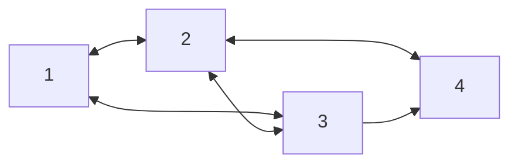
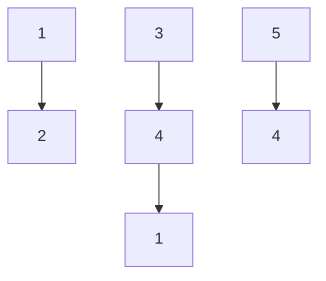
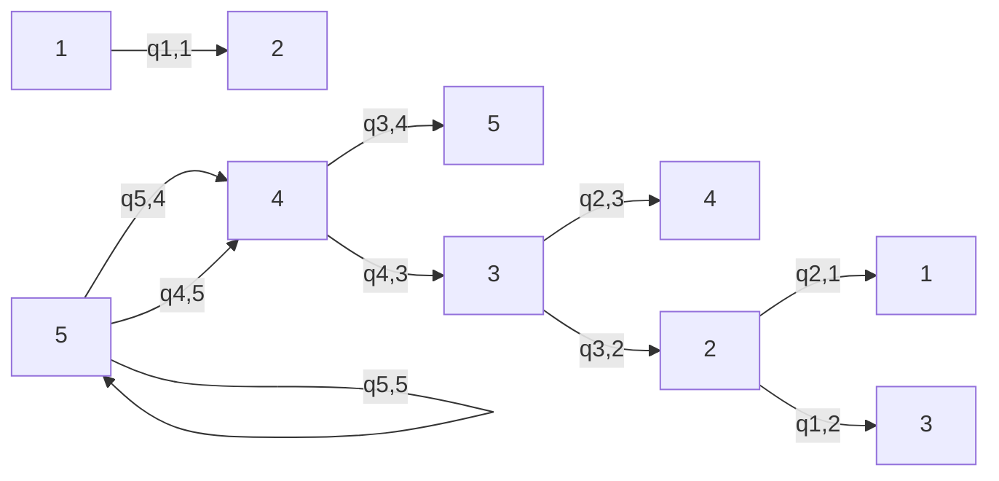
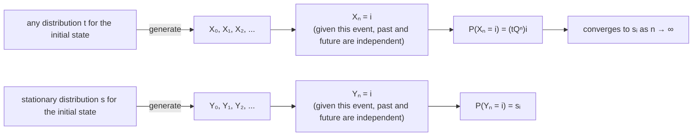
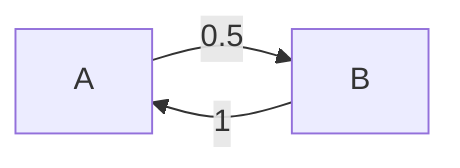
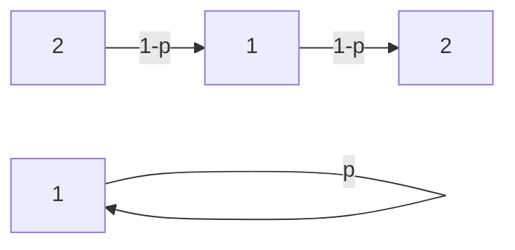
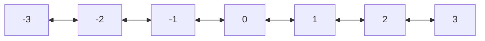
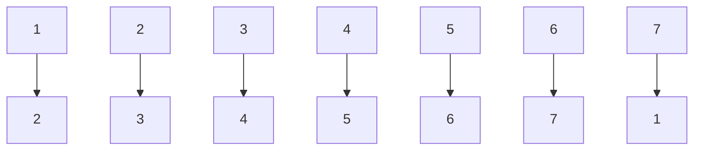

the importance of a page not only by how many pages link to it, but also by the importance of those pages.

Consider the web as a directed network—which is what it is. Each page on the web is a node, and links between nodes represent links between pages. For example, suppose for simplicity that the web only has 4 pages, connected as shown in the figure below.


<details>
<summary>flowchart</summary>


</details>

## FIGURE 11.5

It’s a small web after all.

Imagine someone randomly surfing the web, starting at some page and then randomly clicking links to go from one page to the next (with equal probabilities for all links on the current page). The idea of PageRank is to measure the importance of a page by the long-run fraction of time spent at that page.

Of course, some pages may have no outgoing links at all, such as page 4 above. When the web surfer encounters such a page, rather than despairing they open up a new browser window and visits a uniformly random page. Thus a page with no links is converted to a page that links to every page, including itself. For the example above, the resulting transition matrix is

$$
Q = \left( \begin{array}{c c c c} 0 & 1 / 2 & 0 & 1 / 2 \\ 1 / 2 & 0 & 1 / 2 & 0 \\ 0 & 0 & 0 & 1 \\ 1 / 4 & 1 / 4 & 1 / 4 & 1 / 4 \end{array} \right).
$$

In general, let M be the number of pages on the web, let $Q$ be the M by M transition matrix of the chain described above, and let s be the stationary distribution (assuming it exists and is unique). Think of $s _ { j }$ as a measure of how important page $j$ is. Intuitively, the equation

$$
s _ {j} = \sum_ {i} s _ {i} q _ {i j}
$$

says that the score of page $j$ should be based not only on how many other pages link to it, but on their scores. Furthermore, the “voting power” of a page gets diluted if it has a lot of outgoing links: it counts for more if page i’s only link is to page $j$ (so that $q _ { i j } = 1 )$ than if page i has thousands of links, one of which happens to be to page j.

It is not clear that a unique stationary distribution exists for this chain, since it may not be irreducible and aperiodic. Even if it is irreducible and aperiodic, convergence to the stationary distribution could be very slow since the web is so immense. To address these issues, suppose that before each move, the web surfer flips a coin with probability α of Heads. If Heads, the web surfer clicks a random link from the current page; if Tails, the web surfer teleports to a uniformly random page. The resulting chain has the Google transition matrix

$$
G = \alpha Q + (1 - \alpha) \frac {J}{M},
$$

where J is the M by M matrix of all 1’s. Note that the row sums of G are 1 and that all entries are positive, so G is a valid transition matrix for an irreducible, aperiodic Markov chain. This means there is a unique stationary distribution s, called PageRank, and the chain will converge to it! The choice of α is an important consideration; choosing α close to 1 makes sense to respect the structure of the web as much as possible, but there is a tradeoff since it turns out that smaller values of α make the chain converge much faster. As a compromise, the original recommendation of Brin and Page was α = 0.85.

PageRank is conceptually nice, but computing it sounds extremely difficult, considering that sG = s could be a system of 100 billion equations in 100 billion unknowns. Instead of thinking of this as a massive algebra problem, we can use the Markov chain interpretation: for any starting distribution t, $\mathbf { t } G ^ { n } \to \mathbf { s } { \mathrm { ~ a s ~ } } n \to \infty$ . And tG is easier to compute than it might seem at first:

$$
\mathbf {t} G = \alpha (\mathbf {t} Q) + \frac {1 - \alpha}{M} (\mathbf {t} J),
$$

where computing the first term isn’t too hard since Q is very sparse (mostly $\mathrm { 0 ^ { \circ } s ) }$ and computing the second term is easy since tJ is a vector of all 1’s. Then tG becomes the new t, and we can compute $\mathbf { t } G ^ { 2 } = ( \mathbf { t } G ) G$ , etc., until the sequence appears to have converged (though it is hard to know that it has converged). This gives an approximation to PageRank, and has an intuitive interpretation as the distribution of where the web surfer is after a large number of steps.

## 11.4 Reversibility

We have seen that the stationary distribution of a Markov chain is extremely useful for understanding its long-run behavior. Unfortunately, in general it may be computationally difficult to find the stationary distribution when the state space is large. This section addresses an important special case where working with eigenvalue equations for large matrices can be avoided.

Definition 11.4.1 (Reversibility). Let $Q   =   ( q _ { i j } )$ be the transition matrix of a Markov chain. Suppose there is $\mathbf { s } = ( s _ { 1 } , \ldots , s _ { M } )$ with $\textstyle s _ { i } \geq 0 , \sum _ { i } s _ { i } = 1$ , such that

$$
s _ {i} q _ {i j} = s _ {j} q _ {j i}
$$

for all states $i$ and $j .$ This equation is called the reversibility or detailed balance condition, and we say that the chain is reversible with respect to s if it holds.

The term “reversible” comes from the fact that a reversible chain, started according to its stationary distribution, behaves in the same way regardless of whether time is run forwards or backwards. If you record a video of a reversible chain, started according to its stationary distribution, and then show the video to a friend, either in the normal way or with time reversed, your friend will not be able to determine from watching the video whether time is running forwards or backwards.

As discussed after Definition 11.3.1, we can think about the stationary distribution of a Markov chain intuitively in terms of a system consisting of a large number of particles independently bouncing around according to the transition probabilities. In the long run, the proportion of particles in any state $j$ is the stationary probability of state $j ,$ and the flow of particles out of state $j$ is counterbalanced by the flow of particles into state $j .$ To see this in more detail, let $n$ be the number of particles and s be a probability vector such that $s _ { j }$ is the current proportion of particles at state $j .$ . By definition, s is the stationary distribution of the chain if and only if

$$
s _ {j} = \sum_ {i} s _ {i} q _ {i j} = s _ {j} q _ {j j} + \sum_ {i: i \neq j} s _ {i} q _ {i j},
$$

for all states $j .$ This equation can be rewritten as

$$
n s _ {j} (1 - q _ {j j}) = \sum_ {i: i \neq j} n s _ {i} q _ {i j}.
$$

The left-hand side is the approximate number of particles that will exit from state $j$ on the next step, since there are $n s _ { j }$ particles at state $j ,$ each of which will stay at $j$ with probability $q _ { j j }$ and leave with probability $1 - q _ { j j }$ . The right-hand side is the approximate number of particles that will enter state $j$ on the next step, since for each $i \neq j$ there are $n s _ { i }$ particles at state $i ,$ each of which will enter state $j$ with probability $q _ { i j }$ . So there is a balance between particles leaving state $j$ and particles entering state $j$

The reversibility condition imposes a much more stringent form of balance, in which for each pair of states $i , j$ with $i \neq j$ , the flow of particles from state $i$ to state $j$ is counterbalanced by the flow of particles from state $j$ to state i. To see this, write the reversibility equation for states $i$ and $j$ as

$$
n s _ {i} q _ {i j} = n s _ {j} q _ {j i}.
$$

The left-hand side is the approximate number of particles that will go from state $i$ to state $j$ on the next step, since there are $n s _ { i }$ particles at state $i ,$ each of which has probability $q _ { i j }$ of going to state $j$ . Similarly, the right-hand side is the approximate number of particles that will go from state $i$ to state $j$ on the next step. So reversibility says that there is a balance between particles going from state i to state $j .$ , and particles going from state $j$ to state $i .$

Given a transition matrix, if we can find a probability vector s that satisfies the reversibility condition, then s is automatically a stationary distribution. This should not be surprising, in light of the above discussion.

Proposition 11.4.2 (Reversible implies stationary). Suppose that $Q   =   ( q _ { i j } )$ is the transition matrix of a Markov chain that is reversible with respect to a nonnegative vector $\mathbf { s } = ( s _ { 1 } , \ldots , s _ { M } )$ whose components sum to 1. Then s is a stationary distribution of the chain.

Proof. We have

$$
\sum_ {i} s _ {i} q _ {i j} = \sum_ {i} s _ {j} q _ {j i} = s _ {j} \sum_ {i} q _ {j i} = s _ {j},
$$

where the last equality is because each row sum of $Q$ is 1. So s is stationary.

This is a powerful result because it is often easier to verify the reversibility condition than it is to solve the entire system of equations $\mathbf { s } Q = \mathbf { s }$ . However, in general we may not know in advance whether it is possible to find s satisfying the reversibility condition, and even when it is possible, it may take a lot of effort to find an s that works. In the remainder of this section, we look at three types of Markov chains where it is possible to find an s that satisfies the reversibility condition. Such Markov chains are called reversible.

First, if $Q$ is a symmetric matrix, then the stationary distribution is uniform over the state space: $\mathbf { s } = ( 1 / M , 1 / M , \ldots , 1 / M )$ . It is easy to see that if $q _ { i j } = q _ { j i }$ , then the reversibility condition $s _ { i } q _ { i j } = s _ { j } q _ { j i }$ is satisfied when $s _ { i } = s _ { j }$ for all i and $j$

This is a special case of a more general fact, stated below: if each column of $Q$ sums to 1, then the stationary distribution is uniform over the state space.

Proposition 11.4.3. If each column of the transition matrix $Q$ sums to 1, then the uniform distribution over all states, $( 1 / M , 1 / M , \ldots , 1 / M )$ , is a stationary distribution. (A nonnegative matrix such that the row sums and the column sums are all equal to 1 is called a doubly stochastic matrix.)

Proof. Assuming each column sums to 1, the row vector $\mathbf { v } = ( 1 , 1 , \ldots , 1 )$ satisfies $\mathbf { v } Q = \mathbf { v }$ . It follows that $( 1 / M , 1 / M , \ldots , 1 / M )$ is stationary. 

Second, if the Markov chain is a random walk on an undirected network, then there is a simple formula for the stationary distribution.

Example 11.4.4 (Random walk on an undirected network). A network is a collection of nodes joined by edges; the network is undirected if edges can be traversed in either direction, meaning there are no one-way streets. Suppose a wanderer randomly traverses the edges of an undirected network. From a node $i ,$ the wanderer randomly picks any of the edges at $i ,$ with equal probabilities, and then traverses the chosen edge. For example, in the network shown below, from node 3 the wanderer goes to node 1 or node 2, with probability 1/2 each.


<details>
<summary>flowchart</summary>


</details>

The degree of a node is the number of edges attached to it, and the degree sequence of a network with nodes $1 , 2 , \ldots , n$ is the vector $( d _ { 1 } , \ldots , d _ { n } )$ listing all the degrees, where $d _ { j }$ is the degree of node $j .$ An edge from a node to itself is allowed (such an edge is called a self-loop), and counts 1 toward the degree of that node.

For example, the network above has degree sequence d = (4, 3, 2, 3, 2). Note that

$$
d _ {i} q _ {i j} = d _ {j} q _ {j i}
$$

for all $i , j ,$ , since $q _ { i j }$ is $1 / d _ { i } { \mathrm { ~ i f ~ } } \{ i , j \}$ is an edge and 0 otherwise, for $i \neq j$ . Therefore, by Proposition 11.4.2, the stationary distribution is proportional to the degree sequence. Intuitively, the nodes with the highest degrees are the most well-connected, so it makes sense that the chain spends the most time in these states in the long run. In the example above, this says that

$$
\mathbf {s} = \left(\frac {4}{1 4}, \frac {3}{1 4}, \frac {2}{1 4}, \frac {3}{1 4}, \frac {2}{1 4}\right)
$$

is the stationary distribution for the random walk.

Exercise 20 explores random walk on a weighted undirected network; each edge has a weight assigned to it, and the wanderer chooses where to go from i with probabilities proportional to the weights on the available edges. It turns out that this is a reversible Markov chain. More surprisingly, every reversible Markov chain can be represented as random walk on a weighted undirected network! 

Here is a concrete example of a random walk on an undirected network.

Example 11.4.5 (Knight on a chessboard). Consider a knight randomly moving around on $\mathrm { ~ a ~ } 4 \times 4$ chessboard.


<details>
<summary>text_image</summary>

4
3
2
1
A	B	C	D
</details>

The 16 squares are labeled in a grid, e.g., the knight is currently at the square B3, and the upper left square is A4. Each move of the knight is an L-shaped jump: the knight moves two squares horizontally followed by one square vertically, or vice versa. For example, from B3 the knight can move to A1, C1, D2, or D4; from A4 it can move to B2 or C3. Note that from a light square, the knight always moves to a dark square and vice versa.

Suppose that at each step, the knight moves randomly, with each possibility equally likely. This creates a Markov chain where the states are the 16 squares. Compute the stationary distribution of the chain.

## Solution:

There are only three types of squares on the board: 4 center squares, 4 corner squares (such as A4), and 8 edge squares (such as B4; exclude corner squares from being considered edge squares). We can consider the board to be an undirected network where two squares are connected by an edge if they are accessible via a single knight’s move. Then a center square has degree 4, a corner square has degree 2, and an edge square has degree 3, so their stationary probabilities are 4a, 2a, 3a respectively for some a.

To find $a ,$ count the number of squares of each type to get $4 a \cdot 4 + 2 a \cdot 4 + 3 a \cdot 8 = 1$ giving $a = 1 / 4 8$ . Thus, each center square has stationary probability $4 / 4 8 = 1 / 1 2$ each corner square has stationary probability $2 / 4 8 = 1 / 2 4$ , and each edge square has stationary probability $3 / 4 8 = 1 / 1 6$ 

Third and finally, if in each time period a Markov chain can only move one step to the left, one step to the right, or stay in place, then it is called a birth-death chain. All birth-death chains are reversible.

Example 11.4.6 (Birth-death chain). A birth-death chain on states $\{ 1 , 2 , \ldots , M \}$ is a Markov chain with transition matrix $Q = ( q _ { i j } )$ such that $q_{ij} > 0   if   |i - j| = 1$ and $q _ { i j }   =   0   \mathrm { ~ i f ~ }   | i   -   j |   \geq   2$ . This says it’s possible to go one step to the left and possible to go one step to the right (except at boundaries) but impossible to jump further in one step. The name stems from applications to the growth or decline of a population, where a step to the right is thought of as a birth and a step to the left is thought of as a death in the population.

For example, the chain shown below is a birth-death chain if the labeled transitions have positive probabilities, except for the loops from a state to itself, which are allowed to have 0 probability.


<details>
<summary>flowchart</summary>


</details>

We will now show that any birth-death chain is reversible, and construct the stationary distribution. Let $s _ { 1 }$ be a positive number, to be specified later. Since we want $s _ { \mathrm { 1 } } q _ { \mathrm { 1 2 } } = s _ { \mathrm { 2 } } q _ { \mathrm { 2 1 } }$ , let

$$
s _ {2} = s _ {1} q _ {1 2} / q _ {2 1}.
$$

Then since we want $s _ { \mathrm { 2 } } q _ { \mathrm { 2 3 } } = s _ { \mathrm { 3 } } q _ { \mathrm { 3 2 } }$ , let

$$
s _ {3} = s _ {2} q _ {2 3} / q _ {3 2} = s _ {1} q _ {1 2} q _ {2 3} / (q _ {3 2} q _ {2 1}).
$$

Continuing in this way, let

$$
s _ {j} = \frac {s _ {1} q _ {1 2} q _ {2 3} \dots q _ {j - 1 , j}}{q _ {j , j - 1} q _ {j - 1 , j - 2} \dots q _ {2 1}},
$$

for all states $j$ with $2 \leq j \leq M$ . Choose $s _ { 1 }$ so that the $s _ { j }$ sum to 1. Then the chain is reversible with respect to s, since $q_{ij} = q_{ji} = 0   if   |i - j| \geq 2$ and by construction $s_{i}q_{ij} = s_{j}q_{ji}   if   |i - j| = 1$ . Thus, s is the stationary distribution. 

The Ehrenfest chain is a birth-death chain that can be used as a simple model for the diffusion of gas molecules. The stationary distribution turns out to be a Binomial distribution.

Example 11.4.7 (Ehrenfest). There are two containers with a total of M distinguishable particles. Transitions are made by choosing a random particle and moving it from its current container into the other container. Initially, all of the particles are in the second container. Let $X _ { n }$ be the number of particles in the first container at time $n ,$ so $X _ { 0 } = 0$ and the transition from $X _ { n }$ to $X _ { n + 1 }$ is done as described above. This is a periodic Markov chain with state space $\{ 0 , 1 , \ldots , M \}$


As illustrated above, the first container has $X _ { n }$ particles and the second has $M   -   X _ { n }$ particles. We will use the reversibility condition to show that $\mathbf { s } = ( s _ { 0 } , s _ { 1 } , \ldots , s _ { M } )$ with

$$
s _ {i} = \binom{M}{i} \left(\frac {1}{2}\right) ^ {M}
$$

is the stationary distribution. Note that this is the $\mathrm { B i n } ( M , 1 / 2 )$ PMF.

Let $s _ { i }$ be as claimed, and check that $s _ { i } q _ { i j } = s _ { j } q _ { j i }$ . If $j = i + 1$ (with $i < M )$ , then

$$
s _ {i} q _ {i j} = \binom{M}{i} \left(\frac {1}{2}\right) ^ {M} \frac {M - i}{M} = \frac {M !}{(M - i) ! i !} \left(\frac {1}{2}\right) ^ {M} \frac {M - i}{M} = \binom{M - 1}{i} \left(\frac {1}{2}\right) ^ {M},
$$

$$
s _ {j} q _ {j i} = \binom{M}{j} \left(\frac {1}{2}\right) ^ {M} \frac {j}{M} = \frac {M !}{(M - j) ! j !} \left(\frac {1}{2}\right) ^ {M} \frac {j}{M} = \binom{M - 1}{j - 1} \left(\frac {1}{2}\right) ^ {M} = s _ {i} q _ {i j}.
$$

By a similar calculation, if $j = i - 1$ (with $i > 0 )$ , then $s _ { i } q _ { i j } = s _ { j } q _ { j i }$ . For all other values of i and $j ,   q _ { i j } = q _ { j i } = 0$ . Therefore, s is stationary.

The Binomial was a natural guess for the stationary distribution because after running the Markov chain for a long time, each particle is about equally likely to be in either container. However, the PMF does not converge to a Binomial since the chain has period 2, with $X _ { n }$ guaranteed to be even when n is even, and odd when n is odd.

Happily, it turns out that another interpretation of the stationary distribution remains valid here: $s _ { i }$ is the long-run proportion of time that the chain spends in state i. More precisely, letting $I _ { k }$ be the indicator of the chain being in state i at time k, it can be shown that

$$
\frac {1}{n} \sum_ {k = 0} ^ {n - 1} I _ {k} \rightarrow s _ {i}
$$

as $n \to \infty$ , with probability 1.


## 11.5 Recap

A Markov chain is a sequence of r.v.s $X _ { 0 } , X _ { 1 } , X _ { 2 } , \ldots$ . satisfying the Markov property, which states that given the present, the past and future are conditionally independent:

$$
P (X _ {n + 1} = j | X _ {n} = i, X _ {n - 1} = i _ {n - 1}, \dots , X _ {0} = i _ {0}) = P (X _ {n + 1} = j | X _ {n} = i) = q _ {i j}.
$$

The transition matrix $Q = ( q _ { i j } )$ gives the probabilities of moving from any state to any other state in one step. The ith row of the transition matrix is the conditional PMF of $X _ { n + 1 }$ given $X _ { n } = i .$ The nth power of the transition matrix gives the $n -$ step transition probabilities. If we specify initial conditions $s _ { i } = P ( X _ { 0 } = i )$ and let $\mathbf { s } = ( s _ { 1 } , \ldots , s _ { M } )$ , then the marginal PMF of $X _ { n }$ is $\mathbf { s } Q ^ { n }$

States of a Markov chain can be classified as recurrent or transient: recurrent if the chain will return to the state over and over, and transient if it will eventually leave forever. States can also be classified according to their periods; the period of state i is the greatest common divisor of the numbers of steps it can take to return to $i ,$ starting from i. A chain is irreducible if it is possible to get from any state to any state in a finite number of steps, and aperiodic if each state has period 1.

A stationary distribution for a finite Markov chain is a PMF s such that $\mathbf { s } Q = \mathbf { s } .$ Under various conditions, the stationary distribution of a finite Markov chain exists and is unique, and the PMF of $X _ { n }$ converges to s as $n \to \infty$ . If state i has stationary probability $s _ { i } .$ then the expected time for the chain to return to $i ,$ starting from $i ,$ is $r _ { i } = 1 / s _ { i }$

If a PMF s satisfies the reversibility condition $s _ { i } q _ { i j } \; = \; s _ { j } q _ { j i }$ for all $i$ and $j ,$ it guarantees that s is a stationary distribution of the Markov chain with transition matrix $Q = ( q _ { i j } )$ . Markov chains for which there exists s satisfying the reversibility condition are called reversible. We discussed three types of reversible chains:

1. If the transition matrix is symmetric, then the stationary distribution is uniform over all states.

2. If the chain is a random walk on an undirected network, then the stationary distribution is proportional to the degree sequence, i.e.,

$$
s _ {j} = \frac {d _ {j}}{\sum_ {i} d _ {i}}.
$$

3. If the chain is a birth-death chain, then the stationary distribution satisfies

$$
s _ {j} = \frac {s _ {1} q _ {1 2} q _ {2 3} \cdots q _ {j - 1 , j}}{q _ {j , j - 1} q _ {j - 1 , j - 2} \cdots q _ {2 1}}
$$

for $j > 1$ , where $s _ { 1 }$ is solved for at the end to make $s _ { 1 } + \dots + s _ { M } = 1$


<details>
<summary>flowchart</summary>


</details>

FIGURE 11.6

Given a transition matrix Q and a distribution t over the states, we can generate a Markov chain $X _ { 0 } , X _ { 1 } , \ldots$ by choosing $X _ { 0 }$ according to t and then running the chain according to the transition probabilities. An important event is $X _ { n } = i$ , the event that the chain is visiting state i at time n. We can then find the PMF of $X _ { n }$ in terms of $Q$ and t, and (under conditions discussed in the chapter) the PMF will converge to the stationary distribution s. If instead we start the chain out according to s, then the chain will stay stationary forever.

Figure 11.6 compares two ways to run a Markov chain with transition matrix $Q ;$ choosing the initial state according to an arbitrary distribution t over the states, or choosing the initial state according to the stationary distribution s. In the former case, the exact PMF after n steps can be found in terms of $Q$ and t, and the PMF converges to s (under some very general conditions discussed in this chapter). In the latter case, the chain is stationary forever.

## 11.6 R

## Matrix calculations

Let’s do some calculations for the 4-state Markov chain in Example 11.1.5, as an example of working with transition matrices in R. First, we need to specify the transition matrix $Q .$ This is done with the matrix command: we type in the entries of the matrix, row by row, as a long vector, and then we tell R the number of rows and columns in the matrix (nrow and ncol), as well as the fact that we typed in the entries by row (byrow=TRUE):

<div class="docvortex-algorithm" style="white-space: pre-wrap; font-family:monospace;">
Q &lt;- matrix(c(1/3,1/3,1/3,0,
           0,0,1/2,1/2,
           0,1,0,0,
           1/2,0,0,1/2),nrow=4,ncol=4,byrow=TRUE)
</div>

To obtain higher order transition probabilities, we can multiply Q by itself repeatedly. The matrix multiplication command in R is $\% * \%$ (not just \*). So

<div class="docvortex-algorithm" style="white-space: pre-wrap; font-family:monospace;">
Q2 &lt;- Q %*% Q
Q3 &lt;- Q2 %*% Q
Q4 &lt;- Q2 %*% Q2
Q5 &lt;- Q3 %*% Q2
</div>

produces $Q ^ { 2 }$ through $Q ^ { 5 }$ . If we want to know the probability of going from state 3 to state 4 in exactly 5 steps, we can extract the (3, 4) entry of $Q ^ { 5 }$

Q5[3,4]

This gives 0.229, agreeing with the value 11/48 shown in Example 11.1.5.

To compute a power $Q ^ { n }$ without directly doing repeated matrix multiplications, we can use the command Q $\% \sim \%$ n after installing and loading the expm package. For example, Q %^% 42 yields $Q ^ { 4 2 }$ . By exploring the behavior of $Q ^ { n }$ as n grows, we can see Theorem 11.3.6 in action (and get a sense of how long it takes for the chain to get very close to its stationary distribution).

In particular, for n large each row of $Q ^ { n }$ is approximately (0.214, 0.286, 0.214, 0.286), so this is approximately the stationary distribution. Another way to obtain the stationary distribution numerically is to use

eigen(t(Q))

to compute the eigenvalues and eigenvectors of the transpose of $Q ;$ then the eigenvector corresponding to the eigenvalue 1 can be selected and normalized so that the components sum to 1.

## Gambler’s ruin

To simulate from the gambler’s ruin chain from Example 11.2.6, we start by deciding the total amount of money N, the probability p of gambler A winning a given round, and the number of time periods nsim that we wish to simulate.

<div class="docvortex-algorithm" style="white-space: pre-wrap; font-family:monospace;">
N &lt;- 10
p &lt;- 1/2
nsim &lt;- 80
</div>

Next, we allocate a vector of length nsim called x, which will store the values of the Markov chain. For the initial condition, we set the first entry of x equal to 5; this gives both gamblers \$5 to start with.

```r
x <- rep(0,nsim)
x[1] <- 5
```

Now we are ready to simulate the subsequent values of the Markov chain. This is achieved with the following block of code, which we will explain step by step.

```txt
for (i in 2:nsim){
    if (x[i-1]==0 || x[i-1]==N){
        x[i] <- x[i-1]
    }
    else{
        x[i] <- x[i-1] + sample(c(1,-1), 1, prob=c(p,1-p))
    }
}
```

The first line and the outer set of braces constitute a for loop: for (i in 2:nsim) means that all the code inside the for loop will be executed over and over, with the value of i set to 2, then set to 3, then set to 4, all the way until i reaches the value nsim. Each pass through the loop represents one step of the Markov chain.

Inside the for loop, we first check to see whether the chain is already at one of the endpoints, 0 or N; we do this with an if statement. If the chain is already at 0 or N, then we set its new value equal to its previous value, since the chain is not allowed to escape 0 or N. Otherwise, if the chain is not at 0 or N, it is free to move left or right. We use the sample command to move to the right 1 unit or to the left 1 unit, with probabilities p and 1-p, respectively.

To see what path was taken by the Markov chain during our simulation, we can plot the values of x as a function of time:

```txt
plot(x, type='l', ylim=c(0,N))
```

You should see a path that starts at 5 and bounces up and down before being absorbed into state 0 or state N.

## Simulating from a finite-state Markov chain

With a few modifications, we can simulate from an arbitrary Markov chain on a finite state space. For concreteness, we will illustrate how to simulate from the 4-state Markov chain in Example 11.1.5.

As above, we can type

```txt
Q <- matrix(c(1/3,1/3,1/3,0,
0,0,1/2,1/2,
```

```csv
0,1,0,0,
1/2,0,0,1/2),nrow=4,ncol=4,byrow=TRUE)
```

to specify the transition matrix Q.

Next, we choose the number of states and the number of time periods to simulate, we allocate space for the results of the simulation, and we choose initial conditions for the chain. In this example, x[1] <- sample(1:M,1) says the initial distribution of the chain is uniform over all states.

```r
M <- nrow(Q)
nsim <- 10^4
x <- rep(0,nsim)
x[1] <- sample(1:M,1)
```

For the simulation itself, we again use sample to choose a number from 1 to M. At time i, the chain was previously at state x[i-1], so we must use row x[i-1] of the transition matrix to determine the probabilities of sampling 1, 2, . . . , M. The notation Q[x[i-1],] denotes row x[i-1] of the matrix Q.

```txt
for (i in 2:nsim){
    x[i] <- sample(M, 1, prob=Q[x[i-1],])
}
```

Since we set nsim to a large number, it may be reasonable to believe that the chain is close to stationarity during the latter portion of the simulation. To check this, we eliminate the first half of the simulations to give the chain time to reach stationarity:

```r
x <- x[-(1:(nsim/2))]
```

We then use the table command to calculate the number of times the chain visited each state; dividing by length(x) converts the counts into proportions. The result is an approximation to the stationary distribution.

```txt
table(x)/length(x)
```

For comparison, the true stationary distribution of the chain is approximately (0.214, 0.286, 0.214, 0.286). Is this close to what you obtained via simulation?

## 11.7 Exercises

Exercises marked with s have detailed solutions at [http://stat110.net](http://stat110.net).

## Markov property

1. s Let $X _ { 0 } , X _ { 1 } , X _ { 2 } , \ldots$ . be a Markov chain. Show that $X _ { 0 } , X _ { 2 } , X _ { 4 } , X _ { 6 } , \ldots$ . is also a Markov chain, and explain why this makes sense intuitively.

2. s Let $X _ { 0 } , X _ { 1 } , X _ { 2 } , \ldots$ . be an irreducible Markov chain with state space $\{ 1 , 2 , \ldots , M \}$ $M \geq 3$ , transition matrix $Q = ( q _ { i j } )$ , and stationary distribution $\mathbf { s } = ( s _ { 1 } , \ldots , s _ { M } )$ . Let the initial state $X _ { 0 }$ follow the stationary distribution, i.e., $P ( X _ { 0 } = i ) = s _ { i }$

(a) On average, how many of $X _ { 0 } , X _ { 1 } , \ldots , X _ { 9 }$ equal 3? (In terms of s; simplify.)

(b) Let $Y _ { n } = ( X _ { n } - 1 ) ( X _ { n } - 2 )$ . For $M = 3$ , find an example of $Q$ (the transition matrix for the original chain $X _ { 0 } , X _ { 1 } , \dots )$ where $Y _ { 0 } , Y _ { 1 } , \ldots$ . is Markov, and another example of Q where $Y _ { 0 } , Y _ { 1 } , \ldots$ . is not Markov. In your examples, make $q _ { i i } > 0$ for at least one i and make sure it is possible to get from any state to any other state eventually.

3. A Markov chain has two states, A and B, with transitions as follows:


<details>
<summary>flowchart</summary>


</details>

Suppose we do not get to observe this Markov chain, which we’ll call $X _ { 0 } , X _ { 1 } , X _ { 2 } , \ldots .$ Instead, whenever the chain transitions from A back to $A ,$ we observe a 0, and whenever it changes states, we observe a 1. Let the sequence of 0’s and 1’s be called $Y _ { 0 } , Y _ { 1 } , Y _ { 2 } , \ldots .$

For example, if the X chain starts out as

$$
A, A, B, A, B, A, A, \dots
$$

then the Y chain starts out as

$$
0, 1, 1, 1, 1, 0, \dots
$$

(a) Show that $Y _ { 0 } , Y _ { 1 } , Y _ { 2 } , \ldots$ . is not a Markov chain.

(b) In Example 11.1.3, we dealt with a violation of the Markov property by enlarging the state space to incorporate second-order dependence. Show that such a trick will not work for $Y _ { 0 } , Y _ { 1 } , Y _ { 2 } , \ldots .$ That is, no matter how large m is,

$$
Z _ {n} = (Y _ {n - m + 1}, Y _ {n - m + 2}, \dots , Y _ {n}), n = m - 1, m, \dots
$$

is still not a Markov chain.

4. There are three blocks, floating in a sea of lava. Label the blocks 1, 2, 3, from left to right. Mark the Kangaroo, a video game character, is standing on block 1. To reach safety, he must get to block 3. He can’t jump directly from block 1 to block 3; his only hope is to jump from block 1 to block 2, then jump from block 2 to block 3. Each time he jumps, he has probability $1 / 2$ of success and probability $1 / 2$ of “dying” by falling into the lava. If he “dies”, he starts again at block 1.

Let J be the total number of jumps that Mark will make in order to get to block 3.

(a) Find $E ( J )$ , using the Markov property and conditional expectation.
(b) Explain how this problem relates to a coin tossing problem from Chapter 9.

## Stationary distribution

5. s Consider the Markov chain shown below, where $0   <   p   <   1$ and the labels on the arrows indicate transition probabilities.


<details>
<summary>flowchart</summary>


</details>

(a) Write down the transition matrix Q for this chain.
(b) Find the stationary distribution of the chain.
(c) What is the limit of $Q ^ { n }$ as $n \to \infty ?$

6. s Consider the Markov chain shown below, where the state space is {1, 2, 3, 4} and the labels to the right of arrows indicate transition probabilities.


(a) Write down the transition matrix $Q$ for this chain.
(b) Which states (if any) are recurrent? Which states (if any) are transient?
(c) Find two different stationary distributions for the chain.

7. s Daenerys has three dragons: Drogon, Rhaegal, and Viserion. Each dragon independently explores the world in search of tasty morsels. Let $X _ { n } , Y _ { n } , Z _ { n }$ be the locations at time n of Drogon, Rhaegal, Viserion respectively, where time is assumed to be discrete and the number of possible locations is a finite number M. Their paths $X _ { 0 } , X _ { 1 } , X _ { 2 } , \ldots ;$ $Y _ { 0 } , Y _ { 1 } , Y _ { 2 } , \ldots ;$ and $Z _ { 0 } , Z _ { 1 } , Z _ { 2 } , \ldots$ . are independent Markov chains with the same stationary distribution s. Each dragon starts out at a random location generated according to the stationary distribution.

(a) Let state 0 be home (so s0 is the stationary probability of the home state). Find the expected number of times that Drogon is at home, up to time 24, i.e., the expected number of how many of $X _ { 0 } , X _ { 1 } , \ldots , X _ { 2 4 }$ are state 0 (in terms of s0).

(b) If we want to track all 3 dragons simultaneously, we need to consider the vector of positions, $( X _ { n } , Y _ { n } , Z _ { n } )$ . There are $M ^ { 3 }$ possible values for this vector; assume that each is assigned a number from 1 to $M ^ { 3 } , \; \mathrm { e . g . , \; i f } \; M   =   2$ we could encode the states $( 0 , 0 , 0 ) , ( 0 , 0 , 1 ) , ( 0 , 1 , 0 ) , \ldots , ( 1 , 1 , 1 )$ as $1 , 2 , 3 , \ldots , 8$ respectively. Let $W _ { n }$ be the number between 1 and $M ^ { 3 }$ representing $( X _ { n } , Y _ { n } , Z _ { n } )$ . Determine whether $W _ { 0 } , W _ { 1 } , \ldots$ . is a Markov chain.

(c) Given that all 3 dragons start at home at time 0, find the expected time it will take for all 3 to be at home again at the same time.

8. Consider the following Markov chain with $5 2 !   \approx   8   \times   1 0 ^ { 6 7 }$ states. The states are the possible orderings of a standard 52-card deck. To run one step of the chain, pick 2 different cards from the deck, with all pairs equally likely, and swap the 2 cards. Find the stationary distribution of the chain.

## Reversibility

9. s A Markov chain $X _ { 0 } , X _ { 1 } , \ldots$ with state space $\{ - 3 , - 2 , - 1 , 0 , 1 , 2 , 3 \}$ proceeds as follows. The chain starts at $X _ { 0 }   =   0$ . If $X _ { n }$ is not an endpoint $( - 3   \mathrm { ~ o r ~ }   3 )$ , then $X _ { n + 1 }$ is $X _ { n } - 1$ or $X _ { n } + 1$ , each with probability $1 / 2$ . Otherwise, the chain gets reflected off the endpoint, i.e., from 3 it always goes to 2 and from −3 it always goes to −2. A diagram of the chain is shown below.


<details>
<summary>flowchart</summary>


</details>

(a) Is $| X _ { 0 } | , | X _ { 1 } | , | X _ { 2 } | , \ldots$ . also a Markov chain? Explain.

Hint: For both (a) and (b), think about whether the past and future are conditionally independent given the present; don’t do calculations with a $7$ by $7$ transition matrix!

(b) Let sgn be the sign function: sgn $\operatorname { l } ( x )   =   1   \operatorname { i f }   x   >   0 ,   \operatorname { s g n } ( x )   =   - 1   \operatorname { i f }   x   <   0$ , and $\mathrm { s g n } ( 0 ) = 0$ . Is $\operatorname { s g n } ( X _ { 0 } ) , \operatorname { s g n } ( X _ { 1 } ) , \operatorname { s g n } ( X _ { 2 } ) , \ldots$ a Markov chain? Explain.

(c) Find the stationary distribution of the chain $X _ { 0 } , X _ { 1 } , X _ { 2 } , \ldots .$

(d) Find a simple way to modify some of the transition probabilities $q _ { i j }$ for $i \in \{ - 3 , 3 \}$ to make the stationary distribution of the modified chain uniform over the states.

10. s Let $G$ be an undirected network with nodes labeled $1 , 2 , \ldots , M$ (edges from a node to itself are not allowed), where $M \geq 2$ and random walk on this network is irreducible. Let $d _ { j }$ be the degree of node $j$ for each $j .$ Create a Markov chain on the state space $1 , 2 , \ldots , M$ , with transitions as follows. From state $i ,$ generate a proposal $j$ by choosing a uniformly random $j$ such that there is an edge between i and $j$ in $G ;$ then $\mathbf { g } \mathbf { o }$ to j with probability min $( d _ { i } / d _ { j } , 1 )$ , and stay at i otherwise.

(a) Find the transition probability $q _ { i j }$ from i to $j$ for this chain, for all states $i , j$

(b) Find the stationary distribution of this chain.

11. s (a) Consider a Markov chain on the state space $\{ 1 , 2 , \ldots , 7 \}$ with the states arranged in a “circle” as shown below, and transitions given by moving one step clockwise or counterclockwise with equal probabilities. For example, from state $6 ,$ the chain moves to state $7$ or state 5 with probability $1 / 2$ each; from state $^ { 7 , }$ the chain moves to state 1 or state 6 with probability $1 / 2$ each. The chain starts at state 1.


<details>
<summary>flowchart</summary>


</details>