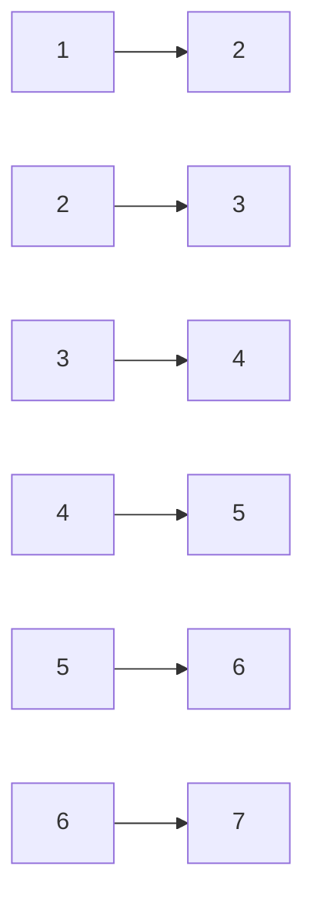
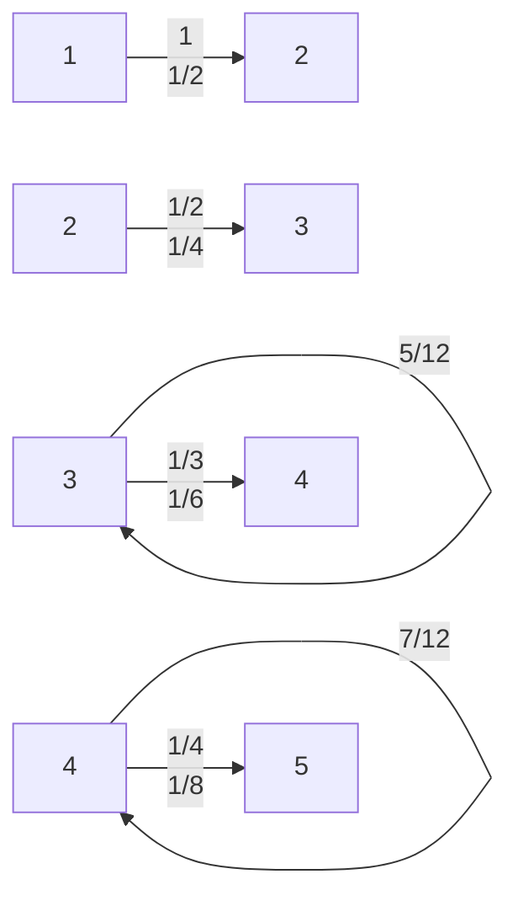
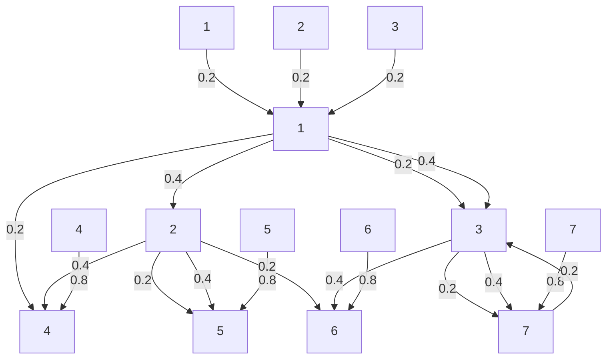
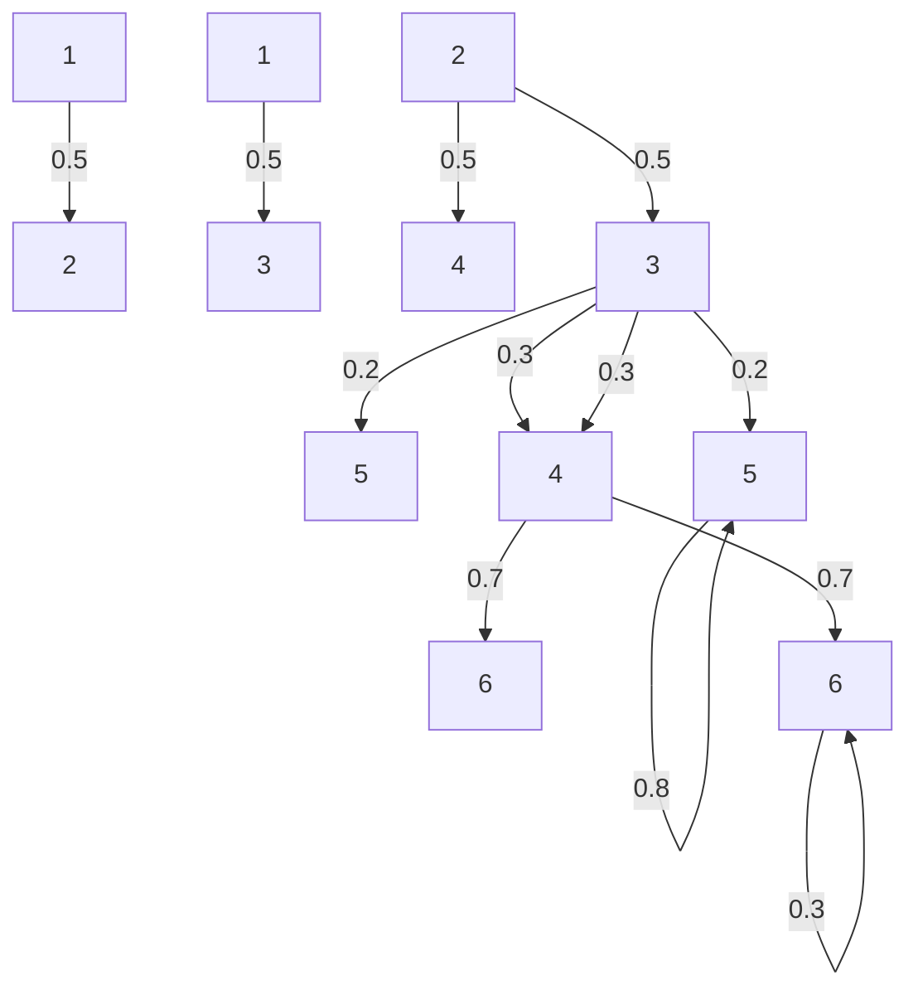
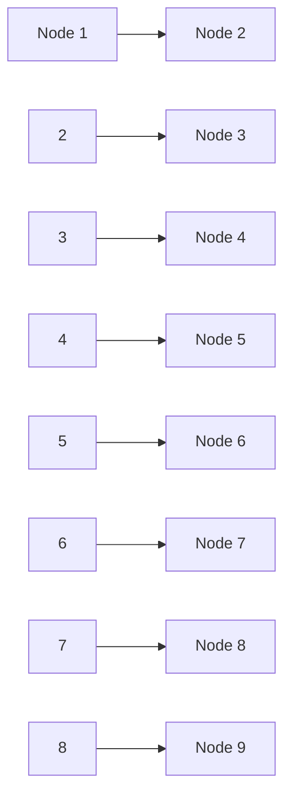

Find the stationary distribution of this chain.

(b) Consider a new chain obtained by “unfolding the circle”. Now the states are arranged as shown below. From state 1 the chain always goes to state 2, and from state 7 the chain always goes to state 6. Find the new stationary distribution.


<details>
<summary>flowchart</summary>


</details>

12. s Let $X _ { n }$ be the price of a certain stock at the start of the nth day, and assume that $X _ { 0 } , X _ { 1 } , X _ { 2 } , \ldots$ . follows a Markov chain with transition matrix Q. (Assume for simplicity that the stock price can never go below 0 or above a certain upper bound, and that it is always rounded to the nearest dollar.)

(a) A lazy investor only looks at the stock once a year, observing the values on days 0, 365, 2 · 365, 3 · 365, . . . . So the investor observes $Y _ { 0 } , Y _ { 1 } , \ldots ,$ where $Y _ { n }$ is the price after n years (which is 365n days; you can ignore leap years). Is $Y _ { 0 } , Y _ { 1 } , \ldots$ . also a Markov chain? Explain why or why not; if so, what is its transition matrix?
(b) The stock price is always an integer between \$0 and \$28. From each day to the next, the stock goes up or down by \$1 or \$2, all with equal probabilities (except for days when the stock is at or near a boundary, i.e., at \$0, \$1, \$27, or \$28).

If the stock is at \$0, it goes up to \$1 or \$2 on the next day (after receiving government bailout money). If the stock is at \$28, it goes down to \$27 or \$26 the next day. If the stock is at \$1, it either goes up to \$2 or \$3, or down to \$0 (with equal probabilities); similarly, if the stock is at \$27 it either goes up to \$28, or down to \$26 or \$25. Find the stationary distribution of the chain.

13. s In chess, the king can move one square at a time in any direction (horizontally, vertically, or diagonally).


<details>
<summary>text_image</summary>

8
7
6
5
4
3
2
1
a b c d e f g h
</details>

For example, in the diagram, from the current position the king can move to any of 8 possible squares. A king is wandering around on an otherwise empty $8 \times 8$ chessboard, where for each move all possibilities are equally likely. Find the stationary distribution of this chain (of course, don’t list out a vector of length 64 explicitly! Classify the 64 squares into types and say what the stationary probability is for a square of each type).

14. A chess piece is wandering around on an otherwise vacant $8 \times 8$ chessboard. At each move, the piece (a king, queen, rook, bishop, or knight) chooses uniformly at random where to go, among the legal choices (according to the rules of chess, which you should look up if you are unfamiliar with them).

(a) For each of these cases, determine whether the Markov chain is irreducible, and whether it is aperiodic.

Hint for the knight: Note that a knight’s move always goes from a light square to a dark square or vice versa. A knight’s tour is a sequence of knight moves on a chessboard such that the knight visits each square exactly once. Many knight’s tours exist.

(b) Suppose for this part that the piece is a rook, with initial position chosen uniformly at random. Find the distribution of where the rook is after n moves.
(c) Now suppose that the piece is a king, with initial position chosen deterministically to be the upper left corner square. Determine the expected number of moves it takes the king to return to that square, fully simplified, preferably in at most 140 characters.
(d) The stationary distribution for the random walk of the king from the previous part is not uniform over the 64 squares of the chessboard. A recipe for modifying the chain to obtain a uniform stationary distribution is as follows. Label the squares as $1 , 2 , \ldots , 6 4$ and let $d _ { i }$ be the number of legal moves from square i. Suppose the king is currently at square i. The next move of the chain is determined as follows:

Step 1: Generate a proposal square $j$ by picking uniformly at random among the legal moves from i.

Step 2: Flip a coin with probability min $\mathbf { . } ( d _ { i } / d _ { j } , 1 )$ of Heads. If the coin lands Heads, go to j. Otherwise, stay at i.

Show that this modified chain has a stationary distribution that is uniform over the 64 squares.

15. s Find the stationary distribution of the Markov chain shown below, without using matrices. The number above each arrow is the corresponding transition probability.


<details>
<summary>flowchart</summary>


</details>

16. There are two urns with a total of 2N distinguishable balls. Initially, the first urn has N white balls and the second urn has N black balls. At each stage, we pick a ball at random from each urn and interchange them. Let $X _ { n }$ be the number of black balls in the first urn at time n. This is a Markov chain on the state space $\{ 0 , 1 , \ldots , N \}$

(a) Give the transition probabilities of the chain.
(b) Show that $( s _ { 0 } , s _ { 1 } , \ldots , s _ { N } )$ where

$$
s _ {i} = \frac {\binom {N} {i} \binom {N} {N - i}}{\binom {2 N} {N}}
$$

is the stationary distribution, by verifying the reversibility condition.

17. Find the stationary distribution of a Markov chain $X _ { 0 } , X _ { 1 } , X _ { 2 } , \ldots$ . on the state space $\{ 0 , 1 , \ldots , 1 1 0 \}$ , with transition probabilities given by

$$
P (X _ {n + 1} = j | X _ {n} = 0) = p, \text { for } j = 1, 2, \dots , 1 1 0;
$$

$$
P (X _ {n + 1} = 0 | X _ {n} = 0) = 1 - 1 1 0 p;
$$

$$
P (X _ {n + 1} = j | X _ {n} = j) = 1 - r, \text { for } j = 1, 2, \dots , 1 1 0;
$$

$$
P (X _ {n + 1} = 0 | X _ {n} = j) = r, \text {   for   } j = 1, 2, \dots , 1 1 0,
$$

where p and r are constants with $\textstyle 0 < p < { \frac { 1 } { 1 1 0 } }$ and $0 < r < 1$

18. Determine whether the Markov chain shown below is reversible, and find the stationary distribution of the chain. The label to the left of an arrow gives the corresponding transition probability.


<details>
<summary>flowchart</summary>


</details>

19. Nausicaa Distribution sells distribution plushies on Etsy. They have two different photos of the Evil Cauchy plushie but do not know which is more effective in getting a customer to purchase an Evil Cauchy plushie. Each visitor to their website is shown one of the two photos (call them Photo A and Photo B), and then the visitor either does buy an Evil Cauchy (“success”) or does not buy one (“failure”).

Let a and b be the probabilities of success when Photo A is shown and when Photo B is shown, respectively. Even though the Evil Cauchy is irresistible, suppose that $0 < a < 1$ and $0 < b < 1$ . Suppose that the following strategy is followed (note that the strategy can be followed without knowing a and b). Show the first visitor Photo A. If that visitor buys an Evil Cauchy, continue with Photo A for the next visitor; otherwise, switch to Photo B. Similarly, if the nth visitor is a “success” then show the $( n + 1 ) \mathrm { s t }$ visitor the same photo, and otherwise switch to the other photo.

(a) Show how to represent the resulting process as a Markov chain, drawing a diagram and giving the transition matrix. The states are A1, B1, A0, B0 (use this order for the transition matrix and stationary distribution), where, for example, being at state A1 means that the current visitor was shown Photo A and was a success.
(b) Determine whether this chain is reversible.

Hint: First think about which transition probabilities are zero and which are nonzero.

(c) Show that the stationary distribution is proportional to $\textstyle { \left( { \frac { a } { 1 - a } } , { \frac { b } { 1 - b } } , 1 , 1 \right) }$ , and find the stationary distribution.
(d) Show that for $a \neq b ,$ the stationary probability of success for each visitor is strictly better than the success probability that would be obtained by independently, randomly choosing (with equal probabilities) which photo to show to each visitor.

20. This exercise considers random walk on a weighted undirected network. Suppose that an undirected network is given, where each edge $( i , j )$ has a nonnegative weight $w _ { i j }$ assigned to it (we allow $i = j$ as a possibility). We assume that $w _ { i j } = w _ { j i }$ since the edge from i to $j$ is considered the same as the edge from $j$ to i. To simplify notation, define $w _ { i j } = 0$ whenever $( i , j )$ is not an edge.

When at node i, the next step is determined by choosing an edge attached to i with probabilities proportional to the weights. For example, if the walk is at node 1 and there are 3 possible edges coming out from node 1, with weights 7, 1, 4, then the first of these 3 edges is traversed with probability $7 / 1 2$ , the second is traversed with probability $1 / 1 2 ,$ and the third is traversed with probability $4 / 1 2$ If all the weights equal 1, then the process reduces to the kind of random walk on a network that we studied earlier.

(a) Let $\begin{array} { r } { v _ { i } = \sum _ { j } w _ { i j } } \end{array}$ for all nodes i. Show that the stationary distribution of node i is proportional to $v _ { i }$

(b) Show that every reversible Markov chain can be represented as a random walk on a weighted undirected network. That is, given the transition matrix Q of a reversible Markov chain, show that we can choose the weights $w _ { i j }$ so that the random walk defined above is a Markov chain with transition matrix Q. Be sure to check that $w _ { i j } = w _ { j i }$

Hint: Let $w _ { i j } = s _ { i } q _ { i j }$ , with s the stationary distribution and $q _ { i j }$ the $( i , j )$ entry of $Q$

## Mixed practice

21. s A cat and a mouse move independently back and forth between two rooms. At each time step, the cat moves from the current room to the other room with probability 0.8. Starting from room 1, the mouse moves to Room 2 with probability 0.3 (and remains otherwise). Starting from room 2, the mouse moves to room 1 with probability 0.6 (and remains otherwise).

(a) Find the stationary distributions of the cat chain and of the mouse chain.

(b) Note that there are 4 possible (cat, mouse) states: both in room 1, cat in room 1 and mouse in room 2, cat in room 2 and mouse in room 1, and both in room 2. Number these cases 1, 2, 3, 4, respectively, and let $Z _ { n }$ be the number representing the (cat, mouse) state at time n. Is $Z _ { 0 } , Z _ { 1 } , Z _ { 2 } , \ldots \; \mathrm { a }$ Markov chain?

(c) Now suppose that the cat will eat the mouse if they are in the same room. We wish to know the expected time (number of steps taken) until the cat eats the mouse for two initial configurations: when the cat starts in room 1 and the mouse starts in room 2, and vice versa. Set up a system of two linear equations in two unknowns whose solution is the desired values.

22. (a) Alice and Bob are wandering around randomly, independently of each other, in a house with M rooms, labeled $1 , 2 , \ldots , M$ . Let $d _ { i }$ be the number of doors in room i (leading to other rooms, not leading outside). At each step, Alice moves to another room by choosing randomly which door to go through (with equal probabilities). Bob does the same, independently. The Markov chain they each follow is irreducible and aperiodic. Let $A _ { n }$ and $B _ { n }$ be Alice’s room and Bob’s room at time n, respectively, for $n = 0 , 1 , 2 , \ldots .$

Find $\lim_{n \to \infty} P(A_n = i, B_n = j)$

(b) With setup as in (a), let $p _ { i j }$ be the transition probability for going from room i to room j. Let $t _ { i k }$ be the expected first time at which Alice and Bob are in the same room, if Alice starts in room i and Bob starts in room k (note that $t _ { i k } = 0$ for $i = k )$

Provide a system of linear equations, the solution of which would yield $t _ { i k }$ for all rooms $i , k .$

Hint: Condition on Alice’s first move and Bob’s first move.

23. Let $\{ X _ { n } \}$ be a Markov chain on states {0, 1, 2} with transition matrix

$$
Q = \left( \begin{array}{c c c} 0. 8 & 0. 2 & 0 \\ 0 & 0. 8 & 0. 2 \\ 0 & 0 & 1 \end{array} \right).
$$

The chain starts at $X _ { 0 } = 0$ . Let $T$ be the time it takes to reach state $2 ;$

$$
T = \min \{n: X _ {n} = 2 \}.
$$

By drawing the Markov chain and telling a story, find $E ( T )$ and $\operatorname { V a r } ( T )$

24. Consider the following Markov chain on the state space $\{ 1 , 2 , 3 , 4 , 5 , 6 \}$


<details>
<summary>flowchart</summary>


</details>

(a) Suppose the chain starts at state 1. Find the distribution of the number of times that the chain returns to state 1.
(b) In the long run, what fraction of the time does the chain spend in state 3? Explain briefly.

25. Let $Q$ be the transition matrix of a Markov chain on the state space $\{ 1 , 2 , \ldots , M \}$ , such that state M is an absorbing state, i.e., from state M the chain can never leave. Suppose that from any other state, it is possible to reach M (in some number of steps).

(a) Which states are recurrent, and which are transient? Explain.
(b) What is the limit of $Q ^ { n }$ as $n \to \infty ?$
(c) For $i , j \in \{ 1 , 2 , \ldots , M - 1 \}$ , find the probability that the chain is at state $j$ at time n, given that the chain is at state i at time 0 (your answer should be in terms of $Q )$ .
(d) For $i , j \in \{ 1 , 2 , \ldots , M - 1 \}$ , find the expected number of times that the chain is at state $j$ up to (and including) time $n ,$ given that the chain is at state i at time 0 (in terms of $Q )$
(e) Let R be the $\left( M   -   1 \right) \times \left( M   -   1 \right)$ matrix obtained from Q by deleting the last row and the last column of Q. Show that the $( i , j )$ entry of $( I - R ) ^ { - 1 }$ is the expected number of times that the chain is at state $j$ before absorption, given that it starts out at state $i .$

Hint: We have $I + R + R ^ { 2 } + \cdots = ( I - R ) ^ { - 1 }$ , analogously to a geometric series. Also, if we partition $Q$ as

$$
Q = \left( \begin{array}{c c} R & B \\ \hline 0 & 1 \end{array} \right)
$$

where B is a $( M - 1 ) \times 1$ matrix and 0 is the $1 \times ( M - 1 )$ zero matrix, then

$$
Q ^ {k} = \left( \begin{array}{c c} R ^ {k} & B _ {k} \\ \hline 0 & 1 \end{array} \right)
$$

for some $( M - 1 ) \times 1$ matrix $B _ { k }$

26. In the game called Chutes and Ladders, players try to be first to reach a certain destination on a board. The board is a grid of squares, numbered from 1 to the number of squares. The board has some “chutes” and some “ladders”, each of which connects a pair of squares. Here we will consider the one player version of the game (this can be extended to the multi-player version without too much trouble, since with more than one player, the players simply take turns independently until one reaches the destination).

On each turn, the player rolls a fair die, which determines how many squares forward to move on the grid, e.g., if the player is at square 5 and rolls a 3, then they advance to square 8. If the resulting square is the base of a ladder, the player gets to climb the ladder, instantly arriving at a more advanced square. If the resulting square is the top of a chute, the player instantly slides down to the bottom of the chute.

This game can be viewed naturally as a Markov chain: given where the player currently is on the board, the past history does not matter for computing, for example, the probability of winning within the next 3 moves.

Consider a simplified version of Chutes and Ladders, played on the $3 \times 3$ board shown below. The player starts out at square 1, and wants to get to square 9. On each move, a fair coin is flipped, and the player gets to advance 1 square if the coin lands Heads and 2 squares if the coin lands Tails. However, there are 2 ladders (shown as upward-pointing arrows) and 2 chutes (shown as downward-pointing arrows) on the board.


<details>
<summary>flowchart</summary>


</details>

(a) Explain why, despite the fact that there are 9 squares, we can represent the game using the $5 \times 5$ transition matrix

$$
Q = \left( \begin{array}{c c c c c} 0 & 0. 5 & 0. 5 & 0 & 0 \\ 0 & 0 & 0. 5 & 0. 5 & 0 \\ 0. 5 & 0 & 0 & 0. 5 & 0 \\ 0. 5 & 0 & 0 & 0 & 0. 5 \\ 0 & 0 & 0 & 0 & 1 \end{array} \right).
$$

(b) Find the mean and variance for the number of times the player will visit square $^ { 7 , }$ without using matrices or any messy calculations.

The remaining parts of this problem require matrix calculations that are best done on a computer. You can use whatever computing environment you want, but here is some information for how to do it in R. In any case, you should state what environment you used and include your code. To create the transition matrix in R, you can use the following commands:

$$
\begin{array}{l} \mathrm{a} <   - 0. 5 \\ \mathrm{Q} <   - \text {matrix} (\mathrm{c} (0, 0, \mathrm{a}, \mathrm{a}, 0, \mathrm{a}, 0, 0, 0, 0, \mathrm{a}, \mathrm{a}, 0, 0, 0, 0, \mathrm{a}, \mathrm{a}, 0, 0, 0, 0, 0, \mathrm{a}, 1), \mathrm{nrow} = 5) \\ \end{array}
$$

Some useful R commands for matrices are in Appendix B.2. In particular, diag(n) gives the $n \times n$ identity matrix, solve(A) gives the inverse $A ^ { - 1 }$ , and A $\% * \%$ B gives the product $A B$ (note that A\*B does not do ordinary matrix multiplication). Matrix powers are not built into R, but you can compute $A ^ { k }$ using $A \% \sim \%$ k after installing and loading the expm package.

(c) Find the median duration of the game (where duration is the number of coin flips).

Hint: Relate the CDF of the duration to powers of $Q$

(d) Find the mean duration of the game (with duration defined as above).

Hint: Relate the duration to the total amount of time spent in transient states, and apply Part (e) of the previous problem.

## Markov chain Monte Carlo

We have seen throughout this book that simulation is a powerful technique in probability. If you can’t convince your friend that it is a good idea to switch doors in the Monty Hall problem, in one second you can simulate playing the game a few thousand times and your friend will just see that switching succeeds about 2/3 of the time. If you’re unsure how to calculate the mean and variance of an r.v. X but you know how to generate i.i.d. draws $X _ { 1 } , X _ { 2 } , \ldots , X _ { n }$ from that distribution, you can approximate the true mean and true variance using the sample mean and sample variance of the simulated draws:

$$
E (X) \approx \frac {1}{n} (X _ {1} + \dots + X _ {n}) = \bar {X} _ {n},
$$

$$
\mathrm{Var} (X) \approx \frac {1}{n - 1} \sum_ {j = 1} ^ {n} (X _ {j} - \bar {X} _ {n}) ^ {2}.
$$

The law of large numbers tells us that these approximations will be good if n is large. We can get better and better approximations by increasing n, just by running the computer for a longer time (rather than having to struggle with a possibly intractable sum or integral). As discussed in Chapter 10, this simulation approach, where we generate random values to approximate a quantity, is called a Monte Carlo method.

A major limitation of the Monte Carlo idea above is that we need to know how to generate $X _ { 1 } , X _ { 2 } , \ldots , X _ { n }$ (hopefully efficiently, since we want to be able to make n large). For example, suppose that we want to simulate random draws from the continuous distribution with PDF f given by

$$
f (x) \propto x ^ {3. 1} (1 - x) ^ {4. 2}
$$

for $0 < x < 1$ (and 0 otherwise). Staring at a density function does not immediately suggest how to get a random variable with that density. In this case we recognize the PDF of the Beta(4.1, 5.2) distribution, so assuming we had access to a Unif(0, 1) r.v., we could theoretically use universality of the Uniform. Unfortunately, finding the CDF of a Beta distribution is difficult, let alone the inverse of the CDF. See Example 12.1.4 for more about the Beta simulation problem.

Of course, the distributions that arise in real-world applications are often much more complicated than the Beta. For the Beta distribution, we know an expression for the normalizing constant in terms of the gamma function. But for many other distributions that are of scientific interest, the normalizing constant in the PDF or PMF is unknown, and beyond the reach of the fastest available computers and the fanciest available mathematical techniques.

This chapter introduces Markov chain Monte Carlo (MCMC), a powerful collec tion of algorithms that enable us to simulate from complicated distributions using Markov chains. The development of MCMC has revolutionized statistics and scientific computation by vastly expanding the range of possible distributions that we can simulate from, including joint distributions in high dimensions. The basic idea is to build your own Markov chain so that the distribution of interest is the stationary distribution of the chain.

In the previous chapter, we looked at Markov chains whose transition matrix Q was specified, and we tried to find the stationary distribution s of the chain. In this chapter we do the reverse: starting with a distribution s that we want to simulate, we will engineer a Markov chain whose stationary distribution is s. If we then run this engineered Markov chain for a very long time, the distribution of the chain will approach our desired s.

But is it possible to create a transition matrix Q with the stationary distribution we desire? Even if it is possible, is solving this problem any easier than the original problem of how to simulate random draws from that distribution? In amazing generality, MCMC shows that it is possible to create a Markov chain with the desired stationary distribution in an easy-to-describe way, without having to know the normalizing constant for the distribution!

MCMC is now being applied to a large number of problems in the biological, natural, and physical sciences, and many different MCMC algorithms have been developed. Here we will introduce two of the most important and most widely used MCMC algorithms: the Metropolis-Hastings algorithm and Gibbs sampling. MCMC is an enormous and growing area of statistical computing; see Brooks, Gelman, Jones, and Meng [2] for much more about its theory, methods, and applications.

## 12.1 Metropolis-Hastings

The Metropolis-Hastings algorithm is a general recipe that lets us start with any irreducible Markov chain on the state space of interest and then modify it into a new Markov chain that has the desired stationary distribution. This modification consists of introducing some selectiveness in the original chain: moves are proposed according to the original chain, but the proposal may or may not be accepted. For example, suppose the original chain is at a state called “Boston” and is about to transition to “San Francisco”. Then for the new chain, we either accept the proposal and go to San Francisco, or we turn down the proposal and remain in Boston as the next step. With a careful choice of the probability of accepting the proposal, this simple modification guarantees that the new chain has the desired stationary distribution.

Algorithm 12.1.1 (Metropolis-Hastings). Let $\mathbf { s } = ( s _ { 1 } , \ldots , s _ { M } )$ be a desired stationary distribution on state space $\{ 1 , \ldots , M \}$ . Assume that $s _ { i } > 0$ for all i (if not, just delete any states $i$ with $s _ { i } = 0$ from the state space). Suppose that $P = ( p _ { i j } )$ is the transition matrix for a Markov chain on state space $\{ 1 , \ldots , M \}$ . Intuitively, $P$ is a Markov chain that we know how to run but that doesn’t have the desired stationary distribution.

Our goal is to modify $P$ to construct a Markov chain $X _ { 0 } , X _ { 1 } , \ldots$ . with stationary distribution s. We will give a Metropolis-Hastings algorithm for this. Start at any state $X _ { 0 }$ (chosen randomly or deterministically), and suppose that the new chain is currently at $X _ { n }$ . To make one move of the new chain, do the following.

1. If $X _ { n } = i$ , propose a new state $j$ using the transition probabilities in the ith row of the original transition matrix $P$

2. Compute the acceptance probability

$$
a _ {i j} = \min \left(\frac {s _ {j} p _ {j i}}{s _ {i} p _ {i j}}, 1\right).
$$

3. Flip a coin that lands Heads with probability $a _ { i j }$

4. If the coin lands Heads, accept the proposal (i.e., go to $j )$ , setting $X _ { n + 1 } = j$ . Otherwise, reject the proposal (i.e., stay at i), setting $X _ { n + 1 } = i$

That is, the Metropolis-Hastings chain uses the original transition probabilities $p _ { i j }$ to propose where to go next, then accepts the proposal with probability $a _ { i j }$ , staying in its current state in the event of a rejection. An especially nice aspect of this algorithm is that the normalizing constant for s does not need to be known, since it cancels out in $s _ { j } / s _ { i }$ anyway. For example, in some problems we may want the stationary distribution to be uniform over all states $( \mathrm { i . e . , ~ } \mathbf { s } = ( 1 / M , 1 / M , \ldots , 1 / M ) )$ but the number of states M is large and unknown, and it would be a very hard counting problem to find M. Fortunately, $s _ { j } / s _ { i } = 1$ regardless of $M$ , so we can simply say $\mathbf { s } \propto ( 1 , 1 , \ldots , 1 )$ , and we can calculate $a _ { i j }$ without having to know M.

The $p _ { i j }$ in the denominator in $a _ { i j }$ will never be 0 when the algorithm is run, since if $p _ { i j } = 0$ then the original chain will never propose going from $i$ to $j$ . Also, if $p _ { i i } > 0$ it is possible that the proposal $j$ will equal the current state $i ;$ in that case, the chain stays at $i$ regardless of whether the proposal is accepted. (Rejecting the proposal of staying at i but staying there anyway is like a child who just got grounded saying “yes, I will stay in my room, but not because you told me $\mathrm { t o l } _ { \cdot } ^ { \mathrm { p } } )$

We will now show that the Metropolis-Hastings chain is reversible with stationary distribution s.

Proof. Let $Q$ be the transition matrix of the Metropolis-Hastings chain. We just need to check the reversibility condition $s _ { i } q _ { i j } = s _ { j } q _ { j i }$ for all i and $j .$ This is clear for $i = j ,$ so assume $i \neq j$ . If $q _ { i j } > 0$ , then $p _ { i j } > 0$ (the chain can’t get from $i$ to $j$ if it can’t even propose going from i to $j )$ and $p _ { j i } > 0$ (otherwise the acceptance probability would be $0 )$ . Conversely, if $p _ { i j } > 0$ and $p _ { j i } > 0$ , then $q _ { j i } > 0$ . So $q _ { i j }$ and $q _ { j i }$ are either both zero or both nonzero. We can assume they are both nonzero. Then

$$
q _ {i j} = p _ {i j} a _ {i j}
$$

since, starting at $i ,$ the only way to get to $j$ is first to propose doing so and then to accept the proposal. First consider the case $s _ { j } p _ { j i } \leq s _ { i } p _ { i j }$ . We have

$$
a _ {i j} = \frac {s _ {j} p _ {j i}}{s _ {i} p _ {i j}}, a _ {j i} = 1,
$$

so

$$
s _ {i} q _ {i j} = s _ {i} p _ {i j} a _ {i j} = s _ {i} p _ {i j} \frac {s _ {j} p _ {j i}}{s _ {i} p _ {i j}} = s _ {j} p _ {j i} = s _ {j} p _ {j i} a _ {j i} = s _ {j} q _ {j i}.
$$

Symmetrically, if $s _ { j } p _ { j i } > s _ { i } p _ { i j }$ , we again have $s _ { i } q _ { i j } = s _ { j } q _ { j i }$ , by switching the roles of $i$ and $j$ in the preceding calculation. Since the reversibility condition holds, s is the stationary distribution of the chain with transition matrix $Q .$ 

h 12.1.2. The Metropolis-Hastings algorithm is an extremely general way to construct a Markov chain with a desired stationary distribution. In the above formulation, both s and $P$ were very general, and nothing was stipulated about their being related (aside from being on the same state space). In practice, however, the choice of the proposal distribution is extremely important since it can make an enormous difference in how quickly the chain converges to its stationary distribution.

How to choose a good proposal distribution is a complicated topic and will not be discussed in detail here. Intuitively, a proposal distribution with a very low acceptance rate will be slow to converge (since the chain will rarely move anywhere). But a high acceptance rate may not be ideal either, since it may indicate that the chain tends to make small, timid proposals. In a large state space, such a chain will take a very long time to explore the entire space.

Here are a couple examples of how the Metropolis-Hastings algorithm can be used to simulate from distributions.

Example 12.1.3 (Zipf distribution simulation). Let $M   \geq   2$ be an integer. An r.v. X has the $Z i p f$ distribution with parameter $a > 0$ if its PMF is

$$
P (X = k) = \frac {1 / k ^ {a}}{\sum_ {j = 1} ^ {M} (1 / j ^ {a})},
$$

for $k = 1 , 2 , \ldots , M$ (and 0 otherwise). This distribution is widely used in linguistics for studying frequencies of words.

Create a Markov chain $X _ { 0 } , X _ { 1 } , \ldots$ . whose stationary distribution is the Zipf distribution, and such that $\left| X _ { n + 1 } - X _ { n } \right|   \leq   1$ for all $n$ . Your answer should provide a simple, precise description of how each move of the chain is obtained, i.e., how to transition from $X _ { n }$ to $X _ { n + 1 }$ for each n.

## Solution:

We can use the Metropolis-Hastings algorithm, after coming up with a proposal distribution. There are many possible proposal distributions, but one simple choice is the following random walk on $\{ 1 , 2 , \ldots , M \}$ . From state i with $i   \neq   1 , i   \neq   M$ , move to state $i - 1 { \mathrm { ~ o r ~ } } i + 1$ , with probability $1 / 2$ each. From state 1, stay there or move to state 2, with probability $1 / 2$ each. From state $M ,$ stay there or move to state $M - 1$ , with probability $1 / 2$ each. This chain is shown below.


<details>
<summary>flowchart</summary>

```mermaid
graph LR
  A[""] --> B["1"]
  B --> C["2"]
  C --> D["3"]
  D --> E["..."]
  E --> F["M-1"]
  F --> G["M"]
  G --> H[""]
```
</details>

## FIGURE 12.1

Proposal chain for Zipf distribution simulation.

Let P be the transition matrix of this chain. The stationary distribution for P is uniform because P is a symmetric matrix, so Proposition 11.4.3 applies. Metropolis-Hastings lets us transmogrify P into a chain whose stationary distribution is $\mathrm { Z i p f ^ { \circ } s }$ distribution.

Let $X _ { 0 }$ be any starting state, and generate a chain $X _ { 0 } , X _ { 1 } , \ldots$ as follows. If the chain is currently at state i, then:

1. Generate a proposal state j according to the proposal chain P.
2. Accept the proposal with probability min $( i ^ { a } / j ^ { a } , 1 )$ . If the proposal is accepted, go to $j ;$ otherwise, stay at i.

This chain is easy to implement and a move requires very little computation; note that the normalizing constant $\textstyle \sum _ { j = 1 } ^ { M } ( 1 / j ^ { a } )$ is not needed to run the chain. 

Example 12.1.4 (Beta simulation). Let us now return to the Beta simulation problem introduced at the beginning of the chapter. Suppose that we want to generate $W \sim \mathrm { B e t a } ( a , b )$ , but we don’t know about the rbeta command in R. Instead, what we have available are i.i.d. Unif(0, 1) r.v.s.

(a) How can we generate W exactly if a and b are positive integers, using a story and universality of the Uniform?
(b) How can we generate W which is approximately $\mathrm { B e t a } ( a , b )$ if a and b are any positive real numbers, with the help of a Markov chain on the state space $( 0 , 1 ) ?$

## Solution:

(a) Applying universality of the Uniform directly for the Beta is hard, so let’s first use the bank–post office story: if $X   \sim   \mathrm { G a m m a } ( a , 1 )$ and $Y   \sim   \mathrm { G a m m a } ( b , 1 )$ are independent, then $X / ( X + Y ) \; \sim$ Beta $, ( a , b )$ . So if we can simulate the Gamma distribution, then we can simulate the Beta distribution!

To simulate $X \sim \mathrm { G a m m a } ( a , 1 )$ , we can use $X _ { 1 } + X _ { 2 } + \cdots + X _ { a }$ with the $X _ { j }$ i.i.d. Expo(1); similarly, we can simulate $Y \sim \mathrm { G a m m a } ( b , 1 )$ as the sum of $b$ i.i.d. Expo(1) r.v.s. Lastly, by taking the inverse of the Expo(1) CDF and applying universality of the Uniform, $- \log ( 1 - U ) \sim \mathrm { E x p o } ( 1 )$ for $U \sim \mathrm { U n i f } ( 0 , 1 )$ , so we can easily construct as many Expo(1) r.v.s as we want.

(b) Let’s use the Metropolis-Hastings algorithm. We have only introduced Metropolis-Hastings for finite state spaces, but the ideas are analogous for an infinite state space. A simple proposal chain we have available consists of independent Unif(0, 1) r.v.s. That is, the proposed state on the interval (0, 1) is always a fresh Unif(0, 1), independent of the current state. The resulting Metropolis-Hastings chain is called an independence sampler.

Let $W _ { 0 }$ be any starting state, and generate a chain $W _ { 0 } , W _ { 1 } , \ldots$ as follows. If the chain is currently at state w, then:

1. Generate a proposal u by drawing a $\mathrm { U n i f } ( 0 , 1 ) ~ \mathrm { r . v }$
2. Accept the proposal with probability min $\left( \begin{matrix} { \frac { u ^ { a - 1 } ( 1 - u ) ^ { b - 1 } } { w ^ { a - 1 } ( 1 - w ) ^ { b - 1 } } , 1 } \\ \end{matrix} \right)$ . If the proposal is accepted, go to u; otherwise, stay at w.

Again, the normalizing constant was not needed in order to run the chain. In obtaining the acceptance probability, the $\mathrm { B e t a } ( a , b )$ PDF plays the role of s since it’s the desired stationary distribution, and the Unif(0, 1) PDF plays the role of $p _ { i j }$ (and $\left| p _ { j i } \right\rangle$ since the proposals are Unif(0, 1) r.v.s, independent of the current state.

Running the Markov chain, we have that $W _ { n } , W _ { n + 1 } , W _ { n + 2 } , \ldots$ are approximately Beta $( a , b )$ for n large. Note that these are correlated r.v.s., not i.i.d. draws. 

h 12.1.5 (MCMC produces correlated samples). A major question in running a Markov chain $X _ { 0 } , X _ { 1 } , \ldots$ for a Monte Carlo computation is how long to run it. In part, this is because it is usually hard to know how close the chain’s distribution at time n will be to the stationary distribution. Another issue is that $X _ { 0 } , X _ { 1 } , \ldots$ are correlated in general. Some chains tend to get stuck in certain regions of the state space, rather than exploring the whole space. If a chain can get stuck easily, then $X _ { n }$ may be highly positively correlated with $X _ { n + 1 }$ . The autocorrelation at lag k is the correlation between $X _ { n }$ and the value k steps later, $X _ { n + k }$ , in the limit as n grows. It is desirable for the autocorrelation at lag k to approach 0 rapidly as k increases. High autocorrelation tends to mean high variances for Monte Carlo approximations.

Analysis of how long to run a chain and finding diagnostics for whether the chain has been run long enough are active research areas. Some general advice is to run your chains for a very large number of steps and to try chains from diverse starting points to see how stable the results are.

Metropolis-Hastings is often useful even for immense state spaces. It can even be useful for problems that may not sound at first like they have anything to do with simulating a distribution, such as code-breaking.

Example 12.1.6 (Code-breaking). Markov chains have recently been applied to code-breaking; this example will introduce one way in which this can be done. (For further information about such applications, see Diaconis [6] and Chen and Rosenthal [3].) A substitution cipher is a permutation g of the letters from a to $z ,$ where a message is enciphered by replacing each letter α by $g ( \alpha )$ . For example, if $g$ is the permutation given by

abcdefghijklmnopqrstuvwxyz zyxwvutsrqponmlkjihgfedcba

where the second row lists the values $g ( a ) , g ( b ) , \ldots , g ( z )$ , then we would encipher the word “statistics” as “hgzgrhgrxh”. (We could also include capital letters, spaces, and punctuation marks if desired.) The state space is all $2 6 ! \approx 4 \cdot 1 0 ^ { 2 6 }$ permutations of the letters a through z. This is an extremely large space: if we had to try decoding a text using each of these permutations, and could handle one permutation per nanosecond, it would still take over 12 billion years to work through all the permutations. So a brute-force investigation that goes through each permutation one by one is infeasible; instead, we will look at random permutations.

(a) Consider the Markov chain that picks two different random coordinates between 1 and 26 and swaps those entries of the 2nd row, e.g., if we pick 7 and 20, then

abcdefghijklmnopqrstuvwxyz zyxwvutsrqponmlkjihgfedcba

becomes

abcdefghijklmnopqrstuvwxyz zyxwvugsrqponmlkjihtfedcba

Find the probability of going from a permutation g to a permutation h in one step (for all $g , h )$ , and find the stationary distribution of this chain.

(b) Suppose we have a system that assigns a positive “score” $s ( g )$ to each permutation g. Intuitively, this could be a measure of how likely it would be to get the observed enciphered text, given that g was the cipher used. Use the Metropolis-Hastings algorithm to construct a Markov chain whose stationary distribution is proportional to the list of all scores $s ( g )$

## Solution:

(a) The probability of going from g to h in one step is 0 unless h can be obtained from g by swapping 2 entries of the second row. Assuming that h can be obtained in this way, the probability is $\frac{1}{\binom{26}{2}}$ , since there are $\textstyle { \binom { 2 6 } { 2 } }$ such swaps, all equally likely.

This Markov chain is irreducible, since by performing enough swaps we can get from any permutation to any other permutation. (Imagine rearranging a deck of cards by swapping cards two at a time; it is possible to reorder the cards in any desired configuration by doing this enough times.) Note that $p ( g , h ) = p ( h , g )$ , where $p ( g , h )$ is the transition probability of going from $g$ to $h .$ Since the transition matrix is symmetric, the stationary distribution is uniform over all 26! permutations of the letters a through $z .$

(b) For our proposal chain, we’ll use the chain from $( \mathrm { a } )$ . Starting from any state $g ,$ generate a proposal h using the chain from $( \mathrm { a } )$ . Flip a coin with probability min $( s ( h ) / s ( g ) , 1 )$ of Heads. If Heads, go to $h ;$ if Tails, stay at $g .$

To prove this has the desired stationary distribution, we can appeal to our general proof of Algorithm 12.1.1 or check the reversibility condition directly. For practice, we’ll do the latter: we need $s ( g ) q ( g , h ) = s ( h ) q ( h , g )$ for all $g$ and $h .$ where $q ( g , h )$ is the transition probability from $g$ to $h$ in the modified chain. If $g = h$ or $q ( g , h ) = 0$ , then the equation clearly holds, so assume $g \neq h$ and $q ( g , h ) \neq 0$ . Let $p ( g , h )$ be the transition probability from (a) (which is the probability of proposing h when at $g )$ First consider the case that $s ( g ) \leq s ( h )$ . Then $q ( g , h ) = p ( g , h )$ and

$$
q (h, g) = p (h, g) \frac {s (g)}{s (h)} = p (g, h) \frac {s (g)}{s (h)} = q (g, h) \frac {s (g)}{s (h)},
$$

so $s ( g ) q ( g , h ) = s ( h ) q ( h , g )$ . Now consider the case that $s ( h ) < s ( g )$ . By a symmetric argument (reversing the roles of $g$ and $h )$ , we again have $s ( g ) q ( g , h ) = s ( h ) q ( h , g )$ Thus, the stationary probability of $g$ is proportional to its score $s ( g )$

In other words, using the Metropolis-Hastings algorithm, we started with a Markov chain that was equally likely to visit all of the ciphers in the long run and created a Markov chain whose stationary distribution sorts the ciphers according to their scores, visiting the most promising ciphers the most often in the long run. 

Here is another MCMC example with an immense state space and which at first sight might not seem to have much connection with simulating a distribution. This example points to the fact that MCMC can be used not only for sampling but also for optimization.

Example 12.1.7 (Knapsack problem). Bilbo the Burglar finds m treasures in Smaug’s Lair. Bilbo is deciding which treasures to steal (or justly reclaim, depending on one’s point of view); he can’t take everything all at once, since the maximum weight he can carry is $w$ pounds. Label the treasures from 1 to $m ,$ and suppose that the $j \mathrm { t h }$ treasure is worth $g _ { j }$ gold pieces and weighs $w _ { j }$ pounds. So Bilbo must choose a vector $x = ( x _ { 1 } , \ldots , x _ { m } )$ , where $x _ { j }$ is 1 if he steals the jth treasure and 0 otherwise, such that the total weight of the treasures $j$ with $x _ { j } = 1$ is at most w. Let $C$ be the space of all such vectors, so $C$ consists of all binary vectors $( x _ { 1 } , \ldots , x _ { m } )$ with $\textstyle \sum _ { j = 1 } ^ { m } x _ { j } w _ { j } \leq w$

Bilbo wishes to maximize the total worth of the treasure he takes. Finding an optimal solution is an extremely difficult problem, known as the knapsack problem, which has a long history in computer science. A brute force solution would be completely infeasible in general. Bilbo decides instead to explore the space $C$ using MCMC—luckily, he has a laptop running R with him.

(a) Consider the following Markov chain. Start at $( 0 , 0 , \ldots , 0 )$ . One move of the chain is as follows. Suppose the current state is $x = ( x _ { 1 } , \ldots , x _ { m } )$ . Choose a uniformly random $J$ in $\{ 1 , 2 , \ldots , m \}$ , and obtain $y$ from x by replacing $x _ { J }$ with $$1 - x _ { J }$ (i.e.$ toggle whether that treasure will be taken). If $y$ is not in $C ,$ stay at $x ;$ if $y$ is in $C ,$ move to $y .$ Show that the uniform distribution over $C$ is stationary for this chain.

(b) Show that the chain from $( \mathrm { a } )$ is irreducible, and that it may or may not be aperiodic (depending on $w , w _ { 1 } , \ldots , w _ { m } )$

(c) The chain from (a) is a useful way to get approximately uniform solutions, but Bilbo is more interested in finding solutions where the value (in gold pieces) is high. In this part, the goal is to construct a Markov chain with a stationary distribution that puts much higher probability on any particular high-value solution than on any particular low-value solution. Specifically, suppose that we want to simulate from the distribution

$$
s (x) \propto e ^ {\beta V (x)},
$$

where $\begin{array} { r } { V ( x ) = \sum _ { j = 1 } ^ { m } x _ { j } g _ { j } } \end{array}$ is the value of $x$ in gold pieces and $\beta$ is a positive constant. The idea behind this distribution is to give exponentially more probability to each high-value solution than to each low-value solution. Create a Markov chain whose stationary distribution is as desired.

## Solution:

(a) The transition matrix is symmetric since for $x \neq y ,$ the transition probabilities from $x$ to $y$ and from $y$ to x are either both 0 or both $1 / m$ . So the stationary distribution is uniform over $C .$

(b) We can go from any $x \in C$ to $( 0 , 0 , \ldots , 0 )$ by dropping treasures one at a time. We can go from $( 0 , 0 , \ldots , 0 )$ to any $y \in C$ by picking up treasures one at a time. Combining these, we can go from anywhere to anywhere, so the chain is irreducible.

To study periodicity, let’s look at some simple cases. First consider the simple case where $w _ { 1 } + \cdots + w _ { m } < w$ , i.e., Bilbo can carry all the treasure at the same time. Then all binary vectors of length m are allowed. So the period of $( 0 , 0 , \ldots , 0 )$ is $2$ since, starting at that state, Bilbo needs to pick up and then put down a treasure in order to get back to that state. In fact, if Bilbo starts at $( 0 , 0 , \ldots , 0 )$ , after any odd number of moves he will be carrying an odd number of treasures.

Now consider the case where $w _ { 1 } > w$ , i.e., the first treasure is too heavy for Bilbo. From any $x \in C$ , there is a $1 / m$ chance that the chain will try to pick up the first treasure, and if that happens, the chain will stay at x. So the period of each state is 1.

(c) We can apply Metropolis-Hastings using the chain from $( \mathrm { a } )$ to make proposals. Start at $( 0 , 0 , \ldots , 0 )$ . Suppose the current state is $x = ( x _ { 1 } , \ldots , x _ { m } )$ . Then: