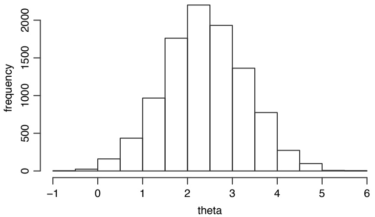
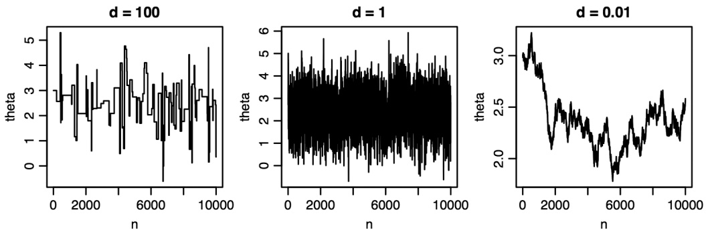
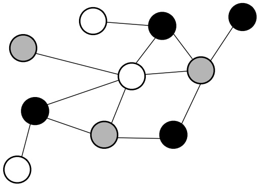
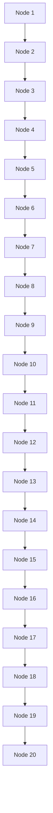
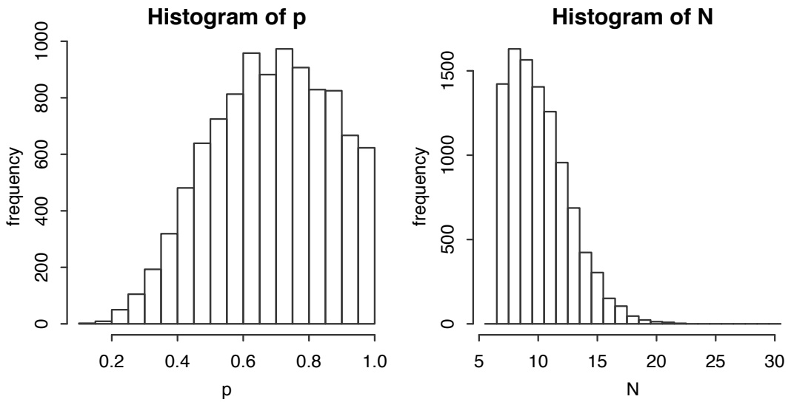

1. Choose a uniformly random J in $\{ 1 , 2 , \ldots , m \}$ , and obtain $y$ from x by replacing $x _ { J }$ with $1 - x _ { J }$

2. If $y$ is not in $C ,$ stay at $x .$ If y is in $C ,$ flip a coin that lands Heads with probability min $\tilde { \left( 1 , e ^ { \beta ( V ( y ) - \tilde { V ( x ) } ) } \right) }$ . If the coin lands Heads, $\mathbf { g } \mathbf { o }$ to $y ;$ otherwise, stay at $x .$

This chain will converge to the desired stationary distribution. But how should $\beta$ be chosen? If $\beta$ is very large, then the best solutions are given very high probability, but the chain may be very slow to converge to the stationary distribution since it can easily get stuck in local modes: the chain may find itself in a state which, while not globally optimal, is still better than the other states that can be reached in one step, and then the probability of rejecting proposals to go elsewhere may be very high. On the other hand, if $\beta$ is close to 0, then it’s easy for the chain to explore the space, but there isn’t as much incentive for the chain to uncover good solutions.

An optimization technique called simulated annealing avoids having to choose one value of $\beta .$ Instead, one specifies a sequence of $\beta$ values, such that $\beta$ gradually increases over time. At first, $\beta$ is small and the space $C$ can be explored broadly. As $\beta$ gets larger and larger, the stationary distribution becomes more and more concentrated on the best solution or solutions. The name “simulated annealing” comes from an analogy with the annealing of metals, a process in which a metal is heated to a high temperature and then gradually cooled until it reaches a very strong, stable state; $\beta$ corresponds to the reciprocal of temperature. 

As mentioned in Example 12.1.4, the Metropolis-Hastings algorithm can also be applied in a continuous state space, using PDFs instead of PMFs. This is extremely useful in Bayesian inference, where we often want to study the posterior distribution of an unknown parameter. This posterior distribution may be very complicated to work with analytically, and may have an unknown normalizing constant.

The MCMC approach is to obtain a large number of draws from a Markov chain whose stationary distribution is the posterior distribution. We can then use these draws to approximate the true posterior distribution. For example, we can estimate the posterior mean using the sample mean of these draws, and the posterior median using the sample median of the draws.

Gelman et al. [10] and McElreath [18] provide extensive introductions to Bayesian thinking and Bayesian data analysis, with wide ranges of applications and emphasis on statistical modeling and simulation. Various supplementary materials for these two books can be found at [http://www.stat.columbia.edu/\~gelman/book](http://www.stat.columbia.edu) and [https://xcelab.net/rm/statistical-rethinking](https://xcelab.net) respectively.

Example 12.1.8 (Normal-Normal conjugacy). Let $Y | \theta   \sim   \mathcal { N } ( \theta , \sigma ^ { 2 } )$ , where $\sigma ^ { 2 }$ is known but $\theta$ is unknown. Using the Bayesian framework, we treat θ as a random variable, with prior given by $\theta \sim \mathcal { N } ( \mu , \tau ^ { 2 } )$ for some known constants $\mu$ and $\tau ^ { 2 }$ . That

is, we have the two-level model

$$
\theta \sim \mathcal {N} (\mu , \tau^ {2})
$$

$$
Y | \theta \sim \mathcal {N} (\theta , \sigma^ {2}).
$$

Describe how to use the Metropolis-Hastings algorithm to find the posterior mean and variance of θ after observing the value of $Y$

Solution:

After observing $Y = y$ , we can update our prior uncertainty for θ using Bayes’ rule. Because we are interested in the posterior distribution of $\theta ,$ any terms not depending on $\theta$ can be treated as part of the normalizing constant. Thus,

$$
f _ {\theta | Y} (\theta | y) \propto f _ {Y | \theta} (y | \theta) f _ {\theta} (\theta) \propto e ^ {- \frac {1}{2 \sigma^ {2}} (y - \theta) ^ {2}} e ^ {- \frac {1}{2 \tau^ {2}} (\theta - \mu) ^ {2}}.
$$

Since we have a quadratic function of θ in the exponent, we recognize the posterior PDF of $\theta$ as a Normal PDF. The posterior distribution stays in the Normal family, which tells us that the Normal is the conjugate prior of the Normal. In fact, by completing the square (a rather tedious calculation which we shall omit), we can obtain an explicit formula for the posterior distribution of $\theta ;$

$$
\theta | Y = y \sim \mathcal {N} \left(\frac {\frac {1}{\sigma^ {2}}}{\frac {1}{\sigma^ {2}} + \frac {1}{\tau^ {2}}} y + \frac {\frac {1}{\tau^ {2}}}{\frac {1}{\sigma^ {2}} + \frac {1}{\tau^ {2}}} \mu , \frac {1}{\frac {1}{\sigma^ {2}} + \frac {1}{\tau^ {2}}}\right).
$$

Let’s try to make sense of this formula.

• It says that the posterior mean of θ, $E ( \theta | Y = y )$ , is a weighted average of the prior mean $\mu$ and the observed data y. The weights are determined by how certain we are about $\theta$ before getting the data and how precisely the data are measured. If we are already very sure about $\theta$ even before getting the data, then $\tau ^ { 2 }$ will be small and $1 / \tau ^ { 2 }$ will be large, which will give a lot of weight to the prior mean $\mu .$ On the other hand, if the data are very precise, then $\sigma ^ { 2 }$ will be small and $1 / \sigma ^ { 2 }$ will be large, which will give a lot of weight to the data $y$ .
• For the posterior variance, if we define precision to be the reciprocal of variance, then the result simply says that the posterior precision of $\theta$ is the sum of the prior precision $1 / \tau ^ { 2 }$ and the data precision $1 / \sigma ^ { 2 }$

This is all well and good, but let’s suppose we didn’t know how to complete the square, or that we wanted to check our calculations for specific values of $y ,   \sigma ^ { 2 } ,   \mu ,$ and $\tau ^ { 2 }$ . We can do this by simulating from the posterior distribution of $\theta ,$ using the Metropolis-Hastings algorithm to construct a Markov chain whose stationary distribution is $f _ { \theta | Y } ( \theta | y )$ . The same method can also be applied to a wide variety of distributions that are far more complicated than the Normal to work with analytically. A Metropolis-Hastings algorithm for generating $\theta _ { 0 } , \theta _ { 1 } , \ldots$ is as follows.

1. If $\theta _ { n } = x$ , propose a new state $x ^ { \prime }$ according to some transition rule. One way to do this in a continuous state space is to generate a Normal r.v. $\epsilon _ { n }$ with mean 0 and add it onto the current state to get the proposed state: in other words, we generate $\epsilon _ { n } \sim \mathcal { N } ( 0 , d ^ { 2 } )$ for some constant $d ,$ and then set $x ^ { \prime } = x + \epsilon _ { n }$ . This is the analog of a transition matrix for a continuous state space. The only additional detail is deciding $d ;$ in practice, we try to choose a moderate value that is neither too large nor too small.

2. The acceptance probability is

$$
a (x, x ^ {\prime}) = \min \left(\frac {s (x ^ {\prime}) p (x ^ {\prime} , x)}{s (x) p (x , x ^ {\prime})}, 1\right),
$$

where $s$ is the desired stationary PDF (this was a PMF in the discrete case) and $p ( x , x ^ { \prime } )$ is the probability density of proposing $x ^ { \prime }$ from $x$ (this was $p _ { i j }$ in the discrete case).

In this problem, we want the stationary PDF to be $f _ { \theta | Y }$ , so we’ll use that for s. As for $p ( x , x ^ { \prime } )$ , proposing $x ^ { \prime }$ from x is the same as having $\epsilon _ { n } = x ^ { \prime }   -   x$ so we evaluate the PDF of $\epsilon _ { n }$ at $x ^ { \prime } - x$ to get

$$
p (x, x ^ {\prime}) = \frac {1}{\sqrt {2 \pi} d} e ^ {- \frac {1}{2 d ^ {2}} (x ^ {\prime} - x) ^ {2}}.
$$

However, since $p ( x ^ { \prime } , x ) = p ( x , x ^ { \prime } )$ , these terms cancel from the acceptance probability, leaving us with

$$
a (x, x ^ {\prime}) = \min \left(\frac {f _ {\theta | Y} (x ^ {\prime} | y)}{f _ {\theta | Y} (x | y)}, 1\right).
$$

Once again, the normalizing constant cancels in the numerator and denominator of the acceptance probability.

3. Flip a coin that lands Heads with probability $a ( x , x ^ { \prime } )$ , independently of the Markov chain.

4. If the coin lands Heads, accept the proposal and set $\theta _ { n + 1 } = x ^ { \prime }$ . Otherwise, stay in place and set $\theta _ { n + 1 } = x$

We ran the algorithm for $1 0 ^ { 4 }$ iterations with the settings $Y   =   3 ,   \mu   =   0 ,   \sigma ^ { 2 }   =   1$ $\tau ^ { 2 } = 4$ , and $d = 1$ . Figure 12.2 shows a histogram of the resulting draws from the posterior distribution of $\theta .$ The posterior distribution indeed looks like a Normal curve. We can estimate the posterior mean and variance using the sample mean and sample variance. For the draws we obtained, the sample mean is 2.4 and the sample variance is 0.8. These are in close agreement with the theoretical values:

$$
E (\theta | Y = 3) = \frac {\frac {1}{\sigma^ {2}}}{\frac {1}{\sigma^ {2}} + \frac {1}{\tau^ {2}}} y + \frac {\frac {1}{\tau^ {2}}}{\frac {1}{\sigma^ {2}} + \frac {1}{\tau^ {2}}} \mu = \frac {1}{1 + \frac {1}{4}} \cdot 3 + \frac {\frac {1}{4}}{1 + \frac {1}{4}} \cdot 0 = 2. 8,
$$

$$
\mathrm{Var} (\theta | Y = 3) = \frac {1}{\frac {1}{\sigma^ {2}} + \frac {1}{\tau^ {2}}} = \frac {1}{1 + \frac {1}{4}} = 0. 8.
$$

The posterior mean is closer to the observed data than to the prior mean, which makes sense because $\tau ^ { 2 }$ is larger than $\sigma ^ { 2 }$ , corresponding to a relatively high level of prior uncertainty. Using the code provided in the R section of this chapter, you can see how the posterior distribution changes for different values of $y ,   \mu ,   \sigma ^ { 2 }$ , and $\tau ^ { 2 }$



<details>
<summary>histogram</summary>

| Bin (theta) | Frequency |
| --- | --- |
| -0.5~0 | ~30 |
| 0~0.5 | ~180 |
| 0.5~1 | ~450 |
| 1~1.5 | ~970 |
| 1.5~2 | ~1780 |
| 2~2.5 | ~2200 |
| 2.5~3 | ~1950 |
| 3~3.5 | ~1380 |
| 3.5~4 | ~780 |
| 4~4.5 | ~290 |
| 4.5~5 | ~120 |
| 5~5.5 | ~10 |
</details>

FIGURE 12.2

Histogram of $1 0 ^ { 4 }$ draws from the posterior distribution of θ given $Y = 3$ , obtained using Metropolis-Hastings with $\mu = 0 ,   \sigma ^ { 2 } = 1$ , and $\tau ^ { 2 } = 4$ . The sample mean is 2.4 and the sample variance is 0.8, in agreement with the theoretical values.



FIGURE 12.3

Trace plots of $\theta _ { n }$ as a function of the iteration number n, for $d = 1 0 0 , 1 , 0 . 0 1$

To help diagnose whether our Markov chain is adequately exploring the state space, we can make a trace plot, which is a plot of the samples $\theta _ { n }$ as a function of n. Figure 12.3 shows three trace plots corresponding to three different choices for the standard deviation d of the proposals, namely $d = 1 0 0 ,   d = 1$ , and $d = 0 . 0 1$ . The trace plot for $d = 1 0 0$ has numerous flat regions where the chain is staying in place. This indicates that d is too large, so the proposals are often rejected. On the other hand, $d = 0 . 0 1$ is too small; we can see from the trace plot that the chain takes tiny steps and is unable to venture very far from its starting point. The trace plot for $d = 1$ is just right, exhibiting neither the low acceptance rate of the $d = 1 0 0$ chain, nor the restricted mobility of the $d = 0 . 0 1$ chain.

In this example, the posterior distribution of θ is available analytically, so we used MCMC for illustrative purposes, to show that the results obtained by MCMC agree with their theoretical counterparts. But the same technique also applies in problems where the prior isn’t conjugate and the posterior isn’t a named distribution. 

## 12.2 Gibbs sampling

Gibbs sampling is an MCMC algorithm for obtaining approximate draws from a joint distribution, based on sampling from conditional distributions one at a time: at each stage, one variable is updated (keeping all the other variables fixed) by drawing from the conditional distribution of that variable given all the other variables. This approach is especially useful in problems where these conditional distributions are pleasant to work with.

First we will run through how the Gibbs sampler works in the bivariate case, where the desired stationary distribution is the joint PMF of discrete r.v.s X and Y . There are several forms of Gibbs samplers, depending on the order in which updates are done. We will introduce two major kinds of Gibbs sampler: systematic scan, in which the updates sweep through the components in a deterministic order, and random scan, in which a randomly chosen component is updated at each stage.

Algorithm 12.2.1 (Systematic scan Gibbs sampler). Let X and Y be discrete r.v.s with joint PMF $p _ { X , Y } ( x , y ) \; = \; P ( X \; = \; x , Y \; = \; y )$ . We wish to construct a two-dimensional Markov chain $( X _ { n } , Y _ { n } )$ whose stationary distribution is $p _ { X , Y }$ . The systematic scan Gibbs sampler proceeds by updating the X-component and the Y -component in alternation. If the current state is $( X _ { n } , Y _ { n } )   =   ( x _ { n } , y _ { n } )$ , then we update the X-component while holding the Y -component fixed, and then update the Y -component while holding the X-component fixed:

1. Draw $x _ { n + 1 }$ from the conditional distribution of X given $Y = y _ { n }$ , and set $X _ { n + 1 } = x _ { n + 1 }$
2. Draw $y _ { n + 1 }$ from the conditional distribution of Y given $X = x _ { n + 1 }$ , and set $Y _ { n + 1 } = y _ { n + 1 }$

Repeating steps 1 and 2 over and over, the stationary distribution of the chain $( X _ { 0 } , Y _ { 0 } ) , ( X _ { 1 } , Y _ { 1 } ) , ( X _ { 2 } , Y _ { 2 } ) , \ldots { \operatorname { ~ i s ~ } } p _ { X , Y }$

Algorithm 12.2.2 (Random scan Gibbs sampler). As above, let X and Y be discrete r.v.s with joint PMF $p _ { X , Y } ( x , y )$ . We wish to construct a two-dimensional

Markov chain $( X _ { n } , Y _ { n } )$ whose stationary distribution is $p _ { X , Y }$ . Each move of the random scan Gibbs sampler picks a uniformly random component and updates it, according to the conditional distribution given the other component:

1. Choose which component to update, with equal probabilities.

2. If the X-component was chosen, draw a value $x _ { n + 1 }$ from the conditional distribution of X given $Y = y _ { n }$ , and set $X _ { n + 1 } = x _ { n + 1 } , Y _ { n + 1 } = y _ { n } .$ Similarly, if the Y -component was chosen, draw a value $y _ { n + 1 }$ from the conditional distribution of Y given $X = x _ { n }$ , and set $X _ { n + 1 } = x _ { n } , Y _ { n + 1 } = y _ { n + 1 }$

Repeating steps 1 and 2 over and over, the stationary distribution of the chain $( X _ { 0 } , Y _ { 0 } ) , ( X _ { 1 } , Y _ { 1 } ) , ( X _ { 2 } , Y _ { 2 } ) , \ldots$ is $p _ { X , Y }$

Gibbs sampling generalizes naturally to higher dimensions. If we want to sample from a d-dimensional joint distribution, the Markov chain we construct will be a sequence of d-dimensional random vectors. At each stage, we choose one component of the vector to update, and we draw from the conditional distribution of that component given the most recent values of the other components. We can either cycle through the components of the vector in a systematic order, or choose a random component to update each time.

The Gibbs sampler is less flexible than the Metropolis-Hastings algorithm in the sense that we don’t get to choose a proposal distribution; this also makes it simpler in the sense that we don’t have to choose a proposal distribution. The flavors of Gibbs and Metropolis-Hastings are rather different, in that Gibbs emphasizes conditional distributions while Metropolis-Hastings emphasizes acceptance probabilities. But the algorithms are closely connected, as we show below.

Theorem 12.2.3 (Random scan Gibbs as Metropolis-Hastings). The random scan Gibbs sampler is a special case of the Metropolis-Hastings algorithm, in which the proposal is always accepted. In particular, it follows that the stationary distribution of the random scan Gibbs sampler is as desired.

Proof. We will show this in two dimensions, but the proof is similar in any dimension. Let X and Y be discrete r.v.s whose joint PMF is the desired stationary distribution. Let’s work out what the Metropolis-Hastings algorithm says to do, using the following proposal distribution: from $( x , y )$ , randomly update one coordinate by running one move of the random scan Gibbs sampler.

To simplify notation, write

$$
P (X = x, Y = y) = p (x, y), P (Y = y | X = x) = p (y | x), P (X = x | Y = y) = p (x | y).
$$

More formally, we should write $p _ { Y | X } ( y | x )$ instead of $p ( y | x )$ , to avoid issues like wondering what $p ( 5 | 3 )$ means. But writing $p ( y | x )$ is more compact and does not create ambiguity in this proof.

Let’s compute the Metropolis-Hastings acceptance probability for going from $( x , y )$

to $( x ^ { \prime } , y ^ { \prime } )$ . The states $( x , y )$ and $( x ^ { \prime } , y ^ { \prime } )$ must be equal in at least one component, since the proposal says to update only one component. Suppose that $x = x ^ { \prime }$ (the case $y = y ^ { \prime }$ can be handled symmetrically). Then the acceptance probability is

$$
\frac {p (x , y ^ {\prime}) p (y | x) \frac {1}{2}}{p (x , y) p (y ^ {\prime} | x) \frac {1}{2}} = \frac {p (x) p (y ^ {\prime} | x) p (y | x)}{p (x) p (y | x) p (y ^ {\prime} | x)} = 1.
$$

Thus, this Metropolis-Hastings algorithm always accepts the proposal! So it’s just running the random scan Gibbs sampler without modifying it. 

Let’s study some concrete examples of Gibbs samplers.

Example 12.2.4 (Graph coloring). Let G be a network (also called a graph): there are n nodes, and for each pair of distinct nodes, there either is or isn’t an edge joining them. We have a set of k colors, e.g., if $k = 7 .$ the color set may be {red, orange, yellow, green, blue, indigo, violet}. A k-coloring of the network is an assignment of a color to each node, such that two nodes joined by an edge can’t be the same color. For example, a 3-coloring of a network is illustrated below. Graph coloring is an important topic in computer science, with wide-ranging applications such as task scheduling and the game of Sudoku.



<details>
<summary>flowchart</summary>


</details>

FIGURE 12.4

A 3-coloring of a network.

Suppose that it is possible to k-color G. Form a Markov chain on the space of all k-colorings of G, with transitions as follows: starting with a k-coloring of $G ,$ pick a uniformly random node, figure out what the legal colors are for that node, and then repaint that node with a uniformly random legal color (note that this random color may be the same as the current color). Show that this Markov chain is reversible, and find its stationary distribution.

## Solution:

Let C be the set of all k-colorings of G, and let $q _ { i j }$ be the transition probability of going from i to $j$ for any k-colorings i and $j$ in $C .$ We will show that $q _ { i j } = q _ { j i }$ which implies that the stationary distribution is uniform on $C .$

For any k-coloring i and node v, let $L ( i , v )$ be the number of legal colorings for node $v ,$ keeping the colors of all other nodes the same as they are in i. If k-colorings i and $j$ differ at more than one node, then $q _ { i j } = 0 = q _ { j i } . \mathrm { ~ I f ~ } i = j$ , then obviously $q _ { i j } = q _ { j i }$ If i and $j$ differ at exactly one node v, then $L ( i , v ) = L ( j , v )$ , so

$$
q _ {i j} = \frac {1}{n} \frac {1}{L (i , v)} = \frac {1}{n} \frac {1}{L (j , v)} = q _ {j i}.
$$

So the transition matrix is symmetric, which shows that the stationary distribution is uniform over the state space.

How is this an example of Gibbs sampling? Think of each node in the graph as a discrete r.v. that can take on k possible values. These nodes have a joint distribution, and the constraint that connected nodes cannot have the same color imposes a complicated dependence structure between nodes.

We would like to sample a random k-coloring of the entire graph; that is, we want to draw from the joint distribution of all the nodes. Since this is difficult, we instead condition on all but one node. If the joint distribution is to be uniform over all legal graphs, then the conditional distribution of one node given all the others is uniform over its legal colors. Thus, at each stage of the algorithm, we are drawing from the conditional distribution of one node given all the others: we’re running a random scan Gibbs sampler! 

Example 12.2.5 (Darwin’s finches). When Charles Darwin visited the Galápagos Islands, he kept a record of the finch species he observed on each island. Table 12.1 summarizes Darwin’s data, with each row corresponding to a species and each column to an island. The presence of a 1 in entry $( i , j )$ of the table indicates that species i was observed on island $j .$

<table><tr><td rowspan="2">Species</td><td colspan="18">Island</td></tr><tr><td>1</td><td>2</td><td>3</td><td>4</td><td>5</td><td>6</td><td>7</td><td>8</td><td>9</td><td>10</td><td>11</td><td>12</td><td>13</td><td>14</td><td>15</td><td>16</td><td>17</td><td>Total</td></tr><tr><td>1</td><td>0</td><td>0</td><td>1</td><td>1</td><td>1</td><td>1</td><td>1</td><td>1</td><td>1</td><td>1</td><td>0</td><td>1</td><td>1</td><td>1</td><td>1</td><td>1</td><td>1</td><td>14</td></tr><tr><td>2</td><td>1</td><td>1</td><td>1</td><td>1</td><td>1</td><td>1</td><td>1</td><td>1</td><td>1</td><td>1</td><td>0</td><td>1</td><td>0</td><td>1</td><td>1</td><td>0</td><td>0</td><td>13</td></tr><tr><td>3</td><td>1</td><td>1</td><td>1</td><td>1</td><td>1</td><td>1</td><td>1</td><td>1</td><td>1</td><td>1</td><td>1</td><td>1</td><td>0</td><td>1</td><td>1</td><td>0</td><td>0</td><td>14</td></tr><tr><td>4</td><td>0</td><td>0</td><td>1</td><td>1</td><td>1</td><td>0</td><td>0</td><td>1</td><td>0</td><td>1</td><td>0</td><td>1</td><td>1</td><td>0</td><td>1</td><td>1</td><td>1</td><td>10</td></tr><tr><td>5</td><td>1</td><td>1</td><td>1</td><td>0</td><td>1</td><td>1</td><td>1</td><td>1</td><td>1</td><td>1</td><td>0</td><td>1</td><td>0</td><td>1</td><td>1</td><td>0</td><td>0</td><td>12</td></tr><tr><td>6</td><td>0</td><td>0</td><td>0</td><td>0</td><td>0</td><td>0</td><td>0</td><td>0</td><td>0</td><td>0</td><td>1</td><td>0</td><td>1</td><td>0</td><td>0</td><td>0</td><td>0</td><td>2</td></tr><tr><td>7</td><td>0</td><td>0</td><td>1</td><td>1</td><td>1</td><td>1</td><td>1</td><td>1</td><td>1</td><td>0</td><td>0</td><td>1</td><td>0</td><td>1</td><td>1</td><td>0</td><td>0</td><td>10</td></tr><tr><td>8</td><td>0</td><td>0</td><td>0</td><td>0</td><td>0</td><td>0</td><td>0</td><td>0</td><td>0</td><td>0</td><td>0</td><td>1</td><td>0</td><td>0</td><td>0</td><td>0</td><td>0</td><td>1</td></tr><tr><td>9</td><td>0</td><td>0</td><td>1</td><td>1</td><td>1</td><td>1</td><td>1</td><td>1</td><td>1</td><td>1</td><td>0</td><td>1</td><td>0</td><td>0</td><td>1</td><td>0</td><td>0</td><td>10</td></tr><tr><td>10</td><td>0</td><td>0</td><td>1</td><td>1</td><td>1</td><td>1</td><td>1</td><td>1</td><td>1</td><td>1</td><td>0</td><td>1</td><td>0</td><td>1</td><td>1</td><td>0</td><td>0</td><td>11</td></tr><tr><td>11</td><td>0</td><td>0</td><td>1</td><td>1</td><td>1</td><td>0</td><td>1</td><td>1</td><td>0</td><td>1</td><td>0</td><td>0</td><td>0</td><td>0</td><td>0</td><td>0</td><td>0</td><td>6</td></tr><tr><td>12</td><td>0</td><td>0</td><td>1</td><td>1</td><td>0</td><td>0</td><td>0</td><td>0</td><td>0</td><td>0</td><td>0</td><td>0</td><td>0</td><td>0</td><td>0</td><td>0</td><td>0</td><td>2</td></tr><tr><td>13</td><td>1</td><td>1</td><td>1</td><td>1</td><td>1</td><td>1</td><td>1</td><td>1</td><td>1</td><td>1</td><td>1</td><td>1</td><td>1</td><td>1</td><td>1</td><td>1</td><td>1</td><td>17</td></tr><tr><td>Total</td><td>4</td><td>4</td><td>11</td><td>10</td><td>10</td><td>8</td><td>9</td><td>10</td><td>8</td><td>9</td><td>3</td><td>10</td><td>4</td><td>7</td><td>9</td><td>3</td><td>3</td><td>122</td></tr></table>

TABLE 12.1 Presence of 13 finch species (rows) on 17 islands (columns). A value of 1 in entry $( i , j )$ indicates that species i was observed on island j. Data are from Sanderson [22].

Given these data, we might be interested in knowing whether the pattern of 0’s and 1’s observed in the table is anomalous in some way. For example, does there appear to be dependence between the rows and columns? Do some pairs of species frequently occur together on the same islands, more often than one would expect by chance? These patterns may shed light on the dynamics of inter-species cooperation or competition. One way to test for such patterns is by looking at a lot of random tables with the same row and column sums as the observed table, to see how the observed table compares to the random ones. This is a common technique in statistics known as a goodness-of-fit test.

But how do we generate random tables with the same row and column sums as Table 12.1? The number of tables satisfying these constraints is impossible to enumerate. MCMC comes to the rescue: we’ll create a Markov chain on the space of all tables with these row and column sums, whose stationary distribution is uniform over all such tables.

To construct the Markov chain, we need a way to transition from one table to another without changing the row or column sums. Starting from the observed table, randomly select two rows and two columns. If the four entries at their intersection have one of the following two patterns:

$$
\begin{array}{c c} 0 & 1 \\ 1 & 0 \end{array} \quad \text {or} \quad \begin{array}{c c} 1 & 0 \\ 0 & 1 \end{array}
$$

then switch to the opposite pattern with probability $1 / 2 ;$ otherwise stay in place. For example, if we selected rows 1 and 3 and columns 1 and 17, we would switch the four entries at their intersection from $^ { \mathrm { ~ 0 ~ 1 ~ } } _ { \mathrm { ~ 1 ~ 0 ~ } }$ to $^ { 1 0 } _ { 0 1 }$ with probability $1 / 2 .$ This is a symmetric transition rule (for all tables t and $t ^ { \prime } ,$ the transition probability from t to $t ^ { \prime }$ equals the transition probability from $t ^ { \prime }$ to $t )$ , the transitions never alter the row or column sums, and it can be shown that the Markov chain defined in this way is irreducible. Therefore the stationary distribution is uniform over all tables with the given row and column sums, as desired.

To interpret this procedure as a Gibbs sampler, consider conditioning on all entries in the table besides the four entries at the intersection of rows 1 and 3 and columns 1 and 17. If the stationary distribution is to be uniform over all tables with the given row and column sums, then the conditional distribution of these four entries must be uniform over all configurations that don’t change the row and column sums, namely $^ { \mathrm { ~ 0 ~ 1 ~ } } _ { \mathrm { ~ 1 ~ 0 ~ } }$ and $^ { 1 0 } _ { 0 1 }$ . Thus, at each stage, we are drawing from the conditional distribution of four entries given all the rest. 

As with Metropolis-Hastings, Gibbs sampling also applies to continuous distributions, replacing conditional PMFs with conditional PDFs.

Example 12.2.6 (Chicken-egg with unknown parameters). A chicken lays $N$ eggs, where $N \sim  Pois (\lambda)$ . Each egg hatches with probability $p ,$ where $p$ is unknown; we let $p \sim \mathrm { B e t a } ( a , b )$ . The constants $\lambda , a , b$ are known.

Here’s the catch: we don’t get to observe N. Instead, we only observe the number of eggs that hatch, X. Describe how to use Gibbs sampling to find $E ( p | X = x )$ , the posterior mean of $p$ after observing x hatched eggs.

## Solution:

By the chicken-egg story, the distribution of X given $p$ is $\operatorname { P o i s } ( \lambda p )$ . The posterior PDF of $p$ is proportional to

$$
f (p | X = x) \propto P (X = x | p) f (p) \propto e ^ {- \lambda p} (\lambda p) ^ {x} p ^ {a - 1} q ^ {b - 1},
$$

where we have dropped all terms not depending on $p .$

This isn’t a named distribution, so it might appear as though we’re stuck, but we can get ourselves out of this rut by thinking conditionally. What do we wish we knew? The total number of eggs! Conditional on observing $N = n$ and knowing the true value of $p ,$ the distribution of X would be $\operatorname { B i n } ( n , p )$ . By conditioning on the total number of eggs, we recover Beta-Binomial conjugacy between $p$ and X. This allows us to write down the posterior distribution right away using Story 8.3.3:

$$
p | X = x, N = n \sim \mathrm{Beta} (x + a, n - x + b).
$$

The fact that conditioning on $N$ makes matters so much nicer inspires us to use Gibbs sampling to tackle the problem. We alternate between sampling from $p$ conditional on N and sampling from N conditional on $p ,$ as described below. Throughout, we must also condition on $X = x .$ since we seek to learn about the posterior distributions of the parameters conditional on the evidence.

We make an initial guess for $p$ and $N .$ then iterate the following steps:

1. Conditional on $N = n$ and $X = x$ , draw a new guess for $p$ from the $\mathrm { B e t a } ( x + a , n - x + b )$ distribution.

2. Conditional on $p$ and $X = x ,$ the number of unhatched eggs is $Y \sim  Pois (\lambda(1 - p))$ by the chicken-egg story, so we can draw $Y$ from the $\mathrm { P o i s } ( \lambda ( 1 - p ) )$ distribution and set the new guess for N to be $N = x + Y$

After many iterations, we have draws for both $p$ and N. If we want, we can ignore the draws of $N ,$ since N was merely a device to help us sample $p .$ But for fun, we’ll plot both: Figure 12.5 shows histograms of the posterior draws of $p$ and N when $\lambda = 10,   a = b = 1$ (corresponding to a $\mathrm { U n i f } ( 0 , 1 )$ prior on $p )$ , and we observe $X = 7$ hatched eggs.

As for the posterior mean $E ( p | X   =   x )$ originally asked for in the problem, we can take the sample mean of the draws of $p$ to get a good approximation. In this case, the sample mean is 0.68. Using the code provided in the R section of this chapter, you can try changing the values of $\lambda ,   a ,   b ,$ and $x$ to see how the histograms and the posterior mean are affected. The key strategy for this problem was to add the unobserved number of eggs N to the model, so that we would have pleasant conditional distributions and could use Gibbs sampling conveniently. 



## FIGURE 12.5

Histograms of $1 0 ^ { 4 }$ draws from the posterior distributions of $p$ and $N ,$ where $\lambda = 1 0$ $a = 1,   b = 1$ , and we observe $X = 7$

## 12.3 Recap

Markov chain Monte Carlo allows us to sample from complicated distributions using Markov chains. MCMC has been applied in a very wide variety of problems in recent years. The main idea behind MCMC algorithms is to construct a Markov chain whose stationary distribution is the distribution we wish to sample from. After running the Markov chain for a long time, the values that the Markov chain takes on can serve as draws from the desired distribution.

The two MCMC algorithms discussed in this chapter are Metropolis-Hastings and Gibbs sampling. The Metropolis-Hastings algorithm uses any irreducible Markov chain on the state space to generate proposals, then accepts or rejects those proposals so as to produce a modified Markov chain with the desired stationary distribution. Moreover, the resulting chain is reversible. The choice of the proposal distribution is extremely important in practice, since a bad proposal distribution may result in very slow convergence to the stationary distribution.

Gibbs sampling is a method for drawing from a d-dimensional joint distribution by updating the components of a d-dimensional Markov chain one at a time, condi tional on all other components. This can be done through a systematic scan, which deterministically cycles through the components in a fixed order, or a random scan, which randomly chooses which component to update at each stage.

## 12.4 R

## Metropolis-Hastings

Here’s how to implement the Metropolis-Hastings algorithm for Example 12.1.8, the Normal-Normal model. First, we choose our observed value of Y and decide on values for the constants σ, µ, and τ :

```r
y <- 3
sigma <- 1
mu <- 0
tau <- 2
```

We also need to choose the standard deviation of the proposals for step 1 of the algorithm, as explained in Example 12.1.8; for this problem, we let d = 1. We set the number of iterations to run, and we allocate a vector theta of length 10<sup>4</sup> which we will fill with our simulated draws:

```r
d <- 1
niter <- 10^4
theta <- rep(0,niter)
```

Now for the main loop. We initialize θ to the observed value y, then run the algorithm described in Example 12.1.8:

```r
theta[1] <- y
for (i in 2:niter){
    theta.p <- theta[i-1] + rnorm(1,0,d)
    r <- dnorm(y,theta.p,sigma) * dnorm(theta.p,mu,tau) /
        (dnorm(y,theta[i-1],sigma) * dnorm(theta[i-1],mu,tau))
    flip <- rbinom(1,1,min(r,1))
    theta[i] <- if(flip==1) theta.p else theta[i-1]
}
```

Let’s step through each line inside the loop. The proposed value of θ is theta.p, which equals the previous value of θ plus a Normal random variable with mean 0 and standard deviation d (recall that rnorm takes the standard deviation and not the variance as input). The ratio r is

$$
\frac {f _ {\theta | Y} (x ^ {\prime} | y)}{f _ {\theta | Y} (x | y)} = \frac {e ^ {- \frac {1}{2 \sigma^ {2}} (y - x ^ {\prime}) ^ {2}} e ^ {- \frac {1}{2 \tau^ {2}} (x ^ {\prime} - \mu) ^ {2}}}{e ^ {- \frac {1}{2 \sigma^ {2}} (y - x) ^ {2}} e ^ {- \frac {1}{2 \tau^ {2}} (x - \mu) ^ {2}}},
$$

where theta.p is playing the role of $x ^ { \prime }$ and theta[i-1] is playing the role of x. The coin flip to determine whether to accept or reject the proposal is flip, which is a coin flip with probability min(r,1) of Heads (encoding Heads as 1 and Tails as 0). Finally, we set theta[i] equal to the proposed value if the coin flip lands Heads, and keep it at the previous value otherwise.

The vector theta now contains all of our simulation draws. We typically discard some of the initial draws to give the chain some time to approach the stationary distribution. The following line of code discards the first half of the draws:

```txt
theta <- theta[-(1:(niter/2))]
```

To see what the remaining draws look like, we can create a histogram using hist(theta). We can also compute summary statistics such as mean(theta) and var(theta), which give us the sample mean and sample variance.

## Gibbs

Now let’s implement Gibbs sampling for Example 12.2.6, the chicken-egg story with unknown hatching probability and invisible unhatched eggs. The first step is to decide on our observed value of X, as well as the constants λ, a, b:

```r
x <- 7
lambda <- 10
a <- 1
b <- 1
```

Next we decide how many iterations to run, and we allocate space for our results, creating two vectors p and N of length 10<sup>4</sup> which we will fill with our simulated draws:

```r
niter <- 10^4
p <- rep(0,niter)
N <- rep(0,niter)
```

Finally, we’re ready to run the Gibbs sampler. We initialize p and N to the values 0.5 and 2x, respectively, and then we run the algorithm as explained in Example 12.2.6:

```txt
p[1] <- 0.5
N[1] <- 2*x
for (i in 2:niter){
    p[i] <- rbeta(1,x+a,N[i-1]-x+b)
    N[i] <- x + rpois(1,lambda*(1-p[i-1]))
}
```

Again, we discard the initial draws:

```txt
p <- p[-(1:(niter/2))]
N <- N[-1:(niter/2))]
```

To see what the remaining draws look like, we can make histograms using hist(p) and hist(N), which is how we created Figure 12.5. We can also compute summary statistics such as mean(p) or median(p).

## 12.5 Exercises

1. Let $p ( x , y )$ be the joint PMF of two discrete r.v.s X and $Y$ Using shorthand notation as we used with the Gibbs sampler, let $p ( x )$ and $p ( y )$ be the marginal PMFs of $X$ and $Y$ and $p ( x | y )$ and $p ( y | x )$ be the conditional PMFs of $X$ given $Y$ and $Y$ given X. Suppose the support of $Y$ is the same as the support of the conditional distribution of $Y | X$

(a) Use the identity $p ( x ) p ( y | x ) = p ( y ) p ( x | y )$ to find an expression for the marginal PMF $p ( y )$ in terms of the conditional PMFs $p ( x | y )$ and $p ( y | x )$

Hint: Rewrite the identity as $p ( x ) / p ( y ) = p ( x | y ) / p ( y | x )$ and take a sum.

(b) Explain why the two conditional distributions $p ( x | y )$ and $p ( y | x )$ determine the joint distribution $p ( x , y )$ , and how this fact relates to the Gibbs sampler.

2. We have a network G with n nodes and some edges. Each node of $G$ can either be vacant or occupied. We want to place particles on the nodes of $G$ in such a way that the particles are not too crowded. Thus, define a feasible configuration as a placement of particles such that each node is occupied by at most one particle, and no neighbor of an occupied node is occupied.

Construct a Markov chain whose stationary distribution is uniform over all feasible configurations. Clearly specify the transition rule of your Markov chain, and explain why its stationary distribution is uniform.

3. This problem considers an application of MCMC techniques to image analysis. Imagine a 2D image consisting of an $L \times L$ grid of black-or-white pixels. Let $Y _ { j }$ be the indicator of the jth pixel being white, for $j = 1 , \ldots , L ^ { 2 }$ . Viewing the pixels as nodes in a network, the neighbors of a pixel are the pixels immediately above, below, to the left, and to the right (except for boundary cases).

Let $i \sim j$ stand for $\mathfrak { c } _ { i }$ and $j$ are neighbors”. A commonly used model for the joint PMF of $\mathbf { Y } = ( Y _ { 1 } , \ldots , Y _ { L ^ { 2 } } )$ is

$$
P (\mathbf {Y} = \mathbf {y}) \propto \exp \left(\beta \sum_ {(i, j): i \sim j} I (y _ {i} = y _ {j})\right).
$$

If $\beta$ is positive, this says that neighboring pixels prefer to have the same color. The normalizing constant of this joint PMF is a sum over all $2 ^ { L ^ { 2 } }$ possible configurations, so it may be very computationally difficult to obtain. This motivates the use of MCMC to simulate from the model.

(a) Suppose that we wish to simulate random draws from the joint PMF of $\mathbf { Y } ,$ for a particular known value of $\beta .$ Explain how we can do this using Gibbs sampling, cycling through the pixels one by one in a fixed order.

(b) Now provide a Metropolis-Hastings algorithm for this problem, based on a proposal of picking a uniformly random site and toggling its value.


## Taylor & Francis

Taylor & Francis Group

http://taylorandfrancis.com

## Poisson processes

Poisson processes serve as a simple model for events occurring in time or space: in one dimension, cars passing by a highway checkpoint; in two dimensions, flowers in a meadow; in three dimensions, stars in a region of the galaxy. Poisson processes are a primary building block for more complicated processes in time and space, which are the focus of a branch of statistics called spatial statistics.

Poisson processes are also useful in probability, as they tie together many of the named distributions and provide us with insightful story proofs for results that might otherwise be tedious to show. This leads to a new problem-solving strategy, which we will demonstrate: even when a problem makes no mention of Poisson processes, there are sometimes ways to pretend the r.v.s are coming from a Poisson process so that we can use convenient Poisson process properties.

In this chapter, we’ll review the already familiar definition of the 1D Poisson process, derive and discuss three important properties of the 1D Poisson process, and then extend these properties to Poisson processes in higher dimensions.

## 13.1 Poisson processes in one dimension

In Section 5.6, we defined a one-dimensional Poisson process and showed that the interarrival times are i.i.d. Exponentials. In Chapter 8 we showed that the time of the jth arrival (relative to some fixed starting time) is Gamma. Let’s review these results, with notation that will help us generalize to higher dimensions.

Definition 13.1.1 (1D Poisson process). A sequence of arrivals in continuous time is a Poisson process with rate λ if the following conditions hold:

1. The number of arrivals in an interval of length t is distributed Pois(λt).
2. The numbers of arrivals in disjoint time intervals are independent.

Usually we will assume that the timeline starts at t = 0, in which case we have a Poisson process on $( 0 , \infty )$ , but we can use the same conditions to define a Poisson process on $( - \infty , \infty )$ if we want the timeline to be infinite in both directions.