# Chapter 1. Introduction to Biology

原始 PDF 第 16–33 页。

# CHAPTER 1

# Introduction to Biology

## 1.1 Introduction

This introduction is intended to provide a brief overview of the basic principles that lie at the heart of biology. It is intended for engineers and physical scientists who do not have any knowledge of biology but who are interested in synthetic biology. Having an understanding of the basic principles will aid the physical scientist and engineer to model biological systems and also to communicate with biologists. There are of course many excellent textbooks dedicated to detailed descriptions of the molecular processes that occur within biology, and readers who wish to extend their knowledge beyond this brief survey are encouraged to seek out more details in the relevant texts.

There are two basic concepts that you need to understand if you wish to be able to engineer biological systems: how information flows in biological systems and how this information flow is controlled. With an understanding of these concepts one can, in principle, apply engineering principles to the design and building of new biological systems: what we call synthetic biology.

Biology is, of course, highly complex and there are important differences that distinguish it from other engineering disciplines. Firstly, biology is not programmed on a printed circuit board, so interactions cannot be programmed by their physical position; rather interactions are based on interactions between molecules that occur in the complex milieu of the cell. Secondly, biology is subject to natural selection, so that modifications which are deleterious to the cell will be selected against and competed out of the population. These evolutionary pressures are not applicable when building an aircraft, and so new definitions of robustness are relevant to biology. Other concepts such as complexity and emergent behaviour may be familiar to engineers, but one must be aware of how they can arise in biology and what their effects may be.

## 1.2 Information Storage in Biology

## 1.2.1 DNA structure

It is widely known by even non-specialists that DNA (deoxyribonucleic acid) is the molecule that stores the information within biological systems. The double-helical structure of the

1

---

2

Synthetic Biology — A Primer

DNA molecule has also entered the wider consciousness and provides a totemic symbol of the genomic age in which we live. To fully appreciate how this molecule functions as a dynamic information store, we must explore its structure in more detail.

The double-helical structure of DNA arises because it is composed of two separate strands. Each strand is a long molecule formed by the linking together of the individual building blocks, the nucleotides. Each nucleotide has three important parts: the phosphate, the deoxyribose sugar and the base (Fig. 1.1). The phosphate and sugar always remain the same, but there are four different bases: A, G, C and T (adenine, guanine, cytosine and thymine). The phosphate and the sugar link together to form the backbone of each DNA strand, while the bases decorate the backbone and provide variability. It is the sequence of these nucleotides that provides the basis of information coding in DNA.

A key feature of DNA, which leads to the double-helix structure, is how the two strands interact. Each of the four bases can only pair with one of the other bases; A can only pair with T, and G with C. A cannot pair with G, C or A and so on. This complementarity means that the sequence of one strand defines the sequence of the other: a G in one strand means that the other strand will always have a C in that position, etc. The consequence of this, from the cell’s perspective, is that it will always have two copies of the information encoded by the DNA sequence. This is important because if one strand is damaged, the other can direct the repair and no information is lost.

The complementarity arises through hydrogen bond interactions between the bases. Looking at the structure of the paired bases reveals that the positions of these hydrogen bonds occur at the same relative positions between the functional groups of the different bases (Fig. 1.1). However, the pattern of hydrogen bond donors (the group with the H-atom) and acceptors (the interacting partner with no H) is different, so that if the bases are swapped around, H-bonds cannot be made (H-bonds cannot form between 2 donors or 2 acceptors). There are 2 H-bonds between A and T, and 3 H-bonds between G and C. This means that GC base pairs are more stable and thus harder to separate.

As two complementary strands of DNA come together the base pairs will interact with each other to form hydrogen bonds. The planar structure of the aromatic bases means that they will ‘stack’ on top of each other, each phosphate on the backbone has a negative charge and they are thus repelled from each other, while the sugar provides a linking group of a fixed length. The attraction of the stacking bases in each strand is balanced by the repulsion of the phosphates within the limit of the deoxyribose link. The net result is that each base is offset by around 34◦ from the previous one and the two strands twist into a double helix (Fig. 1.1).

## 1.2.2 DNA replication

The ability to reproduce is one of the key features of life and DNA replication lies at the heart of this process. The complementarity of the two DNA strands means that it is possible for the strands to separate and for each one to act as a template in the synthesis of a new DNA strand, so that two new daughter DNA helices are produced. Each one of these daughter DNA molecules contains one of the strands of the parental DNA double helix.

---

Introduction to Biology

3

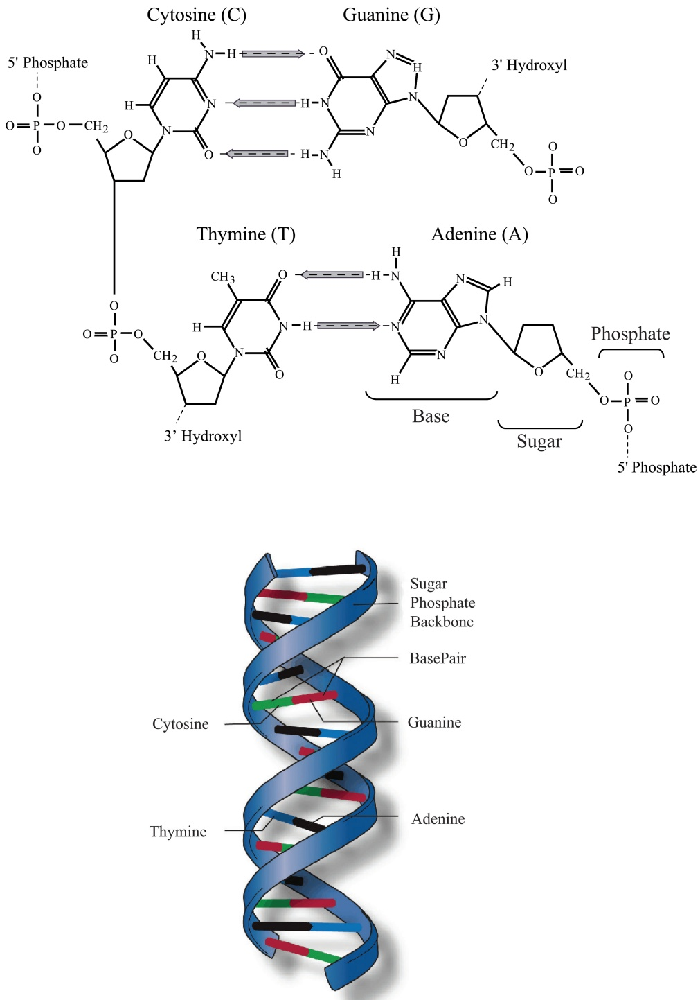

Fig. 1.1 The chemical structure of the nucleotide base pairs and the double-helical structure of DNA. (Courtesy: National Human Genome Research Institute)

---

4

Synthetic Biology — A Primer

DNA is synthesised by enzymes called DNA polymerases from component deoxyribonucleotide triphosphates (dNTPs). The triphosphate is a chemical group that effectively acts as an energy source for the reaction. This is a common feature in nature, and a different nucleotide $\mathrm { A T P }$ functions as a near universal energy source within living systems. DNA polymerases are able to select the correct nucleotide by its ability to base pair with the template strand. It then catalyses its incorporation into the growing strand, releasing a diphosphate (Fig. 1.2).

Another key feature of DNA structure is that the strands have a polarity as the chemistry of the backbone means that they are not the same at each end; they are denoted as the $5 ^ { \prime }$ and $3 ^ { \prime }$ ends. Double-stranded DNA always forms an anti-parallel configuration. This has very important implications for DNA replication, since DNA polymerases can only add on to the $3 ^ { \prime }$ end. Furthermore, DNA polymerases can only extend an existing chain; they cannot initiate synthesis on single-stranded DNA. In a cell, replication is initiated by an enzyme called primase, which synthesises a short RNA primer in situ so that DNA polymerase can begin the process. This also enables a greater degree of control on DNA replication. In vitro, we also use short sequences to initiate DNA synthesis, but we use synthetic DNA oligonucleotides. It turns out that this is a very useful feature of DNA polymerases as it means we can direct the synthesis of DNA very precisely.

## 1.2.3 PCR

The polymerase chain reaction (PCR) is one of the most useful techniques in molecular biology and it is worth studying since understanding it requires understanding all of the key features of DNA structure and replication. PCR is a method for the exponential amplification of DNA. Its value lies in its speed and specificity; one can readily make large quantities of a specific DNA fragment which have been isolated from vanishingly small quantities of the original template sequence. It relies on DNA polymerases that have been isolated from bacteria that live in hot springs or ocean sea vents; these extremophile organisms can live in temperatures in excess of $1 0 0 ^ { \circ } \mathbf { C } .$ As a consequence their DNA polymerases are also stable at high temperatures, a key feature that is required due to the thermal cycling of the reaction.

The specificity comes from the oligonucleotides that are used to prime the DNA polymerase. Two primers are required, one for each end of the DNA. The reaction operates through temperature cycling: the first stage requires heat denaturation of the DNA; as it is then cooled the primers will anneal to their complementary sequence on the DNA template. DNA synthesis is then directed from the $3 ^ { \prime }$ end of the primers and the reaction is heated to $7 2 ^ { \circ } \mathbf { C }$ , the optimal temperature of the thermostable DNA polymerases. The reaction is then heated to $9 5 ^ { \circ } \mathbf { C }$ to melt the newly synthesised double-stranded DNA back to single strands, allowing for another round of priming and synthesis. The doubling nature of the reaction means that the specific DNA fragments increase in an exponential order so after 25–30 cycles a very large quantity of DNA has been synthesised (Fig. 1.3 and Appendix 1).

The general applicability of PCR has increased as new DNA polymerases have been isolated and engineered. The first thermostable DNA polymerase, Taq, had relatively

---

Introduction to Biology

5

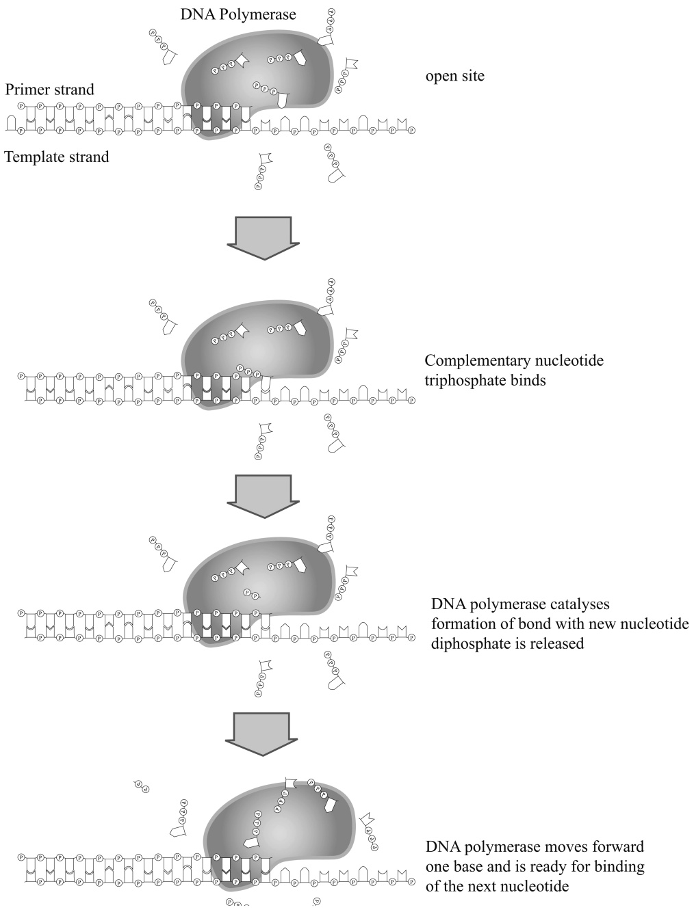

flowchart

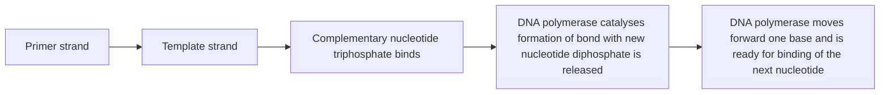

Fig. 1.2 DNA replication and the role of DNA polymerases in synthesising DNA.

---

6

Synthetic Biology — A Primer

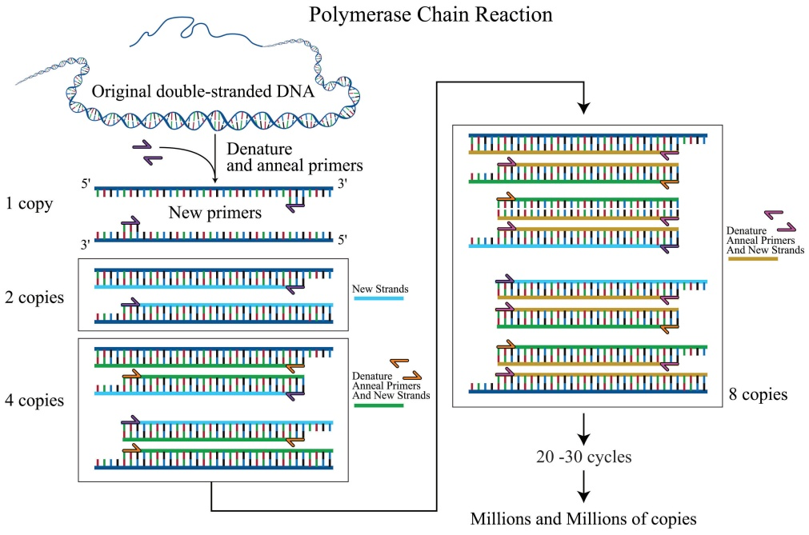

flowchart

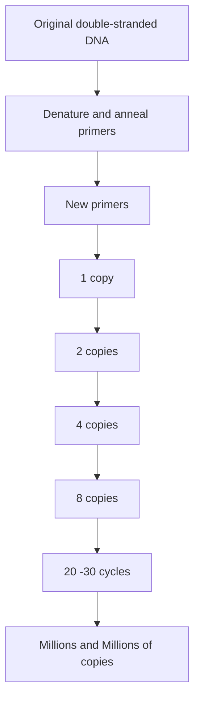

Fig. 1.3 The polymerase chain reaction. (Courtesy: National Human Genome Research Institute)

low fidelity, so amplification of sequences frequently led to mutations in the products. New DNA polymerases have been isolated from other sources that contain proofreading domains $( \mathrm { a }   3 ^ { \prime }     -     5 ^ { \prime }$ exonuclease activity that is able to remove mismatched bases), which has significantly increased the accuracy with which DNA can be amplified. Other polymerases such as Phusion™ have been engineered to contain a DNA binding domain that increases the processivity of the polymerase, increasing the length of DNA that can readily be made by PCR. This increased accuracy means that PCR can now be adapted to many more cloning techniques that require amplification of the vector backbone (Ellis, Adie and Baldwin, 2011).

## 1.3 Information Flow in Biology

DNA is the information store, but the majority of functions within the cell are performed by proteins. The question thus arises of how information leads to function. The flow of information within biological systems forms what is known as the ‘central dogma’(Fig. 1.4). Information is stored in the form of DNA. When required, the message within DNA is transcribed into an intermediate messenger molecule, RNA, before being translated into the final product, protein. The fundamental unit of hereditary information is known as a gene. Most genes are a stretch of DNA that codes for a protein, although some genes will produce functional RNA molecules rather than proteins. A gene should also be considered to include the regulatory elements required to control it. The basic structure of a gene is depicted in

---

Introduction to Biology

7

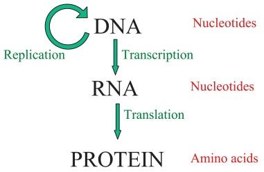

flowchart

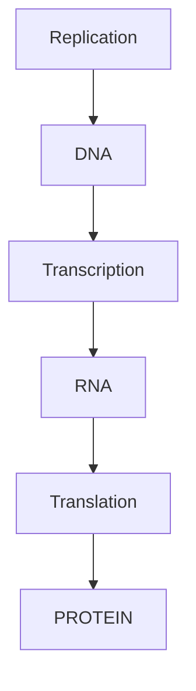

Fig. 1.4 The central dogma of molecular biology.

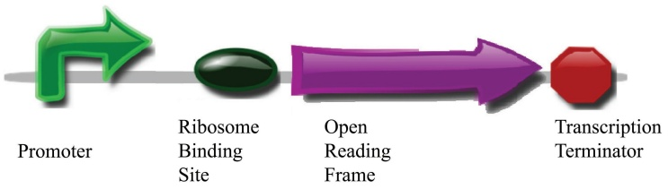

flowchart

Fig. 1.5 The basic structure of a protein-coding gene.

Fig. 1.5. When a gene is turned on, the protein (or other functional molecule) is produced or expressed; when it is turned off it is not produced. More detail on these control mechanisms is provided in the next section.

The messenger molecule is composed of nucleotides similar to those found in DNA, called RNA (ribonucleic acid). The chemical structures of these two molecules are almost identical, the key difference being the $2 ^ { \circ } \mathrm { O H }$ on the sugar moiety of RNA; the lack of this group in DNA is what gives the deoxy-designation. The presence of this extra OH means that RNA can form more complex structures; it is also less stable. In addition, RNA uses U (uracil) in place of T, the difference being the presence of a methyl group in thymine.

The conserved nature of the bases between RNA and DNA means that they can base pair in an identical way to DNA bases. This feature is used when transcribing the information in DNA into the messenger RNA (mRNA) molecule. During transcription a stretch of DNA known as a gene is transcribed into mRNA. That is, a mRNA molecule is synthesised in situ based on complementary base pairing between the RNA and DNA nucleotides. The key feature of a gene is that the sequence of DNA bases code for a protein. The complementary base pairing between RNA and DNA means that this code is retained in mRNA.

Once mRNA has been synthesised it fulfills its role as a messenger by taking the ‘message’ to the ribosome. This is a very large macromolecular complex composed of proteins and RNA molecules and it is here that the message is translated from nucleotides into amino acids, the building blocks of proteins. The end result is a protein where the amino acids have been put together in a specific sequence designated by the DNA sequence. Thus DNA codes for proteins.

---

8

Synthetic Biology — A Primer

RNA codon table

<table><tr><td rowspan="2">1st position</td><td colspan="4">2nd position</td><td rowspan="2">3rd position</td></tr><tr><td>U</td><td>C</td><td>A</td><td>G</td></tr><tr><td rowspan="4">U</td><td>Phe</td><td>Ser</td><td>Tyr</td><td>Cys</td><td>U</td></tr><tr><td>Phe</td><td>Ser</td><td>Tyr</td><td>Cys</td><td>C</td></tr><tr><td>Leu</td><td>Ser</td><td>stop</td><td>stop</td><td>A</td></tr><tr><td>Leu</td><td>Ser</td><td>stop</td><td>Trp</td><td>G</td></tr><tr><td rowspan="4">C</td><td>Leu</td><td>Pro</td><td>His</td><td>Arg</td><td>U</td></tr><tr><td>Leu</td><td>Pro</td><td>His</td><td>Arg</td><td>C</td></tr><tr><td>Leu</td><td>Pro</td><td>Gln</td><td>Arg</td><td>A</td></tr><tr><td>Leu</td><td>Pro</td><td>Gln</td><td>Arg</td><td>G</td></tr><tr><td rowspan="4">A</td><td>lle</td><td>Thr</td><td>Asn</td><td>Ser</td><td>U</td></tr><tr><td>lle</td><td>Thr</td><td>Asn</td><td>Ser</td><td>C</td></tr><tr><td>lle</td><td>Thr</td><td>Lys</td><td>Arg</td><td>A</td></tr><tr><td>Met</td><td>Thr</td><td>Lys</td><td>Arg</td><td>G</td></tr><tr><td rowspan="4">G</td><td>Val</td><td>Ala</td><td>Asp</td><td>Gly</td><td>U</td></tr><tr><td>Val</td><td>Ala</td><td>Asp</td><td>Gly</td><td>C</td></tr><tr><td>Val</td><td>Ala</td><td>Glu</td><td>Gly</td><td>A</td></tr><tr><td>Val</td><td>Ala</td><td>Glu</td><td>Gly</td><td>G</td></tr><tr><td></td><td colspan="4">Amino Acids</td><td></td></tr></table>

Fig. 1.6 The genetic code table. Amino acids are coded by three nucleotides (codons). The information is carried to the ribosome, which synthesises the protein encoded by the messenger RNA (mRNA). The codons are therefore usually shown in RNA nucleotides, where Uracil (U) is used in place of Thymine (T). (Courtesy: National Human Genome Research Institute)

## 1.3.1 The genetic code

The sequence of bases A, G, C and T provides the basis for information storage within DNA. This DNA sequence codes for protein sequence, but proteins are composed of 20 different amino acids, therefore the coding from nucleotides to amino acids is not one-to-one. It is, in fact, a triplet code, so three nucleotides code for a single amino acid (Fig. 1.6). The triplet code means that DNA sequence can be read in three different ‘frames’ on each strand (six in total; Fig. 1.7).

The triplet code means that there is redundancy, and all but two amino acids are coded for by multiple three nucleotide sequences (codons; Fig. 1.6). The exceptions are tryptophan and methionine, which have unique codons and this reflects their reduced frequency of occurrence in proteins.

Methionine is also the initiating amino acid in all bacterial proteins. The start signal for protein synthesis comprises the position where the ribosome binds the mRNA (ribosome binding site, RBS or Shine-Dalgarno sequence) and the first ATG codon, which must be close to the RBS. Reading the first codon establishes the reading frame of the mRNA, so having a unique codon for the initiating amino acid reduces ambiguity.

---

Introduction to Biology

9

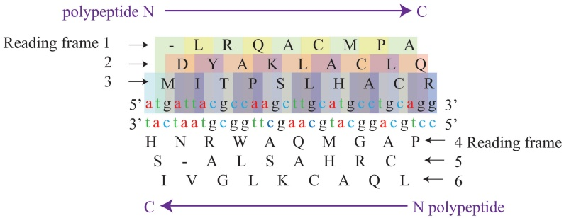

text_image

polypeptide N → C
Reading frame 1 → - L R Q A C M P A
2 → D Y A K L A C L Q
3 → M I T P S L H A C R
5' atgattacgccaagcttgcatgcctgcagg 3'
3'tactaatgcggttcgaacgtacggacgtcc 5'
H N R W A Q M G A P ← 4 Reading frame
S - A L S A H R C ← 5
I V G L K C A Q L ← 6
C ← N polypeptide

Fig. 1.7 A short section of double-stranded DNA. There are six possible coding frames on double-stranded DNA. The top strand codes for a protein. The beginning of the protein sequence is the ATG Methionine codon in reading frame 3. By shifting the reading frame by 1 bp steps, it can be seen that there are three other possible reading frames for the same piece of DNA. In reality these do not code for a protein because they do not satisfy the requirements of an open reading frame (they are not preceded by a promoter, are not uninterrupted by stop codons and do not finish with a stop codon). The other DNA strand also has three other possible reading frames. As the polarity of the DNA is reversed on the partner strand, these read in the opposite direction.

The degeneracy in the genetic code also leads to differences between different organisms. Each organism has evolved within its own niche and its translation machinery has typically developed a narrower set of codons that are regularly used, or are used under particular growth conditions. Since this codon usage varies from organism to organism, a gene that originates from one organism and is transcribed in another may be poorly translated as the codons of the gene are not regularly used in the new host.

The process by which the nucleotide sequence of the mRNA molecule is translated into protein (shown in Fig. 1.8) again requires intermediate molecules, this time to deconvolute the nucleotide sequence into amino acid sequence. These intermediaries are called transfer RNA molecules (tRNA) because they transfer amino acids onto the growing protein. As the name suggests, these molecules are composed of RNA, but are linked to amino acids. Cells contain different types of tRNA molecules, and each type can only be linked with a single amino acid. This highly specific reaction is catalysed by tRNA synthetase enzymes.

Because tRNAs are composed of nucleotides, they are able to base pair with the nucleotides of the mRNA, in the same way that DNA bases pair. The tRNAs are structured in such a way that a triplet of RNA bases is presented to the mRNA template, thus reading the genetic code and presenting the correct amino acid to the ribosome for incorporation.

## 1.3.2 Proteins

The great majority of functional and structural roles within organisms are carried out by proteins. They have a truly remarkable repertoire of properties and functions. They can form structural materials such as spider silk and keratin, which makes up hair and nails; they can act as motors and transduce chemical energy into mechanical energy, like myosin in muscles; there are many enzymes that catalyse highly specific chemical reactions and there are a large number of regulatory proteins. Regulation can occur at many levels from

---

10

Synthetic Biology — A Primer

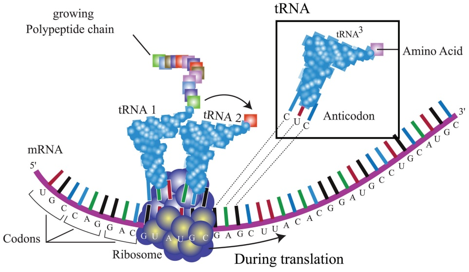

text_image

growing
Polypeptide chain
tRNA
tRNA 1
tRNA 2
tRNA³
Amino Acid
Anticodon
mRNA
5'
U G C C A G G A C G U A U G C G A G C U U A C A C G G A U G C C U G C A U G C
Codons
Ribosome
During translation

Common ways of illustrating tRNA

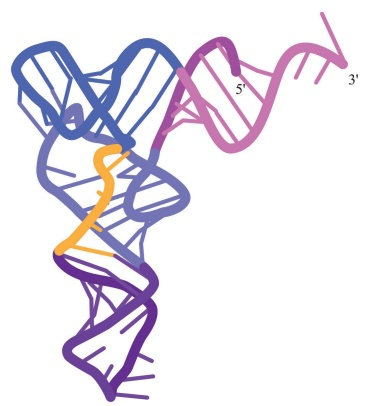

chemical

Diagram of a DNA double helix structure with labeled helices 3', 5'

Anticodon

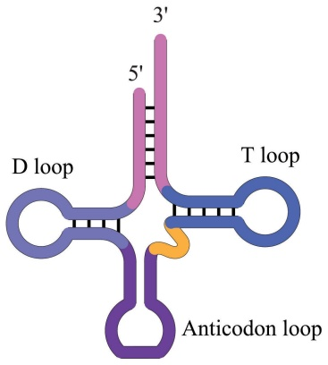

text_image

3'
5'
D loop
T loop
Anticodon loop

Anticodon

Fig. 1.8 Translation of mRNA into protein. The codons are read by transfer RNA molecules (tRNA). The anticodon on the tRNA is able to base pair with the mRNA codon. The amino acid is attached at the $3 ^ { \prime }$ end of the tRNA and when bound to the codon it brings it into the correct orientation for peptide bond formation, elongating the protein by one amino acid. (Courtesy: National Human Genome Research Institute)

hormones such as insulin, which regulates blood sugar levels, down to transcription factors which, as we will see later, control genes.

The diversity of proteins arises from a very limited set of building blocks: the 20 amino acids. The name amino acid comes from the fact that these molecules possess an amine $( \mathrm { N H } _ { 2 } )$ and a carboxylic acid (COOH). These two functional groups are able to join chemically to

---

Introduction to Biology

11

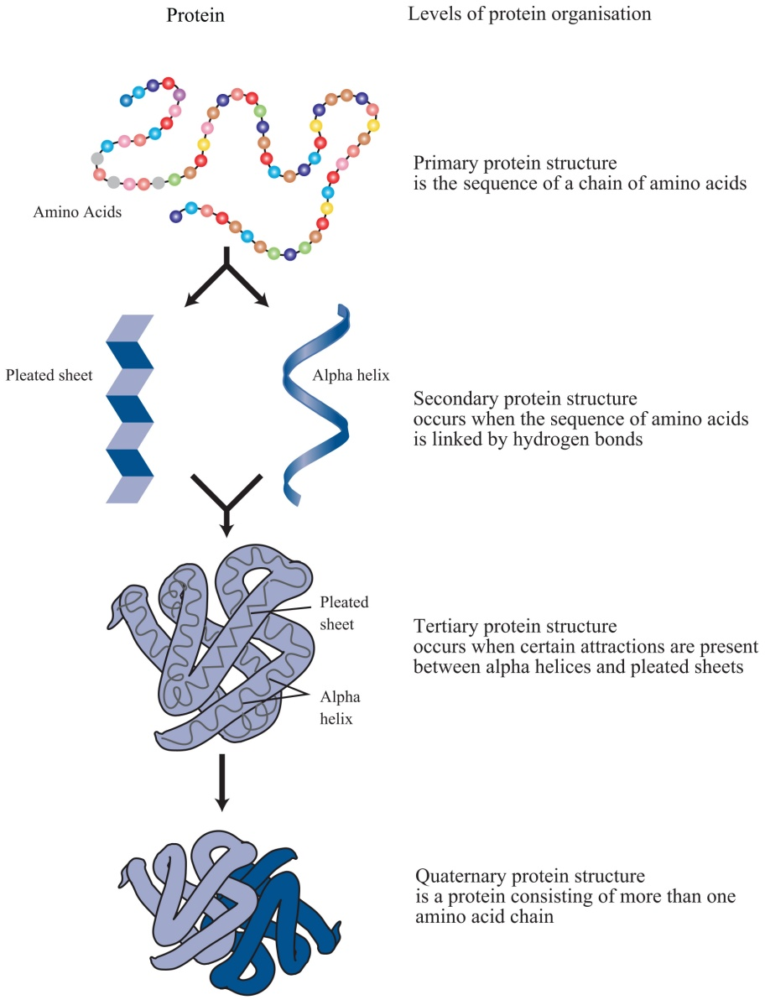

flowchart

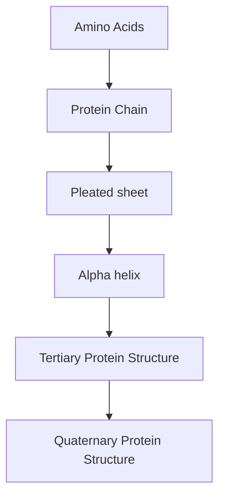

Fig. 1.9 Amino acids and the primary to quaternary levels of protein structure.

form a peptide bond, with the elimination of a water molecule $( \mathrm { H } _ { 2 } \mathrm { O } )$ . This reaction is catalysed in the ribosome and leads to the formation of a linear string of polymerised amino acids (polypeptide, or protein). As we have seen, the precise sequence of the amino acids is dictated by the DNA sequence. The functional properties of proteins do not arise directly from the linear sequence of amino acids (also called the primary structure), but rather the three-dimensional form that they adopt (Fig. 1.9). The folding of proteins into a three-dimensional form is an energetically favourable process, but the intricacies of how

---

12

Synthetic Biology — A Primer

this is governed are highly complex and thus very difficult to predict. It is still not possible to predict computationally the three-dimensional structure of a given protein sequence. The difficulty in understanding the protein folding problem comes back to the incredible diversity of proteins. An average-sized protein would have around 300 amino acids with only 20 different amino acids, which means there are $2 0 ^ { 3 0 0 }$ possible sequences. To put this into perspective, this is a substantially larger number than the number of atoms in the visible universe. This is of course the basis of the huge diversity of protein function, but it also highlights the difficulty of engineering proteins for new functions.

Despite this complexity, huge advances have been made in understanding the structural basis of proteins and their functional properties. These insights have been primarily due to X-ray crystallography, which has enabled atomic resolution structures of proteins to be determined. There are now over 60,000 protein X-ray structures that have been solved, and other techniques such as nuclear magnetic resonance (NMR) and electron microscopy are also making significant contributions to our understanding of protein structure and function.

The detailed atomic resolution of crystal structures has greatly facilitated our ability to rationally engineer proteins, since we can see the structural basis of specific interactions. However, this is still largely a ‘hit-and-miss’ affair, reflecting the complexity of atomic interactions that make a functional protein or enzyme. The great depth of understanding of protein structure has also led to advances in computational techniques to predict protein structure, perhaps best exemplified by the CASP competition (Critical Assessment of techniques for Protein Structure Prediction).

## 1.4 Controlling the Flow of Information in Biology

One of the surprises that became evident with the sequencing and annotation of genomes was how few genes are present in higher organisms, which typically contain around 25,000 open reading frames. By comparison, the well-studied prokaryote contains around 4,800. The difference in the number of open reading frames does not seem to reflect the increase in complexity between humans and E. coli; however, what differs substantially is the number of genes that are responsible for control functions, which are proportionally much higher in eukaryotes (Mattick, 2004). This underlies the importance of control functions in complexity.

The principle flow of information in biological systems determines how information is utilised at required times and in response to external signals. This essentially governs when and where a gene is expressed. In eukaryotes this is responsible for the process by which cells specialise and become skin cells or brain cells, for example. In prokaryotes it enables the bacterium to respond to external signals and change its gene expression pattern in response to new food sources, for example. The aim of synthetic biology is to predictively design and build new biological systems that, for example, programme a phenotypic response or produce a chemical compound. It has become increasingly evident that the fine control of the components of any biological pathway is critical for a successful outcome (Pfleger et al., 2006; Pitera et al., 2007).

---

Introduction to Biology

13

## 1.4.1 Transcriptional control

The primary step at which control takes place is the transcription of DNA into mRNA. This process is performed by RNA polymerase and is a complex process involving several protein subunits. The complexity enables fine control of the process, but also makes understanding the precise mechanism rather difficult. Prokaryotes (bacteria) typically have much simpler systems than eukaryotes (higher organisms whose cells contain a nucleus), and consequently prokaryotic systems are much better understood. For this reason we will provide here a basic overview of prokaryotic transcription, although the reader should be aware that there are differences between prokaryotic and eukaryotic systems and should they require more detailed information then they are advised to consult more specialised texts.

A gene consists of the stretch of DNA that codes for a protein, known as the open reading frame (ORF), plus the regulatory elements that control its expression, that is when it is turned on and off. The most important control element is the promoter which can be considered as the genetic switch. In prokaryotes promoters can either control a single gene, or they can control multiple genes in what is called an operon. Operons have all the genes for a particular function clustered together so that their expression can be coordinated from a single promoter.

The principle enzyme responsible for transcription of a gene is RNA polymerase. The polarity of DNA is also very important in transcription because, as in replication, RNA polymerases only work in a $5 ^ { \prime }$ to $3 ^ { \prime }$ direction, and consequently genes are always read $5 ^ { \prime } { - } 3 ^ { \prime }$ according to the ‘coding strand’. The other DNA strand acts as the ‘template strand’ for RNA polymerase, which acts in an analogous manner to DNA polymerase, making a new polynucleotide chain that is complementary to the template. Hence the newly synthesised mRNA has the same sequence as the coding strand (Fig. 1.10).

RNA polymerase knows where to start transcribing a gene because it interacts with the promoter, which is a stretch of DNA upstream (on the $5 ^ { \prime }$ side) of the gene. RNA polymerase binds the promoter before it begins transcription and consequently the control of transcription is centred around controlling RNA polymerase activity. This involves a number of other proteins, the most fundamental of which are the sigma (σ) factors. Prokaryotic RNA polymerases do not work in the absence of a $\sigma$ factor, and they provide a mechanism for global gene regulation that works under different environmental conditions: $E .$ coli has seven different $\sigma$ factors (Table 1.1). The complex of all the RNA polymerase subunits, including the $\sigma$ factor, is known as the holoenzyme.

Sigma factors are intimately involved with the binding of RNA polymerase to a promoter. Promoters are DNA sequences upstream of where transcription is initiated (denoted as the +1 position). There are certain regions where it can be seen that the DNA sequence is conserved between different genes. This conservation of sequence underlies the importance this sequence has in transcription; if it were mutated then the promoter would not work as well, hence the sequence is conserved during evolution. There are two critical regions where prokaryotic RNA polymerase holoenzyme binds the DNA and recognises the promoter. These regions are 10 and 35 bases upstream of the transcription initiation site, and so are known as the −10 and −35 sites (Fig. 1.11).

---

14

Synthetic Biology — A Primer

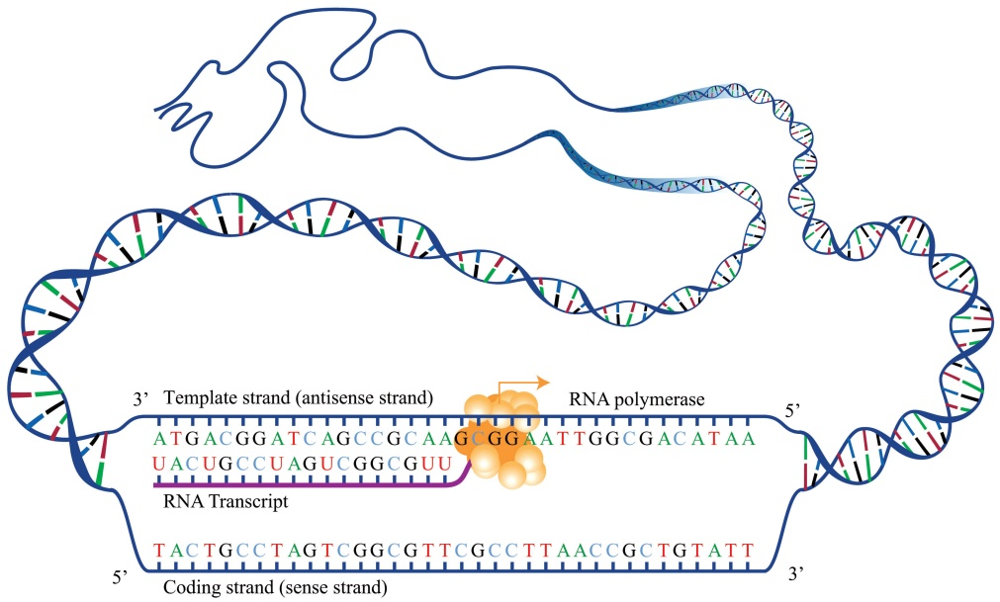

flowchart

Fig. 1.10 Coding and template strands during mRNA synthesis. (Courtesy: National Human Genome Research Institute)

Table 1.1 E. coli σ factors.

| Factor | Function |
| --- | --- |
| $\sigma70$ (RpoD) | The ‘housekeeping’, or primary sigma factor, transcribes most genes in growing cells. Makes the proteins necessary to keep the cell alive |
| $\sigma54$ (RpoN) | The nitrogen-limitation sigma factor |
| $\sigma38$ (RpoS) | The starvation/stationary phase sigma factor |
| $\sigma32$ (RpoH) | The heat shock sigma factor is turned on when exposed to heat |
| $\sigma28$ (RpoF) | The flagellar sigma factor |
| $\sigma24$ (RpoE) | The extracytoplasmic/extreme heat stress sigma factor |
| $\sigma19$ (FecI) | The ferric citrate sigma factor regulates the fec gene for iron transport |

The $\sigma$ factor is largely responsible for the direct interactions with the -10 and -35 sites, and it can be seen that different promoters have different consensus sequences at these positions. This reflects interactions with different $\sigma$ factors, so that the expression of different sets of genes can be differentially controlled through different $\sigma$ factors. The sigma factors themselves are controlled by environmental conditions, and there are also anti-σ factors that can inhibit their action, and even anti-anti-σ factors that can restore activity. $\sigma$ factors typically operate on a number of promoters distributed throughout the genome and can thus be thought of as global regulators of gene expression.

Sigma factors are not the sole means by which transcription is regulated. There are two other types of proteins that control genes: activators and repressors. As their names suggest, these can increase and decrease gene transcription respectively. These transcription factors

---

Introduction to Biology

15

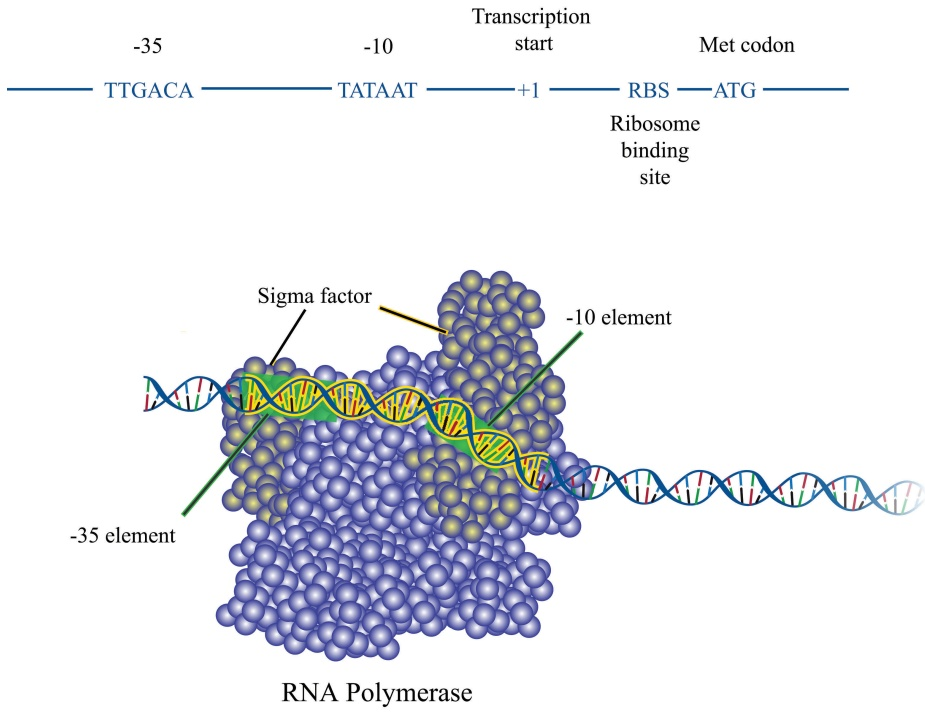

Fig. 1.11 Promoter structure and binding of RNA polymerase. Numbering is in relation to the position where transcription begins at the +1 site. The key elements of bacterial promoters are the −10 and −35 sequences, which interact with the σ-factors. Different sequences mean different promoters operate with different σ-factors (see Table 1.1). The RBS and first methionine codon of the open reading frame are downstream of the transcription start site.

are critically important in turning genes on and off, and typically work on a single operon or a limited number of promoters. Transcription factors thus act as discrete regulators of gene expression, in contrast to the global regulator σ factors.

It is often desirable for the control of transcription to have the characteristics of a switch: it is either on or off. It is worthwhile considering how this effect is achieved by the binding of proteins to a DNA sequence. Transcription factors typically bind specific DNA sequences, but the characteristics of a single protein binding a single site will give a hyperbolic dependency in binding. The effect of this is that the switch from on to off will occur relatively gradually as the concentration of a repressor increases; the switch will not be very responsive, and it will be hard to turn off completely. It is frequently observed that multiple proteins bind at more than one DNA binding site on the operator. When multiple proteins bind this can give rise to protein–protein interactions as well as protein–DNA interactions. This leads to the effect known as cooperativity: it is more favourable for the second protein to bind than the first because of the additional protein–protein contacts. As transcription factor concentration increases, this will lead to a sigmoidal (S-shaped) response in binding and the switch becomes much sharper. For those who wish to understand these important effects more, an insightful text on bacteriophage λ by Mark Ptashne is

---

16

Synthetic Biology — A Primer

worthy of further study (Ptashne, 1992). A lot can also be learnt from modelling these interactions.

## 1.4.2 Translational control

Transcription produces messenger RNA (mRNA), which acts as the intermediate between the DNA ‘archive’ and the functional protein product. To produce the functional protein, the mRNA has to be translated from nucleotides into amino acids, which then fold to create a functional protein. This process is carried out by the ribosome, and the process is called translation.

In prokaryotes, the $5 ^ { \prime }$ end of the mRNA molecule has a sequence that is recognised by the ribosome, called the ribosome binding site (RBS). The presence of this site allows the ribosome to bind the mRNA and it also positions it appropriately to begin translation at the first ATG (methionine) codon. The ribosome will then move down the mRNA, translating the codons into amino acids, and synthesising the polypeptide chain to create the protein according to the sequence encoded by the mRNA.

The RBS has a critical role in translation, and it is the most direct means of modulating how much protein is made from a single RNA molecule. mRNA molecules are relatively unstable and will have a half-life of around 2–3 minutes within a cell, so only a finite amount of protein can be made from a single mRNA molecule. The strength of the RBS will determine how much that is. A strong RBS has a tight interaction with the ribosome, so it will bind and begin translation effectively. Conversely, a weak RBS has a much lower affinity for the ribosome, which means it has a greater tendency to dissociate from the RBS and reduces the potential for protein synthesis, so less protein is made from that mRNA.

The RBS has a consensus sequence, which means that this is the representative sequence based on comparisons of known RBS sites. Slight variations in the sequence will still be functional, but will generally have higher or lower expression levels. In synthetic biology there may be a requirement to fine-tune protein levels, and the RBS provides a site of intervention that can be used to modulate the level of protein expression by slightly changing its sequence (Pfleger et al., 2006).

One of the goals in synthetic biology is to have predictive design of biological systems. Understanding the level of translation for a particular protein can be an important parameter in predictive design. This presents one of the challenges faced when engineering biological systems, because the behaviour of a particular RBS will be dependent on the ORF that it is used with. This context dependence arises because the mRNA is a single-stranded molecule which can therefore fold and form secondary structures if there are homologous sequences in neighbouring regions. If an RBS site folds into a secondary structure then it will be unavailable for binding to a ribosome, which will only bind an open single-stranded RNA molecule, so protein expression will decrease.

One method for determining and rationalising these effects is to take a numerical approach. The RBS calculator determines the free energy difference between a folded mRNA transcript and the same mRNA bound to the ribosome (Salis, Mirsky and Voigt, 2009).

---

Introduction to Biology

17

A number of parameters are considered in the calculation and it predicts the effective strength of a synthetic RBS site within a specified sequence context. This has demonstrated a correlation between the predicted and observed behaviour of a given DNA sequence to within a factor of 2–3. This is an important advance in considering how we tackle these types of problems, although it is also clear that the accuracy of the current predictive model is not sufficient for a rational design-based approach.

## 1.4.3 RNA regulation

It is becoming increasingly recognised that RNA is not merely a passive messenger molecule within the cellular milieu. RNA has a number of important catalytic and regulatory functions and it is thus integral to the overall working of the cell. Its vital role in many of the most fundamental cellular processes underlies its ancient heritage, and it is thought that RNA was the first genomic material and that an ‘RNA world’ preceded the evolution of the current DNA world (Atkins et al., 2011). The evolution of DNA provided a more stable genetic material that facilitated the evolution of higher complexity organisms. The RNA legacy can still be observed in many vital cellular functions. For instance, it forms many of the components within the ribosome, and tRNA molecules are also integral to the process of protein synthesis.

RNA can also act as a catalyst (ribozymes) and many small RNA molecules are now thought to act as regulators of gene expression (Mattick, 2004; Atkins et al., 2011). Within eukaryotes the discovery of siRNA (small interfering RNA) as regulators of gene expression has led to the development of valuable tools for manipulating gene expression as well as the discovery of new pathways for RNA processing and native gene regulation. It is also thought that prokaryotes use small RNA molecules to regulate gene expression, although they do not contain the same RNA processing machinery as eukaryotes.

It has been elegantly demonstrated that small RNA molecules can be engineered to interact with mRNAs and modulate the translation step (Bayer and Smolke, 2005). The short half-life of RNA molecules within prokaryotes means that specific degradation pathways are not required to specifically remove the targeted mRNAs. The short half-life of RNA also makes them an attractive target for regulatory processes, since the response can be rapidly turned on and off (Win and Smolke, 2007). Using proteins is more costly in terms of cellular resources; they are relatively slow to make and can have exceedingly long lifetimes, leading to slow response times.

An interesting variant of RNA control elements are riboswitches (Tucker and Breaker, 2005). These are sequences in the $5 ^ { \prime }$ end of an mRNA that modulate the translation through binding of small metabolite molecules. When the mRNA binds to the metabolite, specific structural complexes are made that sequester the RBS and prevent translation. Frequently riboswitches are control elements that regulate the enzymes responsible for the metabolic pathways, providing feedback mechanisms of control. Recently riboswitches have been engineered by synthetic biologists to provide programmable control mechanisms (Callura et al., 2010).

---

18

Synthetic Biology — A Primer

## Reading

- Atkins, JF, Gesteland, RF and Cech, TR. (2011). RNA Worlds: From Life’s Origins to Diversity in Gene Regulation. Cold Spring Harbor Press, New York.
- Bayer, TS and Smolke, CD. (2005). Programmable, ligand-controlled riboregulators of eukaryotic gene expression. Nat Biotechnol 23: 337–343.
- Callura, JM, Dwyer, DJ, Isaacs, FJ, et al. (2010). Tracking, tuning, and terminating microbial physiology using synthetic riboregulators. Proc Natl Acad Sci U S A 107: 15898–15903.
- Ellis, T, Adie, T and Baldwin, GS. (2011). DNA assembly for synthetic biology: from parts to pathways and beyond. Integrative Biology 3: 109–118.
- Mattick, JS. (2004). RNA regulation: a new genetics? Nat Rev Genet 5: 316–323.
- Pfleger, BF, Pitera, DJ, Smolke, CD, et al. (2006). Combinatorial engineering of intergenic regions in operons tunes expression of multiple genes. Nat Biotechnol 24: 1027–1032.
- Pitera, DJ, Paddon, CJ, Newman, JD, et al. (2007). Balancing a heterologous mevalonate pathway for improved isoprenoid production in Escherichia coli. Metab Eng 9: 193–207.
- Ptashne, M. (1992). A Genetic Switch. Blackwell Scientific, Cambridge, MA.
- Salis, HM, Mirsky, EA and Voigt, CA. (2009). Automated design of synthetic ribosome binding sites to control protein expression. Nat Biotechnol 27: 946–950.
- Tucker, BJ and Breaker, RR. (2005). Riboswitches as versatile gene control elements. Curr Opin Struct Biol 15: 342–348.
- Win, MN and Smolke, CD. (2007). RNA as a versatile and powerful platform for engineering genetic regulatory tools. Biotechnol Genet Eng Rev 24: 311–346.
