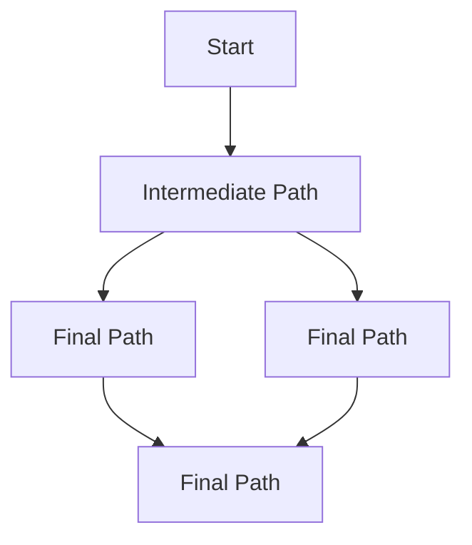
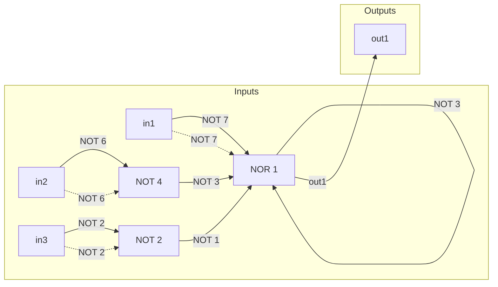
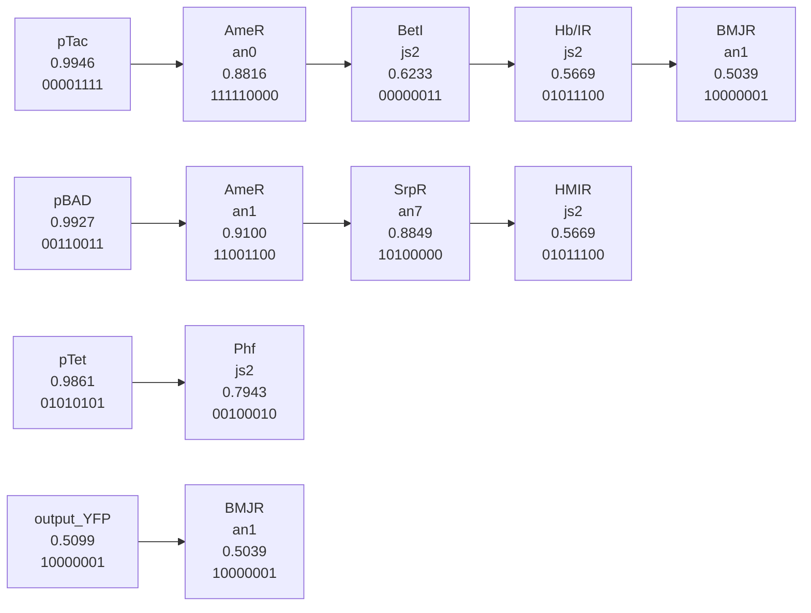

# Chapter 3. Foundational Technologies

原始 PDF 第 56–75 页。

# CHAPTER 3

# Foundational Technologies

## 3.1 Introduction

In this chapter, we will examine the enabling technologies that precipitated the rise of synthetic biology and describe the foundational technologies that modern synthetic biology is built upon. Synthetic biology brings together the principles common to all branches of engineering with the sciences of biology and chemistry. We will look at how these engineering principles define synthetic biology and how advances in biology and chemistry in the last decades of the 20th century set the scene for the subject to emerge. Finally we will touch on upcoming technologies that may define the next generation of synthetic biology research.

## 3.2 Enabling Technologies

Modern research in biology and chemistry often overlaps and is also split into many specialist sub-divisions. To place synthetic biology in context, it is useful to start by defining some of the branches of the biosciences that provide the scientific backbone for synthetic biology and led to the enabling technologies discussed here. One of the oldest subjects in bioscience, microbiology, is the study of microbes — the single-cell organisms that include the bacteria and yeasts so often used in synthetic biology. Genetics looks at cellular function and phenotypic differences between organisms, understanding how they link to genes and genetic differences such as mutations. Biochemistry bridges biology and chemistry to give a link between biological molecules and cellular function by revealing the chemistry and structures of the cellular molecules, particularly proteins like enzymes. Molecular biology completes the circle between genetics and biochemistry, uncovering the molecules and processes in cells that take genetic information from genes and converts it into the molecules of biochemistry. Molecular biology is particularly important for synthetic biology as this subject provides the tools for engineering biology. It gives us the proteins and molecules that convert new information encoded in the DNA of genes to make proteins that change cellular function. It gives us enzymes that cut and rearrange DNA to allow new information to be put into cells and it has also given rise to the tools needed to analyse the sequences of DNA and RNA that encode all life.

41

---

42

Synthetic Biology — A Primer


<details>
<summary>text_image</summary>

Replichore 1
Origin
4,000,000
100
10
1,000,000
35
30
25
50
3,000,000
60
80
90
1,000,000
2,000,000
Terminus
Eschericia Coli K-12
4,639,221 nucleotide pairs
Replichore 2
</details>

Fig. 3.1 A genetic map of the E. coli K-12 genome with an electron microscope image of several E. coli cells. (3.1(A) © Science Photo Lab. Reproduced with permission; 3.1(B) © AAAS. Science 277: 1453–1462, 1997. Reproduced with permission).

## 3.2.1 Genome sequences

Concurrent with the first synthetic biology research projects was the sequencing of the DNA that constitutes the human genome, a massive international project announced as essentially complete in 2003. However, it was in 1996 and 1997 that genome research made its biggest impact for synthetic biology with the sequencing of the genomes of two model organisms both used extensively in biotechnology — the bacterium Escherichia coli (Fig. 3.1) and the yeast Saccharomyces cerevisiae.

Having a complete sequence of an organism’s genome is essential for understanding how a cell works and how it can be re-engineered to be a chassis system for synthetic biology. A genome sequence provides a massive source of digital information that can be used to bring together detailed descriptions of molecular biology, genetics and biochemistry effectively being a blueprint for the function of the cell. The sudden availability of completed DNA sequences of two of the most commonly used laboratory organisms precipitated not only synthetic biology but also the tandem subject of systems biology discussed below. Parallel genome projects gave us further microbial genomes and then later the genomes of plants like A. thaliaria and metazoan animals like D. melanogaster and C. elegans. These

---

Foundational Technologies

43

genomes give molecular biologists a ‘toolbox’ of gene sequences to research with and it is these that provide the basis for ‘parts’ in synthetic biology.

## 3.2.2 Open online databases

The World Wide Web has had a big impact on research science, allowing scientists to share discoveries in faster and more information-rich ways than the printed publication methods, which dominated until the 1990s. Online databases have been particularly important in enabling technology development for synthetic biology. The ability to share graphical representations of large data sets is crucial to modern science. An example of this is the genome projects discussed above. These projects output millions of bases of DNA sequence that are too large to be disseminated on paper, but are perfectly suited to online databases. The Saccharomyces Genome Database (SGD) is an excellent example of this, providing the home to 12 million base pairs of yeast DNA sequence and the annotation of over 6,000 genes and thousands of experiments. As with many other online databases, such as FlyBase for Drosophila fruit fly researchers, the presence of such an essential website for research in this area also provides a focal point for research communities, and with freely available online data comes open-source sharing. A common model for an open online database is as a community wiki, where researchers can input and edit information relevant to their field of research and freely see that of others. There are now hundreds of open online databases containing biochemical, genetic and molecular biology information for a variety of organisms. Synthetic biology is able to make use of many of these databases. Databases that describe chassis cells, typically E. coli or S. cerevisiae, provide information on how to re-engineer the existing cellular systems. Databases that list enzymes and metabolic pathways from across nature are used to design systems that add ‘foreign’ genes to give new biological functions. Finally, synthetic biology has established its own online databases to help share information on experiments and designs. Two examples, both of which are wikis, are OpenWetWare.org, which is used to share experimental protocol information, and parts.igem.org, which holds vital information on standard biological parts discussed below and in other chapters.

## 3.2.3 DNA sequencing

DNA sequencing is one of the main tools of modern biosciences. Early molecular biology research and the first genome projects used traditional Sanger sequencing to sequence individual DNA pieces up to 1,000 base pairs at a time, and relied on gel electrophoresis and fluorescent dye chemistry to get the base pair sequence of DNA. For much longer sequences, such as whole chromosomes, a strategy called shotgun sequencing was employed in the 1990s by J. Craig Venter and others. In this technique a large piece of DNA is cut into many smaller fragments and sequenced by Sanger sequencing in parallel several times. Overlapping DNA data from each sequencing read is fed to an algorithm that re-assembles the sequence of the large DNA piece in silico. Parallel sequencing played a particularly large role in enabling rapid and affordable sequencing of bacterial genomes and is still the primary

---

Synthetic Biology — A Primer

strategy to sequence chromosome-sized DNA. The strategy suits DNA sequencing on an industrial scale and has led to the creation of specialised 24-hour sequencing centres with automation, and a continual, exponential drop in the price and time it takes for researchers to have cloned DNA sequenced. For synthetic biology, verification of the DNA sequence of novel constructs is crucial and so having fast, cheap DNA sequencing is a prerequisite for projects of every size. In particular, DNA sequencing is essential for projects where devices are hosted in bacteria as the fast evolution within these organisms can quickly add mutations to sequences. The technology behind the physical sequencing of DNA has moved from gel electrophoresis to capillary electrophoresis for individual cloned DNA sequences common in synthetic biology. For genome-scale projects the sequencing chemistry has completely moved on to what are referred to as second- and third-generation sequencing technologies that sequence short DNA fragments in a massively parallel manner. These technologies create huge datasets and rely heavily on computation and algorithms to determine the genome sequences.

## 3.2.4 DNA synthesis

The technology directly related to DNA sequencing is DNA synthesis. DNA synthesis broadly falls into two categories: (i) oligonucleotide synthesis and (ii) gene synthesis the latter of which is discussed below. Oligonucleotide synthesis simply means the custom synthesis of short, single-stranded DNA oligonucleotide sequences, usually to be used as primers for PCR amplification of gene sequences. A customer defines the DNA sequence that they would like and simply sends the base sequence of their order to a synthesis facility, usually a company. Oligonucleotide synthesis is a chemical technology — a solid-phase synthesis performed using phosphoramidite chemistry to link A, C, G and T building blocks into chains as long as 150 nucleotides. As with DNA sequencing, oligonucleotide synthesis is typically done on an industrial scale at automated 24-hour centres. Process advances and commercialisation have led to a continual decrease in cost and turnover times for synthesised DNA oligonucleotides that is beginning to match those for DNA sequencing.

The decrease in costs of oligonucleotide synthesis and DNA sequencing has been overtaken by an even more rapid and exponential decrease in the cost of gene synthesis (Fig. 3.2). Gene synthesis is the custom ordering of commercially produced double-stranded sections of DNA, usually from 200 to over 2,000 base pairs in length. Gene synthesis costs are dependent on oligonucleotide and sequencing costs as the custom ordered genes are assembled from pools of synthesised oligonucleotides and then sequence-verified before delivery to the customer. Gene synthesis first requires optimised design and then synthesis of the required oligonucleotides, which are typically 40 to 60 bases in length. These oligos make up both the sense and antisense strands of the duplex DNA product and contain substantial overlap (Fig. 3.3). The gene is assembled from the oligonucleotides by allowing overlapping sequences to anneal and then using purified ligase enzymes and/or DNA repair enzymes to seal gaps. Alternatively, PCR amplification methods can be used; two of the most common are called progressive overlap extension PCR and thermodynamically balanced inside-out PCR. Assembled synthetic genes are purified, sequence-verified and regularly

---

Foundational Technologies

45

Price Per Base of DNA Sequencing and Synthesis


<details>
<summary>line</summary>

| Year | Cost: Sequencing (US Dollars) | Cost: Short Oligo (US Dollars) | Cost: Gene Synthesis (US Dollars) |
| --- | --- | --- | --- |
| 1990 | ~25 | — | — |
| 1993 | ~1 | ~1 | — |
| 1995 | ~0.8 | ~0.7 | — |
| 2000 | ~0.25 | ~0.3 | ~25 |
| 2001 | — | — | ~12 |
| 2002 | — | — | ~8 |
| 2003 | ~0.05 | ~0.15 | ~4 |
| 2004 | ~0.025 | — | — |
| 2006 | ~0.0008 | ~0.1 | ~1 |
| 2007 | — | — | ~0.5 |
| 2008 | — | ~0.08 | ~0.4 |
| 2009 | ~0.000008 | — | ~0.35 |
| 2010 | ~0.000003 | ~0.07 | ~0.3 |
| 2011 | ~0.000002 | — | ~0.25 |
| 2012 | ~0.0000015 | ~0.06 | ~0.2 |
| 2013 | ~0.0000015 | — | ~0.18 |
| 2014 | ~0.0000015 | ~0.06 | ~0.15 |
</details>

Fig. 3.2 The ‘Carlson Curve’ — the fall in DNA sequencing and DNA synthesis costs plotted over the last two decades. Note that cost is on a log-scale, so a straight line decrease is actually an exponential decrease. (Courtesy: Rob Carlson — www.synthesis.cc).

require error-correction using DNA repair enzymes, usually due to problems in the quality of the oligonucleotides used for assembly.

A strong link between synthetic biology and gene synthesis has always existed. Gene synthesis is a short cut to routine laboratory work required for molecular biology such as repetitive cloning and PCR. Gene synthesis allows DNA sequences placed online by researchers to be converted back into DNA constructs in other labs around the world, accelerating the sharing of resources. Importantly, gene synthesis also allows the production of entirely new synthetic gene sequences that have never existed before in nature. For synthetic biology, not only does this offer the freedom to produce novel designs for biomolecules like proteins or regulatory DNA sequences, but crucially allows proteincoding sequences to be codon optimised. Codon optimisation is desirable (and sometimes a necessity) when DNA sequences encoding proteins are transferred from diverse organisms into microbial cells. Throughout nature there is large variation in which codons are preferred by each organism and so the native DNA sequence of, say, a tobacco plant enzyme may be very poorly converted into protein when placed in E. coli. This is because codons that are highly efficient in plants may be rarely used in the bacteria (see Chapter 1). Rare codons in a gene cause the host cell machinery to stall when making the protein as the tRNAs required to match these codons are scarce. In order to allow synthetic biology to engineer complex devices and pathways using the biochemical diversity found across

---

46

Synthetic Biology — A Primer


<details>
<summary>flowchart</summary>


</details>

Fig. 3.3 Diagram of gene synthesis from overlapping oligos by assembly PCR.

nature, codon optimisation through gene synthesis is invaluable. Gene synthesis with codon optimisation has the further advantage of allowing genes to be re-coded at the DNA sequence to specifically contain or be absent of defined sequences, such as those sites recognised by DNA-editing enzymes like the restriction enzymes that play a key role in synthetic biology DNA assembly.

## 3.2.5 Systems biology

A genome sequence is an example of a data-rich experimental project that requires online databases to disseminate results. While genomics was one of the first areas in bioscience where this occurred, many modern experimental projects now collect millions of data points through the use of what is called ‘high-throughput techniques’. In particular, experiments that take parallel measurements of molecules in cells produce very large datasets. An established example is DNA microarrays, which are used to quantify the level of all mRNAs in a cell at a given time, and so give a picture of what genes are being expressed to make protein and by how much. Before genomics and DNA microarrays, experimental biological data had been a precious resource established by individual researchers. However, now the amount of experimental data produced by some techniques has surpassed what classical research methods can adequately describe. To address the gap between data and interpretation, researchers have taken advantage of the increasing availability of computer power to use mathematical-based analysis of data to infer cell function. By writing in silico mechanistic models of how cells may operate using mathematical software it has become possible to

---

Foundational Technologies

47

systematically analyse and integrate large complex datasets to derive how cells respond to stimuli and the nature of the processes that control their life cycle. This research approach, which began after the first genome sequences were completed, is known as systems biology. It is closely associated with synthetic biology because both disciplines use mathematical models to describe and predict function. For systems biology, computation is used to dissect a cell’s natural behaviour from wide-ranging experimental datasets. In contrast, modelling is used for synthetic biology, as it is in engineering, to aid in the design and description of newly constructed functions (see Chapter 6). A useful way to compare systems and synthetic biology is to think of how they approach working with cells and data. Systems biology is considered ‘top-down’, as measurements of outcomes are used to build a model of the inner workings of the cell as a system; synthetic biology is ‘bottom-up’, as the inner workings are measured and then put together and built to create outcomes. The two research fields complement one another in methodology, as modelling strategies such as ordinary differential equations and stochastic simulations are common to both fields, and the initial use of mathematics to describe cellular processes by systems biology has paved the way for its evident application to synthetic biology.

## 3.3 Foundations

## 3.3.1 Standard DNA assembly

The foundational technologies that underpin synthetic biology and differentiate it from traditional DNA manipulation by molecular biology are based on engineering. In other engineering disciplines like electronic and mechanical engineering, standards are an essential foundation, allowing parts and data to be shared worldwide. In particular, the standards that define how parts are linked together are important for giving modular composability, and examples of this can be seen all around us, like the USB standard for linking electronic devices and standardised threading on screws. To facilitate modular composability in engineering biology and ease the re-use of defined DNA parts, synthetic biology has built a foundation of standard DNA assembly that allows parts to be sequentially combined into working devices, pathways and systems.

Biological devices assembled in the initial projects of synthetic biology used unique DNA sequences recognised and cut by restriction enzymes. These sites, when placed at the boundaries of DNA parts, allowed them to be linked together and enabled parts to be removed and/or replaced as necessary using various DNA-editing enzymes to cut and paste. The modularity of this approach is evident, yet it requires a long list of available unique sites and these have to be added accordingly to the ends of parts by DNA modification techniques like PCR. To overcome these limitations the BioBricks assembly standard was developed by Tom Knight at MIT in 2003. The BioBricks standard places the recognition sites of three specific restriction enzymes at each end of every part, and digestion and ligation at these sites allows parts to be assembled together in a standard fashion. Importantly, the use of different restriction enzymes whose digested recognition sites can still ligate together (isocaudomers) means that standard parts can be linked together

---

48

Synthetic Biology — A Primer

in a manner that removes the digestion sites from the part boundaries in the composed product. Thus any product of standard assembly of BioBrick parts becomes itself a usable, larger composite BioBrick. For a full description of BioBrick parts and their assembly, see Appendix 1.

BioBricks assembly, however, has limitations that pose a challenge in designing and engineering synthetic systems. Repetitive ‘scar’ sequences are left behind at part boundaries which can affect the function of the neighbouring parts, and parts cannot be used which contain within them any of the restriction enzyme recognition sequences that are used for standard assembly. These limitations along with the slow methodology of BioBricks assembly means that few of the major research projects in synthetic biology use this assembly method, instead relying on numerous bespoke methodologies. However, the foundation that standard assembly provides is clear as it allows any researcher with the same set of restriction enzymes to reliably assemble thousands of prototype devices from standard biological parts. It is a relatively easy-to-use method and this is evident annually at the International Genetically Engineered Machine (iGEM) competition where undergraduates describe complex devices assembled and tested in just three months (see Chapter 8). In effect, it is a useful prototyping tool analogous to the plastic models that architects produce before buildings are constructed. This reliable method of construction allows prototypes to be tested that can later be replaced by tuned, professional final products, and experience with BioBricks assembly paves the way for researchers to tackle complex projects in synthetic biology.

## 3.3.2 Standard measurement

Regardless of the method of assembly of biological parts, it is important to have standard measurement of their function and efficiency. For synthetic biology to be an engineering discipline, DNA parts of all types, whether in BioBricks form or not, need to be adequately described by data. This allows parts to be re-used by other researchers without themselves having to replicate the most basic experiments. It also enables model-based design and description of devices and systems as the characterisation data of parts helps build the mathematical model, defining the working parameters that give realistic output. In other engineering disciplines, having adequate characterisation data available for each part is essential. For integrated circuit engineers in the 1970s and 1980s, the TTL Data Book described the necessary characteristics of transistors and resistors required for hobbyists and professionals to assemble complex digital circuits. An equivalent to this data book will be required for biological parts as a foundation for synthetic biology to build complex systems.

Precise, quantitative measurement of biological function has always been a challenge. New technologies are able to increase the speed and accuracy of measurements from biological systems and give exponentially more data. For synthetic biology, the key foundational technologies used in the standard measurement of parts are microscopy, flow cytometry, colorimetry, luminometry and fluorimetry. This is because the majority of

---

Foundational Technologies

49

synthetic biology experiments use reporter systems to measure the functional output of a DNA part, device or system. The most accurate and easy-to-use reporter systems rely on accurate detection of cells changing colour or producing fluorescent molecules (fluorophores) or luminescent molecules (luminescence). The most commonly used reporter system for standard measurements in synthetic biology is Green Fluorescent Protein (GFP). This is a protein originally isolated from the jellyfish Aequorea victoria that exhibits bright green fluorescence when exposed to blue light. The DNA sequence encoding this protein can easily be placed into other organisms to make them fluoresce green and fusing the GFP-encoding DNA sequence to the coding sequence for another protein effectively tags that protein with green fluorescence. Output of biological function can be measured using GFP by fusing its encoding DNA to proteins whose expression levels or location need to be determined. Alternatively, directly placing the GFP DNA sequence alongside regulatory DNA sequences like promoters enables researchers to measure how those sequences modulate gene expression levels. GFP levels are quantified at the population level by measuring the green fluorescence output of a volume of cells using fluorimetry. Quantification can also be performed at high-speed for single cells using flow cytometry which passes individual cells through a microfluidics chamber past a blue laser and then detects green output. Finally, fluorescence microscopy can be used to track and (using image analysis) quantify GFP expression within single cells and for populations of cells.

Alternative reporter systems to GFP include natural enzymes such as β-galactosidase and catechol 2,3-dioxygenase that catalyse quantifiable colour-change reactions when specific substrate chemicals are provided. Luminescence is also used as a reporter mechanism, taking natural luciferase enzyme genes that exist in fireflies and jellyfish and expressing these in engineered cells to produce a quantifiable light output. There also now exists a whole range of different fluorescent proteins other than GFP — including blue, cyan, yellow and several shades of red fluorescent proteins along with GFP variants optimised for a wide variety of different cellular conditions (Fig. 3.4). Research and development in biotechnology, using mutation and selection methods, has enabled scientists to engineer new properties into natural proteins and discover new variants of fluorescence. The many types of available reporter systems, particularly fluorescent proteins emitting different colours, allow researchers to measure the output of several parts, devices or systems at once. For example, the gene expression output of two promoters in an engineered yeast cell can be quantified at the same time by placing the GFP DNA sequence downstream of one promoter and an RFP (red fluorescent protein) DNA sequence downstream of the second promoter. Using a fluorescence microscope or a flow cytometer with the correct detection filters and excitation lasers, the researcher can simultaneously record green and red fluorescence, and in doing so infer the output efficiency of the two promoter sequences.

Although technology is improving, the precision of measurements performed by different research groups often produces data that shows large differences. This is due to a variety of reasons. Firstly, biology is inherently ‘noisy’ — within an apparently

---

50

Synthetic Biology — A Primer


Fig. 3.4 Fluorescent proteins are available in many shades of colour, thanks to natural diversity and extensive in-lab evolution experiments. (© Paul Steinbach, Roger Tsien Laboratory. Reproduced with permission).

identical population of a million bacteria cells some will exist that are at different stages in their life cycle, different sizes and with varying access to nutrients and oxygen. Even at the molecular level within the cell there are events like transcription that are stochastic in their nature. Secondly, cells used by different researchers can be quite different — for example two synthetic biologists engineering an E. coli chassis could be working with different strains of the same organism, which have small genetic differences that cause significant changes in their behaviour. Even when two laboratories both use the same strain, the ability of bacteria to quickly acquire mutations means that the two labs may still not have genetically identical systems. Finally, the largest source of variation in measurement comes from the researchers themselves, who set up their experiments differently, following different protocols, have different lab conditions such as temperature and air pressure and use different equipment from a variety of manufacturers to make their measurements.

Although it may be possible to limit this variation by vigilant standardisation of cell strains, chemical reagents, equipment and experimental protocols, it is also possible to do so by using reference elements to aid in standard measurement. A good example of a reference element is the metre. The metre is the standard unit used to measure distance and is based on a length chosen by scientists and engineers. To quantify any distance, an engineer will directly compare that distance to their own measurement tool standardised to the official metre. Just as in measuring distances in engineering, in synthetic biology it has been shown that using a reference element can help standardise measurement between research groups around the world. In one example of this a promoter sequence active in growing E. coli was set as the benchmark reference element for promoter efficiency. Quantifying the green fluorescence output of cells engineered to express GFP under the control of this promoter gives each lab their reference output measurement. Labs can then compare the measured output of other promoter sequences to this reference measure and share their data as relative expression output compared to the standard that each lab has quantified. As a foundational technology for synthetic biology, standard measurement using reference elements enables more accurate sharing of characterisation data among the community.

---

Foundational Technologies

51

## 3.3.3 Abstraction

Natural DNA sequences often encode multiple overlapping functions, providing a challenge for synthetic biology. For example, the initial bases of an mRNA sequence can affect the efficiency of translation but they can also modulate the mRNA lifetime, and are coded for by DNA bases that themselves are usually part of the promoter sequence. Overcoming this and defining each part and its function is a major task in synthetic biology, but it is essential for providing the modular composability that will allow the engineering of novel biological devices and systems.

Composability is a fundamental part of what is known as abstraction in engineering, where intimate understanding at one level (e.g. parts) is not required to work at another level (e.g. devices). Abstraction allows the construction of complex devices without the full understanding of the processes at each scale (Fig. 3.5). For example, in the computer industry, a laptop is designed and assembled by people who have no expertise in how transistors are fabricated into microchips. In synthetic biology, abstraction allows there to be experts on parts like promoters and transcription factors who can characterise these standard parts and pass them over to specialists who design and build devices or engineer pathways. These specialists can then, in turn, offer their expertise to systems-level designers who can work with little or no knowledge of how parts in their designs operate at the molecular level. By having abstraction in synthetic biology it allows complexity to be engineered without a reliance on highly trained experts who understand cellular biology at many levels of detail. In order to enable abstraction it is essential that biology is engineered in a modular fashion


<details>
<summary>flowchart</summary>

```mermaid
graph LR
  subgraph Systems
  A["PoPS NOT.1"] --> B["PoPS NOT.2"]
  B --> C["PoPS NOT.3"]
  end

  subgraph Devices
  D["PoPS"] --> E["PoPS NOT.1"]
  E --> F["PoPS"]
  end

  subgraph Parts
  G["5'-TAATACGACTCACTATAGGGAGA-3'"] --> H["Get me this DNA."]
  H --> I["Here's your DNA."]
  end

  A -.->|"Can I have three inverters?""| J["Here's a set of PDP inverters 1-n that each send and receive through a fungible signal carrier, PoPS."]
  E -.->|"I need a few DNA binding proteins."| K["Here's a set of DNA binding proteins 1-n that each recognize a unique cognate DNA site; choose any."]
  G -.->|"Get me this DNA."| I
```
</details>

Fig. 3.5 Diagram demonstrating the different abstraction levels in synthetic biology. (Courtesy: Nature 438, 24 November 2005, 449–453. Reproduced with permission).

---

52

Synthetic Biology — A Primer

with defined parts. These parts are required to be measured with a suitable degree of precision so that their characterisation data can be used to accurately design and build devices and, in turn, these devices themselves need to be adequately characterised and modular for them to be interfaced into synthetic systems.

## 3.3.4 Modelling

As in all aspects of engineering, mathematical descriptions of designs and processes are an essential tool in synthetic biology and provide a foundation for robust and scalable construction of complex devices and systems. Mathematical models are applied in synthetic biology both before a device or system is assembled and characterised in cells, and also afterwards. Modelling prior to building and testing a device is typically intended to be predictive. That is to assess the likelihood that a design will work, to suggest other possible designs, to simulate the potential performance and to derive the parameters that will give the intended robust function. Deriving the optimal parameters by predictive modelling allows the researchers to select the appropriate parts that should build a successful device or system. For example, when constructing a regulatory gene network, inputs and outputs at logic gates need to be tuned appropriately; parameter estimation informs the relative expression levels required for the regulatory proteins and by selecting promoter parts of different strengths to control expression of these proteins, researchers can build balanced and predictable devices (Fig. 3.6). The use of modelling after the assembly and characterisation of a biological device or system serves several other useful roles in synthetic biology:

(i) Modelling can be used to give a fundamental description of a novel process, explaining the characterisation data and providing a mathematical foundation for the synthetic design. A model of a characterised synthetic device or system can often then be used to derive a mathematical understanding of an equivalent natural process.
(ii) A model describing the experimental data can be used typically by simulation, to quickly explore how a design performs in a wide variety of other potential experimental conditions, including ones which would be difficult to examine in a typical laboratory.
(iii) A post-testing model provides the crucial link to the second round of an engineering cycle, allowing the data derived from testing an initial prototype in a first cycle to direct the design and construction of one or more optimised second-round designs.

Modelling in synthetic biology is important at all scales of work, from describing how protein parts bind their substrates or predicting the folding of RNA motifs, up to analysing how the flux of metabolites runs through enzymatic pathways and understanding how cells interact with one another in engineered consortia. Models of all scales can be done using a variety of techniques including ordinary differential equations (ODEs), stochastic differential equations (SDEs), Master equations and Boolean networks.A detailed description of modelling for synthetic biology is found in Chapter 6. A foundation for modelling in synthetic biology is intended to allow abstraction and to increase the speed and reliability of building synthetic biological devices and systems. Experimental

---

Foundational Technologies

53


Fig. 3.6 Model-predicted behaviour of gene networks can be used to inform how a network will perform when DNA parts from part libraries are interchanged. (Courtesy: Nature Biotechnology 27, 2009, 465–471. Reproduced with permission).

---

54

Synthetic Biology — A Primer

molecular biology is, by comparison, time-consuming, expensive and can be unpredictable. Computational design and simulation is cheap and rapid. By placing more of the process of the synthetic biology engineering cycle in silico there is accelerated innovation and application at lower costs.

## 3.3.5 Parts registries

Science relies on the dissemination of data and the exchange of materials such as DNA and cells from one group to another. Traditionally, this was done through collaboration and via conferences but with increased volume of experimental data collected, open online databases have become more important and also provide a home for valuable basic information about experiments, such as the methods used and the raw data collected. With the decreasing cost of gene synthesis, online databases are also a way to exchange materials, as posting the digital information of a DNA sequence allows others to have this made.

For synthetic biology, sharing data and exchanging DNA sequences is particularly important as it allows engineered systems to be rapidly re-used and modified by others. This is especially true for engineering that uses standard parts to compose complex modular designs. The same community of synthetic biologists that developed the BioBrick and iGEM also co-developed a parts registry for standard BioBricks parts. The Registry of Standard Biological Parts (parts.igem.org) is maintained in the USA by a dedicated team and provides a wiki-like environment for iGEM participants and other BioBricks users to upload DNA sequence information and characterisation data for parts, devices and systems they have constructed or have re-used. The registry and its role with iGEM are both discussed further in Chapter 8. For BioBricks, this registry is an important resource. It gives a full catalogue of available parts that is easily accessible. It provides some data describing their function, performance, design, use and reliability. This information, collated at a single website, enables the synthetic biologist to model, design and build without having to search through thousands of research publications and request materials from hundreds of researchers. A parts registry instead offers a real catalogue of all the usable components in one place and in doing so sets standards for how these should be designed and described. By setting these standards and allowing open access for a participating community, a parts registry offers an essential foundation for engineering biology.

The BioBricks parts registry has catalogued several thousand parts, mostly through the iGEM competition. It provides a major resource for synthetic biology, but is sometimes lacking in usable characterisation data for many parts due to it primarily being part of an undergraduate student competition. As companion databases, synthetic biology researchers have developed professional parts registries which are not limited to BioBricks parts. These are designed to contain rigorous description and characterisation data for each biological part. This makes modelling and design more predictive and enables rapid construction of working devices and systems. Closed-source parts registries of this kind exist at commercial synthetic biology companies and an open professional parts registry was founded in 2009. The International Open Facility Advancing Biotechnology (BIOFAB) was public-funded in the USA to produce and accurately characterise hundreds of high quality standard

---

Foundational Technologies

55


Fig. 3.7 Screenshot of the BIOFAB data access client, January 2010. (©: Cesar A. Rodriguez, BIOFAB, http://biofab.jbei.org/. Reproduced with permission).

parts. Since 2013, these parts have populated a professional registry open to the public (Figure 3.7) that provides a foundation for synthetic biology research and industrial engineering of biology. BIOFAB actively defined the measurement standards for synthetic biology and what the information would be required for the design and modelling of new devices and systems. Their registry stores parts data in a format compatible with the Synthetic Biology Open Language (SBOL). This means that it is readily machine-readable and can be quickly integrated into many diverse synthetic biology and modelling software tools. Both the BioBricks Registry and BIOFAB are also committed to being open source and this important factor is described further in Chapter 9.

## 3.4 Upcoming Technologies

Synthetic biology has put into place foundations for engineering biology based on the technological advances of genomics, bioinformatics, DNA sequencing and synthesis. The future for synthetic biology is hard to predict but is likely to be shaped by new technologies and goals that are being set by the community of synthetic biology researchers. Ultimately, the main aim of synthetic biology is to reduce to a minimum both the experimental laboratory work and the scientific enquiry of the discipline, and instead turn it into a predictable technology suitable for systematic biological design and industrialisation. This is not to say that applying synthetic biology approaches will also uncover significant new and

---

56

Synthetic Biology — A Primer

fundamental insights into biological systems. The drive to achieve both of these aims is notable in several technologies now impacting on synthetic biology.

The rise in the availability of high-power computation will enable more complex mathematical modelling, and in particular will allow simulations of systems that are based on combinations of different models, each working on different scales (multi-scale modelling). Combining complex models and simulations with improved part characterisation data will accelerate the use of computation in predicting how novel synthetic designs will perform, and then how to optimise them further. The end goal for modelling in synthetic biology will be the development of Computer-Aided Design (CAD) software (BioCAD) environments, accessible to researchers who work at the different levels of abstraction. In such a program, DNA sequences of parts or devices are treated as modules that can be virtually assembled in a ‘drag-and-drop’ environment. The functioning of the virtual assemblies in a variety of conditions can be simulated until an optimal design is finalised, upon which the parts list and full DNA sequence to make the design is provided along with detailed instructions on how a laboratory researcher or robotic platform could assemble and test it. CAD software like this is common in other engineering disciplines such as microchip fabrication, and some basic CAD software for synthetic biology is already becoming available. An example of such a CAD program (Cello) is provided in Fig. 3.8.

Computation can also provide an alternative to parts registries in synthetic biology. The function and efficiency of some biological parts can be linked directly to the DNA sequence that encodes them by sequence-to-function models. In 2009, an example of this was shown when a simple RNA part — the ribosome binding site (RBS) — was modelled with enough detail to allow a predictive tool to be produced. This software tool, available online, provides the user with the DNA sequence that they can have synthesised to produce an RBS part with a desired function and efficiency. With cheap custom DNA synthesis and predictive tools for custom designing of parts, it is possible to use modelling to design some simpler parts de novo, instead of obtaining existing parts from registries.

Gene synthesis will continue to play a large role in synthetic biology. Advances in the understanding of codon use in various organisms are allowing genes to be designed with increasingly reliable and predictable levels of expression. The speed at which long DNA sequences can be produced by commercial companies is continually increasing and the cost continues to fall. Recently described methods for genes synthesis from microarray DNA are now driving costs down considerably further, as the parallel production of thousands of DNA oligonucleotides on microarrays is much cheaper than traditional chemical synthesis. This is an example of how cost can be decreased while output is increased by using miniaturisation of typical laboratory processes. Miniaturisation is expected to help advance synthetic biology and is already a strategy to improve the characterisation of parts and devices. This is done using microfluidics — custom-made systems that allow thousands of parallel laboratory experiments to be done in tiny tubes and vessels (see Gulati et al. 2009). Elegant experiments on oscillating devices in bacteria have shown how microfluidics can allow the behaviour of thousands of engineered cells to be monitored separately while also offering precise control of each cell’s local environment.

---

Results

## Cello

Inputs

<table><tr><td colspan="5">choose</td></tr><tr><td></td><td>name</td><td>low REU</td><td>high REU</td><td>promoter sequence</td></tr><tr><td>1</td><td>pTac</td><td>0.0204</td><td>8.7918</td><td>AACGATCGTTGGCTGTGTTGACAATTAATCATCGGCTCGTATAATGTGTGGAATTGTGAGCGCTCACAAT</td></tr><tr><td>2</td><td>pTet</td><td>0.1312</td><td>16.837</td><td>TACTCCACCGTTGGCTTTTTCCCTATCAGTGATAGAGATTGACATCCCTATCAGTGATAGAGATAATGAC</td></tr><tr><td>3</td><td>pBAD</td><td>0.013</td><td>7.801</td><td>ACTTTTCATACTCCCGCCATTCAGAGAAGAAACCAATTGTCCATATTGCATCAGACATTGCCGTCACTGC</td></tr><tr><td colspan="2">clear</td><td>2</td><td>3</td><td>4</td></tr></table>

Verilog

| 1 | module A(output out1, input in1, in2, in3); always@(in1,in2,in3) begin case({in1,in2,in3}) 3'b000: {out1} = 1'b1; 3'b001: {out1} = 1'b0; 3'b010: {out1} = 1'b0; 3'b011: {out1} = 1'b0; 3'b100: {out1} = 1'b0; 3'b101: {out1} = 1'b0; 3'b110: {out1} = 1'b0; 3'b111: {out1} = 1'b1; endcase end endmodule |
| --- | --- |

## Run

1) Boolean logic circuit


<details>
<summary>flowchart</summary>


</details>

2) Assigned logic circuit


<details>
<summary>flowchart</summary>


</details>

4) Plasmid DNA sequence


<details>
<summary>flowchart</summary>

```mermaid
graph LR
  A["GACGCATTC TGGAATGCA"] --> B["TTCAGCCTA"]
  C["CAACGGTGCTC TTTCAGTTGCA"] --> D["GGCATCGTG"]
  E["GGCTTGCTC AGTATGTGAA"] --> F["GGCATCGTG"]
  G["GGCTTGCTC AGTATGTGAA"] --> H["GGCATCGTG"]
  I["GGCTTGCTC AGTATGTGAA"] --> J["GGCATCGTG"]
  K["GGCTTGCTC AGTATGTGAA"] --> L["GGCATCGTG"]
  M["GGCTTGCTC AGTATGTGAA"] --> N["GGCATCGTG"]
  O["GGCTTGCTC AGTATGTGAA"] --> P["GGCATCGTG"]
  Q["GGCTTGCTC AGTATGTGAA"] --> R["GGCATCGTG"]
  S["GGCTTGCTC AGTATGTGAA"] --> T["GGCATCGTG"]
  U["GGCTTGCTC AGTATGTGAA"] --> V["GGCATCGTG"]
  W["GGCTTGCTC AGTATGTGAA"] --> X["GGCATCGTG"]
  Y["GGCTTGCTC AGTATGTGAA"] --> Z["GGCATCGTG"]
  AA["GGCATCGTG GTATTGAGA"] --> AB["AACAGTAGTA"]
  AC["GGCATCGTG GTATTGAGA"] --> AD["AACAGTAGTA"]
  AE["GGCATCGTG GTATTGAGA"] --> AF["AACAGTAGTA"]
  AG["GGCATCGTG GTATTGAGA"] --> AH["AACAGTAGTA"]
  AI["GGCATCGTG GTATTGAGA"] --> AJ["AACAGTAGTA"]
  AK["GGCATCGTG GTATTGAGA"] --> AL["AACAGTAGTA"]
  AM["GGCATCGTG GTATTGAGA"] --> AN["AACAGTAGTA"]
  AO["GGCATCGTG GTATTGAGA"] --> AP["AACAGTAGTA"]
  AQ["GGCATCGTG GTATTGAGA"] --> AR["AACAGTAGTA"]
  AS["GGCATCGTG GTATTGAGA"] --> AT["AACAGTAGTA"]
  AU["GGCATCGTG GTATTGAGA"] --> AV["AACAGTAGTA"]
  AW["GGCATCGTG GTATTGAGA"] --> AX["AACAGTAGTA"]
  AY["GGCATCGTG GTATTGAGA"] --> AZ["AACAGTAGTA"]
  BA["GGCATCGTG GTATTGAGA"] --> BC["AACAGTAGTA"]
  BD["GGCATCGTG GTATTGAGA"] --> BC2["AACAGTAGTA"]
  BC3["GGCATCGTG GTATTGAGA"] --> BC4["AACAGTAGTA"]
  BC5["GGCATCGTG GTATTGAGA"] --> BC6["AACAGTAGTA"]
  BC7["GGCATCGTG GTATTGAGA"] --> BC8["AACAGTAGTA"]
  BC9["GGCATCGTG GTATTGAGA"] --> BC10["AACAGTAGTA"]
  BC11["GGCATCGTG GTATTGAGA"] --> BC12["AACAGTAGTA"]
  BC14["GGCATCGTG GTATTGAGA"] --> BC15["AACAGTAGTA"]
  BC16["GGCATCGTG GTATTGAGA"] --> BC17["AACAGTAGTA"]
  BC19["GGCATCGTG GTATTGAGA"] --> BC20["AACAGTAGTA"]
  BC22["GGCATCGTG GTATTGAGA"] --> BC23["AACAGTAGTA"]
  BC25["GGCATCGTG GTATTGAGA"] --> BC26["AACAGTAGTA"]
  BC29["GGCATCGTG GTATTGAGA"] --> BC30["AACAGTAGTA"]
  BC33["GGCATCGTG GTATTGAGA"] --> BC34["AACAGTAGTA"]
  BC37["GGCATCGTG GTATTGAGA"] --> BC38["AACAGTAGTA"]
  BC41["GGCATCGTG GTATTGAGA"] --> BC42["AACAGTAGTA"]
  BC45["GGCATCGTG GTATTGAGA"] --> BC46["AACAGTAGTA"]
  BC49["GGCATCGTG GTATTGAGA"] --> BC50["AACAGTAGTA"]
  BC53["GGCATCGTG GTATTGAGA"] --> BC54["AACAGTAGTA"]
  BC57["GGCATCGTG GTATTGAGA"] --> BC58["AACAGTAGTA"]
  BC61["GGCATCGTG GTATTGAGA"] --> BC62["AACAGTAGTA"]
  BC65["GGCATCGTG GTATTGAGA"] --> BC66["AACAGTAGTA"]
  BC69["GGCATCGTG GTATTGAGA"] --> BC70["AACAGTAGTA"]
  BC74["GGCATCGTG GTATTGAGA"] --> BC75["AACAGTAGTA"]
  BC79["GGCATCGTG GTATTGAGA"] --> BC80["AACAGTAGTA"]
  BC84["GGCATCGTG GTATTGAGA"] --> BC85["AACAGTAGTA"]
  BC89["GGCATCGTG GTATTGAGA"] --> BC90["AACAGTAGTA"]
  BC94["GGCATCGTG GTATTGAGA"] --> BC95["AACAGTAGTA"]
  BC99["GGCATCGTG GTATTGAGA"] --> BC100["AACAGTAGTA"]
  CC14["GGCATCGTG GTATTGAGA"] --> CC15["AACAGTAGTA"]
  CC19["GGCATCGTG GTATTGAGA"] --> CC20["AACAGTAGTA"]
  CC24["GGCATCGTG GTATTGAGA"] --> CC25["AACAGTAGTA"]
  CC29["GGCATCGTG GTATTGAGA"] --> CC30["AACAGTAGTA"]
  CC34["GGCATCGTG GTATTGAGA"] --> CC35["AACAGTAGTA"]
  CC39["GGCATCGTG GTATTGAGA"] --> CC40["AACAGTAGTA"]
  CC44["GGCATCGTG GTATTGAGA"] --> CC45["AACAGTAGTA"]
  CC49["GGCATCGTG GTATTGAGA"] --> CC50["AACAGTAGTA"]
  CC54["GGCATCGTG GTATTGAGA"] --> CC55["AACAGTAGTA"]
  CC59["GGCATCGTG GTATTGAGA"] --> CC60 [AC:CC:CC:CC:CC:CC:CC:CC:CC:CC:CC:CC:CC:CC:CC:CC:CC:CC:CC:CC:CC:CC:CC:CC:CC:CC:CC:CC:CC:CC:CC:CC:CC:CC:CC:CC:CC:CC:CC:CC:CC:CC:CC:CC:CC:CC:CC:CC:CC:CC:CC: CC:C:C:C:C:C:C:C:C:C:C:C:C:C:C:C:C:C:C:C:C:C:C:C:C:C:C:C:C:C:C:C:C:C:C:C:C:C:C:C:C:C:C:C:C:C:C:C:C:C:C:C:C:C:C:C:C:C:C:C:C:C:C:C:C:C:C:C:C:C:C:C:C:C:C:C:C:C:C:C:C:C:C:C:C:C:C:C:C:C:C:C:C:C:C:C:C:C:C:C:C C: C: C: C: C: C: C: C: C: C: C: C: C: C: C: C: C: C: C: C: C: C: C: C: C: C: C: C: C: C: C: C: C: C: C: C: C: C: C: C: C: C: C: C: C: C: C: C: C: C: C : C : C : C : C : C : C : C : C : C : C : C : C : C : C : C : C : C : C : C : C : C : C : C : C : C : C : C : C : C : C : C : C : C : C : C : C : C : C : C : C : C : C : C : C : C : C : C : C : C : C .C : CC : CC : CC : CC : CC : CC : CC : CC : CC : CC : CC : CC : CC : CC : CC : CC : CC : CC : CC : CC : CC : CC : CC : CC : CC : CC : CC : CC : CC : CC : CC : CC : CC : CC : CC : CC : CC : CC : CC : CC : CC : CC : CC : CC : CC : CC : CC : CC : CC : CC : CCCCACCACCACCACCACCACCACCACCACCACCACCACCACCACCACCACCACCACCACCACCACCACCACCACCACCACCACCACCACCACCACCACCACCACCACCACCACCACCACCACCACCACCACCACCACCACCACCACCACCACCACCACCACCACCACCACCACCACCACCACCACCACCACCACCACCACCACCACCACCACCACCACCACCACCACCACCACCACCACCACCACCACCACCACCACCACCACCACCACCACCACCACCACCACCACCACCACCACCACCACCACCCCACCCCACCCCACCCCACCCCACCCCACCCCACCCCACCCCACCCCACCCCACCCCACCCCACCCCACCCCACCCCACCCCACCCCACCCCACCCCACCCCACCCCACCCCACCCCACCCCACCCCACCCCACCCCACCCCACCCCACCCCACCCCACCCCACCCCACCCCACCCCACCCCACCCCACCCCACCCCACCCCACCCCACCCCACCCCACCCCACCCCACCCCACCCCACCCCACCCCACCCCCCACCCCCCACCCCCCACCCCCCACCCCCCACCCCCCACCCCCCACCCCCCACCCCCCACCCCCCACCCCCCACCCCCCACCCCCCACCCCCCACCCCCCACCCCCCACCCCCCACCCCCCACCCCCCACCCCCCACCCCCCACCCCCCACCCCCCACCCCCCACCCCCCACCCCCCACCCCCCACCCCCCACCCCCCACCCCCCACCCCCCACCCCCCACCCCCCACCCCCCACCCCCCACCCCCCACCCCCCACCCCCCACCCCCCACCCCCCACCCCCCACCCCCCACCCCCCACCCCCCACCCCCCACCCCCCACCCCCCACCCCCCACCCCCCACCCCCCACCCCCACCCCCCACCCCCCACCCCCCACCCCCCACCCCCCACCCCCCACCCCCCACCCCCCACCCCCCACCCCCCACCCCCCACCCCCCACCCCCCACCCCCCACCCCCCACCCCCCACCCCCCACCCCCCACCCCCCACCCCCCACCCCCCACCCCCCACCCCCCACCCCCCACCCCCCACCCCCCACCCCCCC<nl>
```
</details>

3) Circuit performance and state for each input combination


<details>
<summary>violin</summary>

| Category | Distribution Type |
| --- | --- |
| 000 | Histogram with peak near 2 |
| 001 | Histogram with peak near 0.03 |
| 010 | Histogram with peak near 0.03 |
| 011 | Histogram with peak near 0.03 |
| 100 | Histogram with peak near 0.03 |
| 101 | Histogram with peak near 0.03 |
| 110 | Histogram with peak near 0.03 |
| 111 | Histogram with peak near 2 |
</details>

Fig . 3 . 8 Screenshot of the Cello tool, January 20 1 5 © : Doug Densmore, Cello, http ://www.CelloCAD .org/. Reproduced with permission) .

Foundational Technologies

57

---

58

Synthetic Biology — A Primer

Microfluidics is also expected to impact on the assembly of DNA parts. As well as BioBricks there are many other methods for assembling DNA into parts, devices and even up to the scale of genomes. The enzymes and chemical reagents required for DNA assembly are not cheap, and miniaturisation of reactions using microfluidics will cut costs and accelerate construction. Robotic automation of DNA assembly using liquid-handling robots or advanced microfluidics platforms is a major step to further increase the speed and decrease the cost of building prototype devices and systems. DNA assembly by a variety of methods has already been shown to be automatable using robotics, and CAD software can be used to link the design of constructs to programs that direct robot stations to, in turn, perform the DNA assembly from synthesised or shared standard parts. This will be aided by new standardised methods for DNA assembly that are amenable to both robotics and microfluidics and are suitable for working with all types of parts regardless of size, sequence or function (Fig. 3.9). Work published in 2010 by the J. Craig Venter Institute has described an automatable, sequence-independent DNA assembly method that can construct at every scale, going from custom DNA oligonucleotides to genes and all the way up to a complete synthetic chromosome. New assembly methods such as this increase the capabilities of synthetic biology, opening up the possibilities of building constructs on a much larger scale.

A new branch of research, genome engineering, has already extended the capabilities of DNA assembly up to the scale of producing synthetic genomes from gene-sized parts. This has allowed synthetic biology researchers at the J. Craig Venter Institute to go as far as


Fig. 3.9 Schematic diagram of various DNA assembly methods.

---

Foundational Technologies

59

creating a living cell containing a genome entirely produced from custom-synthesised DNA. This landmark achievement is notable for synthetic biology as it opens up the possibility of producing customised cells completely from digital designs. Often called synthetic life, this idea of ‘designer’ cells with constructed genomes is attractive for engineering biology as researchers will have far greater control and understanding of their chassis cell if they have built it up from first principles. In theory this will allow new parts and devices to be added to a cell with greater predictability, especially if this can be combined with multi-scale, whole cell models. Although our current understanding of some cells is quite extensive, especially for yeast and E. coli bacteria, we still rarely know enough to predict accurately how synthetic biology designs will perform in a cell in different environments. Designer organisms and minimal cells are a logical step to improving predictability. Removing all the unessential natural genes that could interfere with synthetic devices will make design and realisation of synthetic biology easier. This would also be advantageous for the safety of synthetic biology, as any genes that could be toxic or potentially cause disease could be removed and the synthetic cells could even be built to be orthogonal to natural systems. For synthetic biology, the notion of orthogonality is to design important processes in devices, systems or even whole synthetic cells so that they no longer interface with natural processes. Researchers have described modified ribosomes that translate synthetically designed mRNAs but do not work with natural ones, and further extensions of this could include using non-natural DNA and RNA bases for encoding synthetic biology designs separately to natural systems. Orthogonality is particularly useful for preventing crosstalk with natural systems, and for synthetic biology this would both enhance predictability of designs while alleviating safety fears of engineered biology contaminating natural life.

## Reading

- BIOFAB initiative. An open repository for professionally characterised biological parts. Available at: http://biofab.synberc.org/ [Accessed 24 July 2015].
- Carlson, R. (2010). Biology is Technology: The Promise, Peril, and New Business of Engineering Life. Harvard University Press, Cambridge, MA.
- Ellis, T, Adie, T and Baldwin, GS. (2011). DNA assembly for synthetic biology: from parts to pathways and beyond. Integrative Biology 3: 109–118.
- Endy, D. (2005). Foundations for engineering biology. Nature 438: 449–453.
- Gulati, S, Rouilly, V, Xize, N, et al. (2009). Opportunities for microfluidic technologies in synthetic biology. J R Soc Interface 6: S493–S506.
- Ideker, T. (2004). Systems biology 101 — What you need to know. Nat Biotechnol 22: 473–475.
- Mutalik, VK, Guimaraes, JC, Cambray, G et al. (2013). Precise and reliable gene expression via standard transcription and translation initiation elements. Nat Methods 10(4): 354–360.
- OpenWetWare. A wiki-style online community for bioscience. Available at: http://openwetware.org[Accessed 24 July 2015].
- Registry of Standard Biological Parts. Available at: http://partsregistry.org/Main\_Page [Accessed 24 July 2015].
- Saccharomyces Genome Database (SGD).An open online database hosting the yeast genome sequence and associated information. Available at: http://www.yeastgenome.org/ [Accessed 24 July 2015].

---

This page intentionally left blank
