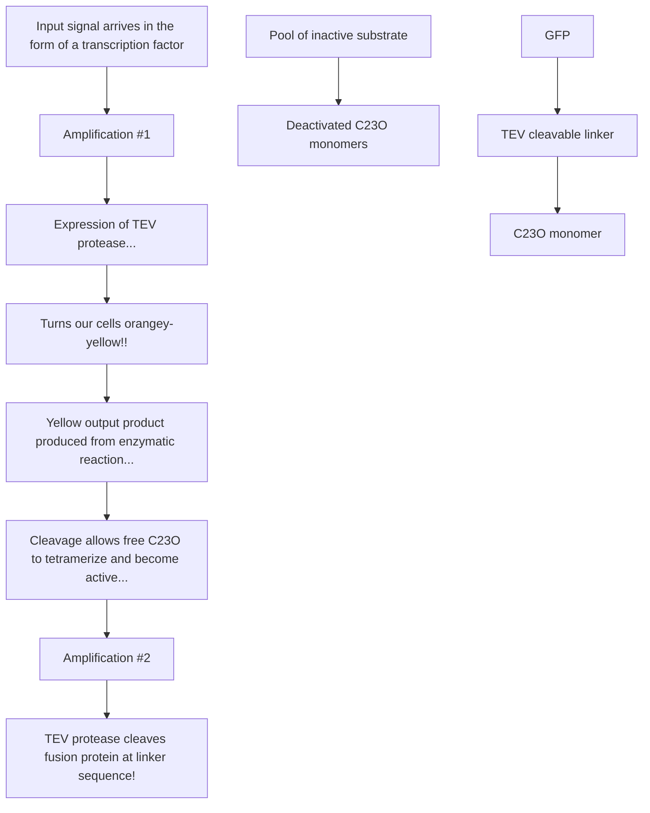

# Chapter 8. iGEM

原始 PDF 第 134–145 页。

## CHAPTER 8 iGEM

## 8.1 Introduction

The International Genetically Engineered Machine (iGEM) competition has played a major role in the development of synthetic biology and highlights how the subject is accessible to undergraduates and even high school students. While iGEM is primarily a teaching tool, training undergraduates in lab project work and the principles of synthetic biology, it has also produced many significant advances in synthetic biology, with many iGEM projects going on to be published as important scientific advances. In this chapter there are descriptions of iGEM projects from the first six years of the competition that are good examples of successful and interesting synthetic biology projects.

## 8.2 The iGEM Competition

The iGEM competition emerged out of project work organised at MIT by Tom Knight and Drew Endy during MIT’s independent activity period (IAP) in 2003 and 2004. The IAP is a special four-week term run at MIT in January each year where students pursue creative and individual projects rather than typical study. Many IAP projects at MIT in the last few decades have been held as competitions and previous student competitions in coding and robot-building were the inspiration for iGEM.

In the 2003 IAP, synthetic biology students worked with the synthetic ‘repressilator system constructed previously by Michael Elowitz. Teams of students worked on improving and modifying this system following engineering principles. The 2004 IAP focused instead on spatial design projects, particularly those of pattern formation, and it stuck with the same standards of the year before, using and generating BioBricks parts, cataloguing these in a registry and documenting work online through the science wiki website, openwetware.org.

Through a one-off funding from the National Science Foundation of the USA, the IAP competition was opened up to four other American universities as a synthetic biology summer boot camp from June to November 2004, and culminated in a Jamboree at MIT where the teams from across the USA compared their ideas and results. The 2004 summer boot camp and Jamboree were so successful that they were repeated in 2005 as the first official iGEM competition, with 13 teams participating, including 3 from outside the USA.

119

---

120

Synthetic Biology — A Primer

After 13 teams in 2005, 2006 saw 32 teams from around the world competing and a more formal competition was established that included the awarding of a Grand Prize at the MIT Jamboree — an oversized aluminium brick. The competition was covered by international press and the unexpected winners were a very impressive team of students from Slovenia. From 2006 to 2010, the competition grew from 32 student teams to over 125, making it difficult to organise and judge the Jamboree, especially with over 1,500 people at MIT for the event. To encourage expansion and further participation, in 2011 iGEM introduced a twostage competition with regional Jamborees in Europe, North America and Asia followed by a finalists-only Jamboree at MIT. With over 200 teams from around the world now participating, including teams from high schools and DIY bio community labs, the iGEM competition is providing a hands-on introduction to synthetic biology for thousands of students each year.

## 8.3 How iGEM Works

The iGEM competition is for teams of high-school students, undergraduates or masters students with most teams being made up of between 5 and 15 students. Established researchers and PhD students usually supervise a team, putting them together in the first half of the year before the team works full time on their project through summer. By registering with iGEM, each team receives a ‘kit’ of around a thousand standard biological DNA parts in BioBricks from the iGEM Registry that they can store in the freezer and use to help them build their project. These are parts that have been built, characterised and submitted by teams from previous years and include systems for light detection and coloured pigment production. Most parts are for work in E. coli, but some Bacillus and yeast parts are also distributed.

Registration for iGEM also gets each team space on the iGEM website to start a wiki, which gives them a website in which to document their project, its progress and the results. Initially these websites were part of the openwetware.org website, but are now fixed within iGEM’s own website. The idea of wikis is to encourage open science, allowing others to see your real work and what you are doing in order to improve and build upon the science as quickly as possible. It also encourages teams to share resources, so that as many teams as possible can reach their goals during the short time frame of the project. It is also a crucial point of iGEM that the DNA sequence of new biological parts that students make each year is uploaded to the official parts registry website for use by the teams of the following years. This also makes these parts free to use for the synthetic biology community, so occasionally parts that are patent-protected are not uploaded. Importantly, iGEM asks that uploaded parts are well described and the results of any testing are displayed too. This improves future use of parts and advances synthetic biology every year.

Registration fees, laboratory work, DNA synthesis of parts and travel to the Jamborees all add up to quite a cost, so many teams engage with bioscience companies, government initiatives and local enterprises to get sponsorship for their teams. iGEM projects normally involve a considerable amount of outreach, with students sometimes teaming up with artists,

---

iGEM

121

designers, film-makers, medical doctors, charitable foundations, lawyers, sociologists and even NASA and the FBI in order to further expand their projects in interesting directions.

By the end of summer each team will produce a wiki of their project and get themselves team T-shirts. For the Jamboree they will make a poster to display and give a presentation of their work. At the Jamboree there are different ‘tracks’ where projects that fall into specific themes like software development, healthcare and energy compete against one another. An army of established members of the synthetic biology community judge each team on a variety of different criteria so that on the final day of the Jamboree awards can be given. Teams are awarded bronze, silver and gold medals for fulfilling basic criteria set out each year and then individual prizes are given for the best projects in each track. On top of this, prizes are awarded for projects that stand out in key aspects, such as the best mathematical models, the best wiki, the best poster, the best human practices and the best new part. The final overall winning team and the runners-up are usually teams that are strong in all aspects, engaging through outreach, presenting well but also producing real results on interesting new synthetic biology ideas.

Over the course of an iGEM project students will work very hard in both the laboratory and on modelling, presenting and promoting their projects. But unlike many other courses that undergraduates can take in summer, iGEM gives them a chance to do real cutting-edge research science, introducing them to synthetic biology and open science while also allowing them to contribute to the new technologies and direction of the subject. Dozens of projects have gone on to later be published as major research articles in the top academic journals, including Nature, Science and Cell showing the quality of the research ideas iGEM has generated in synthetic biology. On top of this, many students choose to follow iGEM with synthetic biology research PhDs. Already, ex-iGEM students have now founded their own research groups and biotechnology companies in many places around the world.

## 8.4 Examples of iGEM Projects

## 8.4.1 Bacterial Photofilm (UT-Austin and UCSF 2004)

In 2004, the team from the University of Texas at Austin engineered E. coli to act as a photographic film, where projected images on a lawn of bacteria could be recorded by the production of a pigment. This approach enables biological pattern formation that is inspired by lithographic and printing techniques rather than the developmental pattern formation observed in nature, an example of truly synthetic biology.

To accomplish this, the UT-Austin team used a chimeric light-sensing system developed by the Voigt Lab at the University of California, San Francisco. This is a synthetic twocomponent sensing system, with a light-sensing protein domain taken from a cyanobacterium coupled to a response regulator from E. coli. The UT-Austin team put the gene lacZ under the control of the light-responsive system. LacZ is able to cleave a small molecule to produce a black pigment. Coupling these functions allowed a lawn of bacteria to act as a photographic film — projection of an image onto the lawn results in the recording of a high-definition two-dimensional chemical image at resolutions up to 100 megapixels per

---

122

Synthetic Biology — A Primer


<details>
<summary>text_image</summary>

Hello
World
</details>

Fig. 8.1 An example of a bacterial photofilm made using E. coli cells producing pigment in response to light activation. (Courtesy: BioBricks Foundation iGem Competition.)

square inch (Fig. 8.1). The results from this project were visually striking and even though the work was just an iGEM student project it gathered enough attention to be featured and written up in the prestigious international journal Nature.

The control of pattern formation in living cells will have important applications in constructing complex patterned biomaterials, tissue engineering and parallel biological computation. In an extension of the iGEM project work, Jeff Tabor and Chris Voigt went on to enable massively parallel edge detection of a projected image, where cells communicate to discriminate and delineate boundaries between cells sensing light and dark regions of the image. They connected additional synthetic device modules to the light-sensing system built by the 2004 iGEM project, with each module constructed independently, characterised and modelled to redirect the behaviour of the full system. In a research article publication of this work, Tabor et al. engineered a cell–cell communication component and a simple genetic logic gate such that cells in the dark areas of the image produce a diffusible chemical signal (see Tabor 2009 and Chapter 5). By implementation of genetic logic, only cells that sense the light areas of the image and the diffusible signal are able to generate a pigment as a read out of the image edge. These efforts hold great potential to explore how biology uses large numbers of computational elements (in this case, cells) to compute complex problems and to combine ‘top-down’ lithographic-style patterning with ‘bottom-up’ parallel computation to specify patterns.

## 8.4.2 Eau d’e coli (MIT 2006)

MIT not only host the iGEM competition but have also entered a team every year of the competition. In 2006, the MIT team won the award for best system, with a project that brought odour into the genetic engineering toolbox. Their project, Eau d’e coli, was a system

---

iGEM

123

engineered to give the production of different smells from E. coli bacteria at different points in a typical growth cycle. While the idea of bacteria smelling of bananas is fun, the project had a useful application; researchers often have to assay whether cells are in exponential growth or have moved to stationary phase and being able to distinguish the two different growth phases from smell would simplify this procedure.

MIT’s team chose two strong scents; for exponential growth phase the cells would produce wintergreen oil (methyl salicylate) and when in stationary phase the cells would switch to producing a banana smell (isoamyl acetate). To achieve this requires adding and optimising all the genes for the enzymes involved in the biological production of these two chemicals and also regulating these genes so that they only express in the correct growth phase. The project was therefore both a metabolic engineering project and a gene regulation project. Wintergreen production required two enzymes to convert E. coli endogenous chorismate into methyl salicylate, and banana required three enzymes to convert endogenous L-leucine into isoamyl acetate. The genes for these enzymes were taken from diverse microbes and placed into an E. coli strain which was known not to have its own strong smell. To regulate the two pathways required a promoter part that was activated in stationary phase only and an inverter device that would shut down another promoter when stationary phase occurred.

The MIT team in 2006 were notable not just for appearing at the Jamboree with bacteria that really smelled strongly of bananas and wintergreen but also for breaking down their project into manageable sub-parts. The project was rigorously described in terms of parts that were linked into devices that then came together to make systems. This abstraction allowed different members of the team to work on their own section before these were brought together to make the final product. Each section was planned to have testable goals so that they could be handled independently before being combined. By following this engineering principle the students achieved a remarkable amount of their project in one summer, producing both a wintergreen scent-producing E. coli strain and a banana scentproducing strain. Their project was a big hit at the Jamboree and was later featured in magazines and on American National Public Radio.

## 8.4.3 Towards self-differentiated bacterial assembly line (Peking 2007)

Peking University were the winning team at the 2007 Jamboree with a project that designed and implemented two novel synthetic systems, both of which contribute to a larger goal of engineered E. coli cells that can be programmed to differentiate into subpopulations performing different tasks. Programmed differentiation like this is attractive as it could allow division of labour within a cell population.

The two systems Peking designed were a hop-count system for spatial differentiation and a push-on-push-off switch system for temporal differentiation. The hop-count system made use of the natural bacterial conjugation system for transfer of plasmids from one cell to a neighbour. By editing and rearranging specific DNA parts required in conjugation plasmids, Peking were able to develop a system where the plasmid being transferred lost

---

124

Synthetic Biology — A Primer


<details>
<summary>flowchart</summary>

```mermaid
graph LR
  Ter["Ter"] --> EFGP["EFGP"]
  EFGP --> LacI["LacI"]
  LacI --> Cl["Cl"]
  LacI --> Prm["PRM"]
  LacI --> PR["PR"]
  Cl --> Prm
  Prm --> PR
  Prm --> Cl434["CI434"]
  PR --> Cl434
  Cl434 --> mRFP["mRFP"]
  mRFP --> Ter
  PsuIA["PsuIA"] --> Cl(ind-)["Cl(ind-)"]
  Cl(ind-) --> Cl434["CI434"]
  Cl434 --> Ter
```
</details>

Fig. 8.2 The Peking 2007 iGEM team’s circuit design for a UV-activated push-on-push-off switch constructed from a NOR gate interfaced with a bistable switch. (Courtesy: http://parts.mit.edu/igem07/index.php/Image:Peking\_Swich\_fig.1.JPG.)

specific sections of DNA each time a transfer occurred, effectively making it a counter device that went from one cell to the next.

The second system, the push-on-push-off switch, was based on the well-known bistable toggle switch system first described in 1999. To an ultraviolet (UV) light-controlled toggle switch, Peking added a NOR logic gate device (Fig. 8.2). The NOR gate compiles the information from both the input (UV light) and the memory of the toggle switch and uses this to flip the toggle switch when there is an induction, even though it is the same inducer each time. The design of this system is interesting as it nicely interfaces an existing synthetic system, the toggle switch, with a different device, the NOR gate, in order to now get a new system. The students built a mathematical model of this system to allow them to simulate its behaviour. They then went on to build and characterise a working bistable toggle switch as well as several NOR gates. Following the iGEM competition in 2007, work on this system continued and in 2010 the team published a major research article describing a working pushon-push-off switch and the many steps it took to create and improve it (see Lou et al., 2010).

Peking’s project gave iGEM many useful new parts for constructing new devices and systems in E. coli but also put together existing parts in a new and interesting way. Their project shows that basic biological parts already found in bacteria, such as conjugating plasmids and UV responsive genes, can be rewired in a predictable fashion to give new functions.

## 8.4.4 Bacto-builders (BCCS-Bristol 2008)

The Bristol Centre for Complexity Sciences iGEM team (BCCS-Bristol) won the Best Modelling Prize at the 2008 Jamboree. Their project aimed at programming a fleet of E. coli cells so as to force them to collaboratively perform a task which would be too great for any individual cell. More specifically, the task targeted by this project involved the physical movement of particles through direct contact with a swarm of bacteria working

---

iGEM

125

in a coordinated manner to displace it to a desired location. The motivation was to make collective behaviour emerge by forcing bacteria to adhere to a set of simple rules so that physical particles are assembled according to some desired pattern.

In their design, collaborative displacement of the physical particles was made possible through the use of a search, signal and collaborative push mechanism. The simple rules to which each bacteria needs to adhere are (i) to randomly search the environment for a suitable particle; (ii) upon contact with the particle, stick to the particle and attempt to chemotactically move it towards a goal (a chemoattractant gradient); (iii) while trying to move towards the goal, send out a short range quorum signal to inform nearby bacteria that a particle is in the vicinity; and (iv) upon sensing of the quorum-sensing signal, activate response to the chemoattractant goal and chemotactically move towards it. A design alternative for (ii) and (iv) that was also envisioned and tested in silico is to directly produce the chemoattractant instead of the quorum-sensing signal upon physical contact with the particle.

Using these simple rules, the assembly of conglomerates of physical particles in a specific configuration becomes possible by altering the patterns of the chemoattractant gradient. The implementation was based on the re-engineering of some of the natural mechanisms used by E. coli, i.e. chemotaxis, environmental sensing and cell–cell communication.

Due to the complexity of the different aspects involved in the project (such as chemotaxis, physical force exerted between large numbers of cells in an environment, chemical diffusion of the quorum-sensing small molecule, fluid dynamics and individual cell states estimation), the BCCS-Bristol team chose to adopt the engineering design cycle described in Chapters 2 and 6 with a combination of modelling, model-based computer simulations (both deterministic and stochastic) and experiments. Computer-based simulations were used to predict the behaviour/performance of the design alternatives and improve them, while experiments were used to test the feasibility of the different design options. In particular, two types of model were developed: an internal differential equations representation of the synthetic gene regulation circuits embedded in each single bacterium, and an external representation of the system as a whole using computerised stochastic agents. Both types of model were extensively simulated in silico. Matlab® software was used for tasks such as numerical integration and statistical analysis, while Java programming language was chosen for the development of a stochastic agent-based framework to simulate bacterial chemotaxis, the physical interactions between the bacteria and particles and the chemical fields exhibiting diffusion. The simulation of a large number of bacteria required huge amounts of computing power that were provided by the Blue Crystal high performance computing cluster at the University of Bristol. What sets this project apart and allowed the team to win the Best Modelling Prize is the use of a rigorous model-based approach for the design and analysis of their design options prior to experimental implementation.

## 8.4.5 E. chromi (Cambridge 2009)

The Grand Prize at the 2009 Jamboree was awarded to the University of Cambridge team for their project E. chromi. In this project, the student team set about producing and

---

126

Synthetic Biology — A Primer

characterising a series of pigment-producing genes and a set of regulation elements known as ‘sensitivity tuners’. Vivid colours are found everywhere in nature and the project sought to bring these to E. coli so that they can be used as reporter genes, in place of typically used reporters such as GFP. The motivation for the work was that biosensors produced by synthetic biology would ideally need to be low cost and simple to read from. Measuring GFP output from a bacterial sample requires fluorescence equipment that would not be realistic in a rural situation, whereas the growth of coloured bacteria would be easy to interpret simply by a human eye. The sensitivity tuner parts added to the project by offering a way to filter biosensor inputs (e.g. the detection of arsenic in water) so that the pigment is only produced in response to a meaningful level of detection. The students imagined their bacteria could be put into a dipstick used to detect heavy-metal pollutants. The dipstick would produce different colours depending on the metals present.

The Cambridge team took a range of approaches when generating the pigmentproducing genes. For orange and red pigments they used production of the carotene and lycopene metabolites, respectively. These are produced in the carotenoid pathways, and BioBricks parts for the four required enzymes of this pathway already existed thanks to previous iGEM teams. For the black/brown pigment, a single MelA gene was taken originally from Rhizobium etli, which produced an enzyme that catalyses the production of the melanin pigment from tyrosine. This gene had already been described elsewhere for use in E. coli but the Cambridge team still had to use PCR techniques to convert this into a usable BioBricks. Having used existing parts and used PCR to generate new parts, the Cambridge team then relied on direct DNA synthesis to make the last set of pigment-producing parts; synthesising a 5-gene operon of the violacein pathway from Chromobacterium violaceum, a naturally occurring purple bacteria. The 5-gene operon produced a purple pigment in E. coli but was also designed to be easily edited to 4 genes to instead produce green pigments.

A real success of the Cambridge project was that the team produced attractive and vivid results, showing E. coli growing in a spectrum of colours and producing colour pictures on agar plates (Fig. 8.3). While this captured the imagination of the audience at iGEM, the team also included extensive characterisation data for all their parts and constructs and made efforts to highlight potential real-world applications of the project. For this they had teamed up with two professional designers to brainstorm how the technologies they had developed in their project could impact on the future world. The design side of the project gave it extra


<details>
<summary>natural_image</summary>

Seven glass test tubes with varying colors and black caps, arranged horizontally (no text or symbols visible)
</details>

Fig. 8.3 Pigmented E. coli strains engineered by the 2009 Cambridge iGEM team. (Courtesy: BioBricks Foundation iGem Competition.)

---

iGEM

127

impact and a conceptual art work, E. chromi, based on the engineered pigment-producing biosensor E. coli, has gone on to win nominations at prestigious art and design awards.

## 8.4.6 Parasight (Imperial College London 2010)

The Best Human Practices Prize at the 2010 Jamboree was awarded to Imperial College London’s Parasight project. Human practices are the consideration of how a technology could potentially impact society and the wider world. This includes but is not limited to: considering the potential hazards involved with use and risk to the environment upon release; design of devices based on the requirements of the end user; and working to spread knowledge and awareness of synthetic biology to an increasing number of people. It has been suggested for a long time that it is these human practices that should either define or at least heavily influence the specifications for a biological device or system. The Parasight project was the first project at iGEM to take its specifications directly from human practices what the end-user (aid agencies and possibly communities in the field) would require from the product, while ensuring safety and increasing awareness of the device itself and the technology behind it.

The aim of the project was to develop a modular method for sensing parasites in water (specifically Schistosoma) that would trigger a very rapid response that would be detectable without sophisticated equipment in the field, potentially by relatively untrained users. By consulting Schistosoma experts, the end-users of such a sensor were suggested to be parasite tracking teams and local communities attempting to determine which water sources were safe to use for activities such as bathing and washing clothes. To be useful to these groups of people, the sensor would need to be as cheap as possible with the possibility of use without sophisticated equipment (such as fluorescence detectors). In particular for use by communities, the result would need to be determined very rapidly rather than in the order of several hours like many pigment- or fluorescent-based systems. As an environment sensor, of paramount importance was safety as there would always be a risk of user exposure or environmental release.

The parasite-sensing device was designed to include a peptide signalling system that enables detection of the proteases that parasites are required to secrete in order to penetrate human skin. This sensor would connect to a fast, visible output module by production of the very small protease TEV. The output system was developed from an enzymatic tetramer (the XylE gene), which produces a yellow compound visible at low concentrations. A modified version of this enzyme was inactivated by fusion to another protein but could be released, by cleaving off this other protein using TEV protease (Fig. 8.4). Upon TEV expression, large amounts of enzyme are rapidly freed to generate a signal visible to the human eye in less than a minute. The system also doubles as a ‘kill-switch’, reducing risks of release, as the visible yellow product of the reaction is toxic to bacteria hosting the system.

To further increase the suitability for use in a real-world situation, the system was designed for use in the chassis organism B. subtilis, as most strains of this are already engineered to be unable to survive without at least one key nutrient (and therefore unlikely to survive in the wild). These bacteria also naturally form spores for easy transport and

---

128

Synthetic Biology — A Primer


<details>
<summary>flowchart</summary>


</details>

Fig. 8.4 A fast-response reporter module based on the gene XylE, from Imperial College London’s 2010 iGEM project. (Courtesy: BioBricks Foundation iGem Competition.)

for growth in the field, and they readily carry out DNA integration and excision, allowing the DNA parts of the system to be stably inserted into the cell genome with no antibiotic resistance gene needed in the final product. In the Parasight project, the students also managed to design and produce prototype kits for their application that were made to attract Schistosoma in water while keeping the engineered bacteria out of the environment. A user manual was produced with these prototypes to spread awareness about the technology underpinning the sensor and its safe use.

While other biosensor projects have been seen in iGEM many times before, the Parasight project stands out because the design and specifications of the project were based on human practices from start to finish — from initial consultation with experts and individuals who work with parasites in the field, from early discussions with a safety

---

iGEM

129

and ethics panel and with potential end-users of the technology, through to later work raising awareness with visits to local schools and creating prototype user kits and manuals.

## Reading

- Learn About iGEM. Available at: http://ung.igem.org/IGEM/Learn\_About [Accessed 24 July 2015].
- Levaskya, A, Chevalier, A, Tabor, J, et al. (2005). Synthetic biology: engineering Escherichia coli to see light. Nature 438: 441–442.
- Lou, C, Liu, X, Ni, M, et al. (2010). Synthesizing a novel genetic sequential logic circuit: a pushon-push-off switch. Mol Syst Biol 6: 350. Available at: http://www.nature.com/msb/journal/v6/n1/full/msb20102.html [Accessed 24 July 2015].
- OpenWetWare. A wiki-style online community for bioscience. Available at: http://openwetware.org[Accessed 24 July 2015].
- Registry of Standard Biological Parts. Available at: http://partsregistry.org/Main\_Page [Accessed 25 July 2015].
- Tabor, JJ, Salis, HM, Simpson, ZB, et al. (2009). A synthetic genetic edge detection program. Cell 137(7): 1272–1281.

---

This page intentionally left blank
