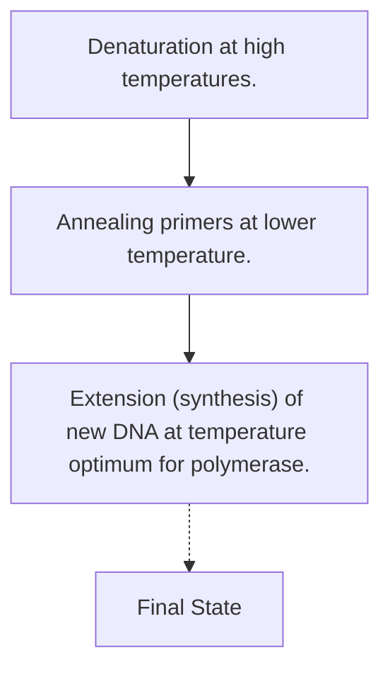
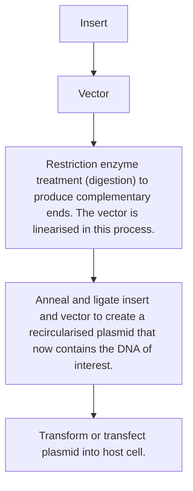
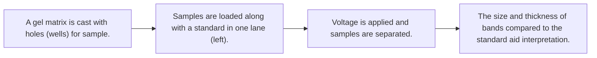
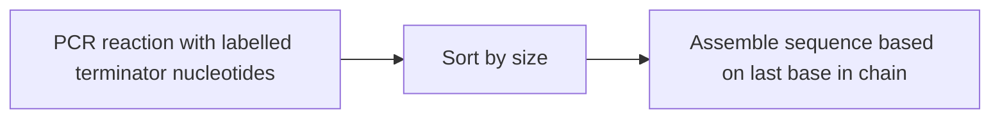
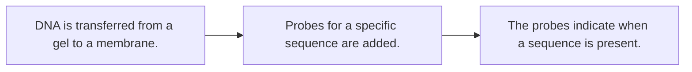
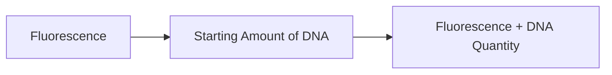
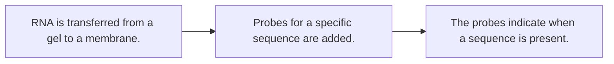
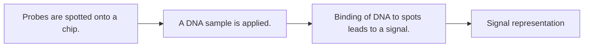
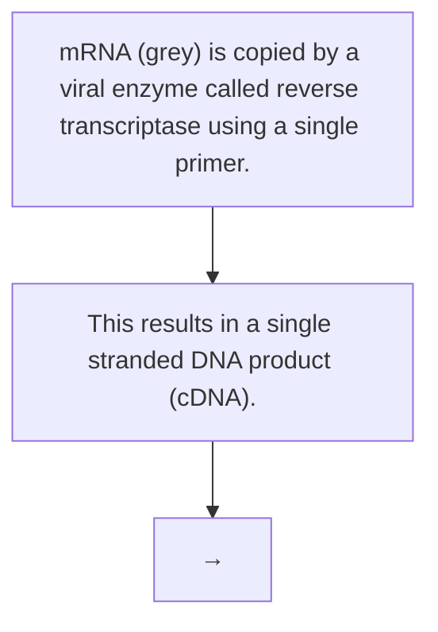
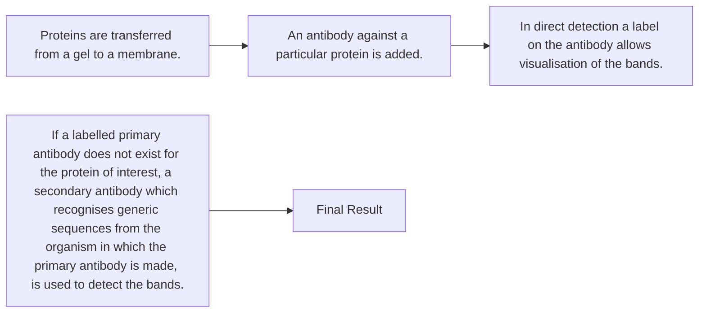

# Appendix 1. Proforma of Common Laboratory Techniques

原始 PDF 第 166–175 页。

# APPENDIX 1

# Proforma of Common Laboratory Techniques

**Technique:** Polymerase Chain Reaction (PCR)

**Inventor:** Kary Mullis (1983)

**Molecule:** DNA

**Basic Concept:** PCR is a technique that is used to make many copies of DNA for cloning and other purposes. Short single-stranded pieces of DNA called primers are designed in regions flanking the sequence to be copied (also called the DNA template). These are then synthesised, usually by a commercial company. They are added to the reaction mixture along with free nucleotide triphosphates, a temperature stable DNA polymerase, the DNA template and buffering components. PCR follows a series of steps at different temperatures which are repeated over and over again to give a high yield of the DNA of interest. In the first step, the reaction mixture is heated to a high temperature which denatures the template forming single strands. The temperature is then lowered and the primers bind (anneal) to the designed region, one to each strand of DNA. The temperature is then increased to the optimum working temperature of the DNA polymerase and new DNA is synthesised. This process is then repeated to make further copies. Because each copy of the template results in two synthesised copies per cycle, the amplification of the DNA proceeds exponentially.

**Uses in Synthetic Biology:** The most common use of PCR in synthetic biology is to create many copies of DNA parts for cloning and/or assembling devices and systems. It is also used in some cases for quantitation (see quantitative PCR below). Systems can also be constructed using PCR based methods such as Overlap Extension PCR and USER™ Cloning.

151

---

152

Synthetic Biology — A Primer

flowchart

Fig. A1.1

**Technique:** Restriction Enzyme Cloning

**Inventor:** Herbert Boyer and Stanley Cohen (1973)

## Molecule: DNA

**Basic Concept:** Cloning is a series of molecular biology steps whereby DNA of interest is inserted into a host cell or chassis. It begins with PCR amplification of the DNA. The DNA is then treated with enzymes which recognise and cut specific sequences, leaving behind a short single-stranded DNA overhang. A vector, or circular piece of carrier DNA, is likewise treated to create complementary ends. These are then annealed together and joined by an enzyme called ligase to recreate a fully circularised piece of DNA (a vector now containing the piece of DNA of interest as an insert). Cells are then induced to take up the circularised plasmids in a process called transformation (for prokaryotes and yeast) or transfection (for mammalian cells). Including an antibiotic resistance marker or another gene which gives cells an advantage allows the user to selectively keep the cells which have taken the plasmid, creating a population of clones.

**Uses in Synthetic Biology:** Restriction enzyme cloning forms the basis of the BioBricks assembly method, which follows a similar flowsheet but uses specific restriction enzymes. It is also the workhorse of traditional molecular biology. However, restriction enzyme cloning is slow and tedious because it is composed of multiple steps which must be carried out for each piece of DNA that is added to a system. In the future, it is envisioned that new DNA assembly techniques will supplant the multistep cloning techniques enabling faster synthesis of complex systems.

---

Appendix 1: Proforma of Common Laboratory Techniques

153

flowchart

Fig. A1.2

**Technique:** BioBricks Assembly

**Inventor:** Tom Knight (2003)

## Molecule: DNA

**Basic Concept:** BioBricks assembly is a version of restriction enzyme cloning where specific restriction enzymes are used in the process in order to create re-usable restriction sites that allow for sequential assembly of a large number of parts. Each BioBricks part is flanked by two different restriction enzyme sites on the 5’ and 3’ ends of the DNA. Upstream of the part are the EcoRI and XbaI sites and downstream are the PstI and SpeI sites. The destination vector also contains all four of the sites. When an empty vector is used as the destination, then, in principle, any of the restriction sites can be used for cloning the first part, but the power of the BioBricks method is that vectors that already contain parts can still be used to add additional pieces to the device. To clone a new part upstream of an existing assembly, the part is digested with EcoRI and SpeI restriction enzymes and the vector is digested with EcoRI and XbaI. Since XbaI and SpeI produce compatible sticky ends, the part can be ligated into the vector by annealing the two EcoRI overhangs of the part and vector and the XbaI overhang of the vector with the SpeI overhang of the insert. Once ligated the combined XbaI–SpeI site cannot be redigested with either restriction enzyme, so new parts can be added sequentially in the same manner. Similarly, to ligate a part into the vector downstream of an existing assembly, the part is digested with XbaI and PstI and the vector with PstI and SpeI.

---

154

Synthetic Biology — A Primer

**Uses in Synthetic Biology:** BioBricks assembly is the basis of construction of many of the devices and systems in the iGEM competition and it is also fairly heavily used in synthetic biology projects in general. However, because it relies on restriction enzymes and has the same associated disadvantages, it is likely that BioBricks cloning will be replaced by other DNA assembly strategies in the future.

Digestions with X and S generates complementary ends which pair during ligation. The other side of the part has complementary ends to the vector because the same enzyme was used.

Fig. A1.3

## Technique: Gel electrophoresis

## Molecule: DNA, RNA or Protein

**Basic Concept:** Gel electrophoresis is a sample analysis technique in which a sample is added to a matrix and the components are separated on the basis of charge/mass ratio using an electric field. The speed of the migration depends on the size of the particle as well as

---

Appendix 1: Proforma of Common Laboratory Techniques

155

the concentration of the matrix that composes the gel. A standard containing molecules of known size and concentration is usually added to the gel in order to aid in interpretation of the results. DNA gel electrophoresis most commonly uses agarose as a matrix, although other matrices can be used, particularly for small or single-stranded products. Since DNA is highly negatively charged due to the phosphate backbone, it will migrate towards positive electrodes when voltage is applied and the speed of migration is directly proportional to its size. RNA gel electrophoresis is very similar to DNA gel electrophoresis and also contains a phosphate backbone which provides a negative charge. Protein gel electrophoresis uses polyacrylamide as a matrix. However, in contrast to nucleic acids, proteins do not have a uniform charge. Therefore, they will migrate based on a combination of charge and mass unless reacted with chemicals that alter their charge. For routine analyses to determine size and/or concentration of proteins, samples are usually denatured and reacted with sodium dodecyl sulphate (SDS), a detergent which coats the protein with negative charge so that it separates according to mass just like on a nucleic acid gel. Proteins can also be electrophoresed on polyacrylamide gels without SDS treatment; these are known as native gels.

**Uses in Synthetic Biology:** Gels are a very common method of sample analysis. DNA agarose gels are used to check the progress during cloning experiments, often after every step and for rough quantification of the DNA concentration of samples during assembly of systems. RNA gels are used to check the purity and concentration of samples before further steps such as quantitative PCR (see below). Protein gels can be used to verify that proteins are expressed and/or to quantify them when paired with Western blot (see below).

flowchart

Fig. A1.4

---

156

Synthetic Biology — A Primer

## Technique: Sequencing

**Inventor:** Fredrick Sanger (1974)

## Molecule: DNA

**Basic Concept:** Current DNA sequencing is based on a method developed by Fredrick Sanger. At its heart is a PCR amplification reaction similar to what is described above, but with modified nucleotides mixed in. These nucleotides lack the necessary chemical group to enable further chain extension and thus cause early termination of the amplification. They are also labelled with fluorescent dyes which allow the sequencer to know the identity of the base which is last in the sequence. The PCR reaction results in a series of shorter DNA fragments, each labelled at the final base. These can then be sorted by size and the sequence ‘read’ from the identity of the last base via the fluorescent label. In most laboratories, DNA sequencing is sent out to a professional laboratory which performs the sequencing and returns a result by email. More recently, high throughput methods have been developed to enable rapid sequencing of large numbers of DNA molecules (e.g. Illumina, 454). However, Sanger sequencing is still the most popular method for routine verification of cloned construct.

**Uses in Synthetic Biology:** Sequencing is used to confirm the identity of cloned DNA as well as to ensure that no errors were introduced in the cloning or assembly process.

flowchart

Fig. A1.5

## Technique: Southern blot

**Inventor:** Edwin Southern (1975)

## Molecule: DNA

**Basic Concept:** Southern blotting is used to transfer DNA that has been electrophoresed to a membrane where it can be hybridised with fluorescent probes. The probes are designed to bind to specific DNA sequences, making the technique useful for detecting when a specific sequence is present in a sample. The probe signal can also be used to roughly quantify the amount of DNA present.

---

Appendix 1: Proforma of Common Laboratory Techniques

157

**Uses in Synthetic Biology:** Southern blotting is one method to determine copy number of a gene, but is very rarely used in synthetic biology. It has been largely replaced by quantitative PCR (see below).

flowchart

Fig. A1.6

## Technique: Quantitative PCR (Real-Time PCR)

## Molecule: DNA

**Basic Concept:** Quantitative PCR is very similar to the standard PCR reaction described above. In addition to the normal reagents the reaction mixture also contains a fluorescent dye which intercalates into the DNA that is formed. This allows a measurement of DNA concentration (in comparison to a standard curve of known DNA concentration).

**Uses in Synthetic Biology:** This is the preferred method of measuring DNA copy number. It can also be combined with reverse transcription (see below) to measure mRNA copy number and to track gene expression changes in response to a genetic circuit.

DNA template is subjected to PCR in the presence of fluorescent dye. The dye is incorporated into the PCR product.

flowchart

Fig. A1.7

---

158

Synthetic Biology — A Primer

## Technique: Northern blotting

**Inventor:** James Alwine, David Kemp and George Stark (1977)

## Molecule: RNA

**Basic Concept:** Northern blotting is the same procedure as Southern blotting, applied to RNA molecules. RNA is separated by gel electrophoresis, transferred to a membrane and then hybridised with probes designed to detect the desired sequence. Its name is a take on Southern blotting.

**Uses in Synthetic Biology:** Northern blotting can be used to detect and quantify RNA, but since it is a difficult and time-consuming procedure it has largely been replaced by quantitative PCR.

flowchart

Fig. A1.8

## Technique: Microarray

**Molecule:** DNA (though versions for other molecules exist)

**Basic Concept:** A microarray is very similar to a Southern blot run in reverse. A large number of probes are printed on a chip surface and a DNA sample is applied to the chip. The DNA binds to probes of complementary sequence, giving a signal.

**Uses in Synthetic Biology:** Microarrays can be used to assay expression changes of a large number of genes. RNA is extracted and then converted to single-stranded DNA (cDNA) using a reverse transcription reaction (see RT-PCR below) which is applied to the chip. This is useful for detecting systems level changes in gene regulation response to a synthetic circuit.

---

Appendix 1: Proforma of Common Laboratory Techniques

159

flowchart

Fig. A1.9

## Technique: Reverse transcription

## Molecule: RNA

**Basic Concept:** Reverse transcription is used to convert RNA to single-stranded DNA, also called complement DNA or cDNA. This enables long-term storage as well as the application of any methods that utilise DNA (e.g. microarray, quantitative PCR) to an RNA sample. A viral enzyme, reverse transcriptase, is used to copy the mRNA to a single strand of DNA.

**Uses in Synthetic Biology:** Reverse transcription coupled with quantitative PCR is the preferred method for quantifying mRNA copy number in synthetic systems.

flowchart

Fig. A1.10

## Technique: Western blotting

**Inventor:** George Stark and J Gordon (1979), W Neal Burnette (1981)

## Molecule: Protein

**Basic Concept:** Western blotting is a procedure similar to Southern blotting, but applied to proteins as the molecule of interest. Western blotting uses antibodies to detect the proteins

---

160

Synthetic Biology — A Primer

rather than labelled nucleotides. After separating the sample by gel electrophoresis, the protein bands are transferred to a membrane which is incubated with an antibody that binds the protein of interest as its antigen. This antibody can be labelled (direct detection) or else a secondary antibody can be used to detect where the first antibody has bound. The secondary antibody will be against generic sequences from the organism in which the primary antibody is made (e.g. anti-mouse antibodies).

**Uses in Synthetic Biology:** Western blotting is used to determine whether an organism is expressing a protein of interest and can be used to quantify the amount of that protein expressed. In contrast to the two other types of blotting, it is still heavily used.

flowchart

Fig. A1.11
