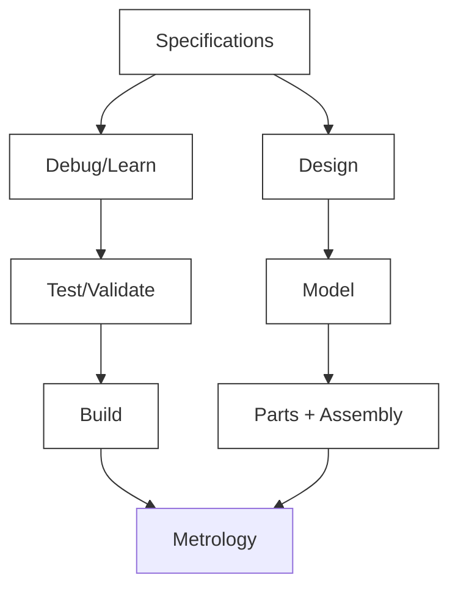
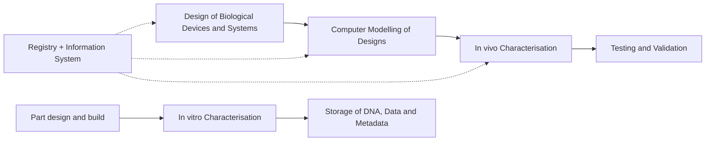
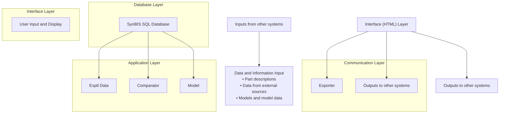
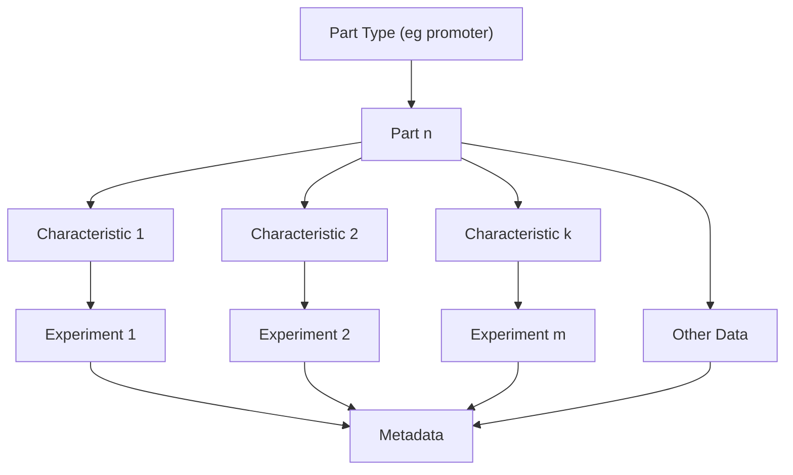
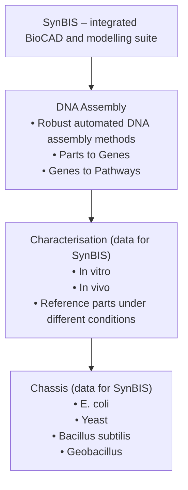
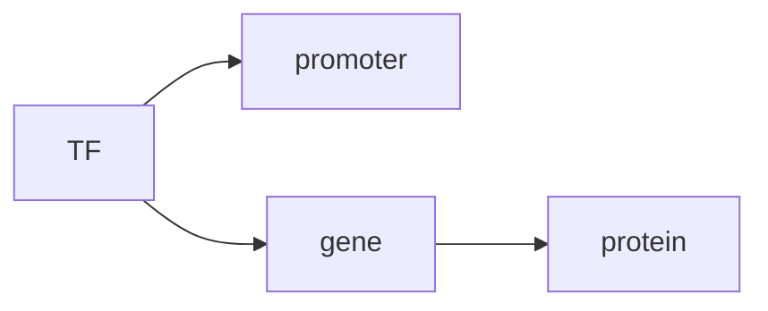
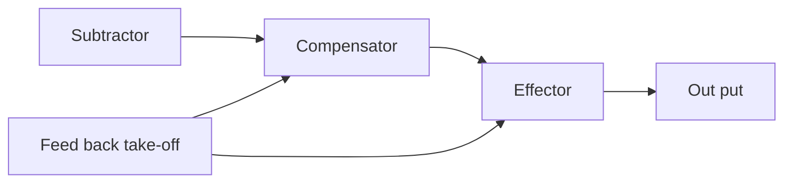

## Reading

- Atkins, JF, Gesteland, RF and Cech, TR. (2011). RNA Worlds: From Life’s Origins to Diversity in Gene Regulation. Cold Spring Harbor Press, New York.
- Bayer, TS and Smolke, CD. (2005). Programmable, ligand-controlled riboregulators of eukaryotic gene expression. Nat Biotechnol 23: 337–343.
- Callura, JM, Dwyer, DJ, Isaacs, FJ, et al. (2010). Tracking, tuning, and terminating microbial physiology using synthetic riboregulators. Proc Natl Acad Sci U S A 107: 15898–15903.
- Ellis, T, Adie, T and Baldwin, GS. (2011). DNA assembly for synthetic biology: from parts to pathways and beyond. Integrative Biology 3: 109–118.
- Mattick, JS. (2004). RNA regulation: a new genetics? Nat Rev Genet 5: 316–323.
- Pfleger, BF, Pitera, DJ, Smolke, CD, et al. (2006). Combinatorial engineering of intergenic regions in operons tunes expression of multiple genes. Nat Biotechnol 24: 1027–1032.
- Pitera, DJ, Paddon, CJ, Newman, JD, et al. (2007). Balancing a heterologous mevalonate pathway for improved isoprenoid production in Escherichia coli. Metab Eng 9: 193–207.
- Ptashne, M. (1992). A Genetic Switch. Blackwell Scientific, Cambridge, MA.
- Salis, HM, Mirsky, EA and Voigt, CA. (2009). Automated design of synthetic ribosome binding sites to control protein expression. Nat Biotechnol 27: 946–950.
- Tucker, BJ and Breaker, RR. (2005). Riboswitches as versatile gene control elements. Curr Opin Struct Biol 15: 342–348.
- Win, MN and Smolke, CD. (2007). RNA as a versatile and powerful platform for engineering genetic regulatory tools. Biotechnol Genet Eng Rev 24: 311–346.

# CHAPTER 2

# Basic Concepts in Engineering Biology

## 2.1 Introduction

This chapter describes basic concepts in engineering biology which have direct application in synthetic biology. Systematic design is a key approach in synthetic biology. This is described, together with the concept of parts or components, devices and systems, the synthetic biology design cycle and modelling techniques. Other important areas relating to the application of engineering methods include the registry of parts and part characterisation. Underlying this is the concept of web-based information systems and data templates for parts data. Another important aspect of synthetic biology is the development of platform or foundational technology, which is discussed in relation to the information system and the concept of BioCAD. The final section of the chapter deals with some example applications.

Francis Collins, the director responsible for the Human Genome Project (see Chapter 3) within the National Institute of Health, stated in a lecture approximately two years after the publication in Nature, that ‘the initial sequencing of the human genome would not have been possible without the extensive use of ICT and computers’. This statement encapsulates how the confluence of engineering, physical science, ICT and computing on the one hand and biology on the other has resulted in the development of a new discipline of synthetic biology.

## 2.2 Systematic Design

An important aspect of synthetic biology is the application of systematic design to the creation of biologically-based devices and systems. This approach is based upon the engineering principles of modularity, characterisation and standardisation. The concept of modularity is the ability to reduce a device or system to a number of component parts. In this approach each of the parts is characterised in detail. That is to say that the characteristics of the part and how it operates under different conditions (e.g. for a type of chassis or cell) are rigorously studied. Where possible, parts are standardised in order that, in principle, a series of standard parts can be combined to create a device. The power of this approach, which is used in many areas of engineering, is that a device does not need to be produced from scratch every time, but, rather, it can be created from existing standard parts (and as we will see, in some cases a combination of standard parts and new parts). These concepts, which are widely used in engineering and manufacturing, are currently being applied to synthetic biology. This is known as the Parts, Devices and Systems approach to synthetic biology design (see Chapter 5 for a biological explanation of parts in the synthetic biology context).

## 2.2.1 The parts, devices and systems approach

In current synthetic biology a hierarchy based on the Parts, Devices and Systems approach can be defined as follows:

(i) Parts (bioparts) — these encode biological functions (currently synthetically designed DNA).
(ii) Devices — these are made from a collection of parts (bioparts) and encode human defined functions (e.g. logic gates).
(iii) Systems — systems perform tasks, such as counting and, potentially in the future, intracellular control functions.

Hence, in principle, to construct a simple gene circuit comprising a promoter, ribosome binding site, protein coding sequence and terminator would consist of joining four sections of DNA (where each section is a part, i.e. a specific DNA sequence for the considered part).

## 2.2.2 The synthetic biology design cycle and its role in systematic design

A key aspect of synthetic biology is the application to biology of techniques which are normally used in engineering design and development. The essence of this approach is to define the specification of the part, device or system required and to develop a design which meets these specifications. This overall approach is part of what is known as the design cycle (based on the design, build test and learn paradigm); this is illustrated in Fig. 2.1. It should be noted that the responsible research and innovation paradigm is implemented at all stages of the design cycle.

In Fig. 2.1, the specification step is followed by a detailed design step. One of the key differences between design today and that of the past is the ability to undertake detailed computer modelling. This is also true in synthetic biology. Comparisons are often made between the difficulty of designing biological systems and the design of electronic devices, such as transistors, 60 years ago. The difference today is the wide availability of large amounts of computer power, which makes it possible to carry out detailed computer modelling. This means that the expected behaviour of the part, device or system under development can be simulated in detail. The next stage in the cycle is implementation. In synthetic biology this normally means synthesising DNA and inserting it into a host cell (chassis). The next stage of the design cycle, testing and validation, is particularly important in synthetic biology because it is the host response to the insertion of new DNA which determines whether or not the specification and the design have been properly realised.

Another key aspect of the design cycle approach is that the development of a part, device or system can involve a number of iterations of the cycle, with each iteration refining the design and its implementation. Engineering systems, for example the A380 Airbus, are based on standard devices, which are built from standard parts. In synthetic biology the field of electronics is sometimes used as a conceptual model. Taking the example of a simple audio amplifier, this would be designed using standard resistors, capacitors and transistors. The designer would have a set of specifications for the amplifier and look up manufacturers’ handbooks (today, probably on the internet) to find component parts which meet the exact specifications which are required for the design. What is important here is to understand that a great deal of time and effort will have been devoted by component manufacturers to produce parts which exactly matched their specifications. In fact, it is common in engineering for a number of manufacturers to make and sell parts which exactly match the same specifications. It is important to note that the designer of the audio amplifier would not question for a moment that a commercially available part exactly matches its specification. Once built, tested and validated, the audio amplifier becomes a standard device built from standard parts — with its own specification sheet (the same approach applies to standard parts and devices in synthetic biology).

flowchart

Fig. 2.1 The synthetic biology design cycle.

Taking this whole approach one step further, now suppose that the objective is to build a simple radio. Radios basically comprise three standard devices: a radio frequency, or RF stage; an intermediate frequency, or IF stage; and an audio stage (the audio amplifier). Hence, the aim would be to build the radio from these three standard devices. It may well be the case that each stage is manufactured and supplied by a different manufacturer but, because they are all standard, it is possible to connect the three stages together to form the radio. This is a very powerful approach and is routinely applied to the building of most engineering systems because it does not require everything to be designed and built from scratch.

flowchart

Fig. 2.2 Device design — incorporating the design cycle and the registry of parts.

A similar conceptual approach is used in synthetic biology. Here a number of bioparts are combined to produce a particular device (on the basis of a particular design). Figure 2.2 illustrates this process. The top line of the figure comprises a linear version of the synthetic biology design cycle. Referring to the first block (design of biological devices and systems) at this point, the bioparts which were used in the design are defined. On this basis, the registry is first interrogated to determine which standard bioparts are available. If additional bioparts are required then new parts need to be designed and built (as shown in the lower section of the diagram). Following the design and build the part is characterised and the characterisation data and metadata are added to the registry as a new part. The part is also then included in the fabrication of the new device.

## 2.3 The Registry and Part Characterisation

Earlier in this chapter the concept of the engineering approach to synthetic biology design was introduced in terms of parts, devices and systems. To summarise, the basic concept is one of using a combination of standard parts to produce standard devices, which are then combined to produce standard systems. This means that the standard parts must be thoroughly characterised so that their performance is carefully determined in relation to all the conditions under which the part will operate normally in the context of a particular type of chassis (cell). Hence, for example, the function of the part is defined on datasheets which comprise graphical, tabular and written information. In addition, metadata is usually provided. This is data about the context in which the data relating to the part has been obtained (experimental conditions, type of equipment etc). Metadata is often referred to as data about data.

Unlike the situation 20 years ago, datasheets in almost all fields today are stored electronically in databases. In the case of synthetic biology parts (bioparts), data and metadata are stored in a registry of parts. The best known registry is currently the so-called MIT Registry for the International Genetically Engineered Machine (iGEM) competition (see Chapter 8). This is a large registry containing many parts which have been designed for the iGEM competition. It does, however, have a number of problems. For example, the data tend to be more qualitative than quantitative; the parts do not always function as stated; and within the iGEM competition the focus has been on quantity rather than the quality of parts. In practice for this registry parts can be submitted by any user; they do not need to conform to a universal structure; they often contain missing data fields; and they are not automatically verified upon submission to the registry. There is, therefore, a widely held view that for professional/commercial synthetic biology design there is a need for a thoroughly characterised registry of parts.

## 2.4 Information Systems

Since the concept of a registry of parts is one which is familiar in a range of fields, it is possible to look at previous experience in other fields to try and design an ideal format for a professional registry of parts. For most registries of parts it is now the case that the part data and metadata are stored in an electronic database, which forms part of what is commonly known as a web-based information system. In synthetic biology, Imperial College has developed an information system called SynBIS (standing for Synthetic Biology Information System). The system is illustrated in Fig. 2.3. Referring to the figure, it can be seen that SynBIS is a web-based information system which comprises a fourlayer architecture consisting of an interface layer (the web browser); a communication layer; an application layer (comprising specialist software); and a database layer (which comprises a structured query language (SQL) commercial database).

flowchart

Fig. 2.3 The Synthetic Biology Information System (SynBIS).

## 2.4.1 The SynBIS system

The specific implementation of the model can best be described in terms of the detailed diagram of SynBIS (Fig. 2.3). The left- and right-hand sides of the diagram are divided according to the following structure.

## 2.4.1.1 Left-hand side of the system diagram (Fig. 2.3)

This comprises the functionality to input various types of data and information into the system. How this is achieved will now be described in terms of each of the layers.

## 2.4.1.1.1 Interface (HTML) layer

This comprises a web-browser (HTML) interface where the user can control the input of various types of data and information into the SynBIS database. These include the following:

(i) Part description (type, function, etc.).
(ii) Experimental data, from an external source — a typical example being characteristic data for a particular part.
(iii) Model description (i.e. the description of models in terms of their equations).
(iv) Data derived from specific models.

## 2.4.1.1.2 Communication layer

The role of the Communication Layer on this side of the system diagram is to allow the information and data described in the previous section, above, to enter the system.

## 2.4.1.1.3 Application layer

Once the data and information have been entered into the system at the Interface Layer, it is transferred to the Application Layer. Here there are two types of application software. The first converts known data types to the SynBIS data standard via standards converter software. The second set of software is conformance software, which checks that the data and information conform to the SynBIS template. If this is not the case then the system delivers a compliance report.

## 2.4.1.1.4 Database layer

This comprises the SQL database, whose schema is the SynBIS template. All the information and data which is entered into the SynBIS system must conform to this template.

## 2.4.1.2 Right-hand side of the system diagram (Fig. 2.3)

## 2.4.1.2.1 Interface (HTML) layer

As previously discussed, this comprises a web-browser (HTML) interface. However, in this section of the system diagram the user can control a number of system functions. These include:

(i) The display and manipulation of various types of data and information from the SynBIS database.
(ii) The export of data and information to other systems.
(iii) Running computer models and displaying the results.
(iv) Running comparisons of experimental data from the database with model results.

## 2.4.1.2.2 Communication layer

The primary role of the Communication Layer on this side of the system diagram is to allow the information and data which result from comparing experimental data with model data to be exported to other systems.

## 2.4.1.2.3 Application layer

On this side of the system diagram the Application Layer carries out a number of important functions:

(i) It enables the extraction, display and manipulation of data and information from the database.
(ii) It enables data and information (such as parameters) from the database to populate models for the purpose of simulation.
(iii) It controls the comparison of experimental data from the database with the results of simulations. Such comparative studies are important because their objective is to study how and why the experimental data differs from that predicted by the model simulation. On this basis new parameters can be fed to external systems for the purpose of optimising parts.

## 2.4.1.3 Data and metadata

As previously described, the information relating to a particular biopart is stored in the database under two separate headings. Hence, conceptually, it is important to understand the schema for the storage of such information in the database. Part type and chassis type are two key pieces of information associated with a particular biopart. Figure 2.4 illustrates the schema for the data and metadata for a particular part, in this example, a promoter. The basic information relating to the part is at the top of the schematic (part type and part number); below this are the characteristics of the part. In practice the characteristics may well comprise graphical information and, also, alphanumeric information. For a given part the scientists characterising the part will determine how many separate characteristics are needed to fully characterise the part. This will determine the nature of the experimental information and its extent.

flowchart

Fig. 2.4 A simplified version of the SynBIS Data Template.

To illustrate this further, Fig. 2.5 shows a part datasheet for the promoter LacUV5. Referring to the figure, it can be seen that in this particular case the datasheet comprises various types of graphical information — as well as images, sequences and diagrams. In addition, there is a significant amount of metadata. In relation to the metadata, the aim is to produce, as far as possible, a standard template for metadata for promoters (and similar metadata schema for other types of part). In reality, the metadata comprises a series of categories, each of which has associated active fields. For a particular case individual fields may or may not be populated.

## 2.5 The BioCAD Concept

Some of the key points which have been made so far can be summarised as follows:

(i) In synthetic biology design an important approach is to build standard systems from standard devices which comprise standard parts.
(ii) This is done in the context of the design cycle and systematic design approach and the implementation throughout the responsible research innovation paradigm.
(iii) Standard parts are stored in a registry of parts.

In the synthetic biology design process there is an interplay between the dry laboratory and the wet laboratory. It is very important to understand that normally, in practice, wet laboratory work takes far longer than work in the dry laboratory. Hence, modelling (dry lab work) is important because it can reduce the amount of time needed for part characterisation in the wet lab.

LB Medium

## Other Metadata

## Metadata version:0.1

| Title | BioFAB Bit-Atom-Bit Transfer |
| --- | --- |
| Time | 17:00 |
| Date | 23/11/2010 |
| Location | CSynBI (Bessemer) |
| Operator | Chris Hirst |
| Species | E. Coli |
| Strain | DH10B (Invitrogen) |

Starter culture

| Origin of culture | Colony from Plate |
| --- | --- |
| Culture volume | 2ml |
| Culture vessel | 14ml BD Falcon tube |
| Duration of growth | Overnight (16h) |
| Media | LB (Merck, batch VM853385) and M9 (Knight recipe) |
| Antibiotic | Kanamycin |
| Antibiotic conc. | 50μg/ml |
| Temperature | 37 °C |
| Shaking (rpm) | 225 |
| Incubator | Thermo Scientific - MaxQ 6000 |

Outgrowth

| Culture volume | 1ml |
| --- | --- |
| Culture vessel | 14ml BD Falcon tube |
| Duration of growth | 90 minutes |
| Media | As above |
| Inoculation ratio | 60:1 LB, 50:1 M9 |
| Antibiotic | Kanamycin |
| Antibiotic conc. | 50μg/ml |

Assay

| Culture volume | 120μl |
| --- | --- |
| Culture vessel | 96-well Greiner black f-bottom |
| Duration | 5 hours |
| Media | As above |
| Inoculation ratio | 6:1 LB, 4:1 M9 |
| Antibiotic | Kanamycin |
| Antibiotic conc. | 50μg/ml |
| Temperature | 37°C |
| Shaking (rpm) | 500 (30s), double orbital, before reading |
| Incubator | Thermo Scientific - MaxQ 6000 |
| Readings | Reader - HourlyCytometry - at 3h and 5h |

Measurement

<table><tr><td colspan="2">D</td></tr><tr><td>Instrument</td><td>Polarstar Omega</td></tr><tr><td>Wavelength</td><td>600nm</td></tr><tr><td>Blank reading</td><td>Media (LB or M9)</td></tr><tr><td>Sample vessel</td><td>96-well black f-bottom Greiner</td></tr></table>

Fluorescence

<table><tr><td>Instrument</td><td>Polarstar Omega</td></tr><tr><td>Excitation Wavelength</td><td>385 ± 10</td></tr><tr><td>Emission Wavelength</td><td>410 ± 10</td></tr><tr><td>Blank reading</td><td>Taken but not used</td></tr><tr><td>Sample vessel</td><td>96-well flat black Greiner plate</td></tr><tr><td colspan="2">ow Cytometry</td></tr><tr><td>Instrument</td><td>Becton Dickinson FACScan</td></tr><tr><td>Excitation laser</td><td>Green</td></tr><tr><td>Output Channel</td><td>FL1-H (Green)</td></tr><tr><td>Number of cells</td><td>Max 10,000</td></tr><tr><td>Gated / Not Gated</td><td>Gated</td></tr><tr><td>Sample media</td><td>Water</td></tr><tr><td>Sample vessel</td><td>96-well clear f-bottom (Costar)</td></tr><tr><td>Statistics used</td><td>Mean, Variance</td></tr></table>

Fig . 2 . 5 An illustrative example of a promoter datasheet.

flowchart

Fig. 2.6 Components of Platform Technology which are incorporated into SynBIS to provide an integrated BioCAD and modelling suite.

In this context (and again in relation to what is done in other fields), the concept of an information system which incorporates a Computer-Aided Design tools approach to synthetic biology, is being developed — this is often referred to as the BioCAD concept. Figure 2.6 illustrates the BioCAD concept in relation to its incorporation into SynBIS. BioCAD incorporates a number of aspects of synthetic biology design: DNA assembly, including feedback as illustrated in Figure 2.9, characterisation (data for SynBIS) and chassis (data for SynBIS). Hence, the concept is that a major amount of design and modelling work can be undertaken in the dry laboratory using BioCAD software.

More specifically, in relation to BioCAD, the systematic design approach in synthetic biology has many similarities to more general computer modelling. Referring to the lefthand side of Fig. 2.7, in computer modelling a block diagram of the design is obtained. Then for each block a mathematical description of the function of the block is derived. The entire block diagram and its associated mathematical descriptions are then converted to high level computer code using a high level computer language (such as C or C++). Within the computer the high level code is then converted to assembly code and then down to machine code (these last two steps are automatic).

On the right-hand side of Fig. 2.7, in synthetic biology a block diagram of the design is first obtained. The next step is to convert the basic block diagram into a biopart (or gene circuit) block diagram. At this point, computer simulations are run and the synthetic biology block diagram design and the associated bioparts block diagram are modified in relation to the results of the simulation. Once the biopart block diagram has been optimised, the next stage is to progress to assembly strategy software. This then leads to DNA assembly and ultimately to viability testing in the wet lab.

It is important to state that currently the BioCAD concept illustrated in the diagram (as well as the associated BioCAD software) is still being developed. There are, however, a number of computer packages available which deal with various levels of the synthetic biology CAD block diagram. These include Clotho, GenoCAD, TinkerCell and a number of other open source packages.

Fig. 2.7 A BioCAD Schema.

## 2.6 Modelling

The device shown in Fig. 2.8 is a typical representation of a transcriptional regulatory device which comprises an inducible promoter, RBS, coding region and a terminator. Using the transcriptional regulatory device as an example, the following section describes the methodology of representing a biological device/system using block diagrams.

The device can be described by ordinary differential equations (ODEs). The same ODEs can also be used to describe devices such as inverters and switches. Referring to the equations, Eq. (1) describes the transcription of mRNA, which is activated in the presence of transcription factor [W]. In the example, [W] is considered to be an inducer. Hence $\mu = + 1$ A Hill kinetic function is used to model these dynamics. Consequently, Eq. (1) is nonlinear.

flowchart

Fig. 2.8 A diagram of typical transcriptional regulatory device (TF refers to transcription factor).

This equation takes [W] as the input and [mRNA] as the output. Equation (2) describes the translation of protein [P]. The input to this process is the concentration of mRNA and the output is the concentration of P. This is treated as a linear equation.

$$
\frac {d [ m R N A ]}{d t} = \frac {k _ {t r} \cdot \left(\frac {W ^ {n}}{K ^ {n}}\right) ^ {\mu}}{1 + \left(\frac {W ^ {n}}{K ^ {n}}\right)} - d _ {m} \cdot [ m R N A ] \tag {1}
$$

$$
\frac {d [ P ]}{d t} = k _ {t l} [ m R N A ] - d _ {p} \cdot [ P ] \tag {2}
$$

where

[mRNA] mRNA Concentration
[P] Protein Concentration
$k_{tr}$ kinetic constant of transcription
$k_{tl}$ kinetic constant of translation
[W] inducer $\mu = +1$
repressor $\mu = 0$
K Activation/Repression Coefficient
n Hill Coefficient
$d_m$ Degradation constant of mRNA
$d_p$ Degradation constant of Protein

The problem when analysing biological systems — or in the case of synthetic biology, designing biological devices and systems — is that as the system becomes more complex it becomes progressively more difficult to have an intuitive ‘feel’ for linking the mathematical description to the biology. This is a problem that has been faced on many occasions in the past. Fortunately, in engineering and physics there is a whole branch of mathematics called Systems and Control Theory, which has been developed over many years to address this problem. In fact the basis of the methods largely revolves around a mathematical theory which was pioneered by two French mathematicians: Pierre-Simon Laplace and Joseph Fourier at the beginning of the 19th century.

Their work is fundamental to much of modern engineering analysis. The essence of the Laplace approach is to convert or transform ODEs into what is called another domain — the Laplace Domain. In this domain, ODEs become algebraic equations, which are far easier to manipulate. Once a solution has been obtained in the Laplace Domain the final equation/solution is retransformed back into the Time Domain (i.e. the real world). The conversion of a function (e.g. an equation) from the Time to the Laplace Domain is done using the forward Laplace transform, vis:

$$
F (s) = \int_ {0} ^ {\infty} f (t) e ^ {- s t} d t \tag {3}
$$

where s is the so-called Laplace transform operator. Hence, the Laplace transform is used extensively to systematise the solution of ordinary differential equations.

flowchart

text_image

Cybernetics
or CONTROL and COMMUNICATION
in THE ANIMAL and THE MACHINE
By NORBERT WIENER
A study of vital importance to psychologism,
physiologies, electrical engineers, radio engineers,
violigations, philosophers, mathematics, arthropoiesis, psychiatrists, and physicians.

text_image

ρ(t,γ),ν,χ) = Σ₀ ∫_0 (t,γ,γ-δ,γ,γ-δ)
∫∫ H(η,γ)
= ∫∫ H
χ,λ,λ,λ,λ,λ,λ,λ,λ,λ,λ,λ,λ,λ,λ,λ,λ,λ,λ,λ,λ,λ,λ,λ,λ,λ,λ,λ,λ,λ,λ,λ,λ,λ,λ,λ,λ,λ,λ,λ,λ,λ,λ,λ,λ,λ,λ,λ,λ,λ,λ, λ, λ

Cybernetics (1948)

Fig. 2.9 Example of a feedback loop. (Courtesy: Weiner, N. (1961 [1948]). Cybernetics. MIT Press, Cambridge, MA).

## 2.7 Norbert Weiner

Around sixty years ago two major building blocks were put in place in relation to systems and signal theory — the publication of Norbert Wiener’s book, Cybernetics, in 1948, and the publication of Claude Shannon’s work on information theory in the same year. In Cybernetics, Wiener established the mathematical basis for studying biological systems. Wiener’s work, and that of others, has resulted in a major area of engineering science called systems theory. The main goal of systems theory is to define general principles that can be used to describe (and also design) systems regardless of their nature — biological, electrical, ecological, etc. This, coupled with signal theory (another very important area of engineering), has been widely applied in a range of fields, including biology in the form of systems biology. For example, systems theory is widely used in various industrial areas nowadays, such as the design and construction of aircraft control systems, information and telecommunication networks and economics.

## 2.8 Signal Theory/Signal Processing

In addition to the use of systems theory, in order to describe biological systems there is often a need to study waveforms. Waveforms are often expressed in terms of the time evolution of a function; for example, the evolution of amplitude of a particular quantity against time. In many areas of science and engineering this is achieved by the application of signal theory. This area of theory, often called signal processing, can be used to analyse signals in biological systems (such as in cell signalling). In nature, signals associated with experiments (waveforms) are normally defined as being ‘continuous’. Continuous in this context means that over the period during which the waveform is being recorded, it comprises finite values at all points in time (see Fig. 2.10, left side).

Fig. 2.10 An example of a continuous waveform is illustrated on the left, and its equivalent sampled data waveform on the right (where the waveform comprises only the sampled values T seconds apart).

The problem is that digital computers can only work with finite amounts of data, i.e. sampled data (see Fig. 2.10, right side). This problem was addressed by Claude Shannon. Shannon established the basis of the information and communication revolution which has taken place over the last 60 years. One of Shannon’s main contributions was his ‘sampling theory’, which allows data to be converted from its continuous form to its sampled form without loss of information and vice versa.

Referring to Fig. 2.10 (right) it can be seen that the sampled version of the waveform comprises vertical lines, which have discrete values and are separated by an interval T (the sampling interval). Shannon determined that all the information in a waveform can be retained in its sampled form if the original waveform is sampled with an interval T where the sampling frequency $F _ { s } \: = \: 1 / T$ and $F _ { s }$ is greater than or equal to twice the maximum frequency contained in the continuous waveform. This is called the Nyquist– Shannon sampling criterion. To understand what is meant by ‘the maximum frequency contained in the continuous waveform’we need to introduce how a signal can be decomposed into its fundamental components. This is covered in the next section.

## 2.8.1 The analysis of periodic signals

In studying biological waveforms for the purposes of synthetic biology design it is often the case that the waveform comprises a number of components that arise from different aspects of the biological function. These fundamental components are superimposed (added) to produce the complete waveform being studied. Such an example is that shown in Fig. 2.11.

Inspection of the waveform reveals that there appear to be patterns in it; for example, similar successive peaks at approximately 0.2, 2.2 and 4.1 mins. Further inspection reveals even more patterns. However, it is difficult to proceed further just by inspection of the waveform. To precisely reveal these patterns a more detailed analysis based on Fourier decomposition of the signal (the basis of which is covered in the next section) is very useful.

line

| Minutes | Amplitude (Arbitrary Units) |
| --- | --- |
| 0.0 | ~690 |
| 0.1 | ~720 |
| 0.2 | ~760 |
| 0.3 | ~680 |
| 0.4 | ~650 |
| 0.5 | ~720 |
| 0.6 | ~770 |
| 0.7 | ~760 |
| 0.8 | ~710 |
| 0.9 | ~770 |
| 1.0 | ~700 |
| 1.1 | ~780 |
| 1.2 | ~800 |
| 1.3 | ~790 |
| 1.4 | ~770 |
| 1.5 | ~780 |
| 1.6 | ~730 |
| 1.7 | ~740 |
| 1.8 | ~720 |
| 1.9 | ~750 |
| 2.0 | ~680 |
| 2.1 | ~750 |
| 2.2 | ~650 |
| 2.3 | ~720 |
| 2.4 | ~760 |
| 2.5 | ~770 |
| 2.6 | ~710 |
| 2.7 | ~770 |
| 2.8 | ~690 |
| 2.9 | ~780 |
| 3.0 | ~800 |
| 3.1 | ~790 |
| 3.2 | ~770 |
| 3.3 | ~780 |
| 3.4 | ~730 |
| 3.5 | ~720 |
| 3.6 | ~750 |
| 3.7 | ~690 |
| 3.8 | ~750 |
| 3.9 | ~650 |
| 4.0 | ~720 |
| 4.1 | ~760 |
| 4.2 | ~770 |
| 4.3 | ~760 |
| 4.4 | ~700 |
| 4.5 | ~760 |
| 4.6 | ~700 |
| 4.7 | ~770 |

Fig. 2.11 An example of a ‘continuous’ biological waveform.

Let us now consider a second example, which is somewhat artificial but helps us to understand the decomposition of a signal into several fundamental components. Referring to Fig. 2.12, consider the case of three sinewaves $a ( t ) , b ( t )$ and $c ( t )$ , where $a ( t ) = \mathrm { A _ { 1 } }$ sin $\omega _ { 1 } t ,$ $b ( t ) = \mathrm { A } _ { 2 }$ sin $\omega _ { 2 } t$ and $c ( t ) = \mathrm { A } _ { 3 }$ sin $\omega _ { 3 } t$ . When the waveforms are summed at discrete points in time, they generate the waveform $d ( t )$ . This waveform can, therefore, be said to comprise the sum of $a ( t ) ,   b ( t )$ and $c ( t ) \mathrm { ~  —  ~ } \mathbf { o r }$ to put it another way, the waveform $d ( t )$ comprises three components $a ( t ) , b ( t )$ and $c ( t )$ . The waveform $d ( t )$ is similar to the type of waveforms obtained in experimental data (e.g. Fig. 2.11). Normally the problem in biological waveform analysis is the inverse problem, i.e. to break a waveform down into its components (in the example of Fig. 2.12, to break $d ( t )$ into $a ( t ) , b ( t )$ and $c ( t ) )$ .

Fortunately this is a problem that was solved by the French mathematician Joseph Fourier 200 years ago. Fourier developed a method called the Fourier transform (more on this in the next section) for breaking waveforms down into their constituent parts and to represent the components, for example, as plots of amplitude against frequency. To understand how this works, let us return to the example of the three sinewaves. Referring again to Fig. 2.12, we can see by inspection that:

$$
d (t) = \mathrm{A} _ {1} \sin \omega_ {1} t + \mathrm{A} _ {2} \sin \omega_ {2} t + \mathrm{A} _ {3} \sin \omega_ {3} t \tag {4}
$$

where the amplitude and frequency of each sinewave is: $( \mathrm { A } _ { 1 } , \omega _ { 1 } ) ,   ( \mathrm { A } _ { 2 } , \omega _ { 2 } )$ and $( \mathrm { A } _ { 3 } , \omega _ { 3 } )$ Hence, the information in $d ( t )$ can be represented on a plot of amplitude against frequency, as shown below in Fig. 2.13. This plot is called the Amplitude Spectrum of $d ( t )$

## 2.8.2 The time and frequency domains

Referring to the plot of waveform d(t) (Fig. 2.12), this is a plot which comprises amplitude on the vertical axis (the ordinate) and time on the horizontal axis (the abscissa). The waveform is therefore said to be in the Time Domain and the plot is called a Time Series. The amplitude