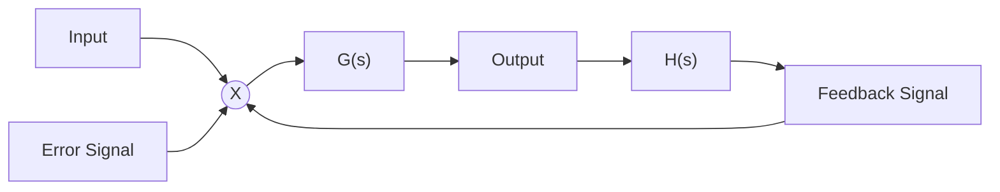
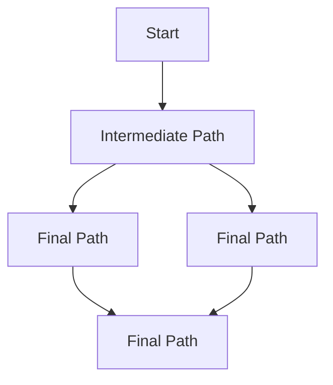

<details>
<summary>line</summary>

| Waveform | Summing Value |
| --- | --- |
| a(t) | \(A_{1}sin\omega_{1}t\) |
| b(t) | \(A_{2}sin\omega_{2}t\) |
| c(t) | \(A_{3}sin\omega_{3}t\) |
| d(t) | \(A_{1}sin\omega_{1}t + A_{2}sin\omega_{2}t + A_{3}sin\omega_{3}t\) |
</details>

Fig. 2.12 The addition of three sinewaves (a(t), b(t), c(t)) to produce the multi-component waveform (d(t)).

spectrum of $\left[ d ( t ) \right.$ comprises a plot of amplitude on the ordinate and frequency on the abscissa (Fig. 2.13). In this case, the waveform is said to be expressed in the Frequency Domain and the corresponding plot is called the amplitude spectrum. The conversion of a time series to its spectrum is a linear process and is said to be a ‘conversion from the Time Domain to the Frequency Domain’. In practice, today, the calculation of the amplitude spectrum for a particular time series is achieved via a computer algorithm called a Fast Fourier Transform or FFT (see Fig. 2.14). The FFT is a fast version of the original method developed by Joseph Fourier.

Frequently, the constituent parts of a complicated waveform can be more readily determined from its frequency spectrum. To illustrate this point, Fig. 2.15 shows the time series of a biological waveform (left), together with its frequency spectrum (right). Inspection of the time series shows that it is very difficult to determine the underlying components which comprise the waveform. However, inspection of its frequency spectrum shows that the waveform actually comprises one major periodic component at 0.05 Hz, or 20-second period, together with a range of low level noise — which impairs identification of the periodic component in the time series. This type of signal analysis by Frequency Domain inspection is a very powerful tool in the synthetic biology design toolbox.


<details>
<summary>spectrogram</summary>

| Peak | Freq (Normalised Units) | Amp (Normalised Units) |
| --- | --- | --- |
| A1 | 1 | ~5.8 |
| A2 | 3.5 | ~4.8 |
| A3 | 7 | ~2.3 |
</details>

Fig. 2.13 The Amplitude Spectrum of d(t).


<details>
<summary>flowchart</summary>


</details>

Fig. 2.14 Conversion from the Time Domain to Frequency Domain via the FFT.


<details>
<summary>spectrogram</summary>

| Time (seconds) | Spectral Power |
| --- | --- |
| 0 | ~0 |
| 100 | ~21 |
| 200 | ~18 |
| 300 | ~18 |
| 400 | ~20 |
</details>

Fig. 2.15 A biological waveform and its spectrum. The waveform essentially comprises a single 20-second period component (obscured in the time domain by noise).

## 2.9 Systems and Control Theory

The device shown in Fig. 2.8 is a form of a dynamical system. In engineering, the analysis of such systems is achieved by Systems and Control Theory. This provides a framework to analyse properties of interconnections of input/output systems. Control Theory has been extensively used in the design of control engineering systems and in the study of physiological systems. Control Theory could also provide a systematic framework to design and build biological systems.

The challenges in modelling systems and devices are to identify and derive a suitable mathematical model, to describe the system and to determine its parameters. Modelling can be performed, for example, using a black box approach. Here the details of the system are generally ignored. The focus of the black box approach is to use the input and output of the system (or device) to define a transfer function that characterises the system behaviour. Hence, the relationship between the output variable and the input variable of the system is described by the transfer function. The transfer function is a property of a system itself, a linear system independent of the magnitude and nature of the input or driving function. This method of modelling has been widely used in the study of physiological systems. For example, for heart rate variability (HRV) the system can be described by a series of components (described in the Laplace Domain), connected in a manner that describes the overall system.

## 2.9.1 Block diagrams

The basis of the Systems and Control methodology is the representation of devices and systems in terms of block diagrams, derived from descriptions of their ODEs. As will be shown, these techniques also allow the incorporation of nonlinearities into the model.

For example, the Laplace Domain equation

$$
Y (s) = G (s) X (s) \tag {5}
$$

can be expressed in a block diagram form as shown below in Fig. 2.16.

For more complex systems, it is possible to break the dynamic down still further by using multiple blocks in series. So, here, $G ( s )$ becomes $G _ { 1 } ( s )$ and $G _ { 2 } ( s )$ as shown in Fig. 2.17.


<details>
<summary>flowchart</summary>


</details>

Fig. 2.16 The block diagram of version of Eq. (4).


Fig. 2.17 The breaking down of G(s) into multiple blocks in series.


<details>
<summary>flowchart</summary>

```mermaid
graph LR
  R["R(s)"] -->|"+"| ×(("×"))
  G["G(s)"] --> C["C(s)"]
  H["H(s)"] -->|"-"| node["×"]
  C --> H
```
</details>

Fig. 2.18 A block diagram of a closed-loop system.

Now referring to the block diagram, the arrows only represent information flow, so that referring to the right-hand part of the diagram in Fig. 2.17, if we were to introduce an output for the block containing $G _ { 1 } ( s )$ , say $Z ( s )$ , then $Z ( s )$ could be defined as:

$$
Z (s) = G _ {1} (s) X (s) \tag {6}
$$

The block diagram method can be extended to include feedback, as shown in Fig. 2.18. This configuration is often referred to as a closed-loop system (where the symbol with the X inside the circle is a comparator).

The method is also capable of representing blocks in parallel (e.g. if $G _ { 1 } ( s )$ and $G _ { 2 } ( s )$ were in parallel, rather than series). A final point, blocks in the Laplace Domain are said to be described by ‘Transfer Functions’, so G(s) actually represents a Transfer Function.

## 2.9.2 Laplace transform method

By way of example, the regulatory device shown in Fig. 2.19 can be represented as a block diagram as shown in Fig. 2.14. Block 1 represents the transcription process described by Eq. (1) and Block 2 represents the translation process described by Eq. (2).

Referring to the equations of the example device shown in Fig. 2.8, Eq. (2) is a linear equation. Hence, Laplace transformation can be applied directly. The transformation of Eq. (2) is as follows:

The Laplace transform of Eq. (2), described earlier in this chapter,

$$
\frac {d [ P ]}{d t} = k _ {t l} [ m R N A ] - d _ {p} \cdot [ P ] \tag {7}
$$

with zero initial conditions is given by:

$$
s [ P ] = k _ {t l} [ m R N A ] - d _ {p} \cdot [ P ] \tag {8}
$$


<details>
<summary>flowchart</summary>


</details>

Fig. 2.19 Representation of the regulatory device using block diagrams.

By arranging Eq. (8), we obtain:

$$
G _ {2} (s) = \frac {[ P ]}{[ m R N A ]} = \frac {k _ {t l}}{s + d _ {p}} \tag {9}
$$

$$
G (s) = \frac {K}{s + a} \tag {10}
$$

$G _ { 2 } ( s )$ is now in a standard form, which is called a simple pole. Simple poles have the general form where a and K are constants.

In the Laplace Domain the system solution can be represented by the transient response plus the steady state response. As stated previously, in Eq. (3), the Laplace transform operator is defined as $^ { \circ } s ^ { \prime }$ . This definition is extended to incorporate the concept of the steady state and transient responses, so s becomes:

$$
s = \sigma + j \omega \tag {11}
$$

where $\sigma$ is the transient response and jω the steady state response. Hence, s is replaced by jω to obtain the steady state response of the system (usually called the frequency response).

In relation to systematic design in synthetic biology, the frequency response is often particularly useful when determining the mathematical description of parts of the device or system, in order to develop a computer model. In practice, there are a number of ways of obtaining such a description from experimental data and/or the literature. An important method of doing this is Bode Analysis.

## 2.10 Models and Languages

## 2.10.1 Applications

This section discusses some applications where biological analogues of electrical devices could be constructed using a synthetic biology approach. For more information on these and other devices as well as their construction from biological parts, please see Chapter 5.

## 2.10.1.1 Electronics and computing

The ability to manipulate signals and functions is a key requirement of many engineering devices and will be required of synthetic biology constructs. For example, many sensors need to combine, control or switch signals to produce a reliable output signal. With this approach the conceptual methodologies of electronics and computing can be applied to applications in synthetic biology. The operating speeds, time constants and power consumption of biologically synthesised parts and devices are likely to be very different from silicon-based electronic devices and computers. For example, biologically synthesised devices may be operationally much slower than their electronic equivalents. This may not be a disadvantage if such devices are to be used to monitor biological processes, since the time constants of the devices would match those of the environment in which they would operate. In addition, they may be driven by power supplies that derive their energy from the surrounding environment.

Biologically synthesised devices may also be capable of operating in environments that would be inhospitable to their electronic counterparts.

## 2.10.1.1.1 Orthogonality

One important problem which needs to be addressed is that of crosstalk in biological systems. Although biological devices are expected, conceptually, to work in a similar manner to their electronic equivalents, a key difference is that unlike electronic digital circuits the individual gates are not connected by wires. In electronic digital circuits there is no significant crosstalk, provided the circuit is properly laid out. This is not the case in synthetic biology where designed constructs sit in a melange of different substances. Since biological systems lack the same physical isolation as occurs in electronic and mechanical engineering, the interactions of biological components have to depend on the chemical specificity between them. However, the toolkit of synthetic biology now contains only a small repertoire of orthogonal regulatory elements. Here orthogonality means that the modules should not interfere with existing parts and modules in the designed biological systems as well as the genetic background circuit of the host. This constrains the development of more complicated systems that might comprise many components because the use of non-orthogonal components in one system likely leads to unintended interactions. There is a pressing need to expand the synthetic biology toolkit of available parts and modules that are truly orthogonal. This will provide the flexibility to construct larger-scale customisable systems with more complex circuitry, like the combinatorial logic circuits found in electronic engineering.

## 2.10.1.1.2 Logical devices and gates

The Texas Instruments data book in the 1970s transformed the application of electronic integrated circuits by allowing designers to combine logical functions using standard parts. Using a base set of Boolean functions represented by the components AND, NOT, OR, etc. any logical function can be produced, including addition and multiplication. A key aspect of this was the TTL standard permitting reliable interface between components. The development of a similar biologically engineered armoury of components performing logical functions will expand the range of biologically engineered devices that can be constructed. Logic gates are the basis of all digital devices from calculators through microprocessors to computers. The ability to design and build robust biological logic gates (BioLogic) is an important goal in synthetic biology. This is the basis upon which biological systems potentially can be controlled.

## 2.10.1.1.3 Timing functions and clocks

The ability to generate time delays or time intervals is another tool used in the design of electronic circuits, and will be required to provide a flexible range of functions required in synthetic biology-engineered devices.A time delay coupled with a series of inverters (NAND gates) constitute the basis of a simple oscillator which can then produce a regular clock signal.

The operation of many logical devices requires a clock to synchronise switching. Clocks can also be used with a counter to time multiple events. An example is work carried out on oscillators which are based on predator–prey dynamics using the Lotka–Volterra equations. The intention is to extend this work and look at other dynamics which could form the basis of clocks for logical devices — e.g. oscillators can now be realised in terms of protein concentrations. Combined with counters this can be used to generate a time delay, or other operations.

## 2.10.1.1.4 Race hazards

A race condition or race hazard is a flaw in an electronic system or process whereby the output and/or result of the process is unexpectedly and critically dependent on the sequence or timing of other events. The term originates with the idea of two signals racing each other to influence the output first, making the outcome much less predictable. In digital electronic circuits significant amounts of time and effort have been devoted to the elimination of such problems. With proper circuit layouts, digital electronic circuits are no longer subject to this problem. However, it may well not be the case in relation to biologically-based devices where the connections between gates are biochemical.

## 2.10.1.1.5 Counters

Once simple multi-stage logical devices have been successfully constructed, following the conclusion of the work on orthogonality and hazards, the next stage will be to construct devices which implement human-defined functions. Counters are a good example of such devices that can be used in association with clocks to define time intervals, or to trigger secondary events after a defined number of primary events. In electronic terms a counter requires an adder using the logic gates discussed above, together with a comparator that compares the count with a target number. The development of counters is a precursor to developing a range of BioLogical devices which will address issues relating to control and signalling in the context of synthetic biology.

## Reading

- Dorf, RC and Bishop, RH. (2008). Modern Control Systems, 11th Ed. Prentice Hall, Upper Saddle River, NJ.
- Endy, D. (2005). Foundations for Engineering Biology. Nature 438: 449–453.
- Franklin, GF, Powell, DJ and Workman, ML. (1997). Digital Control of Dynamic Systems, 3rd Ed. Prentice Hall, Upper Saddle River, NJ.
- Ogata, K. (2001). Modern Control Engineering, 4th Ed. Prentice Hall, Upper Saddle River, NJ.

# CHAPTER 3

# Foundational Technologies

## 3.1 Introduction

In this chapter, we will examine the enabling technologies that precipitated the rise of synthetic biology and describe the foundational technologies that modern synthetic biology is built upon. Synthetic biology brings together the principles common to all branches of engineering with the sciences of biology and chemistry. We will look at how these engineering principles define synthetic biology and how advances in biology and chemistry in the last decades of the 20th century set the scene for the subject to emerge. Finally we will touch on upcoming technologies that may define the next generation of synthetic biology research.

## 3.2 Enabling Technologies

Modern research in biology and chemistry often overlaps and is also split into many specialist sub-divisions. To place synthetic biology in context, it is useful to start by defining some of the branches of the biosciences that provide the scientific backbone for synthetic biology and led to the enabling technologies discussed here. One of the oldest subjects in bioscience, microbiology, is the study of microbes — the single-cell organisms that include the bacteria and yeasts so often used in synthetic biology. Genetics looks at cellular function and phenotypic differences between organisms, understanding how they link to genes and genetic differences such as mutations. Biochemistry bridges biology and chemistry to give a link between biological molecules and cellular function by revealing the chemistry and structures of the cellular molecules, particularly proteins like enzymes. Molecular biology completes the circle between genetics and biochemistry, uncovering the molecules and processes in cells that take genetic information from genes and converts it into the molecules of biochemistry. Molecular biology is particularly important for synthetic biology as this subject provides the tools for engineering biology. It gives us the proteins and molecules that convert new information encoded in the DNA of genes to make proteins that change cellular function. It gives us enzymes that cut and rearrange DNA to allow new information to be put into cells and it has also given rise to the tools needed to analyse the sequences of DNA and RNA that encode all life.


<details>
<summary>text_image</summary>

Replichore 1
Origin
4,000,000
100
10
1,000,000
35
30
25
50
3,000,000
60
80
90
1,000,000
2,000,000
Terminus
Eschericia Coli K-12
4,639,221 nucleotide pairs
Replichore 2
</details>

Fig. 3.1 A genetic map of the E. coli K-12 genome with an electron microscope image of several E. coli cells. (3.1(A) © Science Photo Lab. Reproduced with permission; 3.1(B) © AAAS. Science 277: 1453–1462, 1997. Reproduced with permission).

## 3.2.1 Genome sequences

Concurrent with the first synthetic biology research projects was the sequencing of the DNA that constitutes the human genome, a massive international project announced as essentially complete in 2003. However, it was in 1996 and 1997 that genome research made its biggest impact for synthetic biology with the sequencing of the genomes of two model organisms both used extensively in biotechnology — the bacterium Escherichia coli (Fig. 3.1) and the yeast Saccharomyces cerevisiae.

Having a complete sequence of an organism’s genome is essential for understanding how a cell works and how it can be re-engineered to be a chassis system for synthetic biology. A genome sequence provides a massive source of digital information that can be used to bring together detailed descriptions of molecular biology, genetics and biochemistry effectively being a blueprint for the function of the cell. The sudden availability of completed DNA sequences of two of the most commonly used laboratory organisms precipitated not only synthetic biology but also the tandem subject of systems biology discussed below. Parallel genome projects gave us further microbial genomes and then later the genomes of plants like A. thaliaria and metazoan animals like D. melanogaster and C. elegans. These genomes give molecular biologists a ‘toolbox’ of gene sequences to research with and it is these that provide the basis for ‘parts’ in synthetic biology.

## 3.2.2 Open online databases

The World Wide Web has had a big impact on research science, allowing scientists to share discoveries in faster and more information-rich ways than the printed publication methods, which dominated until the 1990s. Online databases have been particularly important in enabling technology development for synthetic biology. The ability to share graphical representations of large data sets is crucial to modern science. An example of this is the genome projects discussed above. These projects output millions of bases of DNA sequence that are too large to be disseminated on paper, but are perfectly suited to online databases. The Saccharomyces Genome Database (SGD) is an excellent example of this, providing the home to 12 million base pairs of yeast DNA sequence and the annotation of over 6,000 genes and thousands of experiments. As with many other online databases, such as FlyBase for Drosophila fruit fly researchers, the presence of such an essential website for research in this area also provides a focal point for research communities, and with freely available online data comes open-source sharing. A common model for an open online database is as a community wiki, where researchers can input and edit information relevant to their field of research and freely see that of others. There are now hundreds of open online databases containing biochemical, genetic and molecular biology information for a variety of organisms. Synthetic biology is able to make use of many of these databases. Databases that describe chassis cells, typically E. coli or S. cerevisiae, provide information on how to re-engineer the existing cellular systems. Databases that list enzymes and metabolic pathways from across nature are used to design systems that add ‘foreign’ genes to give new biological functions. Finally, synthetic biology has established its own online databases to help share information on experiments and designs. Two examples, both of which are wikis, are OpenWetWare.org, which is used to share experimental protocol information, and parts.igem.org, which holds vital information on standard biological parts discussed below and in other chapters.

## 3.2.3 DNA sequencing

DNA sequencing is one of the main tools of modern biosciences. Early molecular biology research and the first genome projects used traditional Sanger sequencing to sequence individual DNA pieces up to 1,000 base pairs at a time, and relied on gel electrophoresis and fluorescent dye chemistry to get the base pair sequence of DNA. For much longer sequences, such as whole chromosomes, a strategy called shotgun sequencing was employed in the 1990s by J. Craig Venter and others. In this technique a large piece of DNA is cut into many smaller fragments and sequenced by Sanger sequencing in parallel several times. Overlapping DNA data from each sequencing read is fed to an algorithm that re-assembles the sequence of the large DNA piece in silico. Parallel sequencing played a particularly large role in enabling rapid and affordable sequencing of bacterial genomes and is still the primary strategy to sequence chromosome-sized DNA. The strategy suits DNA sequencing on an industrial scale and has led to the creation of specialised 24-hour sequencing centres with automation, and a continual, exponential drop in the price and time it takes for researchers to have cloned DNA sequenced. For synthetic biology, verification of the DNA sequence of novel constructs is crucial and so having fast, cheap DNA sequencing is a prerequisite for projects of every size. In particular, DNA sequencing is essential for projects where devices are hosted in bacteria as the fast evolution within these organisms can quickly add mutations to sequences. The technology behind the physical sequencing of DNA has moved from gel electrophoresis to capillary electrophoresis for individual cloned DNA sequences common in synthetic biology. For genome-scale projects the sequencing chemistry has completely moved on to what are referred to as second- and third-generation sequencing technologies that sequence short DNA fragments in a massively parallel manner. These technologies create huge datasets and rely heavily on computation and algorithms to determine the genome sequences.

## 3.2.4 DNA synthesis

The technology directly related to DNA sequencing is DNA synthesis. DNA synthesis broadly falls into two categories: (i) oligonucleotide synthesis and (ii) gene synthesis the latter of which is discussed below. Oligonucleotide synthesis simply means the custom synthesis of short, single-stranded DNA oligonucleotide sequences, usually to be used as primers for PCR amplification of gene sequences. A customer defines the DNA sequence that they would like and simply sends the base sequence of their order to a synthesis facility, usually a company. Oligonucleotide synthesis is a chemical technology — a solid-phase synthesis performed using phosphoramidite chemistry to link A, C, G and T building blocks into chains as long as 150 nucleotides. As with DNA sequencing, oligonucleotide synthesis is typically done on an industrial scale at automated 24-hour centres. Process advances and commercialisation have led to a continual decrease in cost and turnover times for synthesised DNA oligonucleotides that is beginning to match those for DNA sequencing.

The decrease in costs of oligonucleotide synthesis and DNA sequencing has been overtaken by an even more rapid and exponential decrease in the cost of gene synthesis (Fig. 3.2). Gene synthesis is the custom ordering of commercially produced double-stranded sections of DNA, usually from 200 to over 2,000 base pairs in length. Gene synthesis costs are dependent on oligonucleotide and sequencing costs as the custom ordered genes are assembled from pools of synthesised oligonucleotides and then sequence-verified before delivery to the customer. Gene synthesis first requires optimised design and then synthesis of the required oligonucleotides, which are typically 40 to 60 bases in length. These oligos make up both the sense and antisense strands of the duplex DNA product and contain substantial overlap (Fig. 3.3). The gene is assembled from the oligonucleotides by allowing overlapping sequences to anneal and then using purified ligase enzymes and/or DNA repair enzymes to seal gaps. Alternatively, PCR amplification methods can be used; two of the most common are called progressive overlap extension PCR and thermodynamically balanced inside-out PCR. Assembled synthetic genes are purified, sequence-verified and regularly require error-correction using DNA repair enzymes, usually due to problems in the quality of the oligonucleotides used for assembly.

Price Per Base of DNA Sequencing and Synthesis


<details>
<summary>line</summary>

| Year | Cost: Sequencing (US Dollars) | Cost: Short Oligo (US Dollars) | Cost: Gene Synthesis (US Dollars) |
| --- | --- | --- | --- |
| 1990 | ~25 | — | — |
| 1993 | ~1 | ~1 | — |
| 1995 | ~0.8 | ~0.7 | — |
| 2000 | ~0.25 | ~0.3 | ~25 |
| 2001 | — | — | ~12 |
| 2002 | — | — | ~8 |
| 2003 | ~0.05 | ~0.15 | ~4 |
| 2004 | ~0.025 | — | — |
| 2006 | ~0.0008 | ~0.1 | ~1 |
| 2007 | — | — | ~0.5 |
| 2008 | — | ~0.08 | ~0.4 |
| 2009 | ~0.000008 | — | ~0.35 |
| 2010 | ~0.000003 | ~0.07 | ~0.3 |
| 2011 | ~0.000002 | — | ~0.25 |
| 2012 | ~0.0000015 | ~0.06 | ~0.2 |
| 2013 | ~0.0000015 | — | ~0.18 |
| 2014 | ~0.0000015 | ~0.06 | ~0.15 |
</details>

Fig. 3.2 The ‘Carlson Curve’ — the fall in DNA sequencing and DNA synthesis costs plotted over the last two decades. Note that cost is on a log-scale, so a straight line decrease is actually an exponential decrease. (Courtesy: Rob Carlson — www.synthesis.cc).

A strong link between synthetic biology and gene synthesis has always existed. Gene synthesis is a short cut to routine laboratory work required for molecular biology such as repetitive cloning and PCR. Gene synthesis allows DNA sequences placed online by researchers to be converted back into DNA constructs in other labs around the world, accelerating the sharing of resources. Importantly, gene synthesis also allows the production of entirely new synthetic gene sequences that have never existed before in nature. For synthetic biology, not only does this offer the freedom to produce novel designs for biomolecules like proteins or regulatory DNA sequences, but crucially allows proteincoding sequences to be codon optimised. Codon optimisation is desirable (and sometimes a necessity) when DNA sequences encoding proteins are transferred from diverse organisms into microbial cells. Throughout nature there is large variation in which codons are preferred by each organism and so the native DNA sequence of, say, a tobacco plant enzyme may be very poorly converted into protein when placed in E. coli. This is because codons that are highly efficient in plants may be rarely used in the bacteria (see Chapter 1). Rare codons in a gene cause the host cell machinery to stall when making the protein as the tRNAs required to match these codons are scarce. In order to allow synthetic biology to engineer complex devices and pathways using the biochemical diversity found across nature, codon optimisation through gene synthesis is invaluable. Gene synthesis with codon optimisation has the further advantage of allowing genes to be re-coded at the DNA sequence to specifically contain or be absent of defined sequences, such as those sites recognised by DNA-editing enzymes like the restriction enzymes that play a key role in synthetic biology DNA assembly.


<details>
<summary>flowchart</summary>


</details>

Fig. 3.3 Diagram of gene synthesis from overlapping oligos by assembly PCR.

## 3.2.5 Systems biology

A genome sequence is an example of a data-rich experimental project that requires online databases to disseminate results. While genomics was one of the first areas in bioscience where this occurred, many modern experimental projects now collect millions of data points through the use of what is called ‘high-throughput techniques’. In particular, experiments that take parallel measurements of molecules in cells produce very large datasets. An established example is DNA microarrays, which are used to quantify the level of all mRNAs in a cell at a given time, and so give a picture of what genes are being expressed to make protein and by how much. Before genomics and DNA microarrays, experimental biological data had been a precious resource established by individual researchers. However, now the amount of experimental data produced by some techniques has surpassed what classical research methods can adequately describe. To address the gap between data and interpretation, researchers have taken advantage of the increasing availability of computer power to use mathematical-based analysis of data to infer cell function. By writing in silico mechanistic models of how cells may operate using mathematical software it has become possible to systematically analyse and integrate large complex datasets to derive how cells respond to stimuli and the nature of the processes that control their life cycle. This research approach, which began after the first genome sequences were completed, is known as systems biology. It is closely associated with synthetic biology because both disciplines use mathematical models to describe and predict function. For systems biology, computation is used to dissect a cell’s natural behaviour from wide-ranging experimental datasets. In contrast, modelling is used for synthetic biology, as it is in engineering, to aid in the design and description of newly constructed functions (see Chapter 6). A useful way to compare systems and synthetic biology is to think of how they approach working with cells and data. Systems biology is considered ‘top-down’, as measurements of outcomes are used to build a model of the inner workings of the cell as a system; synthetic biology is ‘bottom-up’, as the inner workings are measured and then put together and built to create outcomes. The two research fields complement one another in methodology, as modelling strategies such as ordinary differential equations and stochastic simulations are common to both fields, and the initial use of mathematics to describe cellular processes by systems biology has paved the way for its evident application to synthetic biology.

## 3.3 Foundations

## 3.3.1 Standard DNA assembly

The foundational technologies that underpin synthetic biology and differentiate it from traditional DNA manipulation by molecular biology are based on engineering. In other engineering disciplines like electronic and mechanical engineering, standards are an essential foundation, allowing parts and data to be shared worldwide. In particular, the standards that define how parts are linked together are important for giving modular composability, and examples of this can be seen all around us, like the USB standard for linking electronic devices and standardised threading on screws. To facilitate modular composability in engineering biology and ease the re-use of defined DNA parts, synthetic biology has built a foundation of standard DNA assembly that allows parts to be sequentially combined into working devices, pathways and systems.

Biological devices assembled in the initial projects of synthetic biology used unique DNA sequences recognised and cut by restriction enzymes. These sites, when placed at the boundaries of DNA parts, allowed them to be linked together and enabled parts to be removed and/or replaced as necessary using various DNA-editing enzymes to cut and paste. The modularity of this approach is evident, yet it requires a long list of available unique sites and these have to be added accordingly to the ends of parts by DNA modification techniques like PCR. To overcome these limitations the BioBricks assembly standard was developed by Tom Knight at MIT in 2003. The BioBricks standard places the recognition sites of three specific restriction enzymes at each end of every part, and digestion and ligation at these sites allows parts to be assembled together in a standard fashion. Importantly, the use of different restriction enzymes whose digested recognition sites can still ligate together (isocaudomers) means that standard parts can be linked together in a manner that removes the digestion sites from the part boundaries in the composed product. Thus any product of standard assembly of BioBrick parts becomes itself a usable, larger composite BioBrick. For a full description of BioBrick parts and their assembly, see Appendix 1.

BioBricks assembly, however, has limitations that pose a challenge in designing and engineering synthetic systems. Repetitive ‘scar’ sequences are left behind at part boundaries which can affect the function of the neighbouring parts, and parts cannot be used which contain within them any of the restriction enzyme recognition sequences that are used for standard assembly. These limitations along with the slow methodology of BioBricks assembly means that few of the major research projects in synthetic biology use this assembly method, instead relying on numerous bespoke methodologies. However, the foundation that standard assembly provides is clear as it allows any researcher with the same set of restriction enzymes to reliably assemble thousands of prototype devices from standard biological parts. It is a relatively easy-to-use method and this is evident annually at the International Genetically Engineered Machine (iGEM) competition where undergraduates describe complex devices assembled and tested in just three months (see Chapter 8). In effect, it is a useful prototyping tool analogous to the plastic models that architects produce before buildings are constructed. This reliable method of construction allows prototypes to be tested that can later be replaced by tuned, professional final products, and experience with BioBricks assembly paves the way for researchers to tackle complex projects in synthetic biology.

## 3.3.2 Standard measurement

Regardless of the method of assembly of biological parts, it is important to have standard measurement of their function and efficiency. For synthetic biology to be an engineering discipline, DNA parts of all types, whether in BioBricks form or not, need to be adequately described by data. This allows parts to be re-used by other researchers without themselves having to replicate the most basic experiments. It also enables model-based design and description of devices and systems as the characterisation data of parts helps build the mathematical model, defining the working parameters that give realistic output. In other engineering disciplines, having adequate characterisation data available for each part is essential. For integrated circuit engineers in the 1970s and 1980s, the TTL Data Book described the necessary characteristics of transistors and resistors required for hobbyists and professionals to assemble complex digital circuits. An equivalent to this data book will be required for biological parts as a foundation for synthetic biology to build complex systems.

Precise, quantitative measurement of biological function has always been a challenge. New technologies are able to increase the speed and accuracy of measurements from biological systems and give exponentially more data. For synthetic biology, the key foundational technologies used in the standard measurement of parts are microscopy, flow cytometry, colorimetry, luminometry and fluorimetry. This is because the majority of synthetic biology experiments use reporter systems to measure the functional output of a DNA part, device or system. The most accurate and easy-to-use reporter systems rely on accurate detection of cells changing colour or producing fluorescent molecules (fluorophores) or luminescent molecules (luminescence). The most commonly used reporter system for standard measurements in synthetic biology is Green Fluorescent Protein (GFP). This is a protein originally isolated from the jellyfish Aequorea victoria that exhibits bright green fluorescence when exposed to blue light. The DNA sequence encoding this protein can easily be placed into other organisms to make them fluoresce green and fusing the GFP-encoding DNA sequence to the coding sequence for another protein effectively tags that protein with green fluorescence. Output of biological function can be measured using GFP by fusing its encoding DNA to proteins whose expression levels or location need to be determined. Alternatively, directly placing the GFP DNA sequence alongside regulatory DNA sequences like promoters enables researchers to measure how those sequences modulate gene expression levels. GFP levels are quantified at the population level by measuring the green fluorescence output of a volume of cells using fluorimetry. Quantification can also be performed at high-speed for single cells using flow cytometry which passes individual cells through a microfluidics chamber past a blue laser and then detects green output. Finally, fluorescence microscopy can be used to track and (using image analysis) quantify GFP expression within single cells and for populations of cells.

Alternative reporter systems to GFP include natural enzymes such as β-galactosidase and catechol 2,3-dioxygenase that catalyse quantifiable colour-change reactions when specific substrate chemicals are provided. Luminescence is also used as a reporter mechanism, taking natural luciferase enzyme genes that exist in fireflies and jellyfish and expressing these in engineered cells to produce a quantifiable light output. There also now exists a whole range of different fluorescent proteins other than GFP — including blue, cyan, yellow and several shades of red fluorescent proteins along with GFP variants optimised for a wide variety of different cellular conditions (Fig. 3.4). Research and development in biotechnology, using mutation and selection methods, has enabled scientists to engineer new properties into natural proteins and discover new variants of fluorescence. The many types of available reporter systems, particularly fluorescent proteins emitting different colours, allow researchers to measure the output of several parts, devices or systems at once. For example, the gene expression output of two promoters in an engineered yeast cell can be quantified at the same time by placing the GFP DNA sequence downstream of one promoter and an RFP (red fluorescent protein) DNA sequence downstream of the second promoter. Using a fluorescence microscope or a flow cytometer with the correct detection filters and excitation lasers, the researcher can simultaneously record green and red fluorescence, and in doing so infer the output efficiency of the two promoter sequences.

Although technology is improving, the precision of measurements performed by different research groups often produces data that shows large differences. This is due to a variety of reasons. Firstly, biology is inherently ‘noisy’ — within an apparently