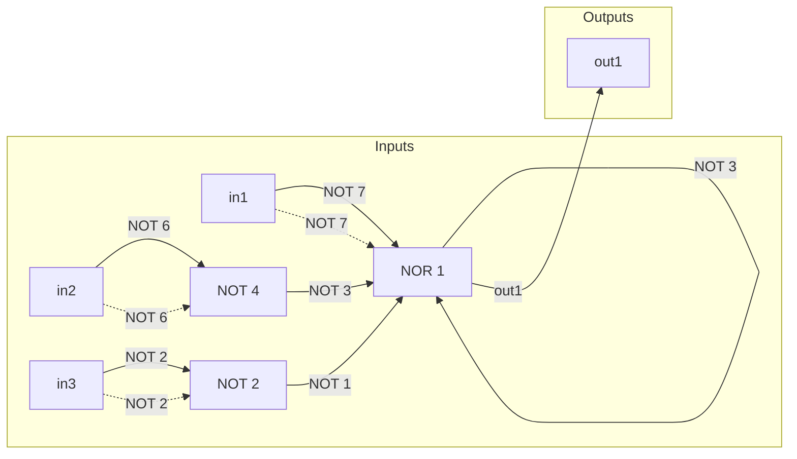
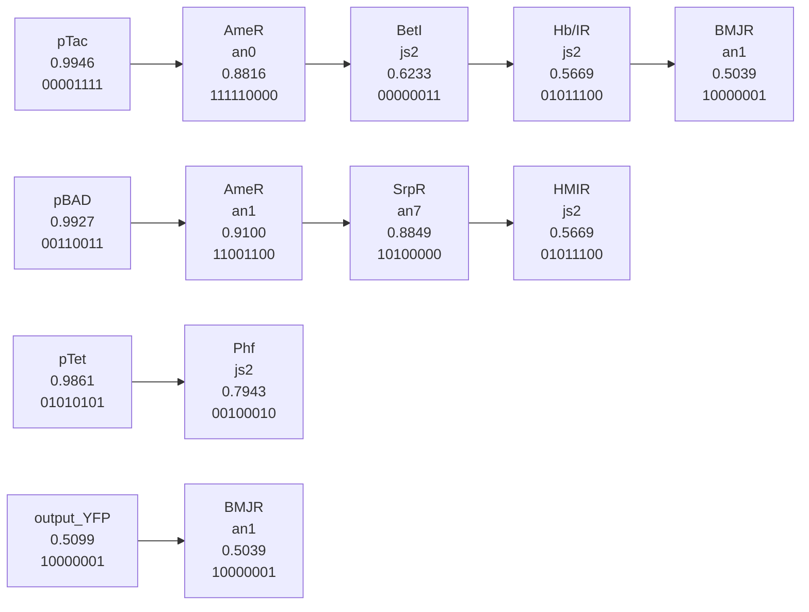

Fig. 3.4 Fluorescent proteins are available in many shades of colour, thanks to natural diversity and extensive in-lab evolution experiments. (© Paul Steinbach, Roger Tsien Laboratory. Reproduced with permission).

identical population of a million bacteria cells some will exist that are at different stages in their life cycle, different sizes and with varying access to nutrients and oxygen. Even at the molecular level within the cell there are events like transcription that are stochastic in their nature. Secondly, cells used by different researchers can be quite different — for example two synthetic biologists engineering an E. coli chassis could be working with different strains of the same organism, which have small genetic differences that cause significant changes in their behaviour. Even when two laboratories both use the same strain, the ability of bacteria to quickly acquire mutations means that the two labs may still not have genetically identical systems. Finally, the largest source of variation in measurement comes from the researchers themselves, who set up their experiments differently, following different protocols, have different lab conditions such as temperature and air pressure and use different equipment from a variety of manufacturers to make their measurements.

Although it may be possible to limit this variation by vigilant standardisation of cell strains, chemical reagents, equipment and experimental protocols, it is also possible to do so by using reference elements to aid in standard measurement. A good example of a reference element is the metre. The metre is the standard unit used to measure distance and is based on a length chosen by scientists and engineers. To quantify any distance, an engineer will directly compare that distance to their own measurement tool standardised to the official metre. Just as in measuring distances in engineering, in synthetic biology it has been shown that using a reference element can help standardise measurement between research groups around the world. In one example of this a promoter sequence active in growing E. coli was set as the benchmark reference element for promoter efficiency. Quantifying the green fluorescence output of cells engineered to express GFP under the control of this promoter gives each lab their reference output measurement. Labs can then compare the measured output of other promoter sequences to this reference measure and share their data as relative expression output compared to the standard that each lab has quantified. As a foundational technology for synthetic biology, standard measurement using reference elements enables more accurate sharing of characterisation data among the community.

## 3.3.3 Abstraction

Natural DNA sequences often encode multiple overlapping functions, providing a challenge for synthetic biology. For example, the initial bases of an mRNA sequence can affect the efficiency of translation but they can also modulate the mRNA lifetime, and are coded for by DNA bases that themselves are usually part of the promoter sequence. Overcoming this and defining each part and its function is a major task in synthetic biology, but it is essential for providing the modular composability that will allow the engineering of novel biological devices and systems.

Composability is a fundamental part of what is known as abstraction in engineering, where intimate understanding at one level (e.g. parts) is not required to work at another level (e.g. devices). Abstraction allows the construction of complex devices without the full understanding of the processes at each scale (Fig. 3.5). For example, in the computer industry, a laptop is designed and assembled by people who have no expertise in how transistors are fabricated into microchips. In synthetic biology, abstraction allows there to be experts on parts like promoters and transcription factors who can characterise these standard parts and pass them over to specialists who design and build devices or engineer pathways. These specialists can then, in turn, offer their expertise to systems-level designers who can work with little or no knowledge of how parts in their designs operate at the molecular level. By having abstraction in synthetic biology it allows complexity to be engineered without a reliance on highly trained experts who understand cellular biology at many levels of detail. In order to enable abstraction it is essential that biology is engineered in a modular fashion with defined parts. These parts are required to be measured with a suitable degree of precision so that their characterisation data can be used to accurately design and build devices and, in turn, these devices themselves need to be adequately characterised and modular for them to be interfaced into synthetic systems.


<details>
<summary>flowchart</summary>

```mermaid
graph LR
  subgraph Systems
  A["PoPS NOT.1"] --> B["PoPS NOT.2"]
  B --> C["PoPS NOT.3"]
  end

  subgraph Devices
  D["PoPS"] --> E["PoPS NOT.1"]
  E --> F["PoPS"]
  end

  subgraph Parts
  G["5'-TAATACGACTCACTATAGGGAGA-3'"] --> H["Get me this DNA."]
  H --> I["Here's your DNA."]
  end

  A -.->|"Can I have three inverters?""| J["Here's a set of PDP inverters 1-n that each send and receive through a fungible signal carrier, PoPS."]
  E -.->|"I need a few DNA binding proteins."| K["Here's a set of DNA binding proteins 1-n that each recognize a unique cognate DNA site; choose any."]
  G -.->|"Get me this DNA."| I
```
</details>

Fig. 3.5 Diagram demonstrating the different abstraction levels in synthetic biology. (Courtesy: Nature 438, 24 November 2005, 449–453. Reproduced with permission).

## 3.3.4 Modelling

As in all aspects of engineering, mathematical descriptions of designs and processes are an essential tool in synthetic biology and provide a foundation for robust and scalable construction of complex devices and systems. Mathematical models are applied in synthetic biology both before a device or system is assembled and characterised in cells, and also afterwards. Modelling prior to building and testing a device is typically intended to be predictive. That is to assess the likelihood that a design will work, to suggest other possible designs, to simulate the potential performance and to derive the parameters that will give the intended robust function. Deriving the optimal parameters by predictive modelling allows the researchers to select the appropriate parts that should build a successful device or system. For example, when constructing a regulatory gene network, inputs and outputs at logic gates need to be tuned appropriately; parameter estimation informs the relative expression levels required for the regulatory proteins and by selecting promoter parts of different strengths to control expression of these proteins, researchers can build balanced and predictable devices (Fig. 3.6). The use of modelling after the assembly and characterisation of a biological device or system serves several other useful roles in synthetic biology:

(i) Modelling can be used to give a fundamental description of a novel process, explaining the characterisation data and providing a mathematical foundation for the synthetic design. A model of a characterised synthetic device or system can often then be used to derive a mathematical understanding of an equivalent natural process.
(ii) A model describing the experimental data can be used typically by simulation, to quickly explore how a design performs in a wide variety of other potential experimental conditions, including ones which would be difficult to examine in a typical laboratory.
(iii) A post-testing model provides the crucial link to the second round of an engineering cycle, allowing the data derived from testing an initial prototype in a first cycle to direct the design and construction of one or more optimised second-round designs.

Modelling in synthetic biology is important at all scales of work, from describing how protein parts bind their substrates or predicting the folding of RNA motifs, up to analysing how the flux of metabolites runs through enzymatic pathways and understanding how cells interact with one another in engineered consortia. Models of all scales can be done using a variety of techniques including ordinary differential equations (ODEs), stochastic differential equations (SDEs), Master equations and Boolean networks.A detailed description of modelling for synthetic biology is found in Chapter 6. A foundation for modelling in synthetic biology is intended to allow abstraction and to increase the speed and reliability of building synthetic biological devices and systems. Experimental


Fig. 3.6 Model-predicted behaviour of gene networks can be used to inform how a network will perform when DNA parts from part libraries are interchanged. (Courtesy: Nature Biotechnology 27, 2009, 465–471. Reproduced with permission).

molecular biology is, by comparison, time-consuming, expensive and can be unpredictable. Computational design and simulation is cheap and rapid. By placing more of the process of the synthetic biology engineering cycle in silico there is accelerated innovation and application at lower costs.

## 3.3.5 Parts registries

Science relies on the dissemination of data and the exchange of materials such as DNA and cells from one group to another. Traditionally, this was done through collaboration and via conferences but with increased volume of experimental data collected, open online databases have become more important and also provide a home for valuable basic information about experiments, such as the methods used and the raw data collected. With the decreasing cost of gene synthesis, online databases are also a way to exchange materials, as posting the digital information of a DNA sequence allows others to have this made.

For synthetic biology, sharing data and exchanging DNA sequences is particularly important as it allows engineered systems to be rapidly re-used and modified by others. This is especially true for engineering that uses standard parts to compose complex modular designs. The same community of synthetic biologists that developed the BioBrick and iGEM also co-developed a parts registry for standard BioBricks parts. The Registry of Standard Biological Parts (parts.igem.org) is maintained in the USA by a dedicated team and provides a wiki-like environment for iGEM participants and other BioBricks users to upload DNA sequence information and characterisation data for parts, devices and systems they have constructed or have re-used. The registry and its role with iGEM are both discussed further in Chapter 8. For BioBricks, this registry is an important resource. It gives a full catalogue of available parts that is easily accessible. It provides some data describing their function, performance, design, use and reliability. This information, collated at a single website, enables the synthetic biologist to model, design and build without having to search through thousands of research publications and request materials from hundreds of researchers. A parts registry instead offers a real catalogue of all the usable components in one place and in doing so sets standards for how these should be designed and described. By setting these standards and allowing open access for a participating community, a parts registry offers an essential foundation for engineering biology.

The BioBricks parts registry has catalogued several thousand parts, mostly through the iGEM competition. It provides a major resource for synthetic biology, but is sometimes lacking in usable characterisation data for many parts due to it primarily being part of an undergraduate student competition. As companion databases, synthetic biology researchers have developed professional parts registries which are not limited to BioBricks parts. These are designed to contain rigorous description and characterisation data for each biological part. This makes modelling and design more predictive and enables rapid construction of working devices and systems. Closed-source parts registries of this kind exist at commercial synthetic biology companies and an open professional parts registry was founded in 2009. The International Open Facility Advancing Biotechnology (BIOFAB) was public-funded in the USA to produce and accurately characterise hundreds of high quality standard parts. Since 2013, these parts have populated a professional registry open to the public (Figure 3.7) that provides a foundation for synthetic biology research and industrial engineering of biology. BIOFAB actively defined the measurement standards for synthetic biology and what the information would be required for the design and modelling of new devices and systems. Their registry stores parts data in a format compatible with the Synthetic Biology Open Language (SBOL). This means that it is readily machine-readable and can be quickly integrated into many diverse synthetic biology and modelling software tools. Both the BioBricks Registry and BIOFAB are also committed to being open source and this important factor is described further in Chapter 9.


Fig. 3.7 Screenshot of the BIOFAB data access client, January 2010. (©: Cesar A. Rodriguez, BIOFAB, http://biofab.jbei.org/. Reproduced with permission).

## 3.4 Upcoming Technologies

Synthetic biology has put into place foundations for engineering biology based on the technological advances of genomics, bioinformatics, DNA sequencing and synthesis. The future for synthetic biology is hard to predict but is likely to be shaped by new technologies and goals that are being set by the community of synthetic biology researchers. Ultimately, the main aim of synthetic biology is to reduce to a minimum both the experimental laboratory work and the scientific enquiry of the discipline, and instead turn it into a predictable technology suitable for systematic biological design and industrialisation. This is not to say that applying synthetic biology approaches will also uncover significant new and fundamental insights into biological systems. The drive to achieve both of these aims is notable in several technologies now impacting on synthetic biology.

The rise in the availability of high-power computation will enable more complex mathematical modelling, and in particular will allow simulations of systems that are based on combinations of different models, each working on different scales (multi-scale modelling). Combining complex models and simulations with improved part characterisation data will accelerate the use of computation in predicting how novel synthetic designs will perform, and then how to optimise them further. The end goal for modelling in synthetic biology will be the development of Computer-Aided Design (CAD) software (BioCAD) environments, accessible to researchers who work at the different levels of abstraction. In such a program, DNA sequences of parts or devices are treated as modules that can be virtually assembled in a ‘drag-and-drop’ environment. The functioning of the virtual assemblies in a variety of conditions can be simulated until an optimal design is finalised, upon which the parts list and full DNA sequence to make the design is provided along with detailed instructions on how a laboratory researcher or robotic platform could assemble and test it. CAD software like this is common in other engineering disciplines such as microchip fabrication, and some basic CAD software for synthetic biology is already becoming available. An example of such a CAD program (Cello) is provided in Fig. 3.8.

Computation can also provide an alternative to parts registries in synthetic biology. The function and efficiency of some biological parts can be linked directly to the DNA sequence that encodes them by sequence-to-function models. In 2009, an example of this was shown when a simple RNA part — the ribosome binding site (RBS) — was modelled with enough detail to allow a predictive tool to be produced. This software tool, available online, provides the user with the DNA sequence that they can have synthesised to produce an RBS part with a desired function and efficiency. With cheap custom DNA synthesis and predictive tools for custom designing of parts, it is possible to use modelling to design some simpler parts de novo, instead of obtaining existing parts from registries.

Gene synthesis will continue to play a large role in synthetic biology. Advances in the understanding of codon use in various organisms are allowing genes to be designed with increasingly reliable and predictable levels of expression. The speed at which long DNA sequences can be produced by commercial companies is continually increasing and the cost continues to fall. Recently described methods for genes synthesis from microarray DNA are now driving costs down considerably further, as the parallel production of thousands of DNA oligonucleotides on microarrays is much cheaper than traditional chemical synthesis. This is an example of how cost can be decreased while output is increased by using miniaturisation of typical laboratory processes. Miniaturisation is expected to help advance synthetic biology and is already a strategy to improve the characterisation of parts and devices. This is done using microfluidics — custom-made systems that allow thousands of parallel laboratory experiments to be done in tiny tubes and vessels (see Gulati et al. 2009). Elegant experiments on oscillating devices in bacteria have shown how microfluidics can allow the behaviour of thousands of engineered cells to be monitored separately while also offering precise control of each cell’s local environment.

## Cello

Inputs

<table><tr><td colspan="5">choose</td></tr><tr><td></td><td>name</td><td>low REU</td><td>high REU</td><td>promoter sequence</td></tr><tr><td>1</td><td>pTac</td><td>0.0204</td><td>8.7918</td><td>AACGATCGTTGGCTGTGTTGACAATTAATCATCGGCTCGTATAATGTGTGGAATTGTGAGCGCTCACAAT</td></tr><tr><td>2</td><td>pTet</td><td>0.1312</td><td>16.837</td><td>TACTCCACCGTTGGCTTTTTCCCTATCAGTGATAGAGATTGACATCCCTATCAGTGATAGAGATAATGAC</td></tr><tr><td>3</td><td>pBAD</td><td>0.013</td><td>7.801</td><td>ACTTTTCATACTCCCGCCATTCAGAGAAGAAACCAATTGTCCATATTGCATCAGACATTGCCGTCACTGC</td></tr><tr><td colspan="2">clear</td><td>2</td><td>3</td><td>4</td></tr></table>

Verilog

| 1 | module A(output out1, input in1, in2, in3); always@(in1,in2,in3) begin case({in1,in2,in3}) 3'b000: {out1} = 1'b1; 3'b001: {out1} = 1'b0; 3'b010: {out1} = 1'b0; 3'b011: {out1} = 1'b0; 3'b100: {out1} = 1'b0; 3'b101: {out1} = 1'b0; 3'b110: {out1} = 1'b0; 3'b111: {out1} = 1'b1; endcase end endmodule |
| --- | --- |

## Run

1) Boolean logic circuit


<details>
<summary>flowchart</summary>


</details>

2) Assigned logic circuit


<details>
<summary>flowchart</summary>


</details>

4) Plasmid DNA sequence


<details>
<summary>flowchart</summary>

```mermaid
graph LR
  A["GACGCATTC TGGAATGCA"] --> B["TTCAGCCTA"]
  C["CAACGGTGCTC TTTCAGTTGCA"] --> D["GGCATCGTG"]
  E["GGCTTGCTC AGTATGTGAA"] --> F["GGCATCGTG"]
  G["GGCTTGCTC AGTATGTGAA"] --> H["GGCATCGTG"]
  I["GGCTTGCTC AGTATGTGAA"] --> J["GGCATCGTG"]
  K["GGCTTGCTC AGTATGTGAA"] --> L["GGCATCGTG"]
  M["GGCTTGCTC AGTATGTGAA"] --> N["GGCATCGTG"]
  O["GGCTTGCTC AGTATGTGAA"] --> P["GGCATCGTG"]
  Q["GGCTTGCTC AGTATGTGAA"] --> R["GGCATCGTG"]
  S["GGCTTGCTC AGTATGTGAA"] --> T["GGCATCGTG"]
  U["GGCTTGCTC AGTATGTGAA"] --> V["GGCATCGTG"]
  W["GGCTTGCTC AGTATGTGAA"] --> X["GGCATCGTG"]
  Y["GGCTTGCTC AGTATGTGAA"] --> Z["GGCATCGTG"]
  AA["GGCATCGTG GTATTGAGA"] --> AB["AACAGTAGTA"]
  AC["GGCATCGTG GTATTGAGA"] --> AD["AACAGTAGTA"]
  AE["GGCATCGTG GTATTGAGA"] --> AF["AACAGTAGTA"]
  AG["GGCATCGTG GTATTGAGA"] --> AH["AACAGTAGTA"]
  AI["GGCATCGTG GTATTGAGA"] --> AJ["AACAGTAGTA"]
  AK["GGCATCGTG GTATTGAGA"] --> AL["AACAGTAGTA"]
  AM["GGCATCGTG GTATTGAGA"] --> AN["AACAGTAGTA"]
  AO["GGCATCGTG GTATTGAGA"] --> AP["AACAGTAGTA"]
  AQ["GGCATCGTG GTATTGAGA"] --> AR["AACAGTAGTA"]
  AS["GGCATCGTG GTATTGAGA"] --> AT["AACAGTAGTA"]
  AU["GGCATCGTG GTATTGAGA"] --> AV["AACAGTAGTA"]
  AW["GGCATCGTG GTATTGAGA"] --> AX["AACAGTAGTA"]
  AY["GGCATCGTG GTATTGAGA"] --> AZ["AACAGTAGTA"]
  BA["GGCATCGTG GTATTGAGA"] --> BC["AACAGTAGTA"]
  BD["GGCATCGTG GTATTGAGA"] --> BC2["AACAGTAGTA"]
  BC3["GGCATCGTG GTATTGAGA"] --> BC4["AACAGTAGTA"]
  BC5["GGCATCGTG GTATTGAGA"] --> BC6["AACAGTAGTA"]
  BC7["GGCATCGTG GTATTGAGA"] --> BC8["AACAGTAGTA"]
  BC9["GGCATCGTG GTATTGAGA"] --> BC10["AACAGTAGTA"]
  BC11["GGCATCGTG GTATTGAGA"] --> BC12["AACAGTAGTA"]
  BC14["GGCATCGTG GTATTGAGA"] --> BC15["AACAGTAGTA"]
  BC16["GGCATCGTG GTATTGAGA"] --> BC17["AACAGTAGTA"]
  BC19["GGCATCGTG GTATTGAGA"] --> BC20["AACAGTAGTA"]
  BC22["GGCATCGTG GTATTGAGA"] --> BC23["AACAGTAGTA"]
  BC25["GGCATCGTG GTATTGAGA"] --> BC26["AACAGTAGTA"]
  BC29["GGCATCGTG GTATTGAGA"] --> BC30["AACAGTAGTA"]
  BC33["GGCATCGTG GTATTGAGA"] --> BC34["AACAGTAGTA"]
  BC37["GGCATCGTG GTATTGAGA"] --> BC38["AACAGTAGTA"]
  BC41["GGCATCGTG GTATTGAGA"] --> BC42["AACAGTAGTA"]
  BC45["GGCATCGTG GTATTGAGA"] --> BC46["AACAGTAGTA"]
  BC49["GGCATCGTG GTATTGAGA"] --> BC50["AACAGTAGTA"]
  BC53["GGCATCGTG GTATTGAGA"] --> BC54["AACAGTAGTA"]
  BC57["GGCATCGTG GTATTGAGA"] --> BC58["AACAGTAGTA"]
  BC61["GGCATCGTG GTATTGAGA"] --> BC62["AACAGTAGTA"]
  BC65["GGCATCGTG GTATTGAGA"] --> BC66["AACAGTAGTA"]
  BC69["GGCATCGTG GTATTGAGA"] --> BC70["AACAGTAGTA"]
  BC74["GGCATCGTG GTATTGAGA"] --> BC75["AACAGTAGTA"]
  BC79["GGCATCGTG GTATTGAGA"] --> BC80["AACAGTAGTA"]
  BC84["GGCATCGTG GTATTGAGA"] --> BC85["AACAGTAGTA"]
  BC89["GGCATCGTG GTATTGAGA"] --> BC90["AACAGTAGTA"]
  BC94["GGCATCGTG GTATTGAGA"] --> BC95["AACAGTAGTA"]
  BC99["GGCATCGTG GTATTGAGA"] --> BC100["AACAGTAGTA"]
  CC14["GGCATCGTG GTATTGAGA"] --> CC15["AACAGTAGTA"]
  CC19["GGCATCGTG GTATTGAGA"] --> CC20["AACAGTAGTA"]
  CC24["GGCATCGTG GTATTGAGA"] --> CC25["AACAGTAGTA"]
  CC29["GGCATCGTG GTATTGAGA"] --> CC30["AACAGTAGTA"]
  CC34["GGCATCGTG GTATTGAGA"] --> CC35["AACAGTAGTA"]
  CC39["GGCATCGTG GTATTGAGA"] --> CC40["AACAGTAGTA"]
  CC44["GGCATCGTG GTATTGAGA"] --> CC45["AACAGTAGTA"]
  CC49["GGCATCGTG GTATTGAGA"] --> CC50["AACAGTAGTA"]
  CC54["GGCATCGTG GTATTGAGA"] --> CC55["AACAGTAGTA"]
  CC59["GGCATCGTG GTATTGAGA"] --> CC60 [AC:CC:CC:CC:CC:CC:CC:CC:CC:CC:CC:CC:CC:CC:CC:CC:CC:CC:CC:CC:CC:CC:CC:CC:CC:CC:CC:CC:CC:CC:CC:CC:CC:CC:CC:CC:CC:CC:CC:CC:CC:CC:CC:CC:CC:CC:CC:CC:CC:CC:CC: CC:C:C:C:C:C:C:C:C:C:C:C:C:C:C:C:C:C:C:C:C:C:C:C:C:C:C:C:C:C:C:C:C:C:C:C:C:C:C:C:C:C:C:C:C:C:C:C:C:C:C:C:C:C:C:C:C:C:C:C:C:C:C:C:C:C:C:C:C:C:C:C:C:C:C:C:C:C:C:C:C:C:C:C:C:C:C:C:C:C:C:C:C:C:C:C:C:C:C:C:C C: C: C: C: C: C: C: C: C: C: C: C: C: C: C: C: C: C: C: C: C: C: C: C: C: C: C: C: C: C: C: C: C: C: C: C: C: C: C: C: C: C: C: C: C: C: C: C: C: C: C : C : C : C : C : C : C : C : C : C : C : C : C : C : C : C : C : C : C : C : C : C : C : C : C : C : C : C : C : C : C : C : C : C : C : C : C : C : C : C : C : C : C : C : C : C : C : C : C : C : C .C : CC : CC : CC : CC : CC : CC : CC : CC : CC : CC : CC : CC : CC : CC : CC : CC : CC : CC : CC : CC : CC : CC : CC : CC : CC : CC : CC : CC : CC : CC : CC : CC : CC : CC : CC : CC : CC : CC : CC : CC : CC : CC : CC : CC : CC : CC : CC : CC : CC : CC : CCCCACCACCACCACCACCACCACCACCACCACCACCACCACCACCACCACCACCACCACCACCACCACCACCACCACCACCACCACCACCACCACCACCACCACCACCACCACCACCACCACCACCACCACCACCACCACCACCACCACCACCACCACCACCACCACCACCACCACCACCACCACCACCACCACCACCACCACCACCACCACCACCACCACCACCACCACCACCACCACCACCACCACCACCACCACCACCACCACCACCACCACCACCACCACCACCACCACCACCACCACCACCCCACCCCACCCCACCCCACCCCACCCCACCCCACCCCACCCCACCCCACCCCACCCCACCCCACCCCACCCCACCCCACCCCACCCCACCCCACCCCACCCCACCCCACCCCACCCCACCCCACCCCACCCCACCCCACCCCACCCCACCCCACCCCACCCCACCCCACCCCACCCCACCCCACCCCACCCCACCCCACCCCACCCCACCCCACCCCACCCCACCCCACCCCACCCCACCCCACCCCACCCCCCACCCCCCACCCCCCACCCCCCACCCCCCACCCCCCACCCCCCACCCCCCACCCCCCACCCCCCACCCCCCACCCCCCACCCCCCACCCCCCACCCCCCACCCCCCACCCCCCACCCCCCACCCCCCACCCCCCACCCCCCACCCCCCACCCCCCACCCCCCACCCCCCACCCCCCACCCCCCACCCCCCACCCCCCACCCCCCACCCCCCACCCCCCACCCCCCACCCCCCACCCCCCACCCCCCACCCCCCACCCCCCACCCCCCACCCCCCACCCCCCACCCCCCACCCCCCACCCCCCACCCCCCACCCCCCACCCCCCACCCCCCACCCCCCACCCCCCACCCCCACCCCCCACCCCCCACCCCCCACCCCCCACCCCCCACCCCCCACCCCCCACCCCCCACCCCCCACCCCCCACCCCCCACCCCCCACCCCCCACCCCCCACCCCCCACCCCCCACCCCCCACCCCCCACCCCCCACCCCCCACCCCCCACCCCCCACCCCCCACCCCCCACCCCCCACCCCCCACCCCCCC<nl>
```
</details>

3) Circuit performance and state for each input combination


<details>
<summary>violin</summary>

| Category | Distribution Type |
| --- | --- |
| 000 | Histogram with peak near 2 |
| 001 | Histogram with peak near 0.03 |
| 010 | Histogram with peak near 0.03 |
| 011 | Histogram with peak near 0.03 |
| 100 | Histogram with peak near 0.03 |
| 101 | Histogram with peak near 0.03 |
| 110 | Histogram with peak near 0.03 |
| 111 | Histogram with peak near 2 |
</details>

Fig . 3 . 8 Screenshot of the Cello tool, January 20 1 5 © : Doug Densmore, Cello, http ://www.CelloCAD .org/. Reproduced with permission) .

Microfluidics is also expected to impact on the assembly of DNA parts. As well as BioBricks there are many other methods for assembling DNA into parts, devices and even up to the scale of genomes. The enzymes and chemical reagents required for DNA assembly are not cheap, and miniaturisation of reactions using microfluidics will cut costs and accelerate construction. Robotic automation of DNA assembly using liquid-handling robots or advanced microfluidics platforms is a major step to further increase the speed and decrease the cost of building prototype devices and systems. DNA assembly by a variety of methods has already been shown to be automatable using robotics, and CAD software can be used to link the design of constructs to programs that direct robot stations to, in turn, perform the DNA assembly from synthesised or shared standard parts. This will be aided by new standardised methods for DNA assembly that are amenable to both robotics and microfluidics and are suitable for working with all types of parts regardless of size, sequence or function (Fig. 3.9). Work published in 2010 by the J. Craig Venter Institute has described an automatable, sequence-independent DNA assembly method that can construct at every scale, going from custom DNA oligonucleotides to genes and all the way up to a complete synthetic chromosome. New assembly methods such as this increase the capabilities of synthetic biology, opening up the possibilities of building constructs on a much larger scale.

A new branch of research, genome engineering, has already extended the capabilities of DNA assembly up to the scale of producing synthetic genomes from gene-sized parts. This has allowed synthetic biology researchers at the J. Craig Venter Institute to go as far as creating a living cell containing a genome entirely produced from custom-synthesised DNA. This landmark achievement is notable for synthetic biology as it opens up the possibility of producing customised cells completely from digital designs. Often called synthetic life, this idea of ‘designer’ cells with constructed genomes is attractive for engineering biology as researchers will have far greater control and understanding of their chassis cell if they have built it up from first principles. In theory this will allow new parts and devices to be added to a cell with greater predictability, especially if this can be combined with multi-scale, whole cell models. Although our current understanding of some cells is quite extensive, especially for yeast and E. coli bacteria, we still rarely know enough to predict accurately how synthetic biology designs will perform in a cell in different environments. Designer organisms and minimal cells are a logical step to improving predictability. Removing all the unessential natural genes that could interfere with synthetic devices will make design and realisation of synthetic biology easier. This would also be advantageous for the safety of synthetic biology, as any genes that could be toxic or potentially cause disease could be removed and the synthetic cells could even be built to be orthogonal to natural systems. For synthetic biology, the notion of orthogonality is to design important processes in devices, systems or even whole synthetic cells so that they no longer interface with natural processes. Researchers have described modified ribosomes that translate synthetically designed mRNAs but do not work with natural ones, and further extensions of this could include using non-natural DNA and RNA bases for encoding synthetic biology designs separately to natural systems. Orthogonality is particularly useful for preventing crosstalk with natural systems, and for synthetic biology this would both enhance predictability of designs while alleviating safety fears of engineered biology contaminating natural life.


Fig. 3.9 Schematic diagram of various DNA assembly methods.

## Reading

- BIOFAB initiative. An open repository for professionally characterised biological parts. Available at: http://biofab.synberc.org/ [Accessed 24 July 2015].
- Carlson, R. (2010). Biology is Technology: The Promise, Peril, and New Business of Engineering Life. Harvard University Press, Cambridge, MA.
- Ellis, T, Adie, T and Baldwin, GS. (2011). DNA assembly for synthetic biology: from parts to pathways and beyond. Integrative Biology 3: 109–118.
- Endy, D. (2005). Foundations for engineering biology. Nature 438: 449–453.
- Gulati, S, Rouilly, V, Xize, N, et al. (2009). Opportunities for microfluidic technologies in synthetic biology. J R Soc Interface 6: S493–S506.
- Ideker, T. (2004). Systems biology 101 — What you need to know. Nat Biotechnol 22: 473–475.
- Mutalik, VK, Guimaraes, JC, Cambray, G et al. (2013). Precise and reliable gene expression via standard transcription and translation initiation elements. Nat Methods 10(4): 354–360.
- OpenWetWare. A wiki-style online community for bioscience. Available at: http://openwetware.org[Accessed 24 July 2015].
- Registry of Standard Biological Parts. Available at: http://partsregistry.org/Main\_Page [Accessed 24 July 2015].
- Saccharomyces Genome Database (SGD).An open online database hosting the yeast genome sequence and associated information. Available at: http://www.yeastgenome.org/ [Accessed 24 July 2015].

This page intentionally left blank

# CHAPTER 4

# Minimal Cells and Synthetic Life

## 4.1 Introduction

In this chapter we will discuss the concepts of synthetic life and minimal cells. Some of the more controversial and thought-provoking topics of synthetic biology and modern science fall into this category, including the creation of synthetic cells and the search for the minimal biological system that can be called life. Ultimately, bottom-up synthetic biology aims to give us new cells that are rationally engineered to act as specialised chassis. These would be more useful to biotechnology than existing natural cells for a variety of reasons. A few examples of the advantages of synthetic cells are:

(i) Using engineered cells would be more predictable than using natural cells that we don’t fully understand.
(ii) Synthetic cells can be engineered to be streamlined for one task only, allowing them to use fewer resources than natural cells.
(iii) Cells constructed from the bottom up can be made dependent on specific conditions, which can be used to prevent them from thriving outside of the desired environment.

Bottom-up synthetic biology broadly falls into two categories: (i) synthetic cells, which are newly designed microbes containing entirely synthetic DNA; and (ii) in vitro life, where biochemical reactions placed together can carry out the functions of life and act as artificial cells. To understand both of these it is also worth first considering the question: What is the minimum that we call life?

## 4.2 Minimal Cells

When we think of life there are millions of examples that jump into our heads, from massive multicellular organisms like elephants, trees and whales down to single-celled ones like bacteria, algae and yeasts. All of these share commonality; they contain a DNA program, they have RNA and protein tools and they are surrounded by a lipid membrane to form a cell. Smaller than all cells are viruses, which also typically contain either DNA or RNA and protein. Viruses act by infecting and reprogramming cells, but cannot reproduce without them. So viruses, along with transposons and prions, are not classed as free-living, and so typically they don’t count as life, instead being something more like aberrant genetic programs.

The idea that all free-living life is based on cells is backed up by strong evidence that everything natural that we consider living contains at least one cell. Compartmentalisation of DNA, RNA and protein appears to be a fundamental property of life and is one of the key requirements for evolution. But how many parts are needed to make a cell, and what is the minimum possible cell that acts as free-living life?

## 4.2.1 Natural minimal cells

The exemplar chassis (host organisms) used in synthetic biology and biotechnology are E. coli bacteria and S. cerevisiae yeast. Both are single-celled microbes but are quite different in size. E. coli, a prokaryote, is about 1 micrometre in diameter and has a genome containing 4.6 million base pairs of DNA, encoding approximately 4,500 genes. Although one of the simplest examples of a eukaryote, S. cerevisiae is considerably larger and more complicated than most bacteria. It is about 10 micrometres in diameter, with a 12.5 million base pair DNA genome encoding approximately 5,800 genes. What is interesting to see is that even though yeast has 3 times more DNA and between 100 to 1,000 times more volume than E. coli, it only has around 1,000 more genes. Does this mean there is a fundamental number of genes we expect every microbe to have? To answer this, researchers have explored the diversity of microbes in search of free-living cells with much less DNA than E. coli and yeast. By studying these natural examples and counting the number of genes encoded on their genomes they have begun to discover the minimal limits of life, that is, just how many genes are required for natural function of free-living cells.

Minimal eukaryotic cells have genomes of around 12 million base pairs of DNA and contain about 5,000 genes. S. cerevisiae yeast is one of these, although a close relative, S. pombe yeast, has a slightly smaller genome. A few parasitic eukaryotes have considerably smaller genomes with half as many genes but, like viruses, these are dependent on their hosts, having done away with essential genes required for a cell to be free-living. An interesting example of a minimal eukaryote is Ostreococcus tauri, the smallest known free-living photosynthetic eukaryote (Fig. 4.1). This primitive alga has cells that are as small as E. coli, yet each contains the chloroplast and starch granule organelles seen in much larger plant cells. The genome of O. tauri is 12.5 million base pairs of DNA but this contains as many as 8,000 genes. Ostreococcus tauri is an example of a physically minimal cell that actually has quite a high number of genes.

Prokaryotic cells with the ‘smallest’ genome and the ‘fewest’ genes seem to be discovered every few years. It seems that the more we search through nature, the smaller the cell we can find. Two recent examples discovered are Hodgkinia cicadicola with 188 genes and a genome of 144,000 bp and Carsonella ruddii with 213 genes and a genome of 144,000 bp. Both of these microbes show just how few genes are required to encode the workings of a cell; however, both are not free-living but have entered into parasitic or symbiotic relationships with other cells — effectively being dependent on genes encoded elsewhere. A thermophilic archea prokaryote, Nanoarchaeum equitans, is also an obligatory symbiont but is worth mentioning as it is the smallest known living organism, with cells only 400 nanometres in diameter. Its genome is only 490,000 bp long, containing just over 500 genes. Perhaps the smallest known microbe that is truly free-living is Pelagibacter ubique, which is a bacterium that lives in the sea and fresh water worldwide. It has a genome of around 1.3 million base pairs with about 1,300 genes. The cells are very small, less than a micrometre in length and only 200 nanometres wide, but they thrive across our planet and P. ubique is thought to be the most abundant organism on Earth, even accounting for around 50% of all cells in the temperate oceans in summer.


<details>
<summary>text_image</summary>

A
Chl
Sg
Chl
n
B
Cyt
n
Chl
</details>

Fig. 4.1 Electron microscope images of Ostreococcus tauri cells. Organelles are labelled as Chl (chloroplast), Sg (starch grain), n (nucleus) and Cyt (cytoplasm). (Courtesy: E. Derelle et al. 2008. PLoS ONE 3(5):e2250.)

The natural minimal cells that we understand in the most detail are the Mycoplasma genus of bacteria, often responsible for human illnesses. Mycoplasmas are usually parasitic bacteria, so are strictly not classed as free-living. However, they are a good example of minimal cells as they can easily grow independently in laboratories when given a source of nutrients. In this genus, the species that have interested researchers looking at minimal life are M. pneumoniae, M. mycoides, M. capricolum and M. genitalium. M. mycoides and M. capricolum have properties that make them suitable for the laboratory experiments required to produce the first cells with a synthetic genome (see Section 4.3.1 of this chapter). M. pneumonia has a genome of only 816,000 DNA base pairs, encoding approximately 680 genes and has been the focus of in-depth studies of the workings of a minimal cell. It was one of the first organisms to have its genome sequenced and has also been the model organism for extensive systems biology investigations aimed at understanding the complete workings of a cell (Fig. 4.2). Lastly, of all the Mycoplasmas, M. genitalium has the smallest genome, and it is one of the smallest of any bacterial cell and one of the very first genomes sequenced. The genome has 583,000 base pairs of DNA encoding only 482 genes and it has become the focus of the minimal genome project.

## 4.2.2 Genome reduction

An active area of research is to determine the minimal number of genes required in a living cell or to find the minimal genome (either for all life or for a specific organism). One such project has been underway since the 1990s, led by Nobel Laureate Hamilton Smith. It focuses on taking natural cells with small genomes and reducing the number of genes in these further until only the essential genes for life remain. Smith’s project has centred on M. genitalium and its 482 genes. M. genitalium contains the necessary genes for the central dogma of life — DNA replication, transcription and translation. It also contains the genes for metabolising phospholipids, utilising vitamins and for undergoing glycolysis. But by being a parasite it has managed to remove many of the genes needed for amino acid and nucleic acid biosynthesis and it does not have the enzymes required for oxidative metabolism. It also has very few regulatory genes like transcription factors or two-component systems.


<details>
<summary>text_image</summary>

A
Purification, electron microscopy & modeling
Pyruvate dehydrogenase structural core
TAP homomultimer x60
Ribosome
50S
30S
RNA polymerase
RpoD
RpoA N-term
RpoA N-term
RpoC
RpoB
TAP homomultimer x14
GroEL
B
Electron tomography
</details>

Fig. 4.2 Mycoplasma pneumonia cell structure (Courtesy: Science, 27 November 2009, 326(5957): 1235–1240. Reproduced with permission.)

To determine which of the 482 genes are essential for minimal cellular life, researchers can take two approaches: a comparative approach or a reductionist approach. In the comparative approach, the genes and genomes cells are compared using DNA sequence data obtained from genome sequencing. Comparative analysis of all sequenced genomes reveals genes that are common to all life, such as DNA polymerases and the genes encoding ribosomal proteins and tRNAs, but it also highlights those genes whose functions are not currently known yet and are also clearly important. In particular for the M. genitalium minimal genome project, comparing the genomes of the closely related Mycoplasma species is very useful. A good indicator for genes that are essential are those that are found in M. pneumonia and have nearly identical DNA sequences to those in M. genitalium.

The lack of change in DNA sequence of genes is indirect evidence that they are important essential genes, as it shows that they have resisted mutational change through evolution. The comparative approach using all sequenced genomes surprisingly identifies only about 60 or 70 genes shared by all living organisms. This number is much lower than the minimal set needed, simply because different forms of life have evolved different genes to carry out similar functions. For example, the DNA polymerases in a human cell are completely different to those in bacteria. Focusing on Mycoplasma, which are very closely related, the comparative approach gives a more realistic figure of the minimal set of genes required — around 200 to 300.

Whilst the comparative approach uses genome sequence data to infer essential genes, the reductionist approach uses experiments. In the reductionist approach, researchers use molecular biology techniques to systematically remove individual genes in the genome to identify those essential for cell survival under lab conditions. To remove each gene, a gene ‘knock-out’ is performed. For the example M. genitalium minimal genome project, each knock-out was done by using a transposon that inserts a deleterious DNA sequence into the middle of each gene, and so destroys its function. For similar work done in other bacteria, such as in Bacillus subtilis, genes have been systematically knocked-out using a series of non-replicating plasmids designed to target each gene. Knock-out experiments in B. subtilis identified only 271 essential genes out of around 4,800, yet no one has attempted to remove all of the 4,500+ non-essential genes simultaneously and it is doubtful that the bacteria would still survive losing even half of these at the same time. The equivalent study in M. genitalium revealed that over 100 genes were not essential for the cell to survive, giving an approximate number of essential protein-coding genes of around 370. Interestingly, the function of about 100 of these 370 genes is still not really understood, indicating that our understanding of what is needed to make a minimal cell is still incomplete.

Whereas the deletion of all non-essential genes in B. subtilis has not been attempted, the aim of the minimal genome project in M. genitalium is to do exactly that and create an engineered minimal cell as a chassis for synthetic biology. The aim of the project is to create ‘M. laboratorium’, a mycoplasma with as few genes as possible. While this could be achieved by sequential deletion of genes from the natural M. genitalium genome, the researchers involved have instead decided to build up this minimal genome from its parts to create a minimal synthetic genome.

## 4.3 Synthetic Life

The definition of synthetic life is contentious, although all versions acknowledge that to be synthetic requires some element of design and construction by humans. Is synthetic life whole cells completely assembled from chemicals, is it simple self-sustaining biochemical processes that we have put together or is it something else? To give a clear story in this chapter we refer to synthetic life as replicating cells that contain a DNA genome put together from synthesised parts. After all, cells are fundamental to life and their functions are encoded by