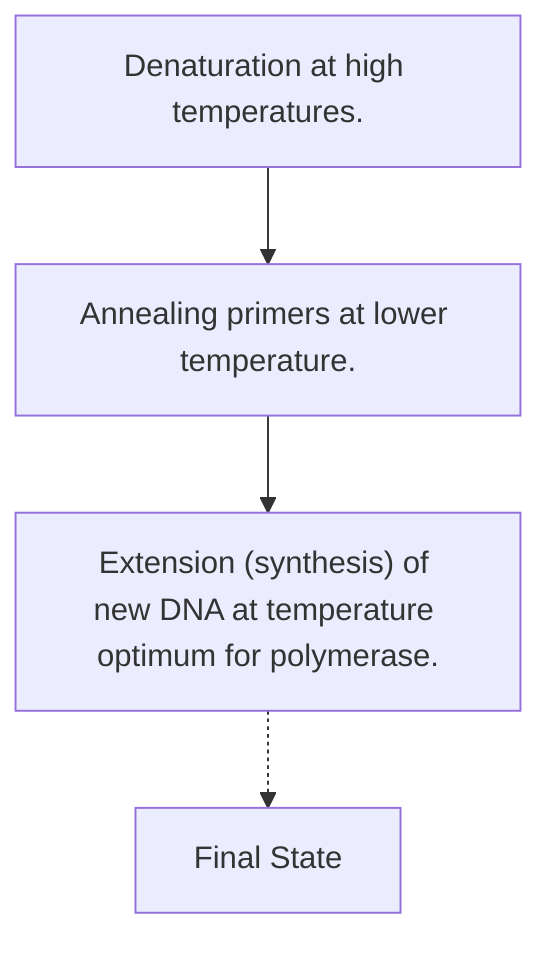
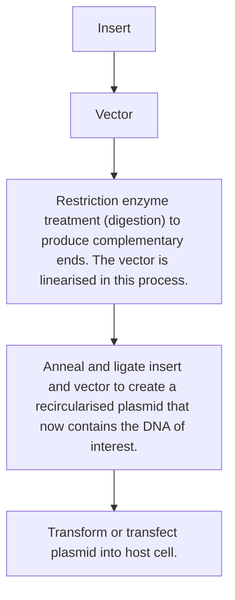
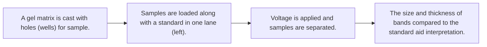
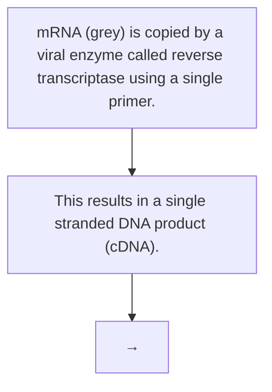
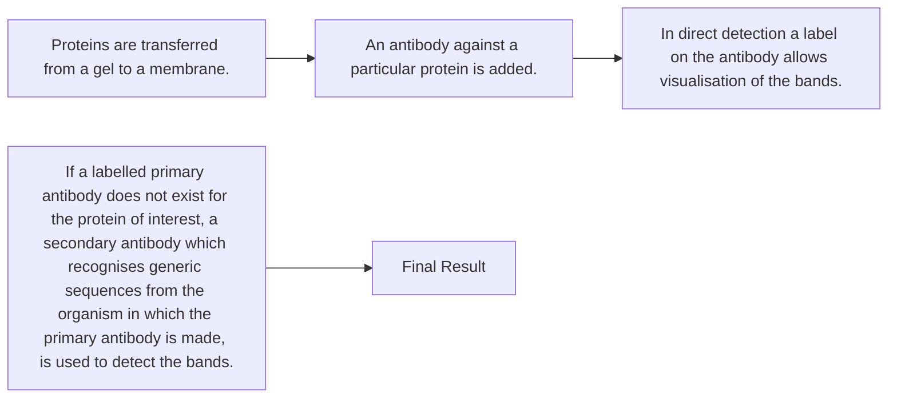

venture capitalists and much more: the decisions taken by each of these at each stage in the process are shaped by social beliefs and expectations as much as by assessments of what is ‘good science’. Indeed, such decisions are increasingly shaped by assessments of future economic pay-back from investment, and hence by economic forecasts, horizon scanning and foresight. Given these social factors shaping the direction of science, it is appropriate that these issues are subject to wide public debate, involving synthetic biologists themselves, but also having input from a wider group of stakeholders.

In synthetic biology, as in a number of other ‘leading edge’ developments such as nanotechnology, public dialogue has become an obligatory part of the process of public funding of scientific and technological innovation. Much of this dialogue has involved soliciting people’s views through surveys, focus groups and interviews. However, over the last few years there have been concerted efforts to move towards a more participatory democracy and a more active notion of citizenship when it comes to technology assessment. One example of this is the citizen-based, deliberative ‘consensus conference’ or ‘citizen panel’. These usually involve the recruitment of 10–20 volunteers representing various stakeholders such as interest groups, government, social scientists, practitioners, industry, theologians, clinicians, patients, consumers, security experts, etc. This panel has a preparatory weekend where it is briefed on the issues and where it identifies questions it wants to ask experts. This is then followed by a three- or four-day conference where various experts are invited to answer questions set by the panel, before the panel makes a decision on how it thinks the technology should best be regulated. The idea is that their decision should then be fed into the decision-making process of policymakers.

The extent to which such approaches are effective, or even representative, is often disputed. Thus the debate continues about how to ensure that the concerns of stakeholders are appropriately represented in the decision-making process about the regulation of emerging technologies such as synthetic biology. What is certain, however, is that the science does not develop in a social vacuum; synthetic biology is tightly coupled with society and each affects the other’s trajectory. It is vital that the new generation of synthetic biologists, excited about the positive potential of their science and research for the public good, should both recognise, and play a full part in, these deliberative processes.

## Reading

- Ball, P. (2010). Making life: A comment on ‘Playing God in Frankenstein’s footsteps: Synthetic biology and the meaning of life’ by Henk van den Belt (2009). Nanoethics 4: 129–132.
- Beatty, D. (1950). ‘Sometimes we fail: Whenever we fail to be of help we must look into ourselves. Pastoral Psychol 1(7): 16–19.
- BioBricks Foundation. Our Goals.Available at: http://biobricks.org/Our\_Goals.php [Accessed 25 July 2015].
- Bio-Economic Research Associates (Bio-ERA). (2007). Genome Synthesis and Design Futures: Implications for the US Economy. Bio-ERA, Cambridge, MA.
- BIOFAB. About the biofab. Available at: http://www.biofab.org/about [Accessed 25 July 2015].
- Canguilhem, G. (2009). Knowledge of Life. Fordham University Press, New York.
- Carey, J. (2007). On the brink of artificial life. Business Week. 25 June: 40.
- Carlson, R. (2009). The changing economics of DNA synthesis. Nat Biotechnol 27: 1091–1094.
- Cello, J, Paul, AV and Wimmer, E. (2002). Chemical synthesis of poliovirus cDNA: Generation of infectious virus in the absence of natural template. Science 297: 1016–1018.
- Central Intelligence Agency. (2003). The Darker Bioweapons Future. Unclassified report, released 3 November 2003.
- Church, G. (2005). Let us go forth and safely multiply. Nature 438: 423.
- Dabrock, P. (2009). Playing God? Synthetic biology as a theological and ethical challenge. Syst Synth Biol 3: 47–54.
- Davies, S, Kearnes, M and Macnaghten, P. (2009). All things weird and scary: Nanotechnology, theology and cultural resources. Culture and Religion 10(2): 201–220.
- Department of Energy, USA. (2010). Secretary Chu announces nearly \$80 million investment for advanced biofuels research and fueling infrastructure. Press release, 13 January 2010.
- Deplazes, A and Huppenbauer, M. (2009). Synthetic organisms and living machines: Positioning the products of synthetic biology at the borderline between living and non-living matter. Syst Synth Biol 3: 55–63.
- Doornbosch, R and Steenblik, R. (2007). Biofuels: Is the cure worse than the disease? OECD Round Table on Sustainable Development. 11–12 September 2007, OECD, Paris.
- Drees, W. (2002). ‘Playing God? Yes!’ Religion in the light of technology. Zygon: Journal of Religion and Science 37: 643–654.
- Editorial (2010). Artemisinin export slumped, the industry in danger. Pharmaceutical Economic News (China). 20 January.
- ETC Group. (2007). Extreme Genetic Engineering — An Introduction to Synthetic Biology, January. Available at: http://www.etcgroup.org/en/node/602 [Accessed 6 September 2011].
- ETC Group. (2008). Commodifying Nature’s Last Straw? Extreme Genetic Engineering and the Post-Petroleum Sugar Economy, October. Available at: http://www.etcgroup.org/en/node/703[Accessed 6 September 2011].
- EuropaBio. (2008). EuropaBio Fact Sheet: Biofuels and Land Use, March. EuropaBio, Brussels.
- Ferber, D. (2004). Synthetic biology. Time for a synthetic biology Asilomar? Science 303: 159.
- Fletcher, J. (1960). The patient’s right to die. Harper’s Magazine. October: 139–143.
- Gerstein, R. (1960). A prosecutor looks at capital punishment. J Crim Law Crimnol 51: 252–256.
- Goodfield, J. (1977). Playing God: Genetic Engineering and the Manipulation of Life. Random House, New York.
- Grey, W. (1998). ‘Playing God’ in Chadwick, R. (Ed.). The Concise Encyclopaedia of the Ethics of New Technologies. Academic Press, San Diego, 335–339.
- Haeckel, E. (1866). Generelle Morphologie der Organismen (General Morphology of the Organisms). Reimer, Berlin.
- Harken, D. (1968). One surgeon looks at human heart transplantation. Dis Chest 54(4): 349–352.
- Heller, M. (1998). The tragedy of the anticommons: Property in the transition from Marx to markets. Harvard Law Rev 111: 621–688.
- Heller, M and Eisenberg, R. (1998).Can patents deter innovation? The anticommons in biomedical research. Science 289: 698–701.
- Hope, J. (2008). Biobazaar: The Open Source Revolution and Biotechnology. Harvard University Press, Cambridge, MA.
- iGEM. (2010). About. Available at: http://2010.igem.org/About [Accessed 6 September 2011].
- Institute for OneWorld Health. (2010). The drug, produced by genetically engineered bacteria, is much cheaper than the plant-derived drug available today. Press release, 7 July 2010.
- Kirkham, G. (2006). ‘Playing God’ and ‘vexing nature’: A cultural perspective. Environ Value 15: 173–195.
- Kline, C. (1963). The potential significance of sperm banks. Advances in Sex Research 1: 123–127.
- Kumar, S and Rai, A. (2007). Synthetic biology: The intellectual property puzzle. Tex Law Rev 85: 1744–1768.
- Leduc, S. (1911). The Mechanism of Life. William Heinemann, London.
- Lentzos, F, Bennett, G, Boeke, J, et al. (2008). Visions and challenges in redesigning life. BioSocieties 3(3): 311–323.
- Levskaya, A, Chevalier, A, Tabor, J, et al. (2005). Engineering Escherichia coli to see light. Nature 438: 441–442.
- Loeb, J. (1912). The Mechanistic Conception of Life. University of Chicago Press, Chicago.
- McGregor, D. (1957). An uneasy look at performance appraisal. Harvard Bus Rev 35: 89–94.
- National Research Council. (2004). Biotechnology in an Age of Terrorism. National Academies Press, Washington DC.
- National Research Council. (2009). A Survey of Attitudes and Actions on Dual Use Research in the Life Sciences. National Academies Press, Washington DC.
- New and Emerging Science and Technology. (2005). Synthetic Biology: Applying Engineering to Biology. Report of a NEST High-Level Expert Group. European Commission, Luxembourg.
- OpenWetWare. A wiki-style online community for bioscience. Available at: http://openwetware.org/wiki [Accessed 25 July 2015].
- Peters, T. (2003). Playing God? Genetic Determinism and Human Freedom. Routledge, New York.
- Peters, T. (2006). ‘Contributions from practical theology and ethics’ in Clayton, P and Simpson, Z. (Eds). The Oxford Handbook of Religion and Science. Oxford University Press, Oxford, 372–387.
- Rai, A and Boyle, J. (2007). Synthetic biology: Caught between property rights, the public domain, and the commons. PLoS Biology 5: 389–393.
- Registry of Standard Biological Parts. Available at: http://partsregistry.org [Accessed 25th July 2015].
- Schmidt, M, Torgersen, H, Ganguli-Mitra, A, et al. (2008). SYNBIOSAFE e-conference: Online community discussion on the societal aspects of synthetic biology. Syst Synth Biol 2: 7–17.
- Shannon, E. (1956). Emma: Character and construction. PMLA 71(4): 637–650.
- Skinner, M. (1939). Playing God. Engl J 28(6): 471.
- Smil, V. (2003). Energy at the Crossroads. MIT Press, Cambridge, MA.
- Smith, GL and Davison, N. (2010). Assessing the spectrum of biological risks. Bull Atomic Scientists 66(1) 1–11.
- SPB. (2006). Criteria for Sustainable Biomass Production. 14 July 2006. Project Group for Sustainable Production of Biomass.
- Su, K. (2010). Blind expansion on Artemisinin. Pharmaceutical Economics News (China). 30 March.
- Tollefson, J. (2008). Energy: Not your father’s biofuels. Nature 451: 880–883.
- Tucker, JB and Zilinskas, RA. (2006). The promise and perils of synthetic biology. The New Atlantis 12: 25–45.
- Tumpey, TM, Basler, CF, Aguilar, PV, et al. (2005). Characterization of the reconstructed 1918 Spanish influenza pandemic virus. Science 310: 77–80.
- van den Belt, H. (2009). Playing God in Frankenstein’s footsteps: Synthetic biology and the meaning of life. Nanoethics 3: 257–268.
- Vogel, KM. (2008). Framing biosecurity: An alternative to the biotech revolution model? Science and Public Policy 35: 1.
- Wellhausen, R and Mukunda, G. (2009). Aspects of the political economy of development of synthetic biology. Syst Synth Biol 3: 115–123.
- World Health Organization. (2010). Drug resistance could set back malaria control success. Press release, 25 February 2010.
- World Intellectual Property Organization: Available at: http://www.wipo.int/portal/index.html.en[Accessed 25 July 2015].
- World Intellectual Property Organization (undated). Frequently Asked Questions. Available at: http://www.wipo.int/patentscope/en/faqs\_patentscope.html [Accessed 25 July 2015].
- World Intellectual Property Organization (undated). Understanding Copyright and Related Rights. Available at: http:// www.wipo.int / edocs / pubdocs/en / intproperty / 909 / wipo\_pub\_909.pdf [Accessed 25 July 2015].
- Zhou, EY. (2006). Chinese biogenerics and protection of IP: Large market potential and solid foundation set the stage. Genetic Eng Biotechn 26(15): 56–60.
- Zimmer, C. (2008). Artificial life? Old news. Wired.com. Available at: http://www.carlzimmer.com/articles/2008.php?subaction=showfull&id=1201754156&archive=&start\_from=&ucat=11&[Accessed 25 July 2015].

This page intentionally left blank

# APPENDIX 1

# Proforma of Common Laboratory Techniques

**Technique:** Polymerase Chain Reaction (PCR)

**Inventor:** Kary Mullis (1983)

**Molecule:** DNA

**Basic Concept:** PCR is a technique that is used to make many copies of DNA for cloning and other purposes. Short single-stranded pieces of DNA called primers are designed in regions flanking the sequence to be copied (also called the DNA template). These are then synthesised, usually by a commercial company. They are added to the reaction mixture along with free nucleotide triphosphates, a temperature stable DNA polymerase, the DNA template and buffering components. PCR follows a series of steps at different temperatures which are repeated over and over again to give a high yield of the DNA of interest. In the first step, the reaction mixture is heated to a high temperature which denatures the template forming single strands. The temperature is then lowered and the primers bind (anneal) to the designed region, one to each strand of DNA. The temperature is then increased to the optimum working temperature of the DNA polymerase and new DNA is synthesised. This process is then repeated to make further copies. Because each copy of the template results in two synthesised copies per cycle, the amplification of the DNA proceeds exponentially.

**Uses in Synthetic Biology:** The most common use of PCR in synthetic biology is to create many copies of DNA parts for cloning and/or assembling devices and systems. It is also used in some cases for quantitation (see quantitative PCR below). Systems can also be constructed using PCR based methods such as Overlap Extension PCR and USER™ Cloning.

flowchart

Fig. A1.1

**Technique:** Restriction Enzyme Cloning

**Inventor:** Herbert Boyer and Stanley Cohen (1973)

## Molecule: DNA

**Basic Concept:** Cloning is a series of molecular biology steps whereby DNA of interest is inserted into a host cell or chassis. It begins with PCR amplification of the DNA. The DNA is then treated with enzymes which recognise and cut specific sequences, leaving behind a short single-stranded DNA overhang. A vector, or circular piece of carrier DNA, is likewise treated to create complementary ends. These are then annealed together and joined by an enzyme called ligase to recreate a fully circularised piece of DNA (a vector now containing the piece of DNA of interest as an insert). Cells are then induced to take up the circularised plasmids in a process called transformation (for prokaryotes and yeast) or transfection (for mammalian cells). Including an antibiotic resistance marker or another gene which gives cells an advantage allows the user to selectively keep the cells which have taken the plasmid, creating a population of clones.

**Uses in Synthetic Biology:** Restriction enzyme cloning forms the basis of the BioBricks assembly method, which follows a similar flowsheet but uses specific restriction enzymes. It is also the workhorse of traditional molecular biology. However, restriction enzyme cloning is slow and tedious because it is composed of multiple steps which must be carried out for each piece of DNA that is added to a system. In the future, it is envisioned that new DNA assembly techniques will supplant the multistep cloning techniques enabling faster synthesis of complex systems.

flowchart

Fig. A1.2

**Technique:** BioBricks Assembly

**Inventor:** Tom Knight (2003)

## Molecule: DNA

**Basic Concept:** BioBricks assembly is a version of restriction enzyme cloning where specific restriction enzymes are used in the process in order to create re-usable restriction sites that allow for sequential assembly of a large number of parts. Each BioBricks part is flanked by two different restriction enzyme sites on the 5’ and 3’ ends of the DNA. Upstream of the part are the EcoRI and XbaI sites and downstream are the PstI and SpeI sites. The destination vector also contains all four of the sites. When an empty vector is used as the destination, then, in principle, any of the restriction sites can be used for cloning the first part, but the power of the BioBricks method is that vectors that already contain parts can still be used to add additional pieces to the device. To clone a new part upstream of an existing assembly, the part is digested with EcoRI and SpeI restriction enzymes and the vector is digested with EcoRI and XbaI. Since XbaI and SpeI produce compatible sticky ends, the part can be ligated into the vector by annealing the two EcoRI overhangs of the part and vector and the XbaI overhang of the vector with the SpeI overhang of the insert. Once ligated the combined XbaI–SpeI site cannot be redigested with either restriction enzyme, so new parts can be added sequentially in the same manner. Similarly, to ligate a part into the vector downstream of an existing assembly, the part is digested with XbaI and PstI and the vector with PstI and SpeI.

**Uses in Synthetic Biology:** BioBricks assembly is the basis of construction of many of the devices and systems in the iGEM competition and it is also fairly heavily used in synthetic biology projects in general. However, because it relies on restriction enzymes and has the same associated disadvantages, it is likely that BioBricks cloning will be replaced by other DNA assembly strategies in the future.

Digestions with X and S generates complementary ends which pair during ligation. The other side of the part has complementary ends to the vector because the same enzyme was used.

Fig. A1.3

## Technique: Gel electrophoresis

## Molecule: DNA, RNA or Protein

**Basic Concept:** Gel electrophoresis is a sample analysis technique in which a sample is added to a matrix and the components are separated on the basis of charge/mass ratio using an electric field. The speed of the migration depends on the size of the particle as well as the concentration of the matrix that composes the gel. A standard containing molecules of known size and concentration is usually added to the gel in order to aid in interpretation of the results. DNA gel electrophoresis most commonly uses agarose as a matrix, although other matrices can be used, particularly for small or single-stranded products. Since DNA is highly negatively charged due to the phosphate backbone, it will migrate towards positive electrodes when voltage is applied and the speed of migration is directly proportional to its size. RNA gel electrophoresis is very similar to DNA gel electrophoresis and also contains a phosphate backbone which provides a negative charge. Protein gel electrophoresis uses polyacrylamide as a matrix. However, in contrast to nucleic acids, proteins do not have a uniform charge. Therefore, they will migrate based on a combination of charge and mass unless reacted with chemicals that alter their charge. For routine analyses to determine size and/or concentration of proteins, samples are usually denatured and reacted with sodium dodecyl sulphate (SDS), a detergent which coats the protein with negative charge so that it separates according to mass just like on a nucleic acid gel. Proteins can also be electrophoresed on polyacrylamide gels without SDS treatment; these are known as native gels.

**Uses in Synthetic Biology:** Gels are a very common method of sample analysis. DNA agarose gels are used to check the progress during cloning experiments, often after every step and for rough quantification of the DNA concentration of samples during assembly of systems. RNA gels are used to check the purity and concentration of samples before further steps such as quantitative PCR (see below). Protein gels can be used to verify that proteins are expressed and/or to quantify them when paired with Western blot (see below).

flowchart

Fig. A1.4

## Technique: Sequencing

**Inventor:** Fredrick Sanger (1974)

## Molecule: DNA

**Basic Concept:** Current DNA sequencing is based on a method developed by Fredrick Sanger. At its heart is a PCR amplification reaction similar to what is described above, but with modified nucleotides mixed in. These nucleotides lack the necessary chemical group to enable further chain extension and thus cause early termination of the amplification. They are also labelled with fluorescent dyes which allow the sequencer to know the identity of the base which is last in the sequence. The PCR reaction results in a series of shorter DNA fragments, each labelled at the final base. These can then be sorted by size and the sequence ‘read’ from the identity of the last base via the fluorescent label. In most laboratories, DNA sequencing is sent out to a professional laboratory which performs the sequencing and returns a result by email. More recently, high throughput methods have been developed to enable rapid sequencing of large numbers of DNA molecules (e.g. Illumina, 454). However, Sanger sequencing is still the most popular method for routine verification of cloned construct.

**Uses in Synthetic Biology:** Sequencing is used to confirm the identity of cloned DNA as well as to ensure that no errors were introduced in the cloning or assembly process.

flowchart

Fig. A1.5

## Technique: Southern blot

**Inventor:** Edwin Southern (1975)

## Molecule: DNA

**Basic Concept:** Southern blotting is used to transfer DNA that has been electrophoresed to a membrane where it can be hybridised with fluorescent probes. The probes are designed to bind to specific DNA sequences, making the technique useful for detecting when a specific sequence is present in a sample. The probe signal can also be used to roughly quantify the amount of DNA present.

**Uses in Synthetic Biology:** Southern blotting is one method to determine copy number of a gene, but is very rarely used in synthetic biology. It has been largely replaced by quantitative PCR (see below).

flowchart

Fig. A1.6

## Technique: Quantitative PCR (Real-Time PCR)

## Molecule: DNA

**Basic Concept:** Quantitative PCR is very similar to the standard PCR reaction described above. In addition to the normal reagents the reaction mixture also contains a fluorescent dye which intercalates into the DNA that is formed. This allows a measurement of DNA concentration (in comparison to a standard curve of known DNA concentration).

**Uses in Synthetic Biology:** This is the preferred method of measuring DNA copy number. It can also be combined with reverse transcription (see below) to measure mRNA copy number and to track gene expression changes in response to a genetic circuit.

DNA template is subjected to PCR in the presence of fluorescent dye. The dye is incorporated into the PCR product.

flowchart

Fig. A1.7

## Technique: Northern blotting

**Inventor:** James Alwine, David Kemp and George Stark (1977)

## Molecule: RNA

**Basic Concept:** Northern blotting is the same procedure as Southern blotting, applied to RNA molecules. RNA is separated by gel electrophoresis, transferred to a membrane and then hybridised with probes designed to detect the desired sequence. Its name is a take on Southern blotting.

**Uses in Synthetic Biology:** Northern blotting can be used to detect and quantify RNA, but since it is a difficult and time-consuming procedure it has largely been replaced by quantitative PCR.

flowchart

Fig. A1.8

## Technique: Microarray

**Molecule:** DNA (though versions for other molecules exist)

**Basic Concept:** A microarray is very similar to a Southern blot run in reverse. A large number of probes are printed on a chip surface and a DNA sample is applied to the chip. The DNA binds to probes of complementary sequence, giving a signal.

**Uses in Synthetic Biology:** Microarrays can be used to assay expression changes of a large number of genes. RNA is extracted and then converted to single-stranded DNA (cDNA) using a reverse transcription reaction (see RT-PCR below) which is applied to the chip. This is useful for detecting systems level changes in gene regulation response to a synthetic circuit.

flowchart

Fig. A1.9

## Technique: Reverse transcription

## Molecule: RNA

**Basic Concept:** Reverse transcription is used to convert RNA to single-stranded DNA, also called complement DNA or cDNA. This enables long-term storage as well as the application of any methods that utilise DNA (e.g. microarray, quantitative PCR) to an RNA sample. A viral enzyme, reverse transcriptase, is used to copy the mRNA to a single strand of DNA.

**Uses in Synthetic Biology:** Reverse transcription coupled with quantitative PCR is the preferred method for quantifying mRNA copy number in synthetic systems.

flowchart

Fig. A1.10

## Technique: Western blotting

**Inventor:** George Stark and J Gordon (1979), W Neal Burnette (1981)

## Molecule: Protein

**Basic Concept:** Western blotting is a procedure similar to Southern blotting, but applied to proteins as the molecule of interest. Western blotting uses antibodies to detect the proteins rather than labelled nucleotides. After separating the sample by gel electrophoresis, the protein bands are transferred to a membrane which is incubated with an antibody that binds the protein of interest as its antigen. This antibody can be labelled (direct detection) or else a secondary antibody can be used to detect where the first antibody has bound. The secondary antibody will be against generic sequences from the organism in which the primary antibody is made (e.g. anti-mouse antibodies).

**Uses in Synthetic Biology:** Western blotting is used to determine whether an organism is expressing a protein of interest and can be used to quantify the amount of that protein expressed. In contrast to the two other types of blotting, it is still heavily used.

flowchart

Fig. A1.11

# APPENDIX 2 Glossary

**Abstraction:** A process where higher concepts are built from combining concepts that themselves have been founded on first principles. The purpose of abstraction is to hide unnecessary details and manage complexity by allowing individuals to work at any one level of complexity without regard for the details that define other levels, while simultaneously allowing for the principled exchange of limited information across levels.

**Activator:** A protein which binds to DNA in the region of the promoter (usually upstream) and aids in establishing transcription.

**Akaike Information Criterion (AIC):** A criterion for model selection among a class of parametric models with different numbers of parameters. Loosely speaking theAIC provides a quantitative measure of the compromise between accuracy and complexity of the model.

**Amino acid:** Building block of proteins.

**Amplitude:** The height of the peak obtained in an oscillation.

**AND gate:** A logic gate where all inputs must be present to produce the output.

**Anticodon:** The portion of the tRNA that base pairs with the mRNA codon to position the correct amino acid for protein synthesis.

**Antisense (strand):** The complementary strand to the sense strand. It does not actually encode for a gene, but its sequence is determined through base pairing.

**Base pair:** A single nucleotide in a macromolecule. The same term is sometimes used for the actual physical hydrogen bonding between two nucleic acid strands.

**Bayesian Information Criterion (BIC):** A criterion for model selection among a class of parametric models with different numbers of parameters. It is a variant of the Akaike Information Criterion, whose development is based on a Bayesian argument.

**Biobricks**<strong>TM</strong>**:** DNA biological parts with standardised prefix and suffix DNA sequences that allow them to be routinely assembled.

**Bioerror:** Accidental release of biological organisms.